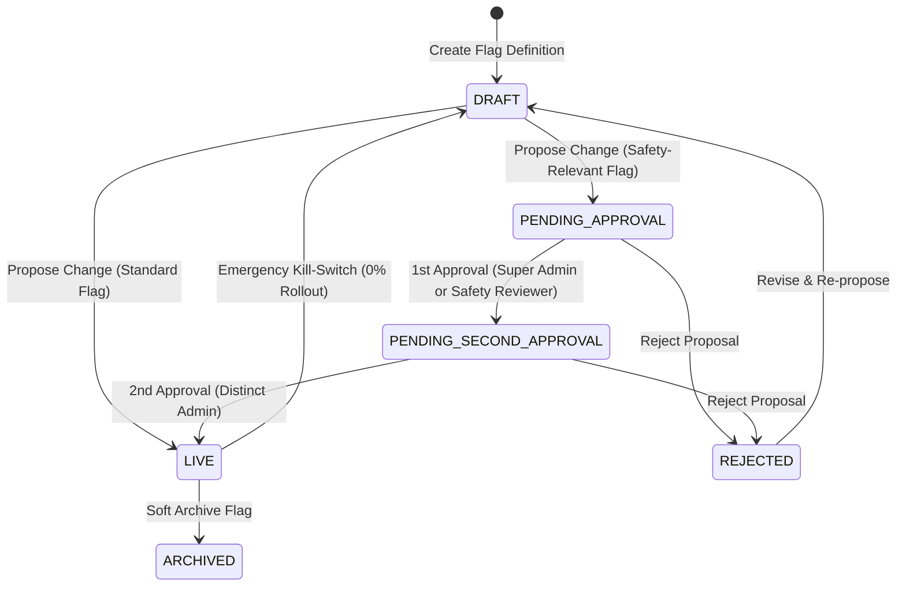

# NoorHeroes Admin Portal — Feature Flags, Dual Sign-Off, Security & Testing Guide

> ### 🏛️ Canonical Cross-Platform Authority Specifications
> - **Live Backend & API Specifications**: [`NoorHeroes-Backend/MASTER-README.md`](../NoorHeroes-Backend/MASTER-README.md) and [`FAST-API-INSTRUCTIONS.md`](../NoorHeroes-Backend/FAST-API-INSTRUCTIONS.md) are the live backend authority. ([`NoorHeroes_Consolidated_Execution_Blueprint.md`](../NoorHeroes_Consolidated_Execution_Blueprint.md) is retained for historical global sequence roadmap context).
> - **Live Admin Portal Specifications**: [`noorheroes-admin/MASTER-README.md`](../noorheroes-admin/MASTER-README.md) and [`NEXT-JS-INSTRUCTIONS.md`](../noorheroes-admin/NEXT-JS-INSTRUCTIONS.md) are the live web admin authority.
> - **Live Mobile App Specifications**: [`NoorHeroes/README.md`](../NoorHeroes/README.md) and the 13 core architecture manuals:
>   - [`NoorHeroes/core/core-analytics/CORE_ANALYTICS_INSTRUCTIONS.md`](../NoorHeroes/core/core-analytics/CORE_ANALYTICS_INSTRUCTIONS.md)
>   - [`NoorHeroes/core/core-common/CORE_COMMON_INSTRUCTIONS.md`](../NoorHeroes/core/core-common/CORE_COMMON_INSTRUCTIONS.md)
>   - [`NoorHeroes/core/core-crash/CORE_CRASH_INSTRUCTIONS.md`](../NoorHeroes/core/core-crash/CORE_CRASH_INSTRUCTIONS.md)
>   - [`NoorHeroes/core/core-data/CORE_DATA_INSTRUCTIONS.md`](../NoorHeroes/core/core-data/CORE_DATA_INSTRUCTIONS.md)
>   - [`NoorHeroes/core/core-database/CORE_DATABASE_INSTRUCTIONS.md`](../NoorHeroes/core/core-database/CORE_DATABASE_INSTRUCTIONS.md)
>   - [`NoorHeroes/core/core-datastore/CORE_DATASTORE_INSTRUCTIONS.md`](../NoorHeroes/core/core-datastore/CORE_DATASTORE_INSTRUCTIONS.md)
>   - [`NoorHeroes/core/core-designsystem/CORE_DESIGNSYSTEM_INSTRUCTIONS.md`](../NoorHeroes/core/core-designsystem/CORE_DESIGNSYSTEM_INSTRUCTIONS.md)
>   - [`NoorHeroes/core/core-logger/CORE_LOGGER_INSTRUCTIONS.md`](../NoorHeroes/core/core-logger/CORE_LOGGER_INSTRUCTIONS.md)
>   - [`NoorHeroes/core/core-navigation/CORE_NAVIGATION_INSTRUCTIONS.md`](../NoorHeroes/core/core-navigation/CORE_NAVIGATION_INSTRUCTIONS.md)
>   - [`NoorHeroes/core/core-network/CORE_NETWORK_INSTRUCTIONS.md`](../NoorHeroes/core/core-network/CORE_NETWORK_INSTRUCTIONS.md)
>   - [`NoorHeroes/core/core-notifications/CORE_NOTIFICATIONS_INSTRUCTIONS.md`](../NoorHeroes/core/core-notifications/CORE_NOTIFICATIONS_INSTRUCTIONS.md)
>   - [`NoorHeroes/core/core-security/CORE_SECURITY_INSTRUCTIONS.md`](../NoorHeroes/core/core-security/CORE_SECURITY_INSTRUCTIONS.md)
>   - [`NoorHeroes/core/core-ui/CORE_UI_INSTRUCTIONS.md`](../NoorHeroes/core/core-ui/CORE_UI_INSTRUCTIONS.md)
>   are the live KMP mobile app authority.
> - 📘 **Operational & Deployment Guide**: [`MASTER-README.md`](../noorheroes-admin/MASTER-README.md) (19 Chapters, Production Runbooks, Failure Scenarios Matrix)
> - 📗 **Technical & Class Reference**: [`NEXT-JS-INSTRUCTIONS.md`](../noorheroes-admin/NEXT-JS-INSTRUCTIONS.md) (Complete usage reference for all 11 feature modules and failure recovery recipes)

This document provides specialized engineering documentation for the **Next.js Admin Web** portal (`noorheroes-admin`).


---

## 1. Feature Flag Platform & Dual-Sign-Off Governance Architecture

The feature flag subsystem (`src/features/feature-flags/`) provides high-leverage runtime configuration controls, environment-isolated rollouts, targeting rules, and multi-party dual-sign-off safety enforcement.

### 1.1 Lifecycle State Machine



### 1.2 Dual-Sign-Off Rules for Safety-Critical Features

| Requirement | Policy Specification | Enforcement Mechanism |
|---|---|---|
| **Safety Classification** | Flags marked `safety_relevant: true` alter child protection rules, AI moderation thresholds, or sensitive interaction mechanics. | Zod schema validation & UI indicator badge. |
| **Dual Sign-Off Gate** | Requires two distinct admin approvals (Super Admin + Child Safety Reviewer) before state flips to `LIVE`. | Backend state machine + `FlagApprovalQueue` status checks. |
| **Self-Approval Prohibition** | If an admin authored the proposal, they **cannot** provide either approval sign-off. | UI disables approve button with warning (`admin.id === proposedByAdminId`); backend rejects self-sign-offs. |
| **Mandatory Reason Note** | Minimum 10 characters required for proposing, approving, or rejecting safety changes. | Enforced via Zod schema (`min(10)`) and form validations. |
| **2FA Step-Up Elevation** | All safety-critical mutations require step-up re-authentication with a fresh TOTP code (`X-Elevated-Token`). | In-memory token injected via `useElevatedSession()` hook. |
| **Emergency Kill-Switch** | Immediately disables a feature flag in an environment (sets rollout to 0% and active state to false). | Bypasses approval queue; requires `feature_flags:kill_switch` permission and 2FA step-up elevation. |
| **Soft Archival** | Cascades soft-archival across all environments, deactivating the flag definition permanently. | Protected by `feature_flags:archive` permission with confirmation modal. |

### 1.3 Targeting Rules Specification

Admins can scope environment rollouts with granular client targeting rules:
- **Age Bands**: `4 to 6`, `6 to 9`, `9 to 12`, `12 to 15`, `15 to 18+`.
- **Locales**: Supported languages `en`, `ar`, `hi`, `ur`.
- **Subscription Tiers**: `FREE`, `HERO_TIER_1`, `HERO_TIER_2`.
- **Minimum App Version**: SemVer formatted string (e.g. `1.2.0`).

### 1.4 API Endpoints & Request/Response Contracts

All administrative feature flag endpoints reside under `/v1/admin/feature-flags`:

```
GET    /v1/admin/feature-flags                       # List feature flags (paginated)
POST   /v1/admin/feature-flags                       # Create feature flag definition
GET    /v1/admin/feature-flags/:id                   # Get feature flag detail & env states
DELETE /v1/admin/feature-flags/:id                   # Archive feature flag
PATCH  /v1/admin/feature-flags/:id/environments/:env/propose     # Propose state change
POST   /v1/admin/feature-flags/:id/environments/:env/approve     # Approve proposal
POST   /v1/admin/feature-flags/:id/environments/:env/reject      # Reject proposal
POST   /v1/admin/feature-flags/:id/environments/:env/kill-switch # Emergency kill switch
GET    /v1/admin/feature-flags/:id/approvals         # Immutable audit history
GET    /v1/admin/feature-flags/approvals/pending     # Cross-flag pending approval queue
```

---

## 2. Security, Authorization & Session Invariants

1. **Zero Database Direct Connections**: The Admin Web connects exclusively via the Backend REST API. No database client packages or direct connection strings exist in client or server bundles.
2. **In-Memory Elevation Token Handling**: 2FA elevation tokens (`X-Elevated-Token`) live strictly in React component memory via `useElevatedSession()` and are **never** persisted to `localStorage`, `sessionStorage`, or cookies.
3. **Backend Authoritative RBAC**: UI permission helpers (`<RequirePermission>` and `hasPermission()`) guide navigation and button visibility, while the backend API enforces authoritative access control.
4. **Absolute Session Ceiling (8 Hours)**: Admin sessions are strictly capped at 8 hours of total elapsed time regardless of continuous activity or proactive refresh cycles.
5. **CORS & Proxy Safety**: Next.js development server proxies backend API calls to `http://localhost:8000` with automated request correlation ID propagation (`X-Request-ID`).

---

## 3. Comprehensive Testing Reference

### 3.1 Test Command Matrix

| Test Suite | Command | Coverage & Purpose |
|---|---|---|
| **All Checks (CI Gate)** | `npm test` | Runs linter (`eslint .`), type-checker (`tsc --noEmit`), architectural tests, and unit tests. |
| **Unit & Component Tests** | `npm run test:unit` | Vitest suite for Zod schemas, API clients, React Query hooks, and UI components. |
| **TypeScript Type-Check** | `npm run type-check` | Enforces zero TypeScript compilation errors (`tsc --noEmit`). |
| **Architectural Invariant Tests** | `npm run test:architecture` | Node test runner validating module boundaries, thin routes, and naming conventions. |
| **Environment Sync Drift Check** | `npm run check:env-sync` | Asserts exact 1:1 synchronization between `.env.example` and `src/config/env.schema.ts`. |
| **Client E2E Suite** | `npm run test:e2e` | Playwright test suite for client flows (excluding staging smoke tests). |
| **Staging Smoke Suite** | `npm run test:smoke` | Post-deploy smoke test running login, 2FA challenge, and authenticated CRUD read. |
| **Stage 6 Route Guard Tests** | `npm run test:architectural` | Playwright tests verifying unauthenticated access redirection to `/sign-in`. |

### 3.2 Running Playwright Staging Smoke Tests

To execute the Stage 10 Playwright smoke test against a live staging environment:

```bash
export SMOKE_BASE_URL="https://noorheroes-admin-staging.run.app"
export SMOKE_ADMIN_EMAIL="smoke-admin@noorheroes.com"
export SMOKE_ADMIN_PASSWORD="YourSecurePassword"
export SMOKE_ADMIN_TOTP_SECRET="JBSWY3DPEHPK3PXP" # Base32 TOTP secret

npm run test:smoke
```

---

## 4. Performance & Rendering Optimizations

1. **React Query Cache Tuning**:
   - `useFeatureFlags`: Integrated `placeholderData: keepPreviousData` and `staleTime: 30_000` to eliminate visual flickering during pagination and filter changes.
   - `useFeatureFlagDetail`: Configured with `staleTime: 30_000` and `enabled: Boolean(flagId)` guard.
   - `usePendingApprovals`: Configured with `staleTime: 15_000` for responsive approval queue polling.
   - `useFlagApprovalHistory`: Configured with `staleTime: 30_000` and `enabled: Boolean(flagId)` guard.
2. **Component Memoization**:
   - `FlagLifecycleBadge`: Memoized with `React.memo` to eliminate redundant table cell re-renders.
   - `FlagListTable`: Column definitions memoized via `useMemo` for stable table layout performance.
3. **Form & Formatter Optimization**:
   - `SignInForm`: Accessibility-compliant `htmlFor`/`id` bindings, numeric `inputMode`, `autoComplete="one-time-code"`, and `autoFocus` on the 2FA challenge input.
   - Number, currency, and date formatters cached via `useFormatters()` bound to the active locale context.

---

## 5. Localization & Internationalization (i18n)

- **Supported Languages**: English (`en`), Arabic (`ar`), Hindi (`hi`), Urdu (`ur`).
- **Bi-Directional Support (RTL/LTR)**: Automatic `dir="rtl"` layout flipping for Arabic (`ar`) and Urdu (`ur`) via `LocalizationProvider`.
- **Zero Unlocalized Strings**: All feature flag headings, badges, tooltips, dialogs, form validation errors, and empty states consume translation keys via `useTranslation()`.

---

## 6. Production Failure Scenarios & Recovery Matrix (Zero Missing Scenarios)

The feature flag and administrative platform handles all 22 failure scenarios gracefully:

| # | Failure Scenario | Responsible Layer | Architectural Handling & Mitigation |
|---|---|---|---|
| **1** | **Network Offline / Disconnection** | `api-client.ts`, `query-error-state.tsx` | Wrapped in typed `NetworkError`, renders localized offline alert with manual retry button; TanStack Query skips redundant retry loops while disconnected. |
| **2** | **Backend 502/504 HTML Gateway Error** | `parseErrorEnvelope()` in `api-errors.ts` | Safely intercepts non-JSON gateway HTML error pages without throwing JSON parse exceptions; falls back to structured `UNKNOWN_ERROR`. |
| **3** | **API 401 Unauthenticated / Token Expiry** | `api-client.ts` (`shareRefresh`) | Proactive 60s token renewal; `shareRefresh` mutex combines in-flight calls; on failure clears memory and redirects to `/sign-in`. |
| **4** | **API 403 / Child Scope Violation** | `query-error-state.tsx` | Anti-enumeration defense: `CHILD_SCOPE_VIOLATION` produces identical output to `NOT_FOUND` to prevent child ID enumeration. |
| **5** | **API 404 Resource Missing** | `query-error-state.tsx` | Displays localized "Item doesn't exist" notice with navigation link back to parent list. |
| **6** | **API 409 Conflict / Stale Data** | `use-suspend-family.ts` | Suppresses fatal error popups, displays "Updated elsewhere" banner, and triggers automatic/manual cache re-sync. |
| **7** | **API 422 Input Validation Failures** | `api-errors.ts` | `ApiError.fieldErrors` mapping annotates specific form fields with field-level error messages. |
| **8** | **API 429 Rate Throttling** | `query-error-state.tsx` | Displays temporary rate-limiting notice with cooldown timer and manual retry button. |
| **9** | **API 500 Server Errors** | `query-client.ts` | Retries up to 2 times for 5xx server errors; subsequent failures display the support correlation `requestId`. |
| **10** | **8-Hour Session Ceiling Exceeded** | `auth-token.api.ts` | Enforced strictly in memory; rejects requests and forces credential + 2FA re-authentication. |
| **11** | **Invalid / Expired Refresh Token** | `api-client.ts` | Clears volatile in-memory token storage, resets session state, and redirects to `/sign-in`. |
| **12** | **Slow / Latent Network Connection** | `DataTable` | Renders sleek skeleton loading placeholders; disables interactive form submit buttons to prevent duplicate requests. |
| **13** | **Concurrent Duplicate Requests** | `api-client.ts` | `shareRefresh` mutex combines multiple in-flight refresh calls into a single promise. |
| **14** | **Double Form Submissions** | Modals & Forms | Mutating forms disable submit buttons during flight (`isPending`/`isElevating`) and generate unique `Idempotency-Key` headers. |
| **15** | **Empty API Response Collections** | `EmptyState` | Displays friendly localized empty states with contextual descriptions instead of broken layouts. |
| **16** | **Large Response Payloads / Pagination** | `usePaginationState` | Server-driven pagination limits payload sizes to 10–50 records per page. |
| **17** | **Schema Drift / Malformed Backend Data** | Repositories | Throws `ResponseValidationError(error, requestId)`; blocks corrupt data from reaching UI; TanStack Query skips redundant retries. |
| **18** | **Missing / Invalid Environment Variables** | `env.schema.ts` | Boot-time Zod schema fails fast if any required variable or secret is missing or using a development placeholder in production. |
| **19** | **Server Secret Leakage to Client** | `server-env.ts` | Protected via `import "server-only"`; accidental client imports trigger compile-time build failures. |
| **20** | **Uncaught React Component Crashes** | `error.tsx` | Route-level error boundaries catch unexpected runtime errors and present a branded recovery view with `reset()`. |
| **21** | **User Navigates Away Mid-Request** | `AbortSignal` | Active HTTP requests abort automatically via React Query signal propagation when component unmounts. |
| **22** | **Modal Keyboard / Focus Traps** | Modal Components | Implements `Escape` key listener (`keydown`) and backdrop click dismissal, preventing keyboard trapped focus. |

---

*Authored and audited by the NoorHeroes Platform Engineering & Architecture Team.*

