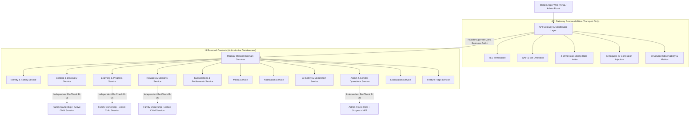
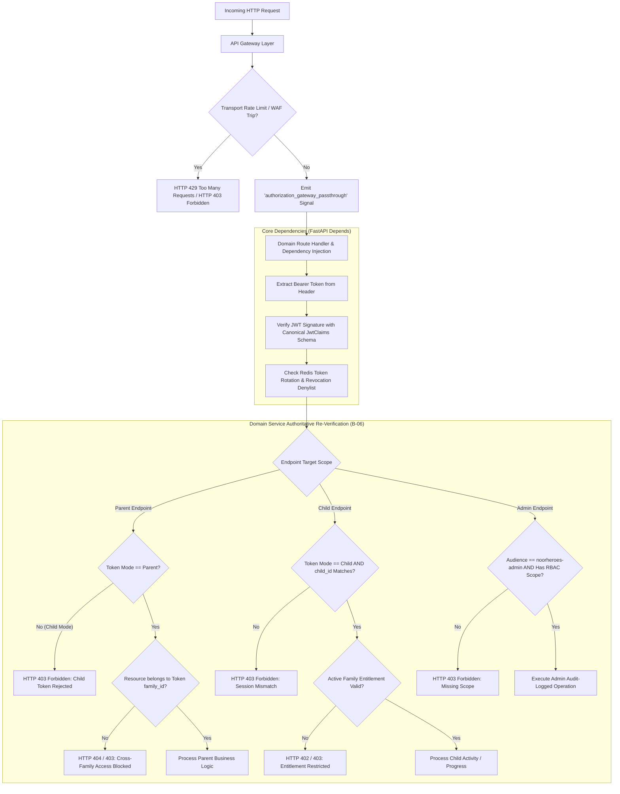

> [!NOTE]
> **@deprecated**: For the latest unified gateway architecture, security invariants, and domain-service defense-in-depth specifications, please see [`NoorHeroes-Backend/MASTER-README.md`](../../NoorHeroes-Backend/MASTER-README.md#11-security-authentication--authorization-architecture).

# API Gateway Zero-Business-Authorization Architecture & Defense-in-Depth

> **Platform Security Architecture Deliverable (F.37 / B-03)**  
> **Target Framework**: FastAPI (Async Python 3.12+)  
> **Status**: Active / Production-Enforced  
> **CI Enforcement Gate**: `tests/architecture/test_gateway_zero_authorization.py`

---

## 1. Core Architectural Principle

The single most fundamental architectural guarantee of the NoorHeroes platform (per **PRD §3.5** and **FR-4**) is:

> **"The API Gateway performs NO business authorization decisions on its own — every domain service re-checks ownership and scope independently. This prevents a single gateway misconfiguration from becoming a system-wide authorization bypass."**

In traditional architectures, edge gateways or reverse proxies are often burdened with path-based role checks, JWT claim inspections for authorization decisions, or even database lookups. This anti-pattern creates a catastrophic failure domain: if a gateway rule is misconfigured, bypassed, or omitted during routing updates, downstream services blindly trust the proxy header, resulting in a critical security breach.

In the NoorHeroes security architecture, the API Gateway and in-process middleware stack operate **strictly as transport, network, telemetry, and rate-limiting filters**. Every domain service treats incoming requests with zero trust, performing its own cryptographic token validation, family ownership verification, active child session validation, and RBAC scope checks.

```
                  ┌──────────────────────────────────────────────┐
                  │                 API GATEWAY                  │
                  │   - TLS Termination & WAF Inspection         │
                  │   - 4-Dimension Sliding Window Rate Limiting │
                  │   - Correlation / Request ID Propagation     │
                  │   - Bot / Credential-Stuffing Mitigation     │
                  │   * ZERO BUSINESS AUTHORIZATION DECISIONS *  │
                  └──────────────────────┬───────────────────────┘
                                         │
                   Passthrough with X-Request-ID & Bearer Token
                                         │
                                         ▼
                  ┌──────────────────────────────────────────────┐
                  │             DOMAIN SERVICE LAYER             │
                  │   - Cryptographic JWT Signature & Expiry     │
                  │   - Active Redis Session & Denylist Check    │
                  │   - Family Ownership Independent Re-Check    │
                  │   - Active Child Session Verification        │
                  │   - Contextual RBAC Scope Enforcement        │
                  └──────────────────────────────────────────────┘
```

---

## 2. End-to-End Architecture Diagrams

### 2.1 Defense-in-Depth Request Routing (PRD §3.2)



### 2.2 JWT Verification and Independent Authorization Flow (PRD §1.17)



---

## 3. Boundary Matrix: Gateway vs. Domain Service

To avoid scope creep and accidental architectural degradation, all engineers must strictly abide by the following classification matrix:

| Functional Responsibility | API Gateway / Middleware Layer | Domain Service Layer (`src/noorheroes/modules/*`) | Rationale |
|---|:---:|:---:|---|
| **TLS Termination & Cipher Negotiation** | ✅ **YES** | ❌ NO | Edge network concern. |
| **Request Correlation (`X-Request-ID`, `X-Correlation-ID`)** | ✅ **YES** | ❌ NO | Assigned at entry, propagated downstream. |
| **CORS Policy & Preflight Handshake** | ✅ **YES** | ❌ NO | Browser cross-origin transport security. |
| **Multi-Dimensional Rate Limiting (IP, Device, Phone, Account)** | ✅ **YES** | ❌ NO | Infrastructure DDoS and brute-force mitigation using atomic Redis sliding windows. Operates strictly on opaque keys. |
| **WAF & Bot Pattern Detection** | ✅ **YES** | ❌ NO | Edge signature analysis. |
| **Bearer Token Presence Check** | ✅ Optional | ✅ **YES** | Gateway may check string presence, but cryptographic decoding belongs in services. |
| **JWT Signature & Expiration Verification** | ❌ NO | ✅ **YES** | `src/noorheroes/core/security.py` and `deps.py`. |
| **Redis Denylist & Refresh Token Rotation Check** | ❌ NO | ✅ **YES** | Session validity is domain authentication state. |
| **Parent vs. Child Mode Routing & Filtering** | ❌ NO | ✅ **YES** | Enforced via `get_current_parent` vs `get_current_child`. |
| **Family Ownership Checks (`family_id == resource.family_id`)** | ❌ **PROHIBITED** | ✅ **MANDATORY** | Requires domain repository access; gateway must never query PostgreSQL. |
| **Child Session Binding (`child_id == session.child_id`)** | ❌ **PROHIBITED** | ✅ **MANDATORY** | Domain isolation boundary. |
| **RBAC Scope & Role Evaluation (`admin:write`, `scholar`, etc.)** | ❌ **PROHIBITED** | ✅ **MANDATORY** | Contextual domain authorization. |
| **Database Queries (`AsyncSession`, SQLAlchemy)** | ❌ **PROHIBITED** | ✅ **MANDATORY** | Zero DB queries in middleware to preserve low edge latency and architectural decoupling. |

---

## 4. Edge Cases & Resilience

### 4.1 Temporary Gateway WAF or Rate-Limit Lapse
- **Scenario**: A misconfiguration or operational lapse in an upstream reverse proxy or edge WAF temporarily allows traffic that should have been throttled.
- **Guarantee**: Because the gateway makes zero business authorization decisions, downstream domain services continue to independently re-verify tokens, family IDs, child IDs, and RBAC scopes. **No data leakage or privilege escalation can occur.**

### 4.2 Gateway Bypass Simulation
- **Scenario**: Internal microservice-to-microservice traffic or test harnesses bypass the edge gateway and hit the FastAPI ASGI application directly.
- **Guarantee**: All endpoints are intrinsically secure at the router and dependency injection level. Direct invocation cannot bypass authorization because authorization is anchored in `src/noorheroes/core/deps.py` and domain services (`B-06`).

### 4.3 Redis Outage on Rate Limiter
- **Scenario**: High load causes Redis latency spikes or connection pool exhaustion.
- **Policy**:
  - `fail-open` for uncritical read endpoints (`authenticated_read`) to maintain system availability.
  - `fail-closed` (HTTP 503) for sensitive write/auth endpoints (`auth_challenge`, `admin_write`) to prevent brute-force attacks.

---

## 5. Production Observability & Telemetry

Continuous verification in production is maintained through structured events and Prometheus metrics:

1. **Prometheus Counter**:
   ```python
   AUTHORIZATION_GATEWAY_PASSTHROUGH_TOTAL = Counter(
       "authorization_gateway_passthrough_total",
       "Total count of requests passing through gateway to domain services with zero gateway business authorization decisions.",
       ["method", "endpoint"],
   )
   ```
2. **Structured Log Signal**:
   Every HTTP request processed by `StructuredLoggingMiddleware` emits:
   ```json
   {
     "event": "authorization_gateway_passthrough",
     "request_id": "req_a1b2c3d4e5f6",
     "correlation_id": "req_a1b2c3d4e5f6",
     "http_method": "GET",
     "url_path": "/v1/learning/progress",
     "status_code": 200,
     "latency_ms": 12.4
   }
   ```

---

## 6. Automated CI-Blocking Enforcement

Compliance with this architecture is continuously enforced by the non-bypassable CI test suite:

- **Test Suites**:
  - `tests/architecture/test_gateway_zero_authorization.py` (B-03 Gateway Zero-Authorization Invariants)
  - `tests/architecture/test_domain_service_reverification_under_simulated_gateway_bypass.py` (B-06 Domain-Service Authoritative Re-Verification & Simulated Gateway Bypass Gate)
- **Verification Invariants**:
  1. **AST Layer Isolation**: `src/noorheroes/infrastructure/` contains 0 imports from `noorheroes.domain.*` or `noorheroes.modules.*`.
  2. **Zero Middleware Database Queries**: `src/noorheroes/infrastructure/middleware/` contains 0 imports of `AsyncSession`, `AsyncSessionLocal`, or SQLAlchemy SQL DML constructs (`select`, `insert`, `update`, `delete`).
  3. **Zero Claim Branching**: Middleware does not branch on or inspect domain claims (`scopes`, `role`, `mode`, `granted_scopes`, `region_scope`, `locale_scope`).
  4. **Zero Ownership Comparisons**: Middleware contains 0 comparisons of `family_id` or `child_id` with request payload entities.
  5. **Runtime Passthrough & Defense-in-Depth**: Verified using `gateway_bypassed_client` and simulated auth bypass tests across all child-scoped domain services.

Any pull request introducing database queries or authorization logic into the infrastructure or gateway layer, or removing domain-service re-verification calls, is blocked at **Stage 6 (Architectural Invariant Gate)** in GitHub Actions.
