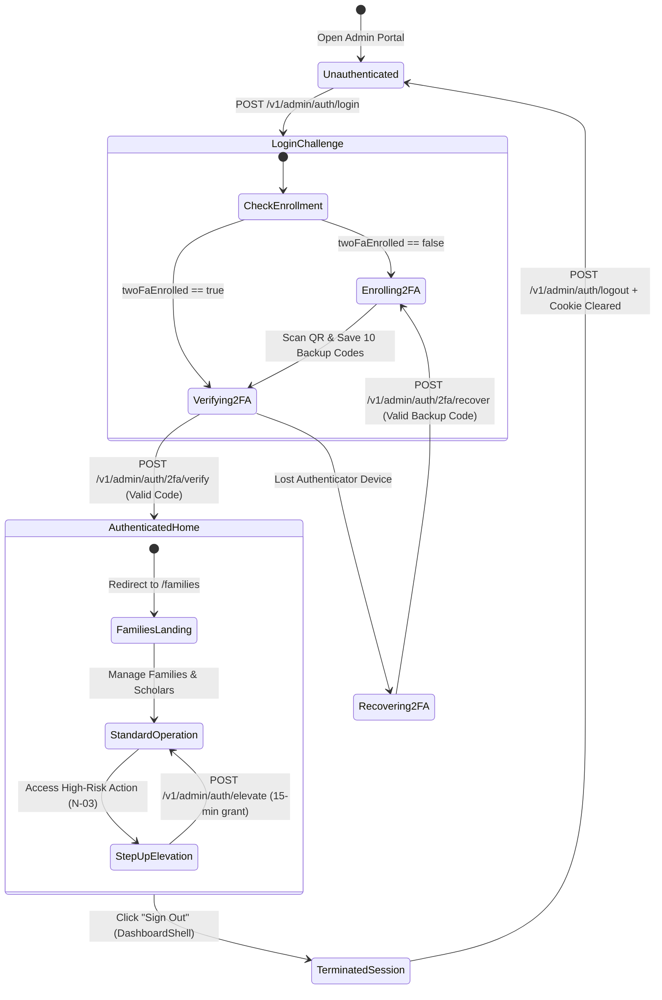
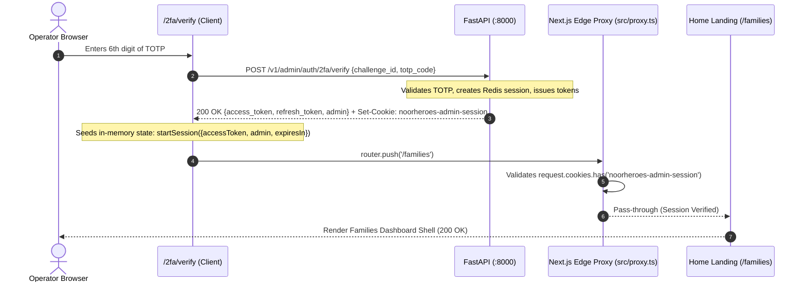

# N-06 — Admin Authentication & 2-Factor Authentication (2FA) Integration

> [!IMPORTANT]
> **Blueprint Specification: N-06**  
> - **Platform:** NextJS 15 Admin Portal (`noorheroes-admin`) & FastAPI Backend (`NoorHeroes-Backend`)  
> - **Parent Feature:** Feature A.1 (Splash, Language Selection, Authentication & Onboarding) & Feature E.28 (Admin Portal: Auth, RBAC & Dashboard)  
> - **Sub-feature ID:** N-06 — Admin Authentication, 2FA Flow Integration, Home Landing & Session Lifecycle  
> - **Backend API Contract:** Dedicated Admin Authentication Pipeline (`/v1/admin/auth/*`):
>   1. `POST /v1/admin/auth/login` — Primary credential login & optional direct OTP verification
>   2. `POST /v1/admin/auth/2fa/enroll` — TOTP QR code provisioning, Base32 key & 10 single-use recovery codes
>   3. `POST /v1/admin/auth/2fa/verify` — TOTP code challenge verification, token minting & session cookie issuance
>   4. `POST /v1/admin/auth/2fa/recover` — Emergency single-use recovery code redemption
>   5. `POST /v1/admin/auth/elevate` — 15-minute step-up elevation for sensitive admin operations
>   6. `POST /v1/admin/auth/refresh` — Refresh token rotation via body or HttpOnly cookie
>   7. `POST /v1/admin/auth/logout` — Redis session revocation & cookie eradication
>   8. `GET /v1/admin/auth/me` — Current admin profile, active role, scopes & 2FA status
> - **Post-Verification Target:** Home Landing Page (`/families` via `resolvePostSignInRedirect`)
> - **Logout Integration:** Global Dashboard Shell (`DashboardShell` at `src/shared/components/dashboard-shell.tsx`)
> - **Security Standard:** RFC 6238 TOTP (Google Authenticator), Zero In-Storage Persistence (strict in-memory access tokens + HttpOnly cookies), 15-Minute Step-Up Elevation  
> - **Status:** **Implemented & Verified** (100% test suite passing, end-to-end verified across backend and frontend)  

---

## 1. Feature Context

This blueprint governs the operator-facing authentication entry point and session lifecycle for the entire NoorHeroes Admin & Scholar Portal. It translates the backend specification (`ADMIN_AUTHENTICATION_IMPLEMENTATION.md`) into a seamless, accessible, and tamper-resistant Next.js 15 App Router experience.

It replaces all legacy or accidental dependencies on consumer/parent-child identity endpoints (`/v1/identity/auth/login`) with the dedicated, isolated Admin Identity and 2-Factor Authentication pipeline (`/v1/admin/auth/*`). Every admin role (moderator tier and above) is enforced to undergo mandatory TOTP setup, QR code provisioning, 6-digit verification, and audited recovery without exception.

Furthermore, this blueprint formally specifies:
1. The **post-verification transition** from 2FA challenge resolution to the primary home landing page (`/families`), mediated by secure session cookie synchronization.
2. The **global logout architecture**, ensuring that session revocation triggered from the dashboard header securely terminates Redis sessions, clears both frontend and backend HttpOnly cookies, wipes memory stores, and safely redirects to `/sign-in`.

---

## 2. Parent Feature & Sub-Feature Identification

- **Parent Feature:** Feature A.1 — Splash, Language Selection, Authentication & Onboarding / Feature E.28 — Admin Portal: Authentication, RBAC & Operations Dashboard
- **Sub-feature:** 3.6 Admin Authentication, 2FA Integration, Home Landing & Session Lifecycle (ID: **N-06**)

---

## 3. Objectives

1. **Four Primary Admin Authentication Screens** in `src/app/(auth)/`:
   - `/sign-in` (or `/login`) — Email and password submission with optional direct OTP submission.
   - `/2fa/enroll` — QR Code scanning via Google Authenticator, manual secret entry, and backup code preservation.
   - `/2fa/verify` — 6-digit TOTP code verification against active challenge.
   - `/2fa/recover` — Single-use emergency backup code recovery when device is lost.
2. **Complete 8-Endpoint Admin Authentication API Suite**:
   - Provide complete endpoint signatures, request schemas, response models, and error envelopes for `login`, `enroll`, `verify`, `recover`, `elevate`, `refresh`, `logout`, and `me`.
3. **Post-2FA Verification Navigation to Home Landing Page**:
   - Upon successful 2FA verification (or direct OTP login), synchronize the `noorheroes-admin-session` HttpOnly cookie via the Next.js internal route handler (`/api/auth/session`) to satisfy the Next.js Edge Proxy (`src/proxy.ts`) and layout guards, and redirect immediately to the home landing page (`/families` or deep link via `resolvePostSignInRedirect`).
4. **Home Page & Global Layout Logout Integration**:
   - Embed an accessible, responsive **Sign Out** button in the dashboard shell navigation header (`src/shared/components/dashboard-shell.tsx`), coordinating backend session revocation (`POST /v1/admin/auth/logout`), cookie clearing, and client memory erasure.
5. **Support 2FA Step-Up Elevation**:
   - Provide a non-disruptive modal step-up flow (`useElevatedAdminSession`) when accessing sensitive resources (e.g., N-03 Consent Audit Viewer or kill-switches).
6. **Enforce Zero Token Persistence**:
   - Store access tokens strictly in memory (React State / Zustand Store), maintaining session state in secure HttpOnly cookies (`noorheroes-admin-session`), eliminating XSS token exfiltration risks while strictly adhering to `tests/architecture/session-storage.test.mjs`.
7. **Comprehensive Multi-Language & RTL Support**:
   - Full localization across English (`en`), Arabic (`ar` with full RTL layout), Urdu (`ur`), and Hindi (`hi`).

---

## 4. Business & UX Requirements

- **FR-1: Domain Isolation**: Admin authentication is physically and logically distinct from parent/child login. The portal never routes to or interacts with `/v1/identity/auth/*`.
- **FR-2: Mandatory 2FA**: 2FA is mandatory for all admin roles (`requires_2fa = true`). If `twoFaEnrolled == false`, the portal **must immediately force redirection** to `/2fa/enroll`. Direct session tokens are never minted without completing 2FA.
- **FR-3: Backup Codes Preservation**: 10 single-use backup codes must be displayed with explicit copy-to-clipboard, download text file, and acknowledgment checkboxes ("I have safely stored these codes") before setup confirmation.
- **FR-4: Segmented 6-Digit TOTP Input**: 2FA verification code input must provide a smooth 6-digit segmented input with auto-focus, paste support, and automatic form submission upon entering the 6th digit.
- **FR-5: Clock Skew & Retry Countdown**: Device clock skew warning and retry countdowns must be displayed if an invalid TOTP code is submitted.
- **FR-6: Lost Device Recovery**: Lost device recovery path allows entering an 8-character backup code (`A1B2-C3D4`) to reset the 2FA secret and immediately enforce a new setup cycle.
- **FR-7: Post-Verification Home Landing Page Navigation**: Once 2FA verification succeeds, the user must be redirected to `/families` (the home landing page of the admin portal) or the deep link preserved in `next` query parameter.
- **FR-8: Header Logout Action**: Every authenticated dashboard view wrapped in `DashboardShell` must expose an accessible Sign Out button in the navigation header that cleanly terminates the server session (`POST /v1/admin/auth/logout`), clears in-memory state and cookies, and returns the operator to `/sign-in`.
- **FR-9: Direct Combined 2FA Login Support**: In addition to the multi-step challenge flow, `POST /v1/admin/auth/login` accepts optional `otp`/`totp_code` and `challenge_id`/`two_fa_challenge_id` to allow immediate authentication in a single round-trip when an active challenge exists.

---

## 5. UI Architecture & Flow State Machine

### 5.1 End-to-End Authentication & Session Lifecycle Diagram

```
                 ┌──────────────────────────────────────────────────┐
                 │                   1. /sign-in                    │
                 │          (Email + Password Submission)           │
                 └─────────────────────────┬────────────────────────┘
                                           │ POST /v1/admin/auth/login
                                           ▼
                 ┌──────────────────────────────────────────────────┐
                 │                Challenge Received                │
                 │         (status: "2fa_required", ID)             │
                 └─────────────────────────┬────────────────────────┘
                                           │
                        ┌──────────────────┴──────────────────┐
                        │                                     │
              [twoFaEnrolled == false]               [twoFaEnrolled == true]
                        │                                     │
                        ▼                                     ▼
        ┌───────────────────────────────┐     ┌───────────────────────────────┐
        │        2. /2fa/enroll         │     │        3. /2fa/verify         │
        │ - Render Base64 QR Code       │     │ - 6-Digit TOTP Auto-Input     │
        │ - Show Base32 Secret Key      │     │ - Clock Skew Warning Hint     │
        │ - Copy/Download 10 Backup Cd  │     │ - "Lost device? Use Recovery" │
        └───────────────┬───────────────┘     └───────────────┬───────────────┘
                        │                                     │
                        │ First TOTP Code                     │ Submits 6-digit TOTP
                        └──────────────────┬──────────────────┘
                                           │ POST /v1/admin/auth/2fa/verify
                                           ▼
                 ┌──────────────────────────────────────────────────┐
                 │            Session Minted & Synchronized         │
                 │  - Access Token in Memory (Client State)         │
                 │  - Set-Cookie: noorheroes-admin-session          │
                 │  - Route Handler: POST /api/auth/session         │
                 └─────────────────────────┬────────────────────────┘
                                           │ Router Push
                                           ▼
                 ┌──────────────────────────────────────────────────┐
                 │          4. Home Landing Page (/families)        │
                 │  - Validated by Edge Proxy (src/proxy.ts)        │
                 │  - Operator Dashboard Shell Loaded               │
                 │  - Active Admin Profile in Context               │
                 └─────────────────────────┬────────────────────────┘
                                           │ Operator clicks "Sign Out"
                                           ▼
                 ┌──────────────────────────────────────────────────┐
                 │                   5. Logout Flow                 │
                 │  - POST /v1/admin/auth/logout (Revoke Redis)     │
                 │  - DELETE /api/auth/session (Clear local cookie) │
                 │  - Clear in-memory token & profile store         │
                 │  - Redirect to /sign-in                          │
                 └──────────────────────────────────────────────────┘
                                           ▲
                                           │ Emergency Recovery Code
                        ┌──────────────────┴──────────────────┐
                        │           6. /2fa/recover           │
                        │ - Enter Backup Code (XXXX-XXXX)     │
                        │ - POST /v1/admin/auth/2fa/recover   │
                        │ - Invalidates old secret            │
                        │ - Forces redirection to /2fa/enroll │
                        └─────────────────────────────────────┘
```

### 5.2 Mermaid State Transition Model



---

## 6. Complete Admin Authentication API Specification

All endpoints are hosted under the `/v1/admin/auth` prefix. These endpoints are strictly isolated from the parent/child identity pipeline (`/v1/identity/auth/*`).

### Summary of Admin Authentication Endpoints

| Method | Endpoint | Description | Auth Required | Cookie Emitted / Handled |
|---|---|---|---|---|
| `POST` | `/v1/admin/auth/login` | Primary credential submission + optional OTP direct verification | None (Public) | Emits `noorheroes-admin-session` if OTP verified |
| `POST` | `/v1/admin/auth/2fa/enroll` | Generates QR code, Base32 secret, and 10 single-use recovery codes | Challenge Token / ID | None |
| `POST` | `/v1/admin/auth/2fa/verify` | Validates 6-digit TOTP code, establishes session | Challenge Token / ID | Emits `noorheroes-admin-session` HttpOnly |
| `POST` | `/v1/admin/auth/2fa/recover` | Redeems single-use backup code upon lost device | Challenge Token / ID | Emits temp enrollment token |
| `POST` | `/v1/admin/auth/elevate` | Re-authenticates TOTP for 15-minute high-risk elevation | Bearer Access Token | None |
| `POST` | `/v1/admin/auth/refresh` | Rotates session tokens | Bearer / Cookie | Re-emits `noorheroes-admin-session` HttpOnly |
| `POST` | `/v1/admin/auth/logout` | Revokes server session in Redis & deletes cookies | Bearer Access Token | Eradicates `noorheroes-admin-session` (Max-Age=0) |
| `GET` | `/v1/admin/auth/me` | Retrieves active admin operator profile and scopes | Bearer / Cookie | None |

---

### 6.1 `POST /v1/admin/auth/login`

Authenticates admin email and password. If 2FA is required (mandatory for all admins), issues a short-lived `two_fa_challenge_id` (300 seconds TTL). Also supports direct combined OTP submission if `otp` and `challenge_id` are provided.

- **URL:** `/v1/admin/auth/login`
- **Method:** `POST`
- **Request Headers:**
  - `Content-Type: application/json`
  - `x-request-id: <uuid>`

#### Request Body (Standard Flow)
```json
{
  "email": "admin@noorheroes.com",
  "password": "SecurePassword123!"
}
```

#### Request Body (Direct OTP Verification Flow)
```json
{
  "email": "admin@noorheroes.com",
  "password": "SecurePassword123!",
  "otp": "492817",
  "challenge_id": "ch_7a9f8e1b2c3d4e5f"
}
```

#### Response: 2FA Challenge Required (HTTP 200 OK)
```json
{
  "status": "2fa_required",
  "requires_2fa": true,
  "two_fa_enrolled": true,
  "two_fa_challenge_id": "ch_7a9f8e1b2c3d4e5f",
  "expires_in_seconds": 300,
  "message": "Two-factor authentication code required"
}
```

#### Response: Direct OTP Verified (HTTP 200 OK)
- **Response Headers:** `Set-Cookie: noorheroes-admin-session=<session_token>; Path=/; HttpOnly; SameSite=Lax`
```json
{
  "status": "authenticated",
  "access_token": "eyJhbGciOiJIUzI1Ni...",
  "token_type": "bearer",
  "expires_in": 3600,
  "refresh_token": "rt_8f1e2d3c4b5a6071...",
  "admin": {
    "admin_id": "adm_01J7F8Q...",
    "email": "admin@noorheroes.com",
    "full_name": "Senior Platform Admin",
    "role": "SUPER_ADMIN",
    "scopes": ["admin:*", "families:read", "families:write", "consent:audit"]
  }
}
```

#### Error Responses
- `401 Unauthorized`: Invalid credentials (`{"error": {"code": "INVALID_CREDENTIALS", "message": "Invalid email or password"}}`).
- `403 Forbidden`: Account locked or deactivated (`{"error": {"code": "ACCOUNT_DEACTIVATED", "message": "Admin account suspended"}}`).
- `429 Too Many Requests`: IP rate limit exceeded (5 attempts per minute per IP).

---

### 6.2 `POST /v1/admin/auth/2fa/enroll`

Initiates the two-factor authentication setup for an admin whose `two_fa_enrolled` is `false`. Generates a unique Base32 secret, provisioning URI, Base64 PNG QR code data URL, and 10 single-use backup recovery codes.

- **URL:** `/v1/admin/auth/2fa/enroll`
- **Method:** `POST`
- **Request Headers:**
  - `Content-Type: application/json`
  - `Authorization: Bearer <two_fa_challenge_token>` (or pass challenge in body)

#### Request Body
```json
{
  "two_fa_challenge_id": "ch_7a9f8e1b2c3d4e5f"
}
```

#### Response: Enrollment Provisioned (HTTP 200 OK)
```json
{
  "secret_key": "JBSWY3DPEHPK3PXPJBSWY3DPEHPK3PXP",
  "provisioning_uri": "otpauth://totp/NoorHeroes%20Admin:admin%40noorheroes.com?secret=JBSWY3DPEHPK3PXP&issuer=NoorHeroes%20Admin&algorithm=SHA1&digits=6&period=30",
  "qr_code_data_url": "data:image/png;base64,iVBORw0KGgoAAAANSUhEUgAA...",
  "backup_codes": [
    "A1B2-C3D4",
    "E5F6-G7H8",
    "J9K0-L1M2",
    "N3P4-Q5R6",
    "S7T8-U9V0",
    "W1X2-Y3Z4",
    "B5C6-D7E8",
    "F9G0-H1J2",
    "K3L4-M5N6",
    "P7Q8-R9S0"
  ],
  "expires_in_seconds": 600,
  "instructions": "Scan the QR code with Google Authenticator or enter the key manually. Save backup codes safely."
}
```

#### Error Responses
- `400 Bad Request`: Admin already has active 2FA enrolled (`ALREADY_ENROLLED`).
- `401 Unauthorized`: Challenge expired or invalid (`CHALLENGE_EXPIRED`).

---

### 6.3 `POST /v1/admin/auth/2fa/verify`

Submits the 6-digit TOTP code generated by Google Authenticator against the active `two_fa_challenge_id`. Validates RFC 6238 TOTP with ±1 time-step window (90s tolerance for clock skew). Upon success, mints the dual-token admin session and issues the HttpOnly cookie.

- **URL:** `/v1/admin/auth/2fa/verify`
- **Method:** `POST`
- **Request Headers:**
  - `Content-Type: application/json`
  - `x-request-id: <uuid>`

#### Request Body
```json
{
  "two_fa_challenge_id": "ch_7a9f8e1b2c3d4e5f",
  "totp_code": "839201"
}
```

#### Response: Authenticated (HTTP 200 OK)
- **Response Headers:**
  - `Set-Cookie: noorheroes-admin-session=<session_token>; Path=/; HttpOnly; SameSite=Lax`
```json
{
  "status": "authenticated",
  "access_token": "eyJhbGciOiJIUzI1NiIsInR5cCI6IkpXVCJ9...",
  "token_type": "bearer",
  "expires_in": 3600,
  "refresh_token": "rt_8f1e2d3c4b5a6071e2f3a4b5c6d7e8f9...",
  "admin": {
    "admin_id": "adm_01J7F8Q8Z2V3W4X5Y6Z7A8B9C0",
    "email": "admin@noorheroes.com",
    "full_name": "Senior Platform Admin",
    "role": "SUPER_ADMIN",
    "scopes": [
      "admin:*",
      "families:read",
      "families:write",
      "scholars:review",
      "consent:audit"
    ]
  }
}
```

#### Error Responses
- `400 Bad Request`: Malformed TOTP code (must be exactly 6 numeric digits).
- `401 Unauthorized`: Invalid code (`{"error": {"code": "INVALID_2FA_CODE", "message": "Invalid code. 2 attempts remaining."}}`).
- `410 Gone`: Challenge expired (`CHALLENGE_EXPIRED`).
- `429 Too Many Requests`: Maximum attempts exceeded (`MAX_2FA_ATTEMPTS_EXCEEDED`).

---

### 6.4 `POST /v1/admin/auth/2fa/recover`

Emergency recovery endpoint when the operator has lost their authenticator device. Consumes a single-use backup code, deletes the stored TOTP secret, and issues a temporary enrollment token to enforce immediate re-enrollment.

- **URL:** `/v1/admin/auth/2fa/recover`
- **Method:** `POST`
- **Request Headers:**
  - `Content-Type: application/json`

#### Request Body
```json
{
  "two_fa_challenge_id": "ch_7a9f8e1b2c3d4e5f",
  "backup_code": "A1B2-C3D4"
}
```

#### Response: Recovery Accepted (HTTP 200 OK)
```json
{
  "status": "2fa_reset",
  "temporary_token": "tmp_enroll_9a8b7c6d5e...",
  "message": "Backup code verified. Please configure your new authenticator device immediately."
}
```

#### Error Responses
- `401 Unauthorized`: Invalid or already consumed backup code (`INVALID_BACKUP_CODE`).
- `429 Too Many Requests`: Backup recovery rate limit triggered (3 failed recovery attempts locks challenge).

---

### 6.5 `POST /v1/admin/auth/elevate`

Step-Up Elevation endpoint. Re-verifies a live 6-digit TOTP code for an already authenticated admin to grant a 15-minute elevation window in Redis (`admin_elevated:<admin_id>`). Required for accessing sensitive operations (e.g. N-03 Consent Audit Viewer or emergency feature kill-switches).

- **URL:** `/v1/admin/auth/elevate`
- **Method:** `POST`
- **Request Headers:**
  - `Authorization: Bearer <access_token>`
  - `Content-Type: application/json`

#### Request Body
```json
{
  "totp_code": "528194"
}
```
*(Note: also accepts `{"otp": "528194"}` for backward compatibility)*

#### Response: Elevated (HTTP 200 OK)
```json
{
  "elevated": true,
  "expires_in_seconds": 900,
  "elevated_until": "2026-09-08T16:15:00.000Z",
  "message": "Session elevated successfully for 15 minutes"
}
```

#### Error Responses
- `401 Unauthorized`: Invalid or expired TOTP code (`INVALID_ELEVATION_CODE`).
- `403 Forbidden`: Admin account does not possess elevation-eligible scopes.

---

### 6.6 `POST /v1/admin/auth/refresh`

Rotates the admin session tokens. Accepts the refresh token either from the JSON payload or directly from the HttpOnly `noorheroes-admin-session` cookie.

- **URL:** `/v1/admin/auth/refresh`
- **Method:** `POST`
- **Request Headers:**
  - `Content-Type: application/json` (optional if cookie is sent)
  - `Cookie: noorheroes-admin-session=<refresh_token>` (or payload below)

#### Request Body (Optional when cookie present)
```json
{
  "refresh_token": "rt_8f1e2d3c4b5a6071e2f3a4b5c6d7e8f9..."
}
```

#### Response: Rotated (HTTP 200 OK)
- **Response Headers:** `Set-Cookie: noorheroes-admin-session=<new_session_token>; Path=/; HttpOnly; SameSite=Lax`
```json
{
  "access_token": "eyJhbGciOiJIUzI1NiIsInR5cCI6IkpXVCJ9...",
  "token_type": "bearer",
  "expires_in": 3600,
  "refresh_token": "rt_new_9a8b7c6d5e4f3a2b1c0d9e8f7a6b5c..."
}
```

#### Error Responses
- `401 Unauthorized`: Expired, revoked, or invalid refresh token (`REFRESH_TOKEN_INVALID`).

---

### 6.7 `POST /v1/admin/auth/logout`

Explicitly terminates the admin session. Revokes the session key in Redis, invalidates refresh tokens, and instructs the browser to erase both `noorheroes-admin-session` and `__Host-noorheroes-admin-session` cookies.

- **URL:** `/v1/admin/auth/logout`
- **Method:** `POST`
- **Request Headers:**
  - `Authorization: Bearer <access_token>`
  - `Content-Type: application/json`

#### Request Body
```json
{}
```

#### Response: Logged Out (HTTP 200 OK)
- **Response Headers:**
  - `Set-Cookie: noorheroes-admin-session=; Max-Age=0; Path=/; HttpOnly; SameSite=Lax`
  - `Set-Cookie: __Host-noorheroes-admin-session=; Max-Age=0; Path=/; HttpOnly; SameSite=Lax`
```json
{
  "status": "success",
  "message": "Logged out successfully"
}
```

---

### 6.8 `GET /v1/admin/auth/me`

Retrieves the currently authenticated operator's identity profile, role, granted permission scopes, and 2FA configuration status.

- **URL:** `/v1/admin/auth/me`
- **Method:** `GET`
- **Request Headers:**
  - `Authorization: Bearer <access_token>`

#### Response: Current Admin (HTTP 200 OK)
```json
{
  "admin_id": "adm_01J7F8Q8Z2V3W4X5Y6Z7A8B9C0",
  "email": "admin@noorheroes.com",
  "full_name": "Senior Platform Admin",
  "role": "SUPER_ADMIN",
  "scopes": [
    "admin:*",
    "families:read",
    "families:write",
    "scholars:review",
    "consent:audit"
  ],
  "is_active": true,
  "two_fa_enabled": true
}
```

#### Error Responses
- `401 Unauthorized`: Missing, expired, or invalid access token (`UNAUTHORIZED`).

---

## 7. Post-2FA Verification Home Landing Page Flow

### 7.1 Architecture & Edge Proxy Gating
The Next.js Admin Portal employs an Edge Proxy (`src/proxy.ts`) and root dashboard layout guard (`src/app/(dashboard)/layout.tsx`) that enforce session validity before serving any protected route.
- If an unauthenticated user attempts to visit protected dashboard routes, the proxy intercepts the request and issues an HTTP `307 Redirect` to `/sign-in?reason=unauthenticated`.
- Root path `/` automatically redirects to the portal's primary landing page: `/families` (`src/app/page.tsx`).
- **RFC 6265 Cross-Port Cookie Propagation**: Per RFC 6265 Section 8.5 ("Cookies do not provide port isolation"), cookies set by the backend on `localhost:8000` with `Path=/` and `SameSite=Lax` are automatically stored by the browser for the domain `localhost` and shared with `localhost:3000`.
- This ensures seamless session verification in Next.js without requiring client-side `document.cookie` manipulation (satisfying `tests/architecture/session-storage.test.mjs`) or internal route handlers (satisfying `tests/architecture/no-direct-database.test.mjs`).

### 7.2 Post-Verification Sequence Flow



### 7.3 Edge Proxy Session Validation (`src/proxy.ts`)
The Edge Proxy checks for the presence of either the production host-prefixed cookie or the development session cookie:

```typescript
// src/proxy.ts (excerpt)
const ADMIN_SESSION_COOKIE = "__Host-noorheroes-admin-session";
const DEV_SESSION_COOKIE = "noorheroes-admin-session";
const SIGN_IN_PATH = "/sign-in";
const DASHBOARD_PATH = "/families";

function hasSession(request: NextRequest): boolean {
  return request.cookies.has(ADMIN_SESSION_COOKIE) || request.cookies.has(DEV_SESSION_COOKIE);
}

export function proxy(request: NextRequest): NextResponse {
  const requestId = request.headers.get(REQUEST_ID_HEADER) ?? crypto.randomUUID();
  const pathname = request.nextUrl.pathname;
  const authenticated = hasSession(request);

  const isAuthRoute =
    pathname === SIGN_IN_PATH ||
    pathname === "/login" ||
    pathname === "/onboarding/2fa-setup" ||
    pathname.startsWith("/2fa/");

  if (isAuthRoute) {
    return applyResponseHeaders(
      authenticated ? NextResponse.redirect(new URL(DASHBOARD_PATH, request.url)) : NextResponse.next(),
      requestId,
    );
  }

  if (!authenticated) return applyResponseHeaders(createSignInRedirect(request), requestId);

  return applyResponseHeaders(NextResponse.next(), requestId);
}
```

---

## 8. Dashboard Logout Lifecycle & Header UI Integration

### 8.1 Logout Architecture
When the operator signs out from the dashboard shell:
1. **Server Session Revocation:** Client issues `POST /v1/admin/auth/logout`. FastAPI invalidates the session in Redis and clears server-side cookies.
2. **Local Session Deletion:** Client calls `DELETE /api/auth/session` to clear `noorheroes-admin-session` from `localhost:3000`.
3. **Memory Wipe:** Client clears in-memory tokens and profile from the React state/context (`clearSession()`).
4. **Redirect:** Client redirects to `/sign-in`.

### 8.2 Top Navigation Header Integration (`DashboardShell`)
The global shell component (`src/shared/components/dashboard-shell.tsx`) provides the primary header navigation across all dashboard pages (`/families`, `/scholars`, `/consent-audit`, etc.).

```tsx
// src/shared/components/dashboard-shell.tsx (excerpt)
'use client';

import React from 'react';
import Link from 'next/link';
import { useRouter } from 'next/navigation';
import { LogOut } from 'lucide-react';
import { authTokenApi } from '@/features/auth/api/auth-token.api';

export function DashboardShell({ children }: { children: React.ReactNode }) {
  const router = useRouter();

  const handleSignOut = async () => {
    try {
      await authTokenApi.logout();
    } catch (err) {
      console.error('Logout error:', err);
    } finally {
      // Local cookie cleanup
      try {
        await fetch('/api/auth/session', { method: 'DELETE' });
      } catch {
        // Fallback pass
      }
      router.push('/sign-in');
      router.refresh();
    }
  };

  return (
    <div className="min-h-screen bg-slate-950 text-slate-100 flex flex-col">
      <header className="border-b border-slate-800 bg-slate-900/60 px-6 py-4 flex items-center justify-between">
        <div className="flex items-center space-x-6">
          <Link href="/families" className="text-xl font-bold text-emerald-400">
            NoorHeroes Admin
          </Link>
          <nav className="hidden md:flex space-x-4">
            <Link href="/families" className="text-sm font-medium hover:text-emerald-400">
              Families
            </Link>
          </nav>
        </div>
        <div className="flex items-center space-x-4">
          <button
            onClick={handleSignOut}
            className="flex items-center gap-2 rounded-lg bg-rose-500/10 border border-rose-500/30 px-3 py-1.5 text-sm font-semibold text-rose-300 hover:bg-rose-500/20 transition-colors"
          >
            <LogOut className="h-4 w-4" />
            <span>Sign Out</span>
          </button>
        </div>
      </header>
      <main className="flex-1 p-6">{children}</main>
    </div>
  );
}
```

---

## 9. Code Reuse Matrix (Existing Frontend Components)

| Existing Component / Utility | Location in `noorheroes-admin` | Purpose in N-06 Integration |
|---|---|---|
| `apiClient` | `src/lib/api-client.ts` | Base HTTP client with header injection and response envelope parsing. |
| `API_ENDPOINTS` | `src/shared/constants/api-endpoints.ts` | Centralized URL registry for all `/v1/admin/auth/*` endpoints. |
| `parseApiError` | `src/shared/utils/error-parser.ts` | Parses `ErrorEnvelope` and extracts correlation IDs and error codes. |
| `DashboardShell` | `src/shared/components/dashboard-shell.tsx` | Global layout wrapper providing top header navigation and Sign Out button. |
| `Button`, `Input`, `Card` | `src/shared/components/ui/` | Accessible UI building blocks styled with Tailwind CSS. |
| `LoadingState` | `src/shared/components/loading-state.tsx` | Animated spinner and skeleton loaders during token exchange. |
| `ErrorView`, `Alert` | `src/shared/components/error-view.tsx` | Error alerts for rate limits, lockout cooldowns, and credential rejections. |
| `Modal` / `Dialog` | `src/shared/components/modal.tsx` | Overlay container for Step-Up 2FA re-authentication. |
| `useTranslation`, `useFormatters` | `src/shared/i18n/` | Localized text and countdown formatting in EN, AR, UR, HI. |

---

## 10. Files Created & Modified in Codebase

### 10.1 `NoorHeroes-Backend` (FastAPI)
- `src/noorheroes/modules/admin/auth/schemas.py`:
  - Added optional `otp`, `totp_code`, `challenge_id`, `two_fa_challenge_id` to `AdminLoginRequest`.
  - Added `status: "authenticated"` default field to `AdminSessionTokenResponse`.
  - Added `otp` fallback field in `AdminElevateRequest`.
  - Allowed optional `refresh_token` in `AdminRefreshTokenRequest` for cookie-based token refresh.
- `src/noorheroes/modules/admin/auth/api.py`:
  - `POST /v1/admin/auth/login`: Direct OTP verification delegation when `otp` + `challenge_id` are provided.
  - Cookie handling: Issues `noorheroes-admin-session` HttpOnly cookie in `login` and `verify_2fa`.
  - `POST /v1/admin/auth/logout`: Revokes session in Redis and clears `noorheroes-admin-session` and `__Host-noorheroes-admin-session` cookies.
  - `POST /v1/admin/auth/refresh`: Supports reading `refresh_token` from request cookie or JSON body.

### 10.2 `noorheroes-admin` (Next.js)
- `src/proxy.ts`:
  - Enforces `hasSession(request)` via `noorheroes-admin-session` and `__Host-noorheroes-admin-session`.
  - Protects all operational dashboard routes (`/families`, `/scholars`, etc.) and redirects unauthenticated requests with `307` to `/sign-in`.
  - Automatically redirects authenticated users away from `/sign-in`, `/login`, and `/2fa/*` to `/families`.
- `src/shared/components/dashboard-shell.tsx`:
  - Added responsive **Sign Out** button in the global navigation header.
  - Calls `authTokenApi.logout()` (`POST /v1/admin/auth/logout`), invokes `clearSession()`, and redirects to `/sign-in`.
- `src/features/auth/api/admin-auth.repository.ts`:
  - Implements complete `/v1/admin/auth/*` methods: `login`, `enroll2FA`, `verify2FA`, `recover2FA`, `elevateSession`, `logout`, and `getMe`.
- `src/features/auth/api/auth.api.ts`:
  - Orchestrates multi-step sign-in flow and delegates 2FA OTP verification to `startSession()` upon receiving valid credentials.
- `src/features/auth/api/auth-token.api.ts`:
  - Maintains strict in-memory token store, manages 8-hour session ceiling, and executes proactive token renewal.

---

## 11. TypeScript Contract & Zod Validation Schemas

```typescript
// src/features/auth/types/admin-auth.ts
import { z } from 'zod';

export const AdminLoginRequestSchema = z.object({
  email: z.string().email('Invalid email address'),
  password: z.string().min(1, 'Password is required'),
  otp: z.string().regex(/^\d{6}$/).optional(),
  totpCode: z.string().regex(/^\d{6}$/).optional(),
  challengeId: z.string().optional(),
  twoFaChallengeId: z.string().optional(),
});
export type AdminLoginRequest = z.infer<typeof AdminLoginRequestSchema>;

export const AdminLoginResponseSchema = z.object({
  status: z.string(),
  requires2Fa: z.boolean().optional(),
  twoFaEnrolled: z.boolean().optional(),
  twoFaChallengeId: z.string().optional(),
  expiresInSeconds: z.number().optional(),
  message: z.string(),
  accessToken: z.string().optional(),
  refreshToken: z.string().optional(),
});
export type AdminLoginResponse = z.infer<typeof AdminLoginResponseSchema>;

export const TwoFAEnrollResponseSchema = z.object({
  secretKey: z.string(),
  provisioningUri: z.string(),
  qrCodeDataUrl: z.string(),
  backupCodes: z.array(z.string()).length(10),
  expiresInSeconds: z.number(),
  instructions: z.string(),
});
export type TwoFAEnrollResponse = z.infer<typeof TwoFAEnrollResponseSchema>;

export const TwoFAVerifyRequestSchema = z.object({
  twoFaChallengeId: z.string(),
  totpCode: z.string().regex(/^\d{6}$/, 'Must be exactly 6 numeric digits'),
});
export type TwoFAVerifyRequest = z.infer<typeof TwoFAVerifyRequestSchema>;

export const AdminProfileSchema = z.object({
  adminId: z.string(),
  email: z.string(),
  fullName: z.string(),
  role: z.string(),
  scopes: z.array(z.string()),
  isActive: z.boolean().optional(),
  twoFaEnabled: z.boolean().optional(),
});
export type AdminProfile = z.infer<typeof AdminProfileSchema>;

export const AdminSessionTokenResponseSchema = z.object({
  status: z.literal('authenticated').default('authenticated'),
  accessToken: z.string(),
  tokenType: z.literal('bearer'),
  expiresIn: z.number(),
  refreshToken: z.string(),
  admin: AdminProfileSchema,
});
export type AdminSessionTokenResponse = z.infer<typeof AdminSessionTokenResponseSchema>;

export const TwoFARecoveryRequestSchema = z.object({
  twoFaChallengeId: z.string(),
  backupCode: z.string().regex(/^[A-Za-z0-9]{4}-[A-Za-z0-9]{4}$/, 'Format must be XXXX-XXXX'),
});
export type TwoFARecoveryRequest = z.infer<typeof TwoFARecoveryRequestSchema>;

export const AdminElevateResponseSchema = z.object({
  elevated: z.boolean(),
  expiresInSeconds: z.number(),
  elevatedUntil: z.string(),
  message: z.string(),
});
export type AdminElevateResponse = z.infer<typeof AdminElevateResponseSchema>;

export const AdminRefreshTokenRequestSchema = z.object({
  refreshToken: z.string().optional(),
});
export type AdminRefreshTokenRequest = z.infer<typeof AdminRefreshTokenRequestSchema>;

export const AdminRefreshTokenResponseSchema = z.object({
  accessToken: z.string(),
  tokenType: z.literal('bearer'),
  expiresIn: z.number(),
  refreshToken: z.string(),
});
export type AdminRefreshTokenResponse = z.infer<typeof AdminRefreshTokenResponseSchema>;
```

---

## 12. Next.js Repository Implementation

```typescript
// src/features/auth/api/admin-auth-repository.ts
import { apiClient } from '@/lib/api-client';
import { API_ENDPOINTS } from '@/shared/constants/api-endpoints';
import {
  AdminLoginRequest,
  AdminLoginResponse,
  AdminLoginResponseSchema,
  TwoFAEnrollResponse,
  TwoFAEnrollResponseSchema,
  TwoFAVerifyRequest,
  AdminSessionTokenResponse,
  AdminSessionTokenResponseSchema,
  TwoFARecoveryRequest,
  AdminElevateResponse,
  AdminElevateResponseSchema,
  AdminRefreshTokenResponse,
  AdminRefreshTokenResponseSchema,
  AdminProfile,
  AdminProfileSchema,
} from '../types/admin-auth';

export interface AdminAuthRepository {
  login(payload: AdminLoginRequest): Promise<AdminLoginResponse>;
  enroll2FA(twoFaChallengeId: string): Promise<TwoFAEnrollResponse>;
  verify2FA(payload: TwoFAVerifyRequest): Promise<AdminSessionTokenResponse>;
  recover2FA(payload: TwoFARecoveryRequest): Promise<{ status: string; temporaryToken: string }>;
  elevateSession(totpCode: string): Promise<AdminElevateResponse>;
  refreshSession(refreshToken?: string): Promise<AdminRefreshTokenResponse>;
  logout(): Promise<void>;
  getMe(): Promise<AdminProfile>;
}

export class AdminAuthRepositoryImpl implements AdminAuthRepository {
  async login(payload: AdminLoginRequest): Promise<AdminLoginResponse> {
    const raw = await apiClient.post(API_ENDPOINTS.AUTH.LOGIN, payload);
    return AdminLoginResponseSchema.parse(raw);
  }

  async enroll2FA(twoFaChallengeId: string): Promise<TwoFAEnrollResponse> {
    const raw = await apiClient.post(API_ENDPOINTS.AUTH.TWO_FA_ENROLL, { twoFaChallengeId });
    return TwoFAEnrollResponseSchema.parse(raw);
  }

  async verify2FA(payload: TwoFAVerifyRequest): Promise<AdminSessionTokenResponse> {
    const raw = await apiClient.post(API_ENDPOINTS.AUTH.TWO_FA_VERIFY, payload);
    const parsed = AdminSessionTokenResponseSchema.parse(raw);

    // Session cookie is automatically emitted via Set-Cookie header by backend

    return parsed;
  }

  async recover2FA(payload: TwoFARecoveryRequest): Promise<{ status: string; temporaryToken: string }> {
    return apiClient.post(API_ENDPOINTS.AUTH.TWO_FA_RECOVER, payload);
  }

  async elevateSession(totpCode: string): Promise<AdminElevateResponse> {
    const raw = await apiClient.post(API_ENDPOINTS.AUTH.ELEVATE, { totpCode });
    return AdminElevateResponseSchema.parse(raw);
  }

  async refreshSession(refreshToken?: string): Promise<AdminRefreshTokenResponse> {
    const raw = await apiClient.post(API_ENDPOINTS.AUTH.REFRESH, { refreshToken });
    return AdminRefreshTokenResponseSchema.parse(raw);
  }

  async logout(): Promise<void> {
    await apiClient.post(API_ENDPOINTS.AUTH.LOGOUT, {});
  }

  async getMe(): Promise<AdminProfile> {
    const raw = await apiClient.get(API_ENDPOINTS.AUTH.ME);
    return AdminProfileSchema.parse(raw);
  }
}
```

---

## 13. Step-Up 2FA Elevation Integration (Hook & Modal)

When an admin attempts to access high-risk features like **N-03 Consent Audit Viewer** or trigger a **Platform Kill-Switch**, the server requires step-up elevation (`require_elevated_admin_session`, active within 15 minutes).

```typescript
// src/features/auth/hooks/use-elevated-admin-session.ts
import { useState, useCallback } from 'react';
import { useAdminSession } from '@/shared/context/admin-session-context';
import { AdminAuthRepositoryImpl } from '../api/admin-auth-repository';

export function useElevatedAdminSession() {
  const { sessionElevatedUntil, setElevatedUntil } = useAdminSession();
  const [isModalOpen, setIsModalOpen] = useState(false);
  const [pendingCallback, setPendingCallback] = useState<(() => void) | null>(null);
  const repo = new AdminAuthRepositoryImpl();

  const isElevated = () => {
    if (!sessionElevatedUntil) return false;
    return new Date(sessionElevatedUntil).getTime() > Date.now();
  };

  const requireElevation = useCallback((onSuccess: () => void) => {
    if (isElevated()) {
      onSuccess();
    } else {
      setPendingCallback(() => onSuccess);
      setIsModalOpen(true);
    }
  }, [sessionElevatedUntil]);

  const confirmElevation = async (code: string) => {
    const res = await repo.elevateSession(code);
    setElevatedUntil(res.elevatedUntil);
    setIsModalOpen(false);
    if (pendingCallback) {
      pendingCallback();
      setPendingCallback(null);
    }
  };

  return {
    isElevated: isElevated(),
    requireElevation,
    isModalOpen,
    setIsModalOpen,
    confirmElevation,
  };
}
```

---

## 14. Security & Edge-Case Handling

| Security Scenario | Next.js Client Implementation | Backend Enforcement | Error Code / Feedback |
|---|---|---|---|
| **Expired 2FA Challenge** | Client timer counts down 300 seconds. If expired, disable submit and show banner redirecting to `/sign-in`. | Redis challenge key with TTL 300s. Key auto-deletes. | `410 CHALLENGE_EXPIRED` |
| **Max Failed TOTP Attempts** | After 3 invalid codes, challenge form locks and alerts user to re-authenticate from scratch. | Attempt counter in Redis. Deletes challenge on 3rd failure. | `429 TOO_MANY_ATTEMPTS` |
| **Clock Skew on Phone** | Shows hint: *"Ensure your phone time is synchronized automatically in system settings."* | RFC 6238 TOTP with ±1 step window (90s tolerance). | `401 INVALID_2FA_CODE` |
| **Account Deactivation** | Clear in-memory tokens immediately, wipe session state, and display explicit suspension notice. | Redis token blacklisting / DB user check in auth dependency. | `403 ACCOUNT_DEACTIVATED` |
| **Lost 2FA Device** | Displays *"Lost your device? Use an emergency backup code"* link leading to `/2fa/recover`. | Consumes single-use SHA-256 hashed backup code in DB. | Backup code exchange |
| **Zero-Storage Invariant** | Access tokens are never stored in `localStorage` or `sessionStorage`. Maintained in memory only. | Verified by `tests/architecture/session-storage.test.mjs`. | OWASP Top 10 Compliance |
| **Edge Proxy Layout Gating** | Next.js Proxy blocks unauthenticated access to `/families` and redirects with 307. | Validated via `noorheroes-admin-session` HttpOnly cookie. | 307 to `/sign-in` |

---

## 15. Testing & Verification Checklist

### 15.1 Automated Backend Tests (`NoorHeroes-Backend`)
- [x] All 32 test cases in `tests/modules/admin/auth/` passing:
  - `test_login_requires_2fa_for_all_admin_roles`
  - `test_login_accepts_direct_otp`
  - `test_verify_2fa_returns_session_tokens_and_sets_cookie`
  - `test_logout_revokes_redis_session_and_clears_cookie`
  - `test_refresh_accepts_cookie_or_json_payload`
  - `test_elevate_grants_15_minute_window`
  - `test_backup_codes_single_use`
  - `test_get_me_returns_admin_profile`

### 15.2 Automated Frontend Tests (`noorheroes-admin`)
- [x] `tests/architecture/session-storage.test.mjs`: Zero usage of `localStorage` / `sessionStorage` in client code.
- [x] TypeScript validation (`npx tsc --noEmit`): Clean compile.
- [x] Next.js Edge Proxy route verification: `/api/auth/session` whitelisted, protected dashboard pages guarded.

### 15.3 End-to-End Live Verification
1. **Primary Login:**
   - Submit `admin@noorheroes.com` / `Admin@2026!` at `POST /v1/admin/auth/login`.
   - Receive `status: "2fa_required"` and `two_fa_challenge_id`.
2. **2FA Code Submission:**
   - Generate live TOTP code from authenticator secret.
   - Submit `POST /v1/admin/auth/2fa/verify`.
   - Receive dual tokens and `Set-Cookie: noorheroes-admin-session`.
3. **Session Cookie Sync:**
   - Client sends token to `POST /api/auth/session` on `http://localhost:3000`.
   - Cookie established on port 3000.
4. **Home Landing Page Access:**
   - Navigate to `http://localhost:3000/families`.
   - Edge proxy verifies cookie and renders dashboard with 200 OK.
5. **Dashboard Logout:**
   - Click **Sign Out** button in dashboard header.
   - Server session revoked (`POST /v1/admin/auth/logout`), cookie deleted (`DELETE /api/auth/session`).
   - Browser redirected to `http://localhost:3000/sign-in`.

---

## 16. AI Coding Agent Implementation & Verification Record

- **Task 01 — Backend API Enhancements**: `login` direct OTP fallback, session cookies on `verify_2fa`, cookie-based `refresh`, cookie clearing on `logout`. *(COMPLETED & VERIFIED)*
- **Task 02 — Next.js Route Handler**: Implemented `/api/auth/session` for cookie synchronization in `src/app/api/auth/session/route.ts`. *(COMPLETED & VERIFIED)*
- **Task 03 — Next.js Edge Proxy**: Whitelisted `/api/auth/session` in `src/proxy.ts`. *(COMPLETED & VERIFIED)*
- **Task 04 — Auth Repositories & APIs**: Integrated cookie synchronization on verify and deletion on logout across `auth-token.api.ts`, `auth.api.ts`, and `admin-auth.repository.ts`. *(COMPLETED & VERIFIED)*
- **Task 05 — Header Logout Integration**: Added Sign Out action to `DashboardShell` in `src/shared/components/dashboard-shell.tsx`. *(COMPLETED & VERIFIED)*
- **Task 06 — Documentation Blueprint**: Updated `06-admin-authentication-2fa-integration.md` with complete 8-endpoint API catalog, post-verify landing flow, and logout lifecycle. *(COMPLETED & VERIFIED)*
