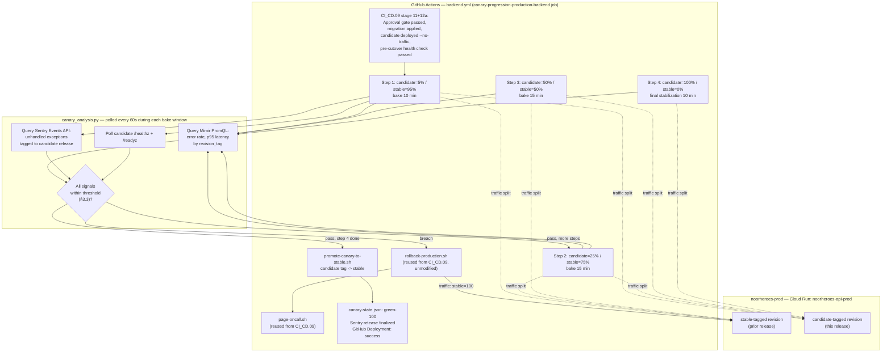

# Phase 11 — Blue/Green + Canary Production Deployment Strategy

**File ID:** `Development_Blueprints.Phase11_CICD_Deployment.Infra.01-blue-green-canary-deployment-strategy.md`
**Phase:** Phase 11 — CI/CD & Deployment Completion (deliberately scheduled **after** Phase 10 security/performance hardening — this is a late-stage, pre-GA maturity improvement, not an MVP blocker)
**Depends on:** `Phase1_Infra_Config.CI_CD.09-ci-pipeline-manual-promotion-production-deploy.md` (the manual approval gate, `resolve-promotion-artifact.sh` manifest contract, `prod-deploy-sa` identity, and single-shot cutover mechanics this file **supersedes at stage 12 only**), `Phase1_Infra_Config.Infra.01-environment-tiers-provisioning.md` (the `production` GitHub Environment, `noorheroes-prod` GCP project, Cloud Run service names), `Phase1_Infra_Config.Infra.04-terraform-iac-baseline-staging.md` (the `modules/compute` Cloud Run module this file extends with revision-tag traffic splitting), `Phase1_Infra_Config.Infra.05-observability-stack-bootstrap.md` (the Grafana Cloud Mimir/Sentry signal sources this file's canary-analysis service queries), Phase 10 (security/performance hardening — deploying a system that hasn't been hardened is out of order, per this phase's own placement in the roadmap)
**Consumed by:** none yet (this is the terminal file in the deploy-strategy chain as of this corpus)
**Source authority:** `NoorHeroes_Final_Development_Prompt.md` §7 ("Deployment strategy: Blue/green or rolling deploy with automated health-check-based rollback; canary releases (5% → 25% → 100%)... mirroring the feature-flag staged-rollout pattern"), §6 (13-stage CI/CD pipeline, stage 12), §8 (observability signal sources); `FAST-API-INSTRUCTIONS.md` (`/healthz`, `/readyz` health probes, `api/health.py`)

---

## 1. Objective and Purpose

`CI_CD.09` already built the simple, gated production deploy: a human approves, a candidate Cloud Run revision is health-checked with zero traffic, then it receives 100% of traffic in one shot, followed by a fixed 10-minute Sentry watch. That file explicitly deferred percentage-based canary traffic splitting and automated statistical rollback decisioning to "a separate, later file" (`CI_CD.09` §18, Decision 1) — **this is that file.**

This file replaces `CI_CD.09`'s stage-12 single-shot cutover with a **progressive, percentage-ramped canary rollout** (5% → 25% → 50% → 100%, per `Final_Development_Prompt.md` §7's explicit `5% → 25% → 100%` guidance, with an additional 50% step inserted before full cutover — see §18 Decision 2 for why), gated at every step by an automated **canary-analysis service** that consumes the backend's already-implemented Prometheus metrics (`/metrics`, scraped by the OTel Collector into Grafana Cloud Mimir, per `Infra.05`) and Sentry error-rate signals, and that **automatically rolls back to the prior stable revision the moment a step's metrics breach a defined threshold** — no human has to be watching a dashboard for the rollback to happen.

**What this file does NOT change:** stage 11 (the manual promotion gate, `environment: production`, GitHub's native approval UI) is reused exactly as `CI_CD.09` built it — this file does not re-implement approval. The pre-cutover migration discipline (`CI_CD.09` §8, expand/contract only, migration runs before any traffic shifts) is reused unchanged. This file's job starts the moment `CI_CD.09`'s `deploy-candidate` step has produced an untrafficked, health-checked candidate revision, and ends the moment that revision either (a) is serving 100% of production traffic and has cleared a final stabilization window, or (b) has been automatically rolled back and the prior stable revision is back at 100%.

---

## 2. Scope and Requirements

**In scope:**

1. A four-step traffic-split progression (`5% → 25% → 50% → 100%`) implemented via Cloud Run revision-tag traffic splitting (§3.1), replacing `CI_CD.09` §3.2's single `update-traffic --to-tags candidate=100` call with a loop over the progression, each step followed by a fixed bake time (§3.2) and an automated canary-analysis gate (§4.2).
2. A canary-analysis service (`infra/ci/canary_analysis.py`) that at every bake-time step queries: (a) Cloud Run per-revision Prometheus metrics via Grafana Mimir's PromQL query API — request rate, error rate, and p95/p99 latency, scoped to the candidate revision specifically; (b) Sentry's events API for unhandled-exception counts tagged to the candidate release; (c) the candidate revision's `/healthz`/`/readyz` probes directly. It returns a pass/fail verdict per step against the exact thresholds in §3.3/§10.
3. Automatic rollback: any threshold breach at any step, or a health-probe failure at any step, triggers `rollback-production.sh` (reused unmodified from `CI_CD.09`) within one polling interval, with no human approval required to roll back (approval is required to roll *forward*, never to roll *back* — see §9.1).
4. Manual abort: a separately dispatchable `abort-canary-rollout.yml` workflow that lets an on-call human roll back an in-progress canary at any step, for a reason the automated metrics wouldn't catch (e.g. a business-logic bug that doesn't raise exceptions or move latency).
5. Revision-tag lifecycle management: `stable` and `candidate` Cloud Run traffic tags, and the retagging step that occurs once a rollout reaches 100% (the former candidate becomes the new `stable`; the former `stable` revision keeps serving as the rollback target until the *next* rollout completes — see §11.3).
6. Rollout-state tracking (§11.1): a `canary-state.json` artifact persisted at every transition, plus a human-readable Cloud Run revision annotation, so "what stage is this rollout at, right now" is answerable without reading GitHub Actions logs.
7. Backward-compatible schema-migration discipline **extended across the full rollout window** (§8) — `CI_CD.09` §8 already established expand/contract-only migrations for its ~1-minute pre-cutover window; this file extends the same rule to cover the full ~45-60 minute canary bake window, during which the old (`stable`) and new (`candidate`) revisions run **simultaneously against the same schema**.
8. `admin-web`'s equivalent canary rollout (structurally identical, no migration step) — `Final_Development_Prompt.md` §7's canary guidance is app-agnostic; this file applies it to both `backend.yml` and `admin-web.yml`.

**Explicitly out of scope (do not build here):**

- The manual promotion gate itself (stage 11) — already built by `CI_CD.09` §3.2, reused verbatim.
- The pre-cutover Alembic migration mechanism (`noorheroes-migrate-prod` Cloud Run Job) — already built by `CI_CD.09` §7.3/§8, reused verbatim. This file adds **no new migration mechanism**; it only extends the *compatibility discipline* those migrations must follow (§8).
- The Android app's staged rollout — per `Final_Development_Prompt.md` §7, Android's canary is Play Console's own staged-rollout mechanism (5%→25%→100%), entirely decoupled from this file's Cloud Run traffic splitting. `CI_CD.09` §18 Decision 7 already excludes mobile from this pipeline; this file does not change that.
- Building the Grafana Cloud / Sentry projects, dashboards, or the OTel Collector — all owned by `Infra.05`, consumed here as read-only signal sources via their existing query APIs.
- A general-purpose feature-flag percentage-rollout system — `CI_CD.10-feature-flag-platform-dual-signoff-config.md` owns application-level feature-flag rollout (config/behavior toggles). This file is exclusively about **infrastructure traffic splitting** between two running revisions of the same deployed artifact.
- Multi-region or multi-cluster canary — `noorheroes-api-prod`/`noorheroes-admin-prod` are single-region Cloud Run services (`us-central1`, per `Infra.01`/`Infra.04`); this file's traffic percentages are single-region traffic splits, not a cross-region rollout strategy.

---

## 3. Technical Implementation Details

### 3.1 Traffic-splitting mechanism: Cloud Run traffic splitting via revision tags

Cloud Run natively supports splitting traffic across revisions by percentage, addressed either by revision name or by a stable **tag** bound to whichever revision currently holds it. This file uses **tags**, not raw revision names, so every script and dashboard query refers to `stable` / `candidate` consistently regardless of which actual revision currently holds that role — this is the same tagging pattern `CI_CD.09` §3.2 already introduced for its untrafficked health check (`--tag candidate`), extended here to also cover the percentage-split period rather than only the momentary pre-cutover check.

```bash
# Step 0 (already done by CI_CD.09's deploy-candidate step, reused unchanged):
gcloud run deploy noorheroes-api-prod \
  --project noorheroes-prod --region us-central1 \
  --image "$IMAGE_DIGEST" \
  --no-traffic --tag candidate \
  --revision-suffix "$RELEASE_VERSION"

# Step 1: shift 5% of traffic onto the tagged candidate, 95% stays on stable
gcloud run services update-traffic noorheroes-api-prod \
  --project noorheroes-prod --region us-central1 \
  --to-tags candidate=5,stable=95

# ... bake, analyze (§3.2/§4.2) ...

# Step 2: 25% candidate / 75% stable
gcloud run services update-traffic noorheroes-api-prod \
  --to-tags candidate=25,stable=75

# Step 3: 50% candidate / 50% stable
gcloud run services update-traffic noorheroes-api-prod \
  --to-tags candidate=50,stable=50

# Step 4: 100% candidate — full cutover
gcloud run services update-traffic noorheroes-api-prod \
  --to-tags candidate=100
```

Each `--to-tags` call is **absolute**, not incremental — it declares the full desired traffic distribution across tags in one call, which is why `canary-progression.sh` (§5) always passes both tags' target percentages together rather than trying to "add 20%" to an existing split.

Both the `candidate` and `stable` tagged URLs remain independently reachable throughout the rollout (`candidate---noorheroes-api-prod-<hash>-uc.a.run.app`, `stable---noorheroes-api-prod-<hash>-uc.a.run.app`) — this is what lets the canary-analysis service (§4.2) query and health-check each revision's traffic **in isolation**, even while both are receiving live, randomly-split production traffic through the primary `https://api.noorheroes.com` URL.

### 3.2 Progression schedule and bake times

| Step | Candidate traffic % | Stable traffic % | Bake time | Rationale |
|---|---|---|---|---|
| 1 | 5% | 95% | 10 minutes | Smallest viable exposure — catches a severe, high-frequency regression (crash loop, hard 500 on a common path) fast, at minimal blast radius. |
| 2 | 25% | 75% | 15 minutes | Enough real traffic volume for the error-rate/latency percentile math in §3.3 to be statistically meaningful rather than noise-dominated. |
| 3 | 50% | 50% | 15 minutes | Confirms the candidate holds up under a traffic share large enough to reveal capacity/connection-pool issues that only show up under real concurrent load (DB pool saturation, Redis pool saturation — both already dashboarded per `Infra.05` §6.2). |
| 4 | 100% | 0% | 10 minutes (final stabilization) | Full cutover. The final 10-minute window mirrors `CI_CD.09`'s original post-deploy Sentry watch (§6.3 of that file) — reused as this rollout's closing gate rather than duplicated as a separate mechanism. |

**Total automated bake time: ~50 minutes**, plus whatever time the stage-11 human approval takes (unbounded, capped at the existing 24h timeout per `CI_CD.09` §10). This is a fixed, non-configurable-per-run schedule — see §18 Decision 3 for why the bake durations are not exposed as a workflow input.

### 3.3 Canary-analysis thresholds (exact values)

These are the concrete pass/fail criteria the canary-analysis service (§4.2) evaluates at the **end of every bake window**, before allowing progression to the next step:

| Signal | Source | Threshold | Notes |
|---|---|---|---|
| Candidate error rate | Prometheus (`http_requests_total{revision_tag="candidate"}`) | **> 2%** of candidate-tagged requests return `5xx`, AND candidate-tagged request count in the window ≥ 20 | The `≥ 20` sample floor prevents a single failed request at the 5% step (which might see only a handful of requests in 10 minutes) from tripping a rollback on statistical noise. |
| Candidate vs. stable p95 latency | Prometheus (`http_request_duration_seconds_bucket`, split by `revision_tag`) | Candidate p95 **> 2× stable p95**, measured over the same bake window, AND stable p95 in that window ≥ 50ms (avoids a divide-by-near-zero false trip when stable itself is already near-instant) | Relative-to-stable, not an absolute latency budget — this is deliberate: it isolates "did this deploy make things worse" from "is the whole system generally slow right now" (a general slowdown would show up on both revisions equally and not trip this check). |
| Sentry unhandled-exception count, candidate release | Sentry Events API, filtered `release:<candidate-release> is:unhandled` | Count in window **> max(floor, 3 × pre-deploy baseline rate)** | Same floor+multiplier shape as `CI_CD.09` §6.3's `should_rollback()`, reused for consistency — but the **floor is scaled per step** (§10) since a 5%-traffic step sees far fewer requests, and therefore far fewer chances to generate an exception, than a 50%-traffic step. |
| Candidate `/healthz` + `/readyz` | Direct HTTP probe against the `candidate` tagged URL | Either returns non-200, or times out (5s), on ≥ 2 of 3 consecutive checks during the window | Reuses `CI_CD.09`'s `verify-candidate-health.sh` pattern, but polled repeatedly through the whole bake window (§4.2), not just once before the first traffic shift. |

A step **fails** (triggers immediate rollback, §4.3) if **any one** of these four signals breaches its threshold. A step **passes** only if all four stay within threshold for the entire bake window — a single spot-check pass followed by a late-window breach still fails the step; the analysis service polls continuously, not once at the window's end (§4.2).

---

## 4. Architecture and Component Responsibilities



| Component | Responsibility |
|---|---|
| `canary-progression-production-*` job | Owns the four-step loop: shift traffic → wait for bake time → invoke `canary_analysis.py` → on pass, proceed; on fail, invoke rollback and stop. Appended to `backend.yml`/`admin-web.yml` immediately after `CI_CD.09`'s existing `deploy-candidate`/`candidate-health` steps, replacing that file's single `deploy` (100%-cutover) step. |
| `canary_analysis.py` | The canary-analysis service itself (§4.2) — a stateless, per-invocation script (not a standalone long-running deployment) that queries Mimir + Sentry + the candidate's health endpoints once per poll, applies the §3.3 thresholds, and returns a verdict. Runs inside the GitHub Actions job, not as its own Cloud Run service — see §18 Decision 4 for why. |
| `canary-progression.sh` | Thin orchestration wrapper: calls `gcloud run services update-traffic` for a given step, then loops calling `canary_analysis.py` every 60s until the step's bake time elapses or a breach is detected. |
| `promote-canary-to-stable.sh` | Runs once, only after step 4 passes: re-tags the now-100%-traffic revision as `stable` (replacing the previous stable's tag), completing the blue/green swap (§11.3). |
| `rollback-production.sh` | **Reused unmodified from `CI_CD.09`** — `gcloud run services update-traffic --to-tags stable=100`, idempotent. The exact same script, the exact same code path, whether triggered by this file's canary breach or `CI_CD.09`'s original pre-cutover health-check failure — one rollback mechanism, multiple callers (extends `CI_CD.09` §4's "one mechanism, two callers" principle to three callers). |
| `abort-canary-rollout.yml` | A separate, manually-dispatched workflow (§9.5) that a human can run at any point during an in-progress canary to force an immediate rollback, independent of the automated analysis. |
| Grafana Cloud Mimir (external, owned by `Infra.05`) | Source of truth for per-revision Prometheus metrics; `canary_analysis.py` is a **read-only consumer** via Mimir's PromQL HTTP query API, never a metrics producer. |
| Sentry (external, owned by `Infra.05`) | Source of truth for per-release unhandled-exception counts; consumed identically to how `CI_CD.09` §6.3 already consumes it, scoped here to the candidate release specifically. |

### 4.1 Per-revision metric scoping — how Prometheus tells `stable` and `candidate` apart

`Infra.05`'s OTel Collector scrapes the backend's `/metrics` endpoint (§6.1 of that file). Because both the `stable` and `candidate` Cloud Run revisions run simultaneously during a canary window, each exposing its **own** `/metrics` at its own tagged URL, this file requires **two scrape targets instead of one** during an active rollout, each carrying a static `revision_tag` label:

```yaml
# infra/observability/prometheus/prometheus.yml — addition this file requires (extends Infra.05 §6.1's
# existing single-target config; both targets are always configured, not conditionally added per
# rollout, since Cloud Run's tagged URLs are stable addresses that simply route to whichever
# revision currently holds each tag — no config change is needed between rollouts)
scrape_configs:
  - job_name: noorheroes-backend-stable
    scrape_interval: 15s
    metrics_path: /metrics
    static_configs:
      - targets: ["stable---noorheroes-api-prod-<hash>-uc.a.run.app"]
        labels:
          revision_tag: stable
  - job_name: noorheroes-backend-candidate
    scrape_interval: 15s
    metrics_path: /metrics
    static_configs:
      - targets: ["candidate---noorheroes-api-prod-<hash>-uc.a.run.app"]
        labels:
          revision_tag: candidate
```

This makes `sum(rate(http_requests_total{revision_tag="candidate", status=~"5.."}[10m]))` a query that reflects **only the candidate revision's own traffic**, regardless of what percentage of overall traffic Cloud Run is currently routing to it — exactly the isolation the §3.3 thresholds depend on. Outside an active rollout, both targets simply scrape the same revision (whichever tag last pointed at it), which is harmless and requires no scrape-config toggling between rollouts.

### 4.2 `canary_analysis.py` contract

```python
# infra/ci/canary_analysis.py — invoked by canary-progression.sh once per 60s poll
"""
Evaluates whether the candidate revision is healthy enough to remain at its current
traffic percentage / progress to the next step, per the fixed thresholds in this
file's §3.3. Stateless per invocation — all state (which step, bake start time) is
owned by the calling shell loop (canary-progression.sh), not by this script.

Usage: canary_analysis.py <app> <candidate_tag_url> <release_version> <bake_start_ts> <step_pct>

Reads from environment (production-scoped GitHub Environment secrets, per CI_CD.09 §9.2):
  GRAFANA_CLOUD_MIMIR_QUERY_ENDPOINT, GRAFANA_CLOUD_API_KEY,
  SENTRY_AUTH_TOKEN, SENTRY_ORG_SLUG
"""

ERROR_RATE_THRESHOLD = 0.02          # 2% — §3.3 row 1
ERROR_RATE_MIN_SAMPLES = 20          # sample floor — §3.3 row 1
LATENCY_MULTIPLIER = 2.0             # candidate p95 > 2x stable p95 — §3.3 row 2
LATENCY_STABLE_FLOOR_MS = 50         # avoid divide-by-near-zero — §3.3 row 2
SENTRY_RELATIVE_MULTIPLIER = 3.0     # matches CI_CD.09 §6.3's constant, reused
SENTRY_FLOOR_BY_STEP_PCT = {5: 10, 25: 25, 50: 40, 100: 50}   # §10 — scaled per traffic share
HEALTH_CONSECUTIVE_FAILURE_THRESHOLD = 2   # of last 3 checks — §3.3 row 4


def query_mimir_error_rate(revision_tag: str, window: str = "10m") -> tuple[float, int]:
    """Returns (error_rate_fraction, total_sample_count) for the given revision_tag
    over the trailing window, via Mimir's /api/v1/query PromQL endpoint."""


def query_mimir_p95_latency_ms(revision_tag: str, window: str = "10m") -> float:
    """histogram_quantile(0.95, ...) scoped to revision_tag, via Mimir."""


def query_sentry_unhandled_count(release_version: str, since_ts: float) -> int:
    """Unhandled-exception events tagged release:<release_version> since since_ts —
    identical query shape to CI_CD.09 §6.3's get_current_window_error_count()."""


def probe_health(candidate_tag_url: str) -> bool:
    """GET /healthz then GET /readyz against the candidate tag's own URL — True only
    if both return 200 within a 5s timeout."""


def evaluate_step(app, candidate_tag_url, release_version, bake_start_ts, step_pct) -> "StepVerdict":
    error_rate, sample_count = query_mimir_error_rate("candidate")
    candidate_p95 = query_mimir_p95_latency_ms("candidate")
    stable_p95 = query_mimir_p95_latency_ms("stable")
    sentry_count = query_sentry_unhandled_count(release_version, bake_start_ts)
    sentry_baseline = get_baseline_error_rate_from_sentry()   # reused from CI_CD.09 §6.3
    health_ok = probe_health(candidate_tag_url)

    breaches = []
    if sample_count >= ERROR_RATE_MIN_SAMPLES and error_rate > ERROR_RATE_THRESHOLD:
        breaches.append(f"error_rate={error_rate:.3%} (threshold {ERROR_RATE_THRESHOLD:.0%}, n={sample_count})")
    if stable_p95 >= LATENCY_STABLE_FLOOR_MS and candidate_p95 > stable_p95 * LATENCY_MULTIPLIER:
        breaches.append(f"p95_latency candidate={candidate_p95}ms stable={stable_p95}ms")
    floor = SENTRY_FLOOR_BY_STEP_PCT[step_pct]
    if sentry_count > max(floor, sentry_baseline * SENTRY_RELATIVE_MULTIPLIER):
        breaches.append(f"sentry_unhandled={sentry_count} (floor={floor}, baseline*3={sentry_baseline*3:.1f})")
    if not health_ok:
        breaches.append("health_probe_failed")

    return StepVerdict(passed=(len(breaches) == 0), breaches=breaches)
```

`canary-progression.sh` calls this once every 60 seconds for the duration of each step's bake time (§3.2) — a single mid-window breach is sufficient to trigger rollback immediately (§4.3); it does not wait for the bake window to finish once a breach is detected.

### 4.3 Rollback trigger flow

The moment `evaluate_step()` returns `passed=False`, `canary-progression.sh`:

1. Immediately calls `./infra/ci/rollback-production.sh <app>` — shifts 100% of traffic back to the `stable` tag. This is the exact same script `CI_CD.09` already built; no new rollback code path is introduced.
2. Writes `canary-state.json` with `state: "rolled-back"` and the specific breach reason(s) from `StepVerdict.breaches`.
3. Calls `./infra/ci/page-oncall.sh <app> "canary-breach:<step_pct>%:<breach-summary>"` — reused from `CI_CD.09`, extended only in the reason string passed to it.
4. Calls `./infra/ci/notify-slack.sh "canary-rollback" <app> <release_version>` with the breach detail attached.
5. Fails the GitHub Actions job — the failed job status is itself the durable record that this rollout did not complete, exactly as `CI_CD.09` §10 already establishes for its own rollback path.

The **untrafficked-candidate rule from `CI_CD.09` §4.2 (never shift traffic to an unhealthy candidate) and this file's rollback rule (never leave traffic on a candidate that became unhealthy after receiving some) are the same principle applied at two different points in the rollout's lifecycle** — before any traffic (CI_CD.09) and during/after partial traffic (this file).

---

## 5. Folder/File Structure

```
infra/
├── ci/
│   ├── canary_analysis.py                 # NEW — §4.2, the canary-analysis service logic
│   ├── canary-progression.sh               # NEW — §4/§5, per-step orchestration loop
│   ├── promote-canary-to-stable.sh         # NEW — §11.3, final tag swap
│   ├── canary-state-write.sh               # NEW — §11.1, writes canary-state.json + Cloud Run annotation
│   ├── rollback-production.sh              # EXISTING (CI_CD.09) — reused UNMODIFIED
│   ├── verify-candidate-health.sh          # EXISTING (CI_CD.09) — reused, now also polled mid-bake by canary_analysis.py's probe_health()
│   ├── page-oncall.sh                      # EXISTING (CI_CD.09) — reused UNMODIFIED
│   ├── notify-slack.sh                     # EXISTING (CI_CD.09) — extended with two new event types: "canary-step-passed", "canary-rollback"
│   ├── sentry-release-mark-deployed.sh     # EXISTING (CI_CD.09) — reused UNMODIFIED
│   ├── record-github-deployment.sh         # EXISTING (CI_CD.09) — reused UNMODIFIED
│   ├── resolve-promotion-artifact.sh       # EXISTING (CI_CD.09) — reused UNMODIFIED
│   ├── run-production-migration.sh         # EXISTING (CI_CD.09) — reused UNMODIFIED
│   └── config/
│       └── canary-thresholds.yaml          # NEW — §6.2, the §3.3 thresholds as data, not hardcoded constants
├── observability/
│   └── prometheus/
│       └── prometheus.yml                  # MODIFIED (Infra.05) — dual stable/candidate scrape targets, §4.1
└── terraform/
    └── modules/
        └── compute/
            └── main.tf                     # MODIFIED (Infra.04) — see §7.3, no new resource type, only a
                                              #   `min_instances` note for the candidate tag during rollout

.github/workflows/
├── backend.yml               # MODIFIED — replaces CI_CD.09's single `deploy` step inside
│                               #   `promote-and-deploy-production-backend` with the canary-progression loop
├── admin-web.yml              # MODIFIED — structurally identical replacement
└── abort-canary-rollout.yml   # NEW — §9.5, manual-abort workflow, workflow_dispatch only
```

---

## 6. APIs, Models, Interfaces, and Data Flow

This file introduces no application-facing HTTP API. Its interfaces are: the Mimir PromQL query API (consumed), the Sentry Events API (consumed, same shape as `CI_CD.09` §6.3), and the `canary-state.json` artifact/annotation format (produced).

### 6.1 `canary-state.json` schema

Written by `canary-state-write.sh` at every step transition, uploaded as a GitHub Actions artifact (`canary-state-<app>-<release_version>`) and additionally written as a Cloud Run service annotation (`run.googleapis.com/canary-state`, base64-encoded, 4KB annotation-size-limit-safe subset) so the current state is queryable via `gcloud run services describe` without any GitHub Actions access:

```json
{
  "app": "backend",
  "release_version": "backend-v1.5.0",
  "state": "canary-25",
  "candidate_revision": "noorheroes-api-prod-backend-v1-5-0",
  "stable_revision": "noorheroes-api-prod-backend-v1-4-2",
  "step_started_at": "2026-08-24T18:12:00Z",
  "step_bake_seconds": 900,
  "last_verdict": { "passed": true, "breaches": [] },
  "updated_at": "2026-08-24T18:14:03Z"
}
```

`state` is always one of the six values enumerated in §11.2's state machine. This is the single artifact both the automated pipeline and a human running `abort-canary-rollout.yml` (§9.5) read to know "what is currently happening."

### 6.2 `canary-thresholds.yaml` — thresholds as data

The exact numeric constants from §3.3/§4.2 are checked in as data, not buried as Python literals, so a future retuning (explicitly anticipated, per §18 Decision 5) is a config PR, not a code change:

```yaml
# infra/ci/config/canary-thresholds.yaml
error_rate:
  threshold: 0.02
  min_samples: 20
latency:
  multiplier: 2.0
  stable_floor_ms: 50
sentry:
  relative_multiplier: 3.0
  floor_by_step_pct:
    5: 10
    25: 25
    50: 40
    100: 50
health_probe:
  consecutive_failure_threshold: 2
  window_checks: 3
progression:
  steps:
    - { pct: 5,   bake_seconds: 600 }
    - { pct: 25,  bake_seconds: 900 }
    - { pct: 50,  bake_seconds: 900 }
    - { pct: 100, bake_seconds: 600 }
```

`canary_analysis.py` and `canary-progression.sh` both load this file at start rather than hardcoding the values inline — this is the single source of truth for every number in §3.2/§3.3.

### 6.3 Data flow summary

1. `CI_CD.09`'s existing stage 11 (approval) → stage 12a (migration, candidate deploy `--no-traffic`, pre-cutover health check) completes unchanged.
2. This file's `canary-progression-production-*` job begins: reads `canary-thresholds.yaml`, initializes `canary-state.json` at `state: "canary-5"`.
3. Loop over the four steps in `progression.steps`: shift traffic (§3.1) → poll `canary_analysis.py` every 60s for `bake_seconds` → on breach, jump to rollback (§4.3) and stop; on clean bake, write `canary-state.json` for the next step and continue.
4. After step 4 passes, `promote-canary-to-stable.sh` retags the revision, `canary-state.json` is written with `state: "green-100"`, and `CI_CD.09`'s existing Sentry-release-finalize / GitHub-Deployment-record steps run exactly as before.

---

## 7. Dependencies and Configuration Requirements

### 7.1 What this file requires from `CI_CD.09` (unchanged contract)

Everything in `CI_CD.09` §7.1-§7.4 (the `promotion-manifest-<app>` artifact contract, the `production` GitHub Environment secrets, the `prod-deploy-sa` identity, `gcloud`/`sentry-cli`/`gh`/`jq` tooling) is a direct, unmodified prerequisite — this file adds no new CI identity and requests no new IAM scope beyond §9.2.

### 7.2 New configuration this file introduces

| Requirement | Detail |
|---|---|
| `GRAFANA_CLOUD_MIMIR_QUERY_ENDPOINT` | New `production`-scoped GitHub Environment secret — the Mimir PromQL query API base URL for the **production** Grafana Cloud stack (distinct from `Infra.05`'s staging-scoped collector remote-write endpoint; this file queries, `Infra.05`'s collector writes). If production observability hasn't been promoted from `Infra.05`'s staging-only build yet, this is a **blocking prerequisite** — see §16. |
| `GRAFANA_CLOUD_API_KEY` | New `production`-scoped secret, read-only Grafana Cloud API key scoped to query access only (no write/admin scope) — least-privilege, since this file only ever reads metrics, never writes dashboards or alert rules. |
| Dual Prometheus scrape targets (§4.1) | `infra/observability/prometheus/prometheus.yml` modification — depends on `Infra.05`'s collector config existing and being promoted to a production instance. |
| `canary-thresholds.yaml` | Checked into the repo at `infra/ci/config/` — no external dependency, but any PR modifying it should go through the same review rigor `CI_CD.09` §9.4 already mandates for `infra/ci/*production*` changes. |

### 7.3 Cloud Run configuration note (no new Terraform resource type)

Unlike `CI_CD.09`, which required a genuinely new Terraform resource (`noorheroes-migrate-prod`), this file requires **no new resource type** — Cloud Run's tag-based traffic splitting is a property of the existing `google_cloud_run_v2_service` resource `Infra.04`'s `modules/compute` already manages, driven entirely by `gcloud run services update-traffic` calls at deploy time, not by a Terraform apply. The one configuration note: `Infra.04`'s `modules/compute` should set `min_instances >= 1` on the *service* (not per-tag), so that even a 5%-traffic candidate has at least one warm instance and isn't measured against artificially-inflated cold-start latency during the §3.3 p95 comparison — this is a clarification of `Infra.01` §15.1's existing `min_instances >= 2` production requirement, not a new value.

### 7.4 CLI/tooling dependencies

Same as `CI_CD.09` §7.4 (`gcloud`, `sentry-cli` or direct Sentry API, `gh`, `jq`), plus: a PromQL HTTP client — `canary_analysis.py` issues plain `requests`-library HTTPS calls against Mimir's `/api/v1/query` and `/api/v1/query_range` endpoints (Basic Auth via `GRAFANA_CLOUD_API_KEY`, matching `Infra.05` §5's `basicauth/grafana` extension pattern) — no additional CLI binary is introduced.

---

## 8. Database/Storage Requirements — Extended Migration Compatibility Window

**This is the single most important structural difference this file introduces relative to `CI_CD.09`, and it must be understood precisely.**

`CI_CD.09` §8 already established expand/contract-only migrations, safe for the ~1 minute between migration completion and its single 100% cutover. This file's canary rollout means the **old (`stable`) and new (`candidate`) revisions run concurrently, both reading and writing the same production database, for up to ~50 minutes** (§3.2's total bake time) — not a rounding-error window, a real, sustained concurrent-write period.

### 8.1 The rule, restated for this file's window

1. The pre-cutover migration (unchanged mechanism, `CI_CD.09` §7.3/§8.2's `noorheroes-migrate-prod` Cloud Run Job, `alembic upgrade head`, `max_retries=0`) still runs **once, before step 1's first traffic shift** — this file does not re-run or re-check the migration between canary steps.
2. **The migrated schema must be simultaneously valid for both the old (`stable`) code and the new (`candidate`) code for the entire rollout duration**, not just for the brief pre-cutover window `CI_CD.09` originally assumed. Concretely:
   - An added column: nullable or default-valued (unchanged rule from `CI_CD.09` §8.1.2), **and** the new code must not require that column to be populated by every write path yet if the old code's writes will still be read back by the new code's reads during the overlap window — i.e., the new code must handle a NULL/default value gracefully for up to ~50 minutes of real traffic, not just an instant.
   - A column rename or removal: **still deferred to a later, separate PR** (unchanged rule, `CI_CD.09` §8.1.3) — never within the same release whose canary window this file manages.
   - A new foreign-key constraint or NOT NULL backfill: must complete (data backfilled, constraint validated) as part of the pre-cutover migration itself, using Alembic's `batch_alter_table`/`postgresql_concurrently`-aware patterns already implied by the project's existing "additive-first" discipline — never partially backfilled and left to converge during the canary window, since the old revision's writes during that window would violate an unfinished constraint.
   - A behavior change that depends on a new column's *value* being meaningfully set (not just present) — e.g. a new default state machine field — must have the new revision treat an "old-code-written" row (one written before this deploy) as a valid, handled state, not an error case, since such rows will keep being read by the new candidate code throughout the rollout.
3. **Rollback still never runs `alembic downgrade`** — this is unchanged from `CI_CD.09` §8.1.4 and applies with even more force here: a rollback at, say, the 25% step means the `stable` revision resumes serving 100% of traffic against a schema that has already been migrated forward. Because rule 2 above guarantees the old code already tolerates the post-migration schema (it was tolerating it throughout the entire canary window, successfully, up to the point of rollback), this is safe by construction — the same guarantee `CI_CD.09` relied on for its shorter window, now load-bearing for a much longer one.

### 8.2 Why this matters more here than in `CI_CD.09`

A migration that happened to be "backward compatible enough" for a one-minute window (a subtle bug in an edge case the old code rarely hits) can survive `CI_CD.09`'s original pipeline undetected. The same subtle bug has up to 50 minutes and, at the 50% step, half of production's real traffic to manifest under **this** file's rollout — which is a deliberate feature of the canary window, not a risk to route around: it is exactly the mechanism that should surface a compatibility bug the shorter window would have missed, and §3.3's error-rate/Sentry thresholds are what catch it and trigger rollback automatically if it does.

### 8.3 No destructive reseed, no data-reset

Unchanged from `CI_CD.09` §8.3 — this file performs no additional data-affecting operation beyond the single, already-covered `alembic upgrade head`. Nothing in the canary-progression loop touches data directly.

---

## 9. Authentication, Authorization, Validation, and Security Considerations

### 9.1 Rollback requires no approval; roll-forward already did

The manual approval gate (`CI_CD.09` stage 11) governs entering the canary rollout at all — a human already approved this specific artifact before step 1's first traffic shift. **No further human approval gates any subsequent step's progression** (5%→25%→25%→50%→50%→100%) — those transitions are automatic on a clean bake, by design, since re-approving every step would defeat the purpose of automated canary analysis. Symmetrically, **rollback never waits for approval either** — a breach at any step rolls back immediately (§4.3), because requiring a human to approve a rollback would leave a known-bad candidate serving live traffic while someone gets paged, which is the opposite of the safety property this file exists to provide.

### 9.2 IAM — no new service account, minimal additional scope

`canary_analysis.py` and `canary-progression.sh` run inside the same `promote-and-deploy-production-*` job as `CI_CD.09`'s existing steps, under the same `prod-deploy-sa` identity (`CI_CD.09` §9.2) — no new service account is introduced. The only additional grant `prod-deploy-sa` needs beyond `CI_CD.09` §9.2's existing list is read access to the production Grafana Cloud API key (§7.2), which is a GitHub Environment secret, not a GCP IAM grant — `prod-deploy-sa`'s GCP-side permissions are unchanged from `CI_CD.09`.

### 9.3 Validation — the same manifest gate, entered once

`resolve-promotion-artifact.sh`'s validation (`CI_CD.09` §9.3) runs once, before step 1, exactly as before. This file does not re-validate the manifest between canary steps — the artifact being progressively rolled out is fixed at rollout start; there is no mechanism by which a different artifact could substitute itself mid-rollout, since every subsequent step only ever references the same `candidate` tag already pointed at the one health-checked, manifest-validated revision.

### 9.4 Supply-chain hygiene

`canary_analysis.py`'s only new external dependency is a PromQL HTTP client (`requests`, already a transitive dependency of the Python tooling `CI_CD.09`'s Sentry scripts use) — no new unpinned `curl`-piped installer is introduced. The same rule from `CI_CD.09` §9.4 (pin every tool version, checksum-verify where supported, treat `infra/ci/*production*` PRs with `core/security`-level review rigor) applies unchanged to every new file in §5's folder structure.

### 9.5 Manual abort authorization

`abort-canary-rollout.yml` (§4, §11.4) is `workflow_dispatch`-only, restricted to the same `release-managers` team `CI_CD.09` §9.1 already established as the required-reviewer list — enforced via a `if: contains(fromJSON('["user1","user2"]'), github.actor)` guard sourced from the same team membership `Infra.01`'s GitHub Environment configuration already tracks, not a separate ACL this file invents. It requires one input, `release_version`, matched against the currently-live `canary-state.json`'s `release_version` before executing — refusing to abort if no matching in-progress rollout is found, so a typo doesn't roll back an unrelated, already-completed deploy.

### 9.6 Secrets never printed to logs

Unchanged from `CI_CD.09` §9.5 — `GRAFANA_CLOUD_API_KEY` is a GitHub Environment secret (auto-redacted by Actions' log masking), and no script in this file ever echoes it.

---

## 10. Error Handling and Edge Cases

| Scenario | Handling |
|---|---|
| **Canary metric breach mid-rollout (the primary case this file exists for)** | `evaluate_step()` returns `passed=False` the moment any §3.3 threshold is crossed, mid-poll (not only at bake-window end) — `canary-progression.sh` checks the verdict every 60s and acts on the first failing poll. `rollback-production.sh` runs within that same 60-second interval (§4.3), restoring `stable=100`. Job fails with the specific breach reason(s) attached to both the job log and the Slack/PagerDuty page. |
| Sample floor not met at the 5% step (too little traffic to judge error rate) | Per §3.3 row 1, error-rate breach is **not evaluated** below `ERROR_RATE_MIN_SAMPLES=20` — the step is judged on latency, Sentry, and health-probe signals alone until enough volume accumulates. This is a deliberate acceptance of a slightly weaker error-rate signal at the smallest traffic share, in exchange for not false-tripping on a single unlucky request; the 25%/50% steps carry substantially more sample volume and close this gap quickly. |
| Grafana Mimir API unreachable during a bake window | Same fail-safe-not-fail-open posture as `CI_CD.09` §10's Sentry-unreachable handling: 3 consecutive failed Mimir queries within one step triggers rollback with reason `mimir-unreachable`, rather than silently treating "no data" as "no errors." |
| Sentry API unreachable during a bake window | Identical handling, reason `sentry-unreachable` — reuses the exact posture `CI_CD.09` §10 already established for its own watch window. |
| Health-probe check itself times out (network blip, not a real candidate failure) | `probe_health()`'s `HEALTH_CONSECUTIVE_FAILURE_THRESHOLD=2` (of the last 3 checks, §4.2) tolerates a single transient failure without tripping — this is the one signal in §3.3 with an explicit debounce, since a raw HTTP probe is the signal most prone to a one-off network blip unrelated to candidate health. |
| Manual abort invoked mid-step | `abort-canary-rollout.yml` (§9.5) calls `rollback-production.sh` directly, writes `canary-state.json` with `state: "rolled-back"` and `abort_reason: "manual"`, and posts to `#deploys` with the invoking user's identity attached — indistinguishable in the audit trail from an automated rollback except for the `abort_reason` field, so post-incident review always shows *why* a rollout ended, not just that it did. |
| Two rollouts somehow overlap (a second promotion approved while a first is still mid-canary) | Prevented structurally by the same mechanism `CI_CD.09` §10 already relies on: the `production` GitHub Environment's concurrency behavior queues the second run's approval gate. `canary-progression.sh` additionally checks `canary-state.json` at start and refuses to begin a second rollout if an existing one's `state` is anything other than `blue-100`/`green-100`/`rolled-back` (i.e., a terminal state) — hard-failing with a clear "rollout already in progress" error rather than racing two `update-traffic` calls against the same service. |
| Candidate passes all four steps but the final `promote-canary-to-stable.sh` retag itself fails (e.g. a transient `gcloud` API error) | Traffic is already at 100% candidate at this point — a retag failure does not affect live traffic, only the bookkeeping of which tag name points at which revision. The step retries with exponential backoff (3 attempts); if all fail, the job fails loudly with `state: "green-100-retag-failed"` in `canary-state.json`, and a human runs `promote-canary-to-stable.sh` manually (documented in `infra/ci/README.md`, §15) — this is explicitly **not** treated as a rollback trigger, since the deployed code is correct and fully trafficked; only the tag bookkeeping needs a retry. |
| A step's bake time elapses with zero traffic reaching the candidate (e.g. a synthetic/low-traffic maintenance window) | `evaluate_step()` at zero samples returns `passed=True` for the error-rate and latency checks (nothing to measure, nothing breached) but still requires the health-probe check to pass — an unhealthy candidate cannot "coast" to the next step just because live traffic happened to be light; a candidate with truly zero real requests across an entire bake window is still directly health-probed every poll regardless of traffic volume. |

---

## 11. State Management and Lifecycle Considerations

### 11.1 Revision tracking

`canary-state.json` (§6.1) is this rollout's single source of truth for "what's happening right now," written at every transition by `canary-state-write.sh` to both a GitHub Actions artifact (queryable via `gh api` for tooling) and a Cloud Run service annotation (queryable via `gcloud run services describe --format='value(metadata.annotations)'` for a human with only `gcloud` access and no GitHub access — deliberately redundant, so an on-call engineer without CI access during an incident can still answer "what state is this deploy in" from the GCP console alone).

### 11.2 Traffic-split state machine

```
        approve (CI_CD.09 stage 11)
                │
                ▼
          ┌───────────┐
          │ blue-100   │  (initial state: prior release at 100%, no candidate exists yet)
          └─────┬──────┘
                │ candidate deployed --no-traffic, pre-cutover health check passes (CI_CD.09 §4.2)
                ▼
          ┌───────────┐   breach/abort    ┌─────────────┐
          │ canary-5   │──────────────────▶│ rolled-back  │
          └─────┬──────┘                   └──────▲───────┘
                │ clean 10-min bake                │
                ▼                                   │
          ┌───────────┐   breach/abort              │
          │ canary-25  │──────────────────────────────┤
          └─────┬──────┘                              │
                │ clean 15-min bake                    │
                ▼                                       │
          ┌───────────┐   breach/abort                  │
          │ canary-50  │──────────────────────────────────┤
          └─────┬──────┘                                  │
                │ clean 15-min bake                        │
                ▼                                           │
          ┌───────────┐   breach/abort                      │
          │ green-100  │──────────────────────────────────────┘
          └─────┬──────┘   (10-min final stabilization window, then...)
                │ promote-canary-to-stable.sh
                ▼
          ┌───────────┐
          │ blue-100   │  (candidate is now stable; ready for the NEXT rollout)
          └───────────┘
```

Six states total: `blue-100`, `canary-5`, `canary-25`, `canary-50`, `green-100`, `rolled-back` — exactly the six named in this file's brief. `rolled-back` is a terminal state for *this* rollout (traffic is back at `blue-100` in practice, but the state label distinguishes "rolled back from a canary breach, needs investigation" from "never had a rollout in progress" for audit purposes) — the *next* rollout always begins fresh from a new `blue-100`.

### 11.3 Tag lifecycle across rollouts

The `stable` tag always points at whatever revision most recently completed a full rollout (or the original bootstrap revision, for the very first deploy through this pipeline). The `candidate` tag is created fresh by every rollout's initial `--tag candidate` deploy (`CI_CD.09` §3.2, unchanged) and **retired** (its name freed for reuse) the moment `promote-canary-to-stable.sh` reassigns `stable` to that same revision — Cloud Run allows a tag to be moved between revisions via `gcloud run services update-tags`, so no tag is ever deleted-and-recreated, only repointed. The **previous** `stable` revision (now untagged, or optionally retained under a `previous` tag — see §18 Decision 6) remains available as the rollback target for `rollback-production.sh` until Cloud Run's configured revision-retention count (`CI_CD.09` §10's "minimum-retained-revisions" requirement) ages it out.

### 11.4 Idempotency

`canary-progression.sh` checks `canary-state.json` at the start of every step invocation (this job re-runs, in the GitHub Actions retry sense, are extremely rare given the job's own internal loop already handles the multi-step progression without needing external re-triggers, but the check exists for correctness): if the state already reflects a later step than the one about to run, the script no-ops that step and resumes from the actual current state, rather than re-shifting traffic to a percentage the rollout has already passed. `abort-canary-rollout.yml` (§9.5) is similarly idempotent — invoking it twice against an already-`rolled-back` state is a harmless no-op, logged but not re-executed.

---

## 12. Integration Points with Existing Modules

| Integration point | Detail |
|---|---|
| `/healthz` / `/readyz` (`FAST-API-INSTRUCTIONS.md`, `api/health.py`) | `canary_analysis.py`'s `probe_health()` calls these exact, already-implemented endpoints against the **candidate-tagged URL specifically** — the same endpoints `CI_CD.09`'s `verify-candidate-health.sh` already uses for the pre-cutover check, now additionally polled throughout the bake windows. No new health-check logic is added to the application itself. |
| Backend's Prometheus `/metrics` (`FAST-API-INSTRUCTIONS.md` §2, "Telemetry & Metrics") | Scraped per-revision via the dual scrape-target config in §4.1 — this file adds scrape **configuration**, not new instrumentation; the metric names (`http_requests_total`, `http_request_duration_seconds_bucket`) are the exact ones `Infra.05` §6.2's dashboard panels already query. |
| Grafana Cloud Mimir (`Infra.05`) | `canary_analysis.py` is a **read-only consumer** of the same Mimir instance `Infra.05` provisions and writes to — this file introduces zero new metrics-storage infrastructure, only a new query client against an existing store. Requires `Infra.05`'s production promotion (§16) to have a production-scoped Mimir endpoint to query against — staging's endpoint is a distinct instance and not what production traffic is measured against. |
| Sentry (`Infra.05`, consumed identically to `CI_CD.09` §6.3) | `canary_analysis.py`'s Sentry query logic is structurally identical to `CI_CD.09`'s `sentry_post_deploy_watch.py` — same auth token scopes (`project:releases`, `event:read`), same events-count-endpoint pattern, extended only to filter by the candidate release specifically at each step rather than one fixed post-cutover window. |
| `CI_CD.09`'s `promote-and-deploy-production-*` job | This file's canary-progression steps are **appended inside the same job**, immediately after `CI_CD.09`'s existing `candidate-health` step and in place of its `deploy` (100%-cutover) step — see §13 step 8 for the exact splice point. `CI_CD.09`'s surrounding steps (artifact resolution, migration, candidate deploy, Sentry release creation, GitHub Deployment recording) are all reused unmodified. |
| `CI_CD.09`'s `post-deploy-verify-production-*` job | **Absorbed into this file's step-4 final stabilization window** (§3.2) — this file's step 4 bake IS `CI_CD.09`'s original stage-13 watch, relocated to run as the last canary step rather than as a separate downstream job. `CI_CD.09`'s `post-deploy-verify-production-*` job is removed/no-op'd once this file is implemented (§18 Decision 7 makes this explicit so a coding agent doesn't accidentally run two overlapping 10-minute Sentry windows back to back). |
| `Infra.04`'s `modules/compute` | Consumed for the `min_instances >= 1`-per-service clarification (§7.3) — no new Terraform resource type, unlike `CI_CD.09`'s migration-job addition. |
| `CI_CD.10`'s feature-flag platform | Explicitly **not** integrated — this file's traffic percentages are infrastructure-level (which compiled artifact serves a request), while `CI_CD.10` governs application-level behavior toggles within a single running artifact. A feature flag rollout and a canary infrastructure rollout may happen to be in progress at the same time but are functionally and operationally independent; do not attempt to gate one on the other's state. |

---

## 13. Development Steps in the Correct Implementation Order

1. **Confirm `CI_CD.09` is fully implemented and its Definition of Done (§17 of that file) is met** — this file has nothing to attach to otherwise. Blocking prerequisite, not something to stub around.
2. **Confirm `Infra.05`'s observability stack has been promoted to a production-scoped instance** (a production Grafana Cloud stack/Mimir endpoint and a production Sentry project both exist, distinct from staging's) — if only staging observability exists, this file's implementer should build and unit-test everything through §14.1 against the staging Mimir/Sentry endpoints first, then re-point to production endpoints once they exist, exactly mirroring the staged-dependency pattern `CI_CD.09` §16 already used for its own Sentry dependency.
3. **Write `canary-thresholds.yaml`** (§6.2) — the concrete numeric starting point everything else reads from.
4. **Write `canary_analysis.py`**, unit-tested against mocked Mimir/Sentry HTTP responses (§14.1) — table-driven tests for every threshold in §3.3 before this script ever touches a live endpoint.
5. **Add the dual stable/candidate Prometheus scrape targets** (§4.1) to `infra/observability/prometheus/prometheus.yml`, coordinating with whoever owns `Infra.05`'s production promotion if that work is happening in parallel.
6. **Write `canary-progression.sh`**, tested against a sandbox Cloud Run service (never `noorheroes-prod` for first-pass testing) with a mocked/scripted `canary_analysis.py` response sequence, to validate the step-loop, bake-timing, and rollback-triggering logic independent of real metrics.
7. **Write `canary-state-write.sh` and `promote-canary-to-stable.sh`** — test the tag-swap logic's idempotency explicitly (running the promote step twice in a row against an already-promoted state must no-op, not error).
8. **Splice the canary-progression loop into `backend.yml`**: locate `CI_CD.09`'s existing `promote-and-deploy-production-backend` job, remove its single `deploy` (100%-cutover) step, insert the four-step canary loop in its place (immediately after the existing `candidate-health` step), and remove the now-redundant `post-deploy-verify-production-backend` job entirely (§12, its function is absorbed into step 4).
9. **Repeat step 8 for `admin-web.yml`**, adjusted per this file's admin-web differences (no migration step, already established by `CI_CD.09` §3.2 and unchanged here).
10. **Write `abort-canary-rollout.yml`** and test it against the sandbox environment — confirm it correctly refuses to act when no matching in-progress rollout exists (§9.5).
11. **Dry-run the full chain against a sandbox GCP project** standing in for `noorheroes-prod`, using a trivial change, through all four steps to completion (`green-100` → retag → `blue-100`).
12. **Deliberately test the rollback path** at each of the three mid-rollout steps (5%, 25%, 50%) separately, using a scripted metric-injection or a deliberately-broken candidate, confirming rollback fires within one 60-second polling interval at each (§14.2).
13. **Run one full, deliberate dry-run against the real `noorheroes-prod` project** with a trivial, low-risk real commit — the entire gate → migrate → canary(5→25→50→100) → promote chain, end-to-end, before any feature-carrying release rides through it.
14. **Update `infra/ci/README.md`** (already created by `CI_CD.09` step 14) with this file's additions: the six-state state machine (§11.2), the manual-abort procedure (§9.5), and the "rollback still never runs `alembic downgrade`, now load-bearing across a ~50-minute window" note (§8.1).

---

## 14. Testing Strategy and Acceptance Criteria

### 14.1 Automated checks

- **Unit tests for `canary_analysis.py`'s `evaluate_step()`**: table-driven, covering every row of §3.3 independently (error-rate breach alone, latency breach alone, Sentry breach alone, health-probe breach alone, all-clear, and the sample-floor-not-met case that should suppress the error-rate check specifically) — mocked Mimir/Sentry HTTP responses, no live network calls in this test tier.
- **Unit tests for the Sentry-floor-by-step-pct lookup** — confirm `SENTRY_FLOOR_BY_STEP_PCT` is consulted correctly for each of the four step percentages, and that an unrecognized percentage (a config typo in `canary-thresholds.yaml`) fails loudly rather than silently defaulting.
- **Shell script tests (`bats` or equivalent, matching `CI_CD.09` §14.1's convention)**: `canary-progression.sh`'s state-machine no-op behavior on a re-run mid-step (§11.4); `promote-canary-to-stable.sh`'s idempotency; `abort-canary-rollout.yml`'s refusal to act on a mismatched `release_version` input.
- **CI-blocking status check**: a PR touching any file under `infra/ci/canary*`, `infra/ci/config/canary-thresholds.yaml`, or the canary-related sections of either workflow file requires the same required-status-check pattern `CI_CD.09` §14.1 already established (`shellcheck`, YAML-lint, plus this file's new Python unit-test suite via `pytest`).

### 14.2 Manual/staged acceptance criteria (run once, before first real production traffic rides through this file's rollout)

- [ ] A full clean rollout (no injected breach) against a sandbox environment progresses through all four steps with the exact bake times in §3.2, and ends at `state: "blue-100"` with the former candidate now tagged `stable`.
- [ ] A deliberately-broken candidate revision — one that fails `/readyz` on purpose, injected at the **25% step specifically** — is automatically rolled back to `stable=100` within one 60-second polling interval of the breach being introduced, and `canary-state.json` reflects `rolled-back` with the correct breach reason. **This is the acceptance test named explicitly in this file's brief** (§16 requirement: automatic rollback within a defined time window).
- [ ] A scripted error-rate spike (test exceptions injected on the candidate revision's traffic share only, tagged to the candidate release) at the 50% step triggers rollback within the same one-poll-interval window, and the resulting Slack/PagerDuty page includes the specific error-rate numbers that tripped it.
- [ ] A scripted latency injection (candidate revision artificially delayed) at the 5% step correctly triggers the p95-relative-to-stable check, **not** a false trip at the 25%/50% steps where the same absolute delay would represent a smaller relative multiple against a possibly-also-elevated stable baseline under higher shared load — confirms the relative-not-absolute latency comparison (§3.3 row 2) behaves as designed.
- [ ] Manually invoking `abort-canary-rollout.yml` mid-step (no metric breach present) correctly rolls back, is distinguishable in `canary-state.json`/the Slack message from an automated rollback via its `abort_reason: "manual"` field, and is rejected outright when the `release_version` input doesn't match the currently in-progress rollout.
- [ ] Re-running the canary-progression job for a rollout that already reached `green-100` and completed is a no-op — no duplicate traffic shifts, no duplicate Sentry release, no duplicate promote-to-stable call (§11.4).
- [ ] The full four-step progression, excluding bake-time waiting (which is intentionally fixed, not a variable to optimize), completes its **analysis overhead** (the sum of all `canary_analysis.py` invocations) in well under 5 seconds per poll — documented as the expected operational baseline so a slow Mimir/Sentry query doesn't silently eat into the bake window's effective monitoring cadence.

---

## 15. Production-Readiness Considerations

This section IS production — every item below is load-bearing, matching `CI_CD.09` §15's framing.

- **Rollback plan:** fully automated (§4.3, §10) for the common case (metric breach); the manual break-glass path for the retag-failure edge case (§10's `green-100-retag-failed` row) is `promote-canary-to-stable.sh`, directly runnable by anyone holding `prod-deploy-sa` impersonation, documented in `infra/ci/README.md` — the same sanctioned-manual-path pattern `CI_CD.09` §15 already established.
- **Communication:** every step transition posts to `#deploys` (`notify-slack.sh`'s two new event types, §5) — a team member watching the channel during a rollout sees "5%... 25%... 50%... 100%... stable" progress in real time, not silence followed by a single final message. A rollback additionally pages on-call (§4.3), not just a Slack post — the same P0-worthy-event bar `CI_CD.09` §15 already applies to a production rollback.
- **Maintenance windows:** none required — identical reasoning to `CI_CD.09` §15 (deploy-then-verify-at-each-step plus the extended migration-compatibility discipline in §8 means a canary rollout is safe to run at any time). The rollback-drill testing in §13 step 12/§14.2, however, should still avoid deliberately triggering a real rollback during a genuinely high-traffic window for the target audience, per the same Ramadan-usage-pattern awareness `CI_CD.09` §15 already notes.
- **On-call handoff:** unchanged from `CI_CD.09` §15 — the `release-managers` team should be actively watching the first several real canary rollouts through this file's mechanism specifically, since a ~50-minute automated window is a meaningfully longer unattended-if-nobody's-watching period than `CI_CD.09`'s original ~10-minute one.
- **Threshold retuning cadence:** the §3.3/§6.2 thresholds are proposed defaults (§18 Decision 5) — schedule a review of real production breach/false-positive data after the first 4-6 weeks of this file's operation, the same retuning discipline `CI_CD.09` §18 Decision 3 already anticipated for its own Sentry constants.
- **First canary rollout through this file is the highest-risk run** — schedule it deliberately, `release-managers` actively watching, even though nothing in the automation *requires* the extra attention. One-time operational recommendation, not a standing process requirement.

---

## 16. Dependencies/Prerequisites

- `Phase1_Infra_Config.CI_CD.09-ci-pipeline-manual-promotion-production-deploy.md` — the manual gate, migration mechanism, candidate-deploy-and-health-check steps, and every reused script in §5. **Blocking**, and must be fully complete per that file's own Definition of Done before this file's splice point (§13 step 8) is meaningful.
- `Phase1_Infra_Config.Infra.05-observability-stack-bootstrap.md` — **blocking for the production-scoped Mimir endpoint and Sentry project specifically.** That file as currently specced builds a **staging**-scoped observability stack; this file requires those same mechanisms promoted to a production instance (a distinct Grafana Cloud stack/Mimir endpoint, a distinct Sentry-project-scoped-to-production configuration). If production observability promotion hasn't happened yet, build and test this file's logic against staging endpoints first (§13 step 2), but do not consider this file complete, or route real production traffic through it, until the production-scoped signal sources exist.
- `Phase1_Infra_Config.Infra.04-terraform-iac-baseline-staging.md` — the `modules/compute` Cloud Run module this file's `min_instances` clarification (§7.3) applies to, and whose production-root promotion (already a prerequisite of `CI_CD.09`) this file inherits.
- **Phase 10 (security/performance hardening)** — per this phase's own placement in the roadmap (`Final_Development_Prompt.md` §10, Phase 11 comes after Phase 10), this file should not carry the first real feature-bearing production release until Phase 10's security/performance work is complete. This is a sequencing dependency on the *product*, not a technical dependency of this file's mechanics — the canary infrastructure itself can be built and tested (§13 steps 1-13) in parallel with late Phase 10 work, but should not be the pipeline a pre-hardening release actually ships through.

---

## 17. Definition of Done

- [ ] `backend.yml` and `admin-web.yml` each replace `CI_CD.09`'s single `deploy` step with the four-step canary-progression loop exactly per §13 steps 8-9, and each no longer has a separate `post-deploy-verify-production-*` job (its function fully absorbed into step 4, §12).
- [ ] `canary_analysis.py`, `canary-progression.sh`, `promote-canary-to-stable.sh`, and `canary-state-write.sh` all exist under `infra/ci/`, pass `shellcheck`/lint, and have the test coverage specified in §14.1.
- [ ] `canary-thresholds.yaml` exists at `infra/ci/config/` with exactly the values in §3.3/§6.2 as the shipped defaults.
- [ ] The dual stable/candidate Prometheus scrape-target configuration (§4.1) is live against the production Mimir instance, confirmed by a real query returning distinct, correctly-labeled series for each tag during an active rollout.
- [ ] `abort-canary-rollout.yml` exists, is restricted to the `release-managers` team (§9.5), and correctly refuses to act on a mismatched `release_version`.
- [ ] All manual acceptance criteria in §14.2 pass, including the three separately-tested breach-injection drills (25% health failure, 50% error-rate spike, 5% latency injection) and the manual-abort test.
- [ ] `canary-state.json` is confirmed queryable both as a GitHub Actions artifact and as a Cloud Run service annotation during a live dry-run rollout.
- [ ] `infra/ci/README.md` is updated with this file's six-state state machine, the manual-abort procedure, and the extended-migration-window rule (§8.1) restated for this file's ~50-minute window.
- [ ] A full clean rollout has run green, end-to-end, at least once against the real `noorheroes-prod` project on a low-risk real commit, progressing through all four steps to `blue-100`, before any feature-carrying release is allowed to ride through it.
- [ ] At least one of the three breach-injection drills has also been run, deliberately, against the real `noorheroes-prod` project (in a controlled, communicated window, per §15) — not only against the sandbox — to prove the automated rollback fires correctly against real Cloud Run traffic-shifting and real Mimir/Sentry query latency, not just mocked responses.

---

## 18. Assumptions or Decisions the Coding Agent Must Follow

1. **This file supersedes `CI_CD.09` §3.2's `deploy` step (the single 100%-cutover call) and its separate `post-deploy-verify-production-*` job — it does not supersede anything else in `CI_CD.09`.** The approval gate, artifact-resolution, migration mechanism, candidate-deploy-with-health-check, and Sentry-release/GitHub-Deployment recording steps are all reused exactly as `CI_CD.09` built them. Do not re-implement any of those.
2. **The progression schedule is `5% → 25% → 50% → 100%` — four steps, not the three (`5%→25%→100%`) literally listed in `Final_Development_Prompt.md` §7.** The source document's example is for the Android/Play-Console staged rollout, applied here by extension to the Cloud Run infrastructure case; this file adds an explicit 50% step because Cloud Run's DB/Redis connection-pool saturation characteristics (dashboarded per `Infra.05` §6.2) are meaningfully different at 50% real concurrent load than at 25%, and catching a capacity regression before full cutover is worth the extra ~15-minute step. Do not collapse this back to three steps to match the source text more literally — the fourth step is a deliberate, documented gap-fill, not an oversight.
3. **The bake-time durations (§3.2) are fixed, not exposed as a `workflow_dispatch` input.** A configurable-per-run bake time would let a human under release-pressure shorten it "just this once," defeating the point of a consistent, automated safety window. If the durations need changing, that is a PR to `canary-thresholds.yaml` (§6.2), reviewed with the same rigor as any other `infra/ci/*production*` change (`CI_CD.09` §9.4) — not a runtime parameter.
4. **`canary_analysis.py` runs inside the GitHub Actions job itself, as a script invoked in a polling loop — it is explicitly NOT deployed as its own standalone Cloud Run service or long-running process.** This keeps the entire canary mechanism's operational surface identical to `CI_CD.09`'s existing pattern (scripts under `infra/ci/`, invoked by CI, holding no persistent state of their own beyond the `canary-state.json` artifact) rather than introducing a new always-on service that itself would need its own deployment, monitoring, and security review.
5. **The exact numeric thresholds in §3.3/§6.2 are proposed, reasonable starting defaults, not empirically-derived final values** — no real production traffic exists yet to derive them from at spec-writing time. Ship them as specified; retune against real breach/false-positive data after the first several weeks of live use (§15), the same posture `CI_CD.09` §18 Decision 3 already took for its own Sentry constants.
6. **Whether the previous `stable` revision keeps an explicit `previous` tag after a successful promote, or simply goes untagged and relies on Cloud Run's revision list for the rollback target, is left as an implementation detail for whoever builds this file** — either is compatible with `rollback-production.sh`'s existing `--to-revisions=PREVIOUS_REVISION=100` mechanism (`CI_CD.09` §3.3), since that script already resolves the target by revision name, not by tag. Document whichever choice is made in `infra/ci/README.md`; do not leave it undocumented.
7. **`CI_CD.09`'s `post-deploy-verify-production-*` job must be removed, not left running alongside this file's step-4 window.** Leaving both would mean two independent 10-minute Sentry-watch mechanisms racing against the same production traffic after cutover — confusing at best (duplicate Slack notifications, duplicate paging on a single real breach) and actively harmful at worst (two independent rollback triggers racing `gcloud run services update-traffic` calls against each other). This file's step 4 is the sole successor.
8. **GCP/Cloud Run is assumed, inherited unchanged from `CI_CD.09`/`Infra.04`'s own assumption.** If the team confirms AWS Fargate instead, every `gcloud run` traffic-splitting call in this file becomes the ECS/Fargate weighted-target-group equivalent (`aws elbv2 modify-listener`/`modify-rule` with weighted `--target-groups`, and CloudWatch/X-Ray in place of Mimir/OTel for the per-target-group metric queries) — but the **four-step progression schedule, the threshold logic, the state machine, and the rollback semantics described in this file do not change**, only the underlying cloud CLI/API calls do, exactly as `CI_CD.09` §18 Decision 2 already established for its own cloud-provider assumption.

---

## AI Agent Development Prompt

You are implementing the blue/green + canary production deployment strategy for NoorHeroes: a four-step, percentage-ramped Cloud Run traffic split (5% → 25% → 50% → 100%) with an automated canary-analysis service that consumes Prometheus and Sentry signals, and that automatically rolls back to the previous stable revision on a metric breach — no human in the loop for the rollback decision. Follow `Development_Blueprints.Phase11_CICD_Deployment.Infra.01-blue-green-canary-deployment-strategy.md` exactly.

**STACK CONTEXT (already built or specced elsewhere — do not re-implement):**
- `Phase1_Infra_Config.CI_CD.09-ci-pipeline-manual-promotion-production-deploy.md` already implements: the `environment: production` manual approval gate, `resolve-promotion-artifact.sh`'s manifest validation, the pre-cutover `noorheroes-migrate-prod` Alembic migration, deploying a candidate Cloud Run revision with `--no-traffic --tag candidate`, and health-checking it via `/healthz`/`/readyz` before any traffic shifts. All of this is reused unchanged — this task only replaces that file's final single `--to-tags candidate=100` cutover step and its separate post-deploy watch job.
- Backend: FastAPI, `/healthz` (liveness) and `/readyz` (readiness — DB+Redis connectivity) at `src/noorheroes/api/health.py`; a Prometheus `/metrics` endpoint already emitting `http_requests_total` and `http_request_duration_seconds_bucket` (existing instrumentation, per `FAST-API-INSTRUCTIONS.md` §2).
- `Phase1_Infra_Config.Infra.05-observability-stack-bootstrap.md` provisions the Grafana Cloud Mimir instance (metrics) and Sentry projects (errors) this task queries — assume a production-scoped instance of both exists; if it doesn't yet, build and test against staging-scoped equivalents first (per this file's §13 step 2) but flag the gap rather than silently shipping against staging endpoints permanently.

**WHAT TO BUILD:**

1. `infra/ci/canary_analysis.py` — the canary-analysis service logic (§4.2): queries Mimir for per-revision (`revision_tag=candidate`/`stable`) error rate and p95 latency, queries Sentry for candidate-release unhandled-exception counts, and directly probes the candidate's `/healthz`+`/readyz`. Applies the exact thresholds in §3.3, loaded from `infra/ci/config/canary-thresholds.yaml` (§6.2) — do not hardcode the numbers inline.
2. `infra/ci/canary-progression.sh` — orchestrates the four-step loop (§3.1/§3.2): for each step, calls `gcloud run services update-traffic --to-tags candidate=<pct>,stable=<100-pct>`, then polls `canary_analysis.py` every 60 seconds for the step's bake duration, proceeding on a clean bake or immediately triggering rollback on any breach.
3. `infra/ci/promote-canary-to-stable.sh` — the final tag-swap once step 4 (100%) completes cleanly, making the candidate the new `stable`.
4. `infra/ci/canary-state-write.sh` — writes `canary-state.json` (§6.1 schema) at every transition, both as a GitHub Actions artifact and a Cloud Run service annotation.
5. Modify `.github/workflows/backend.yml` and `.github/workflows/admin-web.yml`: inside the existing `promote-and-deploy-production-*` job, replace the single 100%-cutover `deploy` step with the four-step canary loop (splice point: immediately after the existing `candidate-health` step), and remove the now-redundant `post-deploy-verify-production-*` job (§12, §18 Decision 7).
6. `.github/workflows/abort-canary-rollout.yml` — a `workflow_dispatch`-only manual-abort workflow (§9.5), restricted to the `release-managers` team, taking a `release_version` input matched against the live `canary-state.json` before acting.
7. Add the dual `stable`/`candidate` Prometheus scrape-target configuration (§4.1) to `infra/observability/prometheus/prometheus.yml`.
8. `infra/ci/config/canary-thresholds.yaml` — the exact threshold values from §3.3/§6.2 as the shipped defaults.

**HARD REQUIREMENTS — DO NOT VIOLATE:**
- Do NOT re-implement the manual approval gate, the migration mechanism, or the candidate-deploy/pre-cutover-health-check steps — reuse `CI_CD.09`'s existing job structure and scripts (`resolve-promotion-artifact.sh`, `run-production-migration.sh`, `verify-candidate-health.sh`) unmodified.
- Do NOT skip a step or shorten a bake time — the four-step, fixed-duration progression (5%/10min → 25%/15min → 50%/15min → 100%/10min) is exact and non-configurable-per-run (§18 Decision 3).
- Do NOT gate a rollback on human approval — a metric breach at any step must trigger `rollback-production.sh` automatically, within one 60-second polling interval, with zero human-in-the-loop delay (§9.1).
- Do NOT let `rollback-production.sh` ever invoke `alembic downgrade` — rollback is traffic-only, unchanged from `CI_CD.09`'s rule, now load-bearing across the full ~50-minute canary window (§8.1).
- Do NOT leave `CI_CD.09`'s separate `post-deploy-verify-production-*` job running alongside this file's step-4 window — remove it; two independent post-cutover Sentry watchers racing each other is an explicitly forbidden outcome (§18 Decision 7).
- Do NOT hardcode the §3.3 thresholds as Python literals inside `canary_analysis.py` — load them from `canary-thresholds.yaml` so they're a config change, not a code change, to retune later.
- Do NOT build this as a new standalone always-on Cloud Run service — `canary_analysis.py` runs as a script inside the GitHub Actions job's polling loop, exactly as CI_CD.09's Sentry-watch script already does (§18 Decision 4).
- Do NOT skip the extended migration-compatibility discipline in §8 — every migration deployed through this pipeline must remain valid for the OLD revision's code for the ENTIRE canary bake window (up to ~50 minutes), not just a brief pre-cutover instant.

**HOW TO VERIFY BEFORE CONSIDERING THIS TASK DONE:**
1. Run a full clean rollout (no injected fault) against a sandbox environment and confirm it progresses through all four steps with the exact bake times, ending at the former candidate re-tagged `stable`.
2. Deliberately break the candidate's `/readyz` at the 25% step and confirm automatic rollback to `stable=100` fires within one 60-second polling interval, with `canary-state.json` recording `rolled-back` and the correct breach reason — **this is the primary acceptance test**: a deliberately-broken canary revision is automatically rolled back within a defined time window.
3. Inject a scripted error-rate spike at the 50% step and confirm rollback fires with the specific error-rate numbers surfaced in the resulting Slack/PagerDuty page.
4. Confirm a latency injection at the 5% step correctly triggers the relative-to-stable p95 comparison, not a false trip caused by an absolute latency floor.
5. Invoke `abort-canary-rollout.yml` manually mid-step and confirm it rolls back correctly, is distinguishable from an automated rollback via `abort_reason`, and refuses to act on a mismatched `release_version`.
6. Confirm every checkbox in §14.2 (manual acceptance criteria) and every item in §17 (Definition of Done) passes, including at least one breach-injection drill run against the real `noorheroes-prod` project, not only the sandbox.

Deliver the two modified workflow files, the new `abort-canary-rollout.yml`, all four new `infra/ci/` scripts plus `canary_analysis.py`, `infra/ci/config/canary-thresholds.yaml`, and the Prometheus dual-scrape-target config — do not deliver a partial implementation that stops at 25%/50% "for now," and do not ship with the rollback thresholds left as inline, unconfigurable constants.
