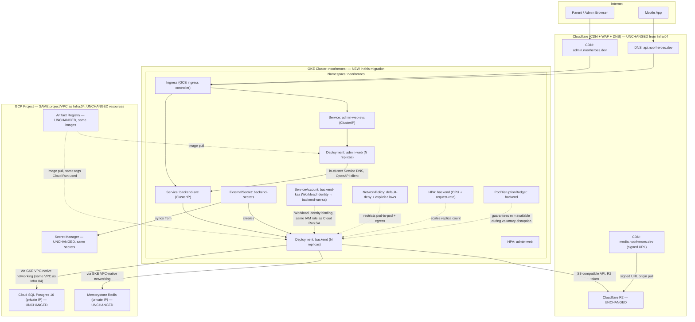

# Phase 11 — Kubernetes Migration Path (Cloud Run/Fargate → K8s, Deferred)

**File ID:** `Development_Blueprints.Phase11_CICD_Deployment.Infra.02-k8s-migration-path-cloud-run-to-k8s.md`
**Phase:** Phase 11 — CI/CD & Deployment Completion (the lowest-urgency item in the entire blueprint — deferred by design, not by neglect)
**Depends on:** `Phase1_Infra_Config.Infra.04-terraform-iac-baseline-staging.md` (the current Cloud Run/Fargate infrastructure this file eventually migrates away from — its module boundaries are the contract this file extends, per that file's §12/§18.6)
**Referenced by (future, not built here):** `Phase11_CICD_Deployment.Infra.01-blue-green-canary-deployment-strategy.md` (production traffic-shifting mechanics, which the K8s target architecture in this file must remain compatible with), any future `CI_CD.11+` pipeline file that adds a Kubernetes deploy stage
**Source authority:** `NoorHeroes_Final_Development_Prompt.md` §7 (Docker, Deployment & Infrastructure — "Production orchestration: Start on a managed container platform... rather than self-managed Kubernetes from day one... Migrate to full Kubernetes (manifests already scaffolded under `infra/k8s/`) once the modular monolith starts getting split into independently-scaled services"), §2.1 (repo structure — `infra/k8s/`, "introduced at Phase 6 (Scale)"), §2.2 (transactional outbox — "this is what makes the later service-extraction path... safe"), §10 Phase 6 roadmap ("extract the first candidate services... migrate from Cloud Run/Fargate to full Kubernetes if warranted"); `NoorHeroes_Consolidated_Blueprint_v6.md` §2.9, §14.3, §18.6, §19.3, §21 (all: "Kubernetes introduced only at the Scale phase," cost-deferral rationale); `FAST-API-INSTRUCTIONS.md` §6 (`/healthz`/`/readyz` health probes, already implemented and already documented as "Kubernetes probes... wired into Kubernetes probes once K8s is introduced")

---

## 0. Deliverable Framing (read this before anything else)

**This file's deliverable is a runbook, not a running cluster.** Nothing in this document is executed as part of implementing it. The Final Development Prompt §7 and the Consolidated Blueprint (§2.9, §14.3, §18.6, §21) are unanimous and explicit: Kubernetes is deferred until the modular monolith is actually being split into independently-scaled services and launch-phase traffic no longer fits Cloud Run/Fargate's operating envelope. Building a live K8s cluster today would directly contradict that guidance and would add operational surface area (control-plane upgrades, node-pool patching, RBAC drift, a second orchestration paradigm to keep in sync with Terraform's Cloud Run reality) with zero traffic to justify it.

What *is* built by implementing this file: a complete, reviewed, version-controlled runbook — trigger criteria, target architecture, example manifests that `kubectl apply --dry-run=client` and `kustomize build`/`helm template` cleanly validate against a real Kubernetes API schema, and a step-by-step execution plan — sitting in the repo, ready to execute the day the trigger criteria in §13.1 actually fire. Every other section of this file is written as "what the migration will do when triggered," not "what to do now."

---

## 1. Objective and Purpose

Produce the documented, pre-validated migration path from the current Cloud Run/Fargate production orchestration (`Infra.04`) to Kubernetes, so that when — not if the team preemptively decides, but if the measurable trigger criteria in §13.1 actually fire — the migration is a matter of executing a known, rehearsed plan against already-written manifests, not a from-scratch architecture exercise done under production-scale pressure.

Three things this objective explicitly does **not** include:
1. Standing up a live GKE/EKS cluster in any environment (staging or production) as part of this file's implementation.
2. Migrating any actual traffic off Cloud Run/Fargate.
3. Deciding *now* that the migration should happen soon — the entire point of the trigger criteria in §13.1 is to make that decision data-driven and later, not aspirational and now.

The concrete deliverable is: (a) this specification document itself, reviewed and merged; (b) an `infra/k8s/` directory containing example/reference Kubernetes manifests (or a Helm chart, see §5) that are schema-valid and structurally complete but are **not** wired into any CI/CD pipeline stage and **not** applied to any real cluster; (c) a runbook (`infra/k8s/README.md` / `docs/runbooks/k8s-migration.md`) a human or a future coding agent can execute step-by-step once triggered.

---

## 2. Scope and Requirements

**In scope for this file:**

1. Explicit, measurable migration trigger criteria (§13.1) — the thing this task description calls out as non-negotiable: no "migrate when needed" hand-waving.
2. The target Kubernetes architecture: Deployments, Services, Ingress, HorizontalPodAutoscalers, NetworkPolicies, and secret-injection pattern for the `backend` (FastAPI) workload, and the equivalent for `admin-web` (Next.js) where it differs.
3. Example manifests (or Helm chart templates) under `infra/k8s/`, kept alongside but structurally separate from `infra/terraform/` (which continues to own Cloud Run/Fargate and every non-compute resource — database, cache, storage, networking, CDN — completely unchanged by this migration, per `Infra.04` §12's explicit module-boundary contract).
4. What changes operationally between Cloud Run/Fargate and K8s for this specific application (orchestration, scaling, networking, ingress, secret injection, RBAC) — and, equally important, what does **not** change (the container images themselves, the database/cache/storage layer, the application code, the health-probe contract).
5. A staging-cluster acceptance bar: the same smoke suite `CI_CD.08` already runs against staging Cloud Run must pass against a staging K8s cluster before any production cutover is even considered.
6. A rollback plan (staying on / falling back to Cloud Run/Fargate) for every stage of the eventual execution.

**Explicitly out of scope:**

- Provisioning a live cluster, node pool, or any billable K8s control plane in any cloud account.
- Any actual DNS or traffic cutover.
- Rewriting application code — the backend's containerization is already K8s-compatible (§3.1); this file changes orchestration, not the FastAPI service itself.
- Splitting the modular monolith into separate services — that is a distinct, its-own-blueprint-item decision (Final Development Prompt §10 Phase 6 / Consolidated Blueprint §3.1) that may *coincide* with the K8s migration trigger but is not the same decision and is not specified by this file.
- Choosing a specific managed K8s vendor irrevocably — §18 states the assumption (GKE, mirroring `Infra.04`'s GCP assumption) and how to re-derive for EKS, exactly as `Infra.04` does for its own compute choice.

---

## 3. Technical Implementation Details

### 3.1 What is already K8s-compatible today (do not rebuild this)

The backend is already built for this future move, per FAST-API-INSTRUCTIONS.md and `Infra.04`:

- **Containerization**: the multi-stage `python:3.12-slim` Dockerfile (Final Development Prompt §7) that Cloud Run runs today is the *exact same image* a K8s Deployment runs tomorrow. No new Dockerfile, no new base image, no new build stage. `admin-web`'s `node:XX-alpine` Next.js standalone-output image is equally K8s-ready as-is.
- **Health probes**: `GET /healthz` (liveness — process status) and `GET /readyz` (readiness — verifies Postgres + Redis connectivity), implemented in `src/noorheroes/api/health.py` (`liveness_check()`, `readiness_check()`), are already documented in FAST-API-INSTRUCTIONS.md §6/§15 as "K8s Orchestrator" probes and are consumed as Cloud Run's `startup_probe`/`liveness_probe` blocks *today*. They are used **verbatim, unchanged** as `livenessProbe`/`readinessProbe` in the K8s Deployment manifest (§4, §6) — this is the single biggest reason the migration is "swap the orchestrator," not "rebuild the health-check contract."
- **Configuration**: `core/settings.py`'s `Settings` (Pydantic settings) already reads all configuration from environment variables / injected secrets, not from a Cloud-Run-specific mechanism — this is orchestrator-agnostic by construction and needs no change.
- **Statelessness**: the backend holds no in-process session state (JWT-based auth, Redis-backed refresh-token denylist per Final Development Prompt §9) and no local filesystem state that survives a restart (uploads go straight to R2 via presigned URLs, per FAST-API-INSTRUCTIONS.md `MediaService`). This is what makes horizontal pod scaling and rolling replacement safe with zero extra work.
- **Graceful shutdown**: `main.py`'s `lifespan()` already disposes the DB engine and resets the Redis pool on shutdown — this is the same hook a K8s `preStop` hook / SIGTERM handling relies on; Cloud Run and K8s both send SIGTERM then wait a grace period before SIGKILL, so this code path is already exercised today, not new.

### 3.2 What actually changes (this is the entire technical delta)

| Concern | Cloud Run/Fargate (today, `Infra.04`) | Kubernetes (this file's target) |
|---|---|---|
| Orchestration unit | A "Service" (Cloud Run) auto-managing revisions | A `Deployment` managing a `ReplicaSet` of Pods explicitly |
| Scaling | Cloud Run's built-in request-concurrency-based autoscaler, `min_instances`/`max_instances` Terraform variables | `HorizontalPodAutoscaler` (HPA) on CPU/memory and/or a custom Prometheus-backed metric (request rate), targeting the `Deployment`'s replica count |
| Scale-to-zero | Supported (`backend_min_instances = 0` in staging today) | Not natively supported by vanilla K8s Deployments/HPA (minimum is 1 unless a scale-to-zero add-on like KEDA is adopted) — a real behavioral difference to plan for, see §10 |
| Networking / ingress | Cloud Run's own HTTPS endpoint + Google-managed cert, fronted by Cloudflare DNS/CDN | An `Ingress` resource (GKE's native GCE ingress controller, or an installed NGINX/Traefik ingress controller) + a `Service` of type `ClusterIP` in front of the Pods, still fronted by the same Cloudflare CDN/WAF layer (§4) — Cloudflare's role is unchanged |
| Container-to-container / east-west traffic | N/A (Cloud Run services don't talk pod-to-pod; `admin-web` → `backend` is over the public/internal HTTPS URL) | In-cluster `Service` DNS (`backend-svc.noorheroes.svc.cluster.local`) available for `admin-web` → `backend` traffic if both are migrated together; NetworkPolicies now needed to restrict which Pods can reach which (§9) |
| Secret injection | Cloud Run reads secrets from GCP Secret Manager at container boot via the platform's native Secret Manager integration (`Infra.04` §9.1) | Two supported patterns, see §9.3: (a) an External Secrets Operator (ESO) syncing GCP Secret Manager → native `Kubernetes Secret` objects, or (b) GCP Secret Manager CSI driver mounting secrets as files directly into the Pod — this file specifies ESO as the default (keeps one secrets source of truth, no plaintext K8s Secret duplication risk beyond the sync) |
| Runtime identity | Cloud Run runtime service account (`backend-run-sa`) attached directly to the Cloud Run service | GKE Workload Identity binding a Kubernetes `ServiceAccount` to the *same* GCP IAM service account (`backend-run-sa` is reused, not recreated — see §9.1) — the IAM permission set carried over from `Infra.04` unchanged |
| Deploy mechanics | `gcloud run deploy` / Terraform `google_cloud_run_v2_service` revision update, built-in traffic-split-based rollback | `kubectl apply` / a GitOps controller (Argo CD/Flux) updating the Deployment's image tag, triggering a `RollingUpdate`; rollback via `kubectl rollout undo` or reverting the Git commit if GitOps-managed |
| Zero-downtime deploys | Native to Cloud Run | Requires explicit `readinessProbe` + `RollingUpdate` strategy (`maxUnavailable`/`maxSurge`) configuration — not automatic, must be specified in the manifest (§4/§6) |
| Node/infra patching | Fully managed by the platform, invisible to the team | Node-pool OS/kubelet patching is the team's responsibility (mitigated by using a managed offering — GKE Autopilot or standard GKE with auto-upgrade — never self-managed control planes, per §18) |
| Cost model | Pay-per-request/pay-per-use, scales to zero | Pay for provisioned node capacity continuously (even a HPA-scaled-down Deployment still occupies at least its `minReplicas` worth of always-on node capacity) — this is itself one of the §13.1 trigger/counter-trigger considerations |

**What explicitly does not change**, restated because it is easy to accidentally over-scope this migration: PostgreSQL (Cloud SQL/RDS), Redis (Memorystore/ElastiCache), Cloudflare R2, and Cloudflare CDN/WAF are **compute-orchestrator-agnostic** and are not touched by this migration at all — `Infra.04`'s `database`, `cache`, `storage`, `networking` (VPC/private connectivity), and `cdn` Terraform modules keep running exactly as they are today. Only `Infra.04`'s `compute` module gets a Kubernetes-targeting sibling (§5, §12). This is the explicit design intent `Infra.04` §12 states: *"this file's module boundaries... are deliberately drawn so that, at the Phase 6/11 migration point, only `modules/compute` needs a Kubernetes-targeting sibling/replacement."*

---

## 4. Architecture and Component Responsibilities

### 4.1 Target K8s architecture (staging-first, single-region — mirrors `Infra.04`'s staging scope)



### 4.2 Component responsibility table

| Component | Responsibility | Manifest / resource |
|---|---|---|
| `Deployment: backend` | Declarative desired-state Pod spec for the FastAPI service — replica count (HPA-managed floor/ceiling), container image, resource requests/limits, `livenessProbe`/`readinessProbe`/`startupProbe` wired to `/healthz`/`/readyz`, rolling-update strategy | `infra/k8s/base/backend/deployment.yaml` |
| `Deployment: admin-web` | Same pattern for the Next.js standalone-output image | `infra/k8s/base/admin-web/deployment.yaml` |
| `Service: backend-svc` | Stable ClusterIP + DNS name (`backend-svc.noorheroes.svc.cluster.local`) fronting the backend Pods for both the Ingress and in-cluster `admin-web` → `backend` traffic | `infra/k8s/base/backend/service.yaml` |
| `Service: admin-web-svc` | Same pattern for admin-web | `infra/k8s/base/admin-web/service.yaml` |
| `Ingress` | Single entry point routing `api.<domain>` → `backend-svc`, `admin.<domain>` → `admin-web-svc`; terminates TLS at the ingress (GKE-managed cert or cert-manager, matching `Infra.04`'s "never manually renewed certs" requirement) | `infra/k8s/base/ingress.yaml` |
| `HorizontalPodAutoscaler` (×2) | Scales `backend`/`admin-web` replica counts within `minReplicas`/`maxReplicas` bounds against CPU utilization and, for `backend`, a custom Prometheus Adapter metric (`http_requests_per_second`) sourced from the OTel/Prometheus instrumentation FAST-API-INSTRUCTIONS.md already documents | `infra/k8s/base/backend/hpa.yaml`, `.../admin-web/hpa.yaml` |
| `PodDisruptionBudget` (×2) | Guarantees `minAvailable` Pods stay up during voluntary disruptions (node drains, cluster upgrades) — the K8s-native equivalent of Cloud Run's implicit availability during platform maintenance | `infra/k8s/base/backend/pdb.yaml`, `.../admin-web/pdb.yaml` |
| `ServiceAccount: backend-ksa` | Kubernetes-native identity, bound via GKE Workload Identity to the **same** `backend-run-sa` GCP IAM service account `Infra.04` already created and scoped — no new IAM roles invented, only a new binding (`iam.gke.io/gcp-service-account` annotation) added to the existing SA | `infra/k8s/base/backend/serviceaccount.yaml` |
| `ExternalSecret: backend-secrets` | Declares which GCP Secret Manager secrets (same secret IDs `Infra.04`'s `modules/secrets` created) to sync into a native `Secret` object the Deployment mounts as env vars — kept in sync on a poll interval by the External Secrets Operator | `infra/k8s/base/backend/externalsecret.yaml` |
| `NetworkPolicy` | Default-deny ingress/egress at the namespace level, with explicit allows: `admin-web` → `backend` (in-cluster), `backend` → DNS, `backend` → Cloud SQL/Memorystore private-IP ranges, `backend` → R2/Secret Manager (via HTTPS egress), Ingress controller → both Services. Nothing else is reachable | `infra/k8s/base/networkpolicy.yaml` |
| `PriorityClass` (optional, production-tier only) | Ensures `backend` Pods preempt lower-priority workloads under node pressure, if the cluster is ever shared with non-NoorHeroes workloads | `infra/k8s/overlays/production/priorityclass.yaml` |

---

## 5. Folder / File Structure

Lives under `infra/k8s/`, which the Final Development Prompt §2.1 already names as a placeholder ("manifests/Helm charts, introduced at Phase 6") — this file is what finally populates it, as **reference/example manifests only**, kept structurally separate from `infra/terraform/` so the two never entangle: Terraform continues to own every resource this migration does not change (§3.2), and `infra/k8s/` owns only the new compute-orchestration layer.

**Packaging choice: Kustomize (base + overlays), not a Helm chart**, for this file's default recommendation — reasoning documented in §18. A Helm chart is an acceptable, explicitly-allowed alternative (many teams standardize on Helm); if the team prefers Helm, translate the `base/` directory 1:1 into `templates/` with `values.yaml` exposing the same knobs the Kustomize overlays expose (`replicas`, `image tag`, `resource requests/limits`, `hostnames`) — the manifest *content* below is authoritative either way, only the templating mechanism differs.

```
infra/k8s/
├── README.md                              # this file's runbook — trigger criteria, execution steps, rollback plan
├── base/                                  # environment-agnostic manifests (Kustomize base)
│   ├── kustomization.yaml                 # lists all resources below
│   ├── namespace.yaml                     # `noorheroes` namespace
│   ├── networkpolicy.yaml                 # default-deny + explicit allows (§9.2)
│   ├── backend/
│   │   ├── deployment.yaml
│   │   ├── service.yaml
│   │   ├── hpa.yaml
│   │   ├── pdb.yaml
│   │   ├── serviceaccount.yaml
│   │   └── externalsecret.yaml
│   ├── admin-web/
│   │   ├── deployment.yaml
│   │   ├── service.yaml
│   │   ├── hpa.yaml
│   │   ├── pdb.yaml
│   │   └── serviceaccount.yaml
│   └── ingress.yaml
├── overlays/
│   ├── staging/
│   │   ├── kustomization.yaml             # patches: image tags, replica floor (1), resource sizing (staging-scale)
│   │   ├── backend-patch.yaml
│   │   └── admin-web-patch.yaml
│   └── production/                        # placeholder-level detail only — NOT built/wired in this file's scope
│       ├── kustomization.yaml             # patches: replica floor ≥ 3, PriorityClass, stricter PDB, production resource sizing
│       ├── backend-patch.yaml
│       └── admin-web-patch.yaml
├── cluster-bootstrap/                     # one-time, cluster-level (not namespace-level) prerequisites
│   ├── external-secrets-operator.yaml     # Helm-installed via a documented `helm install` command in README, values pinned here
│   ├── ingress-controller-notes.md        # GKE-native ingress requires no install; documents the NGINX-ingress alternative if EKS/self-managed
│   ├── cert-manager-notes.md              # only needed if not using GKE-managed certs
│   └── prometheus-adapter-notes.md        # wiring the existing Prometheus metrics (FAST-API-INSTRUCTIONS.md) into HPA's custom-metrics API
└── validation/
    ├── kubeconform-schema-check.sh        # `kustomize build overlays/staging | kubeconform -strict` — CI-runnable, cluster-free validation
    └── expected-resources.txt             # golden list of resource kinds/names `kustomize build` must produce, for drift detection
```

This directory tree, its manifests, and `validation/` scripts are all buildable and lintable **without any cluster or cloud credentials** — that is deliberate (§14) so this file's Definition of Done (§17) can be met with zero live infrastructure.

---

## 6. APIs, Models, Interfaces, and Data Flow

Kubernetes introduces no new application-level API surface — every FastAPI route, Pydantic schema, and OpenAPI contract documented in FAST-API-INSTRUCTIONS.md is unchanged by this migration. What this section specifies instead is the **manifest interface contract** (the K8s equivalent of `Infra.04` §6's Terraform variables/outputs contract) and the request-time data flow once migrated.

### 6.1 `backend/deployment.yaml` — interface sketch

```yaml
apiVersion: apps/v1
kind: Deployment
metadata:
  name: backend
  namespace: noorheroes
  labels:
    app: backend
spec:
  replicas: 2                              # overridden per-overlay; HPA manages this post-deploy
  strategy:
    type: RollingUpdate
    rollingUpdate:
      maxUnavailable: 0                    # zero-downtime: never drop below current capacity
      maxSurge: 1
  selector:
    matchLabels:
      app: backend
  template:
    metadata:
      labels:
        app: backend
    spec:
      serviceAccountName: backend-ksa
      terminationGracePeriodSeconds: 30    # matches main.py's lifespan() shutdown handling
      containers:
        - name: backend
          image: us-central1-docker.pkg.dev/noorheroes-staging/noorheroes-containers/backend:<git-sha>   # SAME image Infra.04's compute module already deploys to Cloud Run
          ports:
            - containerPort: 8000
          envFrom:
            - secretRef:
                name: backend-secrets       # populated by ExternalSecret, see §9.3
          resources:
            requests:
              cpu: "250m"
              memory: "256Mi"
            limits:
              cpu: "1"
              memory: "512Mi"
          startupProbe:
            httpGet: { path: /healthz, port: 8000 }
            failureThreshold: 30
            periodSeconds: 2                # generous startup allowance for DB migration/connection-pool warmup
          livenessProbe:
            httpGet: { path: /healthz, port: 8000 }
            periodSeconds: 10
            failureThreshold: 3
          readinessProbe:
            httpGet: { path: /readyz, port: 8000 }
            periodSeconds: 5
            failureThreshold: 3
```

Note the direct reuse of the **existing, unmodified** `/healthz` and `/readyz` endpoints as `livenessProbe`/`readinessProbe` targets — this is the literal implementation of the task requirement "using the existing `/healthz`/`/readyz` probes directly as liveness/readiness probes," and it is why FAST-API-INSTRUCTIONS.md already documents these two endpoints as "K8s Orchestrator" consumers even while the app runs on Cloud Run today.

### 6.2 `backend/hpa.yaml` — interface sketch

```yaml
apiVersion: autoscaling/v2
kind: HorizontalPodAutoscaler
metadata:
  name: backend
  namespace: noorheroes
spec:
  scaleTargetRef:
    apiVersion: apps/v1
    kind: Deployment
    name: backend
  minReplicas: 2                            # staging overlay: 1 acceptable; production overlay: ≥ 3, see §15
  maxReplicas: 20
  metrics:
    - type: Resource
      resource:
        name: cpu
        target: { type: Utilization, averageUtilization: 65 }
    - type: Pods
      pods:
        metric: { name: http_requests_per_second }   # via Prometheus Adapter, sourced from the app's existing OTel/Prometheus metrics
        target: { type: AverageValue, averageValue: "50" }
  behavior:
    scaleDown:
      stabilizationWindowSeconds: 300        # avoid flapping — same rationale as Cloud Run's own scale-down debounce
```

### 6.3 Data flow

**Request-time (once migrated):**
1. Mobile client / admin-web browser → Cloudflare (`CF_API`/`CF_ADMIN`, unchanged) → GKE `Ingress`.
2. `Ingress` routes by hostname to `backend-svc` or `admin-web-svc` (`ClusterIP` Services), which load-balance across healthy (readiness-probe-passing) backend Pods.
3. Backend Pod reads DB/Redis connection strings from the `backend-secrets` `Secret` (synced by ESO from the same Secret Manager secrets `Infra.04` already populated), connects to Cloud SQL/Memorystore over the same private VPC connectivity `Infra.04`'s `networking` module already provisions (GKE nodes live in the same VPC, so no new peering is introduced).
4. Media requests: identical to today — backend issues a Cloudflare-signed URL pointing at `CF_MEDIA`, unchanged.
5. `admin-web` → `backend` calls: **new option available**, not mandatory — can use in-cluster Service DNS (`http://backend-svc.noorheroes.svc.cluster.local:8000`) instead of the public API hostname, reducing latency and avoiding a Cloudflare round-trip for internal calls; documented as a follow-up optimization, not required for cutover parity (§13.2 step 9 keeps the public-hostname call pattern for the initial migration to minimize simultaneous changes).

**Deploy-time (once migrated):**
1. CI (a new pipeline stage, out of this file's scope — see §12) builds and pushes the same image `Infra.04`'s Cloud Run deploy step already builds, to the same Artifact Registry.
2. `kustomize build overlays/<env> | kubectl apply -f -` (or a GitOps controller reconciling the same rendered manifests) updates the Deployment's image tag.
3. Kubernetes performs the `RollingUpdate`: new Pods created, `startupProbe` then `readinessProbe` must pass before the Pod receives traffic; old Pods terminated only after new ones are ready, respecting `maxUnavailable: 0`.
4. `PodDisruptionBudget` ensures a concurrent node drain (e.g. a cluster upgrade) cannot violate the same availability guarantee.

---

## 7. Dependencies and Configuration Requirements

| Dependency | Why | Where configured |
|---|---|---|
| A GKE cluster (staging first) — **not provisioned by this file** | The manifests in `infra/k8s/` need a real Kubernetes API to validate against beyond schema-checking, and to actually execute the migration once triggered | Provisioned only at §13.2 execution time, via a new `infra/terraform/modules/compute-k8s` (or `modules/gke-cluster`) Terraform module — sketched in §12, not built here |
| External Secrets Operator (ESO) | Syncs GCP Secret Manager secrets into native K8s `Secret` objects without duplicating the secrets-management architecture `Infra.02`/`Infra.04` already established | `cluster-bootstrap/external-secrets-operator.yaml`, installed via Helm at cluster-bootstrap time (§13.2 step 4) |
| Prometheus Adapter | Exposes the backend's existing Prometheus metrics (FAST-API-INSTRUCTIONS.md — already instrumented) to the K8s `custom.metrics.k8s.io` API so the HPA can scale on request rate, not just CPU | `cluster-bootstrap/prometheus-adapter-notes.md` |
| GKE-managed certificates (or cert-manager if EKS/self-managed ingress) | Matches `Infra.04`'s "SSL: Automated... never manually renewed certs" requirement, carried forward unchanged | `base/ingress.yaml` `networking.gke.io/managed-certificates` annotation |
| Kustomize (bundled with `kubectl` ≥ 1.14) or Helm ≥ 3, `kubeconform` | Manifest rendering and cluster-free schema validation, run in CI without cluster credentials | `infra/k8s/validation/kubeconform-schema-check.sh`, versions pinned in the repo's dev-tooling manifest alongside Terraform's own pinned CLI versions (`Infra.04` §7) |
| Same Artifact Registry, Secret Manager, VPC, Cloud SQL, Memorystore, R2 as `Infra.04` | Zero new data-plane infrastructure — the migration reuses every non-compute resource `Infra.04` already provisions | `Infra.04`'s Terraform outputs (`database_connection_name`, `redis_host`, `r2_bucket_name`, etc.) are the exact same values the K8s manifests reference |
| GKE Workload Identity enabled on the cluster | Lets K8s `ServiceAccount`s impersonate the existing GCP IAM service accounts (`backend-run-sa`) without any static key | Cluster-level GKE feature flag, set at cluster-creation time in the (not-yet-built) `modules/compute-k8s` |

No new secret-key names, no new vendor, no new database, no new storage — this file's dependency surface is deliberately narrow: **orchestration tooling only**.

---

## 8. Database / Storage Requirements

**Unchanged, by design.** Restating this explicitly because it is the single most important scoping boundary in this file:

- **PostgreSQL (Cloud SQL/RDS)**: the same instance, same version (Postgres 16, matching `Infra.04` §8.1), same private-IP-only posture, same backup/PITR configuration, same least-privilege `noorheroes_app` DB user. Kubernetes Pods reach it over the same VPC private connectivity Cloud Run already uses (GKE nodes and Cloud Run's Serverless VPC Access connector both terminate inside the same `Infra.04`-provisioned VPC — no new peering, no new firewall rule beyond what §9.2's NetworkPolicy adds at the K8s layer).
- **Redis (Memorystore/ElastiCache)**: same instance, same auth-enabled/private-IP posture, same three consumers (rate limiting, Celery broker/result backend, short-TTL read caches) as documented in `Infra.04` §8.2.
- **Cloudflare R2**: same bucket(s), same private-by-default posture, same presigned-URL flow via the unmodified `R2StorageService`. Migrating compute to K8s changes nothing about how the backend talks to R2 — it is still an S3-compatible HTTPS API call from within the Pod, identical to today's call from within the Cloud Run container.
- **Terraform's `database`/`cache`/`storage` modules**: not touched, not forked, not duplicated. The eventual `modules/compute-k8s` module (§12) consumes their existing *outputs* (`connection_name`, `host`, `bucket_name`) exactly as `modules/compute` does today — it does not reimplement or re-provision any of them.

If a future, separate blueprint item introduces a genuinely stateful K8s workload (e.g. a self-managed queue or search index that doesn't fit the "managed service" pattern), that is out of scope for this file — this migration's data layer is 100% managed-service-external-to-the-cluster, consistent with the "don't self-host what a managed service already does well" posture the Final Development Prompt applies to Redis (§7: "do not self-host Redis in production without a strong operational reason").

---

## 9. Authentication, Authorization, Validation, and Security Considerations

### 9.1 Workload identity (reusing, not recreating, IAM)

```yaml
# base/backend/serviceaccount.yaml
apiVersion: v1
kind: ServiceAccount
metadata:
  name: backend-ksa
  namespace: noorheroes
  annotations:
    iam.gke.io/gcp-service-account: backend-run-sa@noorheroes-staging.iam.gserviceaccount.com   # the SAME SA Infra.04 §9.1 already created for Cloud Run
```

The IAM binding step (`gcloud iam service-accounts add-iam-policy-binding ... --role roles/iam.workloadIdentityUser`) is a cluster-bootstrap-time action, documented in the runbook (§13.2 step 6), not a new Terraform resource duplicating `Infra.04`'s existing `google_service_account.backend_run_sa` and its `google_project_iam_member`/`google_secret_manager_secret_iam_member` bindings — those roles carry over unchanged. `admin-web`'s K8s ServiceAccount (`admin-web-ksa`) mirrors the same "no direct DB/Redis IAM roles" restriction `Infra.04` §9.1 already documents for `admin_run_sa`.

### 9.2 Network policy (new — this is genuinely new attack-surface reduction K8s enables that Cloud Run's model doesn't expose the same way)

```yaml
# base/networkpolicy.yaml
apiVersion: networking.k8s.io/v1
kind: NetworkPolicy
metadata:
  name: default-deny-all
  namespace: noorheroes
spec:
  podSelector: {}
  policyTypes: [Ingress, Egress]
---
apiVersion: networking.k8s.io/v1
kind: NetworkPolicy
metadata:
  name: backend-allow
  namespace: noorheroes
spec:
  podSelector:
    matchLabels: { app: backend }
  policyTypes: [Ingress, Egress]
  ingress:
    - from:
        - namespaceSelector: {}          # scoped further to the ingress-controller namespace in the real manifest
          podSelector: { matchLabels: { app: admin-web } }
        - namespaceSelector: { matchLabels: { kubernetes.io/metadata.name: ingress-system } }
  egress:
    - to: []                              # DNS
      ports: [{ protocol: UDP, port: 53 }]
    - to:
        - ipBlock: { cidr: <cloud-sql-private-ip>/32 }
      ports: [{ protocol: TCP, port: 5432 }]
    - to:
        - ipBlock: { cidr: <memorystore-private-ip>/32 }
      ports: [{ protocol: TCP, port: 6379 }]
    - to: []                              # HTTPS egress for Secret Manager, R2, AI providers, store-webhook targets
      ports: [{ protocol: TCP, port: 443 }]
```

Default-deny at the namespace level, with explicit, narrow allow rules — the K8s-native equivalent of least-privilege that Cloud Run does not offer at this granularity (Cloud Run services can reach anything their egress config permits at the VPC/firewall level, not at a per-workload L4 policy level). This is a genuine security *improvement* the migration enables, called out so it isn't lost as "just an orchestration change."

### 9.3 RBAC

- No workload runs as `cluster-admin` or any broad role. `backend-ksa`/`admin-web-ksa` have **no** Kubernetes RBAC `Role`/`ClusterRole` bindings at all beyond the implicit default (they don't need to call the K8s API from inside the app — nothing in the FastAPI codebase does).
- Human/CI RBAC: a `Role` scoped to the `noorheroes` namespace (`get`/`list`/`watch`/`patch` on `deployments`, `pods`, `events`; `get`/`list` on `secrets` explicitly **excluded** from broad human access — secret *values* are never read via `kubectl get secret -o yaml` as a normal workflow, only via the ESO sync path) is granted to the CI service account that runs `kubectl apply`, mirroring `Infra.04` §9.2's "least-privilege project roles" philosophy applied at the K8s layer.
- Cluster-admin-level access (for cluster-bootstrap operations — installing ESO, Prometheus Adapter) is a named, audited, break-glass-style human action, not a standing CI credential — same posture `Infra.04` §11.1 applies to its own state-bucket break-glass access.

### 9.4 Secret injection (External Secrets Operator, the default pattern)

```yaml
# base/backend/externalsecret.yaml
apiVersion: external-secrets.io/v1beta1
kind: ExternalSecret
metadata:
  name: backend-secrets
  namespace: noorheroes
spec:
  refreshInterval: 1h
  secretStoreRef:
    name: gcp-secret-manager-store
    kind: ClusterSecretStore
  target:
    name: backend-secrets          # the native K8s Secret Deployment's envFrom references
  data:
    - secretKey: DATABASE_URL
      remoteRef: { key: noorheroes-staging-database-url }     # SAME Secret Manager secret Infra.04's modules/secrets already created
    - secretKey: REDIS_URL
      remoteRef: { key: noorheroes-staging-redis-url }
    - secretKey: R2_ACCESS_KEY_ID
      remoteRef: { key: noorheroes-staging-r2-access-key-id }
    - secretKey: R2_SECRET_ACCESS_KEY
      remoteRef: { key: noorheroes-staging-r2-secret-access-key }
    - secretKey: JWT_SIGNING_KEY
      remoteRef: { key: noorheroes-staging-jwt-signing-key }
```

No secret value is ever committed to `infra/k8s/` — `ExternalSecret` manifests reference Secret Manager key *names* only, exactly the same discipline `Infra.04` §9.4 applies to Terraform (`sensitive = true` variables, never hardcoded values). The **CSI-driver alternative** (mounting secrets as files instead of syncing to a native `Secret` object, avoiding secret material existing as a K8s API object at all) is documented as the stricter, opt-in alternative for production (§15) — ESO is the default because it composes more simply with `envFrom` and the app's existing `Settings` class reading from environment variables, requiring zero application-code change.

### 9.5 Pod-level hardening

- `securityContext.runAsNonRoot: true`, a non-root `USER` already set in the existing multi-stage Dockerfile (verify this is already true — if the current Dockerfile runs as root, that is a pre-existing gap this migration surfaces, not one this file introduces or is responsible for fixing beyond flagging it in §10).
- `readOnlyRootFilesystem: true` where the application permits (the backend writes nothing to local disk at runtime per §3.1's statelessness note — verify no temp-file usage breaks this before enabling in production).
- Pod Security Standards: the `noorheroes` namespace is labeled `pod-security.kubernetes.io/enforce: restricted` (the strictest built-in K8s Pod Security Standard tier), rejecting any Pod spec that doesn't meet the above hardening at admission time — a defense-in-depth backstop, not a substitute for writing the manifest correctly in the first place.

---

## 10. Error Handling and Edge Cases

| Scenario | Handling |
|---|---|
| A Pod crash-loops (bad config, migration not yet run against a fresh DB) | `livenessProbe` failures restart the container per K8s's normal Pod lifecycle; if `readinessProbe` never passes, the Pod never receives traffic, so a bad rollout degrades to "new Pods unhealthy, old Pods still serving" rather than an outage — this is a **strictly better** failure mode than a bad Cloud Run revision if `maxUnavailable: 0` is respected; CI must gate on `kubectl rollout status` succeeding before considering a deploy complete, and auto-trigger `kubectl rollout undo` on timeout |
| HPA thrashing (rapid scale up/down under bursty load) | `behavior.scaleDown.stabilizationWindowSeconds` (§6.2) debounces scale-down; scale-up has no such debounce by design (K8s default), matching the "scale up fast, scale down cautiously" pattern already implicit in Cloud Run's own autoscaler behavior |
| Cluster autoscaler can't provision a new node fast enough for a burst (HPA wants more Pods than current node capacity allows) | Pods go `Pending`; this is the K8s-native equivalent of Cloud Run's own cold-start-under-burst behavior, but potentially slower (new *node* provisioning, not just new *container instance*) — mitigated in production by a non-zero `minReplicas` and, if load is predictable (e.g. known peak hours), a scheduled `minReplicas` bump via a CronJob-driven HPA patch or a dedicated always-on node pool sized for baseline load |
| Scale-to-zero gap vs. Cloud Run staging today | Vanilla K8s HPA cannot scale a Deployment to 0 replicas (`minReplicas` must be ≥ 1) — staging on K8s therefore costs more than staging on Cloud Run's `min_instances = 0` today; either accept this as a deliberate tradeoff for staging-cluster realism (§14), or adopt KEDA (Kubernetes Event-Driven Autoscaling) if true scale-to-zero staging cost parity becomes a requirement — documented here as an explicit, named gap, not silently glossed over |
| ExternalSecret sync fails (Secret Manager unreachable, IAM misconfigured) | Pods referencing a `Secret` that ESO hasn't yet created fail to start (`CreateContainerConfigError`) — visible immediately via `kubectl get pods`/Pod events, not a silent stale-secret situation; ESO's `refreshInterval` means a *rotated* secret propagates within that window, not instantly — document this latency explicitly against the JWT-signing-key rotation runbook if/when one exists |
| NetworkPolicy misconfigured too strictly (blocks a legitimate egress path, e.g. an AI provider API call) | Surfaces as application-level connection timeouts/errors in structured logs (`StructuredLoggingMiddleware`) and OTel traces, not a K8s-level error — the runbook (§13.2) includes a staging soak period specifically to catch this class of issue before any production cutover, mirroring `Infra.04` §9.5's "WAF starts in log-only mode" bake-in philosophy applied to NetworkPolicy (start permissive-but-logged via a network policy audit tool if available, tighten before production) |
| Ingress controller / GKE-managed certificate provisioning delay | Managed certs can take up to ~60 minutes to provision on first creation (a real, commonly-hit GKE gotcha) — the runbook explicitly calls this out so a migration execution isn't mistaken for "broken" during that window |
| Two concurrent `kubectl apply`/GitOps reconciliations | Kubernetes' own optimistic-concurrency `resourceVersion` mechanism rejects a stale-based conflicting write; if GitOps-managed (Argo CD/Flux), the controller serializes reconciliation loops, avoiding the concurrent-human-`apply` race entirely — documented as a reason to prefer GitOps for the eventual production execution (§15) |
| Rollback needed mid-migration (staging K8s is broken, Cloud Run staging still running) | Because this migration does not touch `Infra.04`'s Cloud Run resources until DNS is actually cut over (§13.2 step 12), rollback at any point before that step is simply "stop working on K8s, DNS/traffic never left Cloud Run" — zero-risk by construction. After DNS cutover, rollback is "point Cloudflare DNS back at the Cloud Run URL," which `Infra.04`'s Cloud Run service remains warm and ready to serve throughout a documented soak period (§13.2 step 13) specifically so this rollback stays cheap |

---

## 11. State Management and Lifecycle Considerations

**Application state**: unchanged from today — no new state is introduced by this migration. All durable state lives in Cloud SQL/Memorystore/R2, exactly as it does on Cloud Run (§8). Pods are as disposable as Cloud Run container instances are today; a Pod restart, reschedule, or replacement carries zero data-loss risk by the same statelessness argument as §3.1.

**K8s object lifecycle** (this is new — Cloud Run has no equivalent concept):

- **Deployment revision history**: K8s retains a bounded history of `ReplicaSet` revisions (`revisionHistoryLimit`, set to `5` in the manifest) enabling `kubectl rollout undo` to a specific prior revision — the direct K8s analog of Cloud Run's revision-based rollback, and part of why rollback mechanics don't need to be reinvented, only re-expressed in K8s terms.
- **Pod lifecycle and graceful termination**: on scale-down or rolling update, K8s sends SIGTERM, waits `terminationGracePeriodSeconds` (30s, matching `main.py`'s existing `lifespan()` shutdown handling — DB engine disposal, Redis pool reset), then SIGKILLs if still running. This must be verified empirically during the staging soak (§14) — if 30s proves insufficient under real in-flight-request load, extend it; do not silently truncate in-flight requests to hit a shorter number.
- **HPA state**: the HPA continuously reconciles desired replica count against live metrics — there is no "final" replica count to hardcode; `minReplicas`/`maxReplicas` are the only stable, human-set values, everything between them is the HPA's runtime decision, re-evaluated roughly every 15s (K8s default `--horizontal-pod-autoscaler-sync-period`).
- **ExternalSecret sync state**: the synced `Secret` object is itself a K8s-managed resource with its own lifecycle (recreated/updated on each successful ESO sync) — Pods reading it via `envFrom` do **not** automatically pick up a change without a Pod restart (env vars are injected at container start, not live-reloaded); document this as an operational fact: a secret rotation requires either a manual rolling restart (`kubectl rollout restart deployment/backend`) or a tool like Reloader/Stakater that watches `Secret` changes and triggers one automatically — decide which at execution time (§13.2), not speculatively now.
- **Cluster-level lifecycle** (node pool upgrades, control-plane version upgrades): owned by the managed platform (GKE auto-upgrade channel, matching the "never self-managed control planes" assumption in §18) — this file's manifests are written to tolerate a node drain gracefully via the `PodDisruptionBudget` (§4.2), which is the correct K8s-native mechanism for this, not a workaround.

---

## 12. Integration Points with Existing Modules

| Integration point | Detail |
|---|---|
| `Infra.04` Terraform `compute` module | This migration adds a **new, sibling** module — `modules/compute-k8s` (GKE cluster, node pool, Workload Identity pool binding) — it does **not** modify or replace `modules/compute` (Cloud Run) until the actual cutover step (§13.2 step 12), and even then the recommendation is to leave `modules/compute` intact and simply stop routing traffic to it for a full soak period (§13.2 step 13) before ever considering its removal, exactly mirroring the rollback-safety reasoning in §10 |
| `Infra.04` Terraform `networking`/`database`/`cache`/`storage`/`cdn`/`secrets` modules | Consumed as-is via their existing outputs (§8, §9.1, §9.4) — zero modification |
| `CI_CD.06-ci-pipeline-lint-test-build-stages.md` | The build stage that produces and tags the container image is reused unchanged — K8s consumes the exact same Artifact Registry image tag Cloud Run consumes today; only a *new*, separate deploy stage variant (not built by this file) would eventually call `kubectl apply`/GitOps sync instead of `gcloud run deploy` |
| `CI_CD.08-ci-pipeline-deploy-staging-e2e-smoke.md` | The existing smoke suite (hitting `/healthz`/`/readyz` per FAST-API-INSTRUCTIONS.md) is the **exact same suite** §14 requires a staging K8s cluster to pass — no new smoke-test logic is written; only its target URL changes (staging K8s `Ingress` hostname instead of the Cloud Run service URL) |
| `Phase11_CICD_Deployment.Infra.01-blue-green-canary-deployment-strategy.md` (future, sibling file) | The production cutover step in this file's execution plan (§13.2) is a **canary DNS/traffic shift at the Cloudflare layer**, not a K8s-native traffic-splitting mechanism (e.g. Istio/Linkerd) — this deliberately reuses whatever canary mechanism that file specifies for Cloud Run→Cloud Run canaries, applied instead to a Cloud-Run→K8s cutover, so the team does not need to learn two different canary systems |
| `Infra.05-observability-stack-bootstrap.md` | The backend's existing Prometheus/OTel instrumentation (FAST-API-INSTRUCTIONS.md) is scraped identically whether the source is a Cloud Run container or a K8s Pod — Prometheus Adapter (§7) additionally exposes these same metrics to the HPA, but the underlying metrics pipeline `Infra.05` stands up is not rebuilt, only pointed at a new scrape target (K8s Pod annotations / a `ServiceMonitor` if Prometheus Operator is used) |
| `FAST-API-INSTRUCTIONS.md` health probes | Consumed directly and without modification, as detailed throughout §3.1, §4, §6.1 — this is the most load-bearing integration point in the entire file: the backend was built with exactly this K8s move already in mind |
| Mobile app (`core-network` Ktor client) and Admin Portal (`lib/api-client`) | Neither needs any code change — both talk to the backend via its public hostname (`api.<domain>`), which after cutover simply resolves through a different Cloudflare-fronted origin (K8s Ingress instead of Cloud Run URL); the OpenAPI contract, auth flow, and JWT claim schema are 100% unaffected by this migration |

---

## 13. Development Steps in the Correct Order

This section is split, per this file's deferred nature, into (a) the criteria that must actually fire before any of (b) is executed, and (b) the execution plan to follow **only once triggered**.

### 13.1 Migration Trigger Criteria (evaluate quarterly against real production telemetry; do not act on any single criterion in isolation — see the "and" logic below)

**Primary triggers — the migration should be scheduled once *any two or more* of the following are true, sustained for at least 4 consecutive weeks (not a single traffic spike):**

1. **Concurrent-request ceiling.** Backend traffic sustains a level where Cloud Run's per-instance concurrency (default 80, tunable) combined with the `Infra.04`-configured `backend_max_instances` ceiling would require raising `max_instances` past **~50 concurrent instances in production** to maintain the p95 < 500ms home-feed latency target (Consolidated Blueprint §14.1) — at that instance count, per-request cost and cold-start variance under Cloud Run's model become worse than a right-sized, warm K8s node pool would deliver. (Numeric threshold flagged as a proposed default, per the same "propose... confirm actual business-acceptable targets" pattern `Infra.04`/Final Development Prompt §7 apply to RPO/RTO — confirm against real observed Cloud Run instance-count telemetry once production traffic exists, before treating 50 as gospel.)
2. **Service-extraction pressure.** The modular monolith has actually begun splitting into independently-deployed services per Final Development Prompt §10 Phase 6 / Consolidated Blueprint §3.1 (the named first candidates: media transcoding, notification dispatch, or AI inference — "whichever is the actual bottleneck by real traffic data, not speculation"), and at least **two** independently-deployed services now need materially different scaling profiles, deployment cadences, or resource shapes than a single Cloud Run service abstraction comfortably expresses (e.g. one service is CPU-bound and bursty, another is memory-bound and steady — Cloud Run's one-size-fits-one-service model starts requiring N separate Cloud Run services with duplicated cross-cutting config, which is exactly the operational pattern K8s namespaces/shared-cluster tooling exist to consolidate).
3. **Stateful-workload need.** A confirmed product/engineering requirement emerges for a workload Cloud Run structurally cannot host well — e.g. a self-hosted search index, a long-lived WebSocket/streaming connection pool beyond Cloud Run's request-timeout model, or a workload needing `StatefulSet`-style stable network identity/storage. (As of this file's authoring, no such requirement exists anywhere in the PRD/blueprint corpus reviewed — this criterion exists so the trigger list is complete, not because it is currently anticipated.)
4. **Cost crossover.** A cost analysis (using real production Cloud Run billing data, not staging estimates) shows that sustained, non-bursty baseline load makes continuously-provisioned K8s node capacity cheaper than Cloud Run's pay-per-request pricing at the then-current traffic volume — concretely, when the trailing-90-day average Cloud Run compute bill exceeds the *fully-loaded* cost of an equivalently-sized always-on GKE node pool (node cost + the incremental K8s operational overhead estimated in §15) by a sustained **20% or more**, cost alone becomes a legitimate independent trigger even absent (1)–(3).
5. **Team scale.** Engineering headcount and on-call maturity have grown to the point where dedicated platform/SRE capacity exists to own K8s operations (node-pool patching cadence, RBAC hygiene, cluster upgrade testing) as an ongoing responsibility — this is a **necessary precondition**, not sufficient alone: do not migrate solely because headcount grew if none of (1)–(4) also apply, since K8s operational overhead without a load/architecture reason to justify it is pure cost with no corresponding benefit, exactly the outcome the Final Development Prompt's deferral guidance is designed to prevent.

**Explicit counter-triggers — do not migrate even if one criterion above technically fires, if any of these hold:**

- Traffic growth is a short-term spike (a marketing campaign, a seasonal Ramadan-mode surge per Consolidated Blueprint §8) rather than a sustained baseline shift — Cloud Run's autoscaling already handles bursts; a burst is not evidence the *baseline* has outgrown Cloud Run.
- No dedicated platform/SRE capacity exists yet (criterion 5 fails) — migrating without ownership capacity trades a managed-platform problem for an unmanaged self-inflicted one.
- The service-extraction work (criterion 2) is still speculative/planned rather than actually in progress — do not migrate *in anticipation of* extraction; migrate *because of* extraction already underway, per the Final Development Prompt's own "extract when justified... not speculation" philosophy (§10 Phase 6).

### 13.2 Execution Steps (to follow once §13.1 fires — not before)

1. **Re-validate this document.** Confirm the trigger criteria that fired, re-read this file in full (things may have drifted since it was written — provider API schemas, GKE feature availability), and get explicit sign-off from engineering leadership that the migration is starting, referencing which §13.1 criteria are met.
2. **Confirm the cloud-provider/managed-K8s choice** (§18) — GKE assumed by default (mirrors `Infra.04`'s GCP assumption); re-derive for EKS if AWS was actually chosen, following the same "same module boundary, different provider resources" pattern `Infra.04` §18 already establishes for its own compute choice.
3. **Build `modules/compute-k8s`** in `infra/terraform/` — a new Terraform module (GKE cluster, standard mode with auto-upgrade *or* Autopilot — see §18 for the tradeoff — node pool(s), Workload Identity enablement) that reuses `Infra.04`'s existing `networking` module's VPC output; does **not** touch `modules/compute` (Cloud Run) at all yet.
4. **Cluster-bootstrap** (once, per environment, starting with staging): install External Secrets Operator, Prometheus Adapter, and (if not using GKE-native ingress) an ingress controller — via the pinned Helm commands in `infra/k8s/cluster-bootstrap/`.
5. **Apply the base + staging overlay manifests** (`kustomize build overlays/staging | kubectl apply -f -`) against the new staging GKE cluster — this is the **first time** any manifest in `infra/k8s/` touches a real cluster.
6. **Bind Workload Identity** — grant the K8s `ServiceAccount`s the IAM binding onto the existing `backend-run-sa`/`admin_run_sa` (§9.1); do not create new IAM service accounts.
7. **Verify `ExternalSecret` sync** — confirm `backend-secrets` populates correctly from the same Secret Manager secrets `Infra.04` already owns, with no new secret values created.
8. **Run the staging smoke suite** (§14) against the new K8s `Ingress` hostname — must pass identically to how it passes against staging Cloud Run today, per `CI_CD.08`'s existing suite.
9. **Soak in staging** for a minimum of 2 weeks under realistic synthetic/internal traffic, specifically exercising: rolling deploys (§10), HPA scale-up/scale-down behavior under load-test traffic, a simulated node drain (verifying `PodDisruptionBudget` behavior), and a secret-rotation drill (verifying the ESO sync + restart-to-pick-up-new-value flow documented in §11).
10. **Build the production `overlays/production`** patches (§5) — higher `minReplicas`, stricter resource requests/limits sized from real production Cloud Run usage data, `PriorityClass`, and the hardened Pod Security posture (§9.5, §15).
11. **Dry-run production manifests** (`kustomize build overlays/production | kubeconform -strict`, and a `kubectl apply --dry-run=server` against a real production-scale but not-yet-traffic-receiving cluster) — catch schema/quota issues before any real cutover risk.
12. **Cutover**, following whatever canary mechanism `Phase11_CICD_Deployment.Infra.01-blue-green-canary-deployment-strategy.md` specifies (5% → 25% → 100% traffic shift at the Cloudflare DNS/load-balancer layer, per the pattern already named for the Android app's staged rollout in Final Development Prompt §7) — Cloud Run keeps running, receiving the complement of whatever percentage K8s receives, throughout.
13. **Soak at 100% K8s traffic with Cloud Run kept warm** (not decommissioned) for a minimum of 2 weeks, monitoring the same SLOs (Consolidated Blueprint §14) that gated Phase-1-through-Phase-3 exit criteria, before considering Cloud Run decommissioning.
14. **Decommission Cloud Run** only after the soak period passes cleanly — remove `modules/compute`'s resources via a dedicated, reviewed Terraform PR (not folded into the K8s cutover PR), and update `Infra.04`'s own documentation to reflect that compute now lives in `modules/compute-k8s`.
15. **Update all downstream documentation** — `Infra.04`, `CI_CD.06/08/09`, `Infra.05`, and this file itself — to reflect the new steady-state architecture, so the next engineer/agent reading any of these files sees current reality, not a stale Cloud-Run-only picture.

---

## 14. Testing Strategy and Acceptance Criteria

### 14.1 Pre-execution validation (runs today, in CI, with zero cluster — this is what this file's own Definition of Done depends on)

- `kustomize build overlays/staging` and `kustomize build overlays/production` both render without error.
- `kubeconform -strict` (or `kubeval`) validates every rendered manifest against the current Kubernetes API schema (pinned to a specific K8s minor version in `infra/k8s/README.md`) — catches typos, wrong `apiVersion`s, missing required fields, all without touching a real cluster.
- A YAML-lint pass (`yamllint`) on every manifest file, matching the repo's existing linting discipline (Final Development Prompt §4).
- `validation/expected-resources.txt` diff check — CI fails if `kustomize build` produces a resource-kind/name set that doesn't match the golden list, catching accidental resource drops/renames in review.
- Secret-scan pass (the same `gitleaks` tooling `Infra.02`/`Infra.04` already wire into CI) over `infra/k8s/` — `ExternalSecret` manifests must contain secret *key names* only, never values.

### 14.2 Staging-cluster acceptance (only run at §13.2 step 5 onward — requires a real, but staging-only, cluster)

This is the acceptance bar named explicitly in this file's brief: **a staging K8s cluster passes the same smoke suite as the current staging environment before cutover.**

- `CI_CD.08`'s existing smoke suite, retargeted at the staging K8s `Ingress` hostname, must pass with the same assertions it already runs against staging Cloud Run: `GET /healthz` → `200`, `GET /readyz` → `200` (proving live DB + Redis connectivity through the K8s-to-VPC networking path), plus whatever critical-flow checks `CI_CD.08` already defines (login, child-profile read, content-catalog fetch).
- **Acceptance criterion:** zero smoke-suite regressions versus the Cloud Run staging baseline — any endpoint that passes on Cloud Run staging today must pass identically on K8s staging.
- **Acceptance criterion:** p95 latency on the home-feed endpoint (Consolidated Blueprint §14.1's < 500ms target) measured against K8s staging is within 10% of the same measurement against Cloud Run staging — a materially worse latency profile on K8s is a blocker, not an acceptable tradeoff, since the entire point of migrating is to *sustain* the same SLOs at higher scale, not degrade them.
- **Acceptance criterion:** a simulated rolling deploy (new image tag applied) completes with zero dropped requests, verified by a continuous synthetic load generator hitting the staging `Ingress` throughout the deploy.
- **Acceptance criterion:** a simulated node drain (`kubectl drain` on one node) completes with the `PodDisruptionBudget`-guaranteed minimum Pods remaining available throughout, and zero smoke-suite failures during the drain window.
- **Acceptance criterion:** the secret-rotation drill (§13.2 step 9) demonstrates a rotated secret reaching running Pods within the documented propagation window (ESO `refreshInterval` + whatever restart mechanism is chosen), with no manual, undocumented steps.

### 14.3 Production cutover acceptance (only relevant at §13.2 step 12+ — gated on all of §14.2 passing first)

- Every canary traffic-percentage step (per whichever percentages `Phase11_CICD_Deployment.Infra.01` specifies) is gated on the same SLO dashboard (Consolidated Blueprint §20 Observability) showing no regression versus the pre-cutover Cloud Run baseline, for a minimum soak window at each step before advancing to the next.
- A documented, rehearsed rollback (reverting the Cloudflare traffic split back to 100% Cloud Run) must have been **tested at least once in staging** (a deliberate "roll back a healthy K8s deploy back to Cloud Run" drill) before it is ever relied upon for real in production.

---

## 15. Production-Readiness Considerations

- **Multi-zone node pool**: production's GKE node pool spans at least 3 zones within the region (regional, not zonal, cluster) — the K8s analog of `Infra.04` §15's staging-vs-production `ZONAL`→`REGIONAL` Cloud SQL upgrade, applied to compute.
- **`minReplicas` floor**: production `backend` HPA `minReplicas` ≥ 3 (never scale below a quorum that tolerates one Pod being mid-rolling-update or one node being drained without dropping below 2 healthy replicas) — mirrors `Infra.04` §15's "production: `min_instances ≥ 1`" Cloud Run guidance, set slightly higher here because K8s rolling updates and node drains are events this file's design must tolerate gracefully, not edge cases to hope don't coincide with low traffic.
- **Resource requests sized from real data**: staging's placeholder CPU/memory requests (§6.1) are **not** copied into production as-is — production values must be derived from actual Cloud Run resource-utilization telemetry (Cloud Run reports CPU/memory utilization per revision) collected during the pre-migration period, avoiding both under-provisioning (throttling, OOMKills) and over-provisioning (wasted node cost, undermining the cost-crossover trigger's own logic).
- **Pod Security Standard `restricted`**: enforced (not just audited) in production, versus a more permissive `warn`/`audit`-only posture acceptable during the staging soak (§9.5) — mirrors `Infra.04` §9.5's WAF log-mode-then-block-mode staged-rollout pattern applied to Pod Security.
- **Secret CSI driver over ESO-synced-Secret**, as the stricter production option (§9.4) — avoids secret material ever existing as a queryable K8s API `Secret` object, at the cost of requiring the CSI driver's file-mount pattern instead of `envFrom` (a small, documented `Settings` class change if adopted — flagged here, not decided here; the ESO/`envFrom` pattern remains the default unless a security review specifically requires the CSI alternative).
- **GitOps for production deploys** (Argo CD or Flux) rather than direct CI `kubectl apply`, for the audit trail, drift-detection, and automatic reconciliation benefits noted in §10's concurrent-apply discussion — staging can reasonably start with direct CI `kubectl apply` (simpler to stand up first) and adopt GitOps before production cutover, not necessarily from day one of the staging soak.
- **Cluster upgrade policy**: GKE's `RAPID`/`REGULAR`/`STABLE` release channels — production pinned to `STABLE`, staging may track `REGULAR` to surface upstream issues earlier — documented explicitly so a coding agent doesn't leave this at the GKE default without a deliberate choice.
- **Cost monitoring**: a budget alert (reusing whatever cost-observability tooling the team already has for Cloud Run billing) on the new GKE node-pool spend, specifically so the cost-crossover trigger (§13.1 criterion 4) that justified the migration can be continuously re-validated post-migration, not just checked once before deciding to migrate.
- **Autopilot vs. standard GKE**: Autopilot removes node-pool management entirely (Google manages node provisioning/patching per-Pod) at a per-Pod pricing premium over standard GKE's per-node pricing — flagged as a real decision point in §18, not resolved here, because the "right" answer depends on the actual workload shape at trigger time, which is unknowable while this file is deferred/unexecuted.

---

## 16. Dependencies / Prerequisites

- `Phase1_Infra_Config.Infra.04-terraform-iac-baseline-staging.md` — the Cloud Run/Fargate baseline this migration extends; its `networking`/`database`/`cache`/`storage`/`cdn`/`secrets` Terraform modules and their output contract (its §6.2) are consumed as-is (§8, §12).
- `Phase1_Infra_Config.CI_CD.06-ci-pipeline-lint-test-build-stages.md` — the existing build stage whose output (tagged container images) this migration's Deployments consume unchanged.
- `Phase1_Infra_Config.CI_CD.08-ci-pipeline-deploy-staging-e2e-smoke.md` — the existing smoke suite this file's §14.2 acceptance bar is defined relative to; must exist and be passing against Cloud Run staging before it makes sense to compare K8s staging against it.
- `FAST-API-INSTRUCTIONS.md` — the health-probe contract (§3.1, §6.1) this entire migration's liveness/readiness design depends on being stable and unchanged.
- `Phase11_CICD_Deployment.Infra.01-blue-green-canary-deployment-strategy.md` (a sibling Phase 11 file, not yet built as of this writing) — the production cutover mechanics referenced in §13.2 step 12/§14.3; this file's production cutover step is written to *use* whatever that file specifies, not to define its own separate canary system.
- The trigger criteria in §13.1 must actually have fired — this is a prerequisite to *executing* §13.2, not to *authoring* this document (this document itself has no such prerequisite; it should exist well before it's ever needed).

---

## 17. Definition of Done

**For this file — a documented runbook, explicitly not a live cluster:**

- [ ] This specification document exists, is complete (all 19 required sections present with concrete, non-placeholder content), and has been reviewed and merged into the repo.
- [ ] `infra/k8s/base/` and `infra/k8s/overlays/{staging,production}/` exist with every manifest named in §5, containing the structural content sketched in §4/§6/§9 (exact field values may be refined against live provider schemas at execution time, per the same "module boundary is authoritative, internal sketch is illustrative" convention `Infra.04` §18 establishes for its own HCL).
- [ ] `kustomize build overlays/staging` and `kustomize build overlays/production` both render successfully with zero errors, requiring no live cluster or cloud credentials.
- [ ] `kubeconform -strict` (or equivalent) validates all rendered manifests against a pinned Kubernetes API schema version, wired as a CI-runnable script (`infra/k8s/validation/kubeconform-schema-check.sh`) — this check **may** be added as a non-blocking CI job today (it costs nothing and needs no cluster), but is not required to be a merge-blocking status check since `infra/k8s/` is not yet part of any live deploy path.
- [ ] The migration trigger criteria (§13.1) are concrete, measurable, and free of "migrate when needed"-style vague language — each criterion names a specific metric, threshold, or condition and states how it's measured.
- [ ] The execution plan (§13.2) is a complete, ordered, step-by-step sequence a human or coding agent could follow without needing to invent missing steps, from "criteria fired" through "Cloud Run decommissioned."
- [ ] `infra/k8s/README.md` documents: how to render/validate manifests locally, the trigger criteria (linking back to this spec), the cluster-bootstrap sequence, and an explicit, prominent statement that nothing in this directory is wired into any live CI/CD pipeline or applied to any real cluster as of this file's completion.
- [ ] **No live GKE/EKS cluster, node pool, or any billable Kubernetes control plane exists in any cloud project as a result of implementing this file.** This is itself a Definition-of-Done check, not just a design note — the coding agent completing this task must be able to affirmatively state this is true.
- [ ] No CI/CD pipeline stage (existing or new) has been modified to call `kubectl apply`, `helm install/upgrade`, or any GitOps sync against `infra/k8s/` manifests.
- [ ] `Infra.04`'s Terraform tree (`modules/compute`, and every other existing module) is unmodified by this file's implementation.

---

## 18. Assumptions or Decisions the Coding Agent Must Follow

1. **Do not provision a live Kubernetes cluster as part of implementing this file.** This is the single most important constraint in this document, restated a final time because it is the easiest instruction to accidentally violate by over-delivering ("while I'm at it, let me also stand up a real GKE cluster to test this"). Do not. This file's deliverable is the runbook and example manifests (§0, §17), full stop.
2. **Managed K8s vendor: GKE**, mirroring `Infra.04` §18's GCP assumption for Cloud Run, Cloud SQL, and Memorystore — kept consistent so the eventual `modules/compute-k8s` sits naturally alongside `Infra.04`'s existing GCP-provider modules without a mixed-cloud posture. If `Infra.04`'s own provider assumption is ever overridden to AWS, re-derive this file's target as EKS + the AWS Load Balancer Controller (for Ingress) + the AWS-native External Secrets Operator backend (targeting Secrets Manager instead of GCP Secret Manager) — **the manifest structure, HPA/PDB/NetworkPolicy design, and trigger criteria in §13.1 do not change**; only the cluster-provisioning Terraform and the ESO `ClusterSecretStore` backend do.
3. **Standard GKE (with auto-upgrade), not Autopilot, as this file's illustrative default** — standard GKE's node-pool model maps more directly onto the resource-request/HPA tuning this file specifies and keeps the migration's mental model closer to "the same Kubernetes any engineer already knows," while Autopilot remains a legitimate, explicitly-flagged alternative (§15) to evaluate at actual execution time against then-current pricing and the team's operational appetite — do not treat this as a closed decision, only a documented default.
4. **Packaging: Kustomize (base + overlays), not Helm**, as this file's default (§5) — reasoning: Kustomize needs no templating language to learn beyond YAML patches, keeps the manifests directly readable/diffable (important for the PR-reviewed `plan`-equivalent workflow `Infra.04` establishes for Terraform, and which this file's runbook should mirror for K8s changes), and avoids introducing a chart-versioning concern on top of an already-deferred, rarely-touched directory. If the team's broader K8s tooling standardizes on Helm for other reasons by the time this migration executes, translating `base/` → a Helm chart's `templates/` is mechanical and does not require re-deriving any of this file's architecture.
5. **Secret injection: External Secrets Operator with `envFrom`, not the Secret Manager CSI driver**, as the default for staging and the initial production rollout (§9.4) — the CSI-driver alternative is documented as available and stricter (§15) but is not the default because it requires an application-code change (reading secrets from mounted files instead of environment variables) that this file's scope deliberately avoids requiring, consistent with §3.1's "no application code change" framing for the entire migration.
6. **Every non-compute Terraform module (`networking`, `database`, `cache`, `storage`, `cdn`, `secrets`) in `Infra.04` is reused unmodified.** Do not fork, duplicate, or "K8s-ify" any of these — the entire point of `Infra.04` §12's module-boundary design is that this file never needs to touch them.
7. **The health-probe contract (`/healthz`, `/readyz`) is fixed and must not be reinterpreted.** Do not invent new probe endpoints, do not change what `/readyz` checks, do not add a third probe type beyond the `startupProbe`/`livenessProbe`/`readinessProbe` triad already sketched in §6.1 — FAST-API-INSTRUCTIONS.md is the authority on what these endpoints do; this file only wires K8s to call them.
8. **Trigger criteria (§13.1) are proposed defaults requiring stakeholder confirmation before being treated as binding**, exactly the same epistemic status `Infra.04` §7/§18 already gives its own proposed RPO/RTO numbers — the coding agent implementing this file should preserve the "propose... confirm before finalizing" framing verbatim rather than silently promoting these numbers to unquestionable fact, and should not act on them (i.e., should not begin §13.2) regardless of whether they appear to already be met in some hypothetical future reading of this file.
9. **This file does not decide, and must not be read as deciding, that the K8s migration should start soon.** Its existence is preparatory risk-reduction, explicitly consistent with the Final Development Prompt's and Consolidated Blueprint's unanimous recommendation to defer. A coding agent or future engineer picking up this file's "Development steps" (§13) must read §13.1 first and confirm it actually fires before touching §13.2 — this file being complete and merged is not itself a trigger.
10. Where this file's YAML sketches and the eventual real manifests diverge because a Kubernetes API's exact schema differs from what's sketched here (`apiVersion`s deprecate, CRDs like `ExternalSecret` version their own API), **the manifest file layout (§5), the resource-responsibility table (§4.2), and the migration trigger criteria (§13.1) are the authoritative interface to preserve** — the internal YAML field values are illustrative, not gospel, exactly the same convention `Infra.04` §18 applies to its own HCL sketches.

---

## AI Agent Development Prompt

You are implementing the **documented Kubernetes migration runbook** for NoorHeroes — explicitly a planning/runbook deliverable, not a live infrastructure build. Read §0 and §18 of this spec before writing anything; they are the two sections most likely to be misread as permission to provision real infrastructure, and they are not.

**What to build**, in the exact structure specified in §5 of this spec:

1. `infra/k8s/README.md` — the runbook entry point: a short explanation that this directory contains reference manifests for a deferred future migration (not a live deploy path), a link back to this spec file, the trigger criteria from §13.1 restated in human-skimmable form, the execution steps from §13.2, and instructions for how to render/validate the manifests locally (`kustomize build overlays/staging`, `kubeconform -strict`).
2. `infra/k8s/base/` — every manifest listed in §5's tree (`namespace.yaml`, `networkpolicy.yaml`, `ingress.yaml`, and the `backend/`/`admin-web/` subdirectories each with `deployment.yaml`, `service.yaml`, `hpa.yaml`, `pdb.yaml`, `serviceaccount.yaml`, and, for `backend/` only, `externalsecret.yaml`), a `kustomization.yaml` wiring them together — matching the field-level content sketched in §4.1/§4.2/§6.1/§6.2/§9.1/§9.2/§9.4, with real, valid Kubernetes API syntax (verify current `apiVersion`s for `HorizontalPodAutoscaler` (`autoscaling/v2`), `NetworkPolicy` (`networking.k8s.io/v1`), `ExternalSecret` (`external-secrets.io/v1beta1`) against the pinned schema version rather than assuming this spec's sketch is byte-exact).
3. `infra/k8s/overlays/staging/` and `infra/k8s/overlays/production/` — Kustomize overlay `kustomization.yaml` + patch files applying the environment-specific values named in §5/§15 (staging: `minReplicas: 1`, small resource requests; production: `minReplicas: 3+`, `PriorityClass`, production-sized resources — placeholder/illustrative values are fine since real sizing per §15 requires production telemetry that doesn't exist yet).
4. `infra/k8s/cluster-bootstrap/` — documentation (not live installation) of the one-time cluster-level prerequisites: pinned Helm install commands for External Secrets Operator and Prometheus Adapter, and notes on ingress-controller/cert-manager choices for the GKE-default vs. EKS-alternative paths.
5. `infra/k8s/validation/kubeconform-schema-check.sh` — a small, CI-runnable shell script running `kustomize build <overlay> | kubeconform -strict -summary` for both overlays, exiting non-zero on any schema violation, requiring no cluster or cloud credentials to run.
6. `infra/k8s/validation/expected-resources.txt` — a golden list of resource `kind`/`name` pairs `kustomize build` should produce for each overlay, for drift detection in review.

Every manifest must be schema-valid Kubernetes YAML, but **none of it is applied to any cluster and none of it is wired into any existing CI/CD pipeline stage** as part of this task.

**Conventions to follow, non-negotiably:**
- `livenessProbe`/`readinessProbe`/`startupProbe` on the `backend` Deployment point at the existing, unmodified `/healthz`/`/readyz` endpoints — do not invent new health-check logic or new endpoints.
- `RollingUpdate` strategy with `maxUnavailable: 0` on both Deployments — zero-downtime deploys are a hard requirement, not a nice-to-have.
- Default-deny `NetworkPolicy` at the namespace level with explicit, narrow allow rules (§9.2) — do not ship a permissive-by-default network posture.
- `ExternalSecret` manifests reference Secret Manager key *names* only — never a literal secret value anywhere in `infra/k8s/`.
- The K8s `ServiceAccount` for `backend` is annotated to bind to the **existing** `backend-run-sa` GCP IAM service account (§9.1) — do not create a new IAM service account or new IAM roles; this migration reuses `Infra.04`'s existing IAM grants.
- Migration trigger criteria (§13.1) must remain stated as concrete, measurable conditions with named thresholds — if you refine or renumber them, keep them equally concrete; do not soften them into vague "when scale requires it" language.

**What NOT to do:**
- Do not run `terraform apply`, `gcloud container clusters create`, `eksctl create cluster`, or any equivalent cluster-provisioning command against any real or sandbox cloud project.
- Do not write or modify a `modules/compute-k8s` (or similarly named) live Terraform module with real, applicable resources — a *design sketch* of what that module would eventually contain may live in this spec's prose (§12, §13.2 step 3), but do not scaffold live `.tf` files for it as part of this task; that belongs to the actual §13.2 execution, which is out of scope here.
- Do not modify `infra/terraform/` (any of `Infra.04`'s existing modules) at all.
- Do not modify any existing CI/CD pipeline file or workflow (`CI_CD.06`/`.08`/`.09`, or any `.github/workflows/` file) to add a Kubernetes deploy stage.
- Do not modify backend or admin-web application code — every integration point in this migration (§12) is explicitly designed to require zero application-code change.
- Do not install Helm charts, operators (External Secrets Operator, Prometheus Adapter, ingress controllers), or any tooling against a real cluster — document the install commands, do not run them against live infrastructure.
- Do not present this task as complete by claiming "the K8s migration is ready to go live" — the correct completion framing is "the documented migration path exists, is reviewed, and its example manifests validate cleanly; it remains unexecuted by design until §13.1's trigger criteria fire."

**How to verify your work before considering this task done:**
1. `kustomize build infra/k8s/overlays/staging` and `kustomize build infra/k8s/overlays/production` both complete with zero errors and produce well-formed YAML.
2. `kubeconform -strict` (or `kubeval`) run against both rendered outputs reports zero schema violations, using a pinned Kubernetes API version documented in `infra/k8s/README.md`.
3. `yamllint` passes on every file under `infra/k8s/`.
4. A secret-scan (`gitleaks` or equivalent) over `infra/k8s/` finds zero literal secret values.
5. Manually diff the rendered `kustomize build` output's resource list against `infra/k8s/validation/expected-resources.txt` and confirm they match exactly.
6. Re-read §17 (Definition of Done) of this spec and confirm every checkbox is genuinely satisfied — in particular, the two checkboxes affirming **no live cluster exists** and **no CI/CD pipeline was modified** are the two most important ones to verify honestly, not just check off.
7. Confirm `git status`/`git diff` shows changes scoped **only** to `infra/k8s/` (new files) and, if this spec file itself needed a correction discovered during implementation, this specification document — nothing under `infra/terraform/`, `backend/`, `admin-web/`, or `.github/workflows/` should appear in the diff.

Deliver the finished `infra/k8s/` runbook tree plus this reviewed specification; do not deliver a partial manifest set with TODOs, and do not deliver anything beyond a runbook — a live cluster or a wired pipeline stage would both be over-delivery that directly contradicts this file's explicitly deferred scope.
