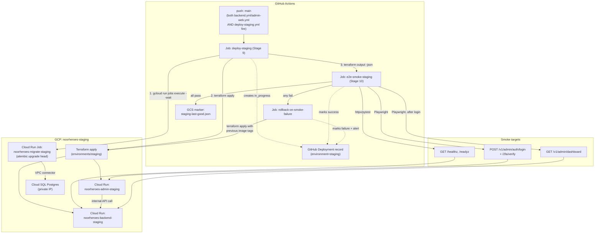

# Phase 1 — CI Pipeline: Automated Staging Deploy & E2E Smoke Suite (Stages 9–10 of 13)

**File ID:** `Development_Blueprints.Phase1_Infra_Config.CI_CD.08-ci-pipeline-deploy-staging-e2e-smoke.md`
**Phase:** Phase 1 — Infrastructure & Configuration
**Depends on:** `Infra.04-terraform-iac-baseline-staging.md` (the Terraform staging root this file's deploy job applies, and the output contract — `backend_service_url`, `admin_web_service_url`, `cdn_admin_fqdn`, `database_connection_name` — this file's smoke suite targets), `CI_CD.06-ci-pipeline-lint-test-build-stages.md` (stages 1–7: lint, static analysis, secret scan, unit tests, integration tests, architectural invariant tests, build artifact — produces the exact container image tags this file deploys), `CI_CD.07-ci-pipeline-security-container-scan.md`¹ (stage 8: Trivy/Grype container scan + dependency audit — must be green before this file's deploy job runs), `Infra.01-environment-tiers-provisioning.md` (defines the "Staging" tier's GitHub Environment name and isolation contract this file's workflow targets)
**Consumed by:** `CI_CD.09-ci-pipeline-manual-promotion-production-deploy.md` (stages 11–13: the manual promotion gate to production may not fire for a given commit unless this file's stage 10 recorded a successful smoke run for that exact commit — see §11.3)
**Source authority:** `NoorHeroes_Final_Development_Prompt.md` §6 (CI/CD Pipeline — the 13-stage list, stages 9 "Deploy to staging" and 10 "E2E smoke tests against staging"), §7 (Docker, Deployment & Infrastructure), §3 (Environment tiers — Staging), §9 (Security Baseline — federated CI auth, no static keys); `FAST-API-INSTRUCTIONS.md` (`api/health.py` — `/healthz`/`/readyz`); `NEXT-JS-INSTRUCTIONS.md` (admin sign-in flow, `signIn()`, `useAdminSession()`); `Development_Blueprints/E28_Admin_Auth_RBAC_Operations_Dashboard/Backend/01-admin-identity-authentication-service.md` and `.../02-two-factor-authentication-enforcement.md` (the exact `POST /v1/admin/auth/login` / `POST /v1/admin/auth/2fa/verify` contract this file's login smoke test drives); `.../08-operations-dashboard-aggregation-api.md` (`GET /v1/admin/dashboard` — this file's CRUD-read smoke target)

¹ Filename inferred from the Final Development Prompt's stage list and the numbering convention already established by the sibling files above (`CI_CD.06` = stages 1–7, `CI_CD.09` = stages 11–13); confirm the exact filename against whatever was actually assigned to "stage 8 — security scan" and update this reference if it differs. Nothing in this file depends on that filename being exactly right — only on stage 8 existing as a required, green, non-bypassable check ahead of this file's deploy job.

---

## 1. Objective and Purpose

Wire the two CI/CD stages that turn a merged, already-built, already-scanned container image into a **running, verified staging deployment**: Stage 9 (automated deploy to Staging) and Stage 10 (automated end-to-end smoke suite against that live deployment). Together these stages are the pipeline's only automated proof that a merge to `main` actually works as a deployed system, not just as passing unit/integration tests in isolation — and they are the hard gate `CI_CD.09`'s manual production-promotion step relies on before a human is even allowed to click "deploy to production."

Concretely, this file specifies:
- The exact GitHub Actions workflow (`.github/workflows/deploy-staging.yml`) that runs on every push to `main`, deploys the just-built backend and admin-web images to the `noorheroes-staging` Cloud Run environment provisioned by `Infra.04`, runs the Alembic migration for that deploy, and records a deployment record.
- The exact E2E smoke suite — `httpx`/`pytest` for the backend's health/readiness probes, Playwright for the admin-web authenticated flows — that runs immediately after deploy and blocks promotion on failure.
- The rollback mechanism triggered when smoke tests fail after an otherwise-successful deploy.
- The "last-known-good" state record that `CI_CD.09` reads to know which exact commit/image tags are safe to promote to production.

This file does **not** re-specify Terraform resource internals (`Infra.04`'s job), does not re-specify stages 1–8 (`CI_CD.06`/`CI_CD.07`'s job), and does not specify the production promotion mechanism or blue/green production rollout (`CI_CD.09`'s job, itself deferred to a Phase 11 file per `Infra.04` §15). It is scoped exactly to: given a green, scanned, tagged image pair, get it running in Staging and prove it works.

---

## 2. Scope and Requirements

In scope:
1. One new GitHub Actions workflow, `.github/workflows/deploy-staging.yml`, containing three jobs: `deploy-staging` (stage 9), `e2e-smoke-staging` (stage 10), and `rollback-on-smoke-failure` (error-path only, runs when stage 10 fails after stage 9 succeeded).
2. The exact deploy mechanism: `terraform plan` / `terraform apply` against `infra/terraform/environments/staging` (the root module `Infra.04` builds), with `backend_image`/`admin_web_image` Terraform variables set to the current commit's Artifact Registry tags — **not** a bare `gcloud run deploy` invocation that bypasses Terraform state (that would immediately desync state from reality and break `Infra.04`'s idempotency guarantee, §14.4's "second plan shows zero diff" acceptance bar).
3. A pre-deploy database migration step: `alembic upgrade head` executed as a one-off **Cloud Run Job** (`noorheroes-migrate-staging`) attached to the same private VPC connector as the backend service, run against the staging Cloud SQL instance *before* the new backend revision receives traffic — never migrated in-process by the Cloud Run service's own startup, and never run from the GitHub Actions runner directly (the runner has no network path to the private-IP-only Cloud SQL instance — see §9.5 of `Infra.04`).
4. Federated GCP authentication reusing the exact Workload Identity Federation pool/provider/service-account (`terraform-ci-runner`) `Infra.04` §9.2 already provisions — no new service account, no new federation setup, no static key anywhere in this file.
5. The E2E smoke suite: backend health/readiness probes via `httpx` + `pytest`; admin-web authenticated login + one CRUD read via Playwright, run as a distinct, fast `smoke` Playwright project separate from the fuller regression E2E suite already named in `Final_Development_Prompt.md` §5.
6. A "last-known-good" deploy marker, written only after Stage 10 passes, that `CI_CD.09` treats as the sole source of truth for what is safe to promote.
7. Rollback: on Stage 10 failure, automatically re-`apply` Terraform with the previous last-known-good image tags — Terraform-native, no drift-inducing `gcloud` traffic-split commands used as the primary path (a `gcloud`-based break-glass fallback is documented, not automated).
8. GitHub Environment (`staging`) configuration: deployment branch policy restricted to `main`, environment-scoped secrets, no required reviewers (staging auto-deploys by design per `Final_Development_Prompt.md` §6 stage 9 — "automatic on merge to main").

Explicitly **not** in scope:
- Building or pushing the container images (owned by `CI_CD.06`).
- The security/dependency/container scan itself (owned by `CI_CD.07`) — this file only requires it as a green prerequisite.
- Any Terraform module internals, provider config, or the state backend (owned by `Infra.04`) — this file calls `terraform plan`/`apply`, it does not redefine what those commands do.
- The manual production-promotion UI/workflow, blue/green traffic shifting, or production rollback (owned by `CI_CD.09` and the Phase 11 blue/green file).
- Mobile (Android/CMP) E2E — explicitly deferred post-MVP per `Final_Development_Prompt.md` §1.1/§5; this file's Stage 10 covers **admin-web only**, exactly as the source document states ("Maestro for Android is deferred — post-MVP... until then this step covers admin-web only").
- Load/performance testing against staging (Locust/k6) — a separate, non-blocking, differently-scheduled concern per `Final_Development_Prompt.md` §5's Load row, not part of the per-merge smoke gate.

---

## 3. Technical Implementation Details

### 3.1 Why Terraform `apply`, not `gcloud run deploy`, is the deploy mechanism

`Infra.04` establishes Terraform as the sole source of truth for the staging Cloud Run services (§6.2's output contract, §14.4's "a second `terraform plan` shows zero diff" acceptance bar, §11's state-lifecycle rules). If this file deployed new revisions via a bare `gcloud run deploy --image=...` call, the running service would immediately diverge from Terraform's last-recorded `backend_image`/`admin_web_image` values, and the very next infra-focused PR's `terraform plan` would show a spurious "revert to the old image" diff. Every deploy in this file is therefore a `terraform plan` + `terraform apply` cycle, re-run on every push to `main`, with only the two image-tag variables changing between deploys in the overwhelming common case (an app-code-only PR). This keeps Terraform state and running reality identical at all times, which is the property `Infra.04`'s own acceptance criteria depend on.

### 3.2 Why the build must also happen on `push: main`, not only on `pull_request`

`CI_CD.06`'s build stage (stage 7) tags images with `${{ github.sha }}`. A repository using **squash-merge** PRs (the branching strategy `Final_Development_Prompt.md` §6 mandates: "short-lived feature branches... merged via squash-merge PRs into `main`") produces a **brand-new commit SHA on `main`** that never existed on the PR branch and was never built by the PR's own CI run. If `CI_CD.06` only triggers on `pull_request`, there is no image tagged with the SHA that lands on `main`, and this file's deploy job has nothing correctly-tagged to deploy.

**Resolution (a cross-file coordination requirement on `CI_CD.06`, stated here because this file's correctness depends on it):** `backend.yml` and `admin-web.yml` must trigger on **both** `pull_request` (for the required-status-check gate PRs need to merge) **and** `push: branches: [main]` (to actually produce and push an image tagged with the real, final `main` commit SHA that this file's `push: main`-triggered `deploy-staging.yml` workflow shares via the identical `github.sha`). This is the standard, idiomatic pattern for squash-merge repos and avoids any brittle "find the PR that produced this merge commit" lookup. Flag this explicitly to whoever implements `CI_CD.06` if it isn't already built this way.

### 3.3 Job graph and triggers

```yaml
# .github/workflows/deploy-staging.yml (skeleton — see §4/§13 for the full job bodies)
name: Deploy Staging

on:
  push:
    branches: [main]

concurrency:
  group: deploy-staging
  cancel-in-progress: false   # never cancel an in-flight apply/migration — see §10

permissions:
  id-token: write      # required for google-github-actions/auth (WIF)
  contents: read
  deployments: write    # required to create/update the GitHub Deployment record, §11.3

env:
  GCP_PROJECT: noorheroes-staging
  GCP_REGION: us-central1
  AR_REPO: us-central1-docker.pkg.dev/noorheroes-staging/noorheroes-containers

jobs:
  deploy-staging:        # Stage 9
    runs-on: ubuntu-latest
    environment: staging
    timeout-minutes: 20
    outputs:
      backend_service_url: ${{ steps.tf-outputs.outputs.backend_service_url }}
      admin_web_service_url: ${{ steps.tf-outputs.outputs.admin_web_service_url }}
      cdn_admin_fqdn: ${{ steps.tf-outputs.outputs.cdn_admin_fqdn }}
      previous_backend_image: ${{ steps.last-good.outputs.backend_image }}
      previous_admin_image: ${{ steps.last-good.outputs.admin_web_image }}
    steps: [ ... see §4.1 ... ]

  e2e-smoke-staging:      # Stage 10
    needs: deploy-staging
    if: needs.deploy-staging.result == 'success'
    runs-on: ubuntu-latest
    environment: staging
    timeout-minutes: 15
    steps: [ ... see §4.2 ... ]

  rollback-on-smoke-failure:   # error path only
    needs: [deploy-staging, e2e-smoke-staging]
    if: needs.deploy-staging.result == 'success' && needs.e2e-smoke-staging.result == 'failure'
    runs-on: ubuntu-latest
    environment: staging
    timeout-minutes: 15
    steps: [ ... see §10.2 ... ]
```

`deployments: write` and the `environment: staging` block on every job are what let GitHub render this as a native Deployment against the `staging` GitHub Environment — this is also the mechanism `Infra.01`'s environment-tier-to-GitHub-Environment mapping already assumes exists (`Infra.01` §"GitHub Environment name corresponds to which tier's isolation boundary").

---

## 4. Architecture and Component Responsibilities



| Component | Responsibility | Owned by |
|---|---|---|
| `deploy-staging` job | Read last-good marker, run migration job, `terraform plan`/`apply`, capture outputs, open GitHub Deployment | This file |
| `noorheroes-migrate-staging` Cloud Run Job | One-off `alembic upgrade head` execution against the private-IP staging Postgres, using the new image's migration set, before any traffic shifts | This file specifies the contract; the Terraform resource itself is a small, additive extension to `Infra.04`'s `modules/compute` — see §7.2 |
| `e2e-smoke-staging` job | Run backend probe tests + admin-web Playwright smoke project against the freshly-deployed URLs; gate everything downstream | This file |
| `rollback-on-smoke-failure` job | Re-apply Terraform with the previous known-good image tags when smoke fails | This file |
| `staging-last-good.json` marker (GCS) | Durable record of the last commit/image tags that passed Stage 10 — the contract `CI_CD.09` reads | This file (writer); `CI_CD.09` (reader) |
| GitHub Deployment record | Human-visible, API-queryable audit trail of every staging deploy attempt and its smoke result | This file |
| Terraform staging root | Actual resource state (Cloud Run revisions, DB, cache, CDN) | `Infra.04` (this file only calls it) |

---

## 5. Folder/File Structure

```
.github/workflows/
├── backend.yml                       # EXISTING (CI_CD.06) — extended per §3.2 to also trigger on push:main
├── admin-web.yml                     # EXISTING (CI_CD.06) — same extension
├── openapi-sync.yml                  # EXISTING (CI_CD.06)
├── security-scan.yml                 # EXISTING (CI_CD.07)
└── deploy-staging.yml                # NEW — this file's primary deliverable (§3.3)

infra/terraform/
├── environments/staging/             # EXISTING (Infra.04) — consumed, not modified in structure
└── ci/
    └── deploy-staging-guardrail.sh   # NEW — the destroy/replace guardrail check, §9.6, invoked by deploy-staging.yml

infra/terraform/modules/compute/
├── main.tf                           # EXISTING (Infra.04) — ADD google_cloud_run_v2_job.migrate_staging, see §7.2
├── variables.tf                      # ADD migrate_job_max_retries, migrate_job_timeout_seconds (both with staging-safe defaults)
└── outputs.tf                        # ADD migrate_job_name

backend/
├── tests/
│   └── smoke/                        # NEW — distinct from tests/unit, tests/integration, tests/api
│       ├── __init__.py
│       ├── conftest.py               # --base-url CLI option, retry-wrapped httpx client fixture
│       └── test_staging_health.py    # NEW — §8's two concrete test cases
└── alembic/                          # EXISTING — unmodified; the migrate job simply runs `alembic upgrade head`
    └── ...

admin-web/
├── e2e/
│   ├── regression/                   # EXISTING (or built alongside it) — the fuller Playwright suite named
│   │   └── ...                       #   in Final_Development_Prompt §5 (scholar-review-to-publish, RBAC-boundary,
│   │                                 #   AI moderation console) — NOT run by this file's Stage 10, too slow for
│   │                                 #   a per-merge gate; scheduled separately
│   └── smoke/                        # NEW — this file's Stage 10 suite only
│       ├── staging-smoke.spec.ts     # NEW — §8's login-round-trip + dashboard-CRUD-read test cases
│       └── helpers/
│           └── totp.ts               # NEW — thin wrapper around the `otpauth` npm package for §9.2's 2FA step
└── playwright.config.ts              # EXISTING — ADD the `smoke` project, §5.1 below

docs/runbooks/
└── staging-deploy-rollback.md        # NEW — human-readable version of §10's rollback procedure, for on-call use
```

### 5.1 `playwright.config.ts` addition

```ts
// admin-web/playwright.config.ts (excerpt — add alongside existing project(s))
export default defineConfig({
  projects: [
    {
      name: 'smoke',
      testDir: './e2e/smoke',
      timeout: 60_000,               // generous, staging can cold-start (Infra.04 §10)
      retries: 1,                    // exactly one retry, matching the documented cold-start tolerance — not a
                                      // general flakiness allowance; a second consecutive failure is real
      use: {
        baseURL: process.env.SMOKE_BASE_URL,
        trace: 'retain-on-failure',
        screenshot: 'only-on-failure',
      },
    },
    {
      name: 'regression',
      testDir: './e2e/regression',
      // existing config, unchanged by this file
    },
  ],
});
```

Running only the fast gate: `npx playwright test --project=smoke`. The pre-existing/fuller `regression` project is never invoked by `deploy-staging.yml` — it is out of scope for this file (§2) and belongs on its own, slower, non-merge-blocking schedule.

---

## 6. APIs, Models, Interfaces, and Data Flow

This file introduces no new application API — it *consumes* two already-specified backend surfaces as smoke targets and *produces* one new data artifact (the last-good marker).

### 6.1 Smoke-test-consumed backend endpoints (pre-existing, unmodified by this file)

| Endpoint | Source | Used for |
|---|---|---|
| `GET /healthz` | `FAST-API-INSTRUCTIONS.md` `api/health.py`, `liveness_check()` | Stage 10 test case 1 |
| `GET /readyz` | `FAST-API-INSTRUCTIONS.md` `api/health.py`, `readiness_check()` — verifies live Postgres + Redis connectivity | Stage 10 test case 2 |
| `POST /v1/admin/auth/login` | `E28_Admin_Auth_RBAC_Operations_Dashboard/Backend/01-admin-identity-authentication-service.md`. Request `{email, password}` → 200 `{requires_2fa: bool, "2fa_challenge_id": str \| null, session_token: str \| null}` | Stage 10 test case 3 (step 1) |
| `POST /v1/admin/auth/2fa/verify` | `.../02-two-factor-authentication-enforcement.md`. Request `{"2fa_challenge_id": str, code: str}` → 200 `{session_token: str}` | Stage 10 test case 3 (step 2) |
| `GET /v1/admin/dashboard` | `.../08-operations-dashboard-aggregation-api.md` — composes 8 widgets, each independently-fallible (`data_unavailable: true` on partial failure) | Stage 10 test case 4 |

The admin login flow is a **two-step challenge/verify exchange, not a single call** — because every admin/scholar account has MFA enforced from account creation (`Final_Development_Prompt.md` §9.8: "Enable MFA/passkey enforcement for every admin/scholar account... never add MFA later"), the smoke-test admin account is a real, moderator+-tier account and **must** complete the TOTP step to obtain a `session_token`. There is no "MFA-exempt smoke account" shortcut — testing the exact path every real admin uses, including 2FA, is the point of this smoke test (a smoke suite that bypasses 2FA would not actually prove the login flow works).

### 6.2 `staging-last-good.json` (new artifact this file owns)

```json
{
  "git_sha": "a1b2c3d4e5f6...",
  "backend_image": "us-central1-docker.pkg.dev/noorheroes-staging/noorheroes-containers/backend:a1b2c3d4e5f6",
  "admin_web_image": "us-central1-docker.pkg.dev/noorheroes-staging/noorheroes-containers/admin-web:a1b2c3d4e5f6",
  "deployed_at": "2026-08-24T14:03:11Z",
  "smoke_passed_at": "2026-08-24T14:06:52Z",
  "github_run_id": "10234567890"
}
```

**Contract:** this object is written to `gs://noorheroes-tfstate/deploy-state/staging-last-good.json` **only** by the `e2e-smoke-staging` job, **only** after every smoke test in Stage 10 passes. It is never written by the `deploy-staging` job alone (a deploy that hasn't been smoke-tested is not "good"). `CI_CD.09`'s production-promotion workflow reads this exact file/path as its sole source of truth for "what is currently verified-good in staging" — treat this path and schema as a stable interface, matching `Infra.04` §6.2's own "treat these as a stable contract" framing for its Terraform outputs.

### 6.3 Data flow, end to end

1. PR merges (squash) into `main` → `push: main` fires `backend.yml`, `admin-web.yml` (rebuild + push, tagged `github.sha`, per §3.2), and `deploy-staging.yml` simultaneously.
2. `deploy-staging` job waits implicitly on nothing (branch-protection required-status-checks already guaranteed stages 1–8 were green on the PR before merge was allowed) — it reads the previous `staging-last-good.json` (for rollback-target capture), runs the migration Cloud Run Job against the new image, then `terraform apply`s the new image tags.
3. Cloud Run creates new revisions for `noorheroes-backend-staging`/`noorheroes-admin-staging`, shifts 100% traffic (staging has no canary/blue-green — that is a production-only concern per `Infra.04` §15).
4. `terraform output -json` surfaces `backend_service_url`, `admin_web_service_url`, `cdn_admin_fqdn` to the next job via `needs.deploy-staging.outputs.*`.
5. `e2e-smoke-staging` runs the backend probe tests directly against `backend_service_url`, then the Playwright `smoke` project against `admin_web_service_url` (which internally calls the backend's admin API).
6. On full pass: write `staging-last-good.json`, mark the GitHub Deployment `success`. On any failure: mark `failure`, trigger `rollback-on-smoke-failure`.

---

## 7. Dependencies and Configuration Requirements

| Dependency | Why | Where configured |
|---|---|---|
| `Infra.04`'s staging Terraform root, already `apply`-able | This file's entire Stage 9 is `terraform plan`/`apply` against it | `infra/terraform/environments/staging/` |
| `terraform-ci-runner` WIF-federated identity | Auth for both `terraform apply` and `gcloud run jobs execute` | `Infra.04` §9.2 — reused verbatim, no new IAM |
| Artifact Registry images tagged `github.sha` for both apps | What gets deployed | Produced by `CI_CD.06`, extended per §3.2 |
| `noorheroes-migrate-staging` Cloud Run Job resource | Runs Alembic migrations pre-deploy | New, small addition to `Infra.04`'s `modules/compute` — see §7.2 |
| GitHub Environment `staging` | Scopes secrets, deployment-branch policy (`main` only), and the Deployments API record | Repository Settings → Environments (or Terraform `github_repository_environment`, out of this file's scope to provision — document as a manual one-time setup step, §13) |
| CI secrets: `STAGING_SMOKE_ADMIN_EMAIL`, `STAGING_SMOKE_ADMIN_PASSWORD`, `STAGING_SMOKE_ADMIN_TOTP_SECRET` | Drive the Playwright login smoke test | GitHub Environment secrets on `staging`; keys registered in `Infra.02`'s `infra/secrets/manifest.yaml` for discoverability, values never committed |
| `google-github-actions/auth@v2`, `google-github-actions/setup-gcloud@v2` | Standard, first-party actions for WIF auth + `gcloud`/`terraform` CLI availability | Pinned by SHA (not just tag) in the workflow, per the supply-chain-hardening convention `CI_CD.06`/`CI_CD.07` already establish for third-party actions |
| `httpx`, `pytest`, `tenacity` (Python) | Backend probe smoke tests | `backend/pyproject.toml`'s dev-dependency group (or a dedicated `smoke` extra) — kept separate from the main runtime dependency set |
| `@playwright/test`, `otpauth` (npm) | Admin-web smoke tests + TOTP code generation | `admin-web/package.json` devDependencies |
| `jq` | Guardrail script parses `terraform show -json` | Pre-installed on `ubuntu-latest` GitHub-hosted runners; no extra install step needed |
| GCS bucket `noorheroes-tfstate` (existing) | Hosts `deploy-state/staging-last-good.json` under a path **distinct from** the Terraform state prefixes (`staging/`, `production/`) `Infra.04` §11.1 defines | Reuses the bucket `Infra.04`'s `global/state-bootstrap` creates; `terraform-ci-runner`'s existing `roles/storage.objectAdmin` on this bucket already covers read/write here — no new IAM |

### 7.2 The one required addition to `Infra.04`'s `modules/compute`

```hcl
# infra/terraform/modules/compute/main.tf — ADDITION (backward-compatible; does not change existing resources)
resource "google_cloud_run_v2_job" "migrate_staging" {
  name     = "noorheroes-migrate-staging"
  location = var.region

  template {
    template {
      containers {
        image   = var.backend_image        # same variable the backend Cloud Run service already uses
        command = ["alembic"]
        args    = ["upgrade", "head"]

        env {
          name = "DATABASE_URL"
          value_source {
            secret_key_ref {
              secret  = var.db_dsn_secret_id   # same secret the backend service reads at boot
              version = "latest"
            }
          }
        }
      }

      vpc_access {
        connector = var.vpc_connector_id       # same connector the backend service uses — private IP reachability
        egress    = "PRIVATE_RANGES_ONLY"
      }

      service_account = google_service_account.backend_run_sa.email  # same least-privilege SA, no new identity
      max_retries     = 0                      # a failed migration must fail loudly, never silently retry-and-
                                                # partially-apply — see §10
      timeout         = "600s"
    }
  }
}

output "migrate_job_name" {
  value = google_cloud_run_v2_job.migrate_staging.name
}
```

This reuses the backend's existing runtime service account, existing DB secret, and existing VPC connector — it introduces zero new IAM surface. It is additive to `modules/compute`'s existing `variables.tf`/`outputs.tf`, not a new module, consistent with `Infra.04` §15's own guidance ("if a module needs a genuinely new capability... extend the module's variables... rather than forking a parallel module").

---

## 8. Database/Storage Requirements

**Migration strategy: run-before-deploy, additive-only, non-interactive, single-attempt.**

1. **Why a Cloud Run Job, not the GitHub Actions runner directly:** the staging Cloud SQL instance has no public IP (`Infra.04` §9.5 — "Cloud SQL... has no public IP — private-IP-only via the VPC"). A GitHub-hosted runner has no network path to a private VPC IP. Running the migration as a Cloud Run Job attached to the same `Serverless VPC Access` connector the backend service uses is the standard GCP-native pattern for this exact constraint — the job runs *inside* the VPC's reachability envelope, the runner just triggers and waits on it via the `gcloud run jobs execute --wait` API call (a public, IAM-authenticated control-plane call, not a data-plane connection to Postgres).
2. **Why before the new revision, not after or in-process:** `Infra.01`'s migration-runner contract is explicit — "the migration-runner step... must leave the tier in a state where the *previous* application version can still run against the *not-yet-migrated* or *partially-migrated* schema... an additive-migration-first discipline (never drop/rename a column in the same migration that also stops the old code from reading it)." Running the migration first, against a schema the *currently-serving* (old) revision must remain compatible with throughout, and only then swapping traffic to the new revision, is what makes this safe. If the migration job fails, the deploy step (`terraform apply`) never runs — the old revision keeps serving unmodified, and no application code was ever exposed to a half-migrated schema (§9's ordering in the workflow YAML enforces this: the migration step is a required prior step, not a parallel one).
3. **Why `max_retries = 0`:** Cloud Run Jobs default to `max_retries = 3`. For a schema migration, an automatic re-attempt after a partial failure risks re-running non-idempotent DDL against a half-applied state. This file sets `max_retries = 0` explicitly — a failed migration surfaces as a failed CI job requiring human review of the Alembic migration and the database state, exactly mirroring `Infra.04` §10's "a failed apply must surface as a failed CI job requiring human review... not a silent retry loop" policy, applied here to migrations.
4. **One migration per PR, never edited after merge** (`Final_Development_Prompt.md` §2.3/`Infra.04` §7 table) is enforced upstream by `CI_CD.06`'s review-gate bot, not by this file — this file only executes whatever migration set is already on the merged commit's `alembic/versions/` directory.
5. **No separate migration-only DB role at staging scale** — the job authenticates as the same `noorheroes_app` user the backend service uses (`Infra.04` §8.1), consistent with that file's explicit note that a stricter migration/runtime privilege split is a possible future hardening, not required at this tier.
6. **Idempotency of re-runs:** if `deploy-staging` itself is re-triggered for the same commit (e.g., a manual `workflow_dispatch` re-run after an earlier infra-only failure), `alembic upgrade head` against an already-current schema is a documented no-op — Alembic tracks the applied-revision watermark in its own `alembic_version` table, so re-running the job is always safe.

---

## 9. Authentication, Authorization, Validation, and Security Considerations

### 9.1 No static cloud credentials anywhere in this file

Every GCP call in `deploy-staging.yml` (`terraform`, `gcloud run jobs execute`) authenticates via `google-github-actions/auth@v2` exchanging the GitHub Actions OIDC token for short-lived credentials impersonating `terraform-ci-runner`, exactly as `Infra.04` §9.2 establishes. No service-account-key JSON is generated, stored, or referenced by this file, at any point. `permissions: id-token: write` at the workflow level is what makes the OIDC token available to `auth@v2` — omitting it is the single most common way this pattern silently breaks, so it is called out explicitly here and must not be dropped from the workflow file.

### 9.2 Smoke-test admin identity and TOTP handling

The Playwright login smoke test authenticates as a **real, dedicated, staging-only admin account** (never a shared human credential, never a production account) with a role at moderator+ tier so the test exercises the enforced 2FA path (§6.1). This account's TOTP secret is generated once, stored **only** as a GitHub Environment-scoped secret (`STAGING_SMOKE_ADMIN_TOTP_SECRET`), and the Playwright test computes the current 6-digit code at run time via the `otpauth` npm package — the raw secret is never logged, never printed to CI output, and the generated code is used exactly once per test run then discarded. This mirrors the redaction discipline `NEXT-JS-INSTRUCTIONS.md` already requires of the app itself (`sanitizeLogs` "recursively sanitizes data payloads by redacting sensitive keys (`password`, `accessToken`, `otp`,...)").

```ts
// admin-web/e2e/smoke/helpers/totp.ts
import { TOTP } from 'otpauth';

export function currentSmokeOtp(): string {
  const secret = process.env.SMOKE_ADMIN_TOTP_SECRET;
  if (!secret) {
    throw new Error('SMOKE_ADMIN_TOTP_SECRET is not set — refusing to run smoke test without it (fail loud, never skip silently, see §9.4)');
  }
  return new TOTP({ secret }).generate();
}
```

**Least privilege for the smoke account itself:** the account is provisioned with the minimum role that can (a) complete login+2FA and (b) successfully read `GET /v1/admin/dashboard` — it holds no content-publish, no user-management, and no billing-mutation permissions. A smoke test account with excess privilege is itself a security liability; it is scoped exactly like any other production credential would be.

### 9.3 GitHub Environment isolation

The `staging` GitHub Environment (used by every job in this workflow) has:
- **Deployment branch policy:** `main` only — no other branch can trigger a deploy to staging through this workflow, even via manual `workflow_dispatch`.
- **No required reviewers** — staging is intentionally fully automatic on merge, per `Final_Development_Prompt.md` §6 stage 9's explicit "automatic on merge to main" (contrast with production's environment, owned by `CI_CD.09`, which *does* require a human approval per stage 11).
- **Environment-scoped secrets**, isolated from any `production` GitHub Environment's secrets that `CI_CD.09` will define — a leaked staging credential (e.g., the smoke TOTP secret) has no path to production, and vice versa.

### 9.4 Fail loud, never fail silent

Every smoke test that depends on a required secret or output (`SMOKE_ADMIN_EMAIL`, `backend_service_url`, etc.) asserts its presence at the very start of the test and throws immediately if missing — a smoke suite that silently skips a test because a secret wasn't configured provides false confidence and is treated as a bug in this file's implementation, not an acceptable degradation.

### 9.5 Validation of the deploy itself before it's trusted

The guardrail script (§9.6) is a validation step, not just an informational one — it is a hard `exit 1` on any unexpected destroy/replace of the protected resources (`google_sql_database_instance.staging`, `cloudflare_r2_bucket.staging_media`), reusing the exact `prevent_destroy` + JSON-plan-grep double-guardrail pattern `Infra.04` §14.2 already establishes for PR-time plan review, now also applied to this file's unattended, post-merge apply.

### 9.6 Guardrail script

```bash
#!/usr/bin/env bash
# infra/terraform/ci/deploy-staging-guardrail.sh
# Usage: deploy-staging-guardrail.sh <path-to-tfplan-binary>
set -euo pipefail
PLAN_FILE="$1"
JSON=$(terraform show -json "$PLAN_FILE")

UNSAFE_COUNT=$(echo "$JSON" | jq '
  [.resource_changes[]
    | select(.address == "module.database.google_sql_database_instance.staging"
           or .address == "module.storage.cloudflare_r2_bucket.staging_media")
    | select(.change.actions | any(. == "delete" or . == "replace"))]
  | length
')

if [ "$UNSAFE_COUNT" -ne 0 ]; then
  echo "::error::terraform plan would destroy/replace a protected staging resource. Aborting deploy — human review required." >&2
  echo "$JSON" | jq '[.resource_changes[] | select(.change.actions | any(. == "delete" or . == "replace"))]'
  exit 1
fi
echo "Guardrail passed: no destroy/replace of protected resources."
```

---

## 10. Error Handling and Edge Cases

| Scenario | Handling |
|---|---|
| Migration job (`noorheroes-migrate-staging`) fails | `gcloud run jobs execute --wait` returns non-zero → `deploy-staging` job fails immediately, `terraform apply` step never runs (subsequent step, gated by default `continue-on-error: false`) → old Cloud Run revision keeps serving unmodified → CI job marked failed, alert fires (§12), human reviews the migration/schema before re-running |
| `terraform apply` fails partway (e.g., backend service updates, admin-web update fails) | Terraform's own state tracking makes re-running `apply` resumption-safe (identical to `Infra.04` §10's handling) — this file does **not** auto-retry blindly; the job fails, and the *next* push to `main` (or a manual `workflow_dispatch` re-run of this exact workflow run) completes the partial apply. In the interim, backend may be on the new revision while admin-web is on the old one — both are individually still serving traffic, so this is a degraded-but-functional state, not an outage |
| Staging Cloud Run scales to zero and the first smoke request hits a cold start | Documented, expected, and tolerated exactly as `Infra.04` §10 requires: the `httpx` fixture wraps requests in a `tenacity`-based single retry with a fixed backoff (§4/§8 code), and the Playwright `smoke` project sets `retries: 1` at the project level (§5.1) — **exactly one** retry is the contract; a second consecutive failure is treated as real and fails the build, never silently retried again |
| Smoke tests fail after a successful deploy | `rollback-on-smoke-failure` job fires automatically (§10.2) |
| Smoke tests fail because of a transient external dependency unrelated to this deploy (e.g., a third-party AI provider sandbox is down) | Out of this file's control to distinguish automatically — the suite intentionally only exercises `/healthz`, `/readyz`, admin login, and one internal-DB-backed CRUD read (§8's test list), none of which depend on third-party AI providers, precisely to minimize this failure mode. If a genuinely flaky external dependency is later added to the smoke path, it must be wrapped in the same one-retry tolerance, never left to fail the whole gate on a single blip |
| Two pushes to `main` land close together | `concurrency: group: deploy-staging, cancel-in-progress: false` (§3.3) queues the second run rather than canceling the first mid-`apply`/mid-migration — a canceled `terraform apply` or a canceled migration job is exactly the kind of partial-state hazard this file must not introduce |
| `deploy-staging` succeeds but `e2e-smoke-staging` never starts (e.g., GitHub Actions outage) | The `staging-last-good.json` marker is **not** updated — `CI_CD.09` sees a stale marker and correctly refuses to treat the un-smoke-tested deploy as promotable. No special handling needed beyond the marker's write-only-on-full-pass contract (§6.2) |
| Migration Cloud Run Job succeeds but takes so long the job step's own timeout is hit | `timeout: "600s"` on the job resource (§7.2) plus the workflow step's own timeout bound it; a migration that legitimately needs longer than 10 minutes is treated as a process failure requiring the migration to be split into smaller, faster, additive steps — not a reason to raise the timeout indefinitely |
| A required smoke secret is rotated/expired | Fails loud per §9.4 — the affected test throws immediately with a clear message identifying the missing/invalid secret, rather than a cryptic downstream Playwright timeout |

### 10.1 Rollback trigger

Automated rollback fires **only** when: `deploy-staging` succeeded (the new revisions are live) **and** `e2e-smoke-staging` failed. It does **not** fire when `deploy-staging` itself failed (nothing to roll back — old revision never stopped serving, per the row above).

### 10.2 Rollback mechanism (Terraform-native, no drift)

```yaml
# .github/workflows/deploy-staging.yml — rollback-on-smoke-failure job body
  rollback-on-smoke-failure:
    needs: [deploy-staging, e2e-smoke-staging]
    if: needs.deploy-staging.result == 'success' && needs.e2e-smoke-staging.result == 'failure'
    runs-on: ubuntu-latest
    environment: staging
    steps:
      - uses: actions/checkout@v4
      - uses: google-github-actions/auth@v2
        with:
          workload_identity_provider: ${{ vars.WIF_PROVIDER }}
          service_account: terraform-ci-runner@noorheroes-staging.iam.gserviceaccount.com
      - uses: google-github-actions/setup-gcloud@v2
      - name: Re-apply Terraform with previous known-good image tags
        working-directory: infra/terraform/environments/staging
        run: |
          terraform init
          terraform apply -auto-approve \
            -var="backend_image=${{ needs.deploy-staging.outputs.previous_backend_image }}" \
            -var="admin_web_image=${{ needs.deploy-staging.outputs.previous_admin_image }}"
      - name: Mark GitHub Deployment as failed + rolled back
        uses: actions/github-script@v7
        with:
          script: |
            // mark the deployment_status as 'failure' with a description noting automatic rollback completed
      - name: Alert
        run: echo "::error::Staging smoke suite failed for ${{ github.sha }} — automatically rolled back to ${{ needs.deploy-staging.outputs.previous_backend_image }}. See §12 alert routing."
```

**Why re-`apply` with old image tags rather than a raw `gcloud run services update-traffic` command:** the latter is faster but leaves Terraform state pointing at the new (broken) image while the running service points at the old one — the exact drift `Infra.04`'s idempotency guarantee forbids. Re-`apply`ing is slightly slower but leaves state and reality identical, consistent with §3.1's reasoning.

**Why the migration is never rolled back:** because every migration is required to be additive-only (§8, point 2), the previous application image is guaranteed compatible with the post-migration schema — rolling back *code* while leaving the *schema* forward-migrated is the safe, intended state, not a gap. If a migration is ever found to be non-additive after the fact, that is a process violation to fix at the PR-review stage (`CI_CD.06`'s migration-review bot, `Final_Development_Prompt.md` §4), not something this file's rollback path can or should compensate for automatically.

**Break-glass fallback (manual, documented, not automated):** if `terraform apply` itself is unavailable during a rollback attempt (e.g., a state-lock held by a stuck prior run), `docs/runbooks/staging-deploy-rollback.md` documents the manual fallback: `gcloud run services update-traffic noorheroes-backend-staging --to-revisions=<previous-revision>=100 --region=us-central1`, immediately followed by a queued reconciling `terraform apply` once the lock clears, to close the drift window this fallback intentionally, briefly opens.

---

## 11. State Management and Lifecycle Considerations

### 11.1 Deploy versioning/tagging

- **Image tags:** immutable, `:<git-sha>` (the full 40-character commit SHA of the commit on `main`), matching `Infra.04` §7's established tag format exactly (`.../backend:<git-sha>`).
- **Cloud Run revision names:** auto-generated by Cloud Run/Terraform (e.g. `noorheroes-backend-staging-00042-abc`) — not manually assigned; the revision history itself is Cloud Run's native version ledger and is available as a secondary rollback reference (§10.2's break-glass path).
- **GitHub Deployment records:** one per push-to-`main`, environment `staging`, `ref` = the commit SHA, queryable via `gh api repos/:owner/:repo/deployments` — this is the human-facing audit trail; `staging-last-good.json` (§6.2) is the machine-facing one `CI_CD.09` actually reads.

### 11.2 Rollback target selection

The rollback target is **always** "whatever `staging-last-good.json` said immediately before this deploy started" — captured at the very start of the `deploy-staging` job (the `last-good` step reads the marker *before* any mutation happens) and threaded through as a job output (`previous_backend_image`/`previous_admin_image`) to both the smoke job (for visibility in logs) and the rollback job (for the actual re-apply). This is deliberately **not** "the previous Cloud Run revision" (Cloud Run's own revision history) as the primary mechanism, because Cloud Run revision history has no concept of "was this one smoke-tested" — a revision that itself failed smoke and was never marked good could otherwise be selected as a rollback target by a naive "just go back one revision" scheme. Reading from the marker guarantees the rollback target was itself, at some point, a verified-passing deploy.

### 11.3 The staging→production promotion contract

`CI_CD.09`'s manual promotion workflow must, before allowing a human to click "promote," confirm: (a) `staging-last-good.json`'s `git_sha` matches the commit being promoted, and (b) `smoke_passed_at` is present and recent. This file's sole responsibility toward that contract is making sure the marker is written correctly and only on a true full pass (§6.2) — enforcing the promotion-time check itself is `CI_CD.09`'s job, out of scope here, but the marker's schema (§6.2) is treated as a stable, versioned interface for exactly that reason.

### 11.4 Idempotency across the workflow's lifecycle

Re-running `deploy-staging.yml` for the same already-deployed commit (manual `workflow_dispatch` retry, or GitHub's own automatic retry of a runner-infrastructure failure) is safe end-to-end: the migration is a no-op (§8, point 6), `terraform apply` for identical variable values is a no-op (`Infra.04`'s own idempotency guarantee), and the smoke suite simply re-verifies an already-correct deployment. No step in this file assumes it is the *only* time it will ever run for a given commit.

---

## 12. Integration Points with Existing Modules

| Integration point | Detail |
|---|---|
| Backend `/healthz`/`/readyz` | Consumed directly as Stage 10's first two test cases — no new health-check code, this file only calls the existing endpoints (`FAST-API-INSTRUCTIONS.md` `api/health.py`) |
| Admin-web sign-in flow (`signIn()`, `useAdminSession()`) | Exercised end-to-end by the Playwright smoke spec exactly as a real user would use it — this file adds no test-only auth bypass or backdoor login path into `admin-web` |
| Admin auth backend (`POST /v1/admin/auth/login`, `.../2fa/verify`) | Consumed unmodified per §6.1; this file's smoke account is a normal row in the same `admin_user` table every other admin uses, with no special-cased "test mode" |
| `GET /v1/admin/dashboard` | Consumed unmodified as the CRUD-read proof point; a smoke failure here also indirectly validates the backend's own DB/Redis connectivity a second, application-level way, complementary to the raw `/readyz` check |
| `Infra.04`'s Terraform staging root | This file's entire deploy mechanism; no Terraform resource is redefined here except the one additive Cloud Run Job (§7.2) |
| `Infra.02`'s secrets manifest | The three new smoke-test CI secrets (§7) are registered there for discoverability alongside every other credential the project tracks, even though they are CI-only and never touch `Infra.02`'s Secret-Manager-at-runtime mechanism |
| `Infra.01`'s environment-tier contract | This file's `staging` GitHub Environment, auto-deploy-on-merge behavior, and "structurally identical to production at smaller scale" framing all directly implement what `Infra.01` already fixed for the Staging tier — no re-litigation |
| Prometheus/OTel/Sentry (`Final_Development_Prompt.md` §8) | Out of this file's direct scope, but a failed smoke run (§10) should also surface as a Sentry release-health signal for the `staging` environment if the backend/admin-web Sentry SDKs are already tagging releases by `git_sha` — this file does not implement that wiring, only notes the natural correlation point via the shared `git_sha` tag |
| `CI_CD.09` (production promotion) | Reads `staging-last-good.json` (§11.3) — the only coupling between the two files; `CI_CD.09` must not re-run its own independent staging smoke check, it trusts this file's marker |

---

## 13. Development Steps in the Correct Implementation Order

1. **Confirm `CI_CD.06` triggers on `push: main`** for `backend.yml`/`admin-web.yml` (§3.2) — if it doesn't yet, this is a blocking prerequisite; coordinate with whoever owns that file before proceeding.
2. **Add the `noorheroes-migrate-staging` Cloud Run Job** to `Infra.04`'s `modules/compute` (§7.2) — apply it once manually (or via the next routine `Infra.04`-owned infra PR) so it exists before this file's workflow ever tries to reference it.
3. **Provision the `staging` GitHub Environment** (Settings → Environments) with the deployment-branch policy and secret scoping from §9.3 — a one-time manual repository-admin step.
4. **Seed the smoke-test admin account** in the staging database — a one-off, staging-only data-seed script (never part of the app's normal seed data used in other tiers), enrolling it in 2FA via the real `POST /v1/admin/auth/2fa/enroll` flow, recording the resulting TOTP secret into the `STAGING_SMOKE_ADMIN_TOTP_SECRET` GitHub secret exactly once.
5. **Write `backend/tests/smoke/`** — `conftest.py`'s `--base-url` option and retry fixture, then `test_staging_health.py`'s two test cases (§14).
6. **Write `admin-web/e2e/smoke/`** — `helpers/totp.ts`, then `staging-smoke.spec.ts`'s login-round-trip-plus-dashboard-read test (§14); add the `smoke` Playwright project (§5.1).
7. **Write `infra/terraform/ci/deploy-staging-guardrail.sh`** (§9.6) and confirm it correctly fails on a deliberately-crafted destructive test plan before wiring it into the real workflow.
8. **Write `.github/workflows/deploy-staging.yml`** — `deploy-staging` job first (get a real, working deploy end-to-end before adding the smoke gate on top of it), confirmed manually against a `workflow_dispatch`-triggered run before relying on `push: main`.
9. **Add the `e2e-smoke-staging` job**, wired to the outputs of step 8, confirm it correctly fails the workflow when a smoke assertion is deliberately broken (a negative test, not just a happy-path check).
10. **Add the `rollback-on-smoke-failure` job**, confirm it end-to-end against a deliberately-broken deploy (e.g., a Playwright spec temporarily forced to fail) — verify the previous image tags actually get re-applied and the marker is correctly left un-updated.
11. **Write `staging-last-good.json`'s first-ever value** manually (bootstrap — there is no "previous good" before the first successful run) so the very first automated run of this workflow has a valid rollback target to read.
12. **Write `docs/runbooks/staging-deploy-rollback.md`** — the break-glass manual procedure (§10.2) and the marker-schema reference (§6.2), for on-call use when automation itself is unavailable.
13. **Hand off to `CI_CD.09`** — confirm its promotion workflow correctly reads and validates `staging-last-good.json` per §11.3 before this file is considered fully integrated into the 13-stage pipeline.

---

## 14. Testing Strategy and Acceptance Criteria

### 14.1 Backend probe tests (`httpx` + `pytest`)

```python
# backend/tests/smoke/conftest.py
import httpx
import pytest
from tenacity import retry, stop_after_attempt, wait_fixed

def pytest_addoption(parser):
    parser.addoption("--base-url", action="store", required=True,
                      help="Deployed backend_service_url from Terraform output, e.g. https://noorheroes-backend-staging-xyz.a.run.app")

@pytest.fixture(scope="session")
def base_url(request):
    return request.config.getoption("--base-url")

@retry(stop=stop_after_attempt(2), wait=wait_fixed(5), reraise=True)
def _get_with_cold_start_tolerance(url: str) -> httpx.Response:
    # Exactly one retry — matches the documented staging cold-start tolerance (Infra.04 §10), not general flake tolerance.
    return httpx.get(url, timeout=15.0)
```

```python
# backend/tests/smoke/test_staging_health.py
def test_healthz_returns_200(base_url, _get_with_cold_start_tolerance):
    resp = _get_with_cold_start_tolerance(f"{base_url}/healthz")
    assert resp.status_code == 200

def test_readyz_returns_200_proving_db_and_redis_connectivity(base_url, _get_with_cold_start_tolerance):
    resp = _get_with_cold_start_tolerance(f"{base_url}/readyz")
    assert resp.status_code == 200
```

CI invocation: `pytest backend/tests/smoke/ --base-url="$BACKEND_SERVICE_URL" -v --junit-xml=smoke-backend-results.xml`.

### 14.2 Admin-web Playwright smoke spec

```ts
// admin-web/e2e/smoke/staging-smoke.spec.ts
import { test, expect } from '@playwright/test';
import { currentSmokeOtp } from './helpers/totp';

test.describe('staging deploy smoke @smoke', () => {
  test('admin login round-trip (incl. 2FA) then one authenticated CRUD read', async ({ page }) => {
    const email = process.env.SMOKE_ADMIN_EMAIL;
    const password = process.env.SMOKE_ADMIN_PASSWORD;
    if (!email || !password) {
      throw new Error('SMOKE_ADMIN_EMAIL/SMOKE_ADMIN_PASSWORD not set — see §9.4, fail loud not silent');
    }

    // --- Test case 3: auth login round-trip ---
    await page.goto('/sign-in');
    await page.getByLabel('Email').fill(email);
    await page.getByLabel('Password').fill(password);
    await page.getByRole('button', { name: 'Sign in' }).click();

    // requires_2fa === true path (every admin account, by policy — §6.1)
    await expect(page.getByLabel('Verification code')).toBeVisible({ timeout: 10_000 });
    await page.getByLabel('Verification code').fill(currentSmokeOtp());
    await page.getByRole('button', { name: 'Verify' }).click();

    await expect(page).toHaveURL(/\/dashboard/, { timeout: 15_000 });
    // useAdminSession()'s isAuthenticated flips true — assert via a UI element gated on it, e.g. the profile menu
    await expect(page.getByTestId('admin-profile-menu')).toBeVisible();

    // --- Test case 4: one CRUD read from admin (GET /v1/admin/dashboard, rendered) ---
    await expect(page.getByTestId('dashboard-widget').first()).toBeVisible({ timeout: 15_000 });
    const unavailableWidgets = await page.getByText('data_unavailable').count();
    expect(unavailableWidgets).toBeLessThan(8); // tolerate partial widget degradation (by design, §6.1's source doc),
                                                  // but not total failure of every widget
  });
});
```

CI invocation: `SMOKE_BASE_URL=$ADMIN_WEB_SERVICE_URL npx playwright test --project=smoke --reporter=junit`.

### 14.3 Acceptance criteria

- [ ] **Backend health:** `GET {backend_service_url}/healthz` → `200`.
- [ ] **Backend readiness:** `GET {backend_service_url}/readyz` → `200` (proves live DB + Redis connectivity through the just-deployed revision).
- [ ] **Admin login round-trip:** the smoke account completes email+password login, receives `requires_2fa: true`, submits a freshly-computed TOTP code, and receives a valid session (`useAdminSession().isAuthenticated === true`, reflected in the UI).
- [ ] **One CRUD read from admin:** `GET /v1/admin/dashboard`, called with the session obtained above, returns `200` and at least one widget renders real (non-`data_unavailable`) data.
- [ ] **CDN reachability:** `GET {cdn_admin_fqdn}` returns `200`/valid HTML through the Cloudflare CDN layer (carried forward from `Infra.04` §14.3's own stated acceptance bar for this exact check).
- [ ] **Zero-tolerance beyond the documented cold-start retry:** any test failing twice in a row (i.e., surviving the single documented retry) fails the build — there is no broader flaky-retry allowance anywhere in this suite.
- [ ] **A deliberately-broken deploy is caught:** as a one-time manual validation when this file is first implemented, force a smoke-test assertion to fail against a real staging deploy and confirm (a) the workflow goes red, (b) `staging-last-good.json` is *not* updated, and (c) `rollback-on-smoke-failure` correctly re-applies the previous image tags.
- [ ] **A deliberately-destructive Terraform diff is caught:** as a one-time manual validation, craft a test `terraform plan` that would replace `google_sql_database_instance.staging` and confirm the guardrail script (§9.6) exits non-zero before `apply` is ever called.

---

## 15. Production-Readiness Considerations (Staging-Scoped)

This file is **staging-only**, mirroring `Infra.04`'s own scoping (§15 there). Everything below is a deliberate staging-tier simplification, each flagged so it is not mistaken for the eventual production posture — the production deploy/promotion mechanics are `CI_CD.09`'s file, not built here:

| Staging choice (this file) | Production difference (future `CI_CD.09`/Phase 11 file) |
|---|---|
| Fully automatic deploy on every merge to `main`, no human approval | Production requires an explicit human "promote" click (stage 11) against a `production` GitHub Environment with required reviewers |
| Cloud Run traffic shifts 100% to the new revision immediately (no canary) | Production uses blue/green or canary (5%→25%→100%), per `Infra.04` §15 and the dedicated blue/green file |
| Rollback = re-`apply` previous image tags, fully automated, no approval needed | Production rollback is health-check-triggered but likely still requires an audit trail/approval step appropriate to production's blast radius, per `Final_Development_Prompt.md` §7's "automatic rollback on health-check failure" — the exact production mechanism is `CI_CD.09`'s to define |
| Smoke suite = 4 targeted checks (health, ready, login, one CRUD read) | `Final_Development_Prompt.md` §6 stage 13 names a full "post-deploy smoke test + Sentry release health check" for production — broader than this file's staging gate, and owned by `CI_CD.09` |
| One smoke-test admin account, staging-only, synthetic | Never reused for production — production's own post-deploy verification must use its own isolated mechanism, never staging credentials |
| Migration runs unattended, no approval | Same mechanism (Cloud Run Job, additive-only) is expected to carry forward to production largely unchanged — the *deploy* gate differs, not the *migration* discipline |

**Explicitly not this file's job:** deciding the production promotion UI/API, building blue/green traffic-shifting Terraform, or defining production's own smoke/health-check-triggered rollback mechanics.

---

## 16. Dependencies/Prerequisites

- `Infra.04-terraform-iac-baseline-staging.md` — fully implemented and `apply`-able against a real `noorheroes-staging` project; this file cannot be meaningfully tested without it.
- `CI_CD.06-ci-pipeline-lint-test-build-stages.md` — implemented and, per §3.2, triggering on `push: main` (not just `pull_request`).
- `CI_CD.07`'s stage 8 security/container scan — implemented and green as a required PR check ahead of merge.
- `Infra.01-environment-tiers-provisioning.md` — the Staging tier's GitHub Environment name and isolation contract already fixed.
- `Infra.02-secrets-management-env-example-gitleaks.md` — the secrets manifest convention this file's three new CI secrets are registered against.
- The admin auth backend (`E28_Admin_Auth_RBAC_Operations_Dashboard/Backend/01`, `02`) — `POST /v1/admin/auth/login` and `.../2fa/verify` fully implemented and deployed to staging (they already are, per the task framing: backend is fully implemented).
- `GET /v1/admin/dashboard` (`E28_Admin_Auth_RBAC_Operations_Dashboard/Backend/08`) — fully implemented and deployed.
- The admin-web sign-in page and `useAdminSession()` hook (`NEXT-JS-INSTRUCTIONS.md`) — fully implemented and deployed.

---

## 17. Definition of Done

- [ ] `.github/workflows/deploy-staging.yml` exists with the three jobs specified in §3.3/§4, correctly gated by `needs`/`if` conditions.
- [ ] `infra/terraform/modules/compute` includes `google_cloud_run_v2_job.migrate_staging` (§7.2), `validate`-clean, wired into `environments/staging/main.tf`.
- [ ] A real push to `main` triggers: migration job execution → `terraform apply` → both Cloud Run services updated → smoke suite runs → `staging-last-good.json` updated on pass.
- [ ] The destroy/replace guardrail script (§9.6) is wired into the `deploy-staging` job and has been proven, once, to actually block a deliberately-destructive plan.
- [ ] The backend smoke tests (`healthz`, `readyz`) and the admin-web Playwright smoke spec (login round-trip + one CRUD read) all pass against a real staging deployment.
- [ ] A deliberately-forced smoke failure has been run once and confirmed to (a) leave `staging-last-good.json` unchanged and (b) trigger a correct, verified rollback to the prior image tags.
- [ ] No static GCP credential of any kind exists in the workflow file, in any script it calls, or in repository secrets — WIF-only, verified by inspection.
- [ ] The smoke-test admin account exists only in staging, is enrolled in real 2FA, and holds the minimum role needed for its two assertions.
- [ ] `docs/runbooks/staging-deploy-rollback.md` documents the automated path and the manual break-glass fallback well enough for on-call use without re-reading this file.
- [ ] `CI_CD.09`'s promotion workflow (once it exists) successfully reads and validates `staging-last-good.json` per §11.3 against at least one real staging deploy produced by this file.

---

## 18. Assumptions or Decisions the Coding Agent Must Follow

1. **Deploy mechanism is `terraform apply`, never a bare `gcloud run deploy`** (§3.1) — this is non-negotiable given `Infra.04`'s state-fidelity guarantees; do not "simplify" by bypassing Terraform.
2. **`backend.yml`/`admin-web.yml` must also trigger on `push: main`** (§3.2) — if this file is implemented before that adjustment lands in `CI_CD.06`, treat it as a blocking cross-file coordination task, not something to route around with an ad hoc rebuild step inside `deploy-staging.yml` (that would duplicate `CI_CD.06`'s ownership and risk the two build paths drifting).
3. **Migrations run as a Cloud Run Job, before the deploy, with `max_retries = 0`** (§7.2/§8) — do not attempt to run Alembic from the GitHub Actions runner directly (no network path to private Cloud SQL) and do not let a Cloud Run Job auto-retry a partially-applied migration.
4. **The smoke-test admin account is a real, 2FA-enrolled, moderator+-tier account** (§6.1/§9.2) — do not build a test-only auth bypass, backdoor login route, or MFA-exempt account "just for CI." That would both violate `Final_Development_Prompt.md` §9.8's "never add MFA later" (and, symmetrically, "never bypass MFA for convenience") and defeat the entire point of smoke-testing the real login path.
5. **`staging-last-good.json` is written only by the smoke job, only on a full pass** (§6.2/§11.2) — do not write it from the deploy job, and do not write a partial/best-effort version on partial smoke success.
6. **Rollback re-applies Terraform with previous image tags; it does not use `gcloud run services update-traffic` as the primary path** (§10.2) — the latter is a documented break-glass fallback only, because it causes Terraform/reality drift.
7. **Exactly one retry for cold-start tolerance, both in the `httpx` fixture and the Playwright project config** (§10/§14) — do not add a broader flaky-retry allowance anywhere in this suite; a second consecutive failure is always treated as real.
8. **This file's Stage 10 smoke suite covers admin-web only, per the source document's explicit "Maestro for Android is deferred — post-MVP... until then this step covers admin-web only"** (§2) — do not add mobile smoke coverage here even if it seems like an easy addition; that is a separate, explicitly-deferred file's responsibility.
9. **`Infra.02`'s secrets manifest is where the three new CI secrets get documented**, but their actual values are configured directly as GitHub Environment secrets on `staging` — do not route them through GCP Secret Manager (they are CI-only, never read by the running application).
10. Where this file's YAML/HCL/TS/Python sketches and the eventual real implementation diverge because an action's or library's exact API differs from what's sketched here (GitHub Actions marketplace actions and npm packages version-drift), **the job graph, the gating conditions (`needs`/`if`), the marker schema (§6.2), and the ordering discipline (migrate → apply → smoke → mark-good) are the authoritative interface to preserve** — the internal step implementation is illustrative, not gospel.

---

## AI Agent Development Prompt

You are implementing CI/CD pipeline **Stages 9–10** for the NoorHeroes monorepo: automated deploy to Staging, followed by an automated E2E smoke suite that gates production promotion. The backend (FastAPI) and admin-web (Next.js) applications are already fully implemented and deployable; the Terraform staging infrastructure baseline (`Infra.04`) and CI stages 1–8 (`CI_CD.06`/`CI_CD.07`) are separate files — treat them as either already implemented or implement this file's small required additions to them (see below) without re-building their full scope.

**What to build**, in the exact structure specified in §5 of this spec:

1. **`.github/workflows/deploy-staging.yml`** — three jobs: `deploy-staging`, `e2e-smoke-staging`, `rollback-on-smoke-failure`, wired exactly per §3.3/§4's job graph and gating conditions. Trigger: `push: branches: [main]`. Auth: `google-github-actions/auth@v2` via Workload Identity Federation, impersonating the existing `terraform-ci-runner` service account (`Infra.04` §9.2) — no new service account, no static keys.
2. **One additive Terraform resource**, `google_cloud_run_v2_job.migrate_staging`, added to `infra/terraform/modules/compute/` per §7.2's exact sketch — reuses the backend's existing runtime service account, DB secret, and VPC connector. Do not create a new module for this.
3. **`infra/terraform/ci/deploy-staging-guardrail.sh`** — the destroy/replace guardrail per §9.6, invoked as a required step in `deploy-staging` between `terraform plan` and `terraform apply`.
4. **`backend/tests/smoke/`** — `conftest.py` (the `--base-url` CLI option and a `tenacity`-wrapped, exactly-one-retry HTTP fixture) and `test_staging_health.py` (the two probe tests), per §14.1.
5. **`admin-web/e2e/smoke/`** — `helpers/totp.ts` (an `otpauth`-based TOTP code generator, failing loud if the secret env var is unset) and `staging-smoke.spec.ts` (the login-round-trip-plus-2FA-plus-dashboard-read test), per §14.2. Add the `smoke` Playwright project to `admin-web/playwright.config.ts` per §5.1, distinct from any existing fuller regression E2E project.
6. **`staging-last-good.json` read/write logic** — read at the start of `deploy-staging` (capturing the rollback target), written at the end of `e2e-smoke-staging` only on full pass, at `gs://noorheroes-tfstate/deploy-state/staging-last-good.json`, schema exactly per §6.2.
7. **`docs/runbooks/staging-deploy-rollback.md`** — the on-call-facing runbook covering both the automated rollback path and the manual break-glass fallback (§10.2).

**Conventions to follow, non-negotiably:**
- Deploy = `terraform plan` + guardrail + `terraform apply`, never a bare `gcloud run deploy` (§3.1/§18.1).
- Migration runs as a Cloud Run Job, before the Terraform apply that shifts traffic, with `max_retries = 0` (§8/§18.3).
- The smoke-test admin account goes through the real, unmodified `POST /v1/admin/auth/login` → `POST /v1/admin/auth/2fa/verify` flow with a real TOTP secret — no test-mode auth bypass of any kind (§6.1/§9.2/§18.4).
- Exactly one retry tolerance for cold starts, nowhere else in the suite (§10/§18.7).
- `staging-last-good.json` is the single, stable interface `CI_CD.09` will read — do not change its schema or path without treating that as a breaking interface change (§6.2/§11.3).
- No static GCP credentials, no service-account-key JSON, anywhere in this file's output.

**What NOT to do:**
- Do not rebuild or duplicate `CI_CD.06`'s build/test/lint stages or `CI_CD.07`'s security scan — this file only requires them as green prerequisites (enforced by branch protection on `main`, not re-implemented here).
- Do not build the production promotion workflow, blue/green traffic shifting, or production rollback — that is `CI_CD.09`, a separate file.
- Do not add mobile (Android/CMP) E2E coverage to this stage — explicitly deferred post-MVP per the source document.
- Do not create a new Terraform module for the migration job — extend `modules/compute` per §7.2.
- Do not weaken the 2FA-enforced login path for the sake of a simpler smoke test.

**How to verify your work before considering this task done:**
1. Manually trigger `deploy-staging.yml` (`workflow_dispatch`, or a real push to `main` in a sandbox) against a real, `Infra.04`-provisioned `noorheroes-staging` project; confirm the migration job runs and succeeds, `terraform apply` completes, and `terraform output -json` yields all four values (§4's job outputs) correctly.
2. Confirm the backend smoke tests pass: `pytest backend/tests/smoke/ --base-url=<backend_service_url> -v`.
3. Confirm the admin-web smoke spec passes: `SMOKE_BASE_URL=<admin_web_service_url> npx playwright test --project=smoke`, including the full login → 2FA → dashboard-read chain against the real deployed staging app.
4. Confirm `staging-last-good.json` is written correctly to GCS only after both of the above pass.
5. Force one smoke assertion to fail (temporarily) and confirm: the workflow goes red, the marker is *not* updated, and `rollback-on-smoke-failure` correctly re-applies the previous image tags — then revert the forced failure.
6. Craft a deliberately-destructive `terraform plan` (e.g., temporarily point `backend_image` at a change that would force-replace the SQL instance) against a throwaway/sandboxed root and confirm the guardrail script (§9.6) exits non-zero and blocks `apply`.
7. Confirm every Definition-of-Done item in §17 and every acceptance-criteria checkbox in §14.3.

Deliver the complete workflow, the additive Terraform resource, both smoke suites, the guardrail script, and the runbook — do not deliver a partial pipeline with a TODO left for the rollback path or the guardrail check; both are load-bearing safety mechanisms, not optional polish.
