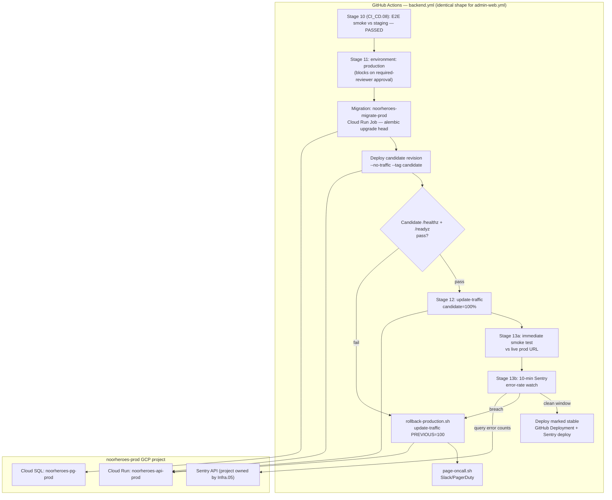

# Phase 1 — CI Pipeline: Manual Promotion Gate & Production Deploy (Stages 11-13 of 13)

**File ID:** `Development_Blueprints.Phase1_Infra_Config.CI_CD.09-ci-pipeline-manual-promotion-production-deploy.md`
**Phase:** Phase 1 — Infrastructure & Configuration
**Depends on:** `CI_CD.08-ci-pipeline-deploy-staging-e2e-smoke.md` (stages 9-10 — automatic staging deploy + E2E smoke; not yet authored in this corpus, its output contract with this file is fixed in §7.1 below), `Infra.01-environment-tiers-provisioning.md` (fixes the `production` GitHub Environment, its protection rule, the `noorheroes-prod` GCP project, and the immutable-artifact-promotion model this file implements), `Infra.04-terraform-iac-baseline-staging.md` (the Cloud Run/Cloud SQL/Secret Manager module pattern this file's production deploy targets, promoted per its own §15), `Phase0_Project_Repo_Foundation.Repo.03-conventional-commits-semver-branching-policy.md` (the `backend-vX.Y.Z` git-tag contract this file consumes for release naming)
**Consumed by:** `Phase11_CICD_Deployment.Infra.01-blue-green-canary-deployment-strategy.md` (supersedes this file's rolling-cutover mechanics with true percentage-based canary once built — see §18), `Infra.05-observability-stack-bootstrap.md` (the Sentry project/DSN this file's stage-13 check reads from — not yet built; §12 fixes the interface this file assumes)
**Source authority:** `NoorHeroes_Final_Development_Prompt.md` §6 (13-stage CI/CD pipeline, stage definitions 11-13), §7 (deployment strategy, disaster-recovery targets), §3 (environment tiers), §8 (observability/alerting), §9 (security baseline); `NoorHeroes_Consolidated_Blueprint_v6.md` §19 (deployment topology); `FAST-API-INSTRUCTIONS.md` (`/healthz`, `/readyz` health probes, §6/§7)

---

## 1. Objective and Purpose

Implement the final three stages of the 13-stage CI/CD pipeline already defined at `NoorHeroes_Final_Development_Prompt.md` §6:

> 11. **Manual promotion gate** to production (a human clicks "deploy" — no fully automatic prod deploy at this stage of the product's maturity)
> 12. **Production deploy** (blue/green or rolling) with automatic rollback on health-check failure
> 13. **Post-deploy smoke test + Sentry release health check**

Everything before stage 11 — lint, type-check, secret scan, unit/integration/architectural tests, image build, container scan, automatic staging deploy, and the Playwright E2E smoke suite against staging — is already specced by earlier Phase-1 CI/CD files (stages 1-10, owned by `CI_CD.06`-`CI_CD.08`) and is **out of scope here**. This file's job starts at the exact moment staging has been deployed and has passed its E2E smoke suite, and ends at the moment a human-approved, staging-verified artifact is running in production, confirmed healthy, and being watched for a defined post-deploy window.

**This is deliberately the simple, gated-deploy version of production rollout**, not the full progressive-delivery system. A single, human-approved cutover to a new Cloud Run revision, gated by an immediate health check and a fixed-window post-deploy Sentry check, is the entire mechanism this file builds. Percentage-based canary traffic splitting (5%→25%→100%), automated statistical anomaly detection, and fully automatic no-human-in-the-loop rollback orchestration are explicitly **not** built here — see §18, Decision 1.

---

## 2. Scope and Requirements

**In scope:**

1. The manual promotion gate (stage 11) as a GitHub Environment protection rule (`production`, already fixed by `Infra.01` §7.2 — this file **consumes** that environment, it does not redefine it) wired into `backend.yml` and `admin-web.yml`'s existing workflow files as additional jobs appended after the stage-9/10 jobs.
2. The production deploy mechanism (stage 12): promoting the **exact same container image digest** already deployed to and verified in staging — never a fresh build — to the `noorheroes-api-prod` and `noorheroes-admin-prod` Cloud Run services in the `noorheroes-prod` GCP project, using a deploy-then-verify-then-cutover sequence (§4.2) with an immediate, automatic rollback if the pre-cutover health check fails.
3. The production database migration step: a distinct, explicit, backward-compatible-only Alembic migration run against Cloud SQL `noorheroes-pg-prod`, executed **before** traffic cutover and **before** the old revision stops serving, per the zero-downtime discipline this file is scoped to (§8).
4. The post-deploy verification stage (stage 13): an immediate smoke test against the live production URL plus a fixed 10-minute Sentry error-rate monitoring window, with a defined rollback trigger and paging path if the window fails.
5. Release versioning and changelog correlation: wiring the already-existing `backend-vX.Y.Z` semantic-release git tag (backend) and the deploying commit SHA (admin-web) into a Sentry release + Sentry deploy marker + a GitHub Deployment record, so "what is running in production right now, and why" is always answerable from tooling, never tribal knowledge.
6. Authentication/authorization for the production deploy: a production-scoped Workload Identity Federation service account, distinct from the staging deploy identity, holding only the IAM roles this stage's `gcloud` calls actually need.
7. Notification/communication around a production promotion (Slack `#deploys` message before the approval gate opens, after cutover, and on any rollback).

**Explicitly out of scope (do not build here):**

- Percentage-based canary traffic splitting, automated statistical rollback decisioning, and multi-stage progressive rollout — that is `Phase11_CICD_Deployment.Infra.01-blue-green-canary-deployment-strategy.md`, a separate, later file. This file's stage 12 is a **single-shot, all-or-nothing** cutover, gated by one health check, not a staged percentage ramp.
- The Android app's production rollout — mobile is **not** promoted through this pipeline at all. Per `Infra.01` §4.6/§12.3, the `prod` Gradle flavor's signed release build ships to Play Console, which runs its own independent staged rollout (5%→25%→100%). This file's stages 11-13 apply to `backend.yml` and `admin-web.yml` only.
- Stages 1-10 (lint through staging E2E smoke) — already specced elsewhere; this file only fixes the **input contract** it needs from stage 10 (§7.1).
- Building the Sentry project itself, its alert rules, or the wider observability stack (Grafana/Prometheus/OTel collector) — that is `Infra.05-observability-stack-bootstrap.md`. This file only consumes an existing Sentry project + DSN via the Sentry API, per the interface fixed in §12.
- Building the `production` GitHub Environment or its reviewer/branch-restriction protection rule — already fixed by `Infra.01` §7.2. This file assumes it exists exactly as specified there and fails loudly (§10) if it does not.
- Terraform module code for the `noorheroes-prod` Cloud Run services, Cloud SQL instance, or the new Cloud Run Job resource this file requires for running migrations — owned by `Infra.04`'s eventual production-root promotion. This file specifies the **interface contract** those resources must satisfy (§6, §7.3) so `Infra.04` can be built or extended against it.

---

## 3. Technical Implementation Details

### 3.1 Where these stages live in the repo

Per `NoorHeroes_Final_Development_Prompt.md` §6 ("One workflow file per app... `backend.yml`, `admin-web.yml`, `mobile.yml`"), stages 11-13 are **additional jobs appended to the existing `backend.yml` and `admin-web.yml` workflow files**, not a separate workflow. This keeps the full 13-stage pipeline visible as one linear job graph per app in the GitHub Actions UI, and avoids the cross-workflow secret-propagation and `workflow_run` trigger-security caveats that a split-workflow design would introduce.

```
.github/workflows/
├── backend.yml         # EXISTING (stages 1-10 owned by CI_CD.06-08) — this file APPENDS jobs:
│                        #   promote-and-deploy-production-backend  (stages 11+12)
│                        #   post-deploy-verify-production-backend  (stage 13)
├── admin-web.yml        # EXISTING (stages 1-10) — this file APPENDS jobs:
│                        #   promote-and-deploy-production-admin    (stages 11+12)
│                        #   post-deploy-verify-production-admin    (stage 13)
├── mobile.yml           # EXISTING — UNCHANGED by this file (Play Console handles production, §2)
└── openapi-sync.yml      # EXISTING — UNCHANGED
```

### 3.2 Stage 11 mechanism: GitHub Environment protection, not custom code

GitHub Actions natively pauses a job the moment it declares `environment: production` if that environment has required reviewers configured (already true per `Infra.01` §7.2). **No custom approval-polling code is written for stage 11** — the job simply declares the environment, and GitHub's own "Review pending deployments" UI blocks the job until a listed reviewer approves or rejects it. This is deliberately the simplest correct implementation of "a human clicks deploy."

```yaml
# .github/workflows/backend.yml (excerpt — appended after the existing stage-10 job, e.g. `e2e-smoke-staging`)

  promote-and-deploy-production-backend:
    name: "Stage 11+12: Promote & deploy backend to production"
    needs: [e2e-smoke-staging]                # the existing stage-10 job from CI_CD.08
    if: github.ref == 'refs/heads/main'         # production promotion only ever runs off main
    runs-on: ubuntu-latest
    timeout-minutes: 1440                       # 24h approval-wait ceiling — see §10
    environment:
      name: production
      url: https://api.noorheroes.com
    permissions:
      id-token: write     # required for Workload Identity Federation
      contents: read
      deployments: write  # required to write GitHub Deployment status
    outputs:
      new_revision: ${{ steps.deploy.outputs.new_revision }}
      release_version: ${{ steps.resolve.outputs.release_version }}
    steps:
      - id: notify-gate-open
        name: Notify #deploys — promotion pending approval
        run: ./infra/ci/notify-slack.sh "gate-open" "backend" "${{ github.sha }}"
      # Everything below this line only executes AFTER a required reviewer approves in the
      # GitHub Actions "Review pending deployments" UI — that pause is implicit in `environment:` above.
      - uses: actions/checkout@v4
      - id: resolve
        name: Resolve the staging-verified image digest and release version
        run: ./infra/ci/resolve-promotion-artifact.sh backend
        # Reads the artifact CI_CD.08 must publish — see §7.1. Fails the job (does not guess)
        # if the expected digest/version artifact is missing or its git SHA doesn't match ${{ github.sha }}.
      - uses: google-github-actions/auth@v2
        with:
          workload_identity_provider: ${{ vars.PROD_WIF_PROVIDER }}
          service_account: prod-deploy-sa@noorheroes-prod.iam.gserviceaccount.com
      - id: migrate
        name: Run production Alembic migration (Cloud Run Job, pre-cutover)
        run: ./infra/ci/run-production-migration.sh backend "${{ steps.resolve.outputs.digest }}"
      - id: deploy-candidate
        name: Deploy new revision with --no-traffic
        run: |
          gcloud run deploy noorheroes-api-prod \
            --project noorheroes-prod --region us-central1 \
            --image "${{ steps.resolve.outputs.digest }}" \
            --no-traffic --tag candidate \
            --revision-suffix "${{ steps.resolve.outputs.release_version }}"
      - id: candidate-health
        name: Health-check the candidate revision before any traffic shifts
        run: ./infra/ci/verify-candidate-health.sh https://candidate---noorheroes-api-prod-<hash>-uc.a.run.app
        # Retries GET /healthz then GET /readyz, 3 attempts with backoff. A failure here
        # is the "automatic rollback on health-check failure" the pipeline stage description
        # names — see §4.2/§10: the candidate revision is simply never given traffic.
      - id: deploy
        name: Cut over 100% traffic to the verified candidate
        run: |
          gcloud run services update-traffic noorheroes-api-prod \
            --project noorheroes-prod --region us-central1 \
            --to-tags candidate=100
          echo "new_revision=$(gcloud run services describe noorheroes-api-prod --project noorheroes-prod --region us-central1 --format='value(status.latestReadyRevisionName)')" >> "$GITHUB_OUTPUT"
      - name: Create Sentry release + deploy marker
        run: ./infra/ci/sentry-release-mark-deployed.sh backend "${{ steps.resolve.outputs.release_version }}" production
      - name: Create GitHub Deployment record
        run: ./infra/ci/record-github-deployment.sh backend "${{ steps.resolve.outputs.release_version }}" success

  post-deploy-verify-production-backend:
    name: "Stage 13: Post-deploy smoke test + Sentry health check (backend)"
    needs: [promote-and-deploy-production-backend]
    runs-on: ubuntu-latest
    timeout-minutes: 20
    permissions:
      id-token: write
      contents: read
    steps:
      - uses: actions/checkout@v4
      - id: smoke
        name: Immediate production smoke test
        run: ./infra/ci/smoke-test.sh https://api.noorheroes.com
      - uses: google-github-actions/auth@v2
        with:
          workload_identity_provider: ${{ vars.PROD_WIF_PROVIDER }}
          service_account: prod-deploy-sa@noorheroes-prod.iam.gserviceaccount.com
      - id: monitor
        name: Monitor Sentry error rate for 10 minutes post-deploy
        run: ./infra/ci/sentry-post-deploy-watch.sh backend "${{ needs.promote-and-deploy-production-backend.outputs.release_version }}"
        # Exit code 0 = healthy window. Exit code 1 = threshold breached — script has ALREADY
        # executed the rollback (§4.3) and posted the Slack/PagerDuty page before returning
        # non-zero, so this job step failing is itself the alert, not a silent no-op.
      - name: Notify #deploys — production stable
        if: success()
        run: ./infra/ci/notify-slack.sh "deploy-stable" "backend" "${{ needs.promote-and-deploy-production-backend.outputs.release_version }}"
```

`admin-web.yml` gets the structurally identical pair of jobs (`promote-and-deploy-production-admin` / `post-deploy-verify-production-admin`), targeting `noorheroes-admin-prod` and `https://admin.noorheroes.com`, with two differences: (a) no migration step (admin-web owns no database), (b) the release identifier passed to Sentry is the raw commit SHA, not a `backend-vX.Y.Z` tag — see §11.1.

### 3.3 Script inventory this file introduces

All under `infra/ci/`, shell + a small amount of Python for the Sentry API calls (matching the pattern already established by `infra/terraform/ci/terraform-plan-comment.sh` in `Infra.04`):

| Script | Purpose |
|---|---|
| `resolve-promotion-artifact.sh <app>` | Reads the digest/version artifact `CI_CD.08` publishes (§7.1), validates its git SHA matches the triggering commit, fails loudly on mismatch or absence |
| `run-production-migration.sh <app> <digest>` | Executes `noorheroes-migrate-prod` Cloud Run Job (`alembic upgrade head`), backend only |
| `verify-candidate-health.sh <candidate-url>` | Hits `/healthz` then `/readyz` on the untrafficked candidate revision, 3 retries |
| `smoke-test.sh <base-url>` | The stage-13 immediate smoke check — health probes plus one authenticated read-only request per app (§14.1) |
| `sentry-release-mark-deployed.sh <app> <version> <env>` | Wraps `sentry-cli releases new/finalize/deploys new` |
| `sentry-post-deploy-watch.sh <app> <version>` | Polls the Sentry API every 60s for 10 minutes; on breach, calls `rollback-production.sh` then `page-oncall.sh` |
| `rollback-production.sh <app>` | `gcloud run services update-traffic --to-revisions=PREVIOUS_REVISION=100`; idempotent |
| `page-oncall.sh <app> <reason>` | Posts to the existing Slack-based on-call channel / PagerDuty per `Final_Development_Prompt.md` §8 |
| `notify-slack.sh <event> <app> <ref>` | Thin wrapper posting to `#deploys` |
| `record-github-deployment.sh <app> <version> <status>` | Wraps the GitHub Deployments API so `git log`-adjacent tooling can answer "what's live" |

---

## 4. Architecture and Component Responsibilities



| Component | Responsibility |
|---|---|
| `promote-and-deploy-production-*` job | Owns stages 11+12: gate, artifact resolution, migration, candidate deploy, pre-cutover health check, cutover, release marking |
| `post-deploy-verify-production-*` job | Owns stage 13: immediate smoke test, 10-minute Sentry watch window, rollback+page on breach |
| `resolve-promotion-artifact.sh` | The single source of truth for "which exact digest is being promoted" — refuses to let stage 12 deploy anything that wasn't the digest stage 10 actually verified |
| `noorheroes-migrate-prod` Cloud Run Job | Executes the one and only production schema change path — no application code path ever runs `alembic upgrade` itself |
| `rollback-production.sh` | The single rollback code path, called identically whether triggered by a pre-cutover health-check failure or a stage-13 Sentry breach — one mechanism, two callers, per §10 |
| Sentry (external, project owned by `Infra.05`) | Source of truth for post-deploy error-rate data; this file is a **consumer** of its API, never the system that stands it up |
| GitHub Environment `production` (owned by `Infra.01`) | The approval-gate mechanism itself; this file only declares `environment: production` in a job, it does not configure the environment |

---

## 5. Folder / File Structure

```
infra/
├── ci/
│   ├── resolve-promotion-artifact.sh
│   ├── run-production-migration.sh
│   ├── verify-candidate-health.sh
│   ├── smoke-test.sh
│   ├── sentry-release-mark-deployed.sh
│   ├── sentry-post-deploy-watch.sh          # the only non-trivial script — see §6.3 for its contract
│   ├── rollback-production.sh
│   ├── page-oncall.sh
│   ├── notify-slack.sh
│   ├── record-github-deployment.sh
│   └── terraform-plan-comment.sh             # EXISTING, owned by Infra.04 — unchanged
└── terraform/
    └── modules/
        └── compute/                          # EXISTING (Infra.04) — this file requires ONE addition:
            └── migrate-job.tf                #   a google_cloud_run_v2_job resource, see §7.3 —
                                                #   flagged as a blocking prerequisite in §16, not built here

.github/workflows/
├── backend.yml       # MODIFIED — 2 jobs appended (§3.2)
└── admin-web.yml      # MODIFIED — 2 jobs appended, backend-equivalent shape minus migration
```

---

## 6. APIs, Models, Interfaces, and Data Flow

This file has no application-facing HTTP API of its own — its "interface" is the set of contracts between its scripts, GitHub Actions, `gcloud`, and the Sentry API.

### 6.1 Input contract: what `CI_CD.08` must publish (§7.1 has the full spec)

A JSON artifact per app, uploaded by stage 10 as a GitHub Actions artifact named `promotion-manifest-<app>`, containing:

```json
{
  "app": "backend",
  "git_sha": "a1b2c3d4e5f6...",
  "image_digest": "us-central1-docker.pkg.dev/noorheroes-platform/noorheroes-images/backend@sha256:...",
  "release_version": "backend-v1.4.2",
  "staging_verified_at": "2026-08-24T14:03:11Z",
  "staging_smoke_test_passed": true
}
```

`resolve-promotion-artifact.sh` downloads this artifact, asserts `git_sha == ${{ github.sha }}` and `staging_smoke_test_passed == true`, and fails the job otherwise — this is the mechanism that prevents promoting an artifact that wasn't the one actually verified in staging.

### 6.2 Output contract: what this file produces for downstream consumers

- A GitHub Deployment record per promotion (queryable via `gh api repos/:owner/:repo/deployments`), `environment: production`, with a `deployment_status` of `success`/`failure`/`in_progress`.
- A Sentry release (`backend-v1.4.2` or `admin-web@<sha>`) with a `production` deploy marker, timestamped at cutover — this is what `Phase11`'s eventual canary file and any future incident-response tooling correlate error spikes back to a specific deploy.
- The new Cloud Run revision name (`noorheroes-api-prod-backend-v1-4-2` style, derived from `--revision-suffix`), surfaced as a job output for any downstream tooling (e.g., a future status-page updater) to reference.

### 6.3 `sentry-post-deploy-watch.sh` contract (the one script worth specifying precisely)

```python
# infra/ci/sentry_post_deploy_watch.py — invoked by sentry-post-deploy-watch.sh
"""
Polls the Sentry API for a fixed 10-minute window after a production cutover and
decides whether the new release is healthy enough to leave live.

Usage: sentry_post_deploy_watch.py <sentry-project-slug> <release-version>

Reads SENTRY_AUTH_TOKEN and SENTRY_ORG_SLUG from environment (production-scoped
Secret Manager values injected via the `production` GitHub Environment's secrets,
per Infra.01 §7.2 — never a repo-level secret).
"""

WATCH_WINDOW_SECONDS = 600          # 10 minutes, per this file's fixed post-deploy check window
POLL_INTERVAL_SECONDS = 60          # 10 samples across the window
ABSOLUTE_EVENT_FLOOR = 50           # never trip on background noise below this count
RELATIVE_MULTIPLIER = 3.0           # trip if event rate exceeds 3x the pre-deploy baseline

def get_baseline_error_rate(project_slug: str) -> float:
    """Mean unhandled-exception event count per POLL_INTERVAL_SECONDS window,
    averaged over the 10 minutes immediately BEFORE this deploy's release-created
    timestamp. Queried once, at watch start, via Sentry's `/events/` count endpoint
    filtered `is:unhandled` and `!release:<new_version>`."""

def get_current_window_error_count(project_slug: str, release_version: str, since_ts: float) -> int:
    """Unhandled-exception events tagged to `release:<release_version>` since since_ts,
    via the same Sentry events-count endpoint filtered to the new release only."""

def should_rollback(baseline: float, current_count: int) -> bool:
    return current_count > ABSOLUTE_EVENT_FLOOR and current_count > baseline * RELATIVE_MULTIPLIER

def main():
    baseline = get_baseline_error_rate(project_slug)
    deploy_ts = time.time()
    while time.time() - deploy_ts < WATCH_WINDOW_SECONDS:
        time.sleep(POLL_INTERVAL_SECONDS)
        current = get_current_window_error_count(project_slug, release_version, deploy_ts)
        if should_rollback(baseline, current):
            subprocess.run(["./infra/ci/rollback-production.sh", app])
            subprocess.run(["./infra/ci/page-oncall.sh", app, f"error-rate-breach:{current}/{baseline}"])
            sys.exit(1)
    sys.exit(0)   # clean window — job succeeds, deploy stands
```

The `ABSOLUTE_EVENT_FLOOR`/`RELATIVE_MULTIPLIER` pair exists so a genuinely low-traffic period (e.g. Ramadan late-night hours, per `F36_Ramadan_Mode`'s own traffic-shape awareness) never trips a rollback on statistical noise, while a real spike — even one that wouldn't clear an absolute-only threshold on a quiet night — still trips it. Both constants are tunable defaults (§18, Decision 3), not hard-coded gospel; `Infra.05` may retune them once real production traffic baselines exist.

### 6.4 Data flow summary

1. Stage 10 (staging) → publishes `promotion-manifest-<app>` artifact.
2. Stage 11 → GitHub pauses the job on `environment: production`; a required reviewer (per `Infra.01` §7.2) approves in the Actions UI.
3. Stage 12 → `resolve-promotion-artifact.sh` re-validates the manifest → migration runs → candidate revision deployed untrafficked → health-checked → traffic cut over → Sentry release/deploy marker created → GitHub Deployment recorded.
4. Stage 13 → immediate smoke test → 10-minute Sentry watch → either "deploy stable" notification or automatic rollback + page.

---

## 7. Dependencies and Configuration Requirements

### 7.1 Fixed contract this file requires from `CI_CD.08` (stage 10)

`CI_CD.08` must publish the `promotion-manifest-<app>` artifact described in §6.1 as its final step, **only after** the staging E2E smoke suite has passed. If `CI_CD.08` is authored before this file reaches implementation, its author must match this exact schema; if this file is implemented first, `CI_CD.08`'s eventual author must produce it. Either way, this schema is the fixed interface — do not let either file silently diverge from it.

### 7.2 GitHub configuration

| Requirement | Source |
|---|---|
| `production` GitHub Environment exists with ≥1 required reviewer, deployment branch restricted to `main` | `Infra.01` §7.2 — this file assumes it, does not create it |
| `production` Environment secrets: `PROD_WIF_PROVIDER`, Sentry `SENTRY_AUTH_TOKEN`/`SENTRY_ORG_SLUG`, Slack webhook URL, PagerDuty routing key | Environment-scoped secrets, per `Infra.01` §8.4/§9.3 — injected only into jobs that declare `environment: production`, never available to stage 1-10 jobs |
| Required reviewers are a named team (e.g. `release-managers`, containing the Eng Lead + the on-call rotation lead), never a single individual | This file's recommendation — see §9.1 for the segregation-of-duties reasoning |

### 7.3 GCP/Terraform prerequisite this file introduces

The one genuinely new infrastructure requirement this file surfaces (not built here, but blocking): a **Cloud Run Job** resource, `noorheroes-migrate-prod`, in the `noorheroes-prod` project, running the backend's existing container image with an overridden entrypoint (`alembic upgrade head`), connected to `noorheroes-pg-prod` over the same private VPC path the `noorheroes-api-prod` service uses. `Infra.04`'s `modules/compute` module (currently service-only, per its own §5) needs a `google_cloud_run_v2_job` resource added — flagged here as a required addition, specified precisely enough that `Infra.04`'s owner or a coding agent extending it has no ambiguity:

```hcl
# infra/terraform/modules/compute/migrate-job.tf (addition required by this file)
resource "google_cloud_run_v2_job" "migrate" {
  name     = "noorheroes-migrate-${var.environment}"
  location = var.region
  template {
    template {
      containers {
        image   = var.backend_image
        command = ["alembic"]
        args    = ["upgrade", "head"]
        env {
          name = "DATABASE_URL"
          value_source {
            secret_key_ref {
              secret  = var.db_dsn_secret_id
              version = "latest"
            }
          }
        }
      }
      vpc_access {
        connector = var.vpc_connector_id
        egress    = "PRIVATE_RANGES_ONLY"
      }
      service_account = google_service_account.migrate_run_sa.email
      max_retries      = 0    # a failed migration must surface as a failed job run, never silently retry
      timeout           = "300s"
    }
  }
}
```

This same module addition, applied once for Staging (by `CI_CD.08`'s migration step) and once for Production (by this file), keeps the migration mechanism identical in both tiers — the only thing that differs is which project's `alembic upgrade head` it runs against.

### 7.4 CLI/tooling dependencies

`gcloud` CLI, `sentry-cli` (or direct Sentry REST API calls via the Python script in §6.3 — either is acceptable; the script above uses direct API calls to avoid an extra CLI dependency in the runner image), `gh` CLI (for the GitHub Deployments API wrapper), `jq` (artifact JSON parsing). All already available on `ubuntu-latest` GitHub-hosted runners except `sentry-cli`, which is installed as a step (`curl -sL https://sentry.io/get-cli/ | sh`) or pinned via a container image — pin the version explicitly, do not curl-pipe an unpinned installer in a job that holds production credentials (see §9.4).

---

## 8. Database/Storage Requirements — Production Migration Strategy

**This file precedes the full blue/green strategy, so the migration discipline it enforces must guarantee zero downtime and full backward compatibility on its own — it cannot rely on a canary window to catch a bad migration gradually.**

### 8.1 Expand/contract only, no exceptions

Every migration deployed through this pipeline must follow the additive-first discipline already established project-wide (`Final_Development_Prompt.md` §2.3: "Alembic, one migration per PR... never edited after merge"; `Infra.01` §10: "never drop/rename a column in the same migration that also stops the old code from reading it"). Concretely, for this file's sequencing to be safe:

1. **The migration runs against production data while the OLD revision is still serving 100% of traffic** (migration happens before candidate-health-check, well before cutover — see §4's diagram). This means the old code must be able to run correctly against the **post-migration** schema for the entire window between migration completion and traffic cutover (typically under a minute, but not instantaneous).
2. A migration that adds a column must make it nullable or default-valued — the old code, which doesn't know the column exists, must not violate a NOT NULL constraint on its existing INSERT/UPDATE statements.
3. A migration that removes or renames a column happens in a **later, separate** PR/migration, only after the release that stops reading/writing it under the old name has itself been running in production for at least one full deploy cycle (the "contract" step, deliberately decoupled from this pipeline run).
4. **Rollback (§10) never runs `alembic downgrade`.** If stage 13 triggers a rollback, `rollback-production.sh` only shifts traffic back to the previous Cloud Run revision — the previous revision's code, by rule 1-3 above, is already guaranteed to run correctly against the migrated schema. Reverting the schema itself is never part of the automated rollback path; a genuinely bad migration is fixed forward, in a new PR, per the project's existing "never edit a merged migration" rule.

### 8.2 Migration execution guarantees

- `noorheroes-migrate-prod` runs with `max_retries = 0` (§7.3) — a failed migration is a **hard stop**: stage 12 fails before any candidate revision is deployed, no traffic is ever at risk, and the job's failure is the alert (no separate paging needed for this specific failure mode, since nothing user-facing has changed yet).
- Alembic's own advisory-lock behavior (enabled by default) prevents two concurrent `alembic upgrade` invocations against the same database from corrupting each other — relevant if a production promotion is ever accidentally re-triggered while a prior one's migration step is still running; `resolve-promotion-artifact.sh`'s git-SHA check (§6.1) also prevents re-promoting the same already-deployed SHA.
- The migration step targets `noorheroes-pg-prod` exclusively — the Cloud Run Job's service account (`migrate-run-sa`) is granted `roles/cloudsql.client` scoped only to that instance, never Staging's or Dev-QA's (mirrors the per-tier IAM isolation `Infra.01` §9.3 already establishes).

### 8.3 No destructive reseed, no data-reset

Per `Infra.01` §8.5, Production is "the durable system of record" — this file never truncates, reseeds, or resets any production data as part of a deploy or a rollback. The only production-data-affecting operation this entire file performs is the single, additive, backward-compatible `alembic upgrade head` in §8.1-8.2.

---

## 9. Authentication, Authorization, Validation, and Security Considerations

### 9.1 Who can approve a production promotion

The `production` GitHub Environment's required-reviewer list (configured by `Infra.01`, consumed here) should be a small named team — this file recommends `release-managers` (Eng Lead + the current on-call lead) — never a single individual and never "anyone with write access." GitHub Environments already prevent the actor who triggered the workflow run from also being the approver of that same run when they are the sole listed reviewer, which mirrors the project's existing segregation-of-duties principle (`Final_Development_Prompt.md`, F.37: "a reviewer who edits cannot approve their own edit") applied to deployment rather than content review. Document this explicitly in `infra/ci/README.md` so a future team doesn't collapse the reviewer list back down to one person "for convenience."

### 9.2 Production deploy credentials — OIDC only, distinct identity from staging

`prod-deploy-sa@noorheroes-prod.iam.gserviceaccount.com` is a **separate** service account from whatever identity `CI_CD.08` uses to deploy Staging — least-privilege and blast-radius isolation, matching `Infra.01`'s per-project IAM boundary. No static GCP key exists anywhere; authentication is Workload Identity Federation exactly as already established by `Infra.04` §9.2, with the WIF provider/pool scoped so that only workflow runs authenticated against the `production` GitHub Environment (i.e., only after the approval gate has already passed) can assume this identity — enforced via the WIF provider's `attribute_condition` matching `assertion.environment == 'production'`, not merely by convention.

`prod-deploy-sa` is granted exactly:
- `roles/run.admin` scoped to `noorheroes-api-prod` and `noorheroes-admin-prod` only (not project-wide `run.admin`).
- `roles/run.developer` + `roles/iam.serviceAccountUser` scoped to trigger `noorheroes-migrate-prod` executions.
- No Secret Manager, Cloud SQL-data, or R2 access of its own — it deploys and migrates, it never reads application secrets or data directly (the deployed Cloud Run revision's *own* runtime service account, already defined by `Infra.04`'s pattern, holds those grants, not the CI deploy identity).

### 9.3 Validation before any production-affecting call

`resolve-promotion-artifact.sh` is the security-relevant validation gate for this entire file: it refuses to proceed unless (a) the manifest artifact exists, (b) its `git_sha` matches the commit that triggered this workflow run, and (c) `staging_smoke_test_passed` is `true`. This prevents two concrete attack/error scenarios: a stale or forged manifest being promoted, and a human approving a promotion for a commit whose staging verification never actually completed.

### 9.4 Supply-chain hygiene inside this file's own scripts

Every third-party tool invocation inside `infra/ci/*.sh` (the `sentry-cli` install, any `curl`-fetched dependency) must be pinned to an exact version and, where the tool supports it, checksum-verified — these scripts run with the production deploy identity's credentials in scope, making them exactly the kind of "highest blast radius" code path the project's existing CODEOWNERS review checklist (`Final_Development_Prompt.md` §4) already calls out for extra scrutiny. Any PR touching `infra/ci/*production*` should be treated with the same review rigor as a PR touching `core/security` per that checklist.

### 9.5 Secrets never printed to logs

`SENTRY_AUTH_TOKEN`, the Slack webhook URL, and the PagerDuty routing key are GitHub Environment secrets (masked by GitHub Actions' log redaction automatically) — no script in §3.3 ever `echo`s or `printf`s one of these values, and the basic secret-looking-string log guard already mandated project-wide (`Final_Development_Prompt.md` §3) applies to this file's job output the same as everywhere else.

---

## 10. Error Handling and Edge Cases

| Scenario | Handling |
|---|---|
| Approval sits unreviewed | `timeout-minutes: 1440` (24h) on the gated job — GitHub cancels the run after that ceiling; the promotion must be re-triggered by re-running the workflow (or pushing a no-op commit that re-runs `CI_CD.08`), which re-validates the manifest fresh. This is deliberate friction, not a bug: a promotion approved a day late should be re-verified against current `main`, not silently applied to a possibly-stale artifact. |
| Reviewer rejects the deployment | GitHub marks the job/run as failed with the rejection reason attached; `notify-slack.sh` is **not** reached (the job never got past the `environment:` gate), so the team's visibility is GitHub's own Actions UI/notification — acceptable, since a rejection is an intentional human decision, not an incident. |
| Candidate revision fails its pre-cutover health check (§4.2) | Traffic is **never** shifted to it — this is the pipeline description's "automatic rollback on health-check failure" satisfied by simply never cutting over; the untrafficked failed candidate revision is left in place (Cloud Run revisions are cheap and inert when untrafficked) for post-incident inspection, not auto-deleted. Job fails, `page-oncall.sh` fires (a candidate that fails health checks after passing every prior stage is itself worth investigating promptly). |
| Migration step fails | Stage 12 stops immediately (§8.2) — no candidate revision is ever deployed, no traffic risk exists. The failure is loud (job failure) but the "rollback" concept doesn't apply here since nothing user-facing changed; `page-oncall.sh` fires because a migration failure blocks the release and needs prompt human attention. |
| Sentry API unreachable during the stage-13 watch window | `sentry-post-deploy-watch.sh` treats a sustained API failure (3 consecutive failed polls) as **fail-safe, not fail-open**: it triggers `rollback-production.sh` and pages on-call with reason `sentry-unreachable`, rather than silently assuming "no errors reported" means "healthy." This is a deliberate conservative choice — better an unnecessary rollback than a missed real spike because the observability channel itself was down. |
| Stage-13 Sentry watch detects a genuine breach | `rollback-production.sh` shifts traffic back to the previous revision, `page-oncall.sh` fires with the breach numbers attached, and the job fails (visible in the Actions UI as the authoritative "this deploy did not stick" record). |
| The "previous revision" no longer exists (Cloud Run's default revision garbage collection deleted it) | Prevented structurally: `noorheroes-api-prod`/`noorheroes-admin-prod` are configured (via `Infra.04`'s eventual production Terraform, per §7.3's pattern) with a minimum-retained-revisions count high enough to always cover at least the last 5 promotions, so `rollback-production.sh` always has a valid target. If this invariant is ever violated (e.g. a manual `gcloud run revisions delete`), the script fails loudly rather than rolling forward to an arbitrary older revision. |
| Two promotions triggered back-to-back before the first finishes | The `production` GitHub Environment's default concurrency behavior queues the second run's approval gate behind the first; additionally, `resolve-promotion-artifact.sh`'s git-SHA check (§9.3) means a second run for an *older* SHA than what's already live would be a human error the script does not protect against by itself — the review step (§9.1) is the intended catch for "don't approve a promotion that's behind what's already live," documented explicitly in `infra/ci/README.md`. |
| Backend cutover succeeds but admin-web's promotion (a separate, independently-gated job graph) fails or is still pending | Acceptable and expected — backend and admin-web are deployed and gated **independently** (matching `Infra.01` §4.6's per-platform promotion model), so a backend-only or admin-web-only release is a normal outcome, not a partial-failure state requiring special handling. |
| `Infra.05`'s Sentry project/DSN doesn't exist yet when this file is first implemented | `sentry-post-deploy-watch.sh` and `sentry-release-mark-deployed.sh` fail fast with a clear "Sentry not configured for this environment" error rather than silently skipping the check — stage 13 must not report "healthy" when it never actually looked. See §16 for sequencing. |

---

## 11. State Management and Lifecycle Considerations

### 11.1 Release identity per app

- **Backend:** the `backend-vX.Y.Z` git tag, already fully automated by `semantic-release` per `Phase0...03-conventional-commits-semver-branching-policy.md`, is this file's release identifier end-to-end — it is the Cloud Run `--revision-suffix`, the Sentry release name, and the GitHub Deployment's `ref`.
- **Admin-web:** per `Final_Development_Prompt.md` §6 ("Admin-web is continuously deployed and doesn't need its own semver — it always tracks `main`"), there is no `admin-web-vX.Y.Z` tag track. This file uses the deploying commit's short SHA (`admin-web@<short-sha>`) as its Sentry release identifier and Cloud Run revision suffix instead — "continuously deployed" describes admin-web's versioning scheme, not an exemption from the promotion gate itself (§2 already resolves this ambiguity explicitly; restated here because it is a state-management decision, not just a scoping one).
- Every Sentry release, once created, is **finalized** (`sentry-cli releases finalize`) only after cutover succeeds — a release that never reaches production (health-check failure before cutover) is left un-finalized/associated-but-not-deployed in Sentry, which correctly reflects "built and verified in staging, never actually served production traffic."

### 11.2 Changelog

No new changelog mechanism is introduced by this file — `backend/CHANGELOG.md` is already machine-generated by `semantic-release` at merge-to-`main` time (before this pipeline's stage 9 even runs), per the Phase-0 file. This file's only changelog-adjacent responsibility is **surfacing** that already-generated changelog section at promotion time: `notify-slack.sh`'s `gate-open` message includes a link to the `backend-vX.Y.Z` tag's changelog entry so the required reviewer can see exactly what they're approving without leaving Slack.

### 11.3 Cloud Run revision lifecycle

- New revisions are named with the `release_version` as suffix, making `gcloud run revisions list` directly readable as a deploy history without needing to cross-reference GitHub separately.
- Revisions are never deleted by this pipeline — Cloud Run's own configured retention (§10's minimum-retained-revisions requirement) governs cleanup, decoupled from this file's logic.
- `min_instances >= 2` (per `Infra.01` §15.1) applies to whichever revision currently holds traffic; an untrafficked candidate revision briefly held during the health-check window does incur its own minimum-instance cost for that short window — an accepted, small cost of the deploy-then-verify pattern, not a bug.

### 11.4 Idempotency

Re-running `promote-and-deploy-production-*` for a SHA that is already live is caught by `resolve-promotion-artifact.sh` treating "this git_sha is already the `latestReadyRevisionName`'s tag" as a no-op success (skips migration and candidate deploy, logs "already deployed, nothing to do") rather than re-running `alembic upgrade head` redundantly or creating a duplicate Sentry release — migrations are safe to no-op-check via Alembic's own version table, but this file adds the explicit short-circuit so the job's intent is legible without reading Alembic internals.

---

## 12. Integration Points with Existing Modules

| Integration point | Detail |
|---|---|
| `/healthz` / `/readyz` (`FAST-API-INSTRUCTIONS.md`, `api/health.py`) | `verify-candidate-health.sh` and `smoke-test.sh` call these exact, already-implemented endpoints — no new health-check logic is added to the application. `/readyz`'s existing Postgres+Redis connectivity check is precisely what proves the candidate revision can actually reach `noorheroes-pg-prod`/the prod Memorystore instance over the VPC connector before it ever receives real traffic. |
| Sentry project (owned by `Infra.05-observability-stack-bootstrap.md`, not yet built) | This file assumes a Sentry project already exists per tier with a `sentry_dsn` value populated in Secret Manager (the field `Infra.01` §6.2 already reserves). This file additionally needs a Sentry **auth token** with `project:releases` and `event:read` scopes, stored as a `production`-Environment-scoped GitHub secret (§7.2) — a new secret this file introduces, to be added to `Infra.02`'s secrets manifest once that file exists/is updated. |
| Alerting channel (`Final_Development_Prompt.md` §8) | `page-oncall.sh` posts into the same Slack-based on-call rotation / PagerDuty route already named as the destination for P0 alerts project-wide — this file adds "production deploy rollback" as one more trigger into that existing channel, it does not stand up a new alerting destination. |
| GitHub Environments (`Infra.01` §7.2) | Consumed, not redefined — see §2/§9.1. |
| Terraform Cloud Run services (`Infra.04`, promoted to production per its own §15) | This file's `gcloud run deploy`/`update-traffic` calls target the exact service names (`noorheroes-api-prod`, `noorheroes-admin-prod`) and VPC/IAM topology `Infra.04`'s module pattern establishes for Staging and is expected to reproduce for Production. |
| `backend-vX.Y.Z` git tags (`Phase0...03`) | Consumed as the release identifier (§11.1) — this file creates no new tags of its own. |
| `F36_Ramadan_Mode` traffic-shape awareness | Referenced only for the Sentry-baseline-tuning rationale in §6.3 — no functional coupling; a low-traffic window (e.g. pre-dawn during Ramadan) should not make the rollback threshold both file more likely to false-positive, which is why a relative multiplier alone was rejected in favor of the floor+multiplier pair. |

---

## 13. Development Steps in Correct Implementation Order

1. **Confirm `Infra.01`'s `production` GitHub Environment is actually live** (required reviewer configured, branch restriction to `main`) — this file cannot be meaningfully tested without it; if it doesn't exist yet, that is a blocking prerequisite, not something to stub around.
2. **Provision `prod-deploy-sa`** and its scoped IAM bindings (§9.2) and the WIF provider `attribute_condition` restricting it to `environment: production`-authenticated runs.
3. **Add the `noorheroes-migrate-prod` Cloud Run Job** to `Infra.04`'s `modules/compute` (§7.3) and apply it to the `noorheroes-prod` project (this is Terraform work belonging to `Infra.04`'s owner, but this file's implementer should not proceed past this step without it existing, since §8's migration step has nothing to invoke otherwise).
4. **Write `resolve-promotion-artifact.sh`** and agree/finalize the manifest schema (§6.1, §7.1) with whoever is implementing or has implemented `CI_CD.08` — this is the single most important cross-file contract in this spec.
5. **Write `run-production-migration.sh`, `verify-candidate-health.sh`, `smoke-test.sh`** — the straightforward scripts, testable against a sandbox/Dev-QA-equivalent Cloud Run service before ever touching `noorheroes-prod`.
6. **Write `sentry-release-mark-deployed.sh`** against whatever Sentry project exists (even a throwaway personal Sentry project is sufficient for initial development, ahead of `Infra.05` standing up the real one) to validate the release/deploy-marker API calls.
7. **Write `sentry_post_deploy_watch.py`/`sentry-post-deploy-watch.sh`** per the contract in §6.3, with unit tests against a mocked Sentry API response (§14.1) before ever wiring it to a live window.
8. **Write `rollback-production.sh` and `page-oncall.sh`** — test `rollback-production.sh`'s idempotency explicitly (running it twice in a row against the same state must not error).
9. **Write `notify-slack.sh` and `record-github-deployment.sh`** — the lowest-risk scripts, build last.
10. **Append the two jobs to `backend.yml`**, dry-run the whole flow against a sandbox GCP project standing in for `noorheroes-prod` (never the real production project for first-pass testing).
11. **Append the structurally-identical jobs to `admin-web.yml`**, adjusted per §3.2's admin-web differences.
12. **Run a full, deliberate dry-run against the real `noorheroes-prod` project** with a trivial, safe change (e.g. a docs-only or comment-only commit that still produces a releasable artifact) to prove the entire gate→migrate→deploy→verify→watch chain end-to-end before the first real feature ever rides through it.
13. **Deliberately test the rollback path**: deploy a revision that will fail its `/readyz` check on purpose (in a controlled, communicated maintenance-adjacent window, see §15) to prove the pre-cutover automatic rollback fires correctly; separately, simulate a Sentry error spike (a scripted burst of test exceptions tagged to the candidate release in a non-prod-critical path) to prove the stage-13 watch-and-rollback fires correctly.
14. **Write `infra/ci/README.md`** documenting the reviewer-list recommendation (§9.1), the 24h approval timeout (§10), the rollback semantics (§8.1, "never `alembic downgrade`"), and how to manually trigger a rollback outside the pipeline if ever needed (`./infra/ci/rollback-production.sh <app>`, runnable by anyone holding the `prod-deploy-sa` impersonation grant, documented as the officially sanctioned break-glass path).

---

## 14. Testing Strategy and Acceptance Criteria

### 14.1 Automated checks

- **Unit tests for `sentry_post_deploy_watch.py`'s `should_rollback()`**: table-driven tests covering below-floor-no-trip, above-floor-below-multiplier-no-trip, above-both-trips, and the zero-baseline edge case (a brand-new project with no prior error history — `baseline=0` must not make `ABSOLUTE_EVENT_FLOOR` alone insufficient to ever trip, i.e. confirm the floor check is doing real work independent of the multiplier).
- **Shell script tests** (`bats` or equivalent, matching whatever the project's existing shell-script testing convention is, if any — otherwise a lightweight `bats-core` suite is an acceptable new addition scoped to `infra/ci/`): `resolve-promotion-artifact.sh` rejects a manifest with a mismatched `git_sha`; `rollback-production.sh` is idempotent (asserted by running it twice against a mocked `gcloud` stub and diffing the resulting traffic-split state).
- **CI-blocking status check**: a PR touching any `infra/ci/*production*` script or either workflow file's appended jobs requires the same architectural-invariant-style required status check pattern already used elsewhere in the project (`Final_Development_Prompt.md` §5) — at minimum, `shellcheck` on every script and a YAML-lint pass on the modified workflow files.

### 14.2 Manual/staged acceptance criteria (run once, before first real production traffic rides through this pipeline)

- [ ] Attempting to run `promote-and-deploy-production-backend` produces a "Review pending deployments" block in the GitHub Actions UI, and does **not** execute any subsequent step, until a listed reviewer approves.
- [ ] A rejected approval leaves `noorheroes-api-prod` completely untouched (confirm via `gcloud run services describe` before/after — identical `latestReadyRevisionName`).
- [ ] A deliberately-broken candidate revision (fails `/readyz`) never receives traffic — `gcloud run services describe noorheroes-api-prod --format='value(status.traffic)'` shows 100% still on the prior revision after the job fails.
- [ ] A successful promotion produces: a new `latestReadyRevisionName` matching the expected `release_version` suffix, a finalized Sentry release with a `production` deploy marker at the correct timestamp, and a `success` GitHub Deployment record.
- [ ] A scripted post-cutover error-rate spike (test exceptions tagged to the new release, injected via a safe, reviewer-approved test path) causes `rollback-production.sh` to fire within one polling interval (≤60s) of the threshold being crossed, restores 100% traffic to the previous revision, and pages the on-call channel with the breach numbers included in the message.
- [ ] Re-running the same promotion for an already-deployed `git_sha` is a no-op (§11.4) — confirmed by checking no new Cloud Run revision, no new Alembic migration attempt, and no duplicate Sentry release are created.
- [ ] The full stage 9→10→11→12→13 chain, timed end-to-end on a trivial real promotion, completes (excluding approval-wait time, which is human-paced) in under 10 minutes for backend and under 5 minutes for admin-web — documented as the expected operational baseline, not a hard CI-enforced SLA.

---

## 15. Production-Readiness Considerations

This section IS production — treat every item below as load-bearing, not aspirational.

- **Rollback plan:** fully automated and pre-built into this pipeline itself (§4.2/§4.3, §10) — there is no separate "break glass" document to write for the common case. For the rare case where automated rollback itself needs to be bypassed or re-run manually (e.g. the pipeline job itself crashed mid-watch-window rather than detecting a real breach), `./infra/ci/rollback-production.sh <app>` is directly runnable by any human holding the `prod-deploy-sa` impersonation grant — document this explicitly in `infra/ci/README.md` as the sanctioned manual path (§13, step 14), so no one improvises a raw `gcloud run services update-traffic` command from memory during an actual incident.
- **Communication/notification:** every promotion posts to `#deploys` at three points — gate-open (with a changelog link, §11.2), post-cutover-stable, and rollback-triggered (with the breach reason). This is not optional instrumentation; a production deploy that isn't visible in the team's shared channel is the exact failure mode this notification wiring exists to prevent.
- **Maintenance windows:** **none are required** — the entire point of the deploy-then-verify-then-cutover pattern plus additive-only migrations (§8) is that a promotion is safe to run at any time without a scheduled downtime window. That said, this file recommends (not enforces) avoiding intentionally-broken-candidate rollback drills (§13, step 13) during identified peak-usage windows for the target audience (e.g., avoid scheduling a deliberate rollback-path test for right after Iftar during Ramadan, per `F36_Ramadan_Mode`'s documented usage-pattern awareness) — a real, unplanned rollback is of course triggered regardless of time of day, since its entire purpose is protecting live traffic whenever it occurs.
- **On-call handoff:** the `release-managers` reviewer team (§9.1) and the on-call rotation `page-oncall.sh` targets (§7.2) should be the same rotation, or at minimum have a documented handoff — a reviewer who approves a promotion and then goes offline before the stage-13 watch window completes should not be the only person who'd see a resulting page.
- **First production deploy is the highest-risk run of this entire pipeline** — schedule it deliberately, with the `release-managers` team actively watching (not just available to page), even though nothing in the automation *requires* that extra attention. This is a one-time operational recommendation, not a permanent process requirement.

---

## 16. Dependencies/Prerequisites

- `Infra.01-environment-tiers-provisioning.md` — the `production` GitHub Environment, the `noorheroes-prod` GCP project, and the immutable-artifact-promotion model (§4.6) this file implements against. **Blocking.**
- `Infra.04-terraform-iac-baseline-staging.md` (its eventual production-root promotion, plus the `noorheroes-migrate-prod` Cloud Run Job addition specified in §7.3 of this file) — **blocking** for stage 12's migration and deploy steps specifically; the approval-gate mechanics (§3.2's `environment: production` block) can be built and tested independently of this.
- `CI_CD.08-ci-pipeline-deploy-staging-e2e-smoke.md` — must publish the manifest artifact per §6.1/§7.1. **Blocking** — without it, `resolve-promotion-artifact.sh` has nothing to validate against.
- `Phase0...03-conventional-commits-semver-branching-policy.md` — the `backend-vX.Y.Z` tag automation this file's release-naming depends on. **Already complete** per that file's own status.
- `Infra.05-observability-stack-bootstrap.md` — the Sentry project/DSN and auth token this file's stage 13 needs. **Not yet built.** This file's implementer should build and test everything through stage 12 first, and stub/mock the Sentry calls in `sentry-post-deploy-watch.sh` (feature-flaggable via an env var, `SENTRY_WATCH_ENABLED=false`, defaulting to `true` in real production) until `Infra.05` lands — but must **not** ship stage 13 permanently disabled; treat the stub as a temporary, explicitly-logged degraded mode, not the final state.
- A Slack webhook / PagerDuty routing key already exists per `Final_Development_Prompt.md` §8's alerting requirement — if the wider alerting pipeline isn't fully built yet, at minimum a working Slack incoming webhook must exist before this file's `page-oncall.sh` can be considered functional.

---

## 17. Definition of Done

- [ ] `backend.yml` and `admin-web.yml` each have the two appended jobs (`promote-and-deploy-production-*`, `post-deploy-verify-production-*`) exactly matching §3.2's structure.
- [ ] All ten scripts in §3.3 exist under `infra/ci/`, pass `shellcheck`, and have the test coverage specified in §14.1.
- [ ] `prod-deploy-sa` exists with exactly the IAM grants in §9.2 — verified by an IAM-policy diff showing no broader grant than specified.
- [ ] `noorheroes-migrate-prod` Cloud Run Job exists and successfully runs `alembic upgrade head` against `noorheroes-pg-prod` when manually invoked once, ahead of the first pipeline-driven run.
- [ ] All manual acceptance criteria in §14.2 pass, including the deliberately-broken-candidate and scripted-error-spike drills.
- [ ] `resolve-promotion-artifact.sh`'s manifest-schema (§6.1) is confirmed identical to whatever `CI_CD.08` actually publishes (a real integration test, not just a schema read-through).
- [ ] Rollback (§10, §15) is directly, manually runnable by a human with `prod-deploy-sa` impersonation rights, and this path is documented in `infra/ci/README.md`.
- [ ] Every promotion produces a Slack `#deploys` notification at gate-open, at stable, and (when triggered) at rollback — confirmed by a real end-to-end dry run.
- [ ] `infra/ci/README.md` exists, documenting: the reviewer-list recommendation (§9.1), the 24h approval timeout (§10), the "rollback never runs `alembic downgrade`" rule (§8.1), and the manual rollback invocation (§15).
- [ ] The full pipeline (stages 1 through 13) has run green, end-to-end, at least once against the real `noorheroes-prod` project on a low-risk real commit, before any feature-carrying release is allowed to ride through it.

---

## 18. Assumptions or Decisions the Coding Agent Must Follow

1. **Full blue/green and canary traffic-splitting, plus fully automated statistical rollback decisioning, are intentionally deferred to `Phase11_CICD_Deployment.Infra.01-blue-green-canary-deployment-strategy.md` — a separate, later file.** This file implements a **single-shot, all-or-nothing cutover** (deploy candidate untrafficked → health-check → 100% traffic shift), gated by one human approval and one fixed 10-minute post-deploy Sentry window. Do not build percentage-based traffic splitting, multi-stage rollout, or automated canary-analysis statistics here — that is explicitly out of scope, and building it prematurely here would conflict with, not accelerate, the later Phase 11 file.
2. **GCP/Cloud Run is assumed**, inherited unchanged from `Infra.01`/`Infra.04`'s own assumption (§3.1/§18 in `Infra.04`) — if the team confirms AWS Fargate instead, every `gcloud run` invocation in this file becomes the ECS/Fargate equivalent (`aws ecs update-service` with a new task-definition revision, `aws elbv2` weighted target-group shifting in place of `--tags`/`update-traffic`), but the **stage structure, script names, and rollback semantics described in this file do not change** — only the underlying cloud CLI calls do.
3. **The Sentry rollback thresholds in §6.3 (`ABSOLUTE_EVENT_FLOOR = 50`, `RELATIVE_MULTIPLIER = 3.0`, `WATCH_WINDOW_SECONDS = 600`) are proposed defaults, not final tuned values.** They exist so the mechanism is concrete and testable from day one; `Infra.05`'s owner (or whoever operates the pipeline once real production traffic exists) should retune them against real baseline data within the first few weeks of live traffic, not leave them as permanent guesses.
4. **The `noorheroes-migrate-prod` Cloud Run Job (§7.3) is a required Terraform addition this file specifies but does not build.** Do not attempt to work around its absence by running migrations from inside the GitHub Actions runner directly (e.g., a raw `psql`/`alembic` invocation from the CI job connecting straight to Cloud SQL) — that would bypass the private-VPC-only database access rule already established project-wide (`Infra.04` §9.5: "no public IP... reachable exclusively through the Serverless VPC Access connector"). Block on the Terraform addition rather than punching a hole in that invariant for convenience.
5. **Admin-web has no semver track and uses its commit SHA as its release identifier (§11.1)** — do not invent an `admin-web-vX.Y.Z` tag scheme to make it "match" backend; the project's own source documents (`Final_Development_Prompt.md` §6) explicitly say admin-web doesn't need one.
6. **Rollback never runs `alembic downgrade` (§8.1)** — this is the single most important correctness rule in this file. A coding agent implementing `rollback-production.sh` must not "helpfully" add a downgrade step; doing so would violate the additive-migration discipline the entire zero-downtime strategy depends on.
7. **Mobile is not part of this file's scope at all** — do not add a `promote-and-deploy-production-mobile` job or attempt to wire Play Console's staged rollout into this same gate mechanism. That is a structurally different, already-decoupled promotion path per `Infra.01` §4.6/§12.3.
8. **Where this file's YAML/shell/Terraform sketches and the eventual real implementation diverge because of tool-version drift** (a `gcloud` flag renamed, a GitHub Actions syntax change), the **stage sequencing, job names, script names, and the interface contracts in §6/§7 are authoritative** — the exact snippets are illustrative of correct behavior, not a byte-for-byte mandate.

---

## AI Agent Development Prompt

You are implementing the final three stages (11-13) of the NoorHeroes 13-stage CI/CD pipeline: the manual promotion gate, the production deploy, and the post-deploy smoke test + Sentry health check. Follow `Development_Blueprints.Phase1_Infra_Config.CI_CD.09-ci-pipeline-manual-promotion-production-deploy.md` exactly.

**STACK CONTEXT (already built or specced elsewhere — do not re-implement):**
- Backend: FastAPI, async SQLAlchemy/Alembic, `/healthz` (liveness) and `/readyz` (readiness — DB+Redis connectivity) already implemented at `src/noorheroes/api/health.py`.
- `Infra.01-environment-tiers-provisioning.md` already defines: the `production` GitHub Environment (≥1 required reviewer, `main`-only), the `noorheroes-prod` GCP project, Cloud Run service names `noorheroes-api-prod`/`noorheroes-admin-prod`, Cloud SQL `noorheroes-pg-prod`, and the immutable-artifact-promotion model (same image digest promoted through every tier).
- `Phase0...03-conventional-commits-semver-branching-policy.md` already automates the `backend-vX.Y.Z` git tag and `backend/CHANGELOG.md` via `semantic-release` on merge to `main`.
- Stages 1-10 of the pipeline (lint through automatic staging deploy + Playwright E2E smoke) are owned by other Phase-1 CI/CD files and are assumed to exist, publishing the exact JSON manifest artifact this file's §6.1 defines.

**WHAT TO BUILD:**

1. Append two jobs to the existing `.github/workflows/backend.yml`: `promote-and-deploy-production-backend` (stages 11+12 — the manual gate via `environment: production`, artifact resolution, the pre-cutover Alembic migration via a Cloud Run Job, a deploy-then-health-check-then-cutover sequence to `noorheroes-api-prod`, and Sentry/GitHub release marking) and `post-deploy-verify-production-backend` (stage 13 — an immediate smoke test plus a 10-minute Sentry error-rate watch with automatic rollback and paging on breach). Follow the exact job structure, step ordering, and script names in §3.2.
2. Append the structurally identical pair of jobs to `.github/workflows/admin-web.yml`, targeting `noorheroes-admin-prod`, with no migration step and a commit-SHA-based (not semver-tag-based) release identifier, per §3.2/§11.1.
3. Write all ten scripts under `infra/ci/` listed in §3.3, matching the precise contracts in §6.1-§6.3 — especially `resolve-promotion-artifact.sh` (the manifest-validation gate, §9.3) and `sentry_post_deploy_watch.py`/`sentry-post-deploy-watch.sh` (the floor+multiplier rollback-decision logic, §6.3).
4. Add the `noorheroes-migrate-prod` Cloud Run Job Terraform resource to `infra/terraform/modules/compute/` per the exact resource sketch in §7.3 (this is the one piece of Terraform this task must produce, even though the rest of `Infra.04`'s production-root promotion is out of scope).
5. Provision `prod-deploy-sa` with exactly the IAM grants in §9.2, and the WIF provider `attribute_condition` restricting it to `environment: production`-authenticated workflow runs.
6. Write `infra/ci/README.md` covering: the recommended reviewer team (§9.1), the 24-hour approval timeout (§10), the "rollback never runs `alembic downgrade`" rule (§8.1), and the manual break-glass rollback invocation (§15).

**HARD REQUIREMENTS — DO NOT VIOLATE:**
- Do NOT build percentage-based canary traffic splitting or automated statistical rollout decisioning — that is `Phase11_CICD_Deployment.Infra.01-blue-green-canary-deployment-strategy.md`, explicitly deferred (§18, Decision 1). This file's stage 12 is a single-shot 100% cutover, gated by one health check.
- Do NOT let `rollback-production.sh` ever invoke `alembic downgrade` — rollback is traffic-only, never a schema reversal (§8.1, §18 Decision 6).
- Do NOT run any Alembic migration from inside the GitHub Actions runner directly against Cloud SQL — migrations run exclusively via the `noorheroes-migrate-prod` Cloud Run Job over the private VPC connector (§18, Decision 4).
- Do NOT deploy anything to production that wasn't the exact image digest already verified in staging — `resolve-promotion-artifact.sh`'s git-SHA/staging-verified check is a hard gate, not a warning.
- Do NOT skip the pre-cutover candidate health check — a candidate revision must prove `/healthz` + `/readyz` pass before it ever receives traffic, with zero exceptions.
- Do NOT build a `promote-and-deploy-production-mobile` job — mobile's production rollout is Play Console's staged rollout, a separate, already-decoupled mechanism (§18, Decision 7).
- Do NOT use a static GCP service-account key anywhere — Workload Identity Federation only, matching the pattern already established for staging deploys.

**HOW TO VERIFY BEFORE CONSIDERING THIS TASK DONE:**
1. Confirm the `production` GitHub Environment blocks the appended job until a required reviewer approves, and that rejecting the approval leaves `noorheroes-api-prod` completely untouched.
2. Deliberately deploy a candidate revision that fails `/readyz` and confirm it never receives traffic and traffic stays 100% on the prior revision.
3. Run a full successful promotion and confirm: the new Cloud Run revision is named with the `release_version` suffix, a finalized Sentry release with a `production` deploy marker exists at the correct timestamp, and a `success` GitHub Deployment record exists.
4. Inject a scripted post-cutover error-rate spike and confirm `rollback-production.sh` fires within one 60-second polling interval, restores the previous revision to 100% traffic, and pages the configured on-call channel with the breach numbers.
5. Re-run a promotion for an already-deployed git SHA and confirm it's a clean no-op (no new revision, no re-run migration, no duplicate Sentry release).
6. Confirm every checkbox in §14.2 (Manual/staged acceptance criteria) and every item in §17 (Definition of Done) passes.

Deliver the two modified workflow files, all ten `infra/ci/` scripts, the `noorheroes-migrate-prod` Terraform resource, the `prod-deploy-sa` IAM configuration, and `infra/ci/README.md` — do not deliver a partial pipeline with stage 13's Sentry check permanently stubbed out; if `Infra.05`'s Sentry project isn't available yet, implement the temporary `SENTRY_WATCH_ENABLED=false` degraded mode exactly as specified in §16, with a clearly logged warning every time it runs in that mode, not a silently-passing no-op.
