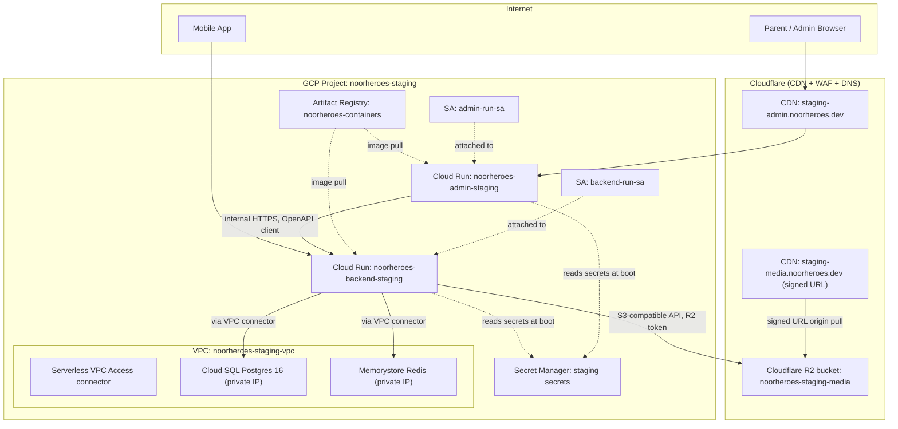

# Phase 1 — Terraform IaC Baseline (Staging Environment)

**File ID:** `Development_Blueprints.Phase1_Infra_Config.Infra.04-terraform-iac-baseline-staging.md`
**Phase:** Phase 1 — Infrastructure & Configuration
**Depends on:** `Infra.01-environment-tiers-provisioning.md` (environment tier definitions), `Infra.03-docker-compose-local-dev-stack.md` (the container image this module provisions runs)
**Consumed by:** `Infra.05-observability-stack-bootstrap.md`, `CI_CD.08-ci-pipeline-deploy-staging-e2e-smoke.md`, and (later, separately) `Phase11_CICD_Deployment.Infra.02-k8s-migration-path-cloud-run-to-k8s.md`
**Source authority:** `NoorHeroes_Final_Development_Prompt.md` §7 (Docker, Deployment & Infrastructure), §2.1 (repo structure — `infra/terraform/`), §3 (environment tiers); `NoorHeroes_Consolidated_Blueprint_v6.md` §2.5 (Storage & CDN — Cloudflare R2/CDN), §2.9 (Infrastructure), §3.1–3.3 (service topology)

---

## 1. Objective and Purpose

Stand up the first real, reproducible piece of cloud infrastructure for NoorHeroes: a Terraform IaC baseline that provisions the **Staging** environment — the environment the Final Development Prompt explicitly designates as where infrastructure-as-code must start ("Start capturing infra-as-code from the staging environment onward even if production is initially clicked together, then reconcile," §7).

This file's job is narrow and concrete: define the Terraform module structure, provider configuration, resource shape, and remote state strategy needed to stand up, in Staging, exactly the resources the Final Development Prompt and Consolidated Blueprint already committed to:

- A managed container compute platform running the `backend` (FastAPI) and `admin-web` (Next.js) container images already built by the Docker multi-stage builds referenced in §7 and provisioned locally by `Infra.03`.
- A managed PostgreSQL instance with automated backups and point-in-time recovery.
- A managed Redis instance (cache / rate-limiting / Celery broker).
- Cloudflare R2 object storage (the vendor already locked in by Consolidated Blueprint §2.5 — this file does not re-litigate that choice, it provisions it).
- Cloudflare CDN in front of the admin-web app and (for signed-URL media delivery) in front of the media pipeline's R2 origin.
- The supporting scaffolding every one of the above needs to be safe and reproducible: networking, IAM/service accounts, secrets wiring, and Terraform's own remote state backend.

**Out of scope for this file** (do not duplicate):
- The Kubernetes migration path — that is `Phase11_CICD_Deployment.Infra.02-k8s-migration-path-cloud-run-to-k8s.md`, a separate, later, deliberately-deferred file.
- Production Terraform — production is a **promotion** of this same module code with a different `environments/production` root and stricter variable values (HA tiers, larger instance sizes, WAF in blocking mode), not a duplicated set of modules. Section 15 below scopes this explicitly.
- CI/CD pipeline stages that *invoke* `terraform plan`/`apply` — that automation lives in `CI_CD.08-ci-pipeline-deploy-staging-e2e-smoke.md`. This file defines what those pipeline stages call.
- Application-level environment tiering decisions (which vars exist, which environments exist) — that's `Infra.01`.
- Blue/green and canary deploy mechanics — that's `Phase11_CICD_Deployment.Infra.01-blue-green-canary-deployment-strategy.md`. Staging in this file deploys via a simple rolling update; blue/green is a production-promotion concern.

---

## 2. Scope and Requirements

In scope, all for the **Staging** environment only:

1. Terraform root module and reusable child modules under `infra/terraform/`, versioned in the monorepo.
2. Remote state backend with locking, isolated per environment, provisioned before any other resource (a bootstrap step).
3. Networking: a VPC with a private subnet, a Serverless VPC Access connector (or provider-equivalent) so the compute layer can reach the database and cache over private IP, and a private services access range for the managed Postgres instance.
4. Compute: containerized deployment of `backend` and `admin-web` images on a serverless container platform, each with its own least-privilege runtime service account, autoscaling bounds appropriate to staging load, and environment variables/secrets wired from Secret Manager — never baked into the image or committed to `.tfvars`.
5. Database: one managed PostgreSQL 16 instance (matching the version already used by `Infra.03`'s local Docker Compose Postgres, per the environment-parity requirement in Final_Development_Prompt §3), with automated daily backups, point-in-time recovery (WAL archiving) enabled, and a dedicated staging database + least-privilege application user (never the instance superuser).
6. Cache: one managed Redis instance sized for staging load (no HA requirement at this tier — HA is a production concern).
7. Object storage: a Cloudflare R2 bucket dedicated to staging, private by default, with the lifecycle/versioning posture the media pipeline assumes (originals retained; see Consolidated Blueprint §2.5, §13.6).
8. CDN: Cloudflare CDN configured in front of (a) the `admin-web` custom staging domain and (b) the signed-URL media delivery path in front of R2, matching Consolidated Blueprint §13.6's "no public unauthenticated media URLs" requirement.
9. Secrets: a managed secrets store (per Final_Development_Prompt §3, "Staging/Prod: a managed secrets service") holding all staging credentials — DB connection string, Redis connection string, R2 API credentials, JWT signing material — read by the compute layer at boot, never embedded in Terraform state in plaintext where avoidable, and never printed in CI logs.
10. IAM: least-privilege service accounts for (a) each running workload, (b) the Terraform CI runner itself, with no long-lived static cloud credentials in CI (federated/OIDC-based auth).
11. Terraform hygiene: `terraform validate` and `terraform fmt -check` as CI-blocking checks (defined here, wired in `CI_CD.06`), a documented `plan`-before-`apply` workflow, and `terraform plan` output as a required PR artifact for any infra change touching staging.

Explicitly **not** in scope: production module instantiation, Kubernetes manifests, blue/green traffic shifting, DNS zone creation for the apex production domain, and any resource not already named in the Final Development Prompt / Consolidated Blueprint (no inventing new vendors or architecture).

---

## 3. Technical Implementation Details

### 3.1 Cloud provider assumption (see §18 for the full assumption statement)

The Final Development Prompt names "Cloud Run/Fargate" without picking one. This file assumes **Google Cloud Platform, using Cloud Run**, as the compute platform, alongside GCP's managed Postgres (Cloud SQL) and managed Redis (Memorystore), for the following reasons made explicit so the choice can be confirmed or overridden before implementation starts:

- GCP Cloud Run is the platform the Final Development Prompt names first in its own comma-separated list ("AWS ECS Fargate, Google Cloud Run, or a managed Kubernetes...").
- Cloud Run's native domain-mapping and container-based deploy model integrates cleanly with a Cloudflare-fronted CDN/WAF setup, which is already locked in as the CDN vendor regardless of compute provider.
- Google-managed TLS certificates satisfy §7's "SSL: Automated via the managed platform... never manually renewed certs" requirement without extra Terraform.

**Cloudflare R2 and Cloudflare CDN remain the object-storage/CDN vendor regardless of this assumption** — R2 is accessed via its S3-compatible API and is cloud-provider-agnostic, so this choice does not lock NoorHeroes out of AWS later. If the team instead confirms AWS Fargate, only the `compute`, `database`, `cache`, and `networking` modules' *provider* changes (ECS Fargate + RDS + ElastiCache + a VPC via the `aws` provider) — the module *boundaries*, variable *names*, and the `storage`/`cdn` modules described in this file are provider-agnostic and do not change.

### 3.2 Provider versions and pinning

```hcl
# infra/terraform/environments/staging/versions.tf
terraform {
  required_version = ">= 1.7.0, < 2.0.0"

  required_providers {
    google = {
      source  = "hashicorp/google"
      version = "~> 5.30"
    }
    google-beta = {
      source  = "hashicorp/google-beta"
      version = "~> 5.30"
    }
    cloudflare = {
      source  = "cloudflare/cloudflare"
      version = "~> 4.40"
    }
    random = {
      source  = "hashicorp/random"
      version = "~> 3.6"
    }
  }
}
```

All modules pin providers via this single root `versions.tf`; child modules declare `required_providers` without version constraints (constraints live once, at the root, per Terraform module-composition best practice) so upgrades happen in exactly one place.

### 3.3 Provider configuration

```hcl
# infra/terraform/environments/staging/providers.tf
provider "google" {
  project = var.gcp_project_id
  region  = var.gcp_region
}

provider "google-beta" {
  project = var.gcp_project_id
  region  = var.gcp_region
}

provider "cloudflare" {
  api_token = var.cloudflare_api_token   # scoped token, see §9.3 — never the account-wide Global API Key
}
```

No static GCP service-account key is ever configured in this provider block. Terraform authenticates as:
- **Locally (developer machine):** `gcloud auth application-default login` (developer's own IAM-bound identity, staging project only).
- **In CI:** Workload Identity Federation — GitHub Actions' OIDC token exchanged for short-lived GCP credentials impersonating the `terraform-ci-runner` service account. See §9.2.

---

## 4. Architecture and Component Responsibilities



| Component | Responsibility | Terraform module |
|---|---|---|
| Networking | VPC, private subnet, Serverless VPC Access connector, private-services-access peering for Cloud SQL | `modules/networking` |
| Database | Cloud SQL Postgres 16 instance, staging database, least-privilege app user, backup/PITR config | `modules/database` |
| Cache | Memorystore Redis instance, private IP, auth enabled | `modules/cache` |
| Storage | Cloudflare R2 bucket + access-key scoping for the media pipeline | `modules/storage` |
| Compute | Cloud Run services for `backend` and `admin-web`, runtime service accounts, autoscaling, secret/env wiring | `modules/compute` |
| CDN | Cloudflare DNS records, zone settings, WAF ruleset, cache rules for admin-web and signed-URL media path | `modules/cdn` |
| Secrets | Secret Manager secrets + IAM bindings granting only the relevant Cloud Run SA read access to its own secrets | `modules/secrets` |
| State bootstrap | The GCS bucket Terraform itself uses for remote state (created once, outside the normal apply cycle) | `global/state-bootstrap` |

Each module is self-contained (own `variables.tf`/`outputs.tf`/`main.tf`), takes no hidden dependency on sibling modules' internals, and communicates only through explicit `module.x.output_name` references wired in the environment root. This mirrors the backend's own bounded-context module boundary convention (Final Development Prompt §2.2) applied to infrastructure.

---

## 5. Folder / File Structure

Exact layout under `infra/terraform/` (extends the `infra/` tree already declared in Final_Development_Prompt §2.1):

```
infra/terraform/
├── README.md                          # how to bootstrap state, run plan/apply, rotate secrets
├── global/
│   └── state-bootstrap/               # run ONCE, manually, before any environment root is ever applied
│       ├── main.tf                    # creates the GCS state bucket + Artifact Registry repo (shared across envs)
│       ├── variables.tf
│       ├── outputs.tf
│       └── backend.tf                 # local backend — this module's own state is NOT remote (chicken/egg)
│
├── modules/
│   ├── networking/
│   │   ├── main.tf                    # google_compute_network, subnetwork, VPC Access connector, PSA range
│   │   ├── variables.tf                # vpc_cidr, region, environment
│   │   ├── outputs.tf                  # network_id, subnet_id, vpc_connector_id, psa_range_name
│   │   └── README.md
│   ├── database/
│   │   ├── main.tf                    # google_sql_database_instance, google_sql_database, google_sql_user
│   │   ├── variables.tf                # tier, disk_size_gb, backup_start_time, network_id, db_name
│   │   ├── outputs.tf                  # connection_name, private_ip_address, db_name
│   │   └── README.md
│   ├── cache/
│   │   ├── main.tf                    # google_redis_instance
│   │   ├── variables.tf                # memory_size_gb, tier (BASIC for staging), network_id
│   │   ├── outputs.tf                  # host, port, auth_string (sensitive)
│   │   └── README.md
│   ├── storage/
│   │   ├── main.tf                    # cloudflare_r2_bucket, R2 API token scoping
│   │   ├── variables.tf                # account_id, bucket_name, environment
│   │   ├── outputs.tf                  # bucket_name, jurisdiction, endpoint
│   │   └── README.md
│   ├── compute/
│   │   ├── main.tf                    # google_cloud_run_v2_service (backend, admin-web), IAM invoker bindings
│   │   ├── variables.tf                # image, cpu, memory, min_instances, max_instances, env vars, secret refs
│   │   ├── outputs.tf                  # service_url, service_name, revision_name
│   │   └── README.md
│   ├── cdn/
│   │   ├── main.tf                    # cloudflare_record, cloudflare_ruleset (WAF), cache rules
│   │   ├── variables.tf                # zone_id, subdomain, origin_hostname, cache_ttl
│   │   ├── outputs.tf                  # fqdn
│   │   └── README.md
│   └── secrets/
│       ├── main.tf                    # google_secret_manager_secret + version, IAM accessor bindings
│       ├── variables.tf                # secret_id, accessor_service_account_email
│       ├── outputs.tf                  # secret_id, secret_version
│       └── README.md
│
├── environments/
│   ├── staging/                       # <-- THIS FILE builds this root module
│   │   ├── backend.tf                 # remote GCS backend config, see §11
│   │   ├── providers.tf
│   │   ├── versions.tf
│   │   ├── main.tf                    # wires modules/* together for staging
│   │   ├── variables.tf                # staging-scoped input variables
│   │   ├── terraform.tfvars            # non-secret staging values (committed)
│   │   ├── secrets.auto.tfvars         # git-ignored; local override only, CI uses injected env vars — see §9.3
│   │   └── outputs.tf                  # service URLs, DB connection name, etc. surfaced to CI for smoke tests
│   └── production/                    # placeholder only — folder + README noting "provisioned at production
│       └── README.md                  #   promotion, see §15; do not instantiate modules here in this file's scope"
│
└── ci/
    └── terraform-plan-comment.sh       # helper invoked by CI_CD.08 to post `plan` output to the PR
```

**Module-boundary rule** (mirrors the backend's `repository.py` → `service.py` separation): a `modules/*` directory never reads another module's resources directly — only the `environments/staging/main.tf` root wires outputs of one module into the variables of another. This keeps every module independently testable with `terraform plan` in isolation (e.g., `cd modules/database && terraform test` against a throwaway root) and keeps the eventual production root a matter of re-wiring the same modules with different variable values, not rewriting resources.

---

## 6. APIs, Models, Interfaces, and Data Flow

Terraform itself has no runtime API surface, but this module's **interface contract** — the variables it accepts and outputs it produces — is the thing downstream files (`Infra.05`, `CI_CD.08`) depend on. Treat these as a stable contract:

### 6.1 `environments/staging/variables.tf` (interface in)

```hcl
variable "gcp_project_id" {
  type        = string
  description = "GCP project for the staging environment, e.g. noorheroes-staging"
}

variable "gcp_region" {
  type    = string
  default = "us-central1"
}

variable "environment" {
  type    = string
  default = "staging"
  validation {
    condition     = var.environment == "staging"
    error_message = "This root module is staging-only; production is a separate root, see §15."
  }
}

variable "backend_image" {
  type        = string
  description = "Fully-qualified Artifact Registry image ref for the FastAPI backend, injected by CI (e.g. us-central1-docker.pkg.dev/noorheroes-staging/noorheroes-containers/backend:<git-sha>)"
}

variable "admin_web_image" {
  type        = string
  description = "Fully-qualified Artifact Registry image ref for the Next.js admin-web app, injected by CI"
}

variable "backend_min_instances" {
  type    = number
  default = 0   # staging scales to zero; see §14/§15 on why prod will differ
}

variable "backend_max_instances" {
  type    = number
  default = 3
}

variable "db_tier" {
  type    = string
  default = "db-custom-1-3840"   # 1 vCPU / 3.75GB — staging-sized, not prod-sized
}

variable "redis_memory_size_gb" {
  type    = number
  default = 1
}

variable "cloudflare_account_id" {
  type = string
}

variable "cloudflare_zone_id" {
  type = string
}

variable "cloudflare_api_token" {
  type      = string
  sensitive = true
}

variable "r2_bucket_name" {
  type    = string
  default = "noorheroes-staging-media"
}
```

### 6.2 `environments/staging/outputs.tf` (interface out — consumed by CI/CD and `Infra.05`)

```hcl
output "backend_service_url" {
  value = module.compute.backend_service_url
}

output "admin_web_service_url" {
  value = module.compute.admin_web_service_url
}

output "database_connection_name" {
  value = module.database.connection_name
}

output "redis_host" {
  value     = module.cache.host
  sensitive = false   # host alone is not a secret; auth_string is (see module output)
}

output "r2_bucket_name" {
  value = module.storage.bucket_name
}

output "cdn_admin_fqdn" {
  value = module.cdn.admin_fqdn
}
```

`CI_CD.08-ci-pipeline-deploy-staging-e2e-smoke.md` consumes `backend_service_url` and `cdn_admin_fqdn` directly (via `terraform output -json`) to point its post-deploy smoke suite (hitting `/healthz` and `/readyz`, per FAST-API-INSTRUCTIONS.md's existing `liveness_check`/`readiness_check`) at the freshly-applied staging environment — no hardcoded staging URLs anywhere in CI config.

### 6.3 Data flow: apply-time and request-time

**Apply-time (Terraform):**
1. CI resolves GCP credentials via Workload Identity Federation.
2. `terraform init` pulls remote state from GCS (§11).
3. `terraform plan -var-file=terraform.tfvars -var="backend_image=..." -var="admin_web_image=..."` — image refs come from the CI build stage that already tagged and pushed to Artifact Registry.
4. On merge to `main` (or a manual staging-deploy trigger), `terraform apply` runs the same plan.
5. Terraform writes new state to GCS, acquiring the backend's native lock for the duration.

**Request-time (the infrastructure this file provisions, once applied):**
1. Browser/mobile client → Cloudflare CDN (`CF_ADMIN` for admin-web; backend API is *not* proxied through Cloudflare CDN caching — it's dynamic JSON, reached directly at its Cloud Run URL or via a Cloudflare DNS-only record for a friendlier hostname, no caching applied).
2. Cloud Run terminates TLS (Google-managed cert) and routes to the current revision.
3. Backend reads DB/Redis connection strings and R2 credentials from Secret Manager at container boot (never from baked-in env vars in the image), then connects to Cloud SQL/Memorystore over the private VPC connector.
4. Media requests: backend issues a Cloudflare-signed URL (per Consolidated Blueprint §13.6) pointing at `CF_MEDIA`, which pulls from the private R2 bucket on cache miss.

---

## 7. Dependencies and Configuration Requirements

| Dependency | Why | Where configured |
|---|---|---|
| GCP project `noorheroes-staging` with billing enabled | Target project for all `google_*` resources | Created out-of-band (console/`gcloud`) before any `terraform apply`; project ID passed as `gcp_project_id` |
| APIs enabled on that project: Cloud Run, Cloud SQL Admin, Serverless VPC Access, Memorystore (Redis), Secret Manager, Artifact Registry, Service Networking, IAM Credentials | Terraform resources fail without these enabled | `google_project_service` resources in `environments/staging/main.tf`, applied first (Terraform resolves this via implicit dependency when other resources reference the enabled API, but declare explicitly for clarity) |
| Cloudflare account with a zone for `noorheroes.dev` (or the confirmed staging domain) | DNS + CDN + R2 all live under this account | `cloudflare_account_id`, `cloudflare_zone_id` variables |
| Cloudflare API token, scoped (see §9.3) | Terraform auth to Cloudflare | Injected via `TF_VAR_cloudflare_api_token` in CI secrets; never committed |
| GCP Workload Identity Federation pool + provider, `terraform-ci-runner` service account | CI auth to GCP with no static keys | Provisioned once via `global/state-bootstrap` (or a dedicated `global/ci-identity` module — see §9.2), referenced by GitHub Actions' `google-github-actions/auth` step |
| Backend container image already built and pushed | `backend_image` variable requires a real, existing tag | Produced by `CI_CD.06` (build stage) before `CI_CD.08` (deploy stage) runs `terraform apply` |
| Admin-web container image already built and pushed | Same as above | Same |
| `infra/docker-compose.yml` / `Infra.03` Postgres version parity | Staging Postgres major version must match local dev (16) so migrations behave identically | `db_tier`/engine version pinned in `modules/database/variables.tf` as `postgres_version = "POSTGRES_16"` |
| Terraform CLI ≥ 1.7, `tflint`, `terraform-docs` (dev tooling, not runtime) | Local dev workflow, CI `validate`/`fmt` stage | Documented in `infra/terraform/README.md`; version pinned in `.tool-versions`/`mise.toml` if the repo uses one |

No new secrets-management architecture is introduced here — this file uses the "managed secrets service" already named in Final_Development_Prompt §3 (GCP Secret Manager, consistent with the GCP compute assumption in §3.1/§18) and the `.env.example` convention from `Infra.02` for what *keys* must exist, not how they're stored.

---

## 8. Database / Storage Requirements

### 8.1 PostgreSQL (Cloud SQL)

```hcl
# modules/database/main.tf (sketch)
resource "google_sql_database_instance" "staging" {
  provider            = google-beta
  name                = "noorheroes-${var.environment}-pg"
  database_version    = "POSTGRES_16"
  region              = var.region
  deletion_protection = true   # even in staging — accidental `terraform destroy` must not silently drop the DB

  settings {
    tier              = var.db_tier
    availability_type = "ZONAL"   # staging: single-zone; production promotion uses REGIONAL, see §15
    disk_size         = 20
    disk_autoresize   = true

    ip_configuration {
      ipv4_enabled    = false
      private_network = var.network_id
    }

    backup_configuration {
      enabled                        = true
      start_time                     = "03:00"
      point_in_time_recovery_enabled = true    # WAL archiving — matches Final_Development_Prompt §7's RPO ≤ 15 min target
      transaction_log_retention_days = 7
      backup_retention_settings {
        retained_backups = 14
      }
    }

    insights_config {
      query_insights_enabled = true
    }

    database_flags {
      name  = "log_min_duration_statement"
      value = "500"
    }
  }
}

resource "google_sql_database" "app_db" {
  name     = "noorheroes"
  instance = google_sql_database_instance.staging.name
}

resource "random_password" "app_db_password" {
  length  = 32
  special = false   # avoid characters that require extra URL-encoding in DSNs
}

resource "google_sql_user" "app_user" {
  name     = "noorheroes_app"
  instance = google_sql_database_instance.staging.name
  password = random_password.app_db_password.result
}
```

The application connects as `noorheroes_app`, never as the instance's built-in `postgres` superuser — this is the least-privilege application-DB-user requirement carried over unchanged from local dev (`Infra.03`) into staging. Alembic migrations (already the project's chosen migration tool per Final_Development_Prompt §2.2/§7) run against this same user; no separate migration-only role is introduced at staging scale, but the module leaves room for one (`google_sql_user.migration_user`) if the team wants migration/runtime privilege separation before production promotion.

**Scheduled restore drills** (Final_Development_Prompt §7: "an untested backup is not a verified backup"): this file provisions the backup *mechanism*; the recurring restore-drill runbook itself belongs in `docs/runbooks/` and is out of this file's scope, but the module's `outputs.tf` exposes `connection_name` and `latest_backup_id` specifically so that runbook/automation can script a restore-to-a-scratch-instance drill against staging without hand-typing connection details.

### 8.2 Redis (Memorystore)

```hcl
# modules/cache/main.tf (sketch)
resource "google_redis_instance" "staging" {
  name               = "noorheroes-${var.environment}-redis"
  tier               = "BASIC"          # staging: no HA replica; production promotion uses STANDARD_HA, see §15
  memory_size_gb     = var.memory_size_gb
  region             = var.region
  authorized_network = var.network_id
  redis_version      = "REDIS_7_2"
  auth_enabled       = true
  transit_encryption_mode = "SERVER_AUTHENTICATION"
}
```

Used for: rate-limiting (per FAST-API-INSTRUCTIONS.md's `RateLimitMiddleware`/`SlidingWindowRateLimiter`), Celery broker/result backend, and short-TTL read caches (e.g. `TranslationCacheManager`, `HabitCatalogCacheManager`). One instance serves all three uses at staging scale — no separate Redis instances per concern until production load justifies the split (consistent with the modular-monolith-first philosophy applied to infra).

### 8.3 Cloudflare R2 (object storage)

```hcl
# modules/storage/main.tf (sketch)
resource "cloudflare_r2_bucket" "staging_media" {
  account_id = var.cloudflare_account_id
  name       = var.r2_bucket_name        # "noorheroes-staging-media"
  location   = "ENAM"                    # or the confirmed jurisdiction/region
}
```

R2 access credentials (Access Key ID / Secret Access Key for the bucket's S3-compatible API) are **not** created via a plain `cloudflare_r2_bucket`-adjacent Terraform resource with a plaintext output — the current Cloudflare provider does not manage R2 API tokens as a first-class Terraform resource with safe secret handling. This file's convention: R2 API tokens are minted manually (or via a one-off `cloudflare_api_token` Terraform resource scoped to `Workers R2 Storage:Edit` on this bucket only) and immediately written into GCP Secret Manager by the same apply step (`modules/secrets`), never surfaced as a Terraform output. This matches the "no secrets baked into images, no secrets in state where avoidable" posture in §9.4.

Bucket posture, matching Consolidated Blueprint §2.5/§13.6:
- Private by default — no public bucket policy, no public R2.dev URL enabled.
- A separate `noorheroes-staging-media-public` bucket (or a clearly delineated path prefix, per §13.6's "separate, clearly delineated bucket/path" requirement) holds public marketing assets only — child-facing content never shares a bucket/path namespace with public assets.
- Versioning: R2 doesn't support native object versioning at this time; the module documents (README) that the *application's* content-versioning system (Consolidated Blueprint §2253) is the actual safety net, not bucket-level versioning — this file provisions storage, it doesn't reimplement the app's versioning model.

---

## 9. Authentication, Authorization, Validation, and Security Considerations

### 9.1 Runtime service accounts (least privilege, one per workload)

```hcl
# modules/compute/main.tf (sketch, IAM excerpt)
resource "google_service_account" "backend_run_sa" {
  account_id   = "backend-run-sa"
  display_name = "NoorHeroes backend Cloud Run runtime SA (staging)"
}

resource "google_project_iam_member" "backend_sql_client" {
  project = var.project_id
  role    = "roles/cloudsql.client"
  member  = "serviceAccount:${google_service_account.backend_run_sa.email}"
}

resource "google_secret_manager_secret_iam_member" "backend_db_secret_access" {
  secret_id = var.db_dsn_secret_id
  role      = "roles/secretmanager.secretAccessor"
  member    = "serviceAccount:${google_service_account.backend_run_sa.email}"
}
# repeat, one binding per secret the backend actually needs — never a project-wide secretAccessor grant
```

`admin-web`'s runtime SA gets **no** direct Cloud SQL/Redis IAM roles at all — the admin-web app talks to the backend's HTTP API only (per the architecture diagram in Consolidated Blueprint §3.2, Admin Portal → Admin Gateway → backend), never to the database directly. This is enforced at the IAM layer, not just by convention: `admin_run_sa` is granted `roles/secretmanager.secretAccessor` only on the specific secrets it needs (backend API base URL, NextAuth/session secret), nothing DB- or Redis-shaped.

### 9.2 CI authentication — no static cloud keys

```hcl
# global/state-bootstrap or global/ci-identity (sketch)
resource "google_iam_workload_identity_pool" "github" {
  workload_identity_pool_id = "github-actions-pool"
}

resource "google_iam_workload_identity_pool_provider" "github" {
  workload_identity_pool_id         = google_iam_workload_identity_pool.github.workload_identity_pool_id
  workload_identity_pool_provider_id = "github-actions-provider"
  attribute_mapping = {
    "google.subject" = "assertion.sub"
    "attribute.repository" = "assertion.repository"
  }
  oidc {
    issuer_uri = "https://token.actions.githubusercontent.com"
  }
}

resource "google_service_account" "terraform_ci_runner" {
  account_id = "terraform-ci-runner"
}

resource "google_service_account_iam_member" "wif_binding" {
  service_account_id = google_service_account.terraform_ci_runner.name
  role                = "roles/iam.workloadIdentityUser"
  member              = "principalSet://iam.googleapis.com/${google_iam_workload_identity_pool.github.name}/attribute.repository/noorheroes/noorheroes"
}
```

`terraform-ci-runner` is granted only the project roles Terraform actually needs to manage this file's resources (`roles/run.admin`, `roles/cloudsql.admin`, `roles/redis.admin`, `roles/secretmanager.admin`, `roles/iam.serviceAccountUser` scoped to the specific runtime SAs it must attach to Cloud Run, `roles/compute.networkAdmin` scoped to the staging VPC, `roles/storage.admin` scoped to the state bucket) — not `roles/owner`, not `roles/editor`. Cloudflare auth in CI uses a scoped API token (§9.3) injected as a GitHub Actions encrypted secret, exchanged the same way any other CI secret is handled per Final_Development_Prompt §3 ("CI: repository/organization-level encrypted secrets... never printed to logs").

### 9.3 Cloudflare token scoping

The `cloudflare_api_token` used by Terraform is a **scoped, custom token** (never the account Global API Key), with exactly these permissions: `Zone:DNS:Edit` and `Zone:Zone Settings:Edit` on the specific zone, `Zone:Cache Rules:Edit`, and `Account:Workers R2 Storage:Edit` scoped to the `noorheroes-staging-media*` buckets only. Documented in `infra/terraform/README.md` with the exact token-creation steps so it's reproducible, not tribal knowledge.

### 9.4 Secrets never in plaintext state where avoidable

- `random_password.app_db_password` and similar generated secrets **do** end up in Terraform state (this is unavoidable for any resource Terraform creates and must track) — mitigated by (a) state itself being encrypted at rest in GCS by default and access-controlled per §11, (b) `sensitive = true` on every such variable/output so it never appears in CI logs or `plan` output printed to a PR comment, and (c) state-bucket IAM restricted to `terraform-ci-runner` and a small break-glass admin group only — no broad "developers" read access to the state bucket.
- Secrets sourced *outside* Terraform (R2 API tokens minted manually, third-party API keys) are written directly into Secret Manager via `google_secret_manager_secret_version` with `secret_data` passed as a `sensitive` variable populated only from CI's injected environment — never committed to any `.tfvars` file, never hardcoded in a module.
- `.gitignore` must cover `*.tfstate`, `*.tfstate.*`, `secrets.auto.tfvars`, and `.terraform/` — local state must never exist in this workflow at all (remote backend is mandatory from the first `terraform init`, see §11), but the ignore rules are a defense-in-depth backstop.

### 9.5 Network security posture

- Cloud SQL and Memorystore have **no public IP** — private-IP-only via the VPC, reachable exclusively through the Serverless VPC Access connector attached to the Cloud Run services. There is no code path, misconfiguration-permitting, where the database is reachable from the open internet by IP.
- Cloud Run services default to `ingress = "INGRESS_TRAFFIC_ALL"` for the backend (it must accept mobile client + admin-web traffic) but the admin-web service, if desired, can be restricted to `INGRESS_TRAFFIC_INTERNAL_LOAD_BALANCER` once the Cloudflare-fronted external HTTPS load balancer path is wired — documented as a hardening follow-up, not required for the initial staging baseline (staging accepts direct Cloud Run ingress fronted by a Cloudflare DNS record in "DNS-only," i.e. grey-cloud, mode initially; full orange-cloud proxying with WAF is the CDN module's default target once validated in staging — see `modules/cdn/README.md` for the exact toggle).
- Cloudflare WAF ruleset (`cloudflare_ruleset`) is deployed in **staging in "log" mode, not "block" mode**, for the first bake-in period, so false positives are visible in Cloudflare's dashboard before anything is actually blocked — flip to block mode as an explicit, separate `terraform apply` once staging traffic patterns are understood. This is called out explicitly so the coding agent doesn't silently ship a blocking WAF that breaks the E2E smoke suite in `CI_CD.08`.

---

## 10. Error Handling and Edge Cases

| Scenario | Handling |
|---|---|
| `terraform apply` fails partway (e.g. Cloud SQL instance creation times out after Redis already created) | Terraform's own dependency graph and state tracking handle partial-apply resumption — re-running `apply` picks up where it left off; this file requires CI to **never** auto-retry a failed apply blindly (a failed apply must surface as a failed CI job requiring human review of `plan` diff, not a silent retry loop) |
| `terraform plan` shows an unexpected destroy/recreate of the database or the R2 bucket | `lifecycle { prevent_destroy = true }` is set on `google_sql_database_instance.staging` and `cloudflare_r2_bucket.staging_media` — any plan that would destroy either fails `terraform apply` outright, forcing explicit human override (removing the lifecycle block in its own reviewed PR) rather than an accidental data-loss apply |
| Two engineers run `apply` concurrently | GCS backend's native state locking rejects the second `apply` with a lock-held error rather than corrupting state — see §11 |
| Secret Manager secret referenced by Cloud Run doesn't exist yet at first apply (ordering problem) | `modules/secrets` is applied before `modules/compute` via explicit `depends_on` in the environment root, not relying on implicit reference ordering alone, because Cloud Run's secret-env-var reference is a string, not a first-class Terraform reference in every provider version — document this explicit ordering in `main.tf` comments |
| Staging Cloud Run scales to zero (min_instances = 0) and the E2E smoke suite hits a cold start | `CI_CD.08`'s smoke suite must tolerate one cold-start-latency retry on the first request — documented here so that file doesn't get built assuming always-warm staging; this is a deliberate staging cost-saving tradeoff, not a bug |
| Cloudflare zone/token misconfigured (wrong zone_id, expired token) | `cloudflare` provider auth failures surface at `terraform plan` time, before any GCP resource is touched, if the `cdn`/`storage` modules are declared early enough in the dependency graph — acceptable to fail fast here rather than mid-apply |
| Someone runs `terraform destroy` on staging by mistake | `prevent_destroy` (above) blocks the DB/bucket; everything else in staging is fully reproducible from this code plus a fresh `apply`, so a staging `destroy` is an inconvenience (redeploy time), never a data-loss incident for anything except those two protected resources |
| Terraform state drift (someone hand-edits a Cloud Run service in the console) | `terraform plan` on the next CI run surfaces the drift as a diff; the module does not attempt automatic drift-correction/import — a human reviews and either re-applies (reverting the manual change) or codifies it (updating the `.tf` to match, in a reviewed PR) |

---

## 11. State Management and Lifecycle Considerations

**This section is about Terraform's own state file — infrastructure-provisioning state — which is a completely different concept from application runtime state (DB rows, Redis cache entries, Celery job state) covered elsewhere in the project. Do not conflate the two.**

### 11.1 Remote backend

```hcl
# infra/terraform/environments/staging/backend.tf
terraform {
  backend "gcs" {
    bucket = "noorheroes-tfstate"
    prefix = "staging"
  }
}
```

- **Bucket:** `noorheroes-tfstate`, created once by `global/state-bootstrap` (see §5), with:
  - `versioning { enabled = true }` — every state write is retained, so a bad `apply`'s state can be rolled back to the prior version via `gsutil` object versioning even if Terraform's own history is insufficient.
  - `uniform_bucket_level_access = true`.
  - IAM restricted to `terraform-ci-runner` (`roles/storage.objectAdmin` on this bucket only) plus a named break-glass admin group — no project-wide or org-wide read grant.
  - **Not** itself managed by the `staging` root's remote state (that would be circular) — `global/state-bootstrap` uses a **local** backend for its own tiny bit of state, checked in nowhere, applied manually by an infra lead exactly once per new environment tier, with the resulting bucket name then hardcoded into every environment root's `backend.tf`. This bootstrap-paradox handling is standard Terraform practice and must be documented verbatim in `infra/terraform/README.md` so a coding agent doesn't try to make `state-bootstrap` remote too.
- **Prefix:** `staging` — the production root (when it's built, per §15) uses `prefix = "production"` in the **same** bucket, keeping one bucket but fully isolated state paths per environment. Never share a prefix between environments.
- **Locking:** the GCS backend provides native state locking (via a lock object, not a separate DynamoDB-style table as AWS S3 backends require) — no additional Terraform resource is needed for locking; this is backend-native behavior. Document this explicitly since engineers coming from an AWS/S3+DynamoDB background will look for a lock-table resource that doesn't exist here.

### 11.2 Lifecycle across the module's life

1. **Bootstrap (once):** infra lead runs `global/state-bootstrap` locally with a local backend, creating the GCS state bucket and Artifact Registry repo. Output: bucket name, recorded in `environments/staging/backend.tf`.
2. **First init:** `cd infra/terraform/environments/staging && terraform init` — pulls (empty) remote state.
3. **Iterative development:** every infra change goes through `plan` → PR review of the plan diff → merge → CI `apply` (never a developer's local `apply` against shared staging state, to avoid state-lock contention and undocumented changes — local `apply` is fine against a personal, separate throwaway GCP project for module development, never against the shared `noorheroes-staging` project).
4. **State migrations:** if a module is refactored (e.g. `modules/compute` split into `modules/compute-backend` + `modules/compute-admin`), use `terraform state mv` in a dedicated, reviewed PR — never delete-and-recreate resources that carry data (the database, the R2 bucket) just to satisfy a refactor.
5. **Environment teardown (staging is never expected to be torn down routinely, but if the project is ever paused):** `terraform destroy` is deliberately *not* a one-command operation for this environment because of `prevent_destroy` on the DB/bucket — teardown requires an explicit, reviewed removal of those lifecycle blocks first, which is the intended friction.

---

## 12. Integration Points with Existing Modules

| Integration point | Detail |
|---|---|
| Backend container image | `modules/compute` deploys whatever image tag `CI_CD.06`'s build stage produced and pushed to the Artifact Registry repo this file's `state-bootstrap` module creates (`us-central1-docker.pkg.dev/noorheroes-staging/noorheroes-containers/backend:<git-sha>`) — this file does not build the image, only deploys it; the image itself is the multi-stage `python:3.12-slim` Dockerfile already specified in Final_Development_Prompt §7 |
| Admin-web container image | Same pattern, `node:XX-alpine` Next.js standalone output image per §7, tag `.../admin-web:<git-sha>` |
| Health/readiness probes | Cloud Run's own health-check config points at the backend's existing `/healthz` (liveness) and `/readyz` (readiness — verifies Postgres + Redis connectivity) endpoints, already implemented per FAST-API-INSTRUCTIONS.md `api/health.py` — this file wires Cloud Run's `startup_probe`/`liveness_probe` blocks to those exact paths, it does not implement new health endpoints |
| Prometheus/OpenTelemetry | The backend already exports Prometheus metrics and OTel traces per FAST-API-INSTRUCTIONS.md — this file's job is only to ensure the Cloud Run service's egress can reach wherever `Infra.05-observability-stack-bootstrap.md` stands up the collector/Grafana endpoint (same VPC or public HTTPS, resolved when that file is authored); no metrics-pipeline infrastructure is built here |
| R2 bucket the media pipeline assumes | `R2StorageService` (FAST-API-INSTRUCTIONS.md, `infrastructure/storage/storage.py`) reads its bucket name/credentials from the same Secret Manager secret `modules/secrets` populates from this file's `modules/storage` output — the application code is unchanged by this file; this file only makes the bucket and credentials exist in staging |
| CDN in front of admin-web | `modules/cdn` creates the Cloudflare DNS record and cache rules for `staging-admin.noorheroes.dev` (or the confirmed staging subdomain) pointed at the `admin-web` Cloud Run service's default domain — no changes to the Next.js app itself are required; standalone-output Next.js is already CDN-friendly with its existing static-asset caching headers |
| Docker Compose local stack (`Infra.03`) | This file's Postgres 16 / Redis versions are pinned to match `Infra.03`'s local `docker-compose.yml` exactly, so a migration or query that works locally behaves identically in staging — any version drift here is a bug in this file, not an acceptable variance |
| Environment tiers (`Infra.01`) | This file implements the "Staging" row of the environment-tier table `Infra.01` defines; it does not redefine what environments exist or their purposes |
| K8s migration path (Phase 11, separate file) | This file's module boundaries (`networking`/`database`/`cache`/`storage`/`compute`/`cdn` as distinct modules) are deliberately drawn so that, at the Phase 6/11 migration point, only `modules/compute` needs a Kubernetes-targeting sibling/replacement — `database`, `cache`, `storage`, `networking`, and `cdn` stay managed-service resources untouched by that later migration. Do not restructure this boundary preemptively; the K8s file will reference this contract, not the other way around |

---

## 13. Development Steps in Correct Implementation Order

1. **Confirm the cloud-provider assumption** (§3.1/§18) with the team before writing any `.tf` — if AWS Fargate is confirmed instead, adjust provider blocks per §3.1's note; the module boundaries and this document's structure do not change.
2. **Provision the GCP staging project** (or AWS account, per confirmed provider) out-of-band, enable required APIs, note the project ID.
3. **Provision the Cloudflare zone/account access** needed (staging subdomain delegated or a dedicated `noorheroes.dev` zone), generate the scoped API token per §9.3.
4. **Write and manually apply `global/state-bootstrap`** — creates the GCS state bucket and Artifact Registry repo. This is the only module in this file applied with local state, by design (§11.1).
5. **Write `global/ci-identity`** (Workload Identity Federation pool/provider/SA) — apply manually once (bootstrapping the very identity CI will later use), same reasoning as step 4.
6. **Scaffold `modules/networking`** — VPC, subnet, VPC Access connector, private services access range. Apply via the now-available remote-state-backed `environments/staging` root (empty except for this module) to validate the backend/init flow end-to-end before adding stateful resources.
7. **Add `modules/database`** — apply, confirm private-IP connectivity from a throwaway Cloud Run "hello world" revision before building real backend deploy logic on top of it.
8. **Add `modules/cache`** — same validate-before-build approach.
9. **Add `modules/storage`** — create the R2 bucket, manually mint the scoped R2 API token, write it into Secret Manager via `modules/secrets`.
10. **Add `modules/secrets`** — wire the DB DSN, Redis connection string, R2 credentials, and JWT signing material (the last sourced from wherever `Infra.02`'s secrets convention places it) as Secret Manager secrets with per-consumer IAM bindings.
11. **Add `modules/compute`** — deploy the real `backend` and `admin-web` images (once `CI_CD.06` exists and produces them; until then, deploy a placeholder/hello-world image to validate the module), wire secret references, confirm `/healthz`/`/readyz` respond.
12. **Add `modules/cdn`** — DNS record + cache rules for admin-web; WAF ruleset in log-only mode initially (§9.5).
13. **Wire `outputs.tf`** — confirm every output `CI_CD.08` will need is present and correctly typed/marked sensitive.
14. **Write `infra/terraform/README.md`** — bootstrap steps, `plan`/`apply` workflow, token-scoping instructions, drift-handling policy — this is the onboarding doc for the next engineer/agent touching this module.
15. **Hand off to `CI_CD.06`/`CI_CD.08`** to wire `terraform validate`/`fmt -check` into the lint stage and `plan`/`apply` into the deploy stage — this file's job ends at "a human or a documented CI job can run these commands and get staging."

---

## 14. Testing Strategy and Acceptance Criteria

### 14.1 Static validation (every PR touching `infra/terraform/`)

- `terraform fmt -check -recursive` — fails the build on any unformatted `.tf` file.
- `terraform validate` — run per-module (`for dir in modules/*; do (cd $dir && terraform validate); done`) and on the `environments/staging` root — catches syntax errors, missing required arguments, provider-schema mismatches, before any state is touched.
- `tflint` — catches provider-specific correctness issues (e.g. a Cloud Run CPU value that isn't a valid increment) that bare `validate` misses.
- A regex/secret-scan pass (the same `gitleaks`/`trufflehog` tooling `Infra.02` wires project-wide) specifically covering `*.tfvars` and `*.tf` files, since Terraform configs are a common accidental-secret-commit vector.

### 14.2 Plan validation (every PR touching `infra/terraform/environments/staging` or a module it uses)

- CI runs `terraform plan -var-file=terraform.tfvars -out=tfplan`, using the CI-injected image tags and Cloudflare token, authenticated via Workload Identity Federation against the real `noorheroes-staging` project (plan is read-only against real infra — safe).
- The plan's human-readable output is posted as a PR comment (via `infra/terraform/ci/terraform-plan-comment.sh`) so reviewers see exactly what would change before approving.
- **Acceptance criterion:** a PR that changes Terraform code cannot merge without a green `plan` job whose diff a human has reviewed — this is enforced as a required status check, matching the non-bypassable-check pattern already established for security scanning (Final_Development_Prompt §9.7).
- **Acceptance criterion:** the plan must show **zero unintended destroys** of `google_sql_database_instance.staging` or `cloudflare_r2_bucket.staging_media` — CI greps the plan's JSON output (`terraform show -json tfplan`) for a `delete`/`replace` action against either resource's address and fails the job if found, as a second independent guardrail beyond the `prevent_destroy` lifecycle block itself.

### 14.3 Apply validation (on merge to `main`, or manual staging-deploy trigger)

- `terraform apply tfplan` (applying the **exact** plan artifact generated and reviewed in 14.2, never a fresh `plan`-then-`apply` in the same step — this guarantees what was reviewed is what gets applied).
- Post-apply, CI runs `terraform output -json` and asserts every key listed in §6.2 is present and non-null.
- Post-apply smoke test (owned by `CI_CD.08`, but this file states the acceptance bar): `GET {backend_service_url}/healthz` returns `200`, `GET {backend_service_url}/readyz` returns `200` (proving live DB + Redis connectivity through the freshly-applied networking/database/cache modules — this is the single most important end-to-end proof this whole file did its job), and `GET {cdn_admin_fqdn}` returns a `200`/valid HTML response through the Cloudflare CDN layer.

### 14.4 Manual acceptance criteria (one-time, at first successful staging apply)

- [ ] `terraform apply` completes with zero errors from a clean CI run (Workload Identity Federation auth, not a developer's local credentials).
- [ ] Cloud SQL instance is reachable **only** via private IP — a direct public-IP connection attempt from outside the VPC fails/times out.
- [ ] Backend Cloud Run service's `/readyz` returns `200`, proving DB + Redis reachability over the VPC connector.
- [ ] A file uploaded to the staging R2 bucket via the backend's existing `R2StorageService` presigned-URL flow is **not** fetchable via a raw, unsigned public URL.
- [ ] `staging-admin.<domain>` resolves through Cloudflare and serves the admin-web app over HTTPS with a valid (Cloudflare or Google-managed, depending on final proxy mode chosen) certificate.
- [ ] A second, concurrent `terraform apply` attempt while the first is running is rejected with a state-lock error, not silently interleaved.
- [ ] `terraform plan` against unmodified `main` after a successful apply shows **zero diff** (proving no drift, no non-idempotent resource in any module).

---

## 15. Production-Readiness Considerations (Staging-Scoped)

This file provisions **Staging only**. Production is a **promotion of this same module code**, not a duplicated Terraform tree — the explicit intent, matching Final_Development_Prompt §7's "Start capturing infra-as-code from the staging environment onward... then reconcile," is that `environments/production/` (a placeholder folder only, per §5) will one day instantiate the **same** `modules/*` with different variable values, plus the additions below. This section exists so a coding agent building this file does not accidentally over-build staging to production specs, and does not accidentally under-document what changes at promotion time.

Deliberately **staging-scoped, weaker-than-production** choices made in this file, each flagged so they're not mistaken for the final production posture:

| Staging choice (this file) | Production difference (future file, not built here) |
|---|---|
| Cloud SQL `availability_type = "ZONAL"` | Production: `REGIONAL` (HA standby) |
| Memorystore `tier = "BASIC"` | Production: `STANDARD_HA` |
| `backend_min_instances = 0` (scales to zero, accepts cold starts) | Production: `min_instances ≥ 1` to avoid cold-start latency on real user traffic |
| Cloudflare WAF ruleset in log-only mode | Production: block mode, tuned from staging's log data |
| Single GCP region, no multi-region failover | Production: DR/multi-region posture decided against the RPO/RTO targets in Final_Development_Prompt §7 (RPO ≤ 15 min, RTO ≤ 1 hour, pending stakeholder confirmation) |
| No blue/green traffic splitting (plain rolling Cloud Run revision update) | Production: blue/green or canary (5%→25%→100%), per `Phase11_CICD_Deployment.Infra.01-blue-green-canary-deployment-strategy.md` — a separate file, not this one |
| Manual promotion gate from staging→production is a CI/CD concern | Owned by `CI_CD.09-ci-pipeline-manual-promotion-production-deploy.md`, not this file |
| Kubernetes not used anywhere in this file | Stays true for production too, until Phase 6's scale-triggered migration — see `Phase11_CICD_Deployment.Infra.02-k8s-migration-path-cloud-run-to-k8s.md` |

**Explicitly not this file's job:** deciding *when* to promote, building the promotion pipeline, or pre-building `environments/production/main.tf`. When that work starts, it should re-use every module under `infra/terraform/modules/` unchanged in interface, varying only the values fed to them — if a module needs a genuinely new capability for production (e.g. read replicas), extend the module's variables with a sensible staging-safe default rather than forking a parallel module.

---

## 16. Dependencies / Prerequisites

- `Infra.01-environment-tiers-provisioning.md` — defines that a "Staging" tier exists, its purpose, and its data-sensitivity rules (synthetic/anonymized data only) that this file's provisioned Postgres instance must respect (no production PII is ever restored into this staging DB).
- `Infra.03-docker-compose-local-dev-stack.md` — the source of the Postgres/Redis version parity requirement (§8) and the container images this file deploys are built by the same Dockerfiles that `Infra.03` documents running locally.
- A GCP billing account and organization (or AWS account, per §3.1's confirmable assumption) already exist and are accessible to whoever runs the one-time `global/state-bootstrap` step.
- A Cloudflare account already holds (or can be delegated) the DNS zone used for staging subdomains.
- `Infra.02-secrets-management-env-example-gitleaks.md` (parallel/soon-after dependency, not strictly blocking) — defines the canonical list of secret keys (`DATABASE_URL`, `REDIS_URL`, R2 credential keys, JWT signing key) this file's `modules/secrets` populates in Secret Manager; align key naming with that file once it exists so the backend's `Settings` class (`core/settings.py`) reads identically-named secrets in every environment.

---

## 17. Definition of Done

- [ ] `infra/terraform/` exists with the exact structure in §5 — `global/state-bootstrap`, seven `modules/*` directories, `environments/staging/` (fully instantiated) and `environments/production/` (placeholder README only).
- [ ] Remote GCS state backend is live, versioned, access-restricted, and `environments/staging` successfully `init`s against it.
- [ ] All seven modules (`networking`, `database`, `cache`, `storage`, `compute`, `cdn`, `secrets`) are implemented, individually `validate`-clean, and wired together in `environments/staging/main.tf`.
- [ ] `terraform apply` against the real `noorheroes-staging` project succeeds end-to-end from a clean CI run using Workload Identity Federation (no static keys anywhere).
- [ ] Backend and admin-web are reachable, healthy (`/healthz`/`/readyz` green), and admin-web is served through Cloudflare CDN with a valid TLS certificate.
- [ ] R2 bucket exists, is private, and is correctly consumed by the existing `R2StorageService` presigned-URL flow with no application-code changes required.
- [ ] `prevent_destroy` guards are in place and verified (a `plan` that would destroy the DB or R2 bucket is caught by CI, per §14.2).
- [ ] `terraform fmt -check`, `terraform validate`, and `tflint` are green and wired as required CI status checks.
- [ ] A second, unmodified `terraform plan` against the applied state shows zero diff (idempotency proven).
- [ ] `infra/terraform/README.md` documents the bootstrap sequence, token scoping, and drift-handling policy well enough that a new engineer/agent can rebuild this environment from scratch in a new GCP project without tribal knowledge.
- [ ] Every output listed in §6.2 is present, correctly typed, and consumed successfully by a first end-to-end run of `CI_CD.08`'s smoke suite.

---

## 18. Assumptions or Decisions the Coding Agent Must Follow

State these explicitly in the PR/ADR that implements this file, and get them confirmed before or during build — do not silently improvise a different answer:

1. **Cloud provider: GCP, using Cloud Run for compute, Cloud SQL for Postgres, Memorystore for Redis.** The source documents name "Cloud Run/Fargate" without picking one; this file assumes GCP per the reasoning in §3.1. **Confirm with the team before implementation** — if AWS Fargate is the actual intended target, re-derive the `networking`/`database`/`cache`/`compute` modules against `aws` provider resources (VPC, ECS Fargate service + task definition, RDS Postgres, ElastiCache Redis) using the **same module names, variable contracts (§6), and folder structure** — only the provider blocks and resource types inside each module change.
2. **Cloudflare R2 + Cloudflare CDN remain fixed regardless of compute-provider choice** — this is already a locked decision per Consolidated Blueprint §2.5 and is not re-opened by this file.
3. **Staging Postgres major version is 16**, matching whatever `Infra.03` pins for local Docker Compose — if that file pins a different version, this file's `database_version` must be updated to match, not the other way around (local dev parity wins).
4. **Region: `us-central1`** (GCP) is the default assumed region for staging — confirm against any data-residency requirement in the PRD documents (none identified in the source docs reviewed for this file) before finalizing; the variable is exposed (`gcp_region`) specifically so this is a one-line change, not a rewrite.
5. **Staging domain:** this file assumes a `noorheroes.dev` (or equivalent, non-production) Cloudflare-managed zone with a `staging-admin.` subdomain for admin-web and a `staging-media.` subdomain for signed media delivery. Confirm actual domain ownership/zone name before applying `modules/cdn`.
6. **No Kubernetes anywhere in this file**, by design — even though the monorepo's `infra/k8s/` folder already exists per Final_Development_Prompt §2.1, it is explicitly deferred to Phase 6/Phase 11 and must not be touched by this file's implementation.
7. **Terraform state bootstrap is a manual, one-time, human-run step** (§11.1/§13 step 4) — do not attempt to fully automate the bootstrap-paradox away inside CI; this is standard, accepted Terraform practice, not a gap to engineer around.
8. **WAF starts in log-only mode in staging** — do not ship it pre-configured to block mode; that is a deliberate, separate, later change once staging traffic patterns are validated (§9.5).
9. **`backend_min_instances = 0` in staging is intentional** (cost control, acceptable cold starts) — do not "fix" this by defaulting it to 1+ without being asked; that's a production-readiness change out of scope here (§15).
10. Where this file's HCL sketches and the eventual real `.tf` files diverge because a provider resource's exact schema differs from what's sketched here (provider APIs evolve), **the module boundary, variable names, and output contract (§5, §6) are the authoritative interface to preserve** — the internal resource implementation is illustrative, not gospel.

---

## AI Agent Development Prompt

You are implementing the Terraform Infrastructure-as-Code baseline for the NoorHeroes **Staging** environment. This is Phase 1 infrastructure work in an existing monorepo (`backend/`, `admin-web/`, `mobile/`, `infra/`, `docs/`, `.github/workflows/` already exist; `infra/terraform/` does not yet exist — you are creating it).

**What to build**, in the exact folder structure specified in §5 of this spec:

1. `infra/terraform/global/state-bootstrap/` — a small, locally-backed root module that creates the GCS remote-state bucket (`noorheroes-tfstate`, versioned, uniform-bucket-level-access, IAM-restricted) and the Artifact Registry repo (`noorheroes-containers`) for container images. This module is applied manually, once, with local state — do not wire it into CI, do not give it a remote backend.
2. `infra/terraform/global/ci-identity/` — Workload Identity Federation pool/provider for GitHub Actions plus the `terraform-ci-runner` service account with least-privilege project roles (§9.2). Also applied manually, once.
3. Seven reusable modules under `infra/terraform/modules/`: `networking`, `database`, `cache`, `storage`, `compute`, `cdn`, `secrets` — each with `main.tf`/`variables.tf`/`outputs.tf`/`README.md`, matching the resource sketches in §4/§8/§9 of this spec. Treat the HCL in this spec as structurally authoritative (correct resource types, correct module boundaries, correct variable/output names) but verify exact argument names against the current `hashicorp/google` (`~> 5.30`) and `cloudflare/cloudflare` (`~> 4.40`) provider schemas — provider APIs shift between versions; the module *boundary* is what must not drift.
4. `infra/terraform/environments/staging/` — the root module wiring all seven modules together, with `backend.tf` (GCS remote state, prefix `staging`), `providers.tf`, `versions.tf`, `variables.tf` (§6.1), `terraform.tfvars` (non-secret staging values, committed), and `outputs.tf` (§6.2 — this exact set of outputs, correctly typed, is a hard contract other Phase-1 files depend on).
5. `infra/terraform/environments/production/README.md` — a placeholder only, explicitly stating production is provisioned by promoting these same modules with different variable values (per §15), not built in this task.
6. `infra/terraform/README.md` — the bootstrap sequence (§13, steps 1–5), the `plan`/`apply` PR workflow (§14), Cloudflare token scoping instructions (§9.3), and the drift-handling policy (§10).

**Conventions to follow, non-negotiably:**
- Every stateful/destructive resource (`google_sql_database_instance.staging`, `cloudflare_r2_bucket.staging_media`) gets `lifecycle { prevent_destroy = true }` — do not omit this to "simplify" the module.
- No static GCP service-account key JSON anywhere in the repo, CI config, or documentation examples — authentication is Workload Identity Federation, full stop.
- No secret value is ever a plain, non-`sensitive` Terraform variable or output.
- `modules/*` never reference each other directly; only `environments/staging/main.tf` wires module outputs into module inputs.
- Match Postgres 16 and whatever Redis version `Infra.03`'s Docker Compose file pins — read that file first if it already exists in the repo; if it doesn't exist yet, use `POSTGRES_16` / `REDIS_7_2` as specified in §8 of this spec and flag the version-parity check as a follow-up once `Infra.03` lands.

**What NOT to change:**
- Do not modify `backend/` or `admin-web/` application code — this task is infrastructure-only. If a Cloud Run health-check path or port assumption seems wrong, verify against `FAST-API-INSTRUCTIONS.md` (`/healthz`, `/readyz`) and `NEXT-JS-INSTRUCTIONS.md` rather than changing the application.
- Do not create or modify anything under `infra/k8s/` — Kubernetes is out of scope for this task, deferred to a separate later file.
- Do not build `environments/production/main.tf` with real resources — placeholder README only, per §15.
- Do not build the CI/CD pipeline stages that call `terraform plan`/`apply` — that is a separate file (`CI_CD.08`); this task ends at "the Terraform code exists, is valid, and can be applied by a human or a documented command," not at "CI runs it automatically."
- Do not change the Cloudflare R2/CDN vendor choice — it is locked by the Consolidated Blueprint and out of scope to reconsider here.

**How to verify your work before considering this task done:**
1. `terraform fmt -check -recursive` and `terraform validate` (run per-module and on the `environments/staging` root) both pass cleanly.
2. Manually bootstrap remote state (`global/state-bootstrap`, applied locally) against a real or sandbox GCP project, confirm `environments/staging` successfully runs `terraform init` against the resulting GCS bucket.
3. Run `terraform plan` against `environments/staging` with placeholder image tags if real backend/admin-web images aren't built yet; confirm the plan is well-formed and shows the expected resource-creation set (networking → database/cache/storage → secrets → compute → cdn, respecting dependency order) with **zero unexpected destroy/replace actions**.
4. If you have credentials to a real or sandbox GCP + Cloudflare setup, run a full `apply` and confirm: `curl {backend_service_url}/healthz` and `/readyz` both return `200`; a file uploaded via the backend's existing R2 presigned-upload flow is not fetchable via a raw unsigned URL; `staging-admin.<domain>` resolves through Cloudflare over HTTPS.
5. Run `terraform plan` a second time against the unchanged applied state and confirm zero diff (idempotency).
6. Confirm every acceptance-criteria checkbox in §14.4 and every Definition-of-Done item in §17 of this spec.

Deliver the finished Terraform tree plus `infra/terraform/README.md`; do not deliver a partial module set with TODOs left for "later" — every module named in §5 must exist and be wired into the staging root before this task is complete.
