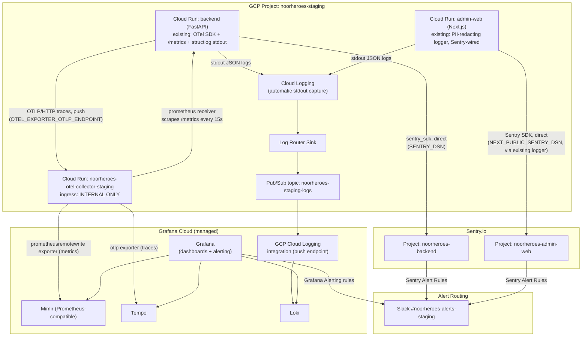

# Phase 1 — Observability Stack Bootstrap (OTel Collector / Prometheus / Grafana / Sentry)

**File ID:** `Development_Blueprints.Phase1_Infra_Config.Infra.05-observability-stack-bootstrap.md`
**Phase:** Phase 1 — Infrastructure & Configuration
**Depends on:** `Infra.04-terraform-iac-baseline-staging.md` (the Staging compute/networking/secrets this stack deploys onto and reads from), `Infra.02-secrets-management-env-example-gitleaks.md` (canonical `SENTRY_DSN` / `OTEL_EXPORTER_OTLP_ENDPOINT` / `NEXT_PUBLIC_SENTRY_DSN` / `SENTRY_AUTH_TOKEN` key names), `Infra.01-environment-tiers-provisioning.md` (environment naming: `noorheroes-staging`)
**Consumed by:** `CI_CD.08-ci-pipeline-deploy-staging-e2e-smoke.md` (post-deploy smoke test asserts a signal reaches Grafana), any later security-alerting file that routes the F.37 §15.2 P0 triggers to PagerDuty/Opsgenie
**Source authority:** `NoorHeroes_Final_Development_Prompt.md` §8 (Observability: Monitoring, Logging, Alerting, Analytics); `FAST-API-INSTRUCTIONS.md` §2 (`main.py` lifespan telemetry init), §4 (Middleware & Storage — `RequestIdMiddleware`, `StructuredLoggingMiddleware`, Prometheus/OTel), §6 (Health Probes); `NEXT-JS-INSTRUCTIONS.md` (`logger` — PII-redacting, Sentry-forwarding)

---

## 1. Objective and Purpose

The backend already emits OpenTelemetry traces, Prometheus-format metrics, and structlog JSON logs with request-scoped correlation IDs (`FAST-API-INSTRUCTIONS.md` §2/§4 — `init_telemetry`, `RequestIdMiddleware`, `StructuredLoggingMiddleware`). The admin-web app already has a PII-redacting `logger` that forwards errors to Sentry (`NEXT-JS-INSTRUCTIONS.md`, `logger.error`). None of it goes anywhere in Staging today — there is no collector, no Prometheus/Mimir, no Grafana, no real Sentry project, no log sink. Signal is generated and immediately discarded.

This file's job is narrow: **stand up the centralized collection layer these two already-instrumented apps send signal to.** Concretely:

1. An OpenTelemetry Collector, deployed as its own Staging Cloud Run service, as the single ingestion point for traces (OTLP push from the backend) and metrics (Prometheus-style scrape of the backend's `/metrics`).
2. A managed metrics/traces backend (Grafana Cloud, see §3.1/§18 for why) the collector exports to, queried through Grafana dashboards-as-code.
3. A log sink: Cloud Run's stdout JSON logs (backend + admin-web) → Cloud Logging → a Pub/Sub-based bridge → Grafana Cloud Loki.
4. Two real Sentry projects (`noorheroes-backend`, `noorheroes-admin-web`) with real DSNs wired into the Secret Manager keys `Infra.04`'s `modules/secrets` already knows how to populate, using the exact env var names `Infra.02` already reserved (`SENTRY_DSN`, `NEXT_PUBLIC_SENTRY_DSN`, `SENTRY_AUTH_TOKEN`).
5. Base Grafana dashboards and a first alerting rule set, provisioned as code, not clicked together.

**Explicitly out of scope** (do not duplicate or re-litigate):
- Re-instrumenting the backend (span creation, metric definitions, structlog processor chain) or the admin-web logger — both already exist. This file adds **collection config**, not instrumentation code. The two narrow, bounded exceptions where this file *does* touch a one-line piece of existing app code are called out explicitly in §12 and §18 — nowhere else.
- KMP/Android crash and analytics reporting. `core-crash`/`core-analytics` are currently no-op modules awaiting a real Firebase Crashlytics/Analytics binding — that is mobile-specific work, tracked separately, and is **not** wired into this backend/admin-focused stack (see §12).
- The Security Posture Dashboard named in Final_Development_Prompt §8 — that is a genuine read-only **admin-web page** (a feature, built on top of real data), not a Grafana dashboard. This file's Loki/Mimir pipeline is plumbing that dashboard could eventually query, but building the page itself is out of scope here.
- Uptime/synthetic monitoring (a separate row in Final_Development_Prompt §8, e.g. Better Stack/Pingdom hitting `/healthz` on a schedule) — a distinct, later concern from in-app telemetry collection.
- Product analytics (Amplitude/Mixpanel/PostHog) — a separate vendor decision pending Final_Development_Prompt §15's KPI framework confirmation, unrelated to this file's operability-focused stack.
- PagerDuty/Opsgenie account provisioning and the full F.37 §15.2 P0 security-alert routing (refresh-token-reuse, MFA non-compliance, payment-webhook failures, etc.) — this file builds the alerting *pipe* (Grafana Alerting → contact points) and routes staging's operability alerts through it; wiring the specific security-domain P0 detections into that pipe is a later, security-blueprint-owned file (flagged in §15).

---

## 2. Scope and Requirements

In scope, all for the **Staging** environment (the only environment `Infra.04` provisions so far):

1. An `infra/terraform/modules/observability` Terraform module, wired into `environments/staging/main.tf` alongside the six modules `Infra.04` already defines.
2. A new Artifact-Registry-pushed container image for the OpenTelemetry Collector (`otel/opentelemetry-collector-contrib`, config baked in), deployed as a Cloud Run service with **internal-only ingress** — never publicly reachable, since an open OTLP endpoint is an unauthenticated write sink for arbitrary telemetry.
3. `OTEL_EXPORTER_OTLP_ENDPOINT` (already a reserved backend env var per `Infra.02` §7.2, currently `http://localhost:4318` locally and disabled via `OTEL_SDK_DISABLED=true`) pointed at the collector's internal Cloud Run URL in Staging, with `OTEL_SDK_DISABLED` unset/`false` in Staging.
4. A Prometheus-format scrape configuration (`prometheus.yml`), consumed by the collector's `prometheus` receiver, targeting the backend's `/metrics` endpoint and the collector's own self-monitoring endpoint.
5. A Grafana Cloud stack (or an equivalent already-provisioned Grafana Cloud org — see §18) as the query/storage backend for metrics (Mimir, Prometheus-compatible), traces (Tempo), and logs (Loki) — chosen over self-hosting Prometheus+Tempo+Loki+Grafana because none of those are naturally stateful-service-friendly on Cloud Run (Prometheus/Loki/Tempo all want persistent local storage or a real StatefulSet, which contradicts `Infra.04`'s deliberate no-Kubernetes-until-Phase-6 posture) and the Final Development Prompt explicitly allows "self-hosted or managed, e.g., Grafana Cloud."
6. Two Sentry projects with DSNs written into Secret Manager under the exact keys `Infra.04`'s `modules/secrets` already expects.
7. A GCP Cloud Logging → Pub/Sub → Grafana Cloud log-forwarding bridge for both Cloud Run services' stdout JSON logs.
8. Two Grafana dashboards, provisioned as code: **Backend Golden Signals** and **Platform Domain & Job Health** (panel lists in §4/§6).
9. A first alerting rule set (Grafana Alerting, provisioned as code) with contact points and notification policies — staging-scoped (Slack only; PagerDuty/Opsgenie routing is a production-promotion concern, §15).
10. Verifying (not building) that the backend's existing correlation-ID middleware and structlog context give Grafana a usable Loki↔Tempo pivot; the one-line exception permitted if that link is missing is scoped precisely in §12.

Explicitly **not** in scope: any new metric, span, or log statement inside `backend/` or `admin-web/` beyond the two bounded exceptions in §12; self-hosted Prometheus/Loki/Tempo/Grafana; production observability (a promotion of this same module, per §15); mobile crash/analytics; product analytics; synthetic uptime monitoring; the admin-web Security Posture Dashboard feature itself.

---

## 3. Technical Implementation Details

### 3.1 Backend vendor assumption (see §18 for the full assumption statement)

The Final Development Prompt names Prometheus+Grafana, Loki (or a managed alternative), and Tempo/Jaeger (or a vendor APM) without picking a single managed vendor. This file assumes **Grafana Cloud** (a single account holding Mimir + Tempo + Loki + Grafana, all reachable behind one OTLP/remote-write ingestion boundary) for these reasons, made explicit so the choice can be confirmed or overridden before build:

- One vendor account, one set of credentials, one Grafana UI serving metrics+traces+logs together — directly enables the log↔trace↔metric correlation Final_Development_Prompt §8 implies ("correlated end-to-end via `X-Request-ID`").
- Every backing store (Mimir, Tempo, Loki) is genuinely stateful and long-running; none of them are a good fit for Cloud Run, and standing up a GKE cluster in Phase 1 directly contradicts `Infra.04`'s explicit no-Kubernetes-until-Phase-6 decision. A managed vendor sidesteps that without inventing new infra patterns this early.
- Grafana Cloud's free/starter tier is sufficient for Staging's synthetic-data-only traffic volume (per `Infra.01`'s staging data-sensitivity rules), keeping Phase 1 cost near zero.

**If self-hosting is confirmed instead**, only the `exporters:` block of `otel-collector-config.yaml` (§5) and the `grafana`-provider Terraform resources in `modules/observability` change (pointed at self-hosted Mimir/Tempo/Loki/Grafana endpoints, likely on a small GKE cluster or a set of persistent-disk-backed Compute Engine VMs) — the collector's receivers, the Prometheus scrape config, the dashboard JSON, and the alert-rule definitions are all vendor-agnostic and do not change.

### 3.2 Provider versions added to the existing Terraform root

`Infra.04`'s `environments/staging/versions.tf` already pins `google`, `google-beta`, `cloudflare`, `random`. This file adds two more to that same root `versions.tf` (never re-declared with version constraints inside child modules, per `Infra.04`'s established convention):

```hcl
# infra/terraform/environments/staging/versions.tf (addition)
grafana = {
  source  = "grafana/grafana"
  version = "~> 3.9"
}
sentry = {
  source  = "jianyuan/sentry"
  version = "~> 0.14"
}
```

### 3.3 Provider configuration

```hcl
# infra/terraform/environments/staging/providers.tf (addition)
provider "grafana" {
  cloud_access_policy_token = var.grafana_cloud_access_policy_token   # sensitive, §9
}

provider "sentry" {
  token          = var.sentry_auth_token                              # sensitive, org-scoped API token, §9
  base_url       = "https://sentry.io/api/"
}
```

Both tokens are injected the same way `cloudflare_api_token` already is in `Infra.04`: CI-injected via GitHub Actions encrypted secrets exchanged at plan/apply time, never committed to `.tfvars`.

---

## 4. Architecture and Component Responsibilities



| Component | Responsibility | Terraform module / config artifact |
|---|---|---|
| OTel Collector (Cloud Run) | Single ingestion point for backend traces (OTLP push) and metrics (Prometheus scrape); fans out to Mimir + Tempo | `modules/observability` (compute), `infra/observability/otel-collector/` (config) |
| Prometheus scrape config | Defines exactly which targets the collector's `prometheus` receiver polls | `infra/observability/prometheus/prometheus.yml` |
| Grafana Cloud (Mimir/Tempo/Loki/Grafana) | Managed storage + query + dashboarding + alerting backend | External vendor; Terraform-managed via `grafana` provider for dashboards/alerts/data-source correlation config |
| Log bridge (Cloud Logging → Pub/Sub → Loki) | Ships both services' stdout JSON logs into Loki without any app-side log-shipping agent | `modules/observability` (`google_logging_project_sink`, `google_pubsub_topic`, `google_pubsub_subscription`) |
| Sentry projects | Error/crash aggregation for backend and admin-web, each already emitting error events (backend's assumed minimal init per §12; admin-web's existing `logger`) | `modules/observability` (`sentry` provider) |
| Secret Manager | Holds `SENTRY_DSN`, `NEXT_PUBLIC_SENTRY_DSN`, `SENTRY_AUTH_TOKEN` (values sourced from this file's provisioned Sentry projects) using the exact secret objects `Infra.04`'s `modules/secrets` already creates | `modules/secrets` (existing, `Infra.04`) — this file only supplies the *values* |
| Grafana dashboards | Backend Golden Signals + Platform Domain & Job Health, provisioned as code | `infra/observability/grafana/dashboards/*.json` + `grafana_dashboard` Terraform resources |
| Grafana Alerting | Staging-scoped alert rules + Slack contact point | `infra/observability/grafana/provisioning/alerting/*.yaml` (source of truth) + `grafana_rule_group`/`grafana_contact_point`/`grafana_notification_policy` Terraform resources (applied form) |

This mirrors `Infra.04`'s module-boundary convention exactly: `modules/observability` is self-contained, takes no hidden dependency on `modules/compute`/`modules/networking` internals, and communicates with them only through explicit outputs wired in `environments/staging/main.tf` (it consumes `module.networking.vpc_connector_id` to attach the collector to the same VPC the backend already reaches, and `module.compute.backend_service_url` to know what to scrape and what to grant collector-ingress access to).

---

## 5. Folder / File Structure

Two trees, matching the split the task brief names explicitly: config-as-code artifacts live under `infra/observability/` (what actually ships into the collector image / gets applied to Grafana Cloud); the Terraform that provisions the cloud resources around them lives under `infra/terraform/modules/observability/`, extending `Infra.04`'s existing `infra/terraform/` tree.

```
infra/
├── observability/
│   ├── README.md                              # what each file below is, how to test a config change locally
│   ├── otel-collector/
│   │   ├── Dockerfile                         # FROM otel/opentelemetry-collector-contrib:0.108.0, COPY config in
│   │   └── otel-collector-config.yaml         # receivers/processors/exporters/pipelines, see §6.1
│   ├── prometheus/
│   │   └── prometheus.yml                     # scrape_configs, inlined into otel-collector-config.yaml's
│   │                                           #   `prometheus` receiver at collector-build time (see §6.1 note)
│   └── grafana/
│       ├── dashboards/
│       │   ├── backend-golden-signals.json    # panels: request rate, p50/p95/p99 latency, error rate,
│       │   │                                   #   DB pool saturation, Redis pool saturation, Celery queue
│       │   │                                   #   depth, Celery task failure rate — see §6.2
│       │   └── platform-domain-health.json    # panels: translation backlog, notification delivery,
│       │                                       #   AI safety refusal/escalation rate, webhook health,
│       │                                       #   outbox processing lag — see §6.2
│       └── provisioning/
│           └── alerting/
│               ├── contact-points.yaml        # Slack webhook contact point (staging)
│               ├── notification-policies.yaml # routes by severity label
│               └── alert-rules.yaml           # source-of-truth rule definitions, see §6.3
│
└── terraform/
    ├── environments/staging/
    │   ├── main.tf                            # MODIFIED by this file: adds `module "observability" {...}`
    │   ├── variables.tf                       # MODIFIED: adds grafana_cloud_access_policy_token,
    │   │                                       #   sentry_auth_token, sentry_org_slug, slack_webhook_url
    │   ├── outputs.tf                         # MODIFIED: adds sentry_backend_dsn, sentry_admin_web_dsn,
    │   │                                       #   grafana_backend_dashboard_url (see §6.4)
    │   └── versions.tf / providers.tf         # MODIFIED per §3.2/§3.3
    └── modules/
        └── observability/
            ├── main.tf                        # collector Cloud Run service, log sink + Pub/Sub bridge,
            │                                   #   sentry_project/sentry_key resources, grafana_dashboard /
            │                                   #   grafana_rule_group resources
            ├── variables.tf                    # network_id, vpc_connector_id, backend_service_url,
            │                                   #   backend_run_sa_email, environment, slack_webhook_url
            ├── outputs.tf                      # collector_internal_url, sentry_backend_dsn (sensitive),
            │                                   #   sentry_admin_web_dsn (sensitive)
            └── README.md
```

**Why the split:** `infra/observability/` is the literal artifact that gets built into a container image or pushed verbatim to Grafana Cloud's API — it is portable, testable in isolation (`otelcol validate --config=otel-collector-config.yaml` needs no cloud credentials), and is exactly what a developer diffs when a dashboard panel or alert threshold changes. `infra/terraform/modules/observability/` is the provisioning layer that makes those artifacts real (builds/pushes the collector image, creates the Sentry projects, applies the dashboard JSON to a live Grafana Cloud stack). This is the same separation `Infra.04` draws between Dockerfiles (build recipe) and the Terraform that deploys the resulting image.

---

## 6. APIs, Models, Interfaces, and Data Flow

### 6.1 `otel-collector-config.yaml` (interface: what the collector accepts and where it forwards)

```yaml
receivers:
  otlp:
    protocols:
      grpc:
        endpoint: 0.0.0.0:4317
      http:
        endpoint: 0.0.0.0:4318

  prometheus:
    config:
      scrape_configs:
        - job_name: noorheroes-backend
          scrape_interval: 15s
          metrics_path: /metrics
          scheme: https
          static_configs:
            - targets: ["${BACKEND_METRICS_HOST}"]   # injected at image-build time from Infra.04's
                                                        # module.compute.backend_service_url host, no scheme
        - job_name: otel-collector-self
          scrape_interval: 30s
          static_configs:
            - targets: ["localhost:8888"]              # collector's own internal telemetry, see `telemetry:` below

processors:
  memory_limiter:
    check_interval: 1s
    limit_mib: 400
    spike_limit_mib: 100
  batch:
    send_batch_size: 512
    timeout: 5s
  resource:
    attributes:
      - key: deployment.environment
        value: staging
        action: upsert
      - key: service.namespace
        value: noorheroes
        action: upsert
  attributes/pii_defense_in_depth:
    # Defense-in-depth only — the backend must not put PII into span/log attributes in the first
    # place. This processor exists so a future accidental `email`/`phone`/`otp` attribute on a span
    # does not silently leave the VPC. See §9.3.
    actions:
      - key: email
        action: delete
      - key: phone_number
        action: delete
      - key: otp
        action: delete
      - key: password
        action: delete

exporters:
  otlp/tempo:
    endpoint: ${GRAFANA_CLOUD_TEMPO_OTLP_ENDPOINT}
    auth:
      authenticator: basicauth/grafana
  prometheusremotewrite:
    endpoint: ${GRAFANA_CLOUD_MIMIR_REMOTE_WRITE_ENDPOINT}
    auth:
      authenticator: basicauth/grafana
  debug:
    verbosity: basic   # staging troubleshooting only — remove/downgrade before any production promotion

extensions:
  basicauth/grafana:
    client_auth:
      username: ${GRAFANA_CLOUD_INSTANCE_ID}
      password: ${GRAFANA_CLOUD_API_KEY}
  health_check:
    endpoint: 0.0.0.0:13133

service:
  extensions: [health_check, basicauth/grafana]
  telemetry:
    metrics:
      address: 0.0.0.0:8888
  pipelines:
    traces:
      receivers: [otlp]
      processors: [memory_limiter, attributes/pii_defense_in_depth, resource, batch]
      exporters: [otlp/tempo, debug]
    metrics:
      receivers: [otlp, prometheus]
      processors: [memory_limiter, resource, batch]
      exporters: [prometheusremotewrite, debug]
```

The `${...}` placeholders are resolved via the Collector's built-in environment-variable expansion at container start (Cloud Run env vars, not baked into the image) — `GRAFANA_CLOUD_*` values and `BACKEND_METRICS_HOST` are wired from Terraform outputs/Secret Manager in `modules/observability`, never hardcoded into the config file itself. This keeps `otel-collector-config.yaml` identical across a local `otelcol validate` run and the real Staging deploy.

### 6.2 Dashboard panel contract (`infra/observability/grafana/dashboards/*.json`)

Both dashboards are provisioned via the `grafana_dashboard` Terraform resource (JSON model checked in, applied as-is — never hand-edited in the Grafana UI and left unexported, per the "dashboards as code" requirement). Panel list, with the PromQL each panel queries against Mimir (metric names below are the conventional names `prometheus-fastapi-instrumentator`/`starlette-exporter`-style libraries emit and the conventional names for a `celery-prometheus-exporter`-style gauge; **confirm the actual exported metric names against the running backend before finalizing the JSON — see §18 assumption 4**):

**`backend-golden-signals.json`** — uid `noorheroes-backend-golden-signals`:
| Panel | Query |
|---|---|
| Request rate | `sum(rate(http_requests_total{environment="staging"}[5m])) by (handler)` |
| p95 latency | `histogram_quantile(0.95, sum(rate(http_request_duration_seconds_bucket{environment="staging"}[5m])) by (le, handler))` |
| p99 latency | `histogram_quantile(0.99, sum(rate(http_request_duration_seconds_bucket{environment="staging"}[5m])) by (le, handler))` |
| Error rate (%) | `100 * sum(rate(http_requests_total{environment="staging",status=~"5.."}[5m])) / sum(rate(http_requests_total{environment="staging"}[5m]))` |
| DB pool saturation | `sqlalchemy_pool_checked_out_connections / sqlalchemy_pool_size` |
| Redis pool saturation | `redis_connected_clients / redis_maxclients` |
| Celery queue depth (per queue) | `celery_queue_length{queue=~"default|translation|notifications"}` |
| Celery task failure rate | `sum(rate(celery_task_failed_total[5m])) by (task_name)` |
| Slowest routes (table) | `topk(5, histogram_quantile(0.95, sum(rate(http_request_duration_seconds_bucket{environment="staging"}[5m])) by (le, handler)))` |

**`platform-domain-health.json`** — uid `noorheroes-platform-domain-health`:
| Panel | Query |
|---|---|
| Translation task backlog | `celery_queue_length{queue="translation"}` |
| Translation task retry rate | `sum(rate(celery_task_retried_total{task_name=~".*translate.*"}[15m]))` |
| Notification dispatch success rate | `sum(rate(notification_dispatch_total{status="sent"}[5m])) / sum(rate(notification_dispatch_total[5m]))` |
| AI safety refusal/escalation rate | `sum(rate(ai_safety_evaluation_total{outcome=~"refused|escalated"}[15m])) by (outcome)` |
| Subscription/store-webhook health | `sum(rate(webhook_processed_total{status="failed"}[5m])) by (source)` |
| Outbox processing lag | `outbox_events_unprocessed_count` (gauge) and `histogram_quantile(0.95, outbox_event_age_seconds_bucket)` |

### 6.3 Alert rule contract (`infra/observability/grafana/provisioning/alerting/alert-rules.yaml`)

Grafana Alerting's provisioning YAML format, source-controlled, applied via the `grafana_rule_group` Terraform resource (which reads this file's rule definitions rather than duplicating them inline in HCL, keeping one source of truth):

```yaml
apiVersion: 1
groups:
  - orgId: 1
    name: noorheroes-staging-golden-signals
    folder: NoorHeroes Staging
    interval: 1m
    rules:
      - uid: api-error-rate-high
        title: "API error rate > 1% for 5m"
        condition: C
        data:
          - refId: A
            datasourceUid: mimir-staging
            model:
              expr: >
                100 * sum(rate(http_requests_total{environment="staging",status=~"5.."}[5m]))
                / sum(rate(http_requests_total{environment="staging"}[5m]))
          - refId: C
            datasourceUid: __expr__
            model:
              type: threshold
              expression: A
              conditions:
                - evaluator: { type: gt, params: [1] }
        for: 5m
        labels: { severity: P1, service: backend }
        annotations:
          summary: "Backend 5xx rate exceeded 1% over the last 5 minutes"
      - uid: db-pool-saturation-critical
        title: "DB connection pool > 90% for 5m"
        condition: C
        data:
          - refId: A
            datasourceUid: mimir-staging
            model:
              expr: "sqlalchemy_pool_checked_out_connections / sqlalchemy_pool_size"
          - refId: C
            datasourceUid: __expr__
            model:
              type: threshold
              expression: A
              conditions:
                - evaluator: { type: gt, params: [0.9] }
        for: 5m
        labels: { severity: P1, service: backend }
        annotations:
          summary: "Postgres connection pool saturation approaching exhaustion"
      - uid: celery-queue-depth-growing
        title: "Celery queue depth > 500 for 10m"
        condition: C
        data:
          - refId: A
            datasourceUid: mimir-staging
            model:
              expr: "max(celery_queue_length)"
          - refId: C
            datasourceUid: __expr__
            model:
              type: threshold
              expression: A
              conditions:
                - evaluator: { type: gt, params: [500] }
        for: 10m
        labels: { severity: P2, service: backend }
        annotations:
          summary: "A Celery queue is backing up — check worker capacity / a stuck task"
```

`contact-points.yaml` defines a single Slack webhook contact point (`#noorheroes-alerts-staging`); `notification-policies.yaml` routes `severity: P1` and `severity: P2` both to that one contact point in staging (there is no PagerDuty contact point in this file — see §15 for why that's deliberate).

### 6.4 Terraform interface additions (consumed by `CI_CD.08` and any later security-alerting file)

```hcl
# infra/terraform/environments/staging/outputs.tf (addition to Infra.04's existing outputs.tf)
output "sentry_backend_dsn" {
  value     = module.observability.sentry_backend_dsn
  sensitive = true
}

output "sentry_admin_web_dsn" {
  value     = module.observability.sentry_admin_web_dsn
  sensitive = true
}

output "otel_collector_internal_url" {
  value = module.observability.collector_internal_url
}

output "grafana_backend_dashboard_url" {
  value = module.observability.backend_dashboard_url
}
```

### 6.5 Data flow

**Metrics:** backend process-local Prometheus registry (already populated by existing instrumentation) is exposed at `GET /metrics` → collector's `prometheus` receiver polls it every 15s → `resource`/`batch` processors → `prometheusremotewrite` exporter pushes to Grafana Cloud Mimir → Grafana dashboards query Mimir via PromQL.

**Traces:** backend's OTel SDK (already configured, reading `OTEL_EXPORTER_OTLP_ENDPOINT`) pushes spans over OTLP/HTTP to the collector's internal Cloud Run URL → `memory_limiter`/`pii_defense_in_depth`/`resource`/`batch` processors → `otlp/tempo` exporter pushes to Grafana Cloud Tempo → Grafana queries Tempo by trace ID (pivoted from a Loki log line's `request_id`, §12).

**Logs:** backend + admin-web write structured JSON to stdout (already implemented — `StructuredLoggingMiddleware`/structlog on the backend, the PII-redacting `logger` on admin-web) → Cloud Run auto-captures stdout into Cloud Logging → a `google_logging_project_sink` filters `resource.type="cloud_run_revision" AND resource.labels.service_name=~"noorheroes-.*-staging"` → publishes to Pub/Sub topic `noorheroes-staging-logs` → Grafana Cloud's "Google Cloud Logging" integration (a push subscription Grafana Cloud itself provisions against that topic once connected) parses and writes into Loki.

**Errors:** each app's Sentry SDK sends error events **directly** to Sentry's ingest API over HTTPS — this path does **not** go through the OTel Collector; Sentry is not an OTel signal in this design, it is a separate, direct vendor integration, consistent with how both apps' instrumentation already treats it (a DSN-configured SDK call, not a span/log/metric emission).

---

## 7. Dependencies and Configuration Requirements

| Dependency | Why | Where configured |
|---|---|---|
| `Infra.04` staging Terraform applied | This module attaches to `module.networking` (VPC connector) and reads `module.compute.backend_service_url` — cannot apply in isolation | `environments/staging/main.tf`, `module.observability` block added after `module.compute` |
| Grafana Cloud account + stack (`noorheroes` org) | Target for Mimir/Tempo/Loki/Grafana | Created out-of-band (Grafana Cloud signup); a Cloud Access Policy Token scoped to that stack is generated and injected as `TF_VAR_grafana_cloud_access_policy_token` in CI |
| Sentry.io org (`noorheroes`) | Target for the two Sentry projects | Created out-of-band; an org-scoped API auth token generated and injected as `TF_VAR_sentry_auth_token` in CI |
| Slack workspace + incoming webhook for `#noorheroes-alerts-staging` | Alert delivery target | Webhook URL injected as `TF_VAR_slack_webhook_url` (sensitive) |
| `otel/opentelemetry-collector-contrib` base image, version pinned | The Dockerfile's `FROM` line — `contrib` (not `core`) distribution is required for the `prometheusremotewrite` exporter and `basicauth` extension | `infra/observability/otel-collector/Dockerfile`, pinned to `0.108.0` (or the latest stable at implementation time — pin exactly, never `:latest`) |
| `Infra.02`'s reserved env var names (`SENTRY_DSN`, `OTEL_EXPORTER_OTLP_ENDPOINT`, `NEXT_PUBLIC_SENTRY_DSN`, `SENTRY_AUTH_TOKEN`) | This file must populate exactly these keys, not invent new ones, so `core/settings.py`'s `Settings` class and admin-web's `src/lib/env.ts` Zod schema (already reading these names) work unchanged | `modules/secrets` (existing, `Infra.04`) — this file supplies real values only |
| GCP APIs: Pub/Sub, Logging | Required for the log-sink bridge | Added to the `google_project_service` list `Infra.04` §7 already establishes |

No new secrets-management architecture is introduced — this file uses `Infra.04`'s existing `modules/secrets` pattern for every credential it produces (Sentry DSNs) and Terraform's standard `sensitive = true` handling for every credential it consumes (Grafana/Sentry/Slack tokens).

---

## 8. Database / Storage Requirements

This file introduces no new application database. Its storage footprint is entirely inside the managed vendors it wires up:

- **Metrics (Mimir):** Grafana Cloud's default retention on the assumed free/starter tier — typically 13 months for the paid tier, shorter on free; staging traffic is synthetic and low-volume (`Infra.01`), so retention length is a cost knob, not a compliance requirement. Set explicitly to **30 days** for staging via the stack's retention policy setting (Terraform `grafana` provider does not currently manage Mimir retention directly on Grafana Cloud — set this once in the Grafana Cloud portal's stack settings and document the manual step in `infra/observability/README.md`, flagged as a known provider gap).
- **Traces (Tempo):** default Grafana Cloud retention, **7 days** for staging — traces are high-volume and short-lived-useful; nothing in Staging needs month-old traces.
- **Logs (Loki):** **14 days** for staging, matching `Infra.01`'s staging data-sensitivity posture (synthetic data only, no long-term audit requirement at this tier).
- **Sentry:** default Sentry.io issue retention (90 days on most plans) — not overridden by this file.
- **Pub/Sub topic (`noorheroes-staging-logs`):** message retention set to the Pub/Sub default (7 days) purely as a buffer against a transient Grafana Cloud ingestion outage — it is not a durable log store; Loki is the durable store.

Production retention (longer Mimir/Tempo/Loki windows, possibly a compliance-driven audit-log retention requirement) is explicitly a production-promotion decision, not built here — see §15.

---

## 9. Authentication, Authorization, Validation, and Security Considerations

### 9.1 Collector ingress — never publicly reachable

```hcl
# modules/observability/main.tf (sketch, Cloud Run ingress excerpt)
resource "google_cloud_run_v2_service" "otel_collector" {
  name     = "noorheroes-otel-collector-staging"
  location = var.gcp_region
  ingress  = "INGRESS_TRAFFIC_INTERNAL_ONLY"   # reachable only from the same VPC — never the public internet

  template {
    vpc_access {
      connector = var.vpc_connector_id   # the SAME connector Infra.04's backend Cloud Run service already uses
      egress    = "PRIVATE_RANGES_ONLY"
    }
    containers {
      image = var.collector_image
      ports { container_port = 4318 }
    }
  }
}

resource "google_cloud_run_v2_service_iam_member" "backend_can_invoke_collector" {
  name   = google_cloud_run_v2_service.otel_collector.name
  role   = "roles/run.invoker"
  member = "serviceAccount:${var.backend_run_sa_email}"   # the SAME SA Infra.04's modules/compute already created
}
```

An unauthenticated, publicly reachable OTLP endpoint is a write sink anyone on the internet can flood with fabricated telemetry (cost/DoS risk) or use to smuggle data out. `INGRESS_TRAFFIC_INTERNAL_ONLY` plus an explicit `run.invoker` grant scoped to exactly the backend's existing runtime service account (from `Infra.04` §9.1) closes both paths — this mirrors `Infra.04`'s own least-privilege service-account pattern rather than inventing a new one.

### 9.2 Sentry DSN secrecy

A Sentry DSN is not a bearer credential in the traditional sense (it is effectively write-only — it lets a client submit events, not read them back), but `Infra.02` already correctly classifies it "CREDENTIAL-adjacent (treat as sensitive; scope-limit exposure)" and this file follows that classification: `SENTRY_DSN` (backend) is stored in Secret Manager and injected as a runtime env var, never logged. `NEXT_PUBLIC_SENTRY_DSN` is, by Next.js convention and Sentry's own documented guidance, safe to inline into the client bundle (it's meant to be public — Sentry rate-limits and scopes ingestion server-side), so it is **not** treated as a Secret Manager secret requiring runtime injection the way `SENTRY_DSN` is — it's a build-time public value, consistent with how `Infra.02` §7.3 already classifies every other `NEXT_PUBLIC_*` key. `SENTRY_AUTH_TOKEN` (used only for CI source-map upload at build time, per `Infra.02`) **is** a real secret — scoped to `project:releases` permission only on the two Sentry projects this file creates, never given org-admin scope.

### 9.3 PII scrubbing before signals leave the app

The admin-web `logger` already redacts PII (`password`, `accessToken`, `otp`, `creditCard`) before anything reaches Sentry or stdout (`NEXT-JS-INSTRUCTIONS.md`, `redact(data)`) — this file changes nothing about that. On the backend side, this file adds one small, config-only defense-in-depth layer: the collector's `attributes/pii_defense_in_depth` processor (§6.1) strips a fixed list of high-risk attribute keys from any span that somehow carries them, **as a safety net, not as the primary control** — the primary control remains the application never attaching PII to span/log attributes in the first place, which is unchanged, existing behavior this file does not audit or modify. Sentry's own server-side scrubbing (its default `Sensitive Data Scrubber`, enabled per-project) is turned on for both projects at creation time as a second independent layer.

### 9.4 Grafana access control

Grafana Cloud's org-level SSO/RBAC (Viewer/Editor/Admin roles) governs who can view dashboards and who can edit alert rules — this file does not provision individual Grafana user accounts (that's an org-admin, human-driven task, out of Terraform's scope here), but does set the **default** org role for anyone not explicitly elevated to `Viewer`, and restricts alert-rule and data-source-credential edit rights to a named `platform-admins` team, provisioned via the `grafana` Terraform provider's `grafana_team` resource. Dashboards themselves carry no PII (they are aggregate metrics), so read access is intentionally permissive within the org; write access (which could redirect alert routing or exfiltrate data-source credentials) is restricted.

### 9.5 Validation of the token surface

Every credential this file introduces (`grafana_cloud_access_policy_token`, `sentry_auth_token`, `slack_webhook_url`) follows `Infra.04` §9's existing rule set unchanged: never a plain non-`sensitive` Terraform variable, never committed to `.tfvars`, sourced only from CI-injected environment variables at `plan`/`apply` time, scanned for by the same `gitleaks`/`trufflehog` pass `Infra.02` already wires project-wide.

---

## 10. Error Handling and Edge Cases

| Scenario | Handling |
|---|---|
| Collector Cloud Run instance is down/restarting | Backend's OTel SDK export is fire-and-forget over a batched OTLP exporter with its own internal retry/backoff (existing SDK behavior, unmodified by this file); a dropped batch during a brief collector restart is an acceptable loss for traces/metrics — telemetry is not on the application's critical path and must never block a request. Confirm the existing SDK init uses a bounded queue (SDK default), not an unbounded one, so a prolonged outage degrades to dropped spans, not backend memory growth — a note for whoever reviews the existing `init_telemetry`, not a change this file makes. |
| Collector overwhelmed / signal backpressure | The `memory_limiter` processor (§6.1) is first in every pipeline specifically so the collector sheds load (refuses new data, forcing the exporting SDK to retry/drop) before it OOMs — Cloud Run's own memory limit on the collector service (set to 512Mi, matching `limit_mib: 400` with headroom) backs this up as a hard ceiling. |
| Sampling under load | Not configured in this file for Staging — full sampling (100%) is intentional at Staging's low, synthetic traffic volume so nothing is silently missing from dashboards during early bring-up. A `probabilistic_sampler` (or the OTel SDK's own head-based sampling, e.g. `traces_sampler` on `sentry_sdk.init` if that's ever tuned) is explicitly a production-scale concern — flagged in §15, not built here. |
| Grafana Cloud or Sentry.io itself has an outage | Neither is on the request path (both are fire-and-forget exporters/SDK calls) — a vendor outage degrades observability, not the product. No circuit breaker or fallback sink is built for this (over-engineering for a Staging-only, non-SLA'd environment); document this limitation plainly in `infra/observability/README.md`. |
| Pub/Sub → Grafana Cloud logging bridge lags or drops | Pub/Sub's own 7-day message retention (§8) is the buffer; if Grafana Cloud's push subscription is unhealthy for longer than that, messages are lost — acceptable for Staging (synthetic data, no audit requirement), explicitly **not** acceptable as-is for a future production promotion (§15 flags a dead-letter topic as a production addition). |
| A log line or span somehow contains an un-redacted PII field | Caught by the layered defenses in §9.3 (admin-web's `redact`, the collector's `pii_defense_in_depth` processor, Sentry's server-side scrubber) — if all three miss it, that is a genuine incident requiring a manual Sentry/Loki data-deletion request against the vendor, documented as a response procedure in `infra/observability/README.md`, not something this file can prevent with certainty by config alone. |
| A Grafana alert rule fires falsely (noisy threshold) | Rules ship in this file with the exact thresholds in §6.3 as a starting point, not a guarantee of correctness — the first two weeks of Staging traffic should be used to tune `for:` durations and thresholds before this pipe is ever extended to page a human in production; document this expected tuning period in §15. |
| Two concurrent `terraform apply` on `modules/observability` | Covered by the same GCS state-lock behavior `Infra.04` §11.1 already establishes for the whole `environments/staging` root — this module doesn't introduce a separate state file. |

---

## 11. State Management and Lifecycle Considerations

**This section is about the observability stack's own operational state (collector process state, Grafana/Sentry resource state in their respective Terraform-managed configs) — not application runtime state, and not Terraform's own state file mechanics, both of which `Infra.04` §11 already covers and this file does not duplicate.**

1. **Collector process:** stateless. It holds no data across restarts beyond in-memory batching buffers (seconds of data at most, per `batch`/`memory_limiter` config) — a Cloud Run cold start or crash-restart loses at most the current in-flight batch, never anything already exported. No persistent volume is attached, by design.
2. **Collector image lifecycle:** built and pushed to Artifact Registry the same way `backend`/`admin-web` images are (`Infra.04` §12), tagged by git SHA. A config-only change (editing `otel-collector-config.yaml`) requires a full image rebuild+redeploy, since the config is baked in — this is a deliberate simplicity tradeoff over a runtime-config-fetch mechanism (documented in §18 as an assumption to revisit if config changes become frequent enough to be annoying).
3. **Dashboard/alert-rule lifecycle:** both are declared in `infra/observability/grafana/` and applied via the `grafana` Terraform provider — **never hand-edited in the Grafana Cloud UI and left there**. If someone does edit a dashboard live for a quick investigation, the next `terraform apply` reverts it to the checked-in JSON (this is intentional drift-correction, not a bug — matches `Infra.04` §10's drift-handling philosophy of "a human reviews and either re-applies or codifies the change in a reviewed PR," here automated because dashboards are lower-stakes than infrastructure).
4. **Sentry project lifecycle:** created once by this file's first `apply`; subsequent applies are idempotent no-ops against the same project unless its Terraform-managed settings (alert rules, team ownership) change.
5. **Log-sink Pub/Sub subscription lifecycle:** the push subscription connecting Pub/Sub to Grafana Cloud's ingestion endpoint is provisioned once when the "Google Cloud Logging" integration is connected in the Grafana Cloud portal (a one-time, human, out-of-band step — Grafana Cloud does not currently expose this integration as a Terraform-manageable resource) and then persists; document this manual step explicitly in `infra/observability/README.md` so it isn't lost as tribal knowledge (same pattern `Infra.04` §11.1 uses for its own unavoidable manual bootstrap step).

---

## 12. Integration Points with Existing Modules

| Integration point | Detail |
|---|---|
| Backend's existing OTel SDK / `init_telemetry` | Unmodified. This file only changes the **value** of `OTEL_EXPORTER_OTLP_ENDPOINT` (from `http://localhost:4318` + `OTEL_SDK_DISABLED=true` locally, to the collector's real internal Staging URL with `OTEL_SDK_DISABLED` unset) via Secret Manager/env wiring in `modules/compute` (`Infra.04`) — no application code changes. |
| Backend's existing Prometheus `/metrics` | Unmodified. The collector's `prometheus` receiver scrapes whatever the existing instrumentation already exposes at that path. |
| Backend's existing structlog + `RequestIdMiddleware` | Unmodified for the log-shipping path itself (stdout → Cloud Logging → Loki works regardless). **One bounded exception, only if confirmed missing on inspection:** for Loki↔Tempo pivoting to work in Grafana (clicking a log line and jumping to its trace), the same `request_id` value must appear as **both** a structlog-bound context field (already true, per `RequestIdMiddleware`) **and** an OTel span attribute on the request's root span. If, on inspecting the actual `RequestIdMiddleware` implementation, the span attribute is not already being set, adding the single line `trace.get_current_span().set_attribute("request_id", request_id)` inside that existing middleware is the **one** narrow, permitted instrumentation touch this file allows — because without it, log↔trace correlation cannot exist at all, and everything else in this spec (the Grafana data-source correlation config keyed on `request_id`) depends on it. Do not add anything beyond that single line (no new spans, no new attributes, no sampling changes). |
| Backend's Sentry error reporting | This file assumes `sentry_sdk.init(dsn=settings.sentry_dsn, environment=..., release=..., traces_sample_rate=...)` already exists inside the existing `init_telemetry()` referenced by `main.py`'s `lifespan` (a reasonable reading of "manages application startup (telemetry init)" in `FAST-API-INSTRUCTIONS.md` §2, and consistent with `SENTRY_DSN` already being a reserved `Settings` field per `Infra.02`). This file's job is only to make that DSN a **real, non-empty value** in Staging. **If, on inspecting the actual codebase, no `sentry_sdk.init()` call exists anywhere**, adding exactly that one call (dsn/environment/release/traces_sample_rate, nothing more — no custom scopes, no breadcrumb filters, no integrations beyond FastAPI's default) is the second and only other narrow exception this file permits, for the same reason as the row above: DSN wiring has nothing to attach to otherwise. |
| Admin-web's existing `logger` / Sentry forwarding | Fully unmodified — `NEXT-JS-INSTRUCTIONS.md` already documents `logger.error` forwarding to Sentry and `redact()` scrubbing before anything is sent. This file supplies the real `NEXT_PUBLIC_SENTRY_DSN`/`SENTRY_AUTH_TOKEN` values; no code change anywhere in `admin-web/`. |
| Admin-web's `X-Request-ID` injection | Already implemented (`NEXT-JS-INSTRUCTIONS.md` line 28) — this file relies on it existing to correlate an admin-web-originated request with the corresponding backend trace/log in Grafana, but does not modify it. |
| `Infra.04` networking/compute/secrets modules | This file's `modules/observability` consumes `module.networking.vpc_connector_id` (to attach the collector) and `module.compute.backend_run_sa_email`/`backend_service_url` (to grant invoke access and to know what to scrape); it writes its Sentry DSN outputs into the **same** `modules/secrets` resource pattern `Infra.04` already established — it does not create a parallel secrets mechanism. |
| KMP `core-crash` / `core-analytics` (mobile) | **Explicitly not touched by this file.** Those modules remain no-op, awaiting a real Firebase Crashlytics/Analytics binding — a separate, mobile-specific piece of work tracked outside this backend/admin-focused observability stack. Do not attempt to wire mobile crash reporting into Sentry as part of implementing this file; Final_Development_Prompt §8 names Firebase Crashlytics, not Sentry, as the Android-specific crash-free-session source of truth. |
| `CI_CD.08` (staging deploy + smoke) | Will assert (once that file is built) that a synthetic request produces a trace visible in Grafana and that `/healthz`/`/readyz` are green — this file's §14.4 acceptance criteria are the manual version of what that pipeline stage should eventually automate. |

---

## 13. Development Steps in Correct Implementation Order

1. **Confirm the Grafana Cloud vendor assumption** (§3.1/§18) with the team; if self-hosting is chosen instead, only §3.1's noted exporter/provider changes apply — everything else in this file (folder structure, dashboard/alert content, collector config shape) stays the same.
2. **Create the Grafana Cloud account/stack and the Sentry.io org**, out-of-band, and generate the two scoped tokens (`grafana_cloud_access_policy_token`, `sentry_auth_token`) needed for Terraform to manage them.
3. **Inspect the actual `backend/` codebase** for the two bounded exceptions named in §12 (the `request_id` span attribute, the `sentry_sdk.init()` call) — confirm whether they already exist before writing any code; only add the single permitted line for whichever is genuinely missing.
4. **Write `infra/observability/otel-collector/otel-collector-config.yaml`** per §6.1; validate locally with `otelcol validate --config=otel-collector-config.yaml` (no cloud credentials needed for a syntax/schema check).
5. **Write `infra/observability/otel-collector/Dockerfile`**, build locally, confirm the collector starts and its `health_check` extension responds on `:13133`.
6. **Write `infra/observability/prometheus/prometheus.yml`** and inline its `scrape_configs` into the collector config's `prometheus` receiver (§6.1).
7. **Scaffold `infra/terraform/modules/observability`** — collector Cloud Run service + IAM invoker binding (§9.1) first; apply and confirm the collector is reachable from the backend's VPC connector but not from the public internet (curl from outside the VPC must fail/timeout).
8. **Wire the Cloud Logging → Pub/Sub bridge** (`google_logging_project_sink`, `google_pubsub_topic`) in the same module; connect Grafana Cloud's "Google Cloud Logging" integration to that topic (the one manual, out-of-band step per §11.5); confirm a test log line reaches Loki.
9. **Provision the two Sentry projects** via the `sentry` Terraform provider; capture their DSNs as module outputs; wire those outputs into `modules/secrets`' existing `SENTRY_DSN`/`NEXT_PUBLIC_SENTRY_DSN` secret objects (`Infra.04`).
10. **Update `environments/staging`'s `backend`/`admin-web` Cloud Run env wiring** (in `Infra.04`'s existing `modules/compute` variable values, not the module itself) so `OTEL_EXPORTER_OTLP_ENDPOINT` points at the collector's internal URL and `OTEL_SDK_DISABLED` is unset — this is a **variable value change** in `environments/staging/main.tf`, not a `modules/compute` code change.
11. **Redeploy backend to Staging**; confirm a real request produces a trace in Tempo and a metrics scrape populates Mimir.
12. **Write and apply the two Grafana dashboards** (§6.2) via `grafana_dashboard`; confirm every panel renders (even if some show "no data" until real load exists — confirm the query itself is valid, not just that the panel loads).
13. **Write and apply the alert rules, contact point, and notification policy** (§6.3); trigger a test alert (e.g., temporarily lower the error-rate threshold to something achievable) and confirm the Slack message arrives, then restore the real threshold.
14. **Write `infra/observability/README.md`** — vendor account setup steps, the manual Grafana Cloud Logging integration step, how to validate the collector config locally, how to add a new dashboard panel or alert rule.
15. **Run the full end-to-end test signal** described in §14 and confirm every acceptance criterion.

---

## 14. Testing Strategy and Acceptance Criteria

### 14.1 Static validation (every PR touching `infra/observability/` or `modules/observability`)

- `otelcol validate --config=otel-collector-config.yaml` — collector config schema check, no cloud credentials required.
- `terraform fmt -check` / `terraform validate` on `modules/observability`, per `Infra.04` §14.1's established pattern.
- JSON-schema validation of the two dashboard files (Grafana dashboard JSON has a stable enough shape to lint with a basic schema or `jq` sanity check — confirm required top-level keys: `title`, `uid`, `panels`).
- The alert-rules YAML is validated against Grafana's provisioning schema (`grafana-cli` or the `grafana` Terraform provider's own plan-time validation).
- Secret-scan pass (`gitleaks`/`trufflehog`, per `Infra.02`) covering this module's `.tf`/`.tfvars` files.

### 14.2 Plan validation (every PR)

- CI runs `terraform plan` against `modules/observability` wired into the real `environments/staging` root, same PR-comment pattern `Infra.04` §14.2 establishes.
- **Acceptance criterion:** the plan must show the collector's `google_cloud_run_v2_service_iam_member` invoker binding scoped to exactly the backend's runtime SA — CI greps the plan JSON for that binding's `member` value and fails if it is ever `allUsers` or `allAuthenticatedUsers`.

### 14.3 End-to-end test signal (the real acceptance bar for this file)

This is the concrete "does the pipe actually work" test, run once after the first successful `apply`:

1. **Trace + metric:** issue a request against a real Staging backend endpoint (e.g. `GET /healthz`). Within ~30 seconds:
   - [ ] The request's trace is visible in Grafana's Tempo explore view, searchable by its `request_id` (or trace ID from the response, if the backend exposes one).
   - [ ] The corresponding `http_requests_total` counter increment is visible in Mimir (query it directly via Grafana Explore).
2. **Log:** the same request's structured JSON log line is visible in Grafana's Loki explore view within ~1 minute, with the matching `request_id` field present.
3. **Log↔trace pivot:** from that Loki log line, using the Grafana data-source correlation config, clicking through reaches the matching Tempo trace (proves §12's `request_id` span-attribute requirement is actually satisfied end-to-end, not just present in isolation).
4. **Error/Sentry:** trigger a deliberate test error (a debug-only endpoint, or a manual `sentry_sdk.capture_message("observability-bootstrap-test")` run once via a shell in the Staging container — remove/never ship a permanent debug endpoint for this). Within ~1 minute:
   - [ ] The event appears as a new issue in the `noorheroes-backend` Sentry project.
5. **Admin-web error:** trigger a deliberate client-side error in admin-web (Staging only) and confirm it appears in the `noorheroes-admin-web` Sentry project, with the PII-redacting `logger`'s scrubbing already applied (no raw secrets/PII visible in the event payload).
6. **Dashboard:** both provisioned dashboards render with real data for at least the Request Rate and Error Rate panels within a few minutes of generating test traffic.
7. **Alert:** the temporarily-lowered test alert (per §13 step 13) fires and a message lands in `#noorheroes-alerts-staging`.

### 14.4 Manual acceptance criteria (Definition-of-Done gate)

- [ ] Every item in §14.3 passes.
- [ ] The collector Cloud Run service is confirmed unreachable from outside the VPC (a request from a machine outside `noorheroes-staging`'s VPC to the collector's URL times out or is rejected).
- [ ] `SENTRY_DSN`, `NEXT_PUBLIC_SENTRY_DSN`, and `SENTRY_AUTH_TOKEN` are populated with real, non-empty, correctly-scoped values in Staging (no more `""` placeholders per `Infra.03`'s local `docker-compose.yml` env block, which stays empty by design — this file's changes affect **only** Staging, never local).
- [ ] A second, unmodified `terraform plan` against `modules/observability` shows zero diff (idempotency, matching `Infra.04` §14.4's same bar).

---

## 15. Production-Readiness Considerations (Staging-Scoped)

This file provisions **Staging-scoped observability only**, deliberately weaker than what production needs, each flagged so it isn't mistaken for the final posture:

| Staging choice (this file) | Production difference (future file, not built here) |
|---|---|
| Alerts route to Slack only | Production: P0 triggers (per Final_Development_Prompt §8/§9 — gateway authorization anomaly, refresh-token-reuse detection, backup-restore failure, MFA-non-compliance, payment-webhook failures) must page a human via PagerDuty/Opsgenie, not just log to Slack — a separate future file wires those specific security-domain detections (mostly not yet emitted as metrics/logs at all) into this file's Grafana Alerting pipe plus a genuine on-call rotation |
| 100% trace/metric sampling | Production: head- or tail-based sampling tuned to real traffic volume and Grafana Cloud cost tier |
| No SLO-burn-rate panels | Production: dedicated SLO dashboards (e.g. 99.9% availability burn-rate alerts) once real uptime targets are confirmed against the KPI framework (Final_Development_Prompt §15) |
| Loki/Tempo/Mimir retention: 14/7/30 days | Production: retention driven by actual compliance/audit requirements, likely longer, and possibly a durable cold-storage export path independent of the vendor's own retention window |
| Debug exporter enabled in the collector pipeline | Production: `debug` exporter removed entirely — it exists here purely to make Staging bring-up debuggable via Cloud Run logs |
| No dead-letter topic on the log-sink Pub/Sub subscription | Production: add one, so a prolonged Grafana Cloud ingestion outage doesn't silently drop audit-relevant logs past the 7-day Pub/Sub retention window |
| Manual Grafana Cloud Logging integration step (§11.5) | Fine to remain manual even in production — this is a one-time, rarely-touched setup step, not a per-deploy operation |
| No Firebase Crashlytics/mobile crash pipeline here | Stays a separate, mobile-owned piece of work regardless of this file's production evolution — not something this stack absorbs later |

**Explicitly not this file's job:** building the PagerDuty/Opsgenie integration, deciding SLO targets, or pre-building a `modules/observability` variant for production. When that work starts, it should reuse this module's structure and Terraform interface unchanged, varying only retention/sampling/contact-point values and adding the security-alert-specific rule group.

---

## 16. Dependencies / Prerequisites

- `Infra.04-terraform-iac-baseline-staging.md` — provides the VPC connector, backend/admin-web Cloud Run services and their runtime service accounts, and the `modules/secrets` pattern this file writes Sentry DSNs into. Must be applied first.
- `Infra.02-secrets-management-env-example-gitleaks.md` — the canonical env var names (`SENTRY_DSN`, `OTEL_EXPORTER_OTLP_ENDPOINT`, `NEXT_PUBLIC_SENTRY_DSN`, `SENTRY_AUTH_TOKEN`) this file must populate exactly, not rename.
- `Infra.01-environment-tiers-provisioning.md` — the `noorheroes-staging` project/environment naming this file's resources live under, and the staging data-sensitivity rule (synthetic data only) that justifies this file's short retention windows.
- A Grafana Cloud account and a Sentry.io org, already created (out-of-band, human step) before Terraform can manage anything inside them.
- `FAST-API-INSTRUCTIONS.md` and `NEXT-JS-INSTRUCTIONS.md` — the source of truth for what the backend and admin-web already emit; re-read both before writing `otel-collector-config.yaml` or the dashboard queries, since this file's job is to match that existing surface, not guess at it.

---

## 17. Definition of Done

- [ ] `infra/observability/` exists with the exact structure in §5 — collector config + Dockerfile, `prometheus.yml`, two dashboard JSON files, three alerting provisioning YAML files, `README.md`.
- [ ] `infra/terraform/modules/observability/` exists, is `validate`-clean, and is wired into `environments/staging/main.tf`.
- [ ] The OTel Collector is deployed to Staging as `INGRESS_TRAFFIC_INTERNAL_ONLY`, reachable only by the backend's runtime service account.
- [ ] Backend's `OTEL_EXPORTER_OTLP_ENDPOINT`/`OTEL_SDK_DISABLED` env values are updated in Staging (value change only, no `modules/compute` code change) and traces/metrics are confirmed flowing (§14.3 steps 1–2).
- [ ] The Cloud Logging → Pub/Sub → Loki bridge is live and confirmed carrying both services' logs (§14.3 step 2).
- [ ] Two real Sentry projects exist with real DSNs populated into Secret Manager under the existing key names, and both a backend and an admin-web test error are confirmed visible in Sentry (§14.3 steps 4–5).
- [ ] Both Grafana dashboards are provisioned as code and render real data.
- [ ] The three starter alert rules are provisioned as code, routed to Slack, and a test firing is confirmed.
- [ ] The §12 codebase inspection for the two bounded exceptions is done and documented (either "already present, unchanged" or "the single permitted line was added, in file X, here's the diff").
- [ ] `infra/observability/README.md` documents vendor account setup, the one manual Grafana Cloud Logging integration step, local collector-config validation, and how to add a new dashboard panel or alert rule.
- [ ] A second, unmodified `terraform plan` against `modules/observability` shows zero diff.

---

## 18. Assumptions or Decisions the Coding Agent Must Follow

State these explicitly in the PR/ADR that implements this file, and get them confirmed before or during build — do not silently improvise a different answer:

1. **Managed vendor: Grafana Cloud (Mimir + Tempo + Loki + Grafana) and Sentry.io.** The source documents name the tooling categories without picking a single managed vendor for each. This file assumes Grafana Cloud specifically because it unifies metrics/traces/logs behind one account and avoids standing up stateful services on Cloud Run (§3.1). **Confirm with the team before implementation** — if self-hosted Prometheus/Loki/Tempo/Grafana (on a future GKE cluster) is the actual intended target, only the collector's `exporters:` block and the `grafana`-provider resources' target endpoints change; the module boundary, folder structure, dashboard content, and alert-rule definitions do not.
2. **Sentry stays Sentry** regardless of the Grafana Cloud vs. self-hosted decision above — already effectively locked in by Final_Development_Prompt §8 naming it explicitly for errors/crashes across backend, admin-web, and (separately, via Crashlytics) Android.
3. **The two §12 bounded exceptions** (a possible one-line `request_id` span attribute, a possible minimal `sentry_sdk.init()` call) are the **only** circumstances under which this file's implementation touches `backend/` source code. If, upon inspection, both already exist (the more likely case, since `SENTRY_DSN` and the correlation-ID middleware are already established conventions per the source docs), this file makes **zero** application code changes anywhere.
4. **Exact Prometheus metric names in §6.2's dashboard queries are illustrative, not guaranteed.** They follow the conventional names emitted by common FastAPI/SQLAlchemy/Celery Prometheus instrumentation libraries, but the actual names depend on exactly which library and label configuration `FAST-API-INSTRUCTIONS.md`'s "Prometheus metrics" bullet refers to. **Before finalizing the dashboard JSON, hit the real Staging `/metrics` endpoint and confirm the actual metric/label names**, adjusting the PromQL in §6.2/§6.3 to match — the panel *titles*, *layout*, and *what they represent* are the authoritative contract to preserve; the exact query string is illustrative.
5. **Collector config is baked into the image, not fetched at runtime** — a deliberate simplicity choice (§11.2). If dashboard/alert changes turn out to need much more frequent collector-config edits than expected, revisit this in a follow-up, but do not build a runtime-config-fetch mechanism preemptively here.
6. **Staging alerting is Slack-only, on purpose** (§15) — do not wire a PagerDuty/Opsgenie integration into this file "for completeness"; that is explicitly a production-promotion concern with its own on-call-rotation prerequisites this file does not attempt to stand up.
7. **100% trace/metric sampling in Staging, on purpose** — do not add sampling logic to "save cost" here; Staging's synthetic traffic volume doesn't need it, and full visibility during early bring-up is more valuable than the marginal cost saved.
8. **The Grafana Cloud "Google Cloud Logging" integration step is manual, one-time, human-run** (§11.5), same category of accepted exception as `Infra.04`'s Terraform state bootstrap — do not attempt to fully Terraform-automate it away; the provider does not currently expose it as a manageable resource.
9. Where this file's YAML/HCL sketches and the real provider schemas diverge (provider APIs shift between versions, exact collector-config field names shift between `opentelemetry-collector-contrib` releases), **the module boundary, the folder structure (§5), and the dashboard/alert-rule *content contract* (§6.2/§6.3) are the authoritative interface to preserve** — the internal resource/config implementation shown here is illustrative, not gospel, exactly as `Infra.04` §18 item 10 already establishes for its own sketches.

---

## AI Agent Development Prompt

You are implementing the centralized observability collection stack for NoorHeroes's **Staging** environment. This is Phase 1 infrastructure work in an existing monorepo where `backend/` (FastAPI) already emits OpenTelemetry traces, Prometheus metrics, and structured JSON logs, and `admin-web/` (Next.js) already has a PII-redacting logger that forwards errors to Sentry — see `FAST-API-INSTRUCTIONS.md` and `NEXT-JS-INSTRUCTIONS.md` for exactly what already exists before writing anything. `infra/terraform/` already exists with `environments/staging/` and six modules (`Infra.04`) — you are adding a seventh, plus a new `infra/observability/` config tree; you are not building either of those two from scratch.

**What to build**, in the exact folder structure specified in §5 of this spec:

1. `infra/observability/otel-collector/otel-collector-config.yaml` and `Dockerfile` — an `otel/opentelemetry-collector-contrib` image with the config in §6.1 baked in: an `otlp` receiver (traces from the backend), a `prometheus` receiver (scraping the backend's existing `/metrics`), a `memory_limiter`/`pii_defense_in_depth`/`resource`/`batch` processor chain, and `otlp`/`prometheusremotewrite` exporters pointed at Grafana Cloud Tempo/Mimir.
2. `infra/observability/prometheus/prometheus.yml` — the scrape config in §6.1, inlined into the collector config.
3. `infra/observability/grafana/dashboards/backend-golden-signals.json` and `platform-domain-health.json` — the exact panel sets in §6.2 (request rate, p95/p99 latency, error rate, DB pool saturation, Redis pool saturation, Celery queue depth, Celery failure rate; translation backlog, notification delivery, AI safety refusal/escalation rate, webhook health, outbox lag). Verify real Prometheus metric/label names against the live Staging `/metrics` endpoint before finalizing queries (§18 assumption 4) — the panel list and layout are the hard contract, the exact PromQL is adjustable to match reality.
4. `infra/observability/grafana/provisioning/alerting/{contact-points,notification-policies,alert-rules}.yaml` — the three starter rules in §6.3 (API error rate > 1% / 5m, DB pool saturation > 90% / 5m, Celery queue depth > 500 / 10m), routed to a single Slack contact point.
5. `infra/terraform/modules/observability/{main,variables,outputs}.tf` — the collector Cloud Run service (`ingress = INGRESS_TRAFFIC_INTERNAL_ONLY`, invoker IAM scoped to the backend's existing runtime SA only, §9.1), the `google_logging_project_sink` + Pub/Sub topic bridging both services' Cloud Logging output toward Grafana Cloud Loki, two `sentry` provider resources (`sentry_project` for `noorheroes-backend` and `noorheroes-admin-web`) with their DSN outputs, and `grafana_dashboard`/`grafana_rule_group`/`grafana_contact_point`/`grafana_notification_policy` resources loading the files from item 3/4 above.
6. Wire `module "observability"` into `infra/terraform/environments/staging/main.tf`, add the new variables (`grafana_cloud_access_policy_token`, `sentry_auth_token`, `slack_webhook_url`, all `sensitive = true`) to `variables.tf`, and add the outputs in §6.4 to `outputs.tf`.
7. Update the **values** (not the module code) `Infra.04`'s `modules/compute` receives for the backend's `OTEL_EXPORTER_OTLP_ENDPOINT` (point it at the new collector's internal URL) and `OTEL_SDK_DISABLED` (unset it) in `environments/staging/main.tf`'s existing `module "compute"` block.
8. Populate `Infra.04`'s existing `modules/secrets` `SENTRY_DSN`/`NEXT_PUBLIC_SENTRY_DSN`/`SENTRY_AUTH_TOKEN` secret objects with the real values this module's Sentry provisioning produces — do not rename these keys or invent new ones.
9. `infra/observability/README.md` — vendor account setup (Grafana Cloud + Sentry.io), the one manual "connect Grafana Cloud's Google Cloud Logging integration to the Pub/Sub topic" step (§11.5), how to run `otelcol validate` locally, and how to add a new dashboard panel or alert rule.

**Before touching any file in `backend/` or `admin-web/`:** inspect the actual existing code for (a) whether the request-correlation middleware already sets a `request_id` OTel span attribute (not just structlog context) and (b) whether `sentry_sdk.init()` is already called somewhere in the existing telemetry-init path with `dsn=settings.sentry_dsn`. These are the **only two possible, narrowly-bounded, single-line-each exceptions** to "do not modify existing instrumentation" that this task permits (§12/§18 assumption 3) — add the missing line only if genuinely missing, add nothing else, and document in your PR description exactly which (if either) you added.

**What NOT to do:**
- Do not add any new span, metric, or log statement to `backend/` beyond the one possible exception above.
- Do not modify admin-web's existing `logger`/`redact` implementation at all — it already does everything this file needs from it.
- Do not build self-hosted Prometheus/Loki/Tempo/Grafana infrastructure, and do not introduce Kubernetes anywhere — both are explicitly out of scope per §3.1/§18.
- Do not wire PagerDuty/Opsgenie, build SLO-burn-rate alerting, or add sampling logic — all explicitly production-promotion concerns per §15.
- Do not touch KMP's `core-crash`/`core-analytics` modules or attempt to route mobile crash reporting through Sentry — that's Firebase Crashlytics' job, and a separate piece of work (§12).
- Do not build the admin-web Security Posture Dashboard page — that's a feature, not part of this collection-layer file.

**How to verify your work before considering this task done:**
1. `otelcol validate --config=otel-collector-config.yaml` passes locally, and `terraform validate`/`fmt -check` pass on `modules/observability`.
2. After a real `terraform apply` against Staging, confirm the collector is unreachable from outside the VPC (a request from outside the project's network times out or is rejected) but reachable from the backend's own service identity.
3. Issue a real request against the deployed Staging backend and confirm, within a couple of minutes: the trace appears in Grafana's Tempo explore view, the metric increments in Mimir, the structured log line appears in Loki with a matching `request_id`, and clicking from that log line correctly pivots to the matching trace.
4. Trigger one deliberate backend error and one deliberate admin-web error (Staging only, via a temporary manual `capture_message`/thrown error, never a permanent debug endpoint) and confirm both land as issues in their respective Sentry projects.
5. Confirm both Grafana dashboards render real panel data, and that temporarily lowering one alert threshold produces a real Slack message in `#noorheroes-alerts-staging`, then restore the real threshold.
6. Walk every checkbox in §14.4 and every line in §17's Definition of Done.

Deliver the finished `infra/observability/` tree, the `modules/observability` Terraform module wired into the staging root, the updated Secret Manager values, and `infra/observability/README.md` — not a partial config with dashboard panels or alert rules left as "add later" placeholders; every panel and rule named in §6.2/§6.3 must exist and query real data before this task is complete.
