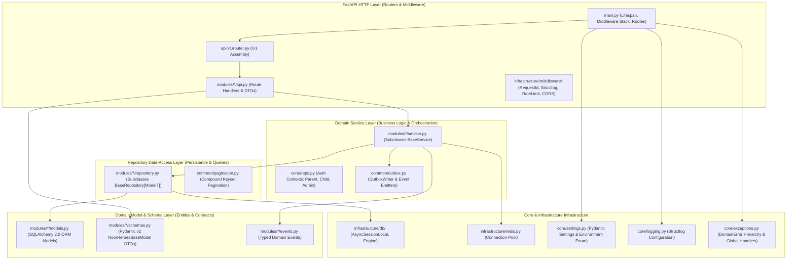
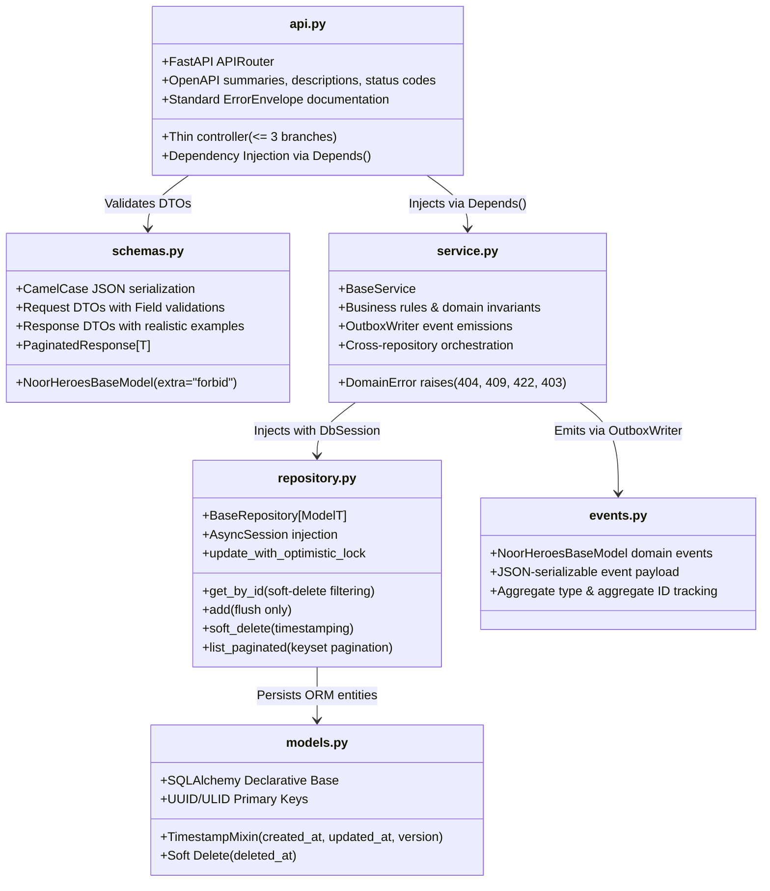
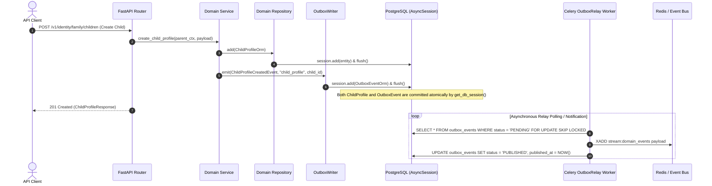
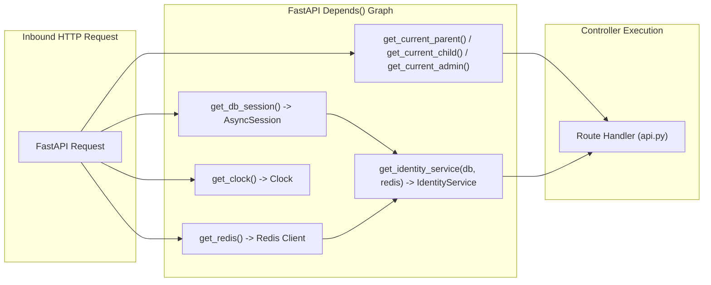
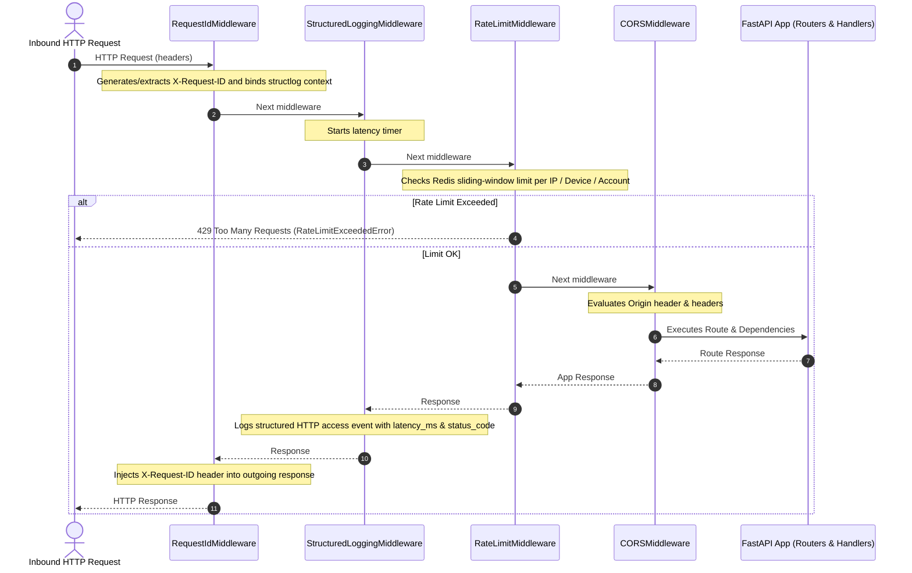
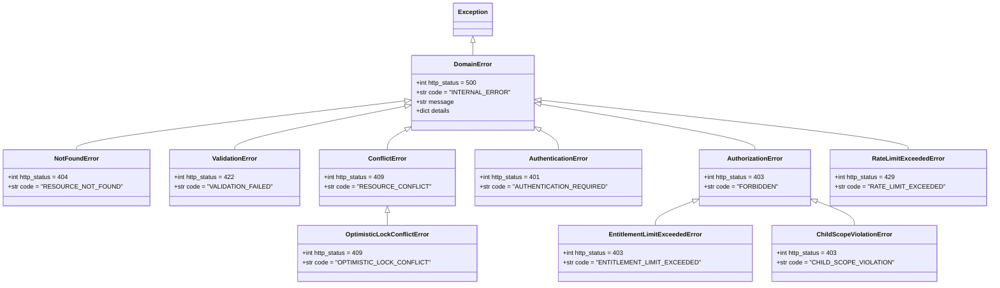

# Phase 2 — Backend Foundation: FastAPI Clean-Architecture Bootstrap & Modular Monolith Scaffolding

**Blueprint ID:** `Development_Blueprints.Phase2_Backend_Foundation.Backend.01-fastapi-clean-architecture-bootstrap.md`  
**Platform:** Backend (`backend/src/noorheroes/`)  
**Phase:** Phase 2 — Backend Foundation & Security Baseline Prerequisites  
**Global Sequence:** Seq 14  
**Closes:** Phase 2 Item 01 (`Backend.01-fastapi-clean-architecture-bootstrap.md`) — Bounded-context folder scaffolding (`identity`, `content`, `learning`, `rewards`, `subscriptions`, `media`, `notifications`, `ai_safety`, `admin`, `localization`, `feature_flags`) with `models.py/schemas.py/repository.py/service.py/events.py` per context, per `NoorHeroes_Final_Development_Prompt.md` §2.2/§13.2.  
**Depends on:**  
- `Phase0_Project_Repo_Foundation.Repo.01-monorepo-scaffold-workspace-structure.md` — Monorepo workspace skeleton (`backend/`, `src/noorheroes/`, `tests/`).
- `Phase0_Project_Repo_Foundation.Repo.02-coding-standards-linting-formatting-config.md` — Coding standards, ruff, black, and mypy type checking.
- `Phase1_Infra_Config.Infra.01-environment-tiers-provisioning.md` — 5-tier environment model (`local`, `ci`, `dev-qa`, `staging`, `production`).
- `Phase1_Infra_Config.Infra.02-secrets-management-env-example-gitleaks.md` — Environment variable naming conventions and secret masking.
- `Phase1_Infra_Config.Infra.03-docker-compose-local-dev-stack.md` — Local PostgreSQL 16, Redis, and R2-compatible object storage stack.

**Consumed by:** Every subsequent Backend domain blueprint across all 11 bounded contexts from Phase 4 to Phase 12 (A1 through F37).

**Source Authority:**  
- `FAST-API-INSTRUCTIONS.md` (authoritative "Zero-Missing Developer Usage Manual & Master Reference")
- `MASTER-README.md` (authoritative unified master technical reference)
- `NoorHeroes_Consolidated_Execution_Blueprint.md` §3 (Phase 2 Backend Foundation & Security Baseline Prerequisites)
- `NoorHeroes_Final_Development_Prompt.md` §2.2, §3, §4, §8, §9, §13.2

**Status:** Implemented & Verified Baseline (Authoritative Specification)

---

## 1. Objective and Strategic Purpose

This blueprint establishes the **foundational Clean Architecture and Domain-Driven Design (DDD-Lite) modular monolith framework** for the NoorHeroes backend service. It serves as the architectural bedrock upon which all domain capabilities (authentication, content delivery, AI safety evaluation, gamification, parental controls, payment processing, multilingual localization, and administrative operations) are built.

The primary objectives are:

1. **Modular Monolith Discipline**: Structuring the application into 11 strictly decoupled bounded contexts located in `src/noorheroes/modules/`, ensuring zero circular dependencies, zero direct cross-context repository coupling, and clear transaction boundaries.
2. **Mandatory 5-File Architecture**: Enforcing a uniform directory layout for every bounded context consisting of `models.py`, `schemas.py`, `repository.py`, `service.py`, and `events.py`, augmented by controller routers (`api.py` / `admin_api.py`) and context dependencies (`deps.py`).
3. **Inward-Pointing Dependency Rule**: Establishing an uncompromising layering hierarchy:
   $$\text{API / Routers} \longrightarrow \text{Domain Services} \longrightarrow \text{Repositories} \longrightarrow \text{Database / ORM}$$
   where API controllers remain thin orchestrators, business rules reside exclusively in services, and repositories handle persistence without owning transaction boundaries or emitting Celery background tasks directly.
4. **Base Abstractions & Reusable Infrastructure**: Providing rock-solid base classes (`BaseRepository[ModelT]`, `BaseService`, `NoorHeroesBaseModel`), optimistic concurrency control (`version` column), compound keyset cursor pagination (`PageResult[ModelT]`), and transparent soft-deletion (`deleted_at`).
5. **Transactional Outbox Pattern**: Implementing atomic dual-write resilience via `outbox_events` and `OutboxRelay` to guarantee reliable asynchronous event publishing to Redis and Celery without two-phase commit overhead.
6. **Unified Dependency Injection**: Standardizing request-scoped `AsyncSession` database management via FastAPI's native `Depends()` system, with automatic commit on success and rollback on failure.
7. **Production-Grade OpenAPI 3.1 / Swagger UI Contract**: Defining rich OpenAPI schema generation with global `BearerAuth` security schemes, categorized tag taxonomies, HTTP status annotations, and comprehensive realistic JSON examples for every request and response model.
8. **Automated Architectural Invariant Enforcement**: Backing the design with automated AST (Abstract Syntax Tree) test suites (`tests/architecture/`) that statically verify layer boundaries, repository isolation, schema conventions, and error-raising rules in CI.

---

## 2. Scope and Architectural Requirements

### 2.1 In Scope

- **Bounded Context Scaffolding**: Layout and contracts for all 11 domain modules:
  1. `identity`: Parent & child account management, JWT minting, password hashing, session context.
  2. `content`: Story catalog, audio episodes, series, age-band categorization.
  3. `learning`: Quizzes, daily learning tracks, progress tracking, streaks.
  4. `rewards`: Stars, badge awards, reward ledger, points balances.
  5. `subscriptions`: Billing plans, subscription checkout, entitlements.
  6. `media`: Asset metadata, presigned Cloudflare R2 upload initiation.
  7. `notifications`: Push token registration, multi-channel dispatch.
  8. `ai_safety`: LLM child safety evaluation, content moderation logs.
  9. `admin`: Administrative operations, audit logging, RBAC checks.
  10. `localization`: Multilingual translations, supported languages, country registries, Celery tasks.
  11. `feature_flags`: Dual-signoff safety flags, environment state matrix, kill-switches.
- **Core Layer Infrastructure**: Centralized configuration (`Settings`, `Environment`), structured logging (`structlog`), correlation context (`request_id`), exception hierarchy (`DomainError`), and security primitives (`JwtClaims`, Argon2id).
- **Common Layer Primitives**: `BaseRepository`, `BaseService`, `OutboxWriter`, `NoorHeroesBaseModel`, `PaginatedResponse`, `IdempotentRequest`, `Clock`, `MinorUnitsAmount`.
- **Infrastructure Layer Integrations**: Database engine (`AsyncSessionLocal`), Redis pool, sliding-window rate limiters, storage abstractions, OpenTelemetry telemetry.
- **API Assembly & Lifespan**: Global FastAPI application instantiation (`main.py`), middleware ordering, exception handler mounting, health probes (`/healthz`, `/readyz`), and OpenAPI schema customizer.

### 2.2 Explicitly Out of Scope

- **Feature-Specific Business Logic**: Concrete domain business logic (e.g. specific quiz grading algorithms, payment gateway webhooks, AI prompt templates) belongs to respective feature blueprints (Phase 4–12).
- **Infrastructure Provisioning**: Cloud SQL provisioning, Terraform state management, and Kubernetes manifests are owned by Phase 1 (`Infra.04`) and Phase 11.
- **Client Application Code**: KMP / Android / iOS client logic and Next.js frontend code are owned by their respective modules.

### 2.3 System Invariants

1. **Transaction Boundary Invariant**: Repositories MUST NEVER call `session.commit()` or `session.rollback()`. Transaction commit/rollback is owned solely by FastAPI's request-scoped `get_db_session` dependency (or explicit service-level sub-transaction managers).
2. **Domain Error Ownership Invariant**: ONLY `service.py` modules may raise `DomainError` subclasses. Models, schemas, and repositories must never raise domain exceptions.
3. **Data Boundary Invariant**: A bounded context repository MUST NEVER import or invoke another bounded context's repository. Cross-context data operations must proceed via service-to-service orchestration or asynchronous domain events.
4. **Thin Controller Invariant**: Router functions (`api.py`) must act as pure HTTP controllers. AST tests reject route functions with $>3$ conditional branching statements.
5. **Schema Wire Invariant**: All Pydantic DTO models must extend `NoorHeroesBaseModel` (enforcing `extra="forbid"`, `populate_by_name=True`, and camelCase wire serialization). No schema may use `float` or `Decimal` for financial or points fields (must use `MinorUnitsAmount` integer units).

---

## 3. Clean Architecture & Modular Monolith Layout

NoorHeroes follows a strict Clean Architecture pattern mapped into a Python Modular Monolith.



### 3.1 The 11 Bounded Contexts

| Bounded Context | Module Path | Primary Domain Responsibility |
|---|---|---|
| **`identity`** | `src/noorheroes/modules/identity/` | Parent registration, authentication, child profile lifecycle, session tokens |
| **`content`** | `src/noorheroes/modules/content/` | Stories, series catalog, audio bedtime tracks, age-band filtering |
| **`learning`** | `src/noorheroes/modules/learning/` | Quizzes, daily learning tracks, progress metrics, streaks |
| **`rewards`** | `src/noorheroes/modules/rewards/` | Gamified reward points, badges, immutable reward ledger |
| **`subscriptions`** | `src/noorheroes/modules/subscriptions/` | Subscription plans, family entitlements, checkout processing |
| **`media`** | `src/noorheroes/modules/media/` | Media asset catalog, Cloudflare R2 presigned upload initiation |
| **`notifications`** | `src/noorheroes/modules/notifications/` | FCM/APNs push token management, notification preferences, dispatch |
| **`ai_safety`** | `src/noorheroes/modules/ai_safety/` | Multi-vendor AI safety moderation, guardrail auditing, prompt review |
| **`admin`** | `src/noorheroes/modules/admin/` | Admin audit logging, back-office operations, role-based controls |
| **`localization`** | `src/noorheroes/modules/localization/` | Multi-language translation pipeline, country registries, currency definitions |
| **`feature_flags`** | `src/noorheroes/modules/feature_flags/` | Dynamic feature evaluation, dual-signoff safety workflows, kill-switches |

---

## 4. Directory & File Scaffolding Standard

Every bounded context inside `src/noorheroes/modules/<context_name>/` adheres to the **Mandatory 5-File Architecture**, augmented by HTTP route handlers and context-specific dependency providers.

```text
src/noorheroes/modules/<context_name>/
├── __init__.py          # Public exports (router, service, repository, models, schemas)
├── models.py            # SQLAlchemy 2.0 ORM entities (extends Base, TimestampMixin)
├── schemas.py           # Pydantic v2 DTOs (extends NoorHeroesBaseModel, extra="forbid")
├── repository.py        # Data access layer (extends BaseRepository[ModelT])
├── service.py           # Business logic & domain events (extends BaseService)
├── events.py            # Typed domain event schemas (for Transactional Outbox)
├── api.py               # FastAPI APIRouter with OpenAPI annotations & status codes
├── admin_api.py         # Optional: Admin-specific APIRouter (e.g. in feature_flags)
├── deps.py              # Optional: Context-specific DI factories (e.g. get_identity_service)
└── tasks.py             # Optional: Celery background worker tasks (e.g. localization, flags)
```

### 4.1 File Responsibilities Matrix



---

## 5. Core Layer Abstractions & Base Components

### 5.1 Declarative Database Model Base (`src/noorheroes/infrastructure/db/base.py`)

All ORM entities inherit from `Base` and `TimestampMixin`.

```python
from datetime import datetime, timezone
from sqlalchemy import BigInteger, DateTime, Integer, MetaData
from sqlalchemy.orm import DeclarativeBase, Mapped, mapped_column

# Consistent naming convention for PostgreSQL constraints
POSTGRES_NAMING_CONVENTION = {
    "ix": "ix_%(column_0_label)s",
    "uq": "uq_%(table_name)s_%(column_0_name)s",
    "ck": "ck_%(table_name)s_%(constraint_name)s",
    "fk": "fk_%(table_name)s_%(column_0_name)s_%(referred_table_name)s",
    "pk": "pk_%(table_name)s",
}

class Base(DeclarativeBase):
    metadata = MetaData(naming_convention=POSTGRES_NAMING_CONVENTION)

class TimestampMixin:
    """
    Standard mixin providing UTC timestamps, soft-delete marker, and optimistic lock versioning.
    """
    created_at: Mapped[datetime] = mapped_column(
        DateTime(timezone=True),
        default=lambda: datetime.now(timezone.utc),
        nullable=False,
    )
    updated_at: Mapped[datetime] = mapped_column(
        DateTime(timezone=True),
        default=lambda: datetime.now(timezone.utc),
        onupdate=lambda: datetime.now(timezone.utc),
        nullable=False,
    )
    deleted_at: Mapped[datetime | None] = mapped_column(
        DateTime(timezone=True),
        nullable=True,
        default=None,
        index=True,
    )
    version: Mapped[int] = mapped_column(
        Integer,
        default=1,
        nullable=False,
    )
```

### 5.2 Base Repository Pattern (`src/noorheroes/common/base_repository.py`)

The generic repository encapsulates data access while enforcing strict transactional boundaries.

```python
from dataclasses import dataclass
from typing import Any, Generic, List, Optional, TypeVar
from sqlalchemy import select, update
from sqlalchemy.ext.asyncio import AsyncSession
from sqlalchemy.orm import selectinload

from src.noorheroes.common.pagination import decode_cursor, encode_cursor
from src.noorheroes.common.utils.clock import Clock
from src.noorheroes.core.exceptions import OptimisticLockConflictError

ModelT = TypeVar("ModelT")

@dataclass
class PageResult(Generic[ModelT]):
    items: List[ModelT]
    next_cursor: Optional[str]
    has_more: bool

class BaseRepository(Generic[ModelT]):
    model: Any

    def __init__(self, session: AsyncSession):
        self._session = session

    async def get_by_id(self, id: Any, *, eager: Optional[List[Any]] = None) -> Optional[ModelT]:
        stmt = select(self.model).where(self.model.id == id, self.model.deleted_at.is_(None))
        for rel in eager or []:
            stmt = stmt.options(selectinload(rel))
        result = await self._session.execute(stmt)
        return result.scalar_one_or_none()

    async def add(self, entity: ModelT) -> ModelT:
        self._session.add(entity)
        await self._session.flush()
        return entity

    async def soft_delete(self, id: Any, *, clock: Clock) -> None:
        entity = await self.get_by_id(id)
        if entity is None:
            return  # Idempotent no-op
        entity.deleted_at = clock.now()
        await self._session.flush()

    async def update_with_optimistic_lock(self, id: Any, expected_version: int, **fields: Any) -> ModelT:
        stmt = (
            update(self.model)
            .where(
                self.model.id == id,
                self.model.version == expected_version,
                self.model.deleted_at.is_(None),
            )
            .values(**fields, version=expected_version + 1)
            .returning(self.model)
        )
        result = await self._session.execute(stmt)
        updated_row = result.scalar_one_or_none()
        if updated_row is None:
            raise OptimisticLockConflictError(
                f"Conflict updating {self.model.__name__} (id={id}): "
                f"stale version {expected_version}. Record was updated concurrently."
            )
        return updated_row

    async def list_paginated(
        self,
        *,
        cursor: Optional[str] = None,
        limit: int = 20,
        filters: Optional[List[Any]] = None,
    ) -> PageResult[ModelT]:
        stmt = select(self.model).where(self.model.deleted_at.is_(None))
        if filters:
            for f in filters:
                stmt = stmt.where(f)

        if cursor:
            cursor_dt, cursor_id = decode_cursor(cursor)
            stmt = stmt.where(
                (self.model.created_at < cursor_dt)
                | ((self.model.created_at == cursor_dt) & (self.model.id < cursor_id))
            )

        stmt = stmt.order_by(self.model.created_at.desc(), self.model.id.desc()).limit(limit + 1)
        result = await self._session.execute(stmt)
        rows = list(result.scalars().all())

        has_more = len(rows) > limit
        items = rows[:limit]
        next_cursor = None
        if has_more and items:
            last = items[-1]
            next_cursor = encode_cursor(last.created_at, str(last.id))

        return PageResult(items=items, next_cursor=next_cursor, has_more=has_more)
```

### 5.3 Base Service Pattern (`src/noorheroes/common/base_service.py`)

Services coordinate domain business logic, enforce authorization and invariant rules, and emit domain events.

```python
from typing import Any, Optional

class BaseService:
    """
    Base class for domain business services across all 11 bounded contexts.
    Standardizes transactional boundaries and shared operational conventions.
    """

    @staticmethod
    def idempotent_delete_semantics(entity: Optional[Any]) -> bool:
        """
        Confirms successful idempotent deletion for existing or absent entities.
        """
        return True
```

### 5.4 Pydantic v2 Schema Conventions (`src/noorheroes/common/schemas.py`)

All DTOs inherit from `NoorHeroesBaseModel`.

```python
from typing import Annotated, Any, Dict, Generic, List, Optional, TypeVar
from pydantic import BaseModel, ConfigDict, Field
from pydantic.alias_generators import to_camel

T = TypeVar("T")

class NoorHeroesBaseModel(BaseModel):
    """
    Single canonical base class for every request and response schema in the application.
    Enforces camelCase wire serialization, whitespace stripping, and forbids extra unrecognized input fields.
    """
    model_config = ConfigDict(
        alias_generator=to_camel,
        populate_by_name=True,
        extra="forbid",
        from_attributes=True,
        str_strip_whitespace=True,
        validate_default=True,
    )

class PaginatedResponse(NoorHeroesBaseModel, Generic[T]):
    items: List[T] = Field(..., description="List of paginated items for the current page.")
    next_cursor: Optional[str] = Field(None, description="Opaque pagination cursor for fetching the next page.")
    has_more: bool = Field(..., description="Indicates whether additional pages remain.")

class PaginatedParams(NoorHeroesBaseModel):
    cursor: Optional[str] = Field(None, description="Opaque pagination cursor for fetching the next page.")
    limit: int = Field(20, ge=1, le=100, description="Maximum number of items to return per page.")

class IdempotentRequest(NoorHeroesBaseModel):
    idempotency_key: str = Field(..., description="Unique client-supplied idempotency key for deduplication.")
```

---

## 6. Transactional Outbox Pattern & Resilient Event Publishing

To guarantee consistency between database updates and asynchronous event dispatch without distributed transactions, NoorHeroes employs the **Transactional Outbox Pattern**.



### 6.1 Outbox Table Schema & Writer (`src/noorheroes/common/outbox.py`)

```python
import json
from datetime import datetime, timezone
from typing import Any
from sqlalchemy import DateTime, Integer, String, Text
from sqlalchemy.dialects.postgresql import JSONB
from sqlalchemy.ext.asyncio import AsyncSession
from sqlalchemy.orm import Mapped, mapped_column

from src.noorheroes.infrastructure.db.base import Base
from src.noorheroes.common.utils.ids import generate_ulid

class OutboxEventOrm(Base):
    __tablename__ = "outbox_events"

    id: Mapped[str] = mapped_column(String(36), primary_key=True, default=generate_ulid)
    aggregate_type: Mapped[str] = mapped_column(String(64), nullable=False, index=True)
    aggregate_id: Mapped[str] = mapped_column(String(64), nullable=False, index=True)
    event_type: Mapped[str] = mapped_column(String(128), nullable=False, index=True)
    payload: Mapped[dict[str, Any]] = mapped_column(JSONB, nullable=False)
    status: Mapped[str] = mapped_column(String(16), default="PENDING", nullable=False, index=True)
    retry_count: Mapped[int] = mapped_column(Integer, default=0, nullable=False)
    created_at: Mapped[datetime] = mapped_column(
        DateTime(timezone=True),
        default=lambda: datetime.now(timezone.utc),
        nullable=False,
    )
    published_at: Mapped[datetime | None] = mapped_column(DateTime(timezone=True), nullable=True)

class OutboxWriter:
    def __init__(self, session: AsyncSession):
        self._session = session

    async def emit(self, event: Any, aggregate_type: str, aggregate_id: str) -> OutboxEventOrm:
        payload = event.model_dump(mode="json") if hasattr(event, "model_dump") else event
        outbox_entry = OutboxEventOrm(
            id=generate_ulid(),
            aggregate_type=aggregate_type,
            aggregate_id=str(aggregate_id),
            event_type=event.__class__.__name__,
            payload=payload,
            status="PENDING",
            created_at=datetime.now(timezone.utc),
        )
        self._session.add(outbox_entry)
        await self._session.flush()
        return outbox_entry
```

---

## 7. Dependency Injection & Session Lifecycle Management

FastAPI's `Depends()` framework is the sole dependency injection mechanism.



### 7.1 Database Session Provider (`src/noorheroes/core/deps.py`)

```python
from collections.abc import AsyncGenerator
from typing import Annotated
from fastapi import Depends
from sqlalchemy.ext.asyncio import AsyncSession
from src.noorheroes.infrastructure.db import AsyncSessionLocal

async def get_db_session() -> AsyncGenerator[AsyncSession, None]:
    """
    Yields a request-scoped AsyncSession instance and manages atomic commit/rollback.
    """
    session: AsyncSession = AsyncSessionLocal()
    try:
        yield session
        if session.is_active:
            await session.commit()
    except Exception:
        await session.rollback()
        raise
    finally:
        await session.close()

DbSession = Annotated[AsyncSession, Depends(get_db_session)]
```

### 7.2 Session Context DTOs and Authentication Dependencies

```python
class ParentSessionContext(BaseModel):
    family_id: str
    parent_sub: str
    session_id: str
    scopes: list[str] = Field(default_factory=list)

class ChildSessionContext(BaseModel):
    family_id: str
    child_id: str
    session_id: str

class AdminSessionContext(BaseModel):
    admin_id: str
    session_id: str
    role: str
    scopes: list[str] = Field(default_factory=list)

async def get_current_parent(
    credentials: Optional[HTTPAuthorizationCredentials] = Depends(oauth2_scheme),
) -> ParentSessionContext:
    if not credentials:
        raise AuthenticationError("Missing Bearer authorization token")
    claims = decode_and_validate_app_jwt(credentials.credentials)
    if claims.mode != SessionMode.PARENT:
        raise AuthenticationError("This endpoint requires a PARENT-mode session token")
    return ParentSessionContext(
        family_id=claims.family_id,
        parent_sub=claims.sub,
        session_id=claims.session_id,
        scopes=claims.scopes,
    )
```

---

## 8. Cross-Cutting Middleware Pipeline

Every HTTP request traverses the global middleware stack registered in strict execution order in `main.py`.



### 8.1 Middleware Registration Hierarchy

```python
# main.py middleware registration order (inner to outer)
app.add_middleware(
    CORSMiddleware,
    allow_origins=cors_origins,
    allow_credentials=True,
    allow_methods=["GET", "POST", "PUT", "PATCH", "DELETE", "OPTIONS"],
    allow_headers=["*"],
    expose_headers=["X-Request-ID"],
)
app.add_middleware(RateLimitMiddleware)
app.add_middleware(StructuredLoggingMiddleware)
app.add_middleware(RequestIdMiddleware)
```

---

## 9. Centralized Domain-Error Hierarchy & Exception Handling

NoorHeroes implements a closed exception hierarchy mapped to standard RFC-7807 compatible error envelopes.

### 9.1 The DomainError Class Hierarchy



### 9.2 Universal JSON Error Envelope Contract

Every error response (4xx, 5xx) returned by the API strictly adheres to the following envelope:

```json
{
  "error": {
    "code": "CHILD_SCOPE_VIOLATION",
    "message": "Access denied: Child profile does not belong to the authenticated family account",
    "requestId": "req_01J6A1B2C3D4E5F6G7H8J9K0L1",
    "details": {
      "childId": "ch_01J6A1B2C3D4E5",
      "familyId": "fam_01J6A1B2C3D4E5"
    }
  }
}
```

---

## 10. Swagger / OpenAPI 3.1 Specification & Rich Developer Documentation

Every API endpoint must provide comprehensive metadata to make testing in Swagger UI seamless.

### 10.1 Global OpenAPI Configuration in `main.py`

```python
def custom_openapi() -> dict[str, Any]:
    if app.openapi_schema:
        return app.openapi_schema

    openapi_schema = get_openapi(
        title="NoorHeroes Backend API",
        version="1.0.0",
        description=(
            "Production-grade, asynchronous backend for NoorHeroes — empowering Islamic character "
            "building and gamified learning for children through AI and storytelling.\n\n"
            "### Authentication Instructions\n"
            "1. Authenticate via `POST /v1/identity/auth/login/json` to obtain an `access_token`.\n"
            "2. Click the **Authorize** button at the top and paste the token.\n"
            "3. Protected endpoints will automatically include the Bearer header."
        ),
        routes=app.routes,
    )

    openapi_schema["components"]["securitySchemes"] = {
        "BearerAuth": {
            "type": "http",
            "scheme": "bearer",
            "bearerFormat": "JWT",
            "description": "Enter your JWT Bearer token."
        }
    }
    openapi_schema["security"] = [{"BearerAuth": []}]
    app.openapi_schema = openapi_schema
    return app.openapi_schema
```

### 10.2 Production Endpoint Definition Pattern

```python
@router.post(
    "/children",
    response_model=ChildProfileResponse,
    status_code=status.HTTP_201_CREATED,
    summary="Register a new child profile",
    description=(
        "Enrolls a new child profile under the authenticated parent's family account. "
        "Enforces subscription tier capacity limits before creation."
    ),
    responses={
        201: {
            "description": "Child profile successfully created",
            "model": ChildProfileResponse,
        },
        401: {"description": "Unauthenticated or invalid parent token", "model": ErrorEnvelope},
        403: {"description": "Subscription tier child profile limit reached", "model": ErrorEnvelope},
        422: {"description": "Validation failure on input parameters", "model": ValidationErrorEnvelope},
    },
)
async def create_child(
    payload: ChildProfileCreateRequest,
    parent_ctx: ParentSessionContext = Depends(get_current_parent),
    service: IdentityService = Depends(get_identity_service),
) -> ChildProfileResponse:
    return await service.create_child_profile(parent_ctx, payload)
```

---

## 11. Security, Authorization & Child Safety Invariants

1. **COPPA / GDPR-K Child Protection**: Under COPPA data-minimization mandates, child accounts never store personal contact emails, phone numbers, or plain passwords. Child accounts are referenced only via parent family accounts and UUIDs/ULIDs.
2. **Slow Credential Hashing (Argon2id)**: User passwords and parental lock PINs are hashed using Argon2id (`t=3, m=65536, p=4`). Fast hashing algorithms (MD5, SHA1, SHA256) are strictly prohibited for credential storage.
3. **Zero Test-Mode Bypass in Staging/Production**: Hardcoded test credentials, fixed OTPs, or bypass flags (`test_mode_auth_bypass_enabled`) are forbidden and blocked by boot-time validators in `staging` and `production` environments.
4. **Gateway Authorization Purity**: API Gateway routes traffic and performs transport-level checks only. Zero business logic or permission checking is allowed at the gateway level; all authorization is authoritatively executed inside domain services.

---

## 12. Automated Architectural Static Analysis & AST Test Suite

The architectural integrity of the Clean Architecture bootstrap is continuously defended in CI by AST-based static analysis test suites (`tests/architecture/`):

1. `test_layering.py`:
   - Validates that every bounded context has the 5 mandatory files (`models.py`, `schemas.py`, `repository.py`, `service.py`, `events.py`).
   - Asserts repositories never import services or router modules.
   - Asserts a context repository never imports another context's repository.
   - Asserts domain errors are raised exclusively within `service.py`.
   - Asserts router functions have $\le 3$ conditional branches.
   - Asserts repositories never dispatch Celery tasks directly.
2. `test_base_repository_service.py`:
   - Validates all repositories extend `BaseRepository[ModelT]`.
   - Validates all services extend `BaseService`.
   - Asserts zero repository methods invoke `.commit()` or `.rollback()`.
   - Asserts optimistic locking conflicts trigger `OptimisticLockConflictError` (409 Conflict).
3. `test_schema_conventions.py`:
   - Validates all schemas extend `NoorHeroesBaseModel`.
   - Asserts camelCase JSON wire serialization.
   - Asserts zero money/points fields use `float` or `Decimal` (must use integer minor units).
   - Asserts rejection of naive datetimes and normalization of E.164 phone numbers.
4. `test_gateway_purity.py`:
   - Validates zero business-authorization logic exists in gateway middleware.

---

## 13. Edge Cases, Failure Modes & Comprehensive Mitigation Matrix

| Failure Mode / Edge Case | Trigger Condition | System Behavior | Mitigation Strategy |
|---|---|---|---|
| **Optimistic Lock Version Collision** | Two concurrent requests attempt to update the same record version | Database `UPDATE ... WHERE version = expected` updates 0 rows | `update_with_optimistic_lock` raises `OptimisticLockConflictError` (HTTP 409 Conflict) with clear diagnostic details |
| **Partial Transaction Failure** | Service operation fails midway through creating aggregate records | Exception propagates out of service method to FastAPI router | `get_db_session` dependency catches exception, triggers `await session.rollback()`, and safely closes session |
| **Outbox Relay Worker Lag** | High traffic volume causes delay in publishing domain events | Events persist safely in `outbox_events` table | Celery `OutboxRelay` uses batching with `SKIP LOCKED` and exponential retry on failure; idempotency keys prevent duplicate consumption |
| **Malformed Pagination Cursor** | Client passes tampered or corrupted base64 cursor token | `decode_cursor` fails decoding timestamp or ID | Raises `ValidationError` with code `INVALID_CURSOR` (HTTP 422) |
| **Stale Redis Connection Pool** | Redis server restarts or connection times out | Command raises `ConnectionError` | Redis client configured with health check intervals and auto-reconnect; critical auth operations fail safe |
| **Missing Environment Variable** | Application starts with missing required settings key | Pydantic `Settings()` validation fails during process bootstrap | Application crashes loudly during startup (`lifespan`) with descriptive `ValidationError` naming the missing field |

---

## 14. Implementation & Verification Checklist

- [x] All 11 Bounded Contexts structured with mandatory 5-file architecture (`models.py`, `schemas.py`, `repository.py`, `service.py`, `events.py`).
- [x] Generic `BaseRepository[ModelT]` implemented with soft-deletes, optimistic locking, and keyset cursor pagination.
- [x] Generic `BaseService` implemented with transaction isolation and domain error raising conventions.
- [x] Pydantic v2 `NoorHeroesBaseModel` enforced across all DTOs with `extra="forbid"` and camelCase wire serialization.
- [x] Transactional Outbox pattern implemented via `outbox_events` and `OutboxWriter`.
- [x] Request-scoped `AsyncSession` dependency injection established with auto-commit on success and auto-rollback on failure.
- [x] Global middleware stack registered in strict order: `RequestIdMiddleware` $\rightarrow$ `StructuredLoggingMiddleware` $\rightarrow$ `RateLimitMiddleware` $\rightarrow$ `CORSMiddleware`.
- [x] Centralized `DomainError` hierarchy and global exception handlers registered returning standard RFC-7807 envelopes.
- [x] OpenAPI / Swagger UI customizer configured with `BearerAuth` security scheme, tag documentation, and realistic JSON request/response examples.
- [x] Automated AST architectural test suite passing (`test_layering.py`, `test_base_repository_service.py`, `test_schema_conventions.py`, `test_gateway_purity.py`).

---

## 15. Architectural Decisions Log (ADRs)

| ADR ID | Decision Title | Status | Rationale & Trade-offs |
|---|---|---|---|
| **ADR-0001** | Modular Monolith over Microservices | **Accepted** | Keeps domain bounded contexts within a single codebase, drastically simplifying transactions, local development, and end-to-end testing while preserving clean module boundaries for future service extraction. |
| **ADR-0002** | Keyset Cursor Pagination over Offset Pagination | **Accepted** | Keyset pagination using `(created_at, id)` guarantees $O(1)$ query complexity regardless of page depth and eliminates page drift during real-time data insertions. |
| **ADR-0003** | Integer Minor Units for Financials & Points | **Accepted** | Floating-point numbers introduce IEEE 754 precision rounding errors. Storing currencies and points as integer minor units guarantees arithmetic determinism. |
| **ADR-0004** | Transactional Outbox for Domain Events | **Accepted** | Avoids dual-write inconsistencies between PostgreSQL and Redis/RabbitMQ by persisting domain events within the same SQL transaction. |
| **ADR-0005** | Request-Scoped Dependency Transaction Management | **Accepted** | Prohibits repositories from committing transactions, allowing domain services to span multiple repository writes within a single atomic unit of work managed by FastAPI's `get_db_session`. |
