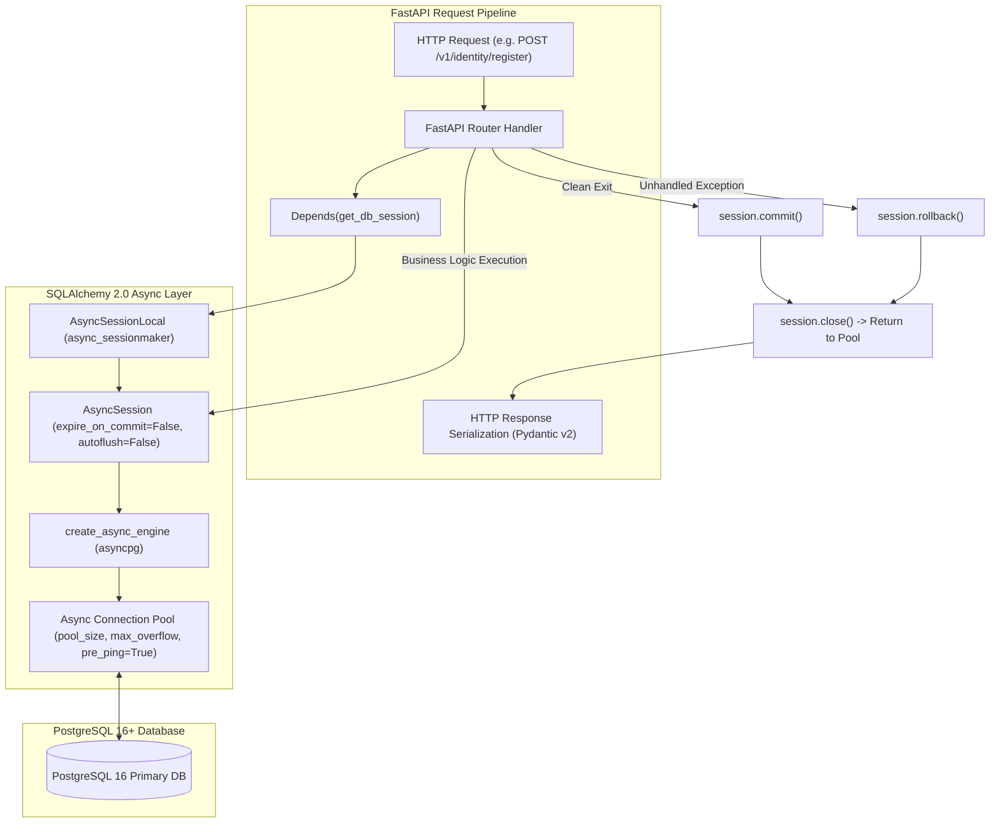

# Phase 2 — Backend Foundation: Async SQLAlchemy 2.0 ORM Configuration & Alembic Migration Harness

**Blueprint ID:** `Development_Blueprints.Phase2_Backend_Foundation.Backend.02-db-orm-config-sqlalchemy-alembic.md`  
**Platform:** Backend (`backend/src/noorheroes/infrastructure/db/`, `alembic/`, `backend/src/noorheroes/core/deps.py`)  
**Phase:** Phase 2 — Backend Foundation & Security Baseline Prerequisites  
**Global Sequence:** Seq 15  
**Closes:** Phase 2 Item 02 (`Backend.02-db-orm-config-sqlalchemy-alembic.md`) — Async SQLAlchemy 2.x engine/session config against PostgreSQL 16+, Alembic migration harness, base declarative model per `NoorHeroes_Consolidated_Execution_Blueprint.md` §3 and `MASTER-README.md` §5.  
**Depends on:**  
- `Phase2_Backend_Foundation.Backend.01-fastapi-clean-architecture-bootstrap.md` — Clean architecture bounded contexts, modular monolith layout, base abstractions.
- `Phase1_Infra_Config.Infra.03-docker-compose-local-dev-stack.md` — Local PostgreSQL 16 container, connection strings, credentials.
- `Phase1_Infra_Config.Infra.01-environment-tiers-provisioning.md` — 5-tier environment model and database sizing.

**Consumed by:**  
- All 11 Bounded Contexts (`identity`, `content`, `learning`, `rewards`, `subscriptions`, `media`, `notifications`, `ai_safety`, `admin`, `localization`, `feature_flags`) for ORM entities and persistence.
- `common/outbox.py` and `common/outbox_relay.py` for transactional outbox persistence.
- `core/deps.py` for request-scoped `get_db_session` dependency injection.
- `api/v1/router.py` for `/healthz` and `/readyz` database connectivity probes.
- `tests/conftest.py` and all integration/architectural test suites.

**Source Authority:**  
- `FAST-API-INSTRUCTIONS.md` (Zero-Missing Developer Usage Manual & Master Reference §2, §4, §15)
- `MASTER-README.md` (Authoritative Unified Master Technical Reference §5)
- `NoorHeroes_Consolidated_Execution_Blueprint.md` §3 (Phase 2 Item 15)

**Status:** Implemented & Verified Baseline (Authoritative Specification)

---

## 1. Objective and Strategic Purpose

This blueprint establishes the **production-grade asynchronous database persistence engine and migration harness** for the NoorHeroes backend platform. Built on **Python 3.12+**, **SQLAlchemy 2.0+**, **asyncpg**, and **Alembic**, it provides a resilient, high-throughput, non-blocking database access layer tailored for PostgreSQL 16+.

The primary architectural goals are:

1. **Pure Asynchronous I/O**: Eliminating synchronous blocking database drivers by executing all queries and transactions through `asyncpg` via SQLAlchemy's `AsyncEngine` and `AsyncSession`.
2. **Strict Transaction Boundaries**: Enforcing request-scoped unit-of-work transactions managed automatically by FastAPI's `Depends(get_db_session)` dependency. A request commits atomically on successful HTTP return, rolls back automatically on unhandled exceptions, and unconditionally releases connections back to the connection pool.
3. **Single DeclarativeBase Invariant**: Enforcing a singular, shared `Base(DeclarativeBase)` class across all 11 bounded contexts to ensure consistent metadata registration, avoid multi-registry fragmentation, and ensure deterministic Alembic schema diffs.
4. **Deterministic Constraint Naming Conventions**: Binding an explicit constraint naming convention dictionary (`ix_`, `uq_`, `ck_`, `fk_`, `pk_`) to `MetaData`, ensuring that auto-generated migrations and schema diffs across PostgreSQL instances are 100% deterministic and reproducible across developers, CI, and staging/production environments.
5. **Alembic Migration Harness with Complete Context Coverage**: Providing an automated migration pipeline that imports all 11 bounded context `models.py` files and the shared `outbox_events` table into `alembic/env.py`, supporting both offline SQL generation and online asynchronous migration execution via `async_engine_from_config`.
6. **Serialization Safety**: Explicitly configuring `expire_on_commit=False` on the async session factory to eliminate `DetachedInstanceError` exceptions when Pydantic v2 schemas serialize ORM attributes after transaction commit.
7. **Zero-Floating-Point Financial & Points Accuracy**: Enforcing `BIGINT` integer minor units (via `MinorUnitsAmount` / integer columns) for all financial currency amounts, star rewards, and points counters, eliminating floating-point rounding drift.
8. **Automated Architectural Invariant Enforcement**: Backing every persistence rule with automated AST static analysis test suites (`tests/architecture/test_db_config.py`) to verify that no secondary `DeclarativeBase` exists, all models are registered in `alembic/env.py`, all `DateTime` columns are timezone-aware, and statement timeouts are enforced.

---

## 2. Scope and Architectural Requirements

### 2.1 In Scope

- **Async SQLAlchemy 2.0 Engine Configuration**: `create_async_engine` initialized with PostgreSQL connection URL, connection pool tuning parameters (`pool_size`, `max_overflow`, `pool_timeout`, `pool_recycle`, `pool_pre_ping=True`), `application_name`, and query statement timeouts.
- **Async Session Factory**: `async_sessionmaker` configured with `AsyncSession`, `expire_on_commit=False`, and `autoflush=False`.
- **Declarative Base & Mixins**: Single shared `Base(DeclarativeBase)` with naming convention, automatic snake_case plural table naming, `TimestampMixin` (`created_at`, `updated_at` with UTC `DateTime(timezone=True)`), and optimistic lock support (`version`).
- **Request-Scoped Dependency Injection**: `get_db_session()` generator in `src/noorheroes/core/deps.py` with `DbSession` type alias, enforcing automatic commit on success and rollback on failure.
- **Alembic Migration Harness**: Configuration (`alembic.ini`), environment runner (`alembic/env.py`), migration template (`script.py.mako`), version history (`alembic/versions/`), and full model metadata registration across all 11 bounded contexts and outbox events.
- **Health Check Integration**: `/healthz` liveness and `/readyz` deep readiness check executing `SELECT 1` connectivity pings.
- **Architectural Tests**: Automated AST static analysis tests in `tests/architecture/test_db_config.py`.

### 2.2 Explicitly Out of Scope

- **Database Server Provisioning**: Managed PostgreSQL provisioning in Cloud SQL / AWS RDS is owned by Phase 1 (`Infra.04`) and Phase 11.
- **Cross-Context Foreign Keys**: Direct relational database foreign keys across bounded context tables are prohibited to maintain loose coupling; inter-context references use logical string IDs and are coordinated via Domain Services or Outbox Events.
- **Direct Repository Transaction Control**: Repositories must never invoke `session.commit()` or `session.rollback()`.

### 2.3 System Invariants

1. **Single DeclarativeBase Invariant**: Exactly ONE `DeclarativeBase` subclass (`Base`) may exist in the entire codebase (`src/noorheroes/infrastructure/db/session.py`). AST tests fail CI if a second `DeclarativeBase` is instantiated anywhere.
2. **Explicit Alembic Registration Invariant**: Every bounded context `models.py` and `common.outbox` must be explicitly imported in `alembic/env.py`.
3. **Timezone-Aware DateTime Invariant**: Every `DateTime` column must specify `timezone=True` (PostgreSQL `TIMESTAMP WITH TIME ZONE`). Naive timestamps are strictly forbidden.
4. **Integer Minor-Units Invariant**: Monetary amounts, star rewards, and points balances must be stored as `BigInteger` or `Integer` minor units. Floating-point or numeric types are strictly forbidden for balance fields.
5. **Connection Leak Prevention Invariant**: `AsyncSession` instances must be closed in a `finally` block, ensuring connections return to the pool even during unhandled exceptions or aborted requests.

---

## 3. Architecture & Data Flow



### 3.1 Connection Pool Lifecycle & Sizing

The connection pool uses SQLAlchemy's `AsyncAdaptedQueuePool` backed by `asyncpg`:

| Parameter | Configuration Key | Default Value | Environment Tier Tuning |
|---|---|---|---|
| **Pool Size** | `settings.db_pool_size` | `10` | Local/CI: 5; Dev/QA: 10; Staging: 20; Production: 30 |
| **Max Overflow** | `settings.db_pool_max_overflow` | `20` | Local/CI: 5; Dev/QA: 10; Staging: 20; Production: 50 |
| **Pool Timeout** | `settings.db_pool_timeout_seconds` | `30.0`s | Prevents unbounded connection request queuing under load |
| **Pool Recycle** | `settings.db_pool_recycle_seconds` | `1800`s (30 min) | Recycles connections before AWS/GCP TCP NAT idle timeouts |
| **Pool Pre-Ping** | `pool_pre_ping=True` | `True` | Emits `SELECT 1` ping before checkout to evict stale/broken connections |
| **Statement Timeout** | `settings.db_statement_timeout_seconds` | `15.0`s | Aborts runaway queries at the PostgreSQL engine level |
| **Application Name** | `server_settings.application_name` | `"noorheroes-api"` | Visible in `pg_stat_activity` for DB monitoring and lock analysis |

---

## 4. Declarative Base & Model Specifications

### 4.1 Single Declarative Base (`src/noorheroes/infrastructure/db/session.py` & `base.py`)

All ORM entities across all 11 bounded contexts inherit from `Base` and optionally `TimestampMixin`.

```python
from datetime import datetime, timezone
from typing import Any
from sqlalchemy import DateTime, MetaData
from sqlalchemy.ext.asyncio import AsyncSession, async_sessionmaker, create_async_engine
from sqlalchemy.orm import DeclarativeBase, Mapped, declared_attr, mapped_column

from src.noorheroes.core.settings import settings

# Explicit PostgreSQL constraint naming convention for deterministic Alembic diffs
naming_convention = {
    "ix": "ix_%(column_0_label)s",
    "uq": "uq_%(table_name)s_%(column_0_name)s",
    "ck": "ck_%(table_name)s_%(constraint_name)s",
    "fk": "fk_%(table_name)s_%(column_0_name)s_%(referred_table_name)s",
    "pk": "pk_%(table_name)s",
}

POSTGRES_NAMING_CONVENTION = naming_convention


class Base(DeclarativeBase):
    """
    Abstract declarative base class for all SQLAlchemy ORM models in NoorHeroes.
    Configured with an explicit naming convention for stable Alembic schema diffs.
    """

    metadata = MetaData(naming_convention=naming_convention)
    id: Any

    @declared_attr.directive
    def __tablename__(cls) -> str:
        """
        Derives snake_case table name automatically from the Python class name.
        Example: `ChildProfile` -> `child_profiles`, `QuizAttempt` -> `quiz_attempts`.
        """
        name = cls.__name__
        return "".join([f"_{c.lower()}" if c.isupper() else c for c in name]).lstrip("_") + "s"

    @declared_attr.directive
    def __table_args__(cls) -> Any:
        """
        Sets default table metadata arguments for all ORM models.
        """
        return {"extend_existing": True}
```

### 4.2 Reusable ORM Mixins

#### `TimestampMixin`
Provides standardized, UTC timezone-aware creation and update auditing:

```python
class TimestampMixin:
    """
    Reusable ORM mixin providing UTC timezone-aware timestamp columns.
    """

    created_at: Mapped[datetime] = mapped_column(
        DateTime(timezone=True),
        default=lambda: datetime.now(timezone.utc),
        nullable=False,
    )
    updated_at: Mapped[datetime] = mapped_column(
        DateTime(timezone=True),
        default=lambda: datetime.now(timezone.utc),
        onupdate=lambda: datetime.now(timezone.utc),
        nullable=False,
    )
```

#### Optimistic Locking & Soft Deletion Standard
For models requiring concurrency control and soft deletion, columns follow strict naming and type conventions:

```python
# Optimistic concurrency version column
version: Mapped[int] = mapped_column(Integer, default=1, nullable=False)

# Soft deletion timestamp (NULL indicates active entity)
deleted_at: Mapped[Optional[datetime]] = mapped_column(DateTime(timezone=True), nullable=True, default=None)
```

---

## 5. Async Engine & Session Factory Configuration

The engine and session maker are instantiated as process-level singletons in `src/noorheroes/infrastructure/db/session.py`:

```python
# Process-level singleton async SQLAlchemy engine
engine = create_async_engine(
    settings.async_postgres_url,
    echo=settings.sql_echo,
    pool_size=settings.db_pool_size,
    max_overflow=settings.db_pool_max_overflow,
    pool_timeout=settings.db_pool_timeout_seconds,
    pool_recycle=settings.db_pool_recycle_seconds,
    pool_pre_ping=True,
    connect_args={
        "server_settings": {"application_name": "noorheroes-api"},
        "command_timeout": settings.db_statement_timeout_seconds,
    },
)

# Process-level singleton async session factory
AsyncSessionLocal = async_sessionmaker(
    bind=engine,
    class_=AsyncSession,
    expire_on_commit=False,  # Critical: prevents DetachedInstanceError during response serialization
    autoflush=False,         # Explicit flush() calls only
)
```

### 5.1 Lifespan Integration & Graceful Teardown

In `main.py`, the `lifespan` context manager handles clean engine disposal during application shutdown:

```python
@asynccontextmanager
async def lifespan(app: FastAPI):
    # Startup phase
    await init_telemetry()
    yield
    # Shutdown phase
    await reset_redis_pool()
    await engine.dispose()
    await shutdown_telemetry()
```

---

## 6. Request-Scoped Dependency Injection & Transaction Boundaries

Database sessions are injected into FastAPI endpoints using the `get_db_session` dependency in `src/noorheroes/core/deps.py`:

```python
async def get_db_session() -> AsyncGenerator[AsyncSession, None]:
    """
    Yields a request-scoped AsyncSession instance and manages single-transaction
    commit/rollback lifecycle automatically.
    """
    session: AsyncSession = AsyncSessionLocal()
    try:
        yield session
        if session.is_active:
            await session.commit()
    except Exception:
        await session.rollback()
        raise
    finally:
        await session.close()

# Reusable Annotated type alias for route and service function signatures
DbSession = Annotated[AsyncSession, Depends(get_db_session)]
```

### Transaction Boundary Rules

1. **Automatic Request-Level Commit**: If the router handler completes without raising an exception, `get_db_session` executes `await session.commit()`.
2. **Automatic Request-Level Rollback**: If any exception is raised during request execution, `get_db_session` catches it, executes `await session.rollback()`, and re-raises the exception for FastAPI's exception handler stack to convert into a standard JSON error envelope.
3. **Repository Flush Only**: Repositories MUST only call `await session.flush()` to generate database-assigned keys/defaults without committing the outer transaction.
4. **Transactional Outbox Co-Persistence**: Outbox events emitted via `OutboxWriter(session).emit(...)` share the caller's active session, ensuring that domain entity state changes and outbox records commit or rollback as a single atomic unit.

---

## 7. Alembic Migration Harness Architecture

### 7.1 Directory Layout & Configuration

```text
alembic/
├── README.md               # Migration guidelines and operational commands
├── env.py                  # Async migration runner linking all 11 domain models
├── script.py.mako          # Migration script Jinja/Mako template
└── versions/               # Sequential migration revisions
    ├── 0001_baseline_schema.py             # Baseline schema for all 10 initial contexts
    └── 0002_add_feature_flags_tables.py    # Feature flags platform and dual-signoff tables
alembic.ini                 # Global Alembic CLI configuration
```

### 7.2 Model Registration in `alembic/env.py`

To ensure `alembic revision --autogenerate` accurately detects all entities across the modular monolith, `alembic/env.py` explicitly imports every bounded context model and the outbox event model:

```python
from src.noorheroes.infrastructure.db import Base

# EXPLICIT IMPORTS FOR ALL 11 BOUNDED CONTEXT MODULE MODELS
import src.noorheroes.modules.identity.models       # noqa
import src.noorheroes.modules.content.models        # noqa
import src.noorheroes.modules.learning.models       # noqa
import src.noorheroes.modules.rewards.models        # noqa
import src.noorheroes.modules.subscriptions.models  # noqa
import src.noorheroes.modules.media.models          # noqa
import src.noorheroes.modules.notifications.models  # noqa
import src.noorheroes.modules.ai_safety.models      # noqa
import src.noorheroes.modules.admin.models          # noqa
import src.noorheroes.modules.localization.models   # noqa
import src.noorheroes.modules.feature_flags.models  # noqa
import src.noorheroes.common.outbox                 # noqa

target_metadata = Base.metadata
```

### 7.3 Async vs. Offline Execution Modes

- **Offline Mode (`alembic upgrade head --sql`)**: Emits raw DDL SQL statements to standard output using synchronous configuration without establishing a live database socket connection.
- **Online Mode (`alembic upgrade head`)**: Instantiates `async_engine_from_config` with `NullPool`, connects asynchronously via `asyncpg`, and runs migration operations inside `connection.run_sync(do_run_migrations)`.

---

## 8. Health Probes & Readiness Integration

The database connection is monitored via standard Kubernetes/Cloud Run health endpoints in `src/noorheroes/api/v1/router.py`:

```python
@router.get("/readyz", response_model=ReadinessResponse, tags=["Health"])
async def readyz(
    db: AsyncSession = Depends(get_db_session),
    redis: Redis = Depends(get_redis),
) -> ReadinessResponse:
    """
    Readiness probe validating database and Redis connectivity with active round-trip pings.
    """
    # 1. Database Connectivity Ping
    try:
        await db.execute(text("SELECT 1"))
        db_status = ComponentCheckStatus(status="healthy", latency_ms=0.0)
    except Exception as e:
        db_status = ComponentCheckStatus(status="unhealthy", detail=str(e))

    # 2. Redis Ping
    try:
        await redis.ping()
        redis_status = ComponentCheckStatus(status="healthy", latency_ms=0.0)
    except Exception as e:
        redis_status = ComponentCheckStatus(status="unhealthy", detail=str(e))

    overall_ready = db_status.status == "healthy" and redis_status.status == "healthy"
    status_code = 200 if overall_ready else 503
    return JSONResponse(
        status_code=status_code,
        content={
            "status": "ready" if overall_ready else "not_ready",
            "checks": {
                "database": db_status.model_dump(),
                "redis": redis_status.model_dump(),
            },
        },
    )
```

---

## 9. Security, Performance & Operational Runbooks

### 9.1 Database Security Controls

1. **Least-Privilege Database Users**:
   - Application runtime uses `noorheroes_app` role granted only `SELECT`, `INSERT`, `UPDATE`, `DELETE` on tables and `USAGE` on sequences.
   - Migration pipelines use a dedicated `noorheroes_migrator` role with `CREATE`, `ALTER`, `DROP` DDL privileges, run during deployment stages only.
2. **SQL Injection Prevention**: All queries use SQLAlchemy ORM or parameterized `text("SELECT ... WHERE id = :id").bindparams(id=val)` queries. String concatenation in SQL statements is strictly prohibited and caught by SAST scans.
3. **Credential Protection**: Database passwords and connection URLs are injected via environment variables (`DATABASE_URL`, `ASYNC_DATABASE_URL`) loaded through `pydantic-settings` and GCP Secret Manager in production.

### 9.2 Operational Runbook: Managing Migrations

```bash
# 1. Generate a new migration revision after modifying models.py
alembic revision --autogenerate -m "add_child_avatar_decorations"

# 2. Review the generated script in alembic/versions/

# 3. Apply pending migrations to local database
alembic upgrade head

# 4. Roll back the most recent migration (if needed)
alembic downgrade -1

# 5. Export migration SQL for DBA / review without executing
alembic upgrade head --sql > migration_dry_run.sql
```

---

## 10. Automated Invariant & Architectural Verification

The database configuration is validated by the test suite in `tests/architecture/test_db_config.py`:

| Test Function | Verification Method | Purpose |
|---|---|---|
| `test_no_second_declarative_base_exists_anywhere_in_the_codebase` | AST traversal of all `.py` files in `src/` | Guarantees exactly 1 `DeclarativeBase` subclass (`Base`) exists |
| `test_every_context_models_module_is_imported_in_alembic_env` | AST inspection of `alembic/env.py` | Guarantees all 11 bounded contexts are registered for migrations |
| `test_no_money_or_points_column_uses_float_numeric_or_double` | AST inspection of all `models.py` files | Guarantees money/points use `BigInteger`/`Integer` minor units |
| `test_every_timestamp_column_is_timezone_aware` | AST inspection of `DateTime` mapped columns | Guarantees all timestamp columns have `timezone=True` |
| `test_expire_on_commit_false_allows_orm_serialization_after_commit` | Unit test with model commit & Pydantic serialization | Guarantees no `DetachedInstanceError` occurs after commit |
| `test_readyz_endpoint_database_round_trip` | Integration test against `/v1/readyz` | Guarantees DB round-trip connectivity check works as expected |
| `test_a_raised_exception_during_request_handling_rolls_back_transaction` | Integration test on `get_db_session` generator | Guarantees automatic rollback on error and commit on success |

---

## 11. Traceability & Source of Truth Summary

| Component / Artifact | File Location | Responsibility |
|---|---|---|
| **Declarative Base & Engine** | `src/noorheroes/infrastructure/db/session.py` | `Base`, `TimestampMixin`, `engine`, `AsyncSessionLocal`, `naming_convention` |
| **Base Re-export Facade** | `src/noorheroes/infrastructure/db/base.py` | Clean re-exports of `Base`, `TimestampMixin`, `POSTGRES_NAMING_CONVENTION` |
| **Infrastructure Init** | `src/noorheroes/infrastructure/db/__init__.py` | Public database package exports |
| **Compatibility Layer** | `src/noorheroes/core/db.py` | Re-exports for legacy/core import paths |
| **Session Dependency** | `src/noorheroes/core/deps.py` | `get_db_session()`, `DbSession` request-scoped dependency |
| **Alembic Configuration** | `alembic.ini` | CLI and tool configuration |
| **Alembic Async Runner** | `alembic/env.py` | Migration metadata linking for all 11 bounded contexts and outbox |
| **Architectural Tests** | `tests/architecture/test_db_config.py` | Static AST and runtime persistence invariant tests |
| **Developer Reference** | `FAST-API-INSTRUCTIONS.md` | Master usage manual and API documentation |
