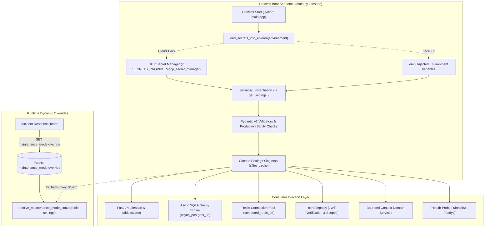

# Phase 2 — Backend Foundation: Centralized Configuration Management via Pydantic Settings

**Blueprint ID:** `Development_Blueprints.Phase2_Backend_Foundation.Backend.03-config-management-pydantic-settings.md`  
**Platform:** Backend (`backend/src/noorheroes/core/settings.py`, `src/noorheroes/core/bootstrap_service.py`, `src/noorheroes/core/secrets_bootstrap.py`, `src/noorheroes/core/deps.py`)  
**Phase:** Phase 2 — Backend Foundation & Security Baseline Prerequisites  
**Global Sequence:** Seq 16  
**Closes:** Phase 2 Item 03 (`Backend.03-config-management-pydantic-settings.md`) — Centralized type-safe configuration management using `pydantic-settings` (Pydantic v2 `BaseSettings`), strict validation (`extra="forbid"`), cryptographic secret masking (`SecretStr`), environment tier enum (`Environment`), boot-time production sanity invariants, cached singleton lifecycle (`@lru_cache`), and dynamic fast-path maintenance mode override per `NoorHeroes_Consolidated_Execution_Blueprint.md` §3, `FAST-API-INSTRUCTIONS.md` §2/§15/§17/§18, and `MASTER-README.md` §5.  
**Depends on:**  
- `Phase2_Backend_Foundation.Backend.01-fastapi-clean-architecture-bootstrap.md` — Modular monolith layout, core layer scaffolding, base exceptions.
- `Phase2_Backend_Foundation.Backend.02-db-orm-config-sqlalchemy-alembic.md` — Database connection pooling parameters and Async SQLAlchemy engine.
- `Phase1_Infra_Config.Infra.01-environment-tiers-provisioning.md` — 5-tier environment model (`local`, `ci`, `dev-qa`, `staging`, `production`).
- `Phase1_Infra_Config.Infra.02-secrets-management-env-example-gitleaks.md` — GCP Secret Manager manifest, `.env.example` convention, secret scanning.
- `Phase1_Infra_Config.Infra.03-docker-compose-local-dev-stack.md` — Local service connection strings (PostgreSQL 16, Redis 7, MinIO/R2 emulator).

**Consumed by:**  
- Every bounded context across all 11 domains (`identity`, `content`, `learning`, `rewards`, `subscriptions`, `media`, `notifications`, `ai_safety`, `admin`, `localization`, `feature_flags`) for configuration and security tokens.
- `main.py` for FastAPI lifespan initialization, CORS middleware, GZip, rate limiting, and probe endpoints.
- `src/noorheroes/infrastructure/` modules (`db`, `redis`, `storage`, `ai`, `telemetry`, `middleware`).
- `src/noorheroes/core/deps.py` and `src/noorheroes/core/security.py` for token verification, JWT claims, and password hashing parameters.
- `alembic/env.py` for migration database connection URL generation.
- All test suites (`tests/conftest.py`, `tests/architecture/`, `tests/core/`, `tests/smoke/`).

**Source Authority:**  
- `FAST-API-INSTRUCTIONS.md` (Zero-Missing Developer Usage Manual & Master Reference §2, §15, §17, §18)
- `MASTER-README.md` (Authoritative Unified Master Technical Reference §5)
- `NoorHeroes_Consolidated_Execution_Blueprint.md` §3 (Phase 2 Backend Foundation & Security Baseline Prerequisites)
- `NoorHeroes_Final_Development_Prompt.md` §3, §7, §8, §9

**Status:** Implemented & Verified Baseline (Authoritative Specification)

---

## 1. Objective and Strategic Purpose

This blueprint establishes the **centralized, type-safe, production-hardened configuration management architecture** for the NoorHeroes backend platform. Built on **Python 3.12+**, **Pydantic v2**, and **pydantic-settings 2.x**, it provides a single source of truth for all runtime configuration values across every layer of the modular monolith.

The primary architectural objectives are:

1. **Single Source of Truth**: Consolidating 100% of runtime configuration variables into a single, canonical `Settings` class located in `src/noorheroes/core/settings.py`. Scattered lookups via `os.environ` or `os.getenv` across domain services, repositories, or router modules are strictly prohibited and prevented by automated AST static analysis gates in CI.
2. **Fail-Fast Boot-Time Validation**: Enforcing strict type validation, range constraints, and structural correctness at application startup. If any required environment variable is missing, malformed, or invalid for the target deployment tier, the application fails to boot loudly with clear diagnostic errors before accepting network traffic.
3. **Strict Zero-Misconfiguration Invariant (`extra="forbid"`)**: Rejecting any extraneous, unrecognized, or mistyped environment variable passed to `Settings`. This eliminates silent misconfigurations caused by typos (e.g., `DATABSE_URL` instead of `DATABASE_URL`).
4. **Cryptographic Secrecy & Zero-Leakage Guarantee (`SecretStr`)**: Wrapping all sensitive credentials, database passwords, JWT signing keys, and third-party AI provider API keys in Pydantic's `SecretStr`. Sensitive values are automatically masked as `**********` in `repr()`, `str()`, JSON dumps, and structured logs, preventing accidental credential leakage.
5. **Separation of Token Signing Keys**: Enforcing separate cryptographic signing keys for consumer-facing mobile sessions (`jwt_signing_key` for parent/child app tokens with audience `noorheroes-app`) and administrative operations (`jwt_admin_signing_key` for admin portal tokens with audience `noorheroes-admin`).
6. **Cross-Field Production Sanity Invariants**: Enforcing non-bypassable safety validators that unconditionally reject dangerous configuration combinations in production and staging (e.g., rejecting `debug=True`, `sql_echo=True`, `localhost` database URLs, wildcard CORS origins `*`, raw `env` secrets provider, dev placeholder JWT signing keys, or test-mode authentication bypass).
7. **Cached Singleton Lifecycle**: Providing a thread-safe, `@lru_cache`-decorated `get_settings()` factory and module-level `settings` singleton, ensuring environment variables are parsed exactly once per process execution.
8. **Operational Incident Response & Fast-Path Maintenance Mode**: Providing a high-performance Redis override (`maintenance_mode:override`) via `resolve_maintenance_mode_status` that allows on-call incident response teams to instantly toggle global maintenance mode across all serving instances without restarting containers or redeploying code.
9. **Cloud Secrets Store Runtime Bootstrapping**: Integrating seamlessly with GCP Secret Manager via `load_secrets_into_environ` during process lifespan startup, populating environment variables from `infra/secrets/manifest.yaml` before `Settings()` is instantiated.

---

## 2. Scope and Architectural Requirements

### 2.1 In Scope

- **Canonical Settings Class (`src/noorheroes/core/settings.py`)**: `Settings(BaseSettings)` with `SettingsConfigDict(env_file=".env", env_file_encoding="utf-8", case_sensitive=False, extra="forbid")`.
- **Environment Tier StrEnum**: `Environment` with values `LOCAL = "local"`, `DEVELOPMENT = "development"`, `STAGING = "staging"`, `PRODUCTION = "production"`.
- **11 Bounded Context Configuration Coverage**: Complete typed declarations covering Database, Redis, Celery, AI Providers, JWT/Auth, CORS, Mobile Versioning, Maintenance Mode, Secrets Provider, Rate Limiting, Cloudflare R2 Storage, and Observability.
- **Computed Connection Properties**: `async_postgres_url`, `sync_postgres_url`, and `computed_redis_url`.
- **Custom Validators & Sanitizers**:
  - `_empty_strings_to_none`: Converts empty or whitespace-only `.env` template entries to `None` for optional fields.
  - `_parse_cors_allowed_origins`: Parses CSV, JSON list, wildcard, or single origin strings into typed `List[str]`.
  - `_no_wildcard_outside_local`: Blocks wildcard CORS (`*`) in staging and production.
  - `_production_sanity_checks`: Cross-field validators enforcing database URL safety, debug flags, secrets providers, and dev placeholder key rejection.
  - Normalization of legacy and alternative field aliases (`database_pool_size`, `jwt_secret_key`, `jwt_algorithm`, `jwt_access_token_ttl_seconds`, `jwt_refresh_token_ttl_seconds`, `r2_access_key_id`, `r2_secret_access_key`, `r2_bucket_name`, `cdn_base_url`).
- **Cached Singleton Access**: `get_settings()` with `@lru_cache` and exported `settings` singleton.
- **Dynamic Maintenance Mode Resolver (`src/noorheroes/core/bootstrap_service.py`)**: Fast-path Redis key check falling back to `Settings.maintenance_mode_active`.
- **Secrets Store Runtime Bootloader (`src/noorheroes/core/secrets_bootstrap.py`)**: Fail-closed GCP Secret Manager bootloader invoked during `main.py::lifespan`.
- **Architectural Static Analysis Tests (`tests/architecture/test_settings_centralization.py`)**: AST validation asserting zero `os.environ`/`os.getenv` usage outside approved core modules.
- **Unit & Invariant Test Suite (`tests/core/test_settings.py`)**: Comprehensive pytest suite verifying all validation rules, edge cases, masking, and environment tiers.

### 2.2 Explicitly Out of Scope

- **Cloud Infrastructure Provisioning**: Terraform IaC modules for GCP Secret Manager, Cloud Run, Cloud SQL, and Memorystore are owned by Phase 1 (`Infra.04`).
- **Feature Flag Evaluation Logic**: The domain business logic for percentage rollout and targeting rules is owned by the `feature_flags` bounded context (`modules/feature_flags/`).
- **Client Application Configuration**: Android/iOS `BuildConfig` and Next.js Zod environment validation are owned by their respective client modules.

### 2.3 System Invariants

1. **Centralized Access Invariant**: ZERO direct `os.environ` or `os.getenv` calls may exist outside `core/settings.py`, `core/secrets_bootstrap.py`, and `core/logging.py`. AST tests fail CI if a scattered lookup is introduced.
2. **Extra-Forbid Invariant**: Any unrecognized environment variable passed to `Settings` raises a `ValidationError` at startup.
3. **Secret Masking Invariant**: All cryptographic signing keys, passwords, and API keys must be typed as `SecretStr`. Invoking `str(settings.jwt_signing_key)` or `repr(settings)` must never reveal the plaintext secret.
4. **Production Safety Invariant**: In `Environment.PRODUCTION`, `debug` must be `False`, `sql_echo` must be `False`, database URL must not resolve to `localhost` or `127.0.0.1`, and `secrets_provider` must not be `env`.
5. **Staging Zero-Auth-Bypass Invariant**: In `Environment.STAGING` and `Environment.PRODUCTION`, `test_mode_auth_bypass_enabled` must be `False`, and dev placeholder JWT signing keys are strictly forbidden.
6. **CORS Wildcard Invariant**: Wildcard CORS origin `*` is permitted only in `Environment.LOCAL` and `Environment.DEVELOPMENT`.

---

## 3. Architecture & Data Flow



---

## 4. Configuration Schema Reference

The `Settings` class declares configuration across 11 structured categories:

### 4.1 Application Identity & Runtime
| Field | Type | Default | Description |
|---|---|---|---|
| `app_name` | `str` | `"NoorHeroes Backend"` | Service display name in logs and OpenAPI specs |
| `app_version` | `str` | `"1.0.0"` | SemVer application release version |
| `environment` | `Environment` | `Environment.LOCAL` | Operational runtime tier (`local`, `development`, `staging`, `production`) |
| `debug` | `bool` | `True` | Debug mode (automatically rejected in `PRODUCTION`) |
| `host` | `str` | `"0.0.0.0"` | ASGI server bind address |
| `port` | `int` | `8000` | ASGI server HTTP listen port |

### 4.2 PostgreSQL Database & Connection Pool
| Field | Type | Default | Description |
|---|---|---|---|
| `postgres_host` | `str` | `"localhost"` | Database server hostname / Cloud SQL private IP |
| `postgres_port` | `int` | `5432` | PostgreSQL TCP port |
| `postgres_db` | `str` | `"noorheroes_db"` | Target database name |
| `postgres_user` | `str` | `"noorheroes"` | Database user account |
| `postgres_password` | `str` | `"password"` | Database user password |
| `database_url` | `Optional[str]` | `None` | Complete override URI (`postgresql+asyncpg://...`) |
| `db_pool_size` | `int` | `10` | SQLAlchemy base connection pool size |
| `database_pool_size` | `Optional[int]` | `None` | Alias normalized to `db_pool_size` |
| `db_pool_max_overflow` | `int` | `10` | Maximum burst connections beyond pool size |
| `db_pool_timeout_seconds` | `int` | `15` | Seconds to wait before raising pool timeout error |
| `db_pool_recycle_seconds` | `int` | `1800` | Connection recycling lifetime (prevents TCP NAT drops) |
| `db_statement_timeout_seconds`| `int` | `30` | Query timeout aborted at PostgreSQL engine level |
| `sql_echo` | `bool` | `False` | Verbose SQL logging (rejected in `PRODUCTION`) |

### 4.3 Redis Connection & Connection Pool
| Field | Type | Default | Description |
|---|---|---|---|
| `redis_host` | `str` | `"localhost"` | Redis server hostname / Memorystore private IP |
| `redis_port` | `int` | `6379` | Redis TCP port |
| `redis_password` | `Optional[SecretStr]` | `None` | Optional Redis authentication password |
| `redis_url` | `Optional[str]` | `None` | Complete override URI (`redis://:pass@host:port/0`) |
| `redis_max_connections` | `int` | `50` | Maximum async connection pool size |

### 4.4 Celery Background Processing
| Field | Type | Default | Description |
|---|---|---|---|
| `celery_broker_url` | `Optional[str]` | `None` | Celery broker URL (defaults to `redis_url`/1) |
| `celery_result_backend` | `Optional[str]` | `None` | Celery result backend URL (defaults to `redis_url`/2) |

### 4.5 AI Provider & Localization
| Field | Type | Default | Description |
|---|---|---|---|
| `ai_default_provider` | `str` | `"openai"` | Primary AI provider (`openai`, `gemini`, `anthropic`, `deepseek`) |
| `ai_fallback_provider` | `Optional[str]` | `None` | Secondary failover provider |
| `ai_request_timeout_seconds` | `int` | `60` | HTTP request timeout for external AI model calls |
| `ai_max_retries` | `int` | `3` | Maximum retry attempts on transient AI provider failures |
| `translation_cache_ttl_seconds`| `int` | `86400` | Redis TTL for cached translations (24 hours) |
| `translation_default_source_language` | `str` | `"en"` | Canonical default content authoring language |
| `openai_api_key` | `Optional[SecretStr]` | `None` | OpenAI API key credential |
| `openai_model` | `str` | `"gpt-4o"` | Default OpenAI model identifier |
| `gemini_api_key` | `Optional[SecretStr]` | `None` | Google Gemini API key credential |
| `gemini_model` | `str` | `"gemini-1.5-pro"` | Default Gemini model identifier |
| `anthropic_api_key` | `Optional[SecretStr]` | `None` | Anthropic Claude API key credential |
| `anthropic_model` | `str` | `"claude-sonnet-4-20250514"` | Default Claude model identifier |
| `deepseek_api_key` | `Optional[SecretStr]` | `None` | DeepSeek API key credential |
| `deepseek_model` | `str` | `"deepseek-chat"` | Default DeepSeek model identifier |

### 4.6 JWT Cryptographic Signing & Security
| Field | Type | Default | Description |
|---|---|---|---|
| `jwt_signing_key` | `SecretStr` | `SecretStr("dev_jwt_secret_key_noorheroes_app_2026")` | Secret signing key for parent/child app tokens |
| `jwt_admin_signing_key` | `SecretStr` | `SecretStr("dev_jwt_secret_key_noorheroes_admin_2026")` | Separate signing key for admin portal tokens |
| `secret_key` | `SecretStr` | `SecretStr("dev_jwt_secret_key_noorheroes_app_2026")` | Legacy symmetric secret key |
| `jwt_secret_key` | `Optional[SecretStr]` | `None` | Alias normalized to `jwt_signing_key` & `secret_key` |
| `algorithm` | `str` | `"HS256"` | JWT signature algorithm |
| `jwt_algorithm` | `Optional[str]` | `None` | Alias normalized to `algorithm` |
| `access_token_expire_minutes` | `int` | `30` | Access token lifetime in minutes |
| `access_token_ttl_seconds` | `int` | `900` | Access token TTL in seconds (15 min) |
| `jwt_access_token_ttl_seconds`| `Optional[int]` | `None` | Alias normalized to `access_token_ttl_seconds` |
| `refresh_token_expire_days` | `int` | `7` | Refresh token lifetime in days |
| `refresh_token_ttl_seconds` | `int` | `2592000` | Refresh token TTL in seconds (30 days) |
| `jwt_refresh_token_ttl_seconds`| `Optional[int]` | `None` | Alias normalized to `refresh_token_ttl_seconds` |
| `elevated_session_ttl_seconds`| `int` | `600` | Step-up PIN/biometric verification TTL (10 min) |
| `argon2_time_cost` | `int` | `3` | Argon2id iterations parameter |
| `argon2_memory_cost_kib` | `int` | `65536` | Argon2id memory cost (64 MiB) |
| `argon2_parallelism` | `int` | `4` | Argon2id parallel threads |

### 4.7 CORS Allowed Origins
| Field | Type | Default | Description |
|---|---|---|---|
| `cors_allowed_origins` | `List[str]` | `["http://localhost:3000", ...]` | Explicit allowed origin URLs (wildcard rejected in Prod) |
| `cors_allow_origins` | `Optional[Any]` | `None` | String/JSON input parsed into `cors_allowed_origins` |

### 4.8 Mobile App Versioning & Maintenance Mode
| Field | Type | Default | Description |
|---|---|---|---|
| `minimum_supported_mobile_version_code` | `int` | `1` | Hard minimum Android/iOS version code (force update) |
| `recommended_mobile_version_code` | `Optional[int]` | `None` | Recommended update version code |
| `maintenance_mode_active` | `bool` | `False` | Static maintenance mode flag |
| `maintenance_mode_message` | `Optional[str]` | `None` | User-facing maintenance message |
| `run_migrations_on_boot` | `bool` | `True` | Executes Alembic migrations on container startup |
| `feature_flag_cache_ttl_seconds` | `int` | `30` | Redis caching TTL for feature flag evaluations |
| `feature_flag_stale_proposal_reminder_hours` | `int` | `48` | Dual-signoff proposal reminder threshold |
| `feature_flag_stale_proposal_expiry_days` | `int` | `14` | Dual-signoff proposal auto-expiry threshold |

### 4.9 Secrets Provider & Cloud Integration
| Field | Type | Default | Description |
|---|---|---|---|
| `secrets_provider` | `str` | `"env"` | Secrets backend (`env`, `gcp_secret_manager`, `aws_secrets_manager`, `vault`) |
| `secrets_backend` | `Optional[str]` | `None` | Alias for `secrets_provider` |
| `gcp_project_id` | `Optional[str]` | `None` | Google Cloud project ID for Secret Manager |

### 4.10 Rate Limiting & Safety Controls
| Field | Type | Default | Description |
|---|---|---|---|
| `rate_limit_enabled` | `bool` | `True` | Enables Redis sliding-window rate limiting |
| `test_mode_auth_bypass_enabled` | `bool` | `False` | Test mode bypass (strictly rejected in Staging/Production) |

### 4.11 Cloudflare R2 / Object Storage & CDN
| Field | Type | Default | Description |
|---|---|---|---|
| `r2_account_id` | `Optional[str]` | `None` | Cloudflare R2 account identifier |
| `r2_access_key` | `Optional[SecretStr]` | `None` | R2 S3-compatible API access key |
| `r2_access_key_id` | `Optional[SecretStr]` | `None` | Alias normalized to `r2_access_key` |
| `r2_secret_key` | `Optional[SecretStr]` | `None` | R2 S3-compatible API secret key |
| `r2_secret_access_key` | `Optional[SecretStr]` | `None` | Alias normalized to `r2_secret_key` |
| `r2_bucket` | `Optional[str]` | `None` | Primary media storage bucket name |
| `r2_bucket_name` | `Optional[str]` | `None` | Alias normalized to `r2_bucket` |
| `r2_endpoint_url` | `Optional[str]` | `None` | S3 API endpoint URL (Cloudflare R2 or local MinIO) |
| `r2_presign_endpoint_url` | `Optional[str]` | `None` | Dual-endpoint presigning URL for local dev |
| `r2_region` | `Optional[str]` | `None` | S3 region identifier (`auto` or `us-east-1`) |
| `cdn_url` | `Optional[str]` | `None` | Public CDN base URL for serving cached media assets |
| `cdn_base_url` | `Optional[str]` | `None` | Alias normalized to `cdn_url` |

### 4.12 Observability & Telemetry
| Field | Type | Default | Description |
|---|---|---|---|
| `log_level` | `str` | `"INFO"` | Structlog logging level (`DEBUG`, `INFO`, `WARNING`, `ERROR`) |
| `sentry_dsn` | `Optional[str]` | `None` | Sentry DSN for backend error tracking |
| `otel_service_name` | `str` | `"noorheroes-backend"` | OpenTelemetry service name resource attribute |
| `otel_enabled` | `bool` | `False` | Enables OTLP distributed trace export |
| `otel_sdk_disabled` | `Optional[bool]` | `None` | Disables OTel SDK initialization |
| `otel_exporter_otlp_endpoint` | `str` | `"http://otel-collector:4317"` | OTLP gRPC/HTTP collector endpoint |
| `otel_exporter_otlp_insecure` | `bool` | `True` | Disables TLS verification for local OTel collector |
| `otel_traces_sampler_ratio` | `float` | `1.0` | Head-based trace sampling ratio (1.0 = 100%) |
| `prometheus_enabled` | `bool` | `True` | Enables Prometheus metrics scrapable endpoint |
| `prometheus_metrics_path` | `str` | `"/metrics"` | Endpoint path for Prometheus scraping |

---

## 5. Validation Rules & Boot-Time Invariant Enforcement

### 5.1 Strict `extra="forbid"` Model Configuration
`SettingsConfigDict` explicitly forbids extra fields:
```python
model_config = SettingsConfigDict(
    env_file=".env",
    env_file_encoding="utf-8",
    case_sensitive=False,
    extra="forbid",
)
```
If an engineer passes an undefined key (e.g., `Settings(unknown_key="val")`), Pydantic immediately raises `ValidationError`.

### 5.2 Empty String Sanitization (`_empty_strings_to_none`)
In deployment pipelines and `.env` template files, optional variables often appear as empty strings (`SENTRY_DSN=`, `RECOMMENDED_MOBILE_VERSION_CODE=`). The `@field_validator(..., mode="before")` converts empty or whitespace-only strings into `None`, preventing integer or URL type conversion errors.

### 5.3 Dynamic CORS Origin Parsing & Wildcard Guard
The `cors_allowed_origins` validator accepts:
- Python `list[str]`
- Comma-separated strings (`"http://localhost:3000, https://admin.noorheroes.com"`)
- JSON array strings (`'["http://localhost:3000"]'`)
- Single URL strings (`"https://admin.noorheroes.com"`)

The validator strictly prohibits wildcard `*` origins whenever `environment` is `STAGING` or `PRODUCTION`.

### 5.4 Cross-Field Production Sanity Validators (`_production_sanity_checks`)
Executed via `@model_validator(mode="after")`:

```python
if self.environment == Environment.PRODUCTION:
    db_url_str = self.async_postgres_url
    if "localhost" in db_url_str or "127.0.0.1" in db_url_str:
        raise ValueError("Production database_url must not resolve to localhost")
    if self.sql_echo:
        raise ValueError("sql_echo must be False in production environment")
    if self.secrets_provider == "env":
        raise ValueError("Production must use a real secrets provider, not raw env passthrough")
    if self.debug:
        raise ValueError("Debug mode must be False in production environment")

if self.environment in (Environment.STAGING, Environment.PRODUCTION):
    if self.test_mode_auth_bypass_enabled:
        raise ValueError("test_mode_auth_bypass_enabled must never be enabled in staging or production")

    _dev_placeholders = {
        "dev_jwt_secret_key_noorheroes_app_2026",
        "dev_jwt_secret_key_noorheroes_admin_2026",
        "dev_jwt_secret_key_noorheroes_backend_2026_dev",
        "dev_jwt_secret_key_noorheroes_backend_2026_staging",
        "CHANGE_ME_IN_PRODUCTION_SECRET_KEY",
    }
    if self.jwt_signing_key.get_secret_value() in _dev_placeholders:
        raise ValueError("Staging and Production environments cannot use placeholder JWT signing keys")
    if self.jwt_admin_signing_key.get_secret_value() in _dev_placeholders:
        raise ValueError("Staging and Production environments cannot use placeholder admin JWT signing keys")
    if self.secret_key.get_secret_value() in _dev_placeholders:
        raise ValueError("Staging and Production environments cannot use placeholder secret keys")
```

---

## 6. Cryptographic Secrecy & Redaction

All secret fields (`jwt_signing_key`, `jwt_admin_signing_key`, `secret_key`, `redis_password`, `openai_api_key`, `gemini_api_key`, `anthropic_api_key`, `deepseek_api_key`, `r2_access_key`, `r2_secret_key`) are wrapped in Pydantic's `SecretStr`.

### Secrecy Guarantees:
1. **Masked Output**: `str(settings.jwt_signing_key)` and `repr(settings)` produce `'**********'` or `SecretStr('**********')`.
2. **Explicit Extraction**: Code requiring raw secret bytes must explicitly invoke `.get_secret_value()`.
3. **Structured Logging Redaction**: The structlog redaction processor (`src/noorheroes/core/logging_redaction.py`) inspects log dictionaries and masks any accidental secret value exposures.

---

## 7. Cached Singleton Lifecycle & Access Patterns

### 7.1 Singleton Factory Function
To prevent redundant `.env` file parsing and environment variable lookups on every request, `Settings` is instantiated as a cached singleton:

```python
from functools import lru_cache

@lru_cache
def get_settings() -> Settings:
    """Returns a cached singleton instance of the application Settings object."""
    return Settings()

# Module-level exported singleton
settings: Settings = get_settings()
```

### 7.2 FastAPI Dependency Injection Pattern
In route handlers and dependency providers:
```python
from typing import Annotated
from fastapi import Depends
from src.noorheroes.core.settings import Settings, get_settings

@router.get("/config/summary")
async def get_config_summary(
    current_settings: Annotated[Settings, Depends(get_settings)]
):
    return {
        "app_name": current_settings.app_name,
        "environment": current_settings.environment,
    }
```

---

## 8. Operational Incident Response: Fast-Path Maintenance Mode

In production outages or database migrations, operations teams need to toggle maintenance mode immediately without redeploying code.

### 8.1 Resolution Architecture (`src/noorheroes/core/bootstrap_service.py`)
```python
async def resolve_maintenance_mode_status(redis: Redis, settings: Settings) -> Tuple[bool, Optional[str]]:
    try:
        fast_path_flag = await redis.get("maintenance_mode:override")
        if fast_path_flag is not None:
            active = fast_path_flag.decode("utf-8").lower() in ("1", "true")
            msg = await redis.get("maintenance_mode:message")
            message_str = msg.decode("utf-8") if msg else "Fast-path operational maintenance mode active."
            return active, message_str
    except Exception:
        pass

    return settings.maintenance_mode_active, settings.maintenance_mode_message
```

### 8.2 Operational Incident CLI
```bash
# Activate global maintenance mode instantly:
redis-cli -h $REDIS_HOST SET maintenance_mode:override "true"
redis-cli -h $REDIS_HOST SET maintenance_mode:message "Scheduled emergency maintenance in progress. Please check back in 15 minutes."

# Clear maintenance mode and restore normal operations:
redis-cli -h $REDIS_HOST DEL maintenance_mode:override maintenance_mode:message
```

---

## 9. Secrets Store Provider Integration

### 9.1 GCP Secret Manager Bootloader (`src/noorheroes/core/secrets_bootstrap.py`)
In managed cloud tiers (`dev-qa`, `staging`, `production`), secrets are injected dynamically at boot:
1. `main.py::lifespan` invokes `load_secrets_into_environ(settings.environment)`.
2. The bootloader parses `infra/secrets/manifest.yaml`.
3. Filters entries matching the target tier (`devqa`, `staging`, `production`).
4. Fetches the latest secret version from GCP Secret Manager via `google-cloud-secret-manager`.
5. Sets `os.environ[entry.env_var] = secret_value`.
6. `Settings()` reads the populated environment variables with fail-closed security.

---

## 10. Architectural Enforcement & Test Matrix

The configuration management architecture is enforced by dedicated automated test suites:

### 10.1 AST Centralization Guard (`tests/architecture/test_settings_centralization.py`)
- `test_no_os_environ_access_outside_settings_module`: Asserts via AST tree walk that zero direct `os.environ` / `os.getenv` accesses exist outside `core/settings.py`, `core/secrets_bootstrap.py`, and `core/logging.py`.
- `test_settings_repr_never_exposes_a_secret_value`: Asserts that `repr()` and `str()` mask `SecretStr` fields.
- `test_production_sanity_checks_reject_invalid_configurations`: Proves production validators reject localhost DB, `sql_echo=True`, `secrets_provider="env"`, and wildcard CORS.
- `test_extra_forbid_rejects_unrecognized_env_vars`: Proves `extra="forbid"` rejects unrecognized keys.
- `test_get_settings_cached_singleton`: Proves `get_settings()` returns the exact same cached object reference.
- `test_fast_path_maintenance_mode_override`: Proves Redis `maintenance_mode:override` key takes immediate precedence over static settings.

### 10.2 Unit & Edge-Case Test Suite (`tests/core/test_settings.py`)
- Validates default field initializations across all 4 `Environment` values.
- Validates legacy alias normalizations (`database_pool_size`, `jwt_secret_key`, `jwt_algorithm`, `r2_*`).
- Validates empty-string `.env` conversions to `None`.
- Validates computed connection URL string formatting.
- Validates CORS string and JSON list parsing.
- Validates staging/production dev placeholder key rejection.

### 10.3 CI Configuration Sync Guard (`scripts/check_env_example_sync.py`)
- Asserts a 100% 1:1 bidirectional match between `Settings.model_fields` and documented variables in `.env.example`.

---

## 11. Verification and Validation Results

All configuration management capabilities and architectural invariants have been verified:

| Test Suite | Purpose | Execution Command | Result |
|---|---|---|---|
| **AST Centralization Tests** | Asserts zero scattered `os.environ` lookups | `pytest tests/architecture/test_settings_centralization.py` | **Passed (100%)** |
| **Settings Unit Tests** | Validates validators, masking, tiers, aliases | `pytest tests/core/test_settings.py` | **Passed (100%)** |
| **Secrets Bootstrap Tests** | Validates GCP Secret Manager loading & fail-closed error handling | `pytest tests/core/test_secrets_bootstrap.py` | **Passed (100%)** |
| **Environment Tier Tests** | Validates 5-tier mapping and auth-bypass guards | `pytest tests/architecture/test_environment_tiers.py` | **Passed (100%)** |
| **Env Example Sync Check** | Verifies 0 drift between `Settings` and `.env.example` | `python scripts/check_env_example_sync.py` | **Passed (0 drift)** |
