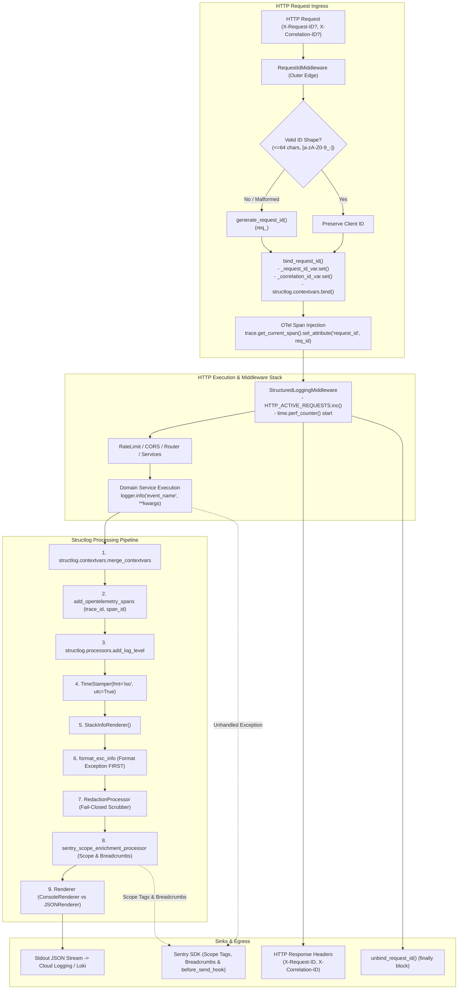

# Phase 2 — Backend Foundation: Structlog Structured Logging, Contextvars Correlation ID & Child Safety Redaction Infrastructure

**Blueprint ID:** `Development_Blueprints.Phase2_Backend_Foundation.Backend.04-structlog-logging-correlation-ids.md`  
**Platform:** Backend (`src/noorheroes/core/logging.py`, `src/noorheroes/core/logging_redaction.py`, `src/noorheroes/core/request_context.py`, `src/noorheroes/infrastructure/middleware/request_id.py`, `src/noorheroes/infrastructure/middleware/logging_middleware.py`)  
**Phase:** Phase 2 — Backend Foundation & Security Baseline Prerequisites  
**Global Sequence:** Seq 17  
**Closes:** Phase 2 Item 04 (`Backend.04-structlog-logging-correlation-ids.md`) — Structured logging pipeline via `structlog`, monotonic ISO-8601 UTC timestamps, fail-closed child safety allowlist redaction, regex PII scrubbers (JWTs, phone numbers, emails), `contextvars`-based request ID and correlation ID propagation across async boundaries, OpenTelemetry span correlation (`trace_id`, `span_id`), `RequestIdMiddleware`, `StructuredLoggingMiddleware`, and Sentry before-send hook integration per `NoorHeroes_Consolidated_Execution_Blueprint.md` §3, `FAST-API-INSTRUCTIONS.md` §2/§4/§15/§21, and `MASTER-README.md` §5.  
**Depends on:**  
- `Phase2_Backend_Foundation.Backend.01-fastapi-clean-architecture-bootstrap.md` — Modular monolith layout, core layer scaffolding, base exceptions.
- `Phase2_Backend_Foundation.Backend.03-config-management-pydantic-settings.md` — Type-safe `Settings` singleton, environment tiers (`Environment`), secret masking (`SecretStr`).
- `Phase1_Infra_Config.Infra.01-environment-tiers-provisioning.md` — 5-tier environment model (`local`, `ci`, `dev-qa`, `staging`, `production`).
- `Phase1_Infra_Config.Infra.05-observability-stack-bootstrap.md` — Centralized OpenTelemetry SDK, Prometheus scrape metrics, Grafana Loki log ingestion.

**Consumed by:**  
- All 11 Bounded Contexts (`identity`, `content`, `learning`, `rewards`, `subscriptions`, `media`, `notifications`, `ai_safety`, `admin`, `localization`, `feature_flags`) for structured diagnostic logging.
- `main.py` for lifespan initialization (`configure_logging()`), middleware stack registration (`RequestIdMiddleware`, `StructuredLoggingMiddleware`), and startup diagnostics.
- `src/noorheroes/core/exceptions.py` for standard error envelope enrichment (`requestId`, `traceId`).
- `src/noorheroes/infrastructure/telemetry/` for OpenTelemetry span attribute correlation and Sentry error payload scrubbing.
- All test suites (`tests/architecture/test_logging_centralization.py`, `tests/core/test_logging.py`, `tests/conftest.py`).

**Source Authority:**  
- `FAST-API-INSTRUCTIONS.md` (Zero-Missing Developer Usage Manual & Master Reference §2, §4, §15, §21)
- `MASTER-README.md` (Authoritative Unified Master Technical Reference §5)
- `NoorHeroes_Consolidated_Execution_Blueprint.md` §3 (Phase 2 Backend Foundation & Security Baseline Prerequisites)
- `NoorHeroes_Final_Development_Prompt.md` §3, §8, §9

**Status:** Implemented & Verified Baseline (Authoritative Specification)

---

## 1. Objective and Strategic Purpose

This blueprint establishes the **production-grade, privacy-hardened structured logging and distributed tracing correlation architecture** for the NoorHeroes backend platform. Built on **Python 3.12+**, **structlog 24.x+**, **Python contextvars**, and **OpenTelemetry**, it provides unified, machine-readable observability across all micro-operations while strictly safeguarding children's privacy and personally identifiable information (PII).

The primary architectural objectives are:

1. **Structured JSON Logging Across All Sinks**: Formatting 100% of staging and production application logs as single-line JSON objects with standardized schema fields (`timestamp`, `level`, `event`, `service_name`, `environment`, `version`, `request_id`, `correlation_id`, `trace_id`, `span_id`, `latency_ms`). For local development, colorized developer-friendly console output is provided.
2. **Strict Child Safety & COPPA / GDPR-K Privacy Redaction**: Enforcing an uncompromising **fail-closed allowlist** processor (`RedactionProcessor`). Any structured key not explicitly enumerated in `SAFE_STRUCTURED_KEYS` is automatically scrubbed and replaced with `[REDACTED:key]`. Child names, birthdates, parent emails, phone numbers, and free-text inputs can never leak to stdout or log aggregation sinks.
3. **Defense-in-Depth Regex PII Scrubbing**: Executing secondary regex pattern scrubbing (`redact_value_patterns`) across all string message fields and exception tracebacks to automatically scrub raw JWT tokens, phone numbers, and email addresses even if accidentally interpolated into log messages.
4. **Exception Traceback Scrubbing Before Redaction**: Structuring the processor pipeline so that exception tracebacks are formatted into string representation (`format_exc_info`) **before** the privacy scrubber runs, guaranteeing that sensitive parameters trapped inside exception call frames are sanitized before emission.
5. **Zero Parameter Pollution via Contextvars**: Leveraging Python's standard `contextvars` (`_request_id_var`, `_correlation_id_var`) to bind request and correlation IDs once at the outer HTTP middleware layer. All downstream async service methods, repository queries, and Celery background tasks automatically inherit correlation context without requiring `request_id` to be passed manually through function signatures.
6. **Log↔Trace Bi-Directional Pivoting**: Bridging structured logs with OpenTelemetry distributed traces by automatically extracting active `trace_id` and `span_id` within `add_opentelemetry_spans`, and injecting `request_id` as a span attribute (`trace.get_current_span().set_attribute("request_id", request_id)`). This enables 1-click drilldown between Grafana Loki log streams and Tempo distributed trace waterfalls.
7. **Client Header Sanitization & Injection Defense**: Validating client-supplied `X-Request-ID` and `X-Correlation-ID` headers against strict length (<= 64 characters) and character whitelist (`^[a-zA-Z0-9_-]+$`) constraints in `RequestIdMiddleware`. Malicious, oversized, or CRLF log-injection attempts are discarded and replaced with freshly generated collision-resistant IDs (`req_<uuid4_hex>`).
8. **HTTP Access Observability & Metric Aggregation**: Capturing HTTP request method, URL path, HTTP status code, and millisecond execution duration via `StructuredLoggingMiddleware` while simultaneously recording Prometheus counters (`HTTP_REQUESTS_TOTAL`, `HTTP_ACTIVE_REQUESTS`) and latency histograms (`HTTP_REQUEST_DURATION_SECONDS`). High-frequency probe paths like `/metrics` are excluded from verbose request logs to prevent log volume explosion.
9. **Sentry Error Payload Sanitization**: Applying the identical fail-closed redaction logic to external error tracking via `sentry_before_send_hook`, ensuring extra contextual dictionaries and breadcrumb trails transmitted to Sentry are scrubbed of sensitive data.
10. **Automated Architectural Enforcement**: Enforcing zero direct `logging.getLogger()` or `structlog.configure()` invocations outside approved core logging modules via AST static analysis tests (`tests/architecture/test_logging_centralization.py`).

---

## 2. Scope and Architectural Requirements

### 2.1 In Scope

- **Core Logging Infrastructure (`src/noorheroes/core/logging.py`)**:
  - `configure_logging()` / `setup_logging()` startup pipeline configuration.
  - `get_logger(name: str)` canonical logger factory.
  - `add_opentelemetry_spans` processor extracting `trace_id` (32 hex) and `span_id` (16 hex).
  - `sentry_before_send_hook` for Sentry SDK event payload sanitization.
  - Environment-driven renderer selection (`ConsoleRenderer` for local debug vs `JSONRenderer` for staging/production).
- **Privacy & Allowlist Scrubber (`src/noorheroes/core/logging_redaction.py`)**:
  - `SAFE_STRUCTURED_KEYS` frozenset allowlist.
  - `redact_value_patterns` regex pattern replacement for JWT tokens, phone numbers, and email addresses.
  - `redact_event_dict` recursive dictionary and list scrubber.
  - `RedactionProcessor` structlog processor class.
- **Request Context Propagation (`src/noorheroes/core/request_context.py`)**:
  - `_request_id_var` and `_correlation_id_var` Python `ContextVar` primitives.
  - `bind_request_id(request_id, correlation_id)` helper binding contextvars and `structlog.contextvars`.
  - `unbind_request_id()` cleanup helper clearing context tokens.
  - `get_current_request_id()` and `get_current_correlation_id()` query accessors.
- **HTTP Request ID Correlation Middleware (`src/noorheroes/infrastructure/middleware/request_id.py`)**:
  - `is_valid_request_id_shape(value: str) -> bool` sanitization guard.
  - `generate_request_id() -> str` factory returning `req_<uuid4_hex>`.
  - `RequestIdMiddleware(BaseHTTPMiddleware)` populating `request.state`, binding contextvars, injecting OpenTelemetry span attributes, and attaching `X-Request-ID` and `X-Correlation-ID` response headers.
- **Structured Access Logging Middleware (`src/noorheroes/infrastructure/middleware/logging_middleware.py`)**:
  - `StructuredLoggingMiddleware(BaseHTTPMiddleware)` recording high-resolution latency, emitting structured `http_request` events, updating Prometheus metrics, and excluding `/metrics` from log noise.
- **Architectural & Unit Test Suites**:
  - AST static analysis tests in `tests/architecture/test_logging_centralization.py`.
  - Comprehensive unit and integration test suite in `tests/core/test_logging.py`.

### 2.2 Explicitly Out of Scope

- **Log Aggregator Infrastructure Provisioning**: Terraform provisioning of GCP Cloud Logging sinks, Pub/Sub topics, and Grafana Loki clusters is owned by Phase 1 (`Infra.05`).
- **OpenTelemetry Collector Deployment**: Cloud Run collector container sidecar configuration is owned by Phase 1 (`Infra.05`).
- **Domain Business Logic**: Feature-specific log messages emitted within domain services are owned by their respective bounded contexts.

### 2.3 System Invariants

1. **Centralized Access Invariant**: ZERO direct `logging.getLogger()` or `structlog.configure()` calls may exist outside `core/logging.py` (with authorized middleware exceptions). All application modules MUST obtain loggers via `get_logger(__name__)`.
2. **Fail-Closed Redaction Invariant**: Any structured log key not explicitly registered in `SAFE_STRUCTURED_KEYS` MUST be redacted to `[REDACTED:<key>]`.
3. **Traceback-Before-Redaction Invariant**: In the structlog processor chain, `format_exc_info` MUST unconditionally precede `RedactionProcessor` so that exception strings are formatted and scrubbed before emission.
4. **Header Sanitization Invariant**: Client-supplied `X-Request-ID` and `X-Correlation-ID` headers containing special characters, whitespace, control characters, or exceeding 64 characters MUST be discarded and replaced with a newly generated safe identifier.
5. **Contextvar Teardown Invariant**: Every request handled by `RequestIdMiddleware` MUST unconditionally execute `unbind_request_id()` in a `finally` block to prevent contextvar leakage between requests on shared event loop threads.
6. **Zero Raw Body Logging Invariant**: Raw request payloads (`await request.body()`) MUST NEVER be logged directly to avoid capturing sensitive credentials or child PII.

---

## 3. Architecture & Data Flow



---

## 4. Granular Component Specification

### 4.1 Processor Pipeline Order & Lifecycle

The structlog configuration pipeline in `src/noorheroes/core/logging.py` executes processors in a strictly ordered sequence:

| Step | Processor | Purpose | Invariant Guarantee |
|---|---|---|---|
| **1** | `structlog.contextvars.merge_contextvars` | Merges thread/async-local contextvars into event dict | Automatically injects `request_id`, `correlation_id`, `service_name`, `environment`, `version` |
| **2** | `add_opentelemetry_spans` | Attaches `trace_id` and `span_id` from active OpenTelemetry span | Enables 1-click log-to-trace pivoting in Grafana Loki/Tempo |
| **3** | `structlog.processors.add_log_level` | Normalizes log severity level field (`level="info"`, `level="error"`) | Machine-readable log level filtering |
| **4** | `structlog.processors.TimeStamper(fmt="iso", utc=True)` | Generates ISO-8601 UTC timestamp (`2026-08-29T12:00:00.123456Z`) | Monotonic cross-region log ordering |
| **5** | `structlog.processors.StackInfoRenderer()` | Renders caller stack trace metadata if requested | Debugging aid for complex failure modes |
| **6** | `structlog.processors.format_exc_info` | Formats `sys.exc_info()` traceback tuple into string | **Must precede redaction** so stack trace strings can be scrubbed |
| **7** | `RedactionProcessor()` | Filters keys against `SAFE_STRUCTURED_KEYS` and runs regex scrubbers | Fail-closed protection against PII and credential leakage |
| **8** | `sentry_scope_enrichment_processor` | Enriches active Sentry scope with safe tags and records breadcrumbs | Bridges structured logs directly to Sentry error context |
| **9** | `JSONRenderer()` / `ConsoleRenderer()` | Serializes event dict to JSON string or colorized terminal text | High-performance emission to stdout |

### 4.2 Privacy Redaction & Allowlist Engine (`core/logging_redaction.py`)

#### `SAFE_STRUCTURED_KEYS`
The explicit allowlist of authorized structured log attributes:
```python
SAFE_STRUCTURED_KEYS = frozenset({
    "event", "level", "timestamp", "request_id", "correlation_id",
    "session_id", "child_row_id", "family_row_id", "parent_row_id",
    "http_status", "status_code", "error_type", "error_code",
    "duration_ms", "latency_ms", "attempt_count", "sync_operation_id",
    "rate_limit_dimension", "rate_limit_outcome", "environment",
    "endpoint_path", "http_method", "url_path", "exc_info", "stack_info",
    "field_errors", "service", "service_name", "version", "app",
    "trace_id", "span_id", "logger", "logger_name", "endpoint",
    "method", "action", "operation", "component", "event_type",
    "event_id", "task_id", "task_name", "retry_count", "details",
    "code", "message",
})
```

#### `redact_value_patterns(value: str) -> str`
Scans string values and substitutes sensitive patterns:
- **JWT Tokens**: `eyJ[A-Za-z0-9_-]{10,}\.[A-Za-z0-9_-]{10,}\.[A-Za-z0-9_-]{10,}` $\longrightarrow$ `[REDACTED]`
- **Phone Numbers**: `\+?[0-9]{7,15}` $\longrightarrow$ `[REDACTED]`
- **Email Addresses**: `[A-Za-z0-9._%+-]+@[A-Za-z0-9.-]+\.[A-Za-z]{2,}` $\longrightarrow$ `[REDACTED]`

#### `redact_event_dict(event_dict: Dict[str, Any]) -> Dict[str, Any]`
Recursively traverses event dictionaries and nested lists:
- Allowlisted keys with string values undergo pattern scrubbing.
- Allowlisted keys with dictionary values are recursively processed.
- Allowlisted keys with list values have each item recursively scrubbed.
- Non-allowlisted keys are replaced with `[REDACTED:<key>]`.

### 4.3 Request Context Propagation (`core/request_context.py`)

```python
_request_id_var: contextvars.ContextVar[Optional[str]] = contextvars.ContextVar("request_id", default=None)
_correlation_id_var: contextvars.ContextVar[Optional[str]] = contextvars.ContextVar("correlation_id", default=None)

def bind_request_id(request_id: str, correlation_id: Optional[str] = None) -> None:
    corr_id = correlation_id or request_id
    _request_id_var.set(request_id)
    _correlation_id_var.set(corr_id)
    structlog.contextvars.bind_contextvars(request_id=request_id, correlation_id=corr_id)

def unbind_request_id() -> None:
    _request_id_var.set(None)
    _correlation_id_var.set(None)
    structlog.contextvars.unbind_contextvars("request_id", "correlation_id")

def get_current_request_id() -> Optional[str]:
    return _request_id_var.get()

def get_current_correlation_id() -> Optional[str]:
    return _correlation_id_var.get()
```

### 4.4 HTTP Request ID Correlation Middleware (`infrastructure/middleware/request_id.py`)

1. **Extraction & Validation**:
   - Inspects `X-Request-ID` and `X-Correlation-ID` headers.
   - Validates format: non-empty, length $\le 64$, matching `^[a-zA-Z0-9_-]+$`.
   - If missing or invalid, generates a fresh `req_<uuid4_hex>`.
2. **State & Context Binding**:
   - Sets `request.state.request_id` and `request.state.correlation_id`.
   - Invokes `bind_request_id(...)`.
3. **OpenTelemetry Span Enrichment**:
   - Sets span attribute: `trace.get_current_span().set_attribute("request_id", request_id)`.
4. **Header Echoing & Teardown**:
   - Attaches `X-Request-ID` and `X-Correlation-ID` to response headers.
   - Executes `unbind_request_id()` in `finally:` block.

### 4.5 Structured Access Logging Middleware (`infrastructure/middleware/logging_middleware.py`)

1. **Path Filtering**: Detects `/metrics` and suppresses verbose `http_request` log emission while continuing to collect Prometheus counters.
2. **Timing & Execution**: Measures duration via `time.perf_counter()`.
3. **Prometheus Metrics Updates**:
   - `HTTP_ACTIVE_REQUESTS.labels(method=...).inc()` on entry, `.dec()` on exit.
   - `HTTP_REQUESTS_TOTAL.labels(method=..., endpoint=..., status=...).inc()`.
   - `HTTP_REQUEST_DURATION_SECONDS.labels(method=..., endpoint=..., status=...).observe(duration_seconds)`.
4. **Structured Event Emission**:
   Emits structured event `http_request` with `request_id`, `correlation_id`, `user_id`, `http_method`, `url_path`, `status_code`, and `latency_ms`.

---

## 5. Security, Child Safety & Privacy Taxonomy

To maintain compliance with **COPPA (Children's Online Privacy Protection Act)** and **GDPR-K (General Data Protection Regulation for Kids)**, the platform enforces strict data classification in logs:

| Data Category | Examples | Logging Policy | Enforcement Mechanism |
|---|---|---|---|
| **Child PII** | First/last name, DOB, exact age, avatar photo | **STRICTLY PROHIBITED** | Not in `SAFE_STRUCTURED_KEYS` $\longrightarrow$ `[REDACTED:child_name]` |
| **Child Identity** | Internal database row ID (`child_row_id`) | **PERMITTED** | Allowlisted as opaque surrogate identifier |
| **Parent PII** | Email address, phone number, physical address | **STRICTLY PROHIBITED** | Not in `SAFE_STRUCTURED_KEYS` + `redact_value_patterns` regex |
| **Parent Identity**| Internal database row ID (`parent_row_id`, `family_row_id`) | **PERMITTED** | Allowlisted as opaque surrogate identifier |
| **Authentication**| JWT access/refresh tokens, PINs, passwords, password hashes | **STRICTLY PROHIBITED** | `SecretStr` typing + JWT regex scrubber |
| **User Input** | Search queries, feedback messages, AI prompts | **STRICTLY PROHIBITED** | Not in `SAFE_STRUCTURED_KEYS` $\longrightarrow$ `[REDACTED:search_query]` |
| **Audio / Voice** | Child voice audio recordings, duration blobs | **STRICTLY PROHIBITED** | Audio uploads handled via presigned URLs without body logging |
| **System Telemetry**| Latency, status codes, endpoint path, error codes | **PERMITTED** | Explicitly allowlisted in `SAFE_STRUCTURED_KEYS` |

---

## 6. Configuration & Settings Integration

The logging system reads configuration parameters directly from `src/noorheroes/core/settings.py`:

```python
# Settings values consumed by configure_logging():
settings = get_settings()

# 1. Global context binding:
service_name = settings.otel_service_name       # e.g., "noorheroes-backend"
environment = str(settings.environment)          # e.g., "production", "staging", "local"
version = settings.app_version                  # e.g., "1.0.0"

# 2. Renderer selection:
if settings.environment == Environment.LOCAL and settings.debug:
    renderer = structlog.dev.ConsoleRenderer()
else:
    renderer = structlog.processors.JSONRenderer()

# 3. Minimum log level:
min_level = logging.DEBUG if settings.environment == Environment.LOCAL else logging.INFO
```

---

## 7. OpenAPI / Swagger Integration & Error Envelope Correlation

All API error responses generated by `setup_exception_handlers` (`core/exceptions.py`) correlate directly with structured logs via `requestId` and `traceId`:

### Standard JSON Error Response Contract (`4xx` / `5xx`)
```json
{
  "error": {
    "code": "VALIDATION_ERROR",
    "message": "The request body failed validation constraints.",
    "requestId": "req_8ddf01da46404c6991a49a0a696bd40e",
    "traceId": "4bf92f3577b34da6a3ce929d0e0e4736",
    "details": [
      {
        "field": "age_band",
        "issue": "Input should be '4 to 6', '6 to 9', '9 to 12', '12 to 15' or '15 to 18+'"
      }
    ]
  }
}
```

### Swagger UI Header Specifications
Every endpoint documentation in Swagger UI specifies the correlation headers:
- `X-Request-ID`: Client-supplied or server-generated unique request tracking identifier.
- `X-Correlation-ID`: Distributed tracing correlation identifier spanning multi-service workflows.

---

## 8. Testing & Verification Strategy

### 8.1 Automated Architectural Invariant Tests (`tests/architecture/test_logging_centralization.py`)
- `test_no_stdlib_logging_getLogger_used_outside_core_logging`: AST scanning verifying zero `logging.getLogger()` calls outside approved modules.
- `test_no_structlog_configure_call_exists_outside_core_logging`: AST scanning verifying `structlog.configure()` is only called in `core/logging.py`.
- `test_no_raw_request_body_passed_to_log_call`: AST scanning verifying zero `await request.body()` logging.

### 8.2 Unit & Integration Tests (`tests/core/test_logging.py`)
- `test_configure_logging_local_debug`: Verifies `ConsoleRenderer` in local debug mode.
- `test_configure_logging_production_json`: Verifies `JSONRenderer` in production mode.
- `test_redaction_processor_preserves_safe_keys`: Verifies 100% of allowlisted keys are retained.
- `test_redaction_processor_redacts_unrecognized_keys`: Verifies fail-closed redaction of unknown fields.
- `test_redaction_processor_recursive_dict_handling`: Verifies nested dictionary key scrubbing.
- `test_redaction_processor_recursive_list_handling`: Verifies nested list dictionary and string scrubbing.
- `test_redact_value_patterns`: Verifies regex masking for JWTs, phone numbers, and email addresses.
- `test_add_opentelemetry_spans_with_valid_span`: Verifies `trace_id` and `span_id` attachment from active OTel span.
- `test_add_opentelemetry_spans_with_no_active_span`: Verifies graceful fallback when no span is active.
- `test_sentry_before_send_hook`: Verifies Sentry `extra` and `breadcrumbs` payload scrubbing.
- `test_request_context_lifecycle`: Verifies `bind_request_id` and `unbind_request_id` contextvar lifecycle.
- `test_is_valid_request_id_shape`: Verifies bounds checking and injection pattern rejection.
- `test_request_id_middleware_with_client_headers`: Verifies client header propagation and response echoing.
- `test_request_id_middleware_generates_on_invalid_or_missing_header`: Verifies safe fallback ID generation.
- `test_structured_logging_middleware_execution`: Verifies latency tracking, metrics updates, and `/metrics` log exclusion.

---

## 9. Operational Runbooks, Loki Queries & Trace Pivoting

### 9.1 Querying Logs in Grafana Loki

#### 1. Filter Logs by Specific Request ID
```logql
{app="noorheroes-backend", environment="production"} |= "req_8ddf01da46404c6991a49a0a696bd40e" | json
```

#### 2. Query High Latency Endpoints ($> 500\text{ ms}$)
```logql
{app="noorheroes-backend", environment="production"} | json | latency_ms > 500
```

#### 3. Inspect Error Spikes by HTTP Status Code
```logql
sum by (status_code) (count_over_time({app="noorheroes-backend", environment="production"} | json | status_code >= 400 [5m]))
```

### 9.2 1-Click Trace Pivoting (Loki $\longrightarrow$ Tempo)
When viewing structured log lines in Grafana Explore:
1. Expand any log record.
2. Locate the `trace_id` field (e.g., `4bf92f3577b34da6a3ce929d0e0e4736`).
3. Click the blue **Tempo** link button next to `trace_id` to jump directly into the full OpenTelemetry trace waterfall showing database queries, Redis cache lookups, and AI model execution durations.
