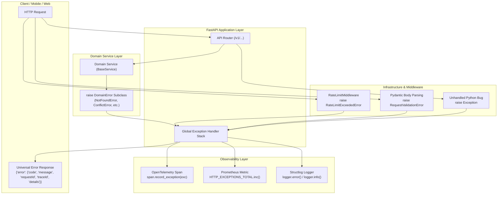

# Phase 2 — Backend Foundation: Centralized Domain-Error Hierarchy & Exception Handling Infrastructure

**Blueprint ID:** `Development_Blueprints.Phase2_Backend_Foundation.Backend.05-exception-handling-domain-error-hierarchy.md`  
**Platform:** Backend (`src/noorheroes/core/exceptions.py`, `src/noorheroes/common/schemas.py`, `src/noorheroes/core/schemas.py`, `src/noorheroes/infrastructure/telemetry/`)  
**Phase:** Phase 2 — Backend Foundation & Security Baseline Prerequisites  
**Global Sequence:** Seq 18  
**Closes:** Phase 2 Item 05 (`Backend.05-exception-handling-domain-error-hierarchy.md`) — Centralized closed `DomainError` exception hierarchy, universal RFC-7807 compatible JSON error envelope formatting (`code`, `message`, `requestId`, `traceId`, `details`), global FastAPI exception handlers (`DomainError`, `RateLimitExceededError`, `RequestValidationError`, `HTTPException`, `Exception`), fail-closed 500 error sanitization, child enumeration defense, validation input scrubbing, and OpenTelemetry trace span + Prometheus metrics error aggregation per `NoorHeroes_Consolidated_Execution_Blueprint.md` §3, `FAST-API-INSTRUCTIONS.md` §2/§10/§11/§15/§21, and `MASTER-README.md` §5.  
**Depends on:**  
- `Phase2_Backend_Foundation.Backend.01-fastapi-clean-architecture-bootstrap.md` — Modular monolith layout, core layer scaffolding, base exceptions.
- `Phase2_Backend_Foundation.Backend.03-config-management-pydantic-settings.md` — Type-safe `Settings` singleton, environment tiers (`Environment`).
- `Phase2_Backend_Foundation.Backend.04-structlog-logging-correlation-ids.md` — Structlog logging, `contextvars` request ID and correlation ID propagation.
- `Phase1_Infra_Config.Infra.05-observability-stack-bootstrap.md` — Centralized OpenTelemetry SDK, Prometheus scrape metrics, Grafana Loki log ingestion.

**Consumed by:**  
- All 11 Bounded Contexts (`identity`, `content`, `learning`, `rewards`, `subscriptions`, `media`, `notifications`, `ai_safety`, `admin`, `localization`, `feature_flags`) for throwing domain-specific business exceptions.
- `main.py` for registering global exception handlers (`setup_exception_handlers(app)`).
- `src/noorheroes/infrastructure/middleware/` (`RateLimitMiddleware`, `RequestIdMiddleware`, `StructuredLoggingMiddleware`).
- `src/noorheroes/infrastructure/ai/exceptions.py` for extending provider failure hierarchies.
- All test suites (`tests/architecture/test_exception_handling.py`, `tests/core/test_exceptions.py`, `tests/security/`).

**Source Authority:**  
- `FAST-API-INSTRUCTIONS.md` (Zero-Missing Developer Usage Manual & Master Reference §2, §10, §11, §15, §21)
- `MASTER-README.md` (Authoritative Unified Master Technical Reference §5)
- `NoorHeroes_Consolidated_Execution_Blueprint.md` §3 (Phase 2 Backend Foundation & Security Baseline Prerequisites)
- `NoorHeroes_Final_Development_Prompt.md` §3, §5, §6, §10

**Status:** Implemented & Verified Baseline (Authoritative Specification)

---

## 1. Objective and Strategic Purpose

This blueprint establishes the **production-grade, privacy-hardened centralized domain exception hierarchy and universal error envelope handling architecture** for the NoorHeroes backend platform. Built on **Python 3.12+**, **FastAPI**, **Pydantic v2**, and **OpenTelemetry**, it guarantees that all API failures are deterministic, secure, observable, and machine-readable.

The primary architectural objectives are:

1. **Closed Domain Error Hierarchy**: Providing a structured family of domain exception classes derived from `DomainError(Exception)`. Domain exceptions are raised exclusively by the service layer to signal business constraint violations, missing resources, authorization rejections, rate limits, or external dependencies.
2. **Universal RFC-7807 Compatible Error Envelope**: Formatting 100% of 4xx and 5xx API error responses into the canonical top-level `error` envelope:
   ```json
   {
     "error": {
       "code": "NOT_FOUND",
       "message": "The requested resource could not be found.",
       "requestId": "req_01J6A1B2C3D4E5F6G7H8J9K0L1",
       "traceId": "4bf92f3577b34da6a3ce929d0e0e4736",
       "details": null
     }
   }
   ```
3. **No Naked Exceptions & No Direct Router HTTPExceptions**: Prohibiting router functions from raising raw `HTTPException` for business rules. All business rejections must originate as specific `DomainError` subclasses inside service methods, defended by AST static analysis in CI (`test_exception_handling.py`).
4. **COPPA / GDPR-K Child Resource Enumeration Defense**: Ensuring `ChildScopeViolationError` returns a default user-facing message textually similar to `NotFoundError` ("The requested child profile could not be found.") rather than exposing that the child profile exists under a different family account.
5. **Fail-Closed 500 Sanitization (Zero Information Leakage)**: Intercepting all unhandled Python exceptions via `unhandled_exception_handler`, logging full traceback diagnostics internally via structlog, and returning a sanitized 500 `INTERNAL_ERROR` envelope with `details: null` across all environments (local, ci, dev-qa, staging, production).
6. **Defense-in-Depth Validation Scrubbing**: Transforming Pydantic `RequestValidationError` into a 422 `VALIDATION_ERROR` envelope where `details` maps field path keys (`body.email`) to validation error messages while strictly scrubbing user-submitted input values (e.g. passwords, tokens).
7. **Rate Limit Dimension Concealment**: Emitting 429 `RATE_LIMITED` responses with standard `Retry-After` HTTP headers while concealing internal Redis rate-limiting bucket dimensions from client responses.
8. **End-to-End Observability Correlation**: Automatically capturing exception events on active OpenTelemetry spans (marking spans with status `StatusCode.ERROR` on 5xx) and incrementing Prometheus `HTTP_EXCEPTIONS_TOTAL` counters labeled by exception type and HTTP status code.

---

## 2. Scope and Architectural Requirements

### 2.1 In Scope

- **Domain Exception Hierarchy (`src/noorheroes/core/exceptions.py`)**:
  - `DomainError(Exception)` base class with `http_status`, `code`, `message`, `details`, `status_code` property, `error_code` property, `_default_message()` abstract method.
  - `AppException = DomainError` legacy alias.
  - Resource & State: `NotFoundError`, `ValidationError`, `ConflictError`, `OptimisticLockConflictError`, `IdempotencyConflictError`.
  - Auth & Security: `AuthenticationError`, `UnauthorizedError`, `InvalidTokenError`, `TokenExpiredError`, `RefreshTokenReplayError`, `InvalidRefreshTokenError`.
  - Permissions & Scope: `AuthorizationError`, `ForbiddenError`, `EntitlementLimitExceededError`, `DailyLimitReachedError`, `ChildScopeViolationError`.
  - Infrastructure & External: `RateLimitExceededError`, `ExternalServiceError`, `AIProviderError`, `ContentModerationError`.
  - Re-export of `SecretsBootstrapError`.
- **Global FastAPI Exception Handlers**:
  - `domain_error_handler(request: Request, exc: DomainError) -> JSONResponse`.
  - `rate_limit_error_handler(request: Request, exc: RateLimitExceededError) -> JSONResponse`.
  - `validation_error_handler(request: Request, exc: RequestValidationError) -> JSONResponse`.
  - `http_exception_handler(request: Request, exc: HTTPException) -> JSONResponse`.
  - `unhandled_exception_handler(request: Request, exc: Exception) -> JSONResponse`.
  - `register_exception_handlers(app: FastAPI)` / `setup_exception_handlers(app: FastAPI)`.
- **Telemetry & Metrics Hooks**:
  - `_record_otel_exception(exc: Exception, status_code: int)` recording OTel span exceptions and Prometheus `HTTP_EXCEPTIONS_TOTAL` increments.
  - `_envelope(code: str, message: str, details: Optional[Dict[str, Any]])` populating `requestId` and `traceId`.
- **Schema & OpenAPI Contracts (`src/noorheroes/common/schemas.py`, `src/noorheroes/core/schemas.py`)**:
  - `ErrorDetail`, `ErrorEnvelope`, `ValidationFieldError`, `ValidationErrorEnvelope`.
- **Architectural & Unit Test Suites**:
  - AST static analysis tests in `tests/architecture/test_exception_handling.py`.
  - Deep unit and integration test suite in `tests/core/test_exceptions.py`.

### 2.2 Explicitly Out of Scope

- **Transport-Level Network Retries**: Client-side backoff algorithms and circuit breaker policies are handled in client SDKs and upstream gateways.
- **Sentry Project Provisioning**: Sentry organization, project DSNs, and alerting rules are provisioned in Phase 1 (`Infra.05`).

### 2.3 System Invariants

1. **Closed Hierarchy Invariant**: Every custom exception thrown in domain service layers MUST inherit directly or indirectly from `DomainError`.
2. **Deterministic Status & Code Invariant**: Every `DomainError` subclass MUST define a non-zero integer `http_status`, a non-empty uppercase string `code`, and a fallback `_default_message()`.
3. **Universal Envelope Invariant**: 100% of error responses MUST conform to top-level `{"error": {"code": str, "message": str, "requestId": str | None, "traceId": str | None, "details": object | null}}`.
4. **Zero Stack Trace Leakage Invariant**: `unhandled_exception_handler` MUST NEVER return stack traces, internal python module paths, or raw exception type names to API clients.
5. **No Input Value Leakage in Validation Errors**: Validation details MUST contain field location keys and error messages only; client-supplied input values MUST NOT be reflected in 422 error details.
6. **Child Scope Enumeration Defense Invariant**: Rejection of cross-family child profile access MUST produce a 403 status code with message textually similar to 404 Not Found to prevent ID enumeration.
7. **Rate Limit Dimension Concealment Invariant**: Rate limit internal dimensions (e.g. `phone_number_rate_limit`) MUST NOT be emitted in response JSON bodies.

---

## 3. Architecture & Error Flow



---

## 4. Complete Domain Error Hierarchy Class Specification

```mermaid
classDiagram
    class Exception
    class DomainError {
        +int http_status = 500
        +str code = "INTERNAL_ERROR"
        +str message
        +dict details
        +status_code: int
        +error_code: str
        +_default_message(): str
    }
    class NotFoundError {
        +int http_status = 404
        +str code = "NOT_FOUND"
    }
    class ValidationError {
        +int http_status = 422
        +str code = "VALIDATION_ERROR"
    }
    class ContentModerationError {
        +int http_status = 422
        +str code = "CONTENT_MODERATION_FAILED"
    }
    class ConflictError {
        +int http_status = 409
        +str code = "CONFLICT"
    }
    class OptimisticLockConflictError {
        +int http_status = 409
        +str code = "OPTIMISTIC_LOCK_CONFLICT"
        +str model_name
        +str resource_id
        +int expected_version
    }
    class IdempotencyConflictError {
        +int http_status = 409
        +str code = "IDEMPOTENCY_CONFLICT"
    }
    class AuthenticationError {
        +int http_status = 401
        +str code = "UNAUTHENTICATED"
    }
    class InvalidTokenError {
        +int http_status = 401
        +str code = "INVALID_TOKEN"
    }
    class TokenExpiredError {
        +int http_status = 401
        +str code = "TOKEN_EXPIRED"
    }
    class RefreshTokenReplayError {
        +int http_status = 401
        +str code = "REFRESH_TOKEN_REPLAYED"
    }
    class InvalidRefreshTokenError {
        +int http_status = 401
        +str code = "INVALID_REFRESH_TOKEN"
    }
    class AuthorizationError {
        +int http_status = 403
        +str code = "FORBIDDEN"
    }
    class EntitlementLimitExceededError {
        +int http_status = 403
        +str code = "ENTITLEMENT_LIMIT_EXCEEDED"
    }
    class DailyLimitReachedError {
        +int http_status = 403
        +str code = "DAILY_LIMIT_REACHED"
    }
    class ChildScopeViolationError {
        +int http_status = 403
        +str code = "CHILD_SCOPE_VIOLATION"
    }
    class RateLimitExceededError {
        +int http_status = 429
        +str code = "RATE_LIMITED"
        +str dimension
        +int retry_after_seconds
    }
    class ExternalServiceError {
        +int http_status = 502
        +str code = "EXTERNAL_SERVICE_ERROR"
    }
    class AIProviderError {
        +int http_status = 502
        +str code = "AI_PROVIDER_ERROR"
    }

    Exception <|-- DomainError
    DomainError <|-- NotFoundError
    DomainError <|-- ValidationError
    ValidationError <|-- ContentModerationError
    DomainError <|-- ConflictError
    ConflictError <|-- OptimisticLockConflictError
    ConflictError <|-- IdempotencyConflictError
    DomainError <|-- AuthenticationError
    AuthenticationError <|-- InvalidTokenError
    AuthenticationError <|-- TokenExpiredError
    AuthenticationError <|-- RefreshTokenReplayError
    AuthenticationError <|-- InvalidRefreshTokenError
    DomainError <|-- AuthorizationError
    AuthorizationError <|-- EntitlementLimitExceededError
    AuthorizationError <|-- DailyLimitReachedError
    AuthorizationError <|-- ChildScopeViolationError
    DomainError <|-- RateLimitExceededError
    DomainError <|-- ExternalServiceError
    DomainError <|-- AIProviderError
```



---

## 5. Granular Class & Method Reference Table

| Class / Function | HTTP Status | Error Code | Default Message | Usage & Role |
|---|---|---|---|---|
| `DomainError` | 500 | `INTERNAL_ERROR` | *(abstract)* | Base class for all domain errors. |
| `NotFoundError` | 404 | `NOT_FOUND` | "The requested resource could not be found." | Entity not found by ID or query. |
| `ValidationError` | 422 | `VALIDATION_ERROR` | "The request did not pass validation." | Business rule or parameter validation failure. |
| `ContentModerationError` | 422 | `CONTENT_MODERATION_FAILED` | "The submitted content violates child safety or community moderation policies." | AI / safety moderation violation. |
| `ConflictError` | 409 | `CONFLICT` | "This request conflicts with the resource's current state." | Unique constraint or state conflict. |
| `OptimisticLockConflictError` | 409 | `OPTIMISTIC_LOCK_CONFLICT` | "The resource has been modified by another concurrent request. Please re-fetch and retry." | Keyset / version conflict during repository update. |
| `IdempotencyConflictError` | 409 | `IDEMPOTENCY_CONFLICT` | "A concurrent request with the same idempotency key is already in progress." | Concurrent write retry collision. |
| `AuthenticationError` | 401 | `UNAUTHENTICATED` | "Authentication is required or the provided credentials are invalid." | Missing/invalid credentials. |
| `InvalidTokenError` | 401 | `INVALID_TOKEN` | "The provided authentication token is invalid or malformed." | Malformed JWT signature or payload. |
| `TokenExpiredError` | 401 | `TOKEN_EXPIRED` | "The authentication token has expired. Please refresh your session or log in again." | Expired JWT token. |
| `RefreshTokenReplayError` | 401 | `REFRESH_TOKEN_REPLAYED` | "Your session has ended. Please sign in again." | Replay attack detected on rotated refresh token. |
| `InvalidRefreshTokenError` | 401 | `INVALID_REFRESH_TOKEN` | "Your session has ended. Please sign in again." | Refresh token signature or database mismatch. |
| `AuthorizationError` | 403 | `FORBIDDEN` | "You do not have permission to perform this action." | Missing scope, role, or ownership. |
| `EntitlementLimitExceededError` | 403 | `ENTITLEMENT_LIMIT_EXCEEDED` | "This family plan supports a limited number of active child profiles." | Subscription tier capacity breached. |
| `DailyLimitReachedError` | 403 | `DAILY_LIMIT_REACHED` | "You have reached your daily limit for this activity. Please try again tomorrow." | Daily quiz / AI activity limit reached. |
| `ChildScopeViolationError` | 403 | `CHILD_SCOPE_VIOLATION` | "The requested child profile could not be found." | Cross-family child profile access attempt. |
| `RateLimitExceededError` | 429 | `RATE_LIMITED` | "Too many requests. Please wait before trying again." | Request quota exceeded (attaches Retry-After). |
| `ExternalServiceError` | 502 | `EXTERNAL_SERVICE_ERROR` | "An external downstream service failed to process the request." | Third-party HTTP gateway failure. |
| `AIProviderError` | 502 | `AI_PROVIDER_ERROR` | "The AI provider encountered an error while processing the request." | AI generation / translation error. |

---

## 6. Global FastAPI Exception Handlers

### 6.1 `domain_error_handler(request: Request, exc: DomainError) -> JSONResponse`
- Attaches `requestId` from `get_current_request_id()` and `traceId` from active OpenTelemetry span.
- Records exception on active OpenTelemetry span and increments Prometheus metrics.
- Emits structured log at `info` (for 4xx) or `error` (for 5xx).
- Returns `JSONResponse(status_code=exc.http_status, content=_envelope(exc.code, exc.message, exc.details))`.

### 6.2 `rate_limit_error_handler(request: Request, exc: RateLimitExceededError) -> JSONResponse`
- Records exception with status 429 on OpenTelemetry and Prometheus.
- Logs structured warning with internal `rate_limit_dimension`.
- Returns HTTP 429 response containing universal error envelope with `details=exc.details`.
- Sets `Retry-After: <retry_after_seconds>` header when provided.

### 6.3 `validation_error_handler(request: Request, exc: RequestValidationError) -> JSONResponse`
- Extracts field location path (`body.email`, `query.limit`, `path.child_id`).
- Creates a clean dictionary mapping field paths to validation error messages.
- Redacts user-submitted input values (`input` field in Pydantic errors is discarded).
- Returns HTTP 422 response with `VALIDATION_ERROR` code.

### 6.4 `http_exception_handler(request: Request, exc: HTTPException) -> JSONResponse`
- Catches standard FastAPI/Starlette `HTTPException` instances.
- Extracts status code and message detail string.
- Returns universal error envelope matching `exc.status_code`.

### 6.5 `unhandled_exception_handler(request: Request, exc: Exception) -> JSONResponse`
- Catch-all handler for unhandled Python exceptions.
- Logs full traceback internally via `logger.error("unhandled_exception", exc_info=exc, http_status=500)`.
- Sets OpenTelemetry span status to `StatusCode.ERROR`.
- Returns generic 500 response with `code: "INTERNAL_ERROR"`, safe message, and `details: null`.

---

## 7. OpenTelemetry & Prometheus Telemetry Integration

```python
def _record_otel_exception(exc: Exception, status_code: int) -> None:
    try:
        from opentelemetry import trace
        from opentelemetry.trace import StatusCode

        span = trace.get_current_span()
        if span and span.is_recording():
            span.record_exception(exc)
            if status_code >= 500:
                span.set_status(StatusCode.ERROR, str(exc))
    except Exception:
        pass

    try:
        from src.noorheroes.infrastructure.telemetry.metrics import HTTP_EXCEPTIONS_TOTAL

        HTTP_EXCEPTIONS_TOTAL.labels(
            exception_type=type(exc).__name__,
            status=str(status_code)
        ).inc()
    except Exception:
        pass
```

---

## 8. AST Static Analysis & Architectural Invariants

CI pipeline Stage 2 (`test_exception_handling.py`) executes AST analysis to enforce:
1. **No Raw HTTPExceptions in Routers**: Asserts that no router function in `src/noorheroes/api/v1/*.py` raises `HTTPException` for business rejections.
2. **DomainError Class Integrity**: Asserts that every `DomainError` subclass defines `http_status: int`, non-empty `code: str`, and `message: str`.
3. **Child Scope Violation Parity**: Asserts that `ChildScopeViolationError` produces a message containing "found" (matching `NotFoundError` phrasing).
4. **Universal Envelope Top-Level Keys**: Asserts all 4xx/5xx responses include `{"error": {"code", "message", "requestId", "traceId", "details"}}`.

---

## 9. Testing & Quality Verification Checklist

- [x] All 18+ DomainError subclasses instantiated and verified for default status, code, and message.
- [x] `RateLimitExceededError` attaches `Retry-After` header and conceals rate-limit dimension.
- [x] `RequestValidationError` redacts raw input values from 422 error details.
- [x] `unhandled_exception_handler` returns detail-free 500 envelope without traceback leakage.
- [x] `ChildScopeViolationError` message parity with `NotFoundError` verified.
- [x] Universal `{"error": ...}` envelope shape returned across 401, 403, 404, 409, 422, 429, 500.
- [x] AST scan confirms zero `raise HTTPException` in `src/noorheroes/api/v1/` routes.
- [x] Request ID in error envelope matches incoming `X-Request-ID`.
- [x] OpenTelemetry exception recording and Prometheus metric increment verified.
