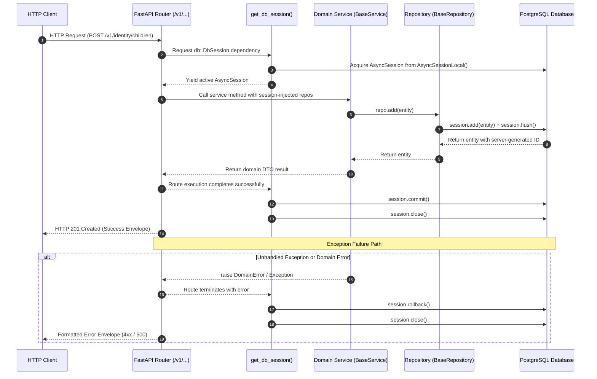
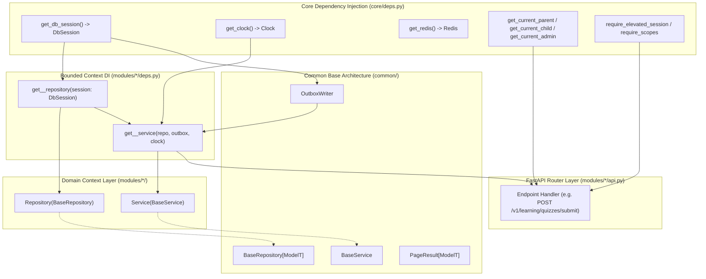
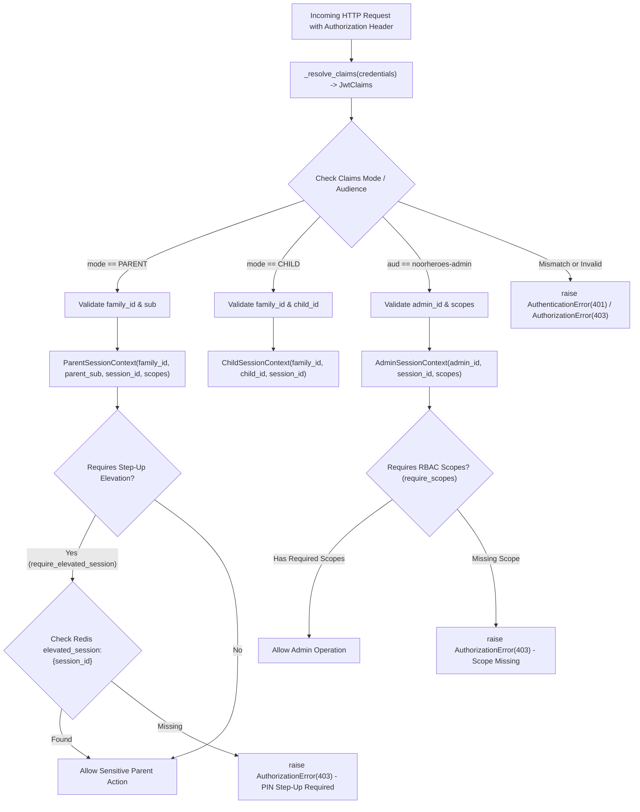

# Phase 2 — Backend Foundation: Base Repository, Service Layer Architecture & FastAPI Dependency Injection Wiring

**Blueprint ID:** `Development_Blueprints.Phase2_Backend_Foundation.Backend.06-base-repository-service-layer-di.md`  
**Platform:** Backend (`src/noorheroes/common/base_repository.py`, `src/noorheroes/common/base_service.py`, `src/noorheroes/core/deps.py`, `src/noorheroes/modules/*/deps.py`, `src/noorheroes/modules/*/repository.py`, `src/noorheroes/modules/*/service.py`)  
**Phase:** Phase 2 — Backend Foundation & Security Baseline Prerequisites  
**Global Sequence:** Seq 19  
**Closes:** Phase 2 Item 06 (`Backend.06-base-repository-service-layer-di.md`) — Base generic repository abstraction (`BaseRepository[ModelT]`), compound `(created_at, id)` keyset cursor pagination (`PageResult[ModelT]`), idempotent soft-deletion via server-authoritative clock, optimistic concurrency locking (`OptimisticLockConflictError`), base domain service layer (`BaseService`), request-scoped single-transaction lifecycle (`get_db_session`), 3-way mutually exclusive authentication session chains (`ParentSessionContext`, `ChildSessionContext`, `AdminSessionContext`), server-side Redis step-up elevation gates (`require_elevated_session`, `require_elevated_admin`), declarative RBAC scope enforcement factories (`require_scopes`, `require_admin_scope`), and modular per-context dependency injection providers per `NoorHeroes_Consolidated_Execution_Blueprint.md` §3, `FAST-API-INSTRUCTIONS.md` §1/§2/§3/§5/§7/§8/§10/§11/§15, and `MASTER-README.md` §2/§5.  
**Depends on:**  
- `Phase2_Backend_Foundation.Backend.01-fastapi-clean-architecture-bootstrap.md` — Modular monolith layout, core layer scaffolding, base exceptions.
- `Phase2_Backend_Foundation.Backend.02-db-orm-config-sqlalchemy-alembic.md` — Async SQLAlchemy 2.x engine, declarative base (`Base`), `TimestampMixin`, and `AsyncSessionLocal`.
- `Phase2_Backend_Foundation.Backend.03-config-management-pydantic-settings.md` — Type-safe `Settings` singleton, environment tiers (`Environment`).
- `Phase2_Backend_Foundation.Backend.04-structlog-logging-correlation-ids.md` — Structlog logging, `contextvars` request ID and correlation ID propagation.
- `Phase2_Backend_Foundation.Backend.05-exception-handling-domain-error-hierarchy.md` — Closed domain exception hierarchy (`DomainError`, `NotFoundError`, `ConflictError`, `OptimisticLockConflictError`, `AuthenticationError`, `AuthorizationError`, `ValidationError`).

**Consumed by:**  
- All 11 Bounded Contexts (`identity`, `content`, `learning`, `rewards`, `subscriptions`, `media`, `notifications`, `ai_safety`, `admin`, `localization`, `feature_flags`) for database queries, domain orchestration, and API dependency injection.
- `Phase2_Backend_Foundation.Backend.08-transactional-outbox-pattern.md` — Outbox writer sharing the active request `AsyncSession`.
- `Phase2_Backend_Foundation.Backend.09-middleware-rate-limiting-cors-correlation.md` — Outer request boundary injecting Redis and request context.
- All API routers (`src/noorheroes/modules/*/api.py`) for declarative route parameter injection via `Depends()`.
- Architectural AST test suites (`tests/architecture/test_base_repository_service.py`, `tests/architecture/test_layering.py`) and unit tests (`tests/core/test_deps.py`, `tests/modules/common/test_domain_repositories.py`).

**Source Authority:**  
- `FAST-API-INSTRUCTIONS.md` (Zero-Missing Developer Usage Manual & Master Reference §1, §2, §3, §5, §7, §8, §10, §11, §15)
- `MASTER-README.md` (Authoritative Unified Master Technical Reference §2, §5)
- `NoorHeroes_Consolidated_Execution_Blueprint.md` §3 (Phase 2 Backend Foundation & Security Baseline Prerequisites)
- `NoorHeroes_Final_Development_Prompt.md` §2, §3, §5, §8, §10

**Status:** Implemented & Verified Baseline (Authoritative Specification)

---

## 1. Objective and Strategic Purpose

This blueprint establishes the **production-grade generic repository pattern, domain service layer orchestration, and FastAPI dependency injection (DI) infrastructure** for the NoorHeroes backend platform. Built on **Python 3.12+**, **FastAPI**, **Async SQLAlchemy 2.0 ORM**, and **Redis**, it delivers strict Clean Architecture separation of concerns, robust transaction boundaries, child-safety data isolation, and high-performance data access primitives.

The primary architectural objectives are:

1. **Standardized Generic Data Access (`BaseRepository[ModelT]`)**: Providing a reusable, type-safe base repository for all domain entities that encapsulates boilerplate CRUD operations, soft-deletion filtering, keyset cursor pagination, relationship eager loading, and optimistic concurrency version increments.
2. **Strict Transaction Boundary & Single Unit of Work**: Guaranteeing that the lifetime of database transactions is governed exclusively by the request-scoped `get_db_session` dependency. Repositories flush writes to the session (`flush()`) but are strictly forbidden from invoking `commit()` or `rollback()` directly. A single database transaction is committed atomically at request completion or rolled back upon an unhandled error.
3. **High-Performance Keyset Cursor Pagination (`PageResult[ModelT]`)**: Standardizing list endpoints on compound `(created_at, id)` keyset cursor pagination. Keyset pagination ensures deterministic ordering, zero offset query degradation on millions of records, and seamless multi-item pagination across mobile and web clients.
4. **Server-Authoritative Idempotent Soft-Deletion**: Standardizing soft-delete semantics across all domain entities using an injected server-side `Clock` (`SystemClock` in production, `TestClock` in tests). Soft-deleting an already deleted or non-existent entity is guaranteed to be an idempotent, successful no-op.
5. **Optimistic Concurrency Control (OCC)**: Providing `update_with_optimistic_lock` to detect and reject concurrent write races on mutable resources (e.g. parent safety rules, feature flag approvals, wallet balances). Stale update attempts immediately raise `OptimisticLockConflictError` (HTTP 409 Conflict) containing model name, resource ID, and expected version.
6. **Three Mutually Exclusive Auth Chains**: Enforcing cryptographic mode isolation across client types:
   - `ParentSessionContext` via `get_current_parent` (mode `PARENT`, requiring `family_id` and `sub`).
   - `ChildSessionContext` via `get_current_child_session` / `get_current_child` (mode `CHILD`, requiring `family_id` and `child_id`).
   - `AdminSessionContext` via `get_current_admin` (audience `noorheroes-admin`, requiring `admin_id` and `scopes`).
   Tokens of one session type cannot authenticate endpoints intended for another session type.
7. **Step-Up Elevation Gates via Redis**: Securing high-risk parent actions (e.g. daily limit modification, profile deletion, subscription changes) and administrative kill-switch toggles via server-side step-up markers (`require_elevated_session`, `require_elevated_admin`) checked against Redis.
8. **Declarative RBAC Scope Enforcement**: Providing parameterizable dependency factories (`require_scopes`, `require_admin_scope`) that inspect authenticated admin JWT claims and reject unauthorized operations with HTTP 403 `AuthorizationError`.
9. **Child Profile Authorization Guardrails**: Enforcing that all repository and service queries accessing child-specific data accept `authorized_child_ids` or are explicitly suffixed with `_unscoped` to prevent unauthorized cross-family child data enumeration (COPPA/GDPR-K compliance).
10. **Automated AST-Based Architectural Invariants**: Validating via continuous integration tests (`test_base_repository_service.py`) that 100% of repositories extend `BaseRepository`, 100% of services extend `BaseService`, zero repositories call commit/rollback, and child-scoped signatures are protected.

---

## 2. Scope and Architectural Requirements

### 2.1 In Scope

- **Shared Repository Foundation (`src/noorheroes/common/base_repository.py`)**:
  - `ModelT = TypeVar("ModelT")` generic model type parameter.
  - `PageResult[ModelT]` dataclass container with `items: List[ModelT]`, `next_cursor: Optional[str]`, `has_more: bool`.
  - `BaseRepository[ModelT]` generic class with:
    - `__init__(self, session: AsyncSession)`.
    - `get_by_id(id: Any, *, eager: Optional[List[Any]] = None) -> Optional[ModelT]`.
    - `add(entity: ModelT) -> ModelT`.
    - `soft_delete(id: Any, *, clock: Clock) -> None`.
    - `update_with_optimistic_lock(id: Any, expected_version: int, **fields: Any) -> ModelT`.
    - `list_paginated(cursor: Optional[str], page_size: int, eager: Optional[List[Any]], extra_filters: Optional[List[Any]]) -> PageResult[ModelT]`.
- **Shared Service Foundation (`src/noorheroes/common/base_service.py`)**:
  - `BaseService` base class for all bounded context business services.
  - `idempotent_delete_semantics(entity: Optional[Any]) -> bool` standard deletion evaluator.
  - Transaction orchestration and transactional outbox event coordination standards.
- **FastAPI Core Dependency Injection Providers (`src/noorheroes/core/deps.py`)**:
  - `get_db_session() -> AsyncGenerator[AsyncSession, None]` request-scoped transaction manager.
  - `get_db_session_new_transaction() -> AsyncGenerator[AsyncSession, None]` isolated transaction escape hatch.
  - `DbSession = Annotated[AsyncSession, Depends(get_db_session)]` type alias.
  - `ParentSessionContext`, `ChildSessionContext`, `AdminSessionContext` session DTO models.
  - `get_current_parent(claims: ResolvedClaims) -> ParentSessionContext`.
  - `get_current_child_session(claims: ResolvedClaims) -> ChildSessionContext` and `get_current_child` alias.
  - `get_current_admin(credentials, authorization) -> AdminSessionContext`.
  - `get_optional_parent(credentials) -> Optional[ParentSessionContext]`.
  - `get_optional_session_context(credentials) -> Optional[ParentSessionContext | ChildSessionContext]`.
  - `require_elevated_session(parent, redis) -> ParentSessionContext`.
  - `require_elevated_admin(admin, redis) -> AdminSessionContext`.
  - `require_scopes(*required_scopes: str)` and `require_admin_scope(required_scope: str)`.
  - `get_idempotency_key(idempotency_key) -> str` and `IdempotencyKey`.
  - `get_redis() -> AsyncGenerator[Redis, None]`.
  - `get_clock() -> Clock`.
  - `get_celery_app() -> Celery`.
- **Bounded Context Dependency Providers (`src/noorheroes/modules/*/deps.py`)**:
  - Modular dependency providers constructing repositories and domain services using `DbSession` and shared singletons.
- **Architectural & Unit Test Suites**:
  - AST-based static analysis tests in `tests/architecture/test_base_repository_service.py` and `tests/architecture/test_layering.py`.
  - Deep dependency injection unit tests in `tests/core/test_deps.py`.
  - Context repository CRUD and pagination tests in `tests/modules/common/test_domain_repositories.py`.

### 2.2 Explicitly Out of Scope

- **Database Connection Pool Configuration**: Physical engine pooling parameters (`pool_size`, `max_overflow`) are owned by Phase 2 Item 02 (`Backend.02-db-orm-config-sqlalchemy-alembic.md`).
- **Distributed Lock Acquisition Primitives**: Distributed Redis locks for multi-pod mutexes are owned by the Redis utility module (`src/noorheroes/common/redis/`).
- **Outbox Event Table Schema & Poller Worker**: The `outbox_events` table schema and relay poller are owned by Phase 2 Item 08 (`Backend.08-transactional-outbox-pattern.md`).

### 2.3 System Invariants

1. **Repository Zero-Commit Invariant**: NO repository method may call `session.commit()` or `session.rollback()`. Transaction boundaries are owned exclusively by FastAPI's `get_db_session` dependency.
2. **Repository Inheritance Invariant**: 100% of repository classes in all bounded contexts MUST inherit from `BaseRepository[ModelT]`.
3. **Service Inheritance Invariant**: 100% of domain service classes in all bounded contexts MUST inherit from `BaseService`.
4. **Downward Layering Invariant**: Repositories MUST NEVER import service modules, API routers, or another bounded context's repository.
5. **No Naked Business Domain Errors Outside Service Invariant**: Only `service.py` modules may raise domain business exceptions (`NotFoundError`, `ValidationError`, `ConflictError`, `AuthorizationError`, `EntitlementLimitExceededError`).
6. **Child Scope Authorization Invariant**: Every repository method taking `child_id` MUST also take `authorized_child_ids` or be named with the `_unscoped` suffix.
7. **Soft-Delete Query Exclusion Invariant**: All repository read operations (`get_by_id`, `list_paginated`) MUST exclude records where `deleted_at IS NOT NULL` by default.
8. **Auth Mode Isolation Invariant**: A JWT minted for `PARENT` mode cannot satisfy a child-restricted route (`get_current_child`), and a JWT minted for `CHILD` mode cannot satisfy a parent-restricted route (`get_current_parent`).

---

## 3. Architecture & Interaction Workflows

### 3.1 Request-Scoped Database Session & Unit of Work Lifecycle



---

### 3.2 Dependency Graph Across Layers



---

### 3.3 3-Way Session Authentication & Step-Up Elevation Flow



---

## 4. Complete Granular Class & Method Specifications

### 4.1 `src/noorheroes/common/base_repository.py`

#### Class: `PageResult[ModelT]`
- **Purpose**: Generic typed container for cursor-paginated results returned by `BaseRepository.list_paginated`.
- **Attributes**:
  - `items: List[ModelT]` — Ordered slice of active entity instances for current page.
  - `next_cursor: Optional[str]` — Base64-encoded JSON cursor containing `last_created_at` (ISO-8601) and `last_id`, or `None` if no more records exist.
  - `has_more: bool` — Boolean flag indicating whether additional records exist beyond current page.

#### Class: `BaseRepository[ModelT]`
- **Purpose**: Generic data access base class subclassed by all bounded context repositories.
- **Attributes**:
  - `model: Any` — Model class reference set on repository subclasses.
  - `_session: AsyncSession` — Request-scoped SQLAlchemy asynchronous database session.
- **Methods**:

##### `__init__(self, session: AsyncSession) -> None`
- Injects request-scoped `AsyncSession`.

##### `async def get_by_id(self, id: Any, *, eager: Optional[List[Any]] = None) -> Optional[ModelT]`
- Retrieves an active entity by primary key ID, automatically filtering out soft-deleted records (`deleted_at IS NOT NULL`).
- Accepts optional `eager` list of SQLAlchemy relationship attributes to load via `selectinload`.
- Returns model instance or `None` if not found or soft-deleted.

##### `async def add(self, entity: ModelT) -> ModelT`
- Adds entity to active session and awaits `self._session.flush()`.
- Flushes SQL writes to assign database defaults, server-generated IDs, and triggers without committing the outer transaction.
- Returns the flushed entity instance.

##### `async def soft_delete(self, id: Any, *, clock: Clock) -> None`
- Retrieves entity via `get_by_id(id)`.
- If entity is not found or already deleted, executes as an **idempotent no-op**.
- If entity exists, assigns `entity.deleted_at = clock.now()` and flushes via `self._session.flush()`.

##### `async def update_with_optimistic_lock(self, id: Any, expected_version: int, **fields: Any) -> ModelT`
- Executes atomic SQL update statement:
  ```python
  stmt = (
      update(self.model)
      .where(
          self.model.id == id,
          self.model.version == expected_version,
          self.model.deleted_at.is_(None),
      )
      .values(**fields, version=expected_version + 1)
      .returning(self.model)
  )
  ```
- If no row matches (stale version or missing record), raises `OptimisticLockConflictError(model_name, str(id), expected_version)` with HTTP 409 status code.
- Returns the updated model instance.

##### `async def list_paginated(self, *, cursor: Optional[str] = None, page_size: int = 20, eager: Optional[List[Any]] = None, extra_filters: Optional[List[Any]] = None) -> PageResult[ModelT]`
- Implements deterministic keyset cursor pagination based on compound `(created_at DESC, id DESC)` ordering.
- If `cursor` is provided, decodes `last_created_at` and `last_id`, applying filter:
  ```sql
  WHERE (created_at < :last_created_at) OR (created_at == :last_created_at AND id < :last_id)
  ```
- Requests `page_size + 1` rows to calculate `has_more` without executing a separate count query.
- Returns `PageResult(items=page_items, next_cursor=next_cursor, has_more=has_more)`.

---

### 4.2 `src/noorheroes/common/base_service.py`

#### Class: `BaseService`
- **Purpose**: Base class for domain business services across all 11 bounded contexts.
- **Architectural Rules**:
  1. Business logic orchestration across one or more repositories occurs within a single unit-of-work transaction.
  2. Domain services MUST NOT call `session.commit()` or `session.rollback()`.
  3. Domain services are the sole sanctioned origin of `DomainError` raises.
- **Methods**:

##### `@staticmethod def idempotent_delete_semantics(entity: Optional[Any]) -> bool`
- Evaluates soft-delete return values, returning `True` for consistent idempotent deletion API contracts.

---

### 4.3 `src/noorheroes/core/deps.py`

#### Core Infrastructure Dependencies:
- `get_clock() -> Clock`: Returns process-singleton `SystemClock` UTC clock instance.
- `get_redis() -> AsyncGenerator[Redis, None]`: Yields per-request `Redis` client from singleton pool (`get_redis_pool()`), closing on request completion.
- `get_celery_app() -> Celery`: Returns global Celery application handle.
- `get_idempotency_key(...) -> str`: Extracts and validates `Idempotency-Key` header (max 128 chars), raising 422 `ValidationError` if missing/invalid.

#### Database Transaction Dependencies:
- `get_db_session() -> AsyncGenerator[AsyncSession, None]`: Request-scoped `AsyncSession` dependency. Commits if active on clean exit, rolls back on exception, unconditionally closes in `finally`.
- `get_db_session_new_transaction() -> AsyncGenerator[AsyncSession, None]`: Isolated transaction dependency for non-blocking sub-operations (e.g. audit logs).
- `DbSession`: Annotated type alias `Annotated[AsyncSession, Depends(get_db_session)]`.

#### Authentication Context DTOs:
- `ParentSessionContext`: Pydantic model with `family_id: str`, `parent_sub: str`, `session_id: str`, `scopes: List[str]`.
- `ChildSessionContext`: Pydantic model with `family_id: str`, `child_id: str`, `session_id: str`.
- `AdminSessionContext`: Pydantic model with `admin_id: str`, `session_id: str`, `scopes: List[str]`.

#### Authentication & Authorization Dependencies:
- `get_current_parent(claims)`: Resolves `ParentSessionContext`. Raises `AuthorizationError` if mode != `PARENT`.
- `get_current_child_session(claims)` / `get_current_child`: Resolves `ChildSessionContext`. Raises `AuthorizationError` if mode != `CHILD`.
- `get_current_admin(credentials, authorization)`: Validates admin JWT (audience `noorheroes-admin`), returning `AdminSessionContext`.
- `get_optional_parent(credentials)`: Resolves optional `ParentSessionContext`, returning `None` if unauthenticated.
- `get_optional_session_context(credentials)`: Resolves optional `ParentSessionContext | ChildSessionContext`, returning `None` if unauthenticated.
- `require_elevated_session(parent, redis)`: Verifies Redis key `elevated_session:{session_id}` exists, raising 403 `AuthorizationError` if expired or absent.
- `require_elevated_admin(admin, redis)`: Verifies Redis key `elevated_admin_session:{session_id}`, raising 403 `AuthorizationError` if expired or absent.
- `require_scopes(*required_scopes)`: Dependency factory asserting admin session contains all specified scopes.
- `require_admin_scope(required_scope)`: Convenience wrapper for single scope verification.

---

### 4.4 Bounded Context Dependency Providers (`modules/*/deps.py`)

Every bounded context provides a standard `deps.py` wiring repositories and services to `DbSession`:

| Bounded Context | Repository Provider (`session: DbSession`) | Service Provider (`Depends(...)`) |
|---|---|---|
| `identity` | `get_child_profile_repository`, `get_family_repository`, `get_user_repository` | `get_child_profile_service`, `get_user_service` |
| `content` | `get_content_repository` | `get_content_service` |
| `learning` | `get_learning_repository` | `get_learning_service` |
| `rewards` | `get_reward_repository` | `get_reward_service` |
| `subscriptions` | `get_subscription_repository` | `get_subscription_service` |
| `media` | `get_media_repository` | `get_media_service` |
| `notifications` | `get_notification_repository` | `get_notification_service` |
| `ai_safety` | `get_ai_safety_repository` | `get_ai_safety_service` |
| `admin` | `get_admin_repository` | `get_admin_service` |
| `localization` | `get_language_repository`, `get_country_repository`, `get_currency_repository`, `get_translation_repository` | `get_translation_service`, `get_country_service` |
| `feature_flags` | `get_feature_flag_repository`, `get_feature_flag_state_repository`, `get_feature_flag_approval_repository` | `get_feature_flag_service` |

---

## 5. Keyset Pagination & Keyset Cursor Specifications

### 5.1 Keyset Cursor Encoding Schema

The pagination cursor is a Base64-encoded UTF-8 JSON payload:
```json
{
  "last_created_at": "2026-08-29T12:00:00.000000+00:00",
  "last_id": "01J6A1B2C3D4E5F6G7H8J9K0L1"
}
```

### 5.2 Deterministic Sorting Invariant

Ordering is strictly compound:
```sql
ORDER BY created_at DESC, id DESC
```
This guarantees that even when multiple records share identical millisecond timestamps, the secondary primary key (`id` ULID/UUID) resolves unambiguous deterministic ordering without duplicate or omitted records between pages.

---

## 6. Child Safety Scope Authorization Invariant

To defend against cross-family child enumeration and unauthorized child record modification (COPPA & GDPR-K mandate §1.4), repository signatures accessing child-scoped data enforce one of two explicit patterns:

1. **Scoped Query Pattern**:
   ```python
   async def get_by_id_scoped(self, child_id: str, *, authorized_child_ids: FrozenSet[str]) -> Optional[ModelT]:
       if authorized_child_ids and child_id not in authorized_child_ids:
           return None
       return await self.get_by_id(child_id)
   ```
2. **Explicit Unscoped Marker Pattern**:
   ```python
   async def get_by_id_unscoped(self, child_id: str) -> Optional[ModelT]:
       return await self.get_by_id(child_id)
   ```

Any repository method accepting `child_id` without `authorized_child_ids` that is not suffixed with `_unscoped` is automatically rejected by CI AST static analysis (`test_base_repository_service.py`).

---

## 7. Verification and Automated Test Coverage

| Test Module | Target Class / Function | Verification Assertion |
|---|---|---|
| `test_base_repository_service.py` | AST Repository Scanner | Asserts 100% of repositories in `modules/` extend `BaseRepository[ModelT]`. |
| `test_base_repository_service.py` | AST Service Scanner | Asserts 100% of services in `modules/` extend `BaseService`. |
| `test_base_repository_service.py` | AST Commit / Rollback Scanner | Asserts ZERO repository methods call `commit()` or `rollback()` directly. |
| `test_base_repository_service.py` | AST Child Authorization Scanner | Asserts every method taking `child_id` accepts `authorized_child_ids` or ends in `_unscoped`. |
| `test_base_repository_service.py` | `BaseRepository.soft_delete` | Verifies soft-deleting an absent entity is an idempotent no-op. |
| `test_base_repository_service.py` | `BaseRepository.update_with_optimistic_lock` | Verifies stale version updates raise `OptimisticLockConflictError` (HTTP 409). |
| `test_deps.py` | `get_db_session` | Verifies transaction commits on clean exit and rolls back on exception. |
| `test_deps.py` | `get_db_session_new_transaction` | Verifies isolated transaction commits on clean exit and rolls back on exception. |
| `test_deps.py` | Dependency Caching | Verifies multiple repositories injected in one request share identical `AsyncSession`. |
| `test_deps.py` | Mode Isolation | Verifies parent tokens are rejected by child/admin dependencies and vice-versa. |
| `test_deps.py` | `require_elevated_session` | Verifies missing Redis marker raises 403 `AuthorizationError`. |
| `test_deps.py` | `require_scopes` & `require_admin_scope` | Verifies missing admin scopes raise 403 `AuthorizationError`. |
| `test_deps.py` | `get_current_child` | Verifies alias resolves `ChildSessionContext` identically to `get_current_child_session`. |
| `test_domain_repositories.py` | `BaseRepository.list_paginated` | Verifies keyset pagination page splitting, `has_more` flag, and cursor generation. |
| `test_domain_repositories.py` | Scoped Repositories | Verifies authorized and unauthorized child scope queries for Rewards and Learning. |
