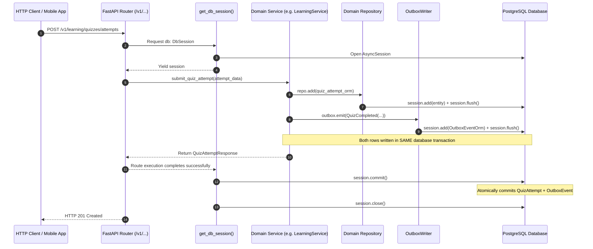
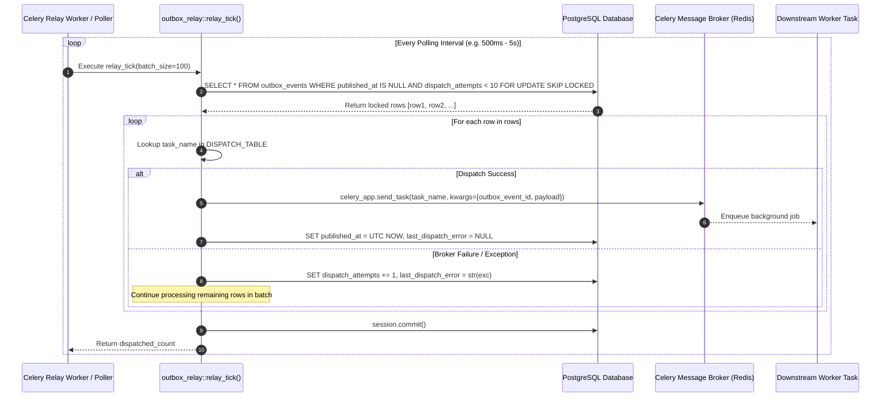

# Phase 2 — Backend Foundation: Transactional Outbox Pattern & Asynchronous Event Relay Architecture

**Blueprint ID:** `Development_Blueprints.Phase2_Backend_Foundation.Backend.08-transactional-outbox-pattern.md`  
**Platform:** Backend (`src/noorheroes/common/outbox.py`, `src/noorheroes/common/outbox_relay.py`, `src/noorheroes/core/deps.py`, `src/noorheroes/modules/*/events.py`, `tests/architecture/test_transactional_outbox.py`)  
**Phase:** Phase 2 — Backend Foundation & Security Baseline Prerequisites  
**Global Sequence:** Seq 21  
**Closes:** Phase 2 Item 08 (`Backend.08-transactional-outbox-pattern.md`) — Production-grade Transactional Outbox Pattern architecture, `outbox_events` table schema, ULID primary keys, partial index on `published_at IS NULL`, compound index on `(aggregate_type, aggregate_id, created_at)`, shared-transaction event emitter (`OutboxWriter.emit`, `OutboxWriter.emit_many`), FastAPI dependency injection provider (`get_outbox_writer`, `Outbox`), outbox relay worker engine (`relay_tick`, `OutboxRelayService`), Celery periodic polling task (`outbox.relay_events`), multi-instance concurrency safety (`FOR UPDATE SKIP LOCKED`), dead-letter threshold handling (`MAX_DISPATCH_ATTEMPTS = 10`), domain event registries across all 11 bounded contexts, and comprehensive architectural test validation per `NoorHeroes_Consolidated_Execution_Blueprint.md` §3, `FAST-API-INSTRUCTIONS.md` §1/§2/§3/§5/§7/§8/§9/§11/§15, and `MASTER-README.md` §2/§5/§9.  
**Depends on:**  
- `Phase2_Backend_Foundation.Backend.01-fastapi-clean-architecture-bootstrap.md` — Modular monolith layout, core layer scaffolding, base exceptions.  
- `Phase2_Backend_Foundation.Backend.02-db-orm-config-sqlalchemy-alembic.md` — Async SQLAlchemy 2.x engine, declarative base (`Base`), `TimestampMixin`, and `AsyncSessionLocal`.  
- `Phase2_Backend_Foundation.Backend.03-config-management-pydantic-settings.md` — Type-safe `Settings` singleton, environment tiers (`Environment`).  
- `Phase2_Backend_Foundation.Backend.04-structlog-logging-correlation-ids.md` — Structlog logging, request ID, correlation ID context.  
- `Phase2_Backend_Foundation.Backend.05-exception-handling-domain-error-hierarchy.md` — Closed domain exception hierarchy (`DomainError`).  
- `Phase2_Backend_Foundation.Backend.06-base-repository-service-layer-di.md` — Base repository/service abstractions, session contexts, and `Depends()` DI wiring.  

**Consumed by:**  
- All 11 Bounded Contexts (`identity`, `content`, `learning`, `rewards`, `subscriptions`, `media`, `notifications`, `ai_safety`, `admin`, `localization`, `feature_flags`) for emitting domain events without distributed dual-write coupling.  
- Celery worker cluster for polling and dispatching asynchronous background tasks.  
- Downstream asynchronous event consumers (Push notifications, Reward points awards, Streak calculators, Search indexing, AI content moderation, Translation workers).  
- Architectural AST test suites (`tests/architecture/test_transactional_outbox.py`, `tests/architecture/test_layering.py`).  

**Source Authority:**  
- `FAST-API-INSTRUCTIONS.md` (Zero-Missing Developer Usage Manual & Master Reference §1, §2, §3, §5, §7, §8, §9, §11, §15)  
- `MASTER-README.md` (Authoritative Unified Master Technical Reference §2, §5, §9)  
- `NoorHeroes_Consolidated_Execution_Blueprint.md` §3 (Phase 2 Backend Foundation & Security Baseline Prerequisites Item 21)  
- `NoorHeroes_Final_Development_Prompt.md` §2, §3, §5, §8, §10, §11, §12  

**Status:** Implemented & Verified Baseline (Authoritative Specification)  

---

## 1. Objective and Strategic Purpose

The **Transactional Outbox Pattern** provides a robust, zero-dual-write messaging foundation for the NoorHeroes modular monolith. Built on **Python 3.12+**, **FastAPI**, **Async SQLAlchemy 2.0 ORM**, **PostgreSQL 16+**, **Redis 7.2**, and **Celery**, it completely eliminates distributed transaction coupling and data inconsistency risks between synchronous relational database transactions and asynchronous message brokers.

### The Dual-Write Vulnerability Solved

In traditional distributed systems, when an application service updates a database and directly dispatches a message broker task (e.g. `celery_app.send_task(...)`), two failure modes create severe data inconsistencies:
1. **Ghost Event**: The Celery task is enqueued successfully, but the database transaction subsequently fails or rolls back. Downstream consumers execute actions (e.g. sending push notifications or granting rewards) for state changes that never committed in the database.
2. **Lost Event**: The database transaction commits successfully, but network partition or broker downtime prevents the task from being enqueued. Downstream reactions never execute.

The Transactional Outbox Pattern eliminates both anomalies by writing outbox records to PostgreSQL inside the **exact same ACID database transaction** as business entity state modifications.

```text
┌─────────────────────────────────────────────────────────────────────────────┐
│                      TRANSACTIONAL OUTBOX ARCHITECTURE                      │
├─────────────────────────────────────────────────────────────────────────────┤
│                                                                             │
│  [ HTTP Request ] ───► [ Domain Service ]                                   │
│                              │                                              │
│                              ▼ (Shared AsyncSession Transaction)            │
│         ┌─────────────────────────────────────────────────────────┐         │
│         │  1. Business State Write: INSERT / UPDATE domain table  │         │
│         │  2. Outbox Event Write:   INSERT INTO outbox_events     │         │
│         │     (published_at = NULL, dispatch_attempts = 0)        │         │
│         └─────────────────────────────────────────────────────────┘         │
│                              │                                              │
│                              ▼                                              │
│                 [ PostgreSQL Transaction COMMIT ]                           │
│                              │ (100% Atomic: Both Persist or Neither)       │
│                                                                             │
│  ─────────────────────────────────────────────────────────────────────────  │
│                                                                             │
│  [ Celery Periodic Relay Worker / Standalone Poller ]                       │
│                              │                                              │
│                              ▼                                              │
│         ┌─────────────────────────────────────────────────────────┐         │
│         │  SELECT * FROM outbox_events                            │         │
│         │  WHERE published_at IS NULL                             │         │
│         │    AND dispatch_attempts < 10                           │         │
│         │  ORDER BY created_at ASC                                │         │
│         │  FOR UPDATE SKIP LOCKED                                 │         │
│         └─────────────────────────────────────────────────────────┘         │
│                              │                                              │
│              ┌───────────────┴───────────────┐                              │
│              ▼                               ▼                              │
│  [ Celery Task Dispatched ]       [ Update outbox_events ]                  │
│  - Task enqueued to Redis         - SET published_at = UTC NOW              │
│  - Task args: event_id, payload   - SET last_dispatch_error = NULL          │
│                                                                             │
└─────────────────────────────────────────────────────────────────────────────┘
```

---

## 2. Scope and Architectural Requirements

### 2.1 In Scope

1. **Database Persistence & ORM Model (`src/noorheroes/common/outbox.py`)**:
   - `OutboxEventOrm(Base)` mapped to table `outbox_events`.
   - 26-character sortable Crockford Base32 ULID primary key (`id`).
   - Strong type definitions: `aggregate_type`, `aggregate_id`, `event_type`, `payload: JSON`, `created_at`, `published_at`, `dispatch_attempts`, `last_dispatch_error`.
   - High-performance partial index: `ix_outbox_unpublished` on `created_at` where `published_at IS NULL`.
   - Compound index: `ix_outbox_aggregate` on `(aggregate_type, aggregate_id, created_at)`.
   - Backward-compatibility alias: `OutboxMessage = OutboxEventOrm`.

2. **Shared-Transaction Event Emitter (`OutboxWriter`)**:
   - `OutboxWriter(session: AsyncSession)` helper bound to the active request session.
   - `emit(event, *, aggregate_type, aggregate_id)` persisting domain events into the active transaction.
   - `emit_many(events, *, aggregate_type, aggregate_id)` batch emission helper.
   - Support for both typed Pydantic models (`NoorHeroesBaseModel`) and payload dictionaries.
   - Strict transaction isolation: invokes `session.add(record)` and `await session.flush()`, NEVER calls `session.commit()` or `session.rollback()`.

3. **FastAPI Dependency Injection (`src/noorheroes/core/deps.py`)**:
   - `get_outbox_writer(session: DbSession) -> OutboxWriter` provider.
   - `Outbox = Annotated[OutboxWriter, Depends(get_outbox_writer)]` type alias.

4. **Outbox Relay Dispatcher & Multi-Instance Polling Engine (`src/noorheroes/common/outbox_relay.py`)**:
   - `DISPATCH_TABLE`: Exhaustive lookup dictionary mapping domain event types across all 11 bounded contexts to registered Celery task names.
   - `MAX_DISPATCH_ATTEMPTS = 10`: Threshold for dead-letter exclusion.
   - `relay_tick(session: AsyncSession, *, batch_size: int = 100) -> int`:
     - Query with `with_for_update(skip_locked=True)`.
     - Dispatches tasks via `celery_app.send_task(task_name, kwargs={"outbox_event_id": row.id, "payload": row.payload})`.
     - Updates `published_at` to current UTC timestamp on success.
     - Records error string and increments `dispatch_attempts` on failure without failing the rest of the batch.
     - Commits session.
   - `dispatch_single_event(session, event_id) -> bool` manual / admin retry helper.
   - `OutboxRelayService` coordinator class.
   - Celery periodic task `@celery_app.task(name="outbox.relay_events", acks_late=True)` executing `relay_tick` via `AsyncSessionLocal()`.

5. **Universal Domain Event Registries Across Bounded Contexts**:
   - Standardized `event_type` field and `EVENT_TYPE_REGISTRY` in all 11 bounded context `events.py` modules.

6. **Automated Architectural & Integration Test Suite (`tests/architecture/test_transactional_outbox.py`)**:
   - Dynamic validation that 100% of event types in domain registries are mapped in `DISPATCH_TABLE`.
   - AST static analysis verifying ZERO service methods invoke Celery directly.
   - Unit and integration tests for session sharing, batch emission, error isolation, dead-letter exclusion, and Celery task execution.

### 2.2 Explicitly Out of Scope

- **Message Broker Topology & Redis Cluster Provisioning**: Provisioning Redis nodes, clustering, and persistence policies is managed by Phase 1 (`Infra.02`).
- **Downstream Celery Task Business Logic**: The internal processing within specific worker tasks (e.g. `localization.translate_content`, `notifications.send_reward_earned_push`) is owned by their respective domain modules.

### 2.3 System Invariants

1. **Zero-Commit Repository/Writer Invariant**: `OutboxWriter` MUST NEVER invoke `session.commit()` or `session.rollback()`. Transaction boundaries are owned exclusively by FastAPI's `get_db_session` dependency.
2. **Zero-Direct-Celery-In-Services Invariant**: Domain service methods MUST NEVER call `celery_app.send_task()` or `.delay()` directly. All asynchronous side effects MUST be emitted via `OutboxWriter.emit()`.
3. **Exhaustive Dispatch Mapping Invariant**: Every domain event type defined in an `EVENT_TYPE_REGISTRY` across all bounded contexts MUST have an authoritative task string entry in `DISPATCH_TABLE`.
4. **Multi-Instance Non-Blocking Invariant**: Relay poller queries MUST use `with_for_update(skip_locked=True)` to prevent row lock contention and guarantee safe concurrent multi-worker execution.
5. **Dead-Letter Containment Invariant**: Outbox records that fail 10 dispatch attempts (`dispatch_attempts >= 10`) MUST be excluded from automated poller queries to prevent infinite retry loops and protect worker throughput.

---

## 3. Architecture & Interaction Workflows

### 3.1 Synchronous Request Event Emission & Atomic Commit Flow



### 3.2 Asynchronous Outbox Relay Polling & Celery Dispatch Flow



---

## 4. Data Models, Database Schema & Index Design

### 4.1 `outbox_events` Table Schema

```sql
CREATE TABLE outbox_events (
    id VARCHAR(26) PRIMARY KEY,                  -- Sortable Crockford Base32 ULID
    aggregate_type VARCHAR(100) NOT NULL,        -- Domain Aggregate Name (e.g. "child_profile", "quiz")
    aggregate_id VARCHAR(128) NOT NULL,          -- Primary Key of Aggregate
    event_type VARCHAR(100) NOT NULL,            -- Domain Event Type (e.g. "child_profile.created")
    payload JSON NOT NULL,                       -- Serialized JSON Event Payload
    created_at TIMESTAMP WITH TIME ZONE NOT NULL DEFAULT NOW(),
    published_at TIMESTAMP WITH TIME ZONE NULL,  -- NULL = Pending, TIMESTAMP = Dispatched
    dispatch_attempts INTEGER NOT NULL DEFAULT 0,-- Failed Dispatch Attempt Counter
    last_dispatch_error VARCHAR(1000) NULL       -- Last Failure Error Trace / Reason
);

-- Partial Index for Blazing-Fast Poller Queries (Excludes already-published records)
CREATE INDEX ix_outbox_unpublished 
ON outbox_events (created_at) 
WHERE published_at IS NULL;

-- Compound Index for Aggregate Event Sourcing & Audit Queries
CREATE INDEX ix_outbox_aggregate 
ON outbox_events (aggregate_type, aggregate_id, created_at);
```

### 4.2 SQLAlchemy ORM Model Definition (`OutboxEventOrm`)

```python
class OutboxEventOrm(Base):
    """
    SQLAlchemy model representing an outbox event record.
    Written in the same database transaction as the business state change.
    """

    __tablename__ = "outbox_events"

    id: Mapped[str] = mapped_column(String(26), primary_key=True)
    aggregate_type: Mapped[str] = mapped_column(String(100), nullable=False)
    aggregate_id: Mapped[str] = mapped_column(String(128), nullable=False)
    event_type: Mapped[str] = mapped_column(String(100), nullable=False)
    payload: Mapped[Dict[str, Any]] = mapped_column(JSON, nullable=False)
    created_at: Mapped[datetime] = mapped_column(DateTime(timezone=True), nullable=False)
    published_at: Mapped[Optional[datetime]] = mapped_column(DateTime(timezone=True), nullable=True)
    dispatch_attempts: Mapped[int] = mapped_column(Integer, default=0, nullable=False)
    last_dispatch_error: Mapped[Optional[str]] = mapped_column(String(1000), nullable=True)

    __table_args__ = (
        Index("ix_outbox_unpublished", "created_at", postgresql_where="published_at IS NULL"),
        Index("ix_outbox_aggregate", "aggregate_type", "aggregate_id", "created_at"),
        {"extend_existing": True},
    )
```

---

## 5. Component Specifications & FastAPI Dependency Injection

### 5.1 `OutboxWriter` Emitter Interface

```python
class OutboxWriter:
    """
    Transactional Outbox event writer helper.
    Persists domain events to outbox_events table within the caller's active AsyncSession transaction.
    """

    def __init__(self, session: AsyncSession) -> None:
        self._session = session
        self.emitted_events: List[Union[NoorHeroesBaseModel, BaseModel, Dict[str, Any]]] = []

    @property
    def session(self) -> AsyncSession:
        return self._session

    async def emit(
        self,
        event: Union[NoorHeroesBaseModel, BaseModel, Dict[str, Any]],
        *,
        aggregate_type: str = "domain_entity",
        aggregate_id: str = "id_unknown",
    ) -> OutboxEventOrm:
        """Converts domain event model into an OutboxEventOrm record and flushes to the DB session."""
        self.emitted_events.append(event)
        # Serialization & ULID generation logic...
        self._session.add(record)
        await self._session.flush()
        return record

    async def emit_many(
        self,
        events: List[Union[NoorHeroesBaseModel, BaseModel, Dict[str, Any]]],
        *,
        aggregate_type: str = "domain_entity",
        aggregate_id: str = "id_unknown",
    ) -> List[OutboxEventOrm]:
        """Emits multiple domain events in a single batch flush."""
        # Batch addition logic...
        await self._session.flush()
        return records
```

### 5.2 FastAPI Dependency Injection Wiring (`src/noorheroes/core/deps.py`)

```python
def get_outbox_writer(session: DbSession) -> OutboxWriter:
    """Provides a request-scoped OutboxWriter instance bound to the active database session."""
    return OutboxWriter(session)

Outbox = Annotated[OutboxWriter, Depends(get_outbox_writer)]
```

---

## 6. Domain Event Registries & Celery Dispatch Table

### 6.1 Bounded Context Dispatch Mapping Matrix

| Bounded Context | Event Model | Event Type String | Destination Celery Task | Downstream Reaction |
|---|---|---|---|---|
| `identity` | `ChildProfileCreated` | `child_profile.created` | `identity.on_child_profile_created` | Initialize rewards ledger, seed default recommendations |
| `rewards` | `RewardEarnedEvent` | `reward.earned` | `notifications.send_reward_earned_push` | Send congratulations push notification to parent & child |
| `rewards` | `RewardUnlocked` | `reward.unlocked` | `notifications.send_reward_unlocked_push` | Trigger avatar unlock / celebration animation |
| `learning` | `QuizCompleted` | `learning.quiz_completed` | `rewards.process_quiz_completion_points` | Calculate reward points, update learning streak |
| `content` | `ContentPublished` | `content.published` | `content.on_content_published` | Invalidate cache, update Algolia/Elasticsearch search index |
| `notifications` | `NotificationDispatched` | `notification.dispatched` | `notifications.on_notification_dispatched` | Deliver push payload via APNs / FCM gateways |
| `media` | `MediaUploaded` | `media.uploaded` | `media.on_media_uploaded` | Trigger asynchronous FFmpeg audio/video transcoding |
| `subscriptions` | `SubscriptionActivated` | `subscription.activated` | `identity.on_subscription_activated` | Update family tier limits, unlock premium stories |
| `ai_safety` | `ContentFlagged` | `ai_safety.content_flagged` | `ai_safety.on_content_flagged` | Enqueue flagged generation to scholar/moderator dashboard |
| `admin` | `AdminActionExecuted` | `admin.action_executed` | `admin.on_action_executed` | Stream immutable audit event to SIEM sink |
| `feature_flags` | `FeatureFlagApproved` | `feature_flag.approved` | `feature_flags.on_flag_approved` | Invalidate distributed Redis flag evaluation cache |
| `feature_flags` | `FeatureFlagExpired` | `feature_flag.expired` | `feature_flags.on_flag_expired` | Record expiration audit log, notify author |
| `localization` | `TranslationRequested` | `localization.translation_requested` | `localization.translate_content` | Trigger AI multi-language translation pipeline |

---

## 7. Concurrency, Performance & Dead-Letter Handling

### 7.1 Multi-Instance Concurrency Safety (`SKIP LOCKED`)

When multiple Celery worker pods run the outbox relay in parallel:
- Pod 1 executes `SELECT ... FOR UPDATE SKIP LOCKED LIMIT 100` and acquires locks on rows 1–100.
- Pod 2 executes the same query concurrently. Instead of blocking or waiting on Pod 1, PostgreSQL instantly skips the locked rows and locks rows 101–200.
- Result: **Zero row lock contention, zero deadlocks, zero double-dispatching**.

### 7.2 Dead-Letter Queue (DLQ) & Alerting

- Each failed task dispatch increments `dispatch_attempts` on the record and saves `last_dispatch_error`.
- The poller query strictly includes `dispatch_attempts < 10`.
- Once an event fails 10 consecutive attempts:
  1. It is automatically excluded from the polling hot-path, preventing poisoned messages from consuming worker capacity.
  2. The record remains durably stored in PostgreSQL for administrative inspection.
  3. Administrators can inspect dead-letter records and trigger manual re-dispatching via `dispatch_single_event(session, event_id)`.

### 7.3 Complete Failure, Concurrency & Recovery Scenarios Catalog

| Scenario ID | Trigger Condition | System Behavior & Invariant Enforced | Recovery Mechanism |
|---|---|---|---|
| **SC-01: Business Write Failure** | Domain validation or constraint error raised during HTTP request. | The entire `AsyncSession` rolls back. Both the business entity write and the `OutboxEventOrm` write are aborted simultaneously. | Zero ghost events emitted; client receives clean RFC-7807 error envelope. |
| **SC-02: Batch Domain Writes** | Operation produces multiple events (e.g. bulk translation, mass profile migration). | `OutboxWriter.emit_many()` writes all event rows to session and flushes in a single `await session.flush()`. | Atomic multi-event commit under single transaction boundary. |
| **SC-03: Broker Network Outage** | Celery broker (Redis) is unreachable during `relay_tick`. | Exception is caught per-row. `last_dispatch_error` records broker error trace; `dispatch_attempts` increments by 1. Next rows continue processing. | Automatic retry on next poller tick once Redis connectivity recovers. |
| **SC-04: Unmapped Event Type** | Event type string emitted without corresponding entry in `DISPATCH_TABLE`. | Relay logs structured warning (`outbox_unmapped_event_type`), sets error description, and increments `dispatch_attempts`. | Alert surfaces in logs for engineer to register task in `DISPATCH_TABLE`. |
| **SC-05: High-Concurrency Multi-Pod Polling** | Multiple Celery worker pods execute `relay_tick` simultaneously. | PostgreSQL `FOR UPDATE SKIP LOCKED` partitions records without waiting or lock contention. | Zero double-dispatching; seamless horizontal scaling across worker replicas. |
| **SC-06: Poison Pill / Permanent Task Failure** | Event payload causes repeated fatal error in task queue exceeding 10 attempts. | Record reaches `dispatch_attempts = 10` and is automatically filtered out of automated poller queries (`dispatch_attempts < 10`). | Worker throughput protected; record preserved in DB for administrator review. |
| **SC-07: Manual / Admin Dead-Letter Retry** | Administrator resolves root cause and triggers re-dispatch of a dead-letter event. | `dispatch_single_event(session, event_id)` queries specific row with `FOR UPDATE SKIP LOCKED`, dispatches to Celery, and resets error on success. | Record transitions to `published_at = UTC NOW` and `last_dispatch_error = NULL`. |
| **SC-08: Celery Beat Periodic Scheduling** | Celery Beat triggers `outbox.relay_events` at configured interval (e.g. every 5 seconds). | `relay_events_task` runs `relay_tick` inside a managed `AsyncSessionLocal` session with threadsafe loop handling (`_run_coroutine`). | Unattended background polling continuously drains pending outbox events. |

---

## 8. Verification Matrix & Architectural Invariants

| Test Identifier | Test Type | File Location | Invariant Verified |
|---|---|---|---|
| `test_every_event_type_in_registry_has_dispatch_table_entry` | Static Architectural AST | `tests/architecture/test_transactional_outbox.py` | 100% of event types across all bounded contexts have `DISPATCH_TABLE` entries |
| `test_no_service_method_calls_celery_send_task_directly` | Static Architectural AST | `tests/architecture/test_transactional_outbox.py` | ZERO domain services invoke Celery directly |
| `test_outbox_orm_schema_and_indexes` | Unit / ORM Schema | `tests/architecture/test_transactional_outbox.py` | Table name, column types, and `ix_outbox_unpublished` / `ix_outbox_aggregate` indexes exist |
| `test_every_outbox_write_shares_transaction_with_business_write` | Unit / Transaction | `tests/architecture/test_transactional_outbox.py` | `OutboxWriter.emit()` flushes to the active session without committing |
| `test_single_row_dispatch_failure_does_not_block_batch` | Integration / Relay | `tests/architecture/test_transactional_outbox.py` | Single row failure increments attempt count and continues batch |
| `test_relay_tick_unmapped_event_type` | Integration / Relay | `tests/architecture/test_transactional_outbox.py` | Unmapped event records error and increments attempts gracefully |
| `test_dispatch_single_event_success_and_failure` | Unit / Retry | `tests/architecture/test_transactional_outbox.py` | Single event dispatch retries record by ID |
| `test_outbox_relay_service` | Unit / Service | `tests/architecture/test_transactional_outbox.py` | `OutboxRelayService.tick()` delegates to `relay_tick` |
| `test_celery_relay_events_task` | Unit / Celery | `tests/architecture/test_transactional_outbox.py` | `relay_events_task` executes `relay_tick` via async runner |
| `test_outbox_deps_wiring` | Unit / DI | `tests/architecture/test_transactional_outbox.py` | `get_outbox_writer` provides session-bound `OutboxWriter` |
