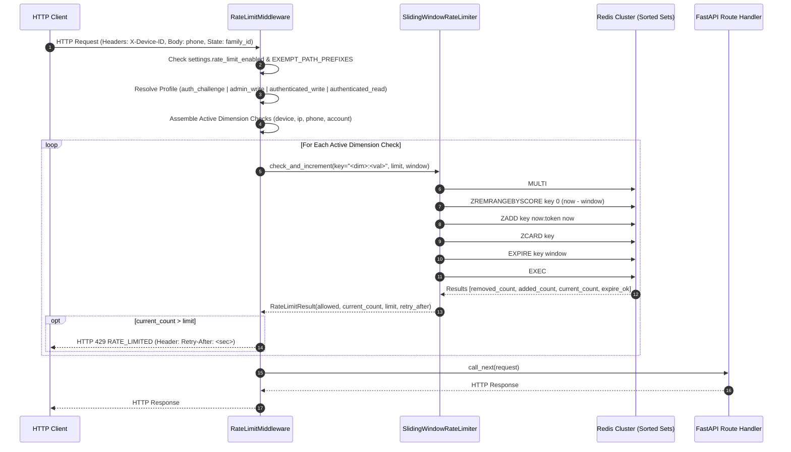

# Phase 2 — Backend Foundation: Outer-Edge Middleware Stack — Multi-Dimensional Rate Limiting, CORS, Correlation Tracking & Access Observability Architecture

**Blueprint ID:** `Development_Blueprints.Phase2_Backend_Foundation.Backend.09-middleware-rate-limiting-cors-correlation.md`  
**Platform:** Backend (`src/noorheroes/infrastructure/middleware/`, `src/noorheroes/core/request_context.py`, `src/noorheroes/core/settings.py`, `main.py`, `tests/architecture/test_gateway_purity.py`, `tests/core/test_middleware_stack.py`)  
**Phase:** Phase 2 — Backend Foundation & Security Baseline Prerequisites  
**Global Sequence:** Seq 22  
**Closes:** Phase 2 Item 09 (`Backend.09-middleware-rate-limiting-cors-correlation.md`) — Production-grade outer-edge middleware pipeline, multi-dimensional sliding-window rate limiting across four independent dimensions (device, IP, phone, account) via atomic Redis sorted-set pipelines (`ZREMRANGEBYSCORE`, `ZADD`, `ZCARD`, `EXPIRE`), per-profile fail-open vs fail-closed outage policies, strict CORS origin allowlisting prohibiting wildcard credentials, collision-resistant correlation tracking (`X-Request-ID`, `X-Correlation-ID`), `contextvars` propagation, OpenTelemetry span attribution, structured JSON access logging, Prometheus HTTP metrics collection, and zero-business-authorization gateway purity enforcement per `NoorHeroes_Consolidated_Execution_Blueprint.md` §3, `FAST-API-INSTRUCTIONS.md` §2/§4/§15, and `MASTER-README.md` §2/§5.  
**Depends on:**  
- `Phase2_Backend_Foundation.Backend.01-fastapi-clean-architecture-bootstrap.md` — Modular monolith layout, core layer scaffolding, base exceptions.  
- `Phase2_Backend_Foundation.Backend.03-config-management-pydantic-settings.md` — Type-safe `Settings` singleton, environment tiers (`Environment`), CORS origins, rate limit configuration.  
- `Phase2_Backend_Foundation.Backend.04-structlog-logging-correlation-ids.md` — Structlog structured logging, request ID, correlation ID contextvars.  
- `Phase2_Backend_Foundation.Backend.05-exception-handling-domain-error-hierarchy.md` — Closed domain exception hierarchy (`DomainError`), universal error envelope.  
- `Phase1_Infra_Config.Infra.02-secrets-management-env-example-gitleaks.md` — Secrets management, CORS/rate-limiting environment tuning variables.  

**Consumed by:**  
- All 11 Bounded Contexts (`identity`, `content`, `learning`, `rewards`, `subscriptions`, `media`, `notifications`, `ai_safety`, `admin`, `localization`, `feature_flags`) as the outer security and observability perimeter.  
- `main.py` for canonical ASGI middleware stack construction.  
- Web portals (Parent Web Account Portal, Scholar/Admin Portal) and Mobile App (iOS / Android) for cross-origin resource sharing, rate limiting headers (`Retry-After`), and correlation diagnostics.  
- Observability and Incident Response platforms (Prometheus, Grafana Loki, Tempo, Sentry) for end-to-end request tracing and latency telemetry.  
- Architectural test suites (`tests/architecture/test_gateway_purity.py`, `tests/core/test_middleware_stack.py`).  

**Source Authority:**  
- `FAST-API-INSTRUCTIONS.md` (Zero-Missing Developer Usage Manual & Master Reference §2, §4, §15)  
- `MASTER-README.md` (Authoritative Unified Master Technical Reference §2, §5)  
- `NoorHeroes_Consolidated_Execution_Blueprint.md` §3 (Phase 2 Backend Foundation & Security Baseline Prerequisites Item 22)  
- `docs/PRD_Documents/Cross-Cutting System Features (35-37)/Feature_F37_Security_Architecture.md` (FR-11, FR-15, §3.1–§3.5, §13.4)  

**Status:** Implemented & Verified Baseline (Authoritative Specification)  

---

## 1. Objective and Strategic Purpose

The **Outer-Edge Middleware Stack** provides the secure, non-bypassable perimeter and observability harness for the NoorHeroes backend platform. Built on **Python 3.12+**, **FastAPI / Starlette ASGI**, **Redis 7.2+**, **structlog 24.x+**, **OpenTelemetry**, and **Prometheus**, it intercepts 100% of incoming HTTP traffic before requests reach domain routers, application services, or database transactions.

```text
┌─────────────────────────────────────────────────────────────────────────────┐
│                       OUTER-EDGE MIDDLEWARE PIPELINE                        │
├─────────────────────────────────────────────────────────────────────────────┤
│                                                                             │
│  [ Incoming HTTP Request ]                                                  │
│             │                                                               │
│             ▼                                                               │
│  ┌─────────────────────────────────────┐                                    │
│  │ 1. RequestIdMiddleware              │ ──► Sanitize/Mint X-Request-ID     │
│  │    (Outermost - First Executed)     │ ──► Bind Contextvars & Tracing     │
│  └──────────────────┬──────────────────┘                                    │
│                     │                                                       │
│                     ▼                                                       │
│  ┌─────────────────────────────────────┐                                    │
│  │ 2. CORSMiddleware                   │ ──► Enforce Origin Allowlist       │
│  │    (Starlette Standard)             │ ──► Ban Wildcard + Credentials     │
│  └──────────────────┬──────────────────┘                                    │
│                     │                                                       │
│                     ▼                                                       │
│  ┌─────────────────────────────────────┐                                    │
│  │ 3. RateLimitMiddleware              │ ──► 4D Sliding Window (Redis)      │
│  │    (Custom Multi-Dimensional)       │ ──► Fail-Open / Fail-Closed Matrix │
│  └──────────────────┬──────────────────┘                                    │
│                     │                                                       │
│                     ▼                                                       │
│  ┌─────────────────────────────────────┐                                    │
│  │ 4. StructuredLoggingMiddleware      │ ──► Latency & Prometheus Metrics   │
│  │    (Observability Interceptor)      │ ──► JSON Access Log (Excl /metrics)│
│  └──────────────────┬──────────────────┘                                    │
│                     │                                                       │
│                     ▼                                                       │
│  ┌─────────────────────────────────────┐                                    │
│  │ 5. GZipMiddleware                   │ ──► Response Compression           │
│  │    (Starlette Standard)             │ ──► Threshold >= 1000 bytes        │
│  └──────────────────┬──────────────────┘                                    │
│                     │                                                       │
│                     ▼                                                       │
│  [ FastAPI Routers / Domain Services / Repositories / PostgreSQL ]          │
│                                                                             │
└─────────────────────────────────────────────────────────────────────────────┘
```

### Core Architectural Goals

1. **Zero-Business-Authorization Gateway Purity**: The gateway and middleware layer is strictly confined to transport and network-layer protections (TLS termination, rate limiting, CORS, correlation, logging). It contains **zero business-authorization logic, zero domain repository imports, and zero direct database queries**. Domain authorizations (e.g. parent ownership, child mode, admin scopes) are executed strictly within domain service boundaries.
2. **Four-Dimensional Sliding-Window Rate Limiting**: Enforcing rate limits independently across four orthogonal dimensions: **Device** (`X-Device-ID`), **IP** (`request.client.host`), **Phone** (E.164 body inspection on unauthenticated challenge endpoints), and **Account** (`family_id` / `user_id` session context). Rotating a single dimension (e.g. spoofing IP or switching device) cannot bypass rate limits on other dimensions.
3. **Atomic Redis Concurrency Control**: Executing sliding-window counters with atomic Redis multi-command transactions (`MULTI` / `ZREMRANGEBYSCORE` / `ZADD` / `ZCARD` / `EXPIRE` / `EXEC`). This prevents fixed-window boundary burst attacks and race conditions under massive horizontal scale.
4. **Resilient Outage Behavior (Fail-Open vs. Fail-Closed)**: Implementing an explicit policy matrix where high-risk endpoints (authentication, password resets, write mutations, admin commands) fail-closed with HTTP 503 (`SERVICE_UNAVAILABLE`) when Redis is unreachable, while public read-heavy catalog endpoints fail-open with high-visibility warning logs to maintain platform availability.
5. **Hardened CORS Policy**: Deriving CORS allowed origins dynamically from typed `Settings`. Prohibiting `allow_credentials=True` in conjunction with wildcard `*` origins at startup, and rejecting `localhost` origins in staging and production tiers.
6. **Robust Correlation Tracking & Log Injection Defense**: Sanitizing client-supplied `X-Request-ID` and `X-Correlation-ID` headers against regex whitelist (`^[a-zA-Z0-9_-]+$`) and length (<= 64 chars) limits, generating collision-resistant `req_<uuid4_hex>` identifiers if invalid or missing, binding them to async `contextvars`, and echoing them in all HTTP response headers.
7. **HTTP Access Observability & Metric Instrumentation**: Measuring sub-millisecond execution duration with `time.perf_counter()`, recording Prometheus metric counters/histograms (`HTTP_ACTIVE_REQUESTS`, `HTTP_REQUESTS_TOTAL`, `HTTP_REQUEST_DURATION_SECONDS`), and emitting single-line structured JSON logs with correlation context while suppressing health and metrics scrape noise.

---

## 2. Scope and Architectural Requirements

### 2.1 In Scope

- **Correlation ID Middleware (`src/noorheroes/infrastructure/middleware/request_id.py`)**:
  - `generate_request_id() -> str`: Collision-resistant UUID4 generator prefixed with `req_`.
  - `is_valid_request_id_shape(value: str) -> bool`: Header sanitization guard against CRLF and log-injection attacks.
  - `RequestIdMiddleware(BaseHTTPMiddleware)`: First-in/last-out interceptor binding `contextvars`, injecting OpenTelemetry span attributes, and attaching `X-Request-ID` and `X-Correlation-ID` headers.
- **CORS Configuration Builder (`src/noorheroes/infrastructure/middleware/cors.py`)**:
  - `build_cors_config(settings: Settings) -> Dict[str, Any]`: Generates validated configuration kwargs for `CORSMiddleware`.
  - Enforces invariant: `allow_credentials=True` cannot be combined with wildcard `*` origins.
  - Permits methods: `GET`, `POST`, `PATCH`, `PUT`, `DELETE`, `OPTIONS`, `HEAD`.
  - Permits headers: `Authorization`, `Content-Type`, `X-Request-ID`, `X-Correlation-ID`, `Idempotency-Key`, `X-Device-ID`, `Accept`, `Origin`.
  - Exposes headers: `X-Request-ID`, `X-Correlation-ID`, `Retry-After`.
- **Sliding-Window Rate Limiter & Middleware (`src/noorheroes/infrastructure/middleware/rate_limit.py`)**:
  - `RateLimitResult`: Frozen dataclass capturing evaluation result, count, limit, and retry backoff.
  - `RateLimitProfile`: Frozen dataclass specifying 4D limits `(limit, window_seconds)` and `fail_policy` (`open` | `closed`).
  - `RATE_LIMIT_PROFILES`: Exhaustive profile matrix (`auth_challenge`, `authenticated_write`, `authenticated_read`, `admin_write`).
  - `SlidingWindowRateLimiter`: Redis-backed atomic pipeline executor.
  - `_extract_phone_number_from_request`: Safe JSON body inspector for unauthenticated phone rate limiting.
  - `RateLimitMiddleware(BaseHTTPMiddleware)`: Interceptor enforcing 4D rate limits, handling Redis outages, exempting health probes (`EXEMPT_PATH_PREFIXES`), and checking `settings.rate_limit_enabled`.
- **Structured HTTP Observability Middleware (`src/noorheroes/infrastructure/middleware/logging_middleware.py`)**:
  - `StructuredLoggingMiddleware(BaseHTTPMiddleware)`: Latency timer, Prometheus metric updater, and structured JSON log emitter with `/metrics` suppression.
- **Application Factory Wiring (`main.py`)**:
  - Middleware registration adhering strictly to Starlette's LIFO execution sequence.
- **Architectural & Unit Test Suites**:
  - `tests/architecture/test_gateway_purity.py`: AST validation of zero domain imports, zero database queries, and zero domain claim branching.
  - `tests/core/test_middleware_stack.py`: Comprehensive test coverage for correlation, CORS, rate limiting, metrics, and error response formatting.

### 2.2 Explicitly Out of Scope

- **WAF Rules & DDoS Scrubbing**: Edge DNS and Layer 7 DDoS mitigation are handled by Cloudflare / GCP Cloud Armor upstream of the application container.
- **Domain Entitlement Checks**: Subscription tier enforcement and child account limits are owned by `SubscriptionService` and domain services, not the gateway middleware.
- **JWT Signature Verification**: Full cryptographic verification of access tokens occurs in `core/deps.py` (`get_current_parent`, `get_current_child`, `get_current_admin`), decoupled from edge rate limiting.

### 2.3 System Invariants

1. **Gateway Purity Invariant**: `src/noorheroes/infrastructure/` MUST contain ZERO imports from `src/noorheroes/domain/` or `src/noorheroes/modules/`.
2. **Zero-Database-in-Middleware Invariant**: Middleware modules MUST NEVER import `AsyncSession`, `AsyncSessionLocal`, or SQLAlchemy query operators (`select`, `insert`, `update`, `delete`).
3. **Four-Dimension Independence Invariant**: Rate limiting evaluations MUST enforce logical AND semantics across all populated dimensions (device, IP, phone, account). Exceeding any single dimension threshold triggers immediate HTTP 429 rejection.
4. **CORS Credential Safety Invariant**: `build_cors_config` MUST raise a `ValueError` if `*` is present in `cors_allowed_origins` when `allow_credentials=True`.
5. **Contextvar Cleanup Guarantee**: `RequestIdMiddleware` MUST unconditionally call `unbind_request_id()` in a `finally` block to prevent contextvar leakage across async event loops.
6. **Probe Exemption Invariant**: Kubernetes liveness/readiness probes (`/health/*`) and Prometheus scrape endpoints (`/metrics`) MUST NEVER be throttled by rate limiters.

---

## 3. Architecture & Interaction Workflows

### 3.1 End-to-End Request Pipeline & LIFO Execution Sequence

In Starlette / FastAPI, `app.add_middleware(MiddlewareClass)` wraps existing ASGI apps from the inside out (LIFO order). The last middleware registered becomes the outermost handler executed first upon incoming requests.

```text
Registration Order in main.py (Innermost to Outermost):
1. app.add_middleware(GZipMiddleware, minimum_size=1000)
2. app.add_middleware(StructuredLoggingMiddleware)
3. app.add_middleware(RateLimitMiddleware)
4. app.add_middleware(CORSMiddleware, **cors_params)
5. app.add_middleware(RequestIdMiddleware)

Runtime Execution Order (Outermost to Innermost):
Incoming Request
  │
  ▼
[ 1. RequestIdMiddleware ]         ──► Validates/Mints X-Request-ID, binds contextvars
  │
  ▼
[ 2. CORSMiddleware ]              ──► Evaluates Origin header & preflight OPTIONS
  │
  ▼
[ 3. RateLimitMiddleware ]         ──► Evaluates 4D sliding window against Redis
  │
  ▼
[ 4. StructuredLoggingMiddleware ] ──► Starts timer, increments active requests metric
  │
  ▼
[ 5. GZipMiddleware ]              ──► Compresses payload if > 1000 bytes
  │
  ▼
[ FastAPI Router & Route Handler ] ──► Executes domain service & repository logic
```

### 3.2 Multi-Dimensional Sliding-Window Rate Limiting Engine



### 3.3 Rate Limiting Profile & Outage Resilience Matrix

| Profile Name | Target Endpoints / Patterns | Device Limit | IP Limit | Phone Limit | Account Limit | Redis Outage Policy |
| :--- | :--- | :--- | :--- | :--- | :--- | :--- |
| `auth_challenge` | `/auth/*`, `/challenges/*` (Login, OTP, Register) | 5 req / 60s | 20 req / 60s | 3 req / 300s | N/A | **Fail-Closed** (HTTP 503 `SERVICE_UNAVAILABLE`) |
| `authenticated_write` | `POST`, `PUT`, `PATCH`, `DELETE` (Domain Mutations) | 60 req / 60s | 120 req / 60s | N/A | 100 req / 60s | **Fail-Closed** (HTTP 503 `SERVICE_UNAVAILABLE`) |
| `authenticated_read` | `GET` (Content Catalog, Profiles, Quizzes) | 120 req / 60s | 300 req / 60s | N/A | 300 req / 60s | **Fail-Open** (Allows request + Logs Warning) |
| `admin_write` | `/admin/*` (Scholar / Admin Mutations) | 30 req / 60s | 60 req / 60s | N/A | 50 req / 60s | **Fail-Closed** (HTTP 503 `SERVICE_UNAVAILABLE`) |

---

## 4. Detailed Component Specifications

### 4.1 `RequestIdMiddleware` (`src/noorheroes/infrastructure/middleware/request_id.py`)

- **Class**: `RequestIdMiddleware(BaseHTTPMiddleware)`
- **Core Methods**:
  - `dispatch(request: Request, call_next: Callable) -> Response`:
    1. Extracts `X-Request-ID` and `X-Correlation-ID` from request headers.
    2. Validates string shape via `is_valid_request_id_shape(val)`: checks non-empty, `len <= 64`, matches `^[a-zA-Z0-9_-]+$`.
    3. If valid, retains client header; otherwise generates collision-resistant `req_<uuid4_hex>` via `generate_request_id()`.
    4. Populates `request.state.request_id` and `request.state.correlation_id`.
    5. Invokes `bind_request_id(request_id, correlation_id)` to initialize Python `contextvars` and structlog logging context.
    6. Tags active OpenTelemetry span: `trace.get_current_span().set_attribute("request_id", request_id)`.
    7. Executes downstream middleware chain.
    8. Attaches response headers: `response.headers["X-Request-ID"]` and `response.headers["X-Correlation-ID"]`.
    9. In `finally` block: unconditionally executes `unbind_request_id()` to prevent memory or context leaks across requests.

### 4.2 `build_cors_config` (`src/noorheroes/infrastructure/middleware/cors.py`)

- **Function**: `build_cors_config(settings: Settings) -> Dict[str, Any]`
- **Validation**:
  - Checks if `*` is present in `settings.cors_allowed_origins`. If found, raises `ValueError("CORS security violation: allow_credentials=True cannot be combined with wildcard '*' origin.")`.
- **Output Kwargs**:
  ```python
  {
      "allow_origins": list(settings.cors_allowed_origins),
      "allow_credentials": True,
      "allow_methods": ["GET", "POST", "PATCH", "PUT", "DELETE", "OPTIONS", "HEAD"],
      "allow_headers": [
          "Authorization",
          "Content-Type",
          "X-Request-ID",
          "X-Correlation-ID",
          "Idempotency-Key",
          "X-Device-ID",
          "Accept",
          "Origin",
      ],
      "expose_headers": ["X-Request-ID", "X-Correlation-ID", "Retry-After"],
  }
  ```

### 4.3 `SlidingWindowRateLimiter` (`src/noorheroes/infrastructure/middleware/rate_limit.py`)

- **Class**: `SlidingWindowRateLimiter`
- **Constructor**: `__init__(redis_client: Redis)`
- **Method**: `async check_and_increment(key: str, *, limit: int, window_seconds: int) -> RateLimitResult`:
  - Calculates `window_start = now - window_seconds`.
  - Keyspace pattern: `ratelimit:{key}`.
  - Pipeline commands:
    ```python
    pipe = self._redis.pipeline(transaction=True)
    pipe.zremrangebyscore(redis_key, 0, window_start)
    pipe.zadd(redis_key, {f"{now}:{secrets.token_hex(4)}": now})
    pipe.zcard(redis_key)
    pipe.expire(redis_key, window_seconds)
    results = await pipe.execute()
    ```
  - Evaluates `allowed = count <= limit`. If not allowed, sets `retry_after_seconds = window_seconds`.

### 4.4 `RateLimitMiddleware` (`src/noorheroes/infrastructure/middleware/rate_limit.py`)

- **Class**: `RateLimitMiddleware(BaseHTTPMiddleware)`
- **Constructor**: `__init__(app, redis_client: Optional[Redis] = None)`
- **Dispatch Lifecycle**:
  1. Checks `settings.rate_limit_enabled`: if `False`, immediately passes through.
  2. Checks `EXEMPT_PATH_PREFIXES`: if request path matches `/health`, `/metrics`, `/docs`, `/redoc`, `/openapi.json`, `/favicon.ico`, or `/`, immediately passes through.
  3. Maps request path and method to corresponding `RateLimitProfile`.
  4. Extracts dimensions:
     - `device_id`: `request.headers.get("X-Device-ID")`
     - `ip_addr`: `request.client.host`
     - `account_id`: `getattr(request.state, "family_id", getattr(request.state, "user_id", None))`
     - `phone_number`: extracted via `_extract_phone_number_from_request(request)` if profile specifies phone dimension.
  5. Executes sliding window evaluations in sequence across all applicable dimensions.
  6. On limit breach: returns HTTP 429 response with `Retry-After` header and universal error envelope.
  7. On Redis connection exception: evaluates `profile.fail_policy`. If `closed`, blocks request with HTTP 503 and logs critical alert; if `open`, logs warning and allows request through.
  8. Ensures Redis client resources are properly closed in `finally` block if locally created.

### 4.5 `StructuredLoggingMiddleware` (`src/noorheroes/infrastructure/middleware/logging_middleware.py`)

- **Class**: `StructuredLoggingMiddleware(BaseHTTPMiddleware)`
- **Dispatch Lifecycle**:
  1. Identifies if request path is `/metrics`.
  2. Increments Prometheus counter `HTTP_ACTIVE_REQUESTS.labels(method=request.method).inc()`.
  3. Captures monotonic start time via `start_time = time.perf_counter()`.
  4. Calls `call_next(request)` inside `try / except / finally`.
  5. In `finally`:
     - Calculates `duration_seconds = time.perf_counter() - start_time` and `latency_ms = duration_seconds * 1000.0`.
     - Decrements `HTTP_ACTIVE_REQUESTS`.
     - Increments `HTTP_REQUESTS_TOTAL.labels(method, endpoint, status)`.
     - Observes histogram `HTTP_REQUEST_DURATION_SECONDS.labels(method, endpoint, status).observe(duration_seconds)`.
     - If not `/metrics`, emits structured log event `"http_request"` with `request_id`, `correlation_id`, `user_id`, `http_method`, `url_path`, `status_code`, and `latency_ms`.

---

## 5. Universal Error Envelopes & HTTP Status Codes

When rate limiting blocks a request or an infrastructure outage occurs on a fail-closed profile, the middleware constructs a standardized JSON payload strictly adhering to NoorHeroes' universal error envelope:

### HTTP 429 — Rate Limit Exceeded
```json
{
  "error": {
    "code": "RATE_LIMITED",
    "message": "Too many requests. Please wait before trying again.",
    "requestId": "req_a1b2c3d4e5f67890a1b2c3d4e5f67890",
    "traceId": "4bf92f3577b34da6a3ce929d0e0e4736",
    "details": null
  }
}
```
**Headers:**
- `Content-Type: application/json`
- `Retry-After: 60`
- `X-Request-ID: req_a1b2c3d4e5f67890a1b2c3d4e5f67890`
- `X-Correlation-ID: req_a1b2c3d4e5f67890a1b2c3d4e5f67890`

### HTTP 503 — Service Unavailable (Fail-Closed Redis Outage)
```json
{
  "error": {
    "code": "SERVICE_UNAVAILABLE",
    "message": "Service temporarily unavailable. Please try again later.",
    "requestId": "req_a1b2c3d4e5f67890a1b2c3d4e5f67890",
    "traceId": "4bf92f3577b34da6a3ce929d0e0e4736",
    "details": null
  }
}
```
**Headers:**
- `Content-Type: application/json`
- `X-Request-ID: req_a1b2c3d4e5f67890a1b2c3d4e5f67890`
- `X-Correlation-ID: req_a1b2c3d4e5f67890a1b2c3d4e5f67890`

---

## 6. Verification & Automated Test Strategy

The middleware architecture is validated across three testing dimensions:

1. **Gateway Purity AST Static Analysis (`tests/architecture/test_gateway_purity.py`)**:
   - Asserts zero imports from `noorheroes.modules.*` in `src/noorheroes/infrastructure/`.
   - Asserts zero direct database queries (`select`, `insert`, `update`, `delete`, `AsyncSession`) in middleware.
   - Asserts zero inspection of domain authorization JWT claims (`scopes`, `role`, `mode`) in middleware.
   - Asserts application middleware registration sequence matches the canonical order.
2. **CORS Security Invariant Verification**:
   - Asserts `build_cors_config` raises `ValueError` on wildcard origin `*` when `allow_credentials=True`.
   - Asserts production settings contain zero localhost or wildcard entries.
3. **Dedicated Middleware Stack Unit & Integration Suite (`tests/core/test_middleware_stack.py`)**:
   - Request ID propagation, auto-generation, and log-injection sanitization.
   - 4-dimensional rate limiting enforcement (device, IP, phone, account).
   - Redis outage fail-open vs fail-closed policy verification.
   - Health probe and documentation path bypass verification.
   - Prometheus metrics incrementation and `/metrics` log noise suppression.
