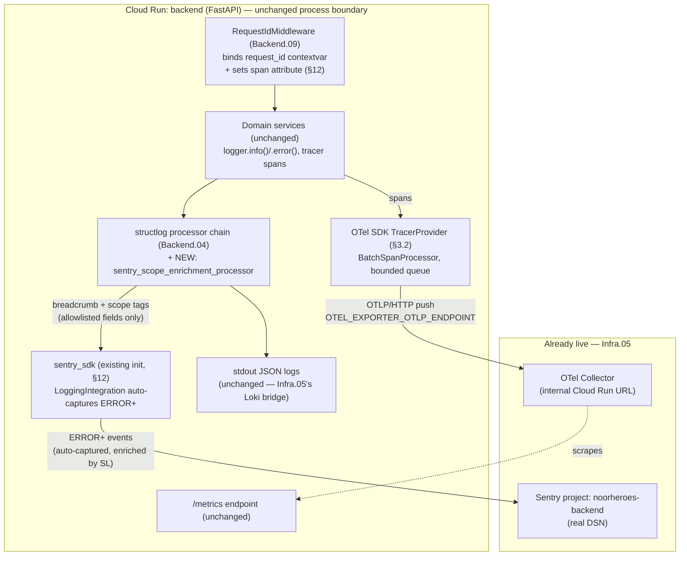

# Phase 2 — Backend Logging/Telemetry: Centralized Sink Integration (Gap Closure)

**File ID:** `Development_Blueprints.Phase2_Backend_Foundation.Backend.11-centralized-observability-sink-integration-gap-closure.md`
**Phase:** Phase 2 — Backend Foundation & Security Baseline Prerequisites
**Closes:** Phase 2 Backend item 04 (`Backend.04-structlog-logging-correlation-ids.md`) — tracked in the Consolidated Execution Blueprint as 🟡 **COMPLETED (partial)**, with the residual gap stated verbatim as: *"Prometheus/OpenTelemetry telemetry confirmed wired in-app; Phase 1's centralized observability stack (Grafana/Sentry sinks) is still open."* This file closes that residual gap now that the referenced Phase 1 stack exists.
**Depends on:**
- `Phase1_Infra_Config.Infra.05-observability-stack-bootstrap.md` — supplies the live OTel Collector's internal URL, the live Grafana Cloud stack, and the two provisioned Sentry projects (`noorheroes-backend`, `noorheroes-admin-web`) with real DSNs already written into Secret Manager. **This file cannot be meaningfully verified end-to-end until `Infra.05` has been applied to Staging** — its code changes can be written and unit-tested beforehand, but §14.3's live acceptance test requires `Infra.05`'s collector to exist.
- `Backend.04-structlog-logging-correlation-ids.md` — the existing structlog processor chain and correlation-ID context this file adds one processor to.
- `Backend.09-middleware-rate-limiting-cors-correlation.md` — owns `RequestIdMiddleware` in the live request pipeline; this file's one possible one-line touch (§12) lands there.
- `Backend.03-config-management-pydantic-settings.md` — the `Settings`/`Environment` class this file extends with new typed fields.
- `Infra.02-secrets-management-env-example-gitleaks.md` — canonical env var names (`SENTRY_DSN`, `OTEL_EXPORTER_OTLP_ENDPOINT`) this file must read, not rename.
- `Infra.03-docker-compose-local-dev-stack.md` — already sets `OTEL_SDK_DISABLED=true` / `SENTRY_DSN=""` in the local backend container's environment block; this file's Settings class must have a typed field to receive that value.

**Consumed by:** every later domain-module blueprint (all of Phase 4 onward) that assumes "an unhandled error surfaces in Sentry" or "a slow endpoint is visible in a Grafana dashboard" — this file plus `Infra.05` are jointly the reason that assumption is true, not merely aspirational.

**Source authority:** `FAST-API-INSTRUCTIONS.md` §2 (`main.py` `lifespan()` — `init_telemetry`/`shutdown_telemetry`), §3 (`core/settings.py` — `Environment`, `Settings`), §4 (Infrastructure Layer — `RequestIdMiddleware`, `StructuredLoggingMiddleware`, "Telemetry & Metrics → Prometheus metrics & OpenTelemetry distributed tracing"); `Phase1_Infra_Config.Infra.05-observability-stack-bootstrap.md` §6.1 (collector receiver contract), §9.3 (PII defense-in-depth pattern this file mirrors on the backend side), §12 (the two bounded backend-code exceptions this file is the authoritative implementer of), §18 assumption 3.

---

## 1. Objective and Purpose

**This is a gap-closure / wiring task on existing, working code. It is not a rebuild, and it is not new instrumentation.**

The backend already has, confirmed built and working per `FAST-API-INSTRUCTIONS.md`:
- structlog structured JSON logging with a processor chain that merges request-scoped correlation IDs (`RequestIdMiddleware`, `Backend.09`) into every log line.
- An OpenTelemetry SDK, initialized somewhere inside `init_telemetry()` (called from `main.py`'s `lifespan()`), emitting spans for inbound requests.
- A Prometheus metrics registry exposed at `/metrics`.

None of this was ever broken. The gap, precisely: until `Infra.05` existed, there was no live OTel Collector to receive the spans, no live Grafana to query the metrics, and no real Sentry project to receive errors — so the SDKs were either disabled (`OTEL_SDK_DISABLED=true` locally, per `Infra.03`) or pointed at nothing (`SENTRY_DSN=""`). The signal-generation code was never the problem; the signal had nowhere real to land, and the code that *decides where to send it* was never built out to handle a real destination correctly across environment tiers.

`Infra.05` closed the infrastructure half of that gap: a real collector now exists in Staging, real Sentry projects exist, and `Infra.05`'s own Terraform changes the **value** `Cloud Run` injects for `OTEL_EXPORTER_OTLP_ENDPOINT`. What `Infra.05` explicitly does **not** do (see its §12/§18 assumption 3) is touch backend application code beyond two narrowly bounded, conditional one-line exceptions. This file is where the actual backend-side application code that makes the sink wiring real, environment-aware, and safe lives:

1. Typed `Settings` fields for every observability env var this file reads (§3.1), replacing implicit/undocumented environment variable reads with validated, defaulted, per-tier-aware configuration.
2. The `init_telemetry()` code that conditionally constructs the OTel exporter/processor pipeline from those settings — including the bounded-queue, non-blocking, batch-export configuration `Infra.05`'s own error-handling section flagged as "a note for whoever reviews the existing `init_telemetry`, not a change `Infra.05` makes" (§3.2).
3. A **new** structlog processor that bridges structlog's request-scoped context into Sentry's active scope and breadcrumb trail (§3.3) — the one piece of genuinely new code this file adds, and the concrete answer to "what does 'wiring structlog to Sentry' actually mean in code."
4. Confirmation (and, only if genuinely missing, the single-line addition) of the two backend-code touches `Infra.05` §12 flagged as its own bounded exceptions — implemented here, in the Backend-owned file, rather than inside an Infra-owned Terraform spec (§12).

**Explicitly out of scope** (do not duplicate or re-litigate — see also §2):
- Re-instrumenting the backend with new spans, new metrics, or new business-logic log statements. Every span, every Prometheus metric, every `logger.info(...)`/`logger.error(...)` call site in domain code is unchanged.
- Anything provisioned by `Infra.05` — the collector deployment, Grafana dashboards, alert rules, the Sentry *projects themselves*, the Cloud Logging→Pub/Sub→Loki bridge. This file only makes the backend correctly *use* what `Infra.05` stood up.
- Renaming, restructuring, or adding new fields to any existing structlog log line's output shape, or renaming any existing OTel span name/attribute. Only exporters and one enrichment processor are added (§18 assumption 1).
- Admin-web's Sentry wiring (`NEXT_PUBLIC_SENTRY_DSN`, the existing `logger`/`redact()`) — untouched, out of this Backend-scoped file entirely; that surface is `Infra.05`'s and admin-web's own existing code, respectively.

---

## 2. Scope and Requirements

### 2.1 In scope

1. New typed fields on the existing `Settings` class (`core/settings.py`) for every observability-related env var this file's code reads: `OTEL_SDK_DISABLED`, `OTEL_EXPORTER_OTLP_ENDPOINT`, `OTEL_EXPORTER_OTLP_PROTOCOL` (new), `SENTRY_DSN`, `SENTRY_TRACES_SAMPLE_RATE` (new), `SENTRY_STRUCTLOG_MIN_LEVEL` (new), and four new OTel `BatchSpanProcessor` tuning fields (§7).
2. Environment-tier-driven enable/disable logic: a `Settings.telemetry_enabled` computed property and a `Settings.sentry_enabled` computed property that the existing `init_telemetry()` uses to decide whether to construct real exporters at all, per tier (§3.1, §6.1).
3. The OTel SDK's exporter construction code inside `init_telemetry()` (or whichever existing function performs it) updated to: read the endpoint from `Settings` (not a hardcoded value), use explicit, bounded `BatchSpanProcessor` settings (queue size, batch size, schedule delay, export timeout), and set OTel `Resource` attributes (`service.name`, `service.namespace`, `service.version`, `deployment.environment`) (§3.2).
4. One new file, `infrastructure/logging/sentry_processor.py`, implementing `sentry_scope_enrichment_processor` — a structlog processor inserted into the **existing** processor chain that enriches the active Sentry scope with an explicit allowlist of already-safe fields and records every log line as a Sentry breadcrumb (§3.3).
5. Confirmation (with the code shown here as the reference implementation, to be added **only if inspection proves it's genuinely missing**) of: (a) `sentry_sdk.init()` being called once, inside the existing telemetry-init path, using `settings.sentry_dsn`/`settings.sentry_traces_sample_rate`/`settings.environment`; (b) the correlation-ID middleware setting `request_id` as both a structlog context var (already true) **and** an OTel span attribute on the request's root span (§12).
6. A local, throwaway verification procedure using a manually-started OTel Collector container (never checked into `Infra.03`'s committed `docker-compose.yml`, which deliberately stays telemetry-disabled — see §14.1) so this file's exporter wiring can be proven correct before Staging exists to test against.

### 2.2 Explicitly out of scope

- **Any new span, metric, or log statement in domain/service/repository code.** If a later reader wonders "should this endpoint also emit metric X," that is a different file's decision, not this one's.
- **The OTel Collector, Grafana dashboards, alert rules, or Sentry project provisioning** — entirely `Infra.05`'s job, already done.
- **Sampling strategy beyond the fixed, explicit rates this file sets** (§10, §18) — head-based trace sampling tuning for production traffic volume is a `Infra.05` §15 production-promotion concern, not this file's.
- **Any change to what data is logged or spanned** — this file only changes *where existing signal goes* and *what safe subset of it Sentry's scope sees*, never *what gets captured in the first place*.
- **PII redaction logic changes on the primary structlog JSON output path** — that output is unchanged; this file's new processor is an additional, narrower, allowlist-based enrichment step that runs *in addition to*, not *instead of*, the existing renderer.

---

## 3. Technical Implementation Details

### 3.1 `Settings` additions — environment-driven enable/disable per tier

```python
# src/noorheroes/core/settings.py
# MODIFIED — existing Settings class, existing fields and Environment enum UNCHANGED.
# All fields below are ADDITIONS only.

from typing import Literal
from pydantic import Field, computed_field


class Settings(BaseSettings):
    # ... all existing fields (database_url, redis_url, jwt_signing_key, etc.) unchanged ...

    # --- Observability sink wiring (this file) ---
    otel_sdk_disabled: bool = Field(default=True, alias="OTEL_SDK_DISABLED")
    otel_exporter_otlp_endpoint: str = Field(
        default="http://localhost:4318", alias="OTEL_EXPORTER_OTLP_ENDPOINT"
    )
    otel_exporter_otlp_protocol: Literal["http/protobuf", "grpc"] = Field(
        default="http/protobuf", alias="OTEL_EXPORTER_OTLP_PROTOCOL"
    )
    otel_bsp_max_queue_size: int = Field(default=2048, alias="OTEL_BSP_MAX_QUEUE_SIZE")
    otel_bsp_max_export_batch_size: int = Field(
        default=512, alias="OTEL_BSP_MAX_EXPORT_BATCH_SIZE"
    )
    otel_bsp_schedule_delay_millis: int = Field(
        default=5_000, alias="OTEL_BSP_SCHEDULE_DELAY_MILLIS"
    )
    otel_bsp_export_timeout_millis: int = Field(
        default=10_000, alias="OTEL_BSP_EXPORT_TIMEOUT_MILLIS"
    )

    sentry_dsn: str | None = Field(default=None, alias="SENTRY_DSN")
    sentry_traces_sample_rate: float = Field(
        default=0.0, ge=0.0, le=1.0, alias="SENTRY_TRACES_SAMPLE_RATE"
    )
    sentry_structlog_min_level: Literal["debug", "info", "warning", "error", "critical"] = (
        Field(default="warning", alias="SENTRY_STRUCTLOG_MIN_LEVEL")
    )

    @computed_field  # type: ignore[misc]
    @property
    def telemetry_enabled(self) -> bool:
        """True only when the OTel SDK should construct real exporters and pipelines."""
        return not self.otel_sdk_disabled

    @computed_field  # type: ignore[misc]
    @property
    def sentry_enabled(self) -> bool:
        """True only when a non-empty DSN is configured — Sentry SDK is otherwise a safe no-op,
        but gating explicitly here keeps the decision visible and testable rather than relying
        on sentry_sdk's own internal empty-DSN no-op behavior."""
        return bool(self.sentry_dsn)
```

`sentry_dsn` deliberately stays `str | None` (not given a non-empty default) — an empty/unset value is the correct, safe, and expected state for Local and CI per `Infra.03`'s `SENTRY_DSN: ""` env block, and must never be treated as a configuration error.

### 3.2 OTel SDK exporter/resource/processor configuration

```python
# src/noorheroes/infrastructure/telemetry.py
# MODIFIED — existing module. init_telemetry()/shutdown_telemetry() function SIGNATURES
# unchanged (main.py's lifespan() calls them exactly as before); bodies extended as shown.

import structlog
from opentelemetry import trace
from opentelemetry.exporter.otlp.proto.http.trace_exporter import OTLPSpanExporter
from opentelemetry.sdk.resources import Resource
from opentelemetry.sdk.trace import TracerProvider
from opentelemetry.sdk.trace.export import BatchSpanProcessor

from noorheroes.core.settings import Settings

logger = structlog.get_logger(__name__)

_tracer_provider: TracerProvider | None = None


def init_opentelemetry(settings: Settings) -> None:
    """Idempotent. Called once from init_telemetry() during app startup."""
    global _tracer_provider

    if not settings.telemetry_enabled:
        # This IS the correct behavior for Local/CI (Infra.03's OTEL_SDK_DISABLED=true).
        # No TracerProvider is registered; the OpenTelemetry API's default no-op tracer
        # remains active, so every existing `tracer.start_as_current_span(...)` call site
        # in domain/middleware code keeps working exactly as before — it just produces
        # spans that are created and immediately discarded, at effectively zero cost.
        logger.info("otel.telemetry_disabled", environment=settings.environment.value)
        return

    resource = Resource.create(
        {
            "service.name": "noorheroes-backend",
            "service.namespace": "noorheroes",
            "service.version": settings.release_version,  # existing Settings field (git SHA / semver)
            "deployment.environment": settings.environment.value,
        }
    )

    exporter = OTLPSpanExporter(
        endpoint=f"{settings.otel_exporter_otlp_endpoint}/v1/traces",
        timeout=settings.otel_bsp_export_timeout_millis / 1000,
    )
    span_processor = BatchSpanProcessor(
        exporter,
        max_queue_size=settings.otel_bsp_max_queue_size,
        max_export_batch_size=settings.otel_bsp_max_export_batch_size,
        schedule_delay_millis=settings.otel_bsp_schedule_delay_millis,
        export_timeout_millis=settings.otel_bsp_export_timeout_millis,
    )

    _tracer_provider = TracerProvider(resource=resource)
    _tracer_provider.add_span_processor(span_processor)
    trace.set_tracer_provider(_tracer_provider)

    logger.info(
        "otel.telemetry_enabled",
        endpoint=settings.otel_exporter_otlp_endpoint,
        environment=settings.environment.value,
    )


def shutdown_opentelemetry() -> None:
    """Called from shutdown_telemetry() during app shutdown — flushes any queued spans
    with a bounded timeout so process exit is never blocked indefinitely on a stuck exporter."""
    if _tracer_provider is not None:
        _tracer_provider.shutdown()
```

`max_queue_size=2048` with `BatchSpanProcessor`'s default drop-oldest-on-overflow behavior is the concrete answer to `Infra.05`'s open note ("confirm the existing SDK init uses a bounded queue... a note for whoever reviews the existing `init_telemetry`, not a change this file makes") — this file is that review, and this is the explicit, tested, bounded configuration. `export_timeout_millis=10_000` bounds how long a single export attempt can block the SDK's background export thread (never the request-handling thread — the exporter always runs off the hot path) before it's abandoned and the batch is dropped.

### 3.3 The new structlog → Sentry processor (the file's principal new code)

This is the concrete, literal answer to "add a structlog sink/processor for Sentry." It is a small, single-purpose module — not a rewrite of the existing processor chain.

```python
# src/noorheroes/infrastructure/logging/sentry_processor.py
# NEW FILE — the one genuinely new source file this gap-closure adds.

from __future__ import annotations

from typing import Any, MutableMapping

import sentry_sdk

# Explicit ALLOWLIST, not a denylist — mirrors Infra.05 §9.3's collector-side
# `attributes/pii_defense_in_depth` processor's defense-in-depth philosophy, but stricter:
# only these exact keys are ever copied out of a structlog event_dict into the Sentry scope.
# Every other field already present in the structlog event_dict (which may legitimately
# contain more, per existing domain-code log statements) is NEVER forwarded here — it stays
# only in the unchanged stdout JSON path Infra.05's Loki bridge already carries.
_SENTRY_SAFE_TAG_KEYS: frozenset[str] = frozenset(
    {
        "request_id",
        "trace_id",
        "span_id",
        "http_method",
        "http_route",
        "http_status_code",
        "environment",
        "service_version",
    }
)
_SENTRY_SAFE_CONTEXT_KEYS: frozenset[str] = frozenset(
    {
        "duration_ms",
        "family_id",   # opaque ULID, never a name/email
        "child_id",    # opaque ULID, never a name
        "admin_id",    # opaque ULID, never a name/email
    }
)
_LEVEL_ORDER = {"debug": 10, "info": 20, "warning": 30, "error": 40, "critical": 50}


def sentry_scope_enrichment_processor(
    logger: Any, method_name: str, event_dict: MutableMapping[str, Any]
) -> MutableMapping[str, Any]:
    """
    structlog processor. Positioned as the LAST processor before the renderer in the
    existing chain (see §3.4) — it must run after every existing context-merging
    processor so request_id/trace_id/etc. are already present in event_dict, and before
    the JSON renderer so it never affects the rendered log line's shape.

    This processor NEVER calls sentry_sdk.capture_event()/capture_message() — event
    capture remains entirely owned by sentry_sdk's LoggingIntegration (auto-installed by
    the existing sentry_sdk.init() call, §12), which already captures any log record at
    ERROR level or above (and any explicit exception) as a Sentry issue. Calling capture_*
    here as well would double-report every error. This processor's only two jobs:

      1. Enrich the ACTIVE Sentry scope with an explicit allowlist of already-non-PII
         fields, so whatever event LoggingIntegration captures carries request_id,
         trace_id, and the other tags above — closing the Loki<->Sentry correlation gap
         the same way Infra.05 §14.3 step 3 closes the Loki<->Tempo gap.
      2. Record EVERY log line, regardless of level, as a Sentry breadcrumb — so an
         eventual error's Sentry issue page shows the sequence of log lines that led up
         to it, which is exactly what "structlog sink for Sentry" means in practice.

    Returns event_dict UNCHANGED — this processor is purely a side-effecting tap, never
    a transform. It must never raise: any sentry_sdk call failing (e.g. Sentry SDK not
    yet initialized because sentry_enabled is False) is caught and swallowed, because a
    telemetry side-channel must never break the primary logging path (§10).
    """
    try:
        scope = sentry_sdk.get_current_scope()
        for key in _SENTRY_SAFE_TAG_KEYS:
            if key in event_dict:
                scope.set_tag(key, event_dict[key])

        safe_context = {k: event_dict[k] for k in _SENTRY_SAFE_CONTEXT_KEYS if k in event_dict}
        if safe_context:
            scope.set_context("structlog", safe_context)

        level_name = str(event_dict.get("level", "info")).lower()
        min_rank = _LEVEL_ORDER.get(level_name, _LEVEL_ORDER["info"])
        sentry_sdk.add_breadcrumb(
            category="structlog",
            message=str(event_dict.get("event", "")),
            level=level_name if level_name in _LEVEL_ORDER else "info",
            data=safe_context,
        )
        _ = min_rank  # breadcrumbs are recorded at every level by design (Sentry itself
                       # caps the breadcrumb trail length); only EVENT capture is level-gated,
                       # and that gating lives in sentry_sdk's own LoggingIntegration config,
                       # driven by settings.sentry_structlog_min_level (§3.4 / §6.1).
    except Exception:  # noqa: BLE001 — deliberate: telemetry must never break logging
        pass

    return event_dict
```

### 3.4 Where the new processor is inserted — existing chain, one addition

```python
# src/noorheroes/infrastructure/telemetry.py (continued)
# MODIFIED — configure_structlog() is an EXISTING function (Backend.04). The processor
# LIST is extended by inserting exactly one new entry; every existing processor, its
# order relative to every OTHER existing processor, and every existing log field name
# stay unchanged.

import structlog
from noorheroes.infrastructure.logging.sentry_processor import sentry_scope_enrichment_processor


def configure_structlog(settings: Settings) -> None:
    structlog.configure(
        processors=[
            structlog.contextvars.merge_contextvars,     # existing — carries request_id, etc.
            structlog.processors.add_log_level,           # existing
            structlog.processors.TimeStamper(fmt="iso"),  # existing
            # ... any other existing processors (e.g. exception formatting) stay exactly
            #     where they already are, unchanged ...
            sentry_scope_enrichment_processor,             # <-- THE ONE LINE THIS FILE ADDS
            structlog.processors.JSONRenderer(),           # existing — must stay LAST
        ],
        wrapper_class=structlog.make_filtering_bound_logger(settings.log_level_int),  # existing
        logger_factory=structlog.stdlib.LoggerFactory(),   # existing
        cache_logger_on_first_use=True,                    # existing
    )
```

`sentry_scope_enrichment_processor` is inserted immediately before `JSONRenderer` (which must remain the final processor, unchanged) and after every context-merging processor, so it observes the fully-assembled `event_dict` — including `request_id` — exactly as it will be rendered to stdout, without altering that render in any way.

### 3.5 Per-tier behavior summary

| Environment tier | `OTEL_SDK_DISABLED` | `telemetry_enabled` | `SENTRY_DSN` | `sentry_enabled` | `SENTRY_TRACES_SAMPLE_RATE` |
|---|---|---|---|---|---|
| **LOCAL** (`Infra.03` docker-compose) | `true` | `False` — no real exporters constructed | `""` | `False` — SDK never initialized | n/a |
| **CI** (test runs) | `true` | `False` | `""` | `False` | n/a |
| **STAGING** (`Infra.05`-provisioned) | `false` | `True` — points at `Infra.05`'s collector internal URL | real DSN from Secret Manager | `True` | `0.0` (§18 — Sentry performance tracing deliberately off; OTel/Tempo, already wired, is the tracing source of truth, so Sentry's separate tracing pipeline would be pure duplication) |
| **PRODUCTION** (future promotion of `Infra.05`) | `false` | `True` | real DSN | `True` | `0.0`, same reasoning, revisit only if Sentry Performance is deliberately adopted later |

---

## 4. Architecture and Component Responsibilities



| Component | Responsibility (this file) | File |
|---|---|---|
| `Settings` observability fields | Typed, validated, per-tier env var surface — the single source of truth every piece below reads from | `core/settings.py` |
| `init_opentelemetry()` | Constructs (or skips) the real OTel exporter/processor pipeline, reading only `Settings` | `infrastructure/telemetry.py` |
| `configure_structlog()` | Existing structlog setup, extended with exactly one new processor entry | `infrastructure/telemetry.py` |
| `sentry_scope_enrichment_processor` | New: bridges structlog's per-request context into Sentry's active scope + breadcrumb trail, allowlist-only | `infrastructure/logging/sentry_processor.py` |
| `RequestIdMiddleware` | Existing (`Backend.09`); confirmed/extended by exactly one line so `request_id` is both a structlog contextvar and an OTel span attribute | `infrastructure/middleware/request_id.py` |
| `sentry_sdk.init()` call | Existing (per `Infra.05`'s assumption) or added here if genuinely missing — the one place `Settings.sentry_dsn`/`sentry_traces_sample_rate` become a live SDK config | `infrastructure/telemetry.py`, inside `init_telemetry()` |

This file introduces **zero new runtime services**. Everything above executes inside the existing backend process; `Infra.05`'s collector/Sentry projects are consumed, never re-provisioned.

---

## 5. Folder / File Structure

```
backend/src/noorheroes/
├── core/
│   └── settings.py                        # MODIFIED — new fields per §3.1, existing fields untouched
├── infrastructure/
│   ├── telemetry.py                       # MODIFIED — init_telemetry()/shutdown_telemetry() bodies
│   │                                       #   extended per §3.2/§3.4; signatures unchanged
│   ├── logging/
│   │   ├── __init__.py                    # UNCHANGED (or created if the package didn't exist —
│   │   │                                   #   see §13 step 1; structlog config may currently live
│   │   │                                   #   directly in telemetry.py, in which case this is a
│   │   │                                   #   new sibling package, not a refactor of that file)
│   │   └── sentry_processor.py            # NEW — §3.3, the file's one new source file
│   └── middleware/
│       └── request_id.py                  # UNCHANGED, unless §12's inspection finds the span
│                                           #   attribute genuinely missing (then: ONE line added)
└── main.py                                # UNCHANGED — lifespan() already calls init_telemetry()/
                                            #   shutdown_telemetry() with the same signatures

backend/tests/
└── infrastructure/
    └── logging/
        └── test_sentry_processor.py       # NEW — unit tests per §14.1

backend/.env.example                        # MODIFIED — new keys appended per §7 (values commented/
                                            #   empty, matching Infra.02's existing convention)
```

**Why no new top-level module:** every piece of code this file adds is a small extension of infrastructure the codebase already organizes exactly this way (`infrastructure/telemetry.py` for cross-cutting SDK init, `infrastructure/middleware/` for HTTP-layer concerns) — introducing a new top-level package for one processor function would be over-structuring a five-function change.

---

## 6. APIs, Models, Interfaces, and Data Flow

### 6.1 `init_telemetry()` — orchestration contract (existing function, extended body)

```python
# src/noorheroes/infrastructure/telemetry.py

def init_telemetry(settings: Settings) -> None:
    """Called once from main.py's lifespan() startup path — signature UNCHANGED."""
    configure_structlog(settings)              # existing, now includes the new processor (§3.4)
    init_sentry(settings)                      # existing (per Infra.05 §12) or added here (§12)
    init_opentelemetry(settings)                # extended per §3.2
    # Prometheus registry setup — existing, unmodified by this file


def shutdown_telemetry() -> None:
    """Called once from main.py's lifespan() shutdown path — signature UNCHANGED."""
    shutdown_opentelemetry()                    # new, bounded-timeout flush, §3.2
    # any existing Sentry/structlog shutdown behavior, unmodified


def init_sentry(settings: Settings) -> None:
    """Reference implementation — add ONLY if §12's inspection finds no sentry_sdk.init()
    call anywhere in the existing telemetry-init path. If found, this file changes nothing
    here beyond confirming the arguments below are already being passed."""
    if not settings.sentry_enabled:
        return
    import sentry_sdk
    from sentry_sdk.integrations.logging import LoggingIntegration
    import logging

    sentry_sdk.init(
        dsn=settings.sentry_dsn,
        environment=settings.environment.value,
        release=settings.release_version,
        traces_sample_rate=settings.sentry_traces_sample_rate,
        integrations=[
            LoggingIntegration(
                level=logging.INFO,   # breadcrumbs from stdlib/structlog-bridged records
                event_level=getattr(logging, settings.sentry_structlog_min_level.upper()),
            )
        ],
    )
```

`event_level` is driven by the new `SENTRY_STRUCTLOG_MIN_LEVEL` setting (default `"warning"`) — this is the single knob that controls "how bad does a log line have to be before it becomes a Sentry *issue*," independent of "every log line becomes a breadcrumb," which `sentry_scope_enrichment_processor` (§3.3) always does regardless of level.

### 6.2 `sentry_scope_enrichment_processor` — interface

```python
def sentry_scope_enrichment_processor(
    logger: Any, method_name: str, event_dict: MutableMapping[str, Any]
) -> MutableMapping[str, Any]:
    ...
```

This is the standard structlog processor interface (`Callable[[Any, str, MutableMapping], MutableMapping]`) — no new interface is invented; the function is a drop-in entry in the existing processor list.

### 6.3 Data flow

**Traces:** domain code's existing `tracer.start_as_current_span(...)` calls (unchanged) → `BatchSpanProcessor` (bounded queue, §3.2) → `OTLPSpanExporter` → `Settings.otel_exporter_otlp_endpoint` (Local: unused, SDK disabled; Staging: `Infra.05`'s collector internal URL) → `Infra.05`'s collector → Tempo.

**Metrics:** unchanged — process-local Prometheus registry, scraped by `Infra.05`'s collector at `/metrics`. This file makes no metrics-path changes.

**Logs → stdout (primary path, unchanged):** `logger.info(...)`/`.error(...)` → existing processor chain (context merge, level, timestamp, ...) → `JSONRenderer` → stdout → `Infra.05`'s Cloud Logging → Pub/Sub → Loki bridge.

**Logs → Sentry (new path, this file):** the same `event_dict`, mid-chain, additionally flows through `sentry_scope_enrichment_processor` → Sentry's active scope (tags/context, allowlist-only) + a breadcrumb — entirely in-process, no network call of its own (breadcrumbs are buffered client-side by `sentry_sdk` and only transmitted as part of whatever event eventually gets captured).

**Errors → Sentry:** any log record at `SENTRY_STRUCTLOG_MIN_LEVEL` or above, or any explicitly captured exception → `sentry_sdk`'s `LoggingIntegration` → Sentry ingest API directly (unchanged vendor path, per `Infra.05` §6.5) → arrives at Sentry already carrying the tags/context/breadcrumbs `sentry_scope_enrichment_processor` attached to the active scope during the request.

---

## 7. Dependencies and Configuration Requirements

### 7.1 Env vars this file reads (already reserved by `Infra.02`/`Infra.03` — unchanged names)

| Var | Source of truth for the *value* | This file's role |
|---|---|---|
| `OTEL_SDK_DISABLED` | `Infra.03` (`"true"` locally), `Infra.05`'s Terraform value-wiring (`false` in Staging) | Read into `Settings.otel_sdk_disabled`; drives `telemetry_enabled` |
| `OTEL_EXPORTER_OTLP_ENDPOINT` | `Infra.02` default (`http://localhost:4318`), `Infra.05`'s Terraform value-wiring in Staging | Read into `Settings.otel_exporter_otlp_endpoint`; used only when `telemetry_enabled` |
| `SENTRY_DSN` | `Infra.03` (`""` locally), `Infra.05`'s Secret-Manager-sourced real value in Staging | Read into `Settings.sentry_dsn`; drives `sentry_enabled` |

### 7.2 New env vars this file introduces (add to `backend/.env.example`, empty/default locally, matching `Infra.02`'s existing convention)

```dotenv
# --- Observability sink wiring (Backend.11 gap closure) ---
OTEL_EXPORTER_OTLP_PROTOCOL=http/protobuf
OTEL_BSP_MAX_QUEUE_SIZE=2048
OTEL_BSP_MAX_EXPORT_BATCH_SIZE=512
OTEL_BSP_SCHEDULE_DELAY_MILLIS=5000
OTEL_BSP_EXPORT_TIMEOUT_MILLIS=10000
SENTRY_TRACES_SAMPLE_RATE=0.0
SENTRY_STRUCTLOG_MIN_LEVEL=warning
```

None of these six are secrets — they are tuning knobs, added to `.env.example` in the same "non-secret, tuning-only" category `Infra.02` §7.2 already uses for `CORS_ALLOWED_ORIGINS`/`RATE_LIMIT_DEFAULT_PER_MINUTE`, not the `# CREDENTIAL` category. No change to `Infra.02`'s gitleaks/trufflehog allowlist is needed.

### 7.3 Python package dependencies (additive only — confirm present, do not upgrade unrelated pins)

| Package | Why | Already implied by existing instrumentation? |
|---|---|---|
| `opentelemetry-sdk` | `TracerProvider`, `BatchSpanProcessor`, `Resource` | Yes — required for spans to exist at all today |
| `opentelemetry-exporter-otlp-proto-http` | `OTLPSpanExporter` | Confirm present; if the existing SDK init currently uses no real exporter (because there was never anywhere to send to), this exact package may need adding — check `pyproject.toml` first |
| `sentry-sdk[fastapi]` | `sentry_sdk.init()`, `LoggingIntegration` | Confirm present per `Infra.05` §12's assumption; add only if genuinely missing |
| `structlog` | processor chain | Already present (`Backend.04`) |

---

## 8. Database / Storage Requirements

**None.** This file introduces no new database table, no new Redis key, no new persistent storage of any kind. Every piece of state it touches (the OTel `TracerProvider`'s in-memory batch queue, `sentry_sdk`'s in-memory breadcrumb ring buffer) is process-local, ephemeral, and already accounted for by the existing SDKs' own memory management — this file only tunes the bounds (§3.2), it does not introduce new storage.

---

## 9. Authentication, Authorization, Validation, and Security Considerations

### 9.1 Secret sourcing — defer entirely to the secrets-manager gap-closure and `Infra.05`

`SENTRY_DSN`'s real, non-empty Staging/Production value is sourced from GCP Secret Manager and injected as a Cloud Run runtime env var — this file **never** hardcodes, logs, or re-derives that value. It only declares the typed `Settings.sentry_dsn` field that receives whatever the runtime environment already provides. For the full chain of how that secret gets from Sentry's API into Secret Manager into the running container, see `Infra.05` §7/§9.2 and the project's secrets-manager gap-closure file (the mechanism by which every backend secret — `JWT_SIGNING_KEY`, `R2_SECRET_ACCESS_KEY`, `SENTRY_DSN` alike — is sourced at runtime); this file is a **consumer** of that mechanism, not a second implementation of it.

### 9.2 `OTEL_EXPORTER_OTLP_ENDPOINT` is not a secret, but its reachability is access-controlled elsewhere

The endpoint URL itself is not sensitive (it's an internal Cloud Run hostname) — its protection is `Infra.05` §9.1's `INGRESS_TRAFFIC_INTERNAL_ONLY` + IAM `run.invoker` binding scoped to the backend's own runtime service account. This file's `OTLPSpanExporter` construction (§3.2) does not add its own authentication — it relies entirely on the network-level/IAM protection `Infra.05` already established; do not add a bearer token or API key to the exporter config, since none is expected or checked on the collector side.

### 9.3 PII scrubbing — this file's allowlist is a second, independent layer

Three independent layers now exist between a structlog event and any external observability vendor, and this file is responsible for exactly the middle one:

1. **Application code** never puts PII into log fields or span attributes in the first place — unchanged, existing discipline, not modified or audited by this file.
2. **This file's `sentry_scope_enrichment_processor`** (§3.3) uses a fixed, small **allowlist** (not a denylist) of field names — `request_id`, `trace_id`, IDs (never names/emails), timing, HTTP metadata. Anything not on that list is never forwarded to Sentry's scope or breadcrumbs, full stop, regardless of what it's called or what it contains.
3. **`Infra.05`'s collector-side `pii_defense_in_depth` processor** (§9.3 of that file) is a third, independent denylist-based net on the trace-export path specifically.

An allowlist is deliberately chosen here (rather than mirroring `Infra.05`'s denylist) because this processor's job is narrower — enriching a scope with a handful of known-good fields — where a denylist would require predicting every possible PII field name a future domain-code log statement might introduce; an allowlist fails safe (a new field is silently dropped, not silently leaked) where a denylist fails open.

### 9.4 The Sentry scope's breadcrumb trail is per-request, not global

`sentry_sdk.get_current_scope()` inside an async FastAPI request handler is contextvar-scoped per the SDK's own async support — breadcrumbs and tags set during one request's structlog processing do not leak into a concurrently-handled different request's Sentry scope. This is existing `sentry_sdk` behavior this file relies on but does not implement; confirm the existing `sentry_sdk.init()` (or the one added per §12) does not disable this via `auto_session_tracking=False` or a custom scope-management override that would break the isolation.

---

## 10. Error Handling and Edge Cases

| Scenario | Handling |
|---|---|
| Collector unreachable (Staging collector restarting, network blip) | The OTel SDK's `BatchSpanProcessor` export runs on its own background thread — a failed export attempt is retried/dropped per the exporter's own internal policy (`OTLPSpanExporter` does not block the caller); the bounded `max_queue_size=2048` (§3.2) means a prolonged outage drops the oldest queued spans rather than growing backend memory unboundedly. **A request handler is never blocked or failed because of a telemetry export failure** — this is the single hardest requirement of this file, and every exporter/processor construction above is designed to fail silently on the telemetry side. |
| Sentry SDK not initialized (`sentry_enabled=False`, e.g. Local/CI) | `sentry_scope_enrichment_processor` wraps every `sentry_sdk` call in a bare `try/except` (§3.3) — calling `sentry_sdk.get_current_scope()`/`add_breadcrumb()` before `sentry_sdk.init()` has run is a documented no-op in the SDK itself (it returns an inert scope), but the explicit `try/except` is kept as defense-in-depth against any future SDK version changing that guarantee. |
| Sentry ingest API unreachable/rate-limited | Entirely `sentry_sdk`'s own internal transport queue/retry behavior — this file adds no additional handling, since it is not on this file's code path (breadcrumbs/tags are local scope mutations; only `LoggingIntegration`'s eventual `capture_event` talks to the network, and that call is already fire-and-forget by SDK design). |
| Sampling under load | Explicit, fixed values only (§3.5): traces at 100% via `Infra.05`'s collector-side decision (unchanged by this file — this file's SDK-side `BatchSpanProcessor` does no head sampling of its own; it batches and exports everything it's given), `SENTRY_TRACES_SAMPLE_RATE=0.0` (Sentry's own separate performance-tracing pipeline is deliberately off, avoiding a duplicate, uncoordinated sampling decision alongside OTel's). Tuning either for real production load is `Infra.05` §15's job, not this file's. |
| A log line is emitted before `configure_structlog()`/`init_telemetry()` has run (startup race) | Not a new risk this file introduces — `main.py`'s `lifespan()` already calls `init_telemetry()` before the app starts accepting requests (existing, unmodified ordering); this file adds no code that runs before that point. |
| `sentry_scope_enrichment_processor` itself raises | Caught internally (§3.3's `try/except`) and the original, unmodified `event_dict` is returned — a broken telemetry enrichment step must never break or alter the primary log line. |
| PII somehow present in one of the six allowlisted field names (e.g. a future bug binds a real name under a key literally called `child_id`) | Not preventable by this file's allowlist alone (the allowlist only decides *which key names* pass through, not what a given call site put *in* them) — the actual guarantee that `child_id`/`family_id`/`admin_id` are always opaque ULIDs, never names, is an existing, unrelated invariant of the domain layer's ID scheme (every "id" field in every model per `FAST-API-INSTRUCTIONS.md` §5 is a ULID/UUID). This file's contribution is narrowing *what class of fields* can reach Sentry at all — it does not and cannot re-validate the contents of each one. |

---

## 11. State Management and Lifecycle Considerations

1. **`TracerProvider` lifecycle:** constructed once in `init_opentelemetry()` at app startup, held in a module-level `_tracer_provider` reference, `shutdown()` called once from `shutdown_opentelemetry()` at app shutdown (§3.2) — this is a bounded-timeout flush of any queued-but-unexported spans; it does not block shutdown indefinitely (`BatchSpanProcessor.shutdown()` has the SDK's own internal timeout).
2. **`sentry_sdk` lifecycle:** initialized once via `sentry_sdk.init()` (existing or §12-added); the SDK manages its own background transport thread and breadcrumb ring buffer internally — this file does not add any explicit shutdown call beyond whatever the existing telemetry-shutdown path already does (if none exists today, none is required — `sentry_sdk` flushes its transport queue on process exit via its own `atexit` hook by default).
3. **`Settings` fields:** loaded once at process startup like every other `Settings` field (existing `pydantic-settings` behavior, `Backend.03`) — not re-read per-request, not hot-reloadable. A change to `SENTRY_TRACES_SAMPLE_RATE`/`OTEL_EXPORTER_OTLP_ENDPOINT` in Staging requires a redeploy (Cloud Run env var change → new revision), same as every other `Settings` field today.
4. **`sentry_scope_enrichment_processor`'s per-request scope state:** entirely owned by `sentry_sdk`'s own contextvar-based scope isolation (§9.4) — this file's processor is stateless itself; it reads `event_dict` and writes to whatever scope is currently active, with no module-level mutable state of its own.
5. **No caching, no TTLs, no background jobs** are introduced by this file — every piece of it executes synchronously (from the calling code's perspective; the actual network I/O is backgrounded by the respective SDKs) within the request or startup/shutdown lifecycle that already exists.

---

## 12. Integration Points with Existing Modules

| Integration point | Detail |
|---|---|
| Existing structlog config module (`Backend.04`, `infrastructure/telemetry.py`'s `configure_structlog()`) | **The only change:** one new processor (`sentry_scope_enrichment_processor`) inserted immediately before the existing `JSONRenderer`. Every other processor, its order, and every existing log field name is unchanged (§3.4, §18 assumption 1). |
| Existing OTel setup module (`init_telemetry()`/`init_opentelemetry()`, `infrastructure/telemetry.py`) | Extended, not replaced: the function now reads `Settings` for the endpoint/protocol/batch-processor tuning instead of whatever it read before (a hardcoded value, or an incomplete config) — signature and call site (`main.py`'s `lifespan()`) unchanged (§3.2, §6.1). |
| Existing correlation-ID middleware (`RequestIdMiddleware`, `Backend.09`) | **Bounded exception, shared with `Infra.05` §12 — implemented here, not there.** Inspect the actual middleware first (§13 step 3). If the root span does not already carry `request_id` as a span attribute, add exactly the one line shown in §3's reference (`current_span.set_attribute("request_id", request_id)`) inside the existing `dispatch()` method. **This file, not `Infra.05`, is the authoritative implementer of this specific line** — because it is backend application code, Phase 2 Backend's natural domain, not Infra's. If `Infra.05` happens to be implemented first and its implementer already added this same line under its own §12 bounded exception, this file's step is then a no-op confirmation, not a duplicate edit — the change is idempotent either way (the line either already exists, in which case nothing is added, or it doesn't, in which case exactly one implementer adds it once). |
| Existing `sentry_sdk.init()` call (assumed present per `Infra.05` §12, inside the existing telemetry-init path) | Same shared-bounded-exception relationship as the row above: this file is the authoritative implementer if inspection finds it genuinely missing (§6.1's `init_sentry()` reference implementation), using exactly the `dsn`/`environment`/`release`/`traces_sample_rate` arguments `Infra.05` already assumed would exist, plus the `LoggingIntegration` config this file additionally specifies (`event_level` driven by the new `SENTRY_STRUCTLOG_MIN_LEVEL` setting) — `Infra.05`'s assumed call did not specify `LoggingIntegration` explicitly; this file makes that configuration concrete. |
| `Infra.05`'s collector/Sentry projects | Consumed only via `Settings` values already sourced from Secret Manager/Cloud Run env vars by `Infra.05`'s Terraform — this file never talks to GCP Secret Manager, Terraform, or the Grafana/Sentry APIs directly. |
| `Backend.03`'s `Settings`/`Environment` class | Extended with the new fields in §3.1 — the `Environment` enum itself (`LOCAL`/`DEVELOPMENT`/`STAGING`/`PRODUCTION`) is unchanged; this file only adds fields, never new enum members or a changed default environment. |
| `Infra.03`'s local `docker-compose.yml` | Unchanged by this file — it already sets `OTEL_SDK_DISABLED: "true"` / `SENTRY_DSN: ""` in the `x-backend-env` anchor; this file's new `Settings` fields simply give those existing values (and the six new tuning env vars, which fall back to their coded defaults if absent from `docker-compose.yml`) a typed home. |
| Admin-web's Sentry wiring, KMP's `core-crash`/`core-analytics` | **Not touched.** Out of scope for this Backend-only file, same exclusions `Infra.05` §12 already states for its own scope. |

---

## 13. Development Steps in the Correct Implementation Order

1. **Confirm `Infra.05` is applied to Staging** (or at minimum that its collector/Sentry-project Terraform plan is finalized and the endpoint/DSN values are known) before attempting §14.2's live Staging verification — the code in §3 can be written and unit-tested (§14.1) beforehand, but the end-to-end acceptance bar (§14.2) needs a real collector.
2. **Add the new `Settings` fields** (§3.1) to `core/settings.py`; run the existing `Settings`-loading test (from `Backend.03`) to confirm no existing field or default was disturbed.
3. **Inspect the actual `RequestIdMiddleware` and telemetry-init code** for the two items named in §12 — does the root span already carry a `request_id` attribute? Does `sentry_sdk.init()` already exist? Document the finding (both are the more likely case, per `Infra.05` §18 assumption 3, since `SENTRY_DSN` and the correlation middleware are already established conventions) before writing any of the next two steps.
4. **Add the single-line span-attribute fix** to `RequestIdMiddleware`, only if step 3 found it missing.
5. **Add `init_sentry()`** (§6.1's reference implementation), only if step 3 found no existing `sentry_sdk.init()` call; otherwise, confirm the existing call's arguments match (`dsn`, `environment`, `release`, `traces_sample_rate` sourced from the new `Settings` fields) and add the `LoggingIntegration` configuration if it isn't already present.
6. **Extend `init_opentelemetry()`** per §3.2 — `Resource` attributes, `BatchSpanProcessor` bounded-queue config, endpoint read from `Settings`.
7. **Write `infrastructure/logging/sentry_processor.py`** per §3.3.
8. **Insert `sentry_scope_enrichment_processor` into `configure_structlog()`'s processor list** per §3.4 — immediately before `JSONRenderer`, nowhere else.
9. **Write unit tests** (§14.1) for the new processor and for `Settings`' new computed properties (`telemetry_enabled`, `sentry_enabled`) across all four tiers.
10. **Add the six new env vars to `backend/.env.example`** (§7.2), all non-secret, defaults matching the coded `Settings` defaults.
11. **Run the local throwaway-collector verification** (§14.2) — confirm a real span reaches a manually-started local OTel Collector before trusting the Staging path.
12. **Deploy to Staging** (after `Infra.05` is live) and run the full §14.2 live acceptance checklist.
13. **Confirm `Infra.05`'s own §14.3 acceptance criteria** (Tempo trace, Mimir metric, Loki log, log↔trace pivot, Sentry issue) now pass using this file's code — `Infra.05`'s acceptance test and this file's are the same real-world check, viewed from the infra side and the backend side respectively; if `Infra.05`'s checklist was already run and passed before this file existed, re-run steps 4/5's items specifically to confirm no regression from adding the new processor.

---

## 14. Testing Strategy and Acceptance Criteria

### 14.1 Unit tests (run in CI, no external network, no live collector needed)

```python
# tests/infrastructure/logging/test_sentry_processor.py

def test_enrichment_processor_forwards_only_allowlisted_keys(sentry_sdk_mock):
    event_dict = {
        "event": "child_profile_created",
        "level": "info",
        "request_id": "req_01ABC",
        "family_id": "fam_01XYZ",
        "email": "should-never-appear@example.com",   # NOT on the allowlist
        "password": "should-never-appear",              # NOT on the allowlist
    }
    result = sentry_scope_enrichment_processor(None, "info", event_dict)

    assert result is event_dict  # unchanged pass-through
    sentry_sdk_mock.get_current_scope().set_tag.assert_any_call("request_id", "req_01ABC")
    # "email"/"password" must never appear in any set_tag/set_context/add_breadcrumb call:
    for call in sentry_sdk_mock.get_current_scope().set_tag.call_args_list:
        assert call.args[0] != "email"
        assert call.args[0] != "password"


def test_enrichment_processor_never_raises_when_sentry_uninitialized(monkeypatch):
    monkeypatch.setattr("sentry_sdk.get_current_scope", lambda: (_ for _ in ()).throw(RuntimeError))
    event_dict = {"event": "x", "level": "info"}
    result = sentry_scope_enrichment_processor(None, "info", event_dict)
    assert result == event_dict  # swallowed, not raised


@pytest.mark.parametrize(
    "environment,otel_sdk_disabled,sentry_dsn,expected_telemetry,expected_sentry",
    [
        (Environment.LOCAL, True, "", False, False),
        (Environment.STAGING, False, "https://real@sentry.io/123", True, True),
        (Environment.STAGING, False, "", True, False),  # DSN missing even though tier is Staging
    ],
)
def test_settings_computed_properties_per_tier(
    environment, otel_sdk_disabled, sentry_dsn, expected_telemetry, expected_sentry
):
    settings = Settings(environment=environment, otel_sdk_disabled=otel_sdk_disabled, sentry_dsn=sentry_dsn or None)
    assert settings.telemetry_enabled is expected_telemetry
    assert settings.sentry_enabled is expected_sentry


def test_init_opentelemetry_is_noop_when_telemetry_disabled(monkeypatch):
    settings = Settings(environment=Environment.LOCAL, otel_sdk_disabled=True)
    provider_class = MagicMock()
    monkeypatch.setattr("noorheroes.infrastructure.telemetry.TracerProvider", provider_class)
    init_opentelemetry(settings)
    provider_class.assert_not_called()  # no real SDK construction attempted
```

**Acceptance criterion:** all four tests above pass in CI, with zero network calls and zero dependency on a live collector or Sentry project.

### 14.2 Local, throwaway-collector integration verification (manual, once, before trusting Staging)

`Infra.03`'s committed `docker-compose.yml` deliberately keeps telemetry disabled (`OTEL_SDK_DISABLED=true`) and stands up no local collector — this verification uses a **manually started, never-committed** collector container instead, so this file's wiring can be proven correct without contradicting `Infra.03`'s stated decision:

```yaml
# scratch/otel-collector-local-verify.yaml
# Throwaway file — created locally only, NEVER committed to infra/observability/
# (that tree belongs to Infra.05); delete after use.
receivers:
  otlp:
    protocols:
      http:
        endpoint: 0.0.0.0:4318
exporters:
  debug:
    verbosity: detailed
service:
  pipelines:
    traces:
      receivers: [otlp]
      exporters: [debug]
```

```bash
# 1. Start the throwaway collector (pin the same version Infra.05 pins, §7 of that file)
docker run --rm -p 4318:4318 \
  -v "$(pwd)/scratch/otel-collector-local-verify.yaml:/etc/otelcol-contrib/config.yaml" \
  otel/opentelemetry-collector-contrib:0.108.0

# 2. In a second shell, run the backend with telemetry force-enabled, pointed at it
OTEL_SDK_DISABLED=false OTEL_EXPORTER_OTLP_ENDPOINT=http://localhost:4318 \
  uv run uvicorn src.noorheroes.main:app --port 8000

# 3. Issue a request
curl http://localhost:8000/healthz
```

**Acceptance criterion:** within a few seconds of the `curl`, the collector container's stdout (the `debug` exporter, `verbosity: detailed`) shows a span for the `/healthz` request, including a `request_id` attribute on the root span (proving §12's bounded exception is correctly wired, independent of whether Staging exists yet). This is the concrete, literal satisfaction of "a test trace actually appears in a local OTel Collector during a test run."

### 14.3 Live Staging acceptance (after `Infra.05` is applied — shared checklist with `Infra.05` §14.3)

- [ ] A real request against Staging produces a trace in Grafana's Tempo explore view, with a `request_id` span attribute matching the response's `X-Request-ID` header.
- [ ] The same request's structured log line appears in Loki within ~1 minute, and clicking through the Loki↔Tempo correlation (`Infra.05` §14.3 step 3) reaches the matching trace.
- [ ] A deliberately triggered backend error (temporary `sentry_sdk.capture_message(...)` run once via a Staging shell, never a permanent debug endpoint) appears as a new Sentry issue in `noorheroes-backend`, and that issue's **Tags** section shows `request_id`/`http_route`/etc., and its **Breadcrumbs** section shows the preceding structlog-derived log lines — this is the concrete proof that `sentry_scope_enrichment_processor` is doing its job, distinct from `Infra.05`'s own checklist item (which only proves an event reaches Sentry at all, not that it's enriched).
- [ ] `SENTRY_STRUCTLOG_MIN_LEVEL=warning` is confirmed: a deliberate `logger.warning(...)` call does **not** create a new Sentry issue (only a breadcrumb on whatever event eventually fires), while a deliberate `logger.error(...)` call **does**.
- [ ] A second, unmodified test run confirms idempotency: no duplicate Sentry issue is created for the same single error (proving `sentry_scope_enrichment_processor` never calls `capture_event`/`capture_message` itself, per §3.3's design).

### 14.4 Manual acceptance criteria (Definition-of-Done gate)

- [ ] Every item in §14.1, §14.2, and §14.3 passes.
- [ ] No existing structlog log line's field names changed (diff the JSON shape of a sampled set of existing log statements before/after this file's changes — must be byte-identical aside from processor-chain-position-neutral ordering, which structlog's `JSONRenderer` does not depend on).
- [ ] No existing OTel span name changed (grep `start_as_current_span(` / `start_span(` call sites across `backend/` before/after — the diff must show zero changes to any string literal span name).
- [ ] `terraform plan` against `Infra.05`'s `modules/observability` (if already applied) shows zero diff — this file makes no infrastructure changes.

---

## 15. Production-Readiness Considerations

| Consideration | This file's position |
|---|---|
| Bounded export queues | Already production-appropriate as specified (§3.2) — `max_queue_size=2048` is not a Staging-only relaxed value; it's the value this file recommends for Production too, tuned only if real traffic volume proves it needs adjusting. |
| Sentry performance tracing (`SENTRY_TRACES_SAMPLE_RATE`) | Deliberately `0.0` in every tier this file addresses (§3.5) — revisiting this to a nonzero value for Production is a future, explicit decision (not this file's default), since OTel/Tempo already serves as the tracing source of truth; do not silently raise this value "for completeness." |
| `SENTRY_STRUCTLOG_MIN_LEVEL` | `"warning"` is a reasonable Production default as-is — tune upward to `"error"` only if Sentry issue volume from `WARNING`-level log lines proves too noisy in practice; this is an env var change, not a code change, when that tuning is needed. |
| PII allowlist (§3.3, §9.3) | The allowlist is the same in every tier — there is no "relaxed" Staging version and "strict" Production version; this is intentional, since Staging traffic per `Infra.01`'s data-sensitivity rules should already be synthetic, but the allowlist does not rely on that fact to stay safe. |
| The two §12 bounded exceptions | Once implemented (in whichever tier they're first verified), they do not need re-implementing for Production — the `request_id` span attribute and `sentry_sdk.init()` call are process-code, not environment-specific config. |
| Collector/Sentry endpoint values | This file never hardcodes an endpoint or DSN — every tier's real value flows in via `Settings`/env vars exactly as `Infra.05` (or its eventual Production-promotion sibling) provisions it. No Production-specific code change is anticipated here; only the env var values change. |

---

## 16. Dependencies / Prerequisites

- `Phase1_Infra_Config.Infra.05-observability-stack-bootstrap.md` — must be applied to Staging before §14.3's live acceptance checklist can run; §14.1/§14.2 do not require it.
- `Backend.04-structlog-logging-correlation-ids.md` — the existing processor chain this file adds one entry to.
- `Backend.09-middleware-rate-limiting-cors-correlation.md` — owns `RequestIdMiddleware`, the possible one-line touch site.
- `Backend.03-config-management-pydantic-settings.md` — the `Settings` class this file extends.
- `Infra.02-secrets-management-env-example-gitleaks.md` / `Infra.03-docker-compose-local-dev-stack.md` — the canonical env var names and Local-tier default values this file must not rename or contradict.
- The secrets-manager mechanism (referenced in §9.1) by which `SENTRY_DSN`'s real Staging/Production value actually reaches the running container — this file consumes that mechanism's output, never re-implements it.

---

## 17. Definition of Done

- [ ] `core/settings.py` has all fields from §3.1, with the `telemetry_enabled`/`sentry_enabled` computed properties, and the parametrized per-tier test (§14.1) passes.
- [ ] `infrastructure/telemetry.py`'s `init_opentelemetry()`/`shutdown_opentelemetry()` and `configure_structlog()` are extended exactly as specified in §3.2/§3.4 — no unrelated refactor.
- [ ] `infrastructure/logging/sentry_processor.py` exists with `sentry_scope_enrichment_processor` exactly as specified in §3.3, and its unit tests (§14.1) pass.
- [ ] The §12 inspection is complete and documented (either "both already present, unchanged" or "the specific single line(s) added, here's the diff") — not skipped, not assumed.
- [ ] `backend/.env.example` has the six new non-secret keys from §7.2.
- [ ] The local throwaway-collector verification (§14.2) has been run at least once and its trace/`request_id`-attribute output captured (e.g., pasted into the implementing PR's description) as evidence.
- [ ] After `Infra.05` is live, the full §14.3 live Staging acceptance checklist passes, including the Sentry issue's Tags/Breadcrumbs enrichment check that is specific to this file (not just `Infra.05`'s "an event exists" check).
- [ ] No existing log field name or span name changed (§14.4 diff check).
- [ ] The Consolidated Execution Blueprint's Phase 2 Backend item 04 status is updated from 🟡 **COMPLETED (partial)** to ✅ **COMPLETED**, with this file cited as the closure.

---

## 18. Assumptions or Decisions the Coding Agent Must Follow

1. **This file only adds exporters and one enrichment processor — it must never change an existing log field name or OTel span name.** If implementing this file seems to require renaming something to "make it cleaner," stop and re-read §3.4/§14.4: the existing shape is a hard contract every other Phase 2+ blueprint and `Infra.05`'s dashboards/correlation config already assume.
2. **The two §12 bounded exceptions are shared with `Infra.05` §12/§18 assumption 3 — this file is their authoritative implementer, not `Infra.05`.** If both files are implemented by different people/sessions, whichever runs the §12/§3 inspection first and finds the line genuinely missing adds it once; the other treats it as already satisfied. Never add the same line twice, and never skip the inspection assuming "the other file must have handled it."
3. **`SENTRY_TRACES_SAMPLE_RATE=0.0` is a deliberate default, not a placeholder to fill in later.** OTel/Tempo (already wired) is this project's tracing source of truth; Sentry's separate performance-tracing pipeline is intentionally not activated by this file. Do not raise this value without an explicit decision recorded elsewhere.
4. **The allowlist in `sentry_scope_enrichment_processor` (§3.3) is the authoritative PII-safety mechanism for this file's Sentry-enrichment path — extend it deliberately, never casually.** Adding a new key to `_SENTRY_SAFE_TAG_KEYS`/`_SENTRY_SAFE_CONTEXT_KEYS` is a security-relevant change requiring the same scrutiny as adding a new field to any PII-adjacent allowlist elsewhere in the codebase (e.g., admin-web's `redact()` denylist) — never add a key "because it'd be useful for debugging" without confirming it can never carry a name/email/address/free-text field.
5. **`sentry_scope_enrichment_processor` must never call `sentry_sdk.capture_event()`/`capture_message()`.** Event capture is `LoggingIntegration`'s job alone. If a future requirement seems to need the processor to force-capture something `LoggingIntegration` wouldn't (e.g., a specific business event that should always become a Sentry issue regardless of log level), that is a new, explicit `sentry_sdk.capture_message(...)` call at the specific call site that needs it — not a change to this shared processor's behavior for every log line.
6. **This file assumes `Infra.05`'s vendor choice (Grafana Cloud + Sentry.io, `Infra.05` §18 assumption 1) as given** — it does not re-litigate collector/vendor choice; if `Infra.05`'s vendor assumption changes, only the *values* this file's `Settings` fields receive change (a different `OTEL_EXPORTER_OTLP_ENDPOINT` host, a different Sentry org), never this file's code.
7. **Where this file's Python snippets and the actual existing `infrastructure/telemetry.py`/`core/settings.py` code diverge** (exact existing function names, whether `infrastructure/logging/` already exists as a package, whether the OTel exporter package is already installed), **the *behavioral contract* — per-tier enable/disable via `Settings`, bounded batch export, the allowlist-based Sentry enrichment processor inserted once before the renderer, the two possible one-line exceptions — is authoritative; the exact code shown is illustrative**, matching the same "structure is gospel, snippets are illustrative" convention `Infra.05` §18 item 9 and `Infra.04` §18 item 10 already establish.

---

## AI Agent Development Prompt

You are closing a narrow, specific gap in an already-built, working part of the NoorHeroes FastAPI backend. **Do not re-instrument the application.** The backend already has structlog structured logging with request-scoped correlation IDs, an OpenTelemetry SDK emitting spans, and a Prometheus `/metrics` endpoint — all confirmed built and working, per `FAST-API-INSTRUCTIONS.md`. Separately, `Development_Blueprints/Phase1_Infra_Config/Infra/05-observability-stack-bootstrap.md` has already stood up (or specifies how to stand up) a live OTel Collector, Grafana Cloud stack, and two real Sentry projects in Staging. **Your job is the narrow slice in between: the backend application code that makes the already-built exporters actually point at, and behave correctly against, that live infrastructure.**

**What to build**, in this exact order:

1. **`core/settings.py`** — add every new field in this spec's §3.1 (`otel_sdk_disabled`, `otel_exporter_otlp_endpoint`, `otel_exporter_otlp_protocol`, four `OTEL_BSP_*` tuning fields, `sentry_dsn`, `sentry_traces_sample_rate`, `sentry_structlog_min_level`) plus the `telemetry_enabled`/`sentry_enabled` computed properties. Do not touch any existing field.
2. **Inspect the real `RequestIdMiddleware` and the real telemetry-init code** (wherever `init_telemetry()` actually lives today) for the two items in §12: does the root span already carry a `request_id` attribute? Does `sentry_sdk.init()` already exist? Record the finding explicitly in your PR description before writing the next two steps — do not assume either answer.
3. **Add the single-line span-attribute fix to `RequestIdMiddleware`**, `current_span.set_attribute("request_id", request_id)`, only if step 2 found it genuinely missing. Add nothing else to that middleware.
4. **Add or confirm `sentry_sdk.init(dsn=..., environment=..., release=..., traces_sample_rate=..., integrations=[LoggingIntegration(level=logging.INFO, event_level=<from SENTRY_STRUCTLOG_MIN_LEVEL>)])`** inside the existing telemetry-init path, only if step 2 found no existing call — using this spec's §6.1 as the reference implementation. If a call already exists without the `LoggingIntegration` configuration, add only that piece.
5. **Extend the OTel SDK construction code** (§3.2) to read the endpoint/protocol from `Settings`, set `Resource` attributes (`service.name=noorheroes-backend`, `service.namespace=noorheroes`, `service.version`, `deployment.environment`), and configure `BatchSpanProcessor` with the bounded, explicit queue/batch/timeout values in §3.2 — and to be a complete no-op (no real `TracerProvider` constructed) when `Settings.telemetry_enabled` is `False`.
6. **Create `infrastructure/logging/sentry_processor.py`** with `sentry_scope_enrichment_processor` exactly as specified in §3.3 — the allowlist-only scope/breadcrumb enrichment function that never calls `capture_event`/`capture_message`, never raises, and never mutates `event_dict`.
7. **Insert `sentry_scope_enrichment_processor` into the existing structlog `configure()` processor list**, immediately before the existing `JSONRenderer` (or equivalent final renderer) and after every existing context-merging processor — do not reorder, remove, or rename any other processor in that list.
8. **Add the six new non-secret env vars** to `backend/.env.example` per §7.2, with the same defaults the `Settings` fields already carry in code.
9. **Write the unit tests in §14.1** — the allowlist-forwarding test, the never-raises test, the per-tier `Settings` computed-property test, and the OTel no-op-when-disabled test. All must pass with zero network access and zero live collector/Sentry dependency.
10. **Run the local throwaway-collector verification in §14.2** — start a manually-run `otel/opentelemetry-collector-contrib` container with a `debug` exporter (never commit this config into `infra/observability/`, which belongs to `Infra.05`), point the locally-running backend at it with `OTEL_SDK_DISABLED=false`, issue a request, and confirm a span with a `request_id` attribute appears in the collector's console output. Capture this output as evidence.

**What NOT to do:**
- Do not add any new span, metric, or business-logic log statement anywhere in `backend/`. Every domain service, repository, and router is untouched.
- Do not rename any existing structlog log field or OTel span name.
- Do not touch anything `Infra.05` owns — the OTel Collector deployment, Grafana dashboards/alert rules, or the Sentry *projects* themselves. This file consumes their output only.
- Do not have `sentry_scope_enrichment_processor` call `sentry_sdk.capture_event()`/`capture_message()` — that would double-report every error already captured by `LoggingIntegration`.
- Do not add a second, broader PII-forwarding mechanism to Sentry "for more debugging context" — the allowlist in §3.3 is deliberately narrow; extending it is a security-relevant decision, not a convenience change.
- Do not touch admin-web's Sentry wiring, `RequestIdMiddleware`'s `X-Request-ID` response-header behavior, or KMP's `core-crash`/`core-analytics` modules — all out of this file's scope.
- Do not add sampling logic, PagerDuty/Opsgenie routing, or any change to Staging's alert thresholds — all `Infra.05` §15 production-promotion concerns, not this file's.

**How to verify your work before considering this task done:**
1. Run the unit tests in §14.1 — all pass, no network access used.
2. Run the local throwaway-collector verification in §14.2 — a real trace with a `request_id` attribute appears in the collector's console output.
3. Diff every existing structlog call site's rendered JSON shape and every existing `start_as_current_span`/`start_span` call site's span-name string literal, before and after your change — zero differences beyond processor-list insertion order (which does not affect `JSONRenderer`'s output).
4. Once `Infra.05` is live in Staging, run the full §14.3 checklist — a real request's trace in Tempo, its log in Loki, the Loki↔Tempo pivot, and — the check specific to this file, not `Infra.05`'s — a deliberately triggered Sentry issue whose **Tags** section shows `request_id`/`http_route` and whose **Breadcrumbs** section shows the preceding structlog-derived log lines, proving `sentry_scope_enrichment_processor` actually did its job.
5. Walk every checkbox in §14.4 and §17's Definition of Done, and update the Consolidated Execution Blueprint's Phase 2 Backend item 04 status accordingly.

Deliver the finished `core/settings.py` additions, the extended `infrastructure/telemetry.py`, the new `infrastructure/logging/sentry_processor.py`, the §12 inspection findings and any resulting single-line fix(es), the updated `.env.example`, and passing unit tests — not a partial implementation with the Sentry enrichment processor stubbed out or the per-tier logic left as a TODO.
