# Phase 9 — Mobile Screenshot & E2E Test Hardening (Cross-Feature Pass)

**File ID:** `Development_Blueprints.Phase9_Testing_Quality.KMP.03-mobile-screenshot-e2e-hardening.md`
**Phase:** Phase 9 — Testing & Quality Hardening (cross-cutting, post-feature-completeness)
**Depends on:** Every `feature/*` KMP/CMP module built across Phases 4–8 (the full A–F child-app product surface, screen catalogs per the Development_Blueprints corpus); the 14 already-built `core-*`/`library:kmpplayer` modules — specifically `CORE_UI_INSTRUCTIONS.md` (`BaseViewModel`, `LoadStateContent`, the full Compose component set) and `CORE_NAVIGATION_INSTRUCTIONS.md` (`Navigator`, `Route`, `NavigationAction`) — plus `CORE_DESIGNSYSTEM_INSTRUCTIONS.md` (`ThemeId`/`ColorMode`/`ThemeController`, RTL handling); `Development_Blueprints.Phase1_Infra_Config.CI_CD.06-ci-pipeline-lint-test-build-stages.md` (the existing `.github/workflows/mobile.yml` this file extends, not replaces)
**Consumed by:** `Development_Blueprints.Phase9_Testing_Quality.CrossPlatform.01` (the architectural-invariant test suite referenced from `CI_CD.06`'s `mobile.yml`, a sibling but functionally distinct Phase 9 file — see §0 for the boundary between the two); any later production-readiness/release-gate file that names "screenshot/E2E suite green" as a release criterion
**Source authority:** `NoorHeroes_Final_Development_Prompt.md` §1.1 (Mobile tech stack table, "Testing (screenshot/E2E)" row — the explicit deferral), §5 (Testing Strategy cross-platform table, "E2E" and "Visual/screenshot" rows), §10 ("Phase 7 — Mobile Screenshot & E2E Test Hardening", the deferred roadmap phase this file executes); `NoorHeroes_Consolidated_Blueprint_v6.md` §18 (Development Roadmap, Phases 1–8 module sequencing) and its Information Architecture (§5, Parent/Child gate flow, Home tab job descriptions), §6.4 (Storytelling System), §6.13 (Screen Time/Bedtime Controls), §8 (Ramadan Mode); `CORE_UI_INSTRUCTIONS.md`; `CORE_NAVIGATION_INSTRUCTIONS.md`; `CORE_DESIGNSYSTEM_INSTRUCTIONS.md`; `CORE_KMP_PLAYER_INSTRUCTIONS.md`

---

## 0. Boundary With the Architectural-Invariant Suite (read before §1)

`CI_CD.06`'s `mobile.yml` already names a placeholder job — `architectural-invariant` — that runs a Phase-1 seed test today and is annotated to expect its full suite from a file called `Development_Blueprints.Phase9_CrossPlatform.CrossPlatform.01`. That file (not this one) owns **assertion-based, non-visual** invariants: "no raw `SharedPreferences.putString`/`NSUserDefaults` call touches PIN/pattern/hash-typed variables outside `core-security`", JWT-claim-schema-singularity, gateway-zero-authorization, and similar CI-blocking `kotlin.test`/static-analysis checks named in Final_Development_Prompt §5's "Architectural" row.

**This file is different in kind, not just in scope.** It owns **visual regression** (does a screen still *render* correctly) and **behavioral flow regression** (does a multi-screen journey still *work* end-to-end), for the KMP/CMP mobile app specifically. It does not duplicate, replace, or depend on `CrossPlatform.01`'s test suite, and `CrossPlatform.01` does not depend on this one — they are independent, parallel Phase 9 workstreams that happen to both live under `mobile/`. Do not merge their CI jobs, golden-image stores, or Gradle source sets.

---

## 1. Objective and Purpose

Every `feature/*` KMP/CMP module (A1–F36's mobile-relevant subset — see §2 for exactly which) ships across Phases 4–8 with its own unit tests (ViewModel/service logic, `≥70%` coverage per Final_Development_Prompt §5) and the shared **Compose Multiplatform UI Test** functional suite named in §1.1's "Testing (shared logic + UI)" row. Neither of those catches two categories of regression that only a running, rendered screen — or a running, multi-screen flow — can catch:

1. **Visual regression**: a Composable still compiles, its unit tests still pass, but a theme-token change in `core-designsystem`, a layout tweak in a shared `core-ui` component, or an RTL mirroring bug silently breaks how a screen actually *looks* — cropped text, misaligned padding, a broken celebration animation frame, a light-mode color leaking into dark mode.
2. **End-to-end flow regression**: every screen in a journey unit-tests green in isolation, but the journey itself — navigating from screen to screen through `core-navigation`'s `Navigator`, crossing a Parent/Child gate, completing a multi-step action — breaks at the seam between screens, which no single screen's test suite can catch.

This file's job is narrow and explicit: **stand up both test types now that Phases 4–8 have made the full mobile screen surface stable**, per the roadmap's own explicit reasoning for deferring this work (Final_Development_Prompt §10, Phase 7: "Deliberately scheduled after feature completeness so baselines/scripts aren't churned by in-flight UI changes"). Concretely, this file delivers:

1. A `mobile/testing-support` Gradle module holding every shared screenshot/E2E test fixture, theme-matrix runner, and Maestro flow fragment — built once, consumed by every `feature/*` module's test source set, mirroring the "shared foundational infrastructure, never reinvented per-feature" principle Final_Development_Prompt §13 already establishes for production code.
2. Paparazzi-based Android/JVM screenshot baselines for every in-scope mobile screen, across the four theme variants named in the source doc (`light`/`dark`/`bedtime`/`Ramadan`) and both layout directions (LTR/RTL).
3. Compose Multiplatform UI Test (`captureToImage()`-based) screenshot coverage extended to the iOS simulator target for the narrower set of critical-journey screens, acknowledging the source doc's own caveat that CMP-native cross-platform screenshot tooling is less mature than the Android-only path.
4. Maestro E2E flow scripts for the three critical user journeys named explicitly in this file's brief: **onboarding → child profile creation → profile picker**, **story play → completion → reward**, and **parent PIN gate → parent dashboard**.
5. A CI trigger strategy (`.github/workflows/mobile-screenshot-e2e.yml`, a new, separate workflow — see §7/§15) that does not run on every commit, given both suite types are slow relative to `mobile.yml`'s existing fast-fail stages.

**Explicitly out of scope** (do not duplicate or re-litigate):
- Non-visual architectural invariant tests — owned by `CrossPlatform.01` (§0).
- Backend/admin-web testing (Playwright E2E, pytest, Vitest/RTL) — those have their own Phase 9 files under different sub-series names; this file touches `mobile/` only.
- Building or modifying any `feature/*` module's actual screens/business logic. This file adds test infrastructure and test files; it does not fix bugs it finds beyond the single bounded exception in §12 (adding missing `testTag`/content-description identifiers).
- Real device farm / physical hardware lab procurement (BrowserStack App Automate, Firebase Test Lab physical devices) — this file targets emulator/simulator-based CI runners only; a physical-device performance/low-end-Android pass is a separate, already-named per-sprint concern (Consolidated_Blueprint_v6 §17.1), not this file's job.
- Real in-app-purchase E2E against live Play Billing/StoreKit sandboxes (see §10, C24's flagged limitation).

---

## 2. Scope and Requirements

### 2.1 Which of the ~37 A–F modules are even in this file's universe

The 37-module catalog spans four different applications, not one. Only the **KMP/Compose Multiplatform mobile app** (`composeApp` + its `feature/*` modules) is this file's concern:

| Module range | App | In scope for this file? |
|---|---|---|
| A1–A12 (Splash/Auth/Onboarding … Avatar System) | Mobile (child-facing) | **Yes** |
| B13–B18 (Search/Discovery … Islamic Facts) | Mobile (child-facing) | **Yes** |
| C19–C26 (Parent PIN Gate … Privacy/Consent) | Mobile (in-app Parent Profile screens — the "App-Only Parent Progress Dashboard" reached via the Parent/Child gate, per Consolidated_Blueprint_v6 §5) | **Yes** |
| D27 (Parent Web Account Portal) | Separate Next.js web app | **No** — not a CMP surface; has its own Playwright-based testing file |
| E28–E34 (Admin Auth/RBAC … Localization Management) | Admin Portal, Next.js | **No** — same reason as D27 |
| F35 (AI Layer Microservices Architecture) | Backend | **No** — no mobile UI of its own; mobile only consumes its outputs through existing `core-network` repositories, already covered by those repositories' own contract tests |
| F36 (Ramadan Mode) | Mobile (re-skin + new screens on top of A/B/C) | **Yes** |
| F37 (Security Architecture) | Cross-cutting | **Partially** — the PIN/pattern/biometric lock **screens** (part of C19) get screenshot/E2E coverage here; the security *logic* (hashing, no-raw-prefs invariant) is `CrossPlatform.01`'s job (§0), not this file's |

**In-scope module count: 27** (A1–A12, B13–B18, C19–C26, F36). This is the authoritative scope for every table, checklist, and coverage requirement in the rest of this file — "all `feature/*` modules" elsewhere in this document always means these 27, never the full 37.

### 2.2 Coverage tier per module — the E2E vs. screenshot-only split

Per this file's brief, exactly **three** journeys get full E2E coverage; every other in-scope module gets screenshot-only regression coverage. The three journeys were chosen because each crosses a structurally significant seam (an irreversible onboarding action, a media-playback-to-ledger-write handoff, an authentication gate) that a single screen's screenshot cannot exercise, and because each is explicitly named in this file's brief.

| Tier | Modules | Journey | Why full E2E |
|---|---|---|---|
| **Full E2E + screenshot** | A1 (Splash/Auth/Onboarding), B16 (Child Profile) | **Journey 1 — Onboarding → child profile creation → profile picker** | Crosses the auth boundary (`Unauthenticated` → `Parent`), writes a new `Child` entity, and lands on the profile-picker tile grid described in Consolidated_Blueprint_v6 §5 — a multi-screen, multi-repository-write flow that no single screen's unit test exercises end-to-end |
| **Full E2E + screenshot** | A3 (Stories Module), A4 (Audio/Bedtime Player), A11 (Rewards System) | **Journey 2 — Story play → completion → reward** | Crosses from `library:kmpplayer` playback state into the append-only reward ledger write and the `RewardUnlockAnimation` (`core-ui`) — the single highest-blast-radius subsystem named repeatedly across the PRDs (reward ledger correctness), and the one place a screenshot-only regression net would miss a broken hand-off between "player reports completion" and "ledger actually credits XP" |
| **Full E2E + screenshot** | C19 (Parent PIN/Biometric Gate), C20 (Parent Dashboard) | **Journey 3 — Parent PIN gate → parent dashboard** | Crosses the Parent/Child gate itself — the single most safety-critical navigation boundary in the app (Consolidated_Blueprint_v6 §5.6/§6.13) — verifying a wrong PIN correctly blocks entry and a correct PIN/biometric correctly reveals parent-only data |
| **Screenshot-only** | A2, A5, A6, A7, A8, A9, A10, A12, B13, B14, B15, B17, B18, C21, C22, C23, C24, C25, C26, F36 (20 modules) | — | Each gets full theme × locale × RTL screenshot regression coverage (§2.3) but no dedicated Maestro flow. Internal navigation within these modules is still exercised indirectly whenever a critical-journey E2E flow happens to pass through one of their screens (e.g. Journey 2's flow touches A3/A4/A11 directly, but a screenshot-only module like A9's skill tree is never scripted as a flow target) |

**Do not expand the three-journey list.** If a fourth "obviously important" flow (e.g., subscription purchase, referral share) seems worth E2E coverage during implementation, flag it in the PR description as a follow-up candidate rather than silently adding a fourth Maestro suite — this file's brief is explicit about exactly three, and C24 (Subscription/Billing) in particular has a specific, documented reason to stay screenshot-only (§10).

### 2.3 Screenshot coverage requirement, per screenshot-only module

For each of the 20 screenshot-only modules (and, additionally, for every distinct screen inside the 7 critical-journey modules beyond the exact screens the Maestro flows traverse — a journey script only asserts the screens on its path, not every state a module can render):

- Every distinct screen/composable destination the module owns (per its own Development_Blueprints screen catalog) gets at least one Paparazzi golden image.
- Every screen with a `Loading`/`Empty`/`Error`/`Offline` `LoadState` variant (per `CORE_UI_INSTRUCTIONS.md`'s `LoadStateContent`) gets one golden image per variant that is realistically reachable in that screen's context — not all four are relevant to every screen (a static settings screen has no `Loading` state).
- Every screen gets the 4-theme × 2-direction matrix from §10.2 applied selectively (§10.2 explains the prioritization — not every screen needs all 8 combinations; screens that render no theme-sensitive content beyond `core-designsystem` tokens already covered by `core-ui`'s own component-level goldens can be spot-checked rather than exhaustively matrixed).

---

## 3. Technical Implementation Details

### 3.1 Screenshot tool: Paparazzi (Android/JVM) as the primary, broad net

**Chosen tool: `app.cash.paparazzi`.** Paparazzi renders Compose UI on the JVM using an embedded LayoutLib, with no emulator, no physical device, and no instrumentation overhead — a golden-image test runs in milliseconds as part of the same `unit-test`-tier Gradle task category `mobile.yml` already runs on `ubuntu-latest`. This is why it is the *primary* net across all 27 in-scope modules: at that speed, exhaustive theme/locale/RTL matrixing (§10.2) is actually affordable in CI, which it would not be if every screenshot required booting an Android emulator.

**Why Paparazzi over Roborazzi for this project, despite both being named as candidates in the source docs' "when added" note (§1.1 row):** Paparazzi and Roborazzi solve the same problem (JVM-hosted Compose rendering) via different mechanisms — Paparazzi via LayoutLib directly, Roborazzi via Robolectric's shadow framework plus a screenshot extension. Since `mobile.yml`'s existing `integration-test` job (CI_CD.06 §7.3) **already runs Robolectric-backed integration tests** on the same `ubuntu-latest` runner, Roborazzi would be the lower-friction choice if this module's test infra were being built from nothing. Paparazzi is specified instead because:
1. Paparazzi does not require booting a Robolectric `ApplicationProvider`/shadow environment per screenshot test, keeping the screenshot suite's own dependency surface (LayoutLib resource loading, font resolution) fully decoupled from whatever the integration-test suite's Robolectric config evolves into — a broken Robolectric shadow config change should never be able to break golden-image tests as a side effect.
2. Paparazzi's snapshot-diff tooling (`./gradlew recordPaparazziDebug` / `verifyPaparazziDebug`) is the more mature, widely-adopted convention specifically for **golden-image regression** (its explicit purpose), whereas Roborazzi's screenshot capability is an add-on to a general instrumentation-test framework whose primary purpose is behavioral testing.

This is a reversible choice — record §18 as the point to revisit if the team already has deep Roborazzi tooling elsewhere in the stack by the time this file is implemented.

**CMP compatibility:** Paparazzi renders standard Android `View`/Compose bytecode; since CMP's Android target compiles `commonMain` Composables to ordinary `androidx.compose.*` output (the same runtime Paparazzi already supports), no CMP-specific Paparazzi fork or plugin variant is needed — every `feature/*` module's shared Composables are Paparazzi-testable exactly as if they were Android-only Compose, by depending on the module's existing `androidMain`/`commonMain` source sets from a new `androidUnitTest` (or a dedicated `screenshotTest`, see §5) source set.

### 3.2 Screenshot tool: Compose Multiplatform UI Test (`captureToImage()`) for iOS parity, narrow scope

Paparazzi has **no iOS support at all** — it is fundamentally an Android/JVM LayoutLib tool. Since CMP's whole premise is a single shared UI layer, an Android-only screenshot net leaves iOS's actual rendered output completely unverified. The source doc's own §1.1 row acknowledges this directly: "Screenshot/E2E tooling is still largely platform-specific even with shared CMP UI, since it drives the actual rendered platform surface."

The mitigation this file specifies: extend the **already-existing, already-✅-stable** Compose Multiplatform UI Test suite (`androidx.compose.ui.test`, named in §1.1's "Testing (shared logic + UI)" row as already running on both the Android instrumented target and the iOS simulator target for functional assertions) with `SemanticsNodeInteraction.captureToImage()`-based golden-bitmap assertions, run only for:
- The exact screens the three critical-journey Maestro flows traverse (§2.2's 7 modules' key screens — not every state those modules can render, just the states the flows actually hit).
- Nothing else, for now. Broadening iOS screenshot coverage beyond the critical-journey screens is deliberately deferred past this file (§15/§18) — the Android/Paparazzi net (§3.1) is the primary regression net for the other 20 screenshot-only modules until iOS coverage is prioritized in a later hardening pass, exactly as the source doc's own explicit "revisit tool choice at that time in case CMP-native screenshot tooling has matured further" caveat anticipates.

This asymmetry (broad Android, narrow iOS) is a deliberate, source-doc-sanctioned tradeoff — not an oversight. Do not attempt to force Paparazzi-equivalent breadth onto the iOS simulator target in this pass.

**`swift-snapshot-testing`** (the iOS-native option §1.1's table lists) is **not used** by this file, because there is no native SwiftUI shell screen in scope today (§1.1's own note: "keep a thin SwiftUI shell only for iOS-only system integration screens if ever needed" — none exist yet). If a native SwiftUI screen is ever added, that screen's screenshot coverage is a job for whichever file introduces it, using `swift-snapshot-testing` as the source doc already specifies — not a job for this file to pre-build support for.

### 3.3 E2E tool: Maestro

**Chosen tool: Maestro** (mobile.dev), not raw `UI Automator`/Espresso (Android-only) or raw `XCUITest` (iOS-only), for one decisive reason specific to this project's architecture: **Maestro drives the app through the platform accessibility tree / view hierarchy using a single declarative YAML flow file that runs unmodified against both an Android build and an iOS build of the same app** — which is exactly what a CMP app needs, since the whole point of CMP is that Android and iOS render the *same* Composables. A raw `UI Automator` suite would be Android-only and would have to be entirely reauthored (in Swift, against `XCUIApplication`) to cover iOS, defeating the "write once" value CMP is supposed to deliver at the UI layer. Maestro is also the tool the source doc itself names for the deferred Android E2E work (§1.1/§10's "Maestro/UI Automator" pairing) — this file picks the one member of that pair that is genuinely cross-platform-capable, consistent with the CMP-first direction the rest of the stack already commits to.

**How Maestro finds elements:** by visible text, by `accessibilityLabel`/content description, or by a `testTag`-derived resource ID (Android) / accessibility identifier (iOS). This has one concrete, bounded implication for existing `feature/*` Composables — see §12.

**Maestro Cloud vs. local CLI:** this file specifies the **local Maestro CLI**, invoked from CI against a GitHub Actions-hosted Android emulator (`reactivecircus/android-emulator-runner`) and, for the iOS leg, a macOS runner's iOS Simulator (`xcrun simctl`) — no Maestro Cloud account/subscription is assumed, keeping this file's dependency surface to open tooling only. If the team later adopts Maestro Cloud for faster device-matrix parallelism, that's a CI-configuration change to the workflow in §7, not a change to any flow YAML.

---

## 4. Architecture and Component Responsibilities

```mermaid
flowchart TB
    subgraph SharedSupport["mobile/testing-support (NEW)"]
        FIX["Fixtures\n(fake repositories, deterministic Clock, seeded AuthState)"]
        HARNESS["ScreenshotHarness\n(Paparazzi rule wrapper, ThemeMatrix runner)"]
        FLOWLIB["Maestro flow fragments\n(reusable .yaml includes: login-as-parent, create-child, etc.)"]
    end

    subgraph FeatureModules["feature/* modules (27 in scope)"]
        A1["feature-onboarding (A1)"]
        A3["feature-stories (A3)"]
        A4["feature-bedtime-player (A4)"]
        A11["feature-rewards (A11)"]
        B16["feature-child-profile (B16)"]
        C19["feature-parent-gate (C19)"]
        C20["feature-parent-dashboard (C20)"]
        OTHERS["...20 more screenshot-only modules"]
    end

    subgraph CoreDeps["Existing core-* / library (unmodified, consumed)"]
        UI["core-ui\nBaseViewModel, LoadStateContent, component set"]
        NAV["core-navigation\nNavigator, Route, NavigationAction"]
        DS["core-designsystem\nThemeId, ColorMode, RTL mirroring"]
        PLAYER["library:kmpplayer\nMedia3 / AVPlayer"]
    end

    subgraph ComposeApp["composeApp (app assembly)"]
        GRAPH["NavHost graph\n(assembled from every feature's Route contracts)"]
    end

    HARNESS --> A1 & A3 & A4 & A11 & B16 & C19 & C20 & OTHERS
    FIX --> A1 & A3 & A4 & A11 & B16 & C19 & C20 & OTHERS
    FLOWLIB --> MaestroCLI

    A1 & A3 & A4 & A11 & B16 & C19 & C20 & OTHERS -.consume, unmodified.-> UI
    A1 & A3 & A4 & A11 & B16 & C19 & C20 & OTHERS -.consume, unmodified.-> NAV
    A1 & A3 & A4 & A11 & B16 & C19 & C20 & OTHERS -.consume, unmodified.-> DS
    A4 -.consume, unmodified.-> PLAYER

    A1 & A3 & A4 & A11 & B16 & C19 & C20 --> GRAPH

    MaestroCLI["Maestro CLI\n(local, CI-invoked)"] -- "drives via accessibility tree" --> GRAPH
    GRAPH -- "renders on" --> EMU["Android Emulator (CI)"]
    GRAPH -- "renders on" --> SIM["iOS Simulator (CI, macOS runner)"]
```



| Component | Responsibility | Owns / does not own |
|---|---|---|
| `mobile/testing-support` (new module) | Shared, reusable screenshot/E2E test infrastructure — Paparazzi rule wrappers, fake repository fixtures, deterministic time/random seeding, reusable Maestro flow YAML fragments | Owns: harness code, fixtures, flow fragments. Does **not** own: any `feature/*` module's production code, any golden image itself (goldens live inside each owning `feature/*` module, §5) |
| Each in-scope `feature/*` module | Its own `androidUnitTest`/`screenshotTest` Paparazzi test classes + golden PNGs; for the 7 critical-journey modules, its slice of the Maestro flow YAML and any `captureToImage()` iOS goldens | Owns: its own screens' goldens and test classes. Does not own: shared harness logic (imports it from `testing-support` instead of reimplementing) |
| `composeApp` | Assembles the real `NavHost` from every feature's `Route` contracts — the actual target Maestro drives | Unmodified by this file except the one bounded exception in §12 |
| `core-ui`, `core-navigation`, `core-designsystem`, `library:kmpplayer` | Existing, already-built dependencies every in-scope module already consumes | Fully unmodified by this file (see §12 for the one narrow, bounded exception) |
| `.github/workflows/mobile-screenshot-e2e.yml` (new) | CI orchestration: runs Paparazzi verification, iOS `captureToImage()` suite, and Maestro flows on the trigger policy in §15 | Owns: workflow YAML only. Does not modify `mobile.yml`'s existing fast-fail pipeline (§0's separation) |

---

## 5. Folder / File Structure

```
mobile/
├── testing-support/                          # NEW Gradle module
│   ├── build.gradle.kts                      # depends on: core-common, core-ui (test-fixtures), Paparazzi plugin,
│   │                                           #   compose.uiTest; NEVER depended on by production `feature/*` code —
│   │                                           #   only by feature modules' *test* source sets
│   ├── src/commonTest/kotlin/com/noorheroes/testing/
│   │   ├── fixtures/
│   │   │   ├── FakeAuthStateProvider.kt        # seeds Unauthenticated/Parent/ChildMode deterministically
│   │   │   ├── FakeClock.kt                    # fixed Instant, so streak/bedtime/Ramadan-window logic is deterministic
│   │   │   ├── FakeRepositories.kt             # in-memory fakes per repository interface (§13.1's pattern), NOT mocks —
│   │   │   │                                   #   matches the existing unit-test convention already used per-module
│   │   │   └── TestFixtureFamily.kt            # a canonical seeded Family/Child/entitlement fixture set, reused by
│   │   │                                       #   every screenshot/E2E test so goldens render identical sample data
│   │   └── theme/
│   │       └── ThemeMatrix.kt                  # data class + companion enumerating the 4 ThemeId/ColorMode combos
│   │                                           #   used by §10.2 ("light","dark","bedtime","ramadan") x RTL bool
│   ├── src/androidUnitTest/kotlin/com/noorheroes/testing/paparazzi/
│   │   └── NoorHeroesPaparazziRule.kt          # a JUnit @Rule wrapping app.cash.paparazzi.Paparazzi, pre-configured
│   │                                           #   with the project's device spec (Pixel 6, font scale 1.0) and a
│   │                                           #   `forEachThemeMatrix { theme -> ... }` helper (§6.1)
│   └── maestro/
│       └── fragments/                          # reusable, includable Maestro flow snippets (not runnable alone)
│           ├── login-as-test-parent.yaml
│           ├── create-test-child-profile.yaml
│           └── dismiss-first-run-tooltips.yaml
│
├── core/                                       # existing 12 core-* modules — UNMODIFIED by this file
│   └── ...
│
├── feature/
│   ├── feature-onboarding/                     # A1 — full E2E + screenshot
│   │   ├── src/commonMain/...                  # existing production code, unmodified (except §12's bounded exception)
│   │   ├── src/androidUnitTest/kotlin/.../screenshot/
│   │   │   ├── SplashScreenshotTest.kt
│   │   │   ├── OtpVerificationScreenshotTest.kt
│   │   │   └── ConsentCaptureScreenshotTest.kt
│   │   └── screenshots/                        # Paparazzi golden PNGs, Git-LFS-tracked (§8)
│   │       ├── light-ltr/
│   │       ├── dark-ltr/
│   │       ├── light-rtl/
│   │       └── ...
│   │
│   ├── feature-stories/                        # A3 — full E2E + screenshot
│   │   └── ... (same shape)
│   ├── feature-bedtime-player/                 # A4 — full E2E + screenshot
│   ├── feature-rewards/                        # A11 — full E2E + screenshot
│   ├── feature-child-profile/                  # B16 — full E2E + screenshot
│   ├── feature-parent-gate/                    # C19 — full E2E + screenshot
│   ├── feature-parent-dashboard/                # C20 — full E2E + screenshot
│   │
│   └── feature-<...>/                          # the remaining 20 screenshot-only modules, each with the same
│                                                 #   src/androidUnitTest/.../screenshot/ + screenshots/ shape,
│                                                 #   no maestro/ subfolder of their own
│
├── composeApp/
│   └── src/iosSimulatorArm64Test/kotlin/com/noorheroes/composeapp/
│       └── CriticalJourneyGoldensTest.kt        # the narrow iOS captureToImage() suite (§3.2), one file, covers
│                                                 #   only the 7 critical-journey modules' key screens — lives in
│                                                 #   composeApp (not per-feature) since it exercises the assembled
│                                                 #   NavHost, not an isolated Composable
│
└── .maestro/                                    # top-level, sibling to feature/ — NOT inside testing-support,
    │                                             #   because Maestro's CLI expects flow files at a conventional
    │                                             #   project-relative path, and flows script the ASSEMBLED app
    │                                             #   (composeApp), not any single feature module in isolation
    ├── config.yaml                              # appId, default flow tags, env var declarations (§9.1)
    └── flows/
        ├── journey-1-onboarding-to-profile-picker.yaml
        ├── journey-2-story-play-to-reward.yaml
        └── journey-3-parent-gate-to-dashboard.yaml
```

**Why `testing-support` is a real Gradle module, not a `test-fixtures` source set inside `core-ui`:** `core-ui` is production code every `feature/*` module depends on at runtime; bundling test-only fixtures into it would leak Paparazzi/Maestro-only dependencies into the production dependency graph. A sibling module, depended on only from each feature module's `*Test`/`*UnitTest` configurations (Gradle's `testImplementation`), keeps the production dependency graph exactly as `core-*`/`feature/*` architecture already guarantees (§13.1's "core modules never depend on each other beyond `core-common`" rule extends naturally here: `testing-support` may depend on `core-common` and `core-ui` for types, but nothing depends on `testing-support` in a `main` source set, ever).

---

## 6. APIs, Models, Interfaces, and Data Flow

### 6.1 `NoorHeroesPaparazziRule` — the shared screenshot harness

```kotlin
// mobile/testing-support/src/androidUnitTest/kotlin/com/noorheroes/testing/paparazzi/NoorHeroesPaparazziRule.kt

class NoorHeroesPaparazziRule(
    private val deviceConfig: DeviceConfig = DeviceConfig.PIXEL_6,
) : TestRule {

    private val delegate = Paparazzi(
        deviceConfig = deviceConfig,
        theme = "android:Theme.Material.Light.NoActionBar", // host theme only; NoorHeroesTheme wraps content itself
        renderingMode = SessionParams.RenderingMode.SHRINK,
    )

    override fun apply(base: Statement, description: Description): Statement = delegate.apply(base, description)

    /** Renders [content] once per entry in [ThemeMatrix.ALL], naming each snapshot deterministically. */
    fun forEachThemeMatrix(
        snapshotBaseName: String,
        content: @Composable (matrixEntry: ThemeMatrix) -> Unit,
    ) {
        ThemeMatrix.ALL.forEach { entry ->
            delegate.snapshot(name = "$snapshotBaseName-${entry.id}") {
                CompositionLocalProvider(LocalLayoutDirection provides entry.layoutDirection) {
                    NoorHeroesTheme(themeId = entry.themeId, modeOverride = entry.colorMode) {
                        content(entry)
                    }
                }
            }
        }
    }
}
```

```kotlin
// mobile/testing-support/src/commonTest/kotlin/com/noorheroes/testing/theme/ThemeMatrix.kt

data class ThemeMatrix(
    val id: String,               // e.g. "light-ltr", "bedtime-rtl"
    val themeId: ThemeId,         // core-designsystem's ThemeId — resolve the exact registered IDs for the
                                   //   bedtime/Ramadan variants against the live ThemeRegistry before finalizing;
                                   //   this file specifies the CONTRACT (4 variants x 2 directions), not the
                                   //   literal ThemeId string constants, which are core-designsystem's to define
    val colorMode: ColorMode,     // System / Light / Dark
    val layoutDirection: LayoutDirection,
) {
    companion object {
        val ALL: List<ThemeMatrix> = listOf(
            ThemeMatrix("light-ltr",   ThemeId.DEFAULT,  ColorMode.Light, LayoutDirection.Ltr),
            ThemeMatrix("dark-ltr",    ThemeId.DEFAULT,  ColorMode.Dark,  LayoutDirection.Ltr),
            ThemeMatrix("bedtime-ltr", ThemeId.BEDTIME,  ColorMode.Dark,  LayoutDirection.Ltr),
            ThemeMatrix("ramadan-ltr", ThemeId.RAMADAN,  ColorMode.Light, LayoutDirection.Ltr),
            ThemeMatrix("light-rtl",   ThemeId.DEFAULT,  ColorMode.Light, LayoutDirection.Rtl),
            ThemeMatrix("dark-rtl",    ThemeId.DEFAULT,  ColorMode.Dark,  LayoutDirection.Rtl),
            ThemeMatrix("bedtime-rtl", ThemeId.BEDTIME,  ColorMode.Dark,  LayoutDirection.Rtl),
            ThemeMatrix("ramadan-rtl", ThemeId.RAMADAN,  ColorMode.Light, LayoutDirection.Rtl),
        )
    }
}
```

A per-screen test then reads:

```kotlin
// mobile/feature/feature-stories/src/androidUnitTest/kotlin/.../screenshot/StoryDetailScreenshotTest.kt

class StoryDetailScreenshotTest {
    @get:Rule val paparazzi = NoorHeroesPaparazziRule()

    @Test
    fun storyDetail_allThemeVariants() {
        val fixture = TestFixtureFamily.prophetStorySample()
        paparazzi.forEachThemeMatrix("story-detail") { matrix ->
            StoryDetailScreen(
                state = StoryDetailState.Content(story = fixture, isBedtimeSafe = matrix.id.startsWith("bedtime")),
                onPlay = {}, onBack = {},
            )
        }
    }
}
```

### 6.2 Maestro flow contract — Journey 2 example (`journey-2-story-play-to-reward.yaml`)

```yaml
# mobile/.maestro/flows/journey-2-story-play-to-reward.yaml
appId: com.noorheroes.app
---
- runFlow: ../../testing-support/maestro/fragments/login-as-test-parent.yaml
- runFlow: ../../testing-support/maestro/fragments/create-test-child-profile.yaml
- tapOn:
    id: "profile_tile_test_child"
- tapOn:
    text: "Stories"
- tapOn:
    id: "story_tile_prophet_yunus"          # requires testTag("story_tile_${storyId}") — see §12
- assertVisible:
    text: "Prophet Yunus"
- tapOn:
    id: "story_play_button"
- assertVisible:
    id: "player_surface"                    # NoorVideoPlayerSurface / NoorAudioPlayerControls, per CORE_UI_INSTRUCTIONS
- waitForAnimationToEnd:
    timeout: 45000                          # full story runtime; see §10.1 flakiness note on fixed vs. dynamic waits
- assertVisible:
    id: "reward_unlock_animation"           # RewardUnlockAnimation, core-ui
- assertVisible:
    text: "XP"
- tapOn:
    id: "reward_continue_button"
- assertVisible:
    id: "story_completion_moral_summary"
```

### 6.3 Data flow — screenshot suite

`ThemeMatrix` (test-only) → `NoorHeroesPaparazziRule.forEachThemeMatrix` → `NoorHeroesTheme` (production, `core-designsystem`, unmodified) wraps the screen's real Composable, fed `TestFixtureFamily` sample data (test-only) instead of a live repository → Paparazzi's LayoutLib render → PNG written to `screenshots/<matrix-id>/` → compared byte-for-byte (or with Paparazzi's configured tolerance, §10.3) against the committed golden on `verifyPaparazziDebug`.

### 6.4 Data flow — E2E suite

Maestro CLI reads `.maestro/flows/*.yaml` → drives the real, assembled `composeApp` (built as a real debug APK / iOS simulator build, exactly what a user would run) through its accessibility tree → every `tapOn`/`assertVisible` step exercises the real `Navigator`/`Route`/`NavigationAction` pipeline (`CORE_NAVIGATION_INSTRUCTIONS.md`, unmodified) and the real `BaseViewModel`/repository/network stack, pointed at a seeded test backend environment (§9.2) — no fakes, no mocks, on this path; that is precisely what distinguishes E2E coverage from the screenshot suite's fixture-fed isolation.

---

## 7. Dependencies and Configuration Requirements

| Dependency | Version guidance | Where configured |
|---|---|---|
| `app.cash.paparazzi` Gradle plugin | Latest stable at implementation time (pin exactly in `gradle/libs.versions.toml`, per the project's existing Version Catalog convention, Final_Development_Prompt §1.1) | Applied per in-scope `feature/*` module's `build.gradle.kts`, plus `testing-support` |
| `androidx.compose.ui:ui-test` / `ui-test-junit4` (already used for the existing functional Compose UI Test suite) | Already pinned by the existing suite — reuse the same version, do not introduce a second version | `testing-support`, `composeApp`'s `iosSimulatorArm64Test` source set |
| Maestro CLI | Latest stable, installed via the official install script in CI (`curl -Ls "https://get.maestro.mobile.dev" \| bash`), pinned by recording the resolved version in `.maestro/config.yaml`'s comment header and re-confirming quarterly | `.github/workflows/mobile-screenshot-e2e.yml` |
| `reactivecircus/android-emulator-runner` (GitHub Action) | Latest stable major version at implementation time | New workflow, Android E2E job |
| macOS GitHub-hosted runner (`macos-14` or later) | For the iOS Simulator leg of both the screenshot and E2E suites | New workflow, iOS jobs |
| Git LFS | Already available on GitHub; no new account/vendor | `.gitattributes` (§8) |

No new backend/infrastructure dependency is introduced by this file — it consumes the existing `mobile/` Gradle project and the existing backend's staging environment (§9.2), both already provisioned by earlier Phase 0/1 files.

---

## 8. Database / Storage Requirements

This file introduces no application database. Its storage footprint is entirely **golden-image assets in the Git repository**, managed via **Git LFS**:

```gitattributes
# mobile/.gitattributes (new)
*.png filter=lfs diff=lfs merge=lfs -text
```

**Budget estimate** (for CI runtime and repo-size planning, not a hard requirement): 27 in-scope modules × ~3 distinct screens/states average × 8 theme-matrix combinations (§6.1's `ThemeMatrix.ALL`) ≈ 650 Android goldens, plus ~15 iOS `captureToImage()` goldens for the narrow critical-journey set (§3.2) ≈ **~665 PNGs total**, at a typical Paparazzi snapshot size of 20–60 KB ≈ **20–40 MB** total LFS storage — well within GitHub's free LFS storage tier, revisit only if the app's screen count grows substantially past this baseline.

**Versioning / baseline-update workflow:**
1. A PR that intentionally changes a screen's appearance runs `./gradlew recordPaparazziDebug` locally (or via a CI-triggered "record" job, gated the same way as the verify job in §15) to regenerate the affected goldens.
2. The PR includes the regenerated PNGs as a normal diff — reviewers see the actual before/after images rendered inline by GitHub's LFS-aware PR image diff view (no custom tooling needed; this is native GitHub LFS behavior).
3. `verifyPaparazziDebug` (CI) fails the PR if any screen's rendered output differs from its committed golden and the PR did **not** update that golden — forcing every visual change to be an explicit, reviewed diff rather than an accidental regression.
4. No separate "golden image versioning" database or manifest is needed — Git's own history is the version log, exactly as it already is for the rest of the codebase.

---

## 9. Authentication, Authorization, Validation, and Security Considerations

### 9.1 Test accounts and fixtures — never real credentials

- **Screenshot suite:** never touches real auth at all — `TestFixtureFamily`/`FakeAuthStateProvider` (§5/§6) synthesize an in-memory `Parent`/`ChildMode` `AuthState` directly, bypassing OTP/login entirely. No phone numbers, no OTP codes, no real or fake JWTs are ever involved.
- **E2E suite:** Maestro flows authenticate against a **seeded staging-like backend test environment**, using a dedicated test parent account provisioned specifically for CI (e.g. `qa-mobile-e2e@noorheroes-internal.test`, a real but non-production, non-personal record that exists only in the staging DB's seed data) with a **fixed, non-secret test OTP bypass**: the backend's staging environment must expose a build-flag-gated "test OTP always accepts `000000` for phone numbers matching a reserved `+1555...` test prefix" path — never enabled outside `staging`/CI-target environments, never wired into `prod` under any flag combination. This is the same category of test-fixture pattern `Infra.02`'s environment-tiers work already establishes for backend integration tests; this file does not invent a new bypass mechanism, it is the mobile-side consumer of one the backend test fixtures already need to expose (coordinate with whichever backend file owns staging seed-data provisioning — flag as a cross-file dependency if that seed-data endpoint does not yet exist at implementation time).
- **Test PIN:** Journey 3's Maestro flow uses a fixed, clearly-non-production test PIN (e.g. `1234`) set on the seeded test child profile — documented in `.maestro/config.yaml` as `TEST_PARENT_PIN`, never a value that resembles a real user's actual credential pattern, and never logged in CI output beyond what Maestro's own step trace already shows (which is acceptable, since it's a disposable test fixture, not a real secret).
- **No real payment/IAP credentials** are ever used (§10's C24 note) — subscription/billing screens are screenshot-only precisely to avoid needing real sandbox purchase flows in this pass.

### 9.2 Test environment isolation

E2E flows point at a dedicated **staging** backend target (never production), configured via the existing Gradle build-variant mechanism (`dev`/`staging`/`prod`, Final_Development_Prompt §13.1) — the Maestro CI job builds the app with the `staging` variant specifically so `core-network`'s base URL and any staging-only feature flags are already correctly wired without this file inventing a new build variant.

### 9.3 No secrets in flow YAML or golden images

- `.maestro/flows/*.yaml` and `testing-support/maestro/fragments/*.yaml` are committed source-controlled text — the test OTP bypass code (`000000`) and test PIN (`1234`) are fixture values, not secrets, and are fine to commit in plaintext (§9.1's classification). Anything that *would* be a real secret (a staging API key, if the test backend ever required one beyond the OTP bypass) is injected via CI environment variables (`MAESTRO_ENV`-prefixed vars Maestro natively supports), never hardcoded into a flow file, following the same secret-handling discipline `Infra.02` already establishes project-wide.
- Golden-image PNGs render only the `TestFixtureFamily` synthetic sample data (§6.1) — fictional child names, placeholder avatars, sample story content already approved for use in test fixtures — never a real user's data, never a real scholar-authored content asset pulled live from production.

---

## 10. Error Handling and Edge Cases

### 10.1 Flaky UI tests

| Source of flakiness | Mitigation |
|---|---|
| Network-dependent screens in Maestro flows (a real staging backend call, unlike the fixture-fed screenshot suite) | Maestro's `assertVisible`/`waitForAnimationToEnd` use bounded but generous timeouts (30–45s for network-plus-render steps, not Maestro's default few-second timeout) — tuned per step, not globally, so a genuinely-broken flow still fails promptly rather than hanging the whole CI job |
| Animation-driven timing (reward unlock, streak flame, XP toast) | `core-ui`'s `LocalReducedMotion` composition local (already built, `CORE_UI_INSTRUCTIONS.md` §6) is force-enabled for **both** the screenshot suite (Paparazzi renders a single frame regardless, so this mostly matters for consistency) and the **E2E suite** (Maestro flows set a `DISABLE_ANIMATIONS=true` env flag the app's DI wiring reads to force `LocalReducedMotion` on for the test build variant) — eliminating animation-timing races as a flake source entirely, rather than tuning wait times against a moving target |
| Font/locale asset loading differences between local dev machine and CI runner | Paparazzi's `DeviceConfig` pins font scale and screen density explicitly (§6.1); the CI job runs on the same `ubuntu-latest` image family every time — a documented `docker`-based Paparazzi runner (Paparazzi supports a Dockerized verify mode) is the fallback if any font-rendering nondeterminism is observed between local and CI runs, added only if actually needed (§18) |
| Emulator/simulator boot flakiness in CI | `reactivecircus/android-emulator-runner`'s built-in retry/snapshot-boot support is used as-is (its documented default behavior); the iOS Simulator leg uses `xcrun simctl boot` with an explicit `bootstatus` wait before the Maestro job proceeds, not a fixed sleep |
| A genuinely flaky (not consistently-failing) Maestro step | Maestro's own `retryTapIfNoChange`/flow-level retry is not blanket-enabled — a flow that needs a retry to pass is treated as a bug in the flow script (usually a missing `waitFor`/`assertVisible` step) to fix, not papered over with automatic retries, except for the one documented case of transient staging-backend cold-start latency on the very first request of a CI run, where a single automatic retry of the whole flow (not individual steps) is acceptable |

### 10.2 Platform rendering differences — Android vs. iOS golden images are separate baselines, never compared to each other

Android (Paparazzi/LayoutLib) and iOS (CMP's iOS Skia-based renderer via `captureToImage()`) render the **same Composable source** through genuinely different rendering pipelines — font hinting, sub-pixel anti-aliasing, and shadow/elevation rendering will differ even for pixel-identical intended layout. **This file's baselines are platform-scoped by construction**: Android goldens live under each module's `screenshots/` (Paparazzi, Android-only), iOS goldens live under `composeApp`'s `iosSimulatorArm64Test` resources (a separate, smaller set, §3.2/§5) — there is no cross-platform pixel-diff assertion anywhere in this suite, and none should ever be added. The two suites independently guard against platform-specific regressions on their own baseline; they do not guard against Android/iOS visual *parity* (a manual design-QA concern, out of this file's scope).

### 10.3 Perceptual diff tolerance

Paparazzi's `verify` task supports an exact-match mode and a configurable perceptual-difference threshold. This file specifies **near-exact matching with a small default tolerance** (Paparazzi's built-in `maxPercentDifference`, set to `0.1%` project-wide in `testing-support`'s shared Paparazzi configuration) — tight enough to catch a real layout regression, loose enough to absorb the sub-pixel anti-aliasing noise that can vary by a fraction of a percent between otherwise-identical CI runs on the same runner image. Do not set this to `0%` (exact byte match) — that produces false-positive failures from harmless renderer noise and trains the team to ignore CI red, which is worse than a small, deliberate tolerance.

### 10.4 RTL layout screenshot variants

`core-designsystem` already documents automatic RTL handling ("Automatically handles RTL by mapping physical left/right insets to logical start/end padding," `CORE_DESIGNSYSTEM_INSTRUCTIONS.md`). This file's job is to **verify** that guarantee holds per-screen, not to implement RTL support itself. Every screenshot-covered screen gets its full theme matrix rendered at both `LayoutDirection.Ltr` and `LayoutDirection.Rtl` (§6.1's `ThemeMatrix.ALL` already includes both) — a screen that has hardcoded a `padding(start = ...)`-equivalent using raw left/right instead of `core-designsystem`'s logical tokens will visibly fail its RTL golden the first time this suite runs, which is precisely the kind of regression this pass exists to catch per the source doc's explicit RTL testing requirement (Consolidated_Blueprint_v6 §17.1: "Accessibility, RTL, font-scale, and reduced-motion tests across supported locales").

**Locale scope:** per Consolidated_Blueprint_v6 §14.2, Arabic and Urdu are the two RTL locales in scope; the `LayoutDirection.Rtl` matrix entries render with an Arabic string-resource set specifically (Urdu RTL rendering is structurally identical from a layout-mirroring perspective and is spot-checked, not fully duplicated, to avoid doubling the golden-image count for no additional layout-bug-catching value — Urdu-specific *font* rendering, if it uses a different font family than Arabic, is the one dimension worth a small number of dedicated Urdu goldens on the highest-text-density screens only, e.g. story reading views).

### 10.5 Edge cases explicitly deferred, not silently dropped

| Edge case | Disposition |
|---|---|
| Offline/no-network screenshot states (B15) | Screenshot-covered via `LoadState.Error(offline = true)`-driven fixtures (§2.3), fed synthetically — this file does **not** attempt to simulate real airplane-mode conditions in the Maestro/emulator environment, since B15 is screenshot-only tier anyway |
| Foldable/tablet layouts | Not in this pass's device matrix (`DeviceConfig.PIXEL_6` only, §6.1) — flagged in §15 as a natural next expansion once the app's tablet/foldable support itself is a committed feature, not before |
| Dynamic type / accessibility font scaling beyond the default | Consolidated_Blueprint_v6 §17.1 names "font scaling" as an accessibility testing requirement generally; this file's screenshot matrix does not add a font-scale dimension on top of the already-8-way theme/direction matrix (avoiding a 16-way combinatorial explosion) — a smaller, separate spot-check (2–3 highest-priority screens at 1.3x/1.5x system font scale) is a reasonable follow-up, named here as explicitly deferred rather than silently assumed covered |
| In-app-purchase E2E (C24) | Real Play Billing/StoreKit sandbox purchase flows require store-account-level test configuration far beyond this file's fixture model and are known to be some of the flakiest, most environment-fragile E2E surfaces in mobile testing generally — C24 stays screenshot-only (§2.2) specifically to avoid this trap; a future, dedicated IAP-testing file (using each store's own sandbox-testing tooling, not Maestro driving a real purchase sheet) is the right place for that coverage |

---

## 11. State Management and Lifecycle Considerations

- **Determinism is the governing principle for the screenshot suite.** Every source of non-determinism a screen's rendering could depend on — wall-clock time (streak counts, "3 days until Ramadan" copy, bedtime-window state), `Random`-seeded content ordering, animation frame timing — is replaced with a fixed value from `testing-support`'s fixtures (`FakeClock`, a seeded `Random(42)` where any screen genuinely shuffles content) before a golden is ever recorded. A screenshot test that reads real system time or real `Random` is a bug in that test, not an acceptable source of goldens that "usually" match.
- **`BaseViewModel` state for screenshot tests is constructed directly**, not driven through a real ViewModel's `launchSafely`/repository call — screenshot tests render a given `State` value directly against the screen's stateless Composable signature (every screen Composable in this architecture already takes `State`/callbacks as parameters per the MVI pattern `CORE_UI_INSTRUCTIONS.md` documents, so this requires no new indirection layer, only test code that constructs each relevant `State` variant explicitly).
- **E2E flows exercise the real lifecycle end-to-end**, including `BaseViewModel`'s `onAuthContextChanged` hook (a real profile switch mid-flow in Journey 1, from `Unauthenticated` through `Parent` to the new child's `ChildMode`) and Koin's real DI graph (the same `checkModules()`-verified graph from `core-network`/`core-database`, per Final_Development_Prompt §13.1) — this is precisely the category of seam-crossing behavior screenshot tests cannot exercise and is this file's explicit reason for including E2E coverage at all (§1).
- **Koin test overrides:** the screenshot suite never touches Koin (screens are rendered directly with constructed state, no DI resolution needed); the E2E suite runs against the app's real, unmodified Koin graph — the only "override" involved is the build-variant-level base-URL/feature-flag difference already provided by the `staging` build variant (§9.2), not a Koin module swap. Do not introduce a parallel "test Koin module" mechanism for E2E — that would defeat the purpose of testing the real, assembled app.

---

## 12. Integration Points with Existing Modules

| Integration point | Detail |
|---|---|
| `composeApp` | Both suites' ultimate target — screenshot tests render individual feature Composables in isolation (no `composeApp` involvement beyond the narrow iOS critical-journey suite living there, §5); Maestro flows drive the fully assembled `composeApp` build. Unmodified except the one bounded exception below. |
| Every in-scope `feature/*` module's Composables (27 modules) | Consumed for rendering (screenshot suite) and for accessibility-tree-based interaction (E2E suite). **The one bounded, permitted touch this file makes to existing production Composables:** adding `Modifier.testTag("<stable_id>")` (and, where missing, a meaningful `contentDescription`) to the specific interactive elements the three critical-journey Maestro flows target (e.g. `story_tile_${storyId}`, `story_play_button`, `reward_continue_button`, `profile_tile_${childId}`, `parent_pin_digit_${n}`) — a purely additive, non-behavioral change (an accessibility/testability identifier, which also improves real screen-reader accessibility as a side benefit, directly relevant to Consolidated_Blueprint_v6 §17.1's screen-reader testing requirement). **Do not** add `testTag`s speculatively to screenshot-only modules' Composables — only the exact elements the three Maestro flows actually target need one. |
| `core-ui` (`BaseViewModel`, `LoadStateContent`, full component set) | Consumed, unmodified. Every screenshot test renders through the same `LoadStateContent`/component-library surface production screens already use — this file never reimplements loading/error/empty rendering for test purposes. |
| `core-navigation` (`Navigator`, `Route`, `NavigationAction`) | Consumed, unmodified, by the E2E suite implicitly (Maestro drives the real navigation, which flows through the real `Navigator`) — this file writes no code that calls `Navigator` directly; it only asserts on the *visible result* of navigation events via `assertVisible` steps. |
| `core-designsystem` (`ThemeId`, `ColorMode`, `ThemeController`, RTL mirroring) | Consumed, unmodified. `ThemeMatrix` (§6.1) references `core-designsystem`'s existing registered `ThemeId` values — this file does not define new themes; it exercises the existing ones. **Confirm the exact `ThemeId` constants for the bedtime and Ramadan variants against the live `ThemeRegistry`/`DefaultThemeRegistry.kt` before finalizing `ThemeMatrix.ALL`** (§18 assumption). |
| `library:kmpplayer` | Consumed, unmodified, by Journey 2's Maestro flow (drives real playback through `rememberKMPPlayerController()`-backed UI) and by A4's screenshot tests (rendering `NoorVideoPlayerSurface`/`NoorAudioPlayerControls` at a fixed playback-state snapshot, never actually invoking real Media3/AVPlayer during a screenshot render). |
| `mobile.yml` (`CI_CD.06`) | This file adds a **new, separate** workflow (`mobile-screenshot-e2e.yml`, §7/§15) rather than adding jobs to `mobile.yml` itself — `mobile.yml`'s existing fast-fail per-PR pipeline stays exactly as `CI_CD.06` defines it; this file's slower suites run on the trigger policy in §15 instead. |
| `CI_CD.08` (staging deploy + smoke) | That file's Stage 10 explicitly defers mobile E2E ("Maestro for Android is deferred — post-MVP... until then this step covers admin-web only"). This file is what makes that deferral resolvable — once implemented, a future update to `CI_CD.08` (not this file) could add a post-staging-deploy Maestro smoke run using the same flows this file builds; wiring that trigger is out of this file's own scope (§15 names it as a production-readiness follow-up, not a deliverable here). |
| `CrossPlatform.01` (architectural invariants) | Parallel, non-overlapping sibling — see §0. |

---

## 13. Development Steps in Correct Implementation Order

1. **Scaffold `mobile/testing-support`** (§5) — `build.gradle.kts`, `FakeAuthStateProvider`, `FakeClock`, `FakeRepositories`, `TestFixtureFamily`, `ThemeMatrix`, `NoorHeroesPaparazziRule`. Confirm the exact bedtime/Ramadan `ThemeId` constants against the live `core-designsystem` `ThemeRegistry` before finalizing `ThemeMatrix.ALL` (§12).
2. **Apply the Paparazzi plugin to one pilot module first** (recommend A1, since it's needed for Journey 1 anyway) — get one screen's golden recorded and verified end-to-end (`recordPaparazziDebug` → commit PNG via Git LFS → `verifyPaparazziDebug` passes) before rolling the pattern out further, to catch any project-wide Paparazzi configuration issue (font loading, resource resolution) cheaply.
3. **Build the three critical-journey E2E flows, in this order — Journey 1, then Journey 2, then Journey 3** (the order given in this file's brief): write the flow YAML, add the bounded `testTag` set each flow needs (§12) to exactly the modules that flow touches, get each flow passing locally against a debug build pointed at staging before adding it to CI. Journey 1 first because it's a prerequisite state (a created child profile) the other two flows' fixtures can reuse via `create-test-child-profile.yaml` (§5's shared fragment).
4. **Add the narrow iOS `captureToImage()` suite** (`composeApp`'s `CriticalJourneyGoldensTest.kt`, §3.2) for the same 7 critical-journey modules' key screens, once their Android goldens and Journey flows are stable — this deliberately comes after the Android-side work is proven, not in parallel, since the iOS leg's goal is *confirming* the same screens on the second platform, not discovering new screen states first.
5. **Backfill screenshot coverage for the remaining 20 screenshot-only modules**, in the same A→B→C→F order the module catalog itself uses (matching the order Phases 4–8 build them — the catalog order is this file's stand-in for the exact Phase-4-through-8 module sequencing, since that sequencing isn't restated inside this file; see §18 assumption): A2, A5–A10, A12, then B13–B15, B17–B18, then C21–C26, then F36. Within each module, cover its screen catalog per §2.3.
6. **Author `.github/workflows/mobile-screenshot-e2e.yml`** (§15) once at least the three E2E flows and a representative slice of screenshot coverage exist, so the workflow can be validated against real, passing suites rather than against an empty shell.
7. **Write `mobile/testing-support/README.md` and `mobile/.maestro/config.yaml`'s header comment** — how to record a new golden, how to add a `testTag`, how to run a Maestro flow locally, how the theme matrix maps to `core-designsystem` `ThemeId`s.
8. **Run the full acceptance pass** (§14) before considering the file's work complete.

---

## 14. Testing Strategy and Acceptance Criteria

### 14.1 Screenshot suite acceptance

- [ ] Every one of the 27 in-scope modules has at least one Paparazzi test class under `src/androidUnitTest/.../screenshot/`.
- [ ] Every screen named in that module's own screen catalog (per its Development_Blueprints file) has a golden recorded for at least the `light-ltr` matrix entry, and the full 8-entry `ThemeMatrix.ALL` for any screen reachable within the 7 critical-journey modules.
- [ ] `./gradlew verifyPaparazziDebug` (run across all modules) passes cleanly on a fresh checkout with LFS-fetched goldens present.
- [ ] The narrow iOS `captureToImage()` suite (`composeApp`'s `CriticalJourneyGoldensTest.kt`) passes on `macos-14`'s iOS Simulator for the 7 critical-journey modules' key screens.
- [ ] At least one deliberately-introduced visual regression (a temporary padding change on a pilot screen, reverted after the check) is confirmed to fail `verifyPaparazziDebug` — proving the suite actually catches what it claims to, not just that it runs green on unchanged code.

### 14.2 E2E suite acceptance

- [ ] All three Maestro flows (`journey-1`, `journey-2`, `journey-3`) pass locally against a debug build pointed at the seeded staging test environment (§9.2), on both an Android emulator and an iOS Simulator.
- [ ] Each flow is confirmed to actually fail when its target behavior is deliberately broken (e.g., temporarily short-circuit the reward-ledger write in Journey 2's path and confirm the flow's `assertVisible: reward_unlock_animation` step fails) — same "prove the net catches something" bar as §14.1's last item.
- [ ] A wrong-PIN attempt in Journey 3 is confirmed to correctly block entry to the parent dashboard (a negative-path assertion, not just the happy path).
- [ ] Each flow completes within a documented time budget (target: under 3 minutes per flow per platform) — flag any flow that runs meaningfully longer as a candidate for a `waitFor` tuning pass before merging.

### 14.3 CI acceptance

- [ ] `.github/workflows/mobile-screenshot-e2e.yml` runs successfully end-to-end on its configured trigger (§15), producing a clear pass/fail per suite (screenshot job separate from E2E job, each independently rerunnable).
- [ ] A failed screenshot verification produces an easily-reviewable artifact (Paparazzi's diff-image output uploaded via `actions/upload-artifact`) rather than requiring a local re-run to see what changed.
- [ ] A failed Maestro flow produces Maestro's own step-by-step trace plus a screen recording (`maestro test --format junit --output ... ` and Maestro's built-in `.mp4` capture on failure) as a CI artifact.

---

## 15. Production-Readiness Considerations

**CI runtime budget is the central production-readiness concern for this file** — both suite types are inherently slower than `mobile.yml`'s existing fast-fail lint/unit/integration stages, and running either on every commit would materially slow down the team's PR feedback loop for reasons unrelated to most PRs' actual changes.

**Trigger policy — do not run on every commit:**

| Suite | Trigger |
|---|---|
| Screenshot suite (Paparazzi, Android) | Runs on every PR that touches `mobile/**` **and** is fast enough (§3.1's whole justification for choosing Paparazzi) to stay in the fast-fail category — add it to `mobile.yml` itself as a new job once this file's rollout is complete, rather than the separate slow workflow, since it genuinely is cheap. Flag this as a §18 decision point: this file scaffolds it in the separate `mobile-screenshot-e2e.yml` first (so it can be validated in isolation per §13 step 6), then a follow-up PR migrates the screenshot job specifically into `mobile.yml`'s fast pipeline once proven stable — the E2E job stays in the separate slow workflow permanently. |
| iOS `captureToImage()` suite | Same PR trigger as the Android screenshot suite, but on a `macos-14` runner — GitHub-hosted macOS runners are materially more expensive/slower to provision than Linux runners, so this narrow (7-module) suite's cost is deliberately kept small by scope, not by trigger frequency |
| E2E suite (Maestro, both platforms) | **Not on every PR.** Triggered by: (a) a nightly `schedule:` cron against `main`, and (b) a labeled-PR trigger (a `run-e2e` label a reviewer applies to a PR that specifically touches one of the three critical journeys' modules or `core-navigation`) — matching this file's own brief's explicit recommendation ("running on a schedule or a labeled PR trigger rather than every commit") |

```yaml
# .github/workflows/mobile-screenshot-e2e.yml (excerpt — trigger block)
on:
  schedule:
    - cron: "0 3 * * *"     # nightly, 03:00 UTC
  pull_request:
    types: [labeled]
  workflow_dispatch: {}      # manual re-run, e.g. after fixing a flake
```

**Other production-readiness notes:**
- **Golden-image drift ownership:** a scheduled-run screenshot/E2E failure on `main` (not a PR) is a signal something merged without its goldens updated, or a genuine regression slipped through — route nightly-run failures to the same Slack alerting channel other scheduled CI failures already use (per whichever CI/observability file owns that routing), not silently ignored.
- **Device/OS version pinning:** the Android emulator API level and iOS Simulator OS version used in CI are pinned explicitly (not "latest") in the workflow, and bumped deliberately alongside the project's own `minSdk`/`targetSdk`/iOS deployment target changes — an unplanned emulator image bump is a common, avoidable source of a whole suite's goldens going stale at once.
- **Scaling the suite as Phases 4–8 add more screens:** this file's 27-module scope is fixed at the point Phases 4–8 are complete; any `feature/*` module added afterward should follow this file's established pattern (add to `testing-support`'s consumer list, add a Paparazzi test class, add `testTag`s only if it becomes a fourth critical journey) rather than requiring a rewrite of this file.
- **Explicitly not built here (flagged for later):** physical-device coverage (§1's exclusions), tablet/foldable layouts (§10.5), dynamic-type spot-checks beyond the deferred note in §10.5, and wiring this suite's Maestro flows into `CI_CD.08`'s post-deploy staging smoke stage (a future update to that file, not this one).

---

## 16. Dependencies / Prerequisites

- Every in-scope `feature/*` module (A1–A12, B13–B18, C19–C26, F36) must exist and be functionally complete, per this file's whole premise (Phases 4–8 done) — starting this file's work against an incomplete module means goldens/flows churn immediately, defeating the entire point of the deferral.
- The 14 already-built `core-*`/`library:kmpplayer` modules, specifically `core-ui`, `core-navigation`, `core-designsystem`, and `library:kmpplayer` — read `CORE_UI_INSTRUCTIONS.md` and `CORE_NAVIGATION_INSTRUCTIONS.md` in full before writing any screenshot or flow test, since every fixture/flow step in this file assumes their documented APIs exactly as specified (`BaseViewModel`, `LoadStateContent`, `Navigator`, `Route`).
- `Development_Blueprints.Phase1_Infra_Config.CI_CD.06-ci-pipeline-lint-test-build-stages.md` — the existing `mobile.yml` this file's new workflow sits alongside; confirm its current job structure hasn't drifted from what §0/§12 describe before wiring the new workflow in.
- A seeded staging backend test environment exposing the build-flag-gated test-OTP-bypass path (§9.1) — coordinate with whichever backend file owns staging test-fixture/seed-data provisioning if that path does not yet exist.
- Git LFS enabled on the repository (a one-time, likely-already-true GitHub repo setting).

---

## 17. Definition of Done

- [ ] `mobile/testing-support` exists with the structure in §5, and is depended on only from `testImplementation`/equivalent test configurations across the 27 in-scope modules — never from a `main`/production source set anywhere.
- [ ] All 27 in-scope modules have Paparazzi screenshot coverage per §2.3/§14.1's acceptance bar, with goldens committed via Git LFS.
- [ ] The narrow iOS `captureToImage()` suite exists and passes for the 7 critical-journey modules' key screens.
- [ ] All three Maestro flows (`journey-1-onboarding-to-profile-picker.yaml`, `journey-2-story-play-to-reward.yaml`, `journey-3-parent-gate-to-dashboard.yaml`) exist, pass on both Android and iOS targets, and are confirmed (§14.2) to actually fail when their target behavior is deliberately broken.
- [ ] The bounded `testTag`/content-description additions (§12) are the **only** production-code changes made anywhere in `feature/*` or `composeApp` — confirmed by PR diff review, not just asserted.
- [ ] `.github/workflows/mobile-screenshot-e2e.yml` exists, runs on the trigger policy in §15 (nightly + labeled-PR + manual dispatch, explicitly **not** every commit), and both suites pass on a clean run.
- [ ] `mobile/testing-support/README.md` and `.maestro/config.yaml`'s header document how to record a new golden, add a `testTag`, and run a flow locally.
- [ ] A deliberately-introduced regression (per §14.1/§14.2's last checklist items) is confirmed caught by both suite types before this file's work is considered complete — passing on unchanged code alone is not sufficient proof the suites work.

---

## 18. Assumptions or Decisions the Coding Agent Must Follow

State these explicitly in the PR/ADR that implements this file, and get them confirmed before or during build — do not silently improvise a different answer:

1. **Scope is the 27 mobile-KMP modules (A1–A12, B13–B18, C19–C26, F36), not all 37 catalog entries.** D27 (web portal) and E28–E34 (Admin Portal) are Next.js, not CMP, and are excluded entirely; F35 is backend-only; F37's screenshot-relevant slice is limited to the PIN/pattern lock **screens** already inside C19 (§2.1). If this reading is wrong — e.g. if C19–C26 turn out to be Next.js web-portal screens rather than in-app Parent Profile Composables — the module list in §2.1/§2.2 needs correcting before implementation proceeds, since it's load-bearing for every other section.
2. **Exactly three E2E journeys, no more**, per this file's brief (§2.2) — do not add a fourth "obviously important" flow without flagging it as a scope change first.
3. **Paparazzi over Roborazzi** for the Android/JVM screenshot net (§3.1) — a reversible choice; revisit only if the team has a strong existing Roborazzi investment elsewhere by implementation time.
4. **iOS screenshot coverage is deliberately narrow** (7 critical-journey modules only, §3.2) — this is a sanctioned asymmetry per the source doc's own caveat about CMP-native screenshot tooling maturity, not an oversight to "fix" by force-expanding it in this pass.
5. **Maestro, not Espresso/XCUITest**, for E2E — chosen specifically for its cross-platform single-flow-file property, which is the only E2E approach that doesn't fork test code per platform for a CMP app (§3.3).
6. **The exact `ThemeId` constants for the bedtime/Ramadan matrix entries must be confirmed against the live `core-designsystem` `ThemeRegistry`/`DefaultThemeRegistry.kt`** before finalizing `ThemeMatrix.ALL` (§6.1/§12) — this file's `ThemeId.BEDTIME`/`ThemeId.RAMADAN` references are illustrative placeholders for "whatever the real registered IDs are," not a guarantee those exact symbol names exist.
7. **The screenshot suite migrates into `mobile.yml`'s fast pipeline after initial validation; the E2E suite stays in the separate slow workflow permanently** (§15) — a deliberate two-stage rollout, not an oversight to unify prematurely.
8. **`testTag` additions are the only permitted touch to existing production Composables**, scoped exactly to the elements the three Maestro flows target (§12) — resist the temptation to "clean up" or add `testTag`s more broadly while in a given file; that inflates this file's blast radius beyond its stated bounded exception.
9. **The seeded-staging test-OTP-bypass mechanism (§9.1) is assumed to be either already provided by an existing backend test-fixture file, or a small addition this file's implementer coordinates with whichever backend file owns staging seed data** — this file does not itself specify backend code for that bypass beyond the requirement that it exists, is build-flag-gated, and is never reachable in `prod`.
10. Where this file's YAML/Kotlin sketches and the real, as-implemented `core-*` module APIs diverge (a method signature shifts slightly between when this spec was written and when the core modules were actually finalized), **the module boundary, the folder structure (§5), and the coverage-tier contract (§2.2/§2.3) are the authoritative interface to preserve** — the internal code sketches shown here are illustrative, not gospel, consistent with how every other Development_Blueprints file in this series treats its own code samples.

---

## AI Agent Development Prompt

You are implementing the deliberately-deferred **Phase 9 mobile screenshot and E2E test hardening pass** for NoorHeroes — a Kotlin Multiplatform / Compose Multiplatform (CMP) app. This work begins only after every `feature/*` module across Phases 4–8 already exists and is functionally stable; you are not building or fixing any feature, only adding test infrastructure on top of what already exists. Before writing anything, read `CORE_UI_INSTRUCTIONS.md` and `CORE_NAVIGATION_INSTRUCTIONS.md` in full (they define `BaseViewModel`, `LoadStateContent`, `Navigator`, `Route` — every fixture and flow step you write assumes these APIs exactly as documented) and confirm the real registered `ThemeId` values in `core-designsystem`'s `ThemeRegistry`.

**Scope — read this before touching any module:** this file covers exactly 27 mobile KMP/CMP feature modules — A1–A12, B13–B18, C19–C26, and F36. It does **not** cover D27 (Parent Web Portal), E28–E34 (Admin Portal), or F35 (AI microservices backend) — those are separate Next.js/backend apps with their own testing files. Confirm this module list against the real repository structure before proceeding; if it doesn't match, stop and flag the mismatch rather than guessing.

**What to build, in order:**

1. **`mobile/testing-support`** — a new Gradle module (§5) with `FakeAuthStateProvider`, `FakeClock`, `FakeRepositories`, `TestFixtureFamily`, `ThemeMatrix` (4 theme variants × 2 layout directions = 8 combinations, §6.1), and `NoorHeroesPaparazziRule`. Depended on only via `testImplementation` from feature modules' test source sets — never from a `main` source set.
2. **Paparazzi screenshot coverage for all 27 in-scope modules** — apply the `app.cash.paparazzi` Gradle plugin, write one `screenshot/` test class per screen per module, render through `NoorHeroesPaparazziRule.forEachThemeMatrix`, record and commit goldens via Git LFS (`.gitattributes` per §8). Every screen gets at least the `light-ltr` variant; screens inside the 7 critical-journey modules get the full 8-way matrix.
3. **A narrow iOS `captureToImage()` suite** (`composeApp`'s `CriticalJourneyGoldensTest.kt`, §3.2) covering only the 7 critical-journey modules' key screens on the iOS Simulator target — do not attempt to match Paparazzi's Android breadth on iOS; this asymmetry is intentional (§3.2/§18).
4. **Three Maestro E2E flows** under `mobile/.maestro/flows/`, in this exact order of implementation: `journey-1-onboarding-to-profile-picker.yaml` (A1 + B16), `journey-2-story-play-to-reward.yaml` (A3 + A4 + A11), `journey-3-parent-gate-to-dashboard.yaml` (C19 + C20). Each drives the real, assembled `composeApp` — never a mock — pointed at a seeded staging backend (§9.2) using a build-flag-gated test-OTP bypass (§9.1), never real credentials.
5. **The one permitted production-code touch:** add `Modifier.testTag("<stable_id>")` to exactly the interactive elements the three Maestro flows target — nothing more, nowhere else. Document every `testTag` you add in your PR description.
6. **`.github/workflows/mobile-screenshot-e2e.yml`** — a new, separate workflow from the existing `mobile.yml` (do not add jobs to `mobile.yml` itself). Screenshot job triggers on PRs touching `mobile/**`; E2E job triggers on a nightly schedule, a `run-e2e` PR label, and manual `workflow_dispatch` — never on every commit (§15).

**What NOT to do:**
- Do not modify any `feature/*` module's business logic, ViewModel, or navigation code.
- Do not touch `core-ui`, `core-navigation`, `core-designsystem`, or `library:kmpplayer` at all — consume them exactly as documented.
- Do not add a fourth E2E journey, or expand iOS screenshot coverage beyond the 7 critical-journey modules, without first flagging it as a scope change.
- Do not build the `CrossPlatform.01` architectural-invariant suite — that is a separate, parallel Phase 9 file (§0).
- Do not attempt real Play Billing/StoreKit sandbox E2E for C24 — it stays screenshot-only, deliberately (§10.5).
- Do not add the E2E suite to every-commit CI triggers, and do not merge the screenshot job into `mobile.yml`'s fast pipeline until it has been validated in the separate workflow first (§15).
- Do not compare Android and iOS golden images against each other — they are separate, platform-scoped baselines (§10.2).

**How to verify your work before considering this task done:**
1. `./gradlew verifyPaparazziDebug` passes across all 27 modules on a fresh checkout with LFS-fetched goldens.
2. The iOS `captureToImage()` suite passes on a `macos-14` runner's iOS Simulator.
3. All three Maestro flows pass locally on both an Android emulator and an iOS Simulator, pointed at the seeded staging environment.
4. Deliberately break one thing in each suite's path (a temporary padding change for a screenshot test; a temporarily short-circuited reward-ledger write for Journey 2's E2E flow) and confirm the corresponding test **fails** — then revert the deliberate breakage. Passing on unchanged code alone does not prove the suite works.
5. Confirm a wrong-PIN attempt in Journey 3 correctly blocks entry to the parent dashboard (negative-path assertion, not just the happy path).
6. Walk every checkbox in this spec's §14 (Testing Strategy and Acceptance Criteria) and §17 (Definition of Done).

Deliver the finished `mobile/testing-support` module, full screenshot coverage for all 27 in-scope modules, the narrow iOS critical-journey screenshot suite, all three working Maestro flows on both platforms, the new CI workflow, and updated documentation — not a partial pass with modules or flows left as "add later" placeholders.
