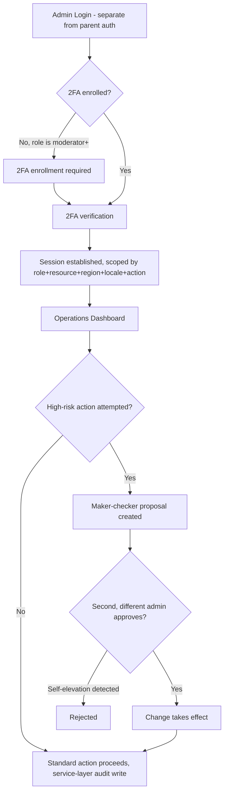
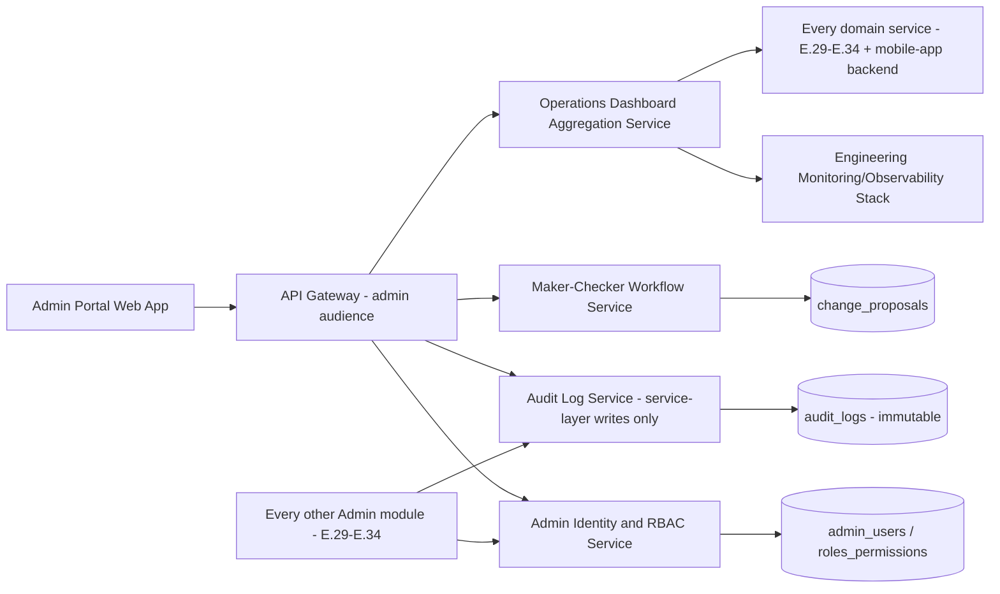
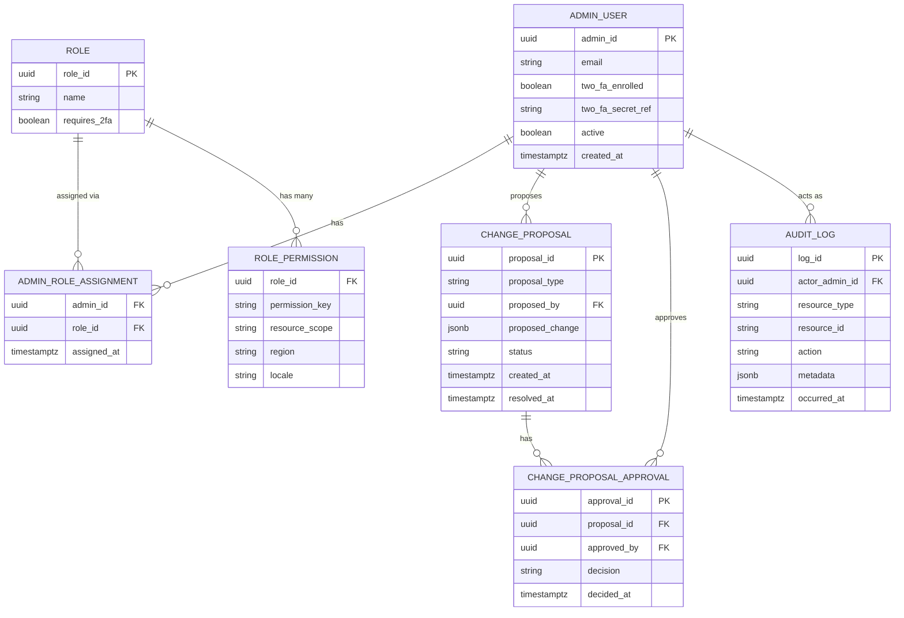

# Feature E.28 — Admin Portal: Authentication, RBAC & Operations Dashboard

**App:** NoorHeroes — Islamic Learning App for Children
**Feature Owner:** Platform / Security / Engineering Operations
**Status:** Implementation-ready
**Version:** 1.0
**Depends on:** None within the Admin Portal (this is the foundational, gating module every other Admin/Scholar feature depends on)
**Feeds into:** Every other Admin & Scholar Portal feature (E.29 Content CMS, E.30 Review Queues, E.31 Engagement, E.32 Commerce, E.33 Intelligence, E.34 Platform Configuration) — all read this module's RBAC matrix for access control and all write to its Audit Log

> **Scope note:** This document is the canonical specification for the **Admin & Scholar Portal's** gatekeeper layer — Admin Authentication (separate from parent auth, 2FA-mandatory for moderator+), the Role/Permission Matrix (RBAC), maker-checker approval workflow for high-risk changes, and the Operations Dashboard (incidents, feature flags, service health, job failures) that every admin sees as their landing surface. It also specifies the platform-wide **immutable Audit Log** that every other Admin Portal module writes to, since that capability is foundational rather than belonging to any single downstream module. Content CMS, Review Queues, Engagement tools, Commerce tools, and AI Intelligence tooling are each owned by their own dedicated documents (E.29–E.33) and are referenced here only as RBAC-scope consumers and Audit-Log writers.

---

## Table of Contents

1. [Product Requirements](#1-product-requirements)
2. [UX/UI Requirements](#2-uxui-requirements)
3. [Backend Requirements](#3-backend-requirements)
4. [Database Design](#4-database-design)
5. [Backend AI Code-Generation Prompt](#5-backend-ai-code-generation-prompt)
6. [Frontend (Admin Web) Requirements](#6-frontend-admin-web-requirements)
7. [Frontend AI Code-Generation Prompt](#7-frontend-ai-code-generation-prompt)
8. [Admin Requirements](#8-admin-requirements)
9. [Admin AI Code-Generation Prompt](#9-admin-ai-code-generation-prompt)
10. [DevOps Requirements](#10-devops-requirements)
11. [Analytics Requirements](#11-analytics-requirements)
12. [Security Requirements](#12-security-requirements)
13. [QA Requirements](#13-qa-requirements)
14. [Marketing Requirements](#14-marketing-requirements)
15. [Release & Rollback Plan](#15-release--rollback-plan)

---

## 1. Product Requirements

### 1.1 Problem Statement

NoorHeroes' operators (content editors, publishers, scholar reviewers, child-safety reviewers, support agents, billing ops, analysts, localization managers, and super admins) need a completely separate, more rigorously secured authentication system from parent/child auth, with fine-grained role-scoped permissions, mandatory 2FA for anyone above basic access, maker-checker approval for high-risk changes, and a single immutable audit trail covering every sensitive action across the entire portal — all visible through one Operations Dashboard that gives admins the same operational signal engineers see, scoped appropriately by role (source: NoorHeroes Blueprint "Authentication, Roles & Permissions — Gatekeeper for every other module... 2FA mandatory for moderator+ roles; role changes require a second admin's approval (maker-checker); cannot self-elevate own role"; Consolidated Blueprint §20.4: "Operational dashboard... feeds directly into the Admin Portal Dashboard widgets... there is no separate, disconnected 'engineering-only' monitoring view").

### 1.2 Business Goals

- Provide one trustworthy, rigorously access-controlled gatekeeper for the entire operator-facing surface, preventing any downstream Admin Portal module from needing to reimplement its own authentication/authorization logic.
- Eliminate self-elevation and unilateral high-risk changes as attack/error vectors via mandatory maker-checker approval.
- Give engineering and product/content operations a single shared operational picture (incidents, service health, job failures) rather than two disconnected monitoring views.
- Maintain an audit trail that is genuinely immutable and queryable, supporting compliance, dispute resolution, and security-incident investigation.

### 1.3 User Goals

- **Admin (any role):** Log in securely with 2FA, see exactly the modules and data my role permits, and land on a useful Operations Dashboard reflecting the platform's actual current health.
- **Super Admin:** Manage roles and permissions, approve high-risk changes via maker-checker, and trust that no admin (including other super admins) can silently self-elevate their own access.
- **Engineering:** See the same operational health signals (incidents, service health, job failures) that product/content admins see, without needing a separate engineering-only tool.

### 1.4 Success Metrics

| Metric | Target |
|---|---|
| 2FA enrollment rate (moderator+ roles) | 100% (hard requirement) |
| Self-elevation attempts blocked | 100% (hard, zero-tolerance) |
| Maker-checker approval cycle time (high-risk changes) | ≤ 4 business hours |
| Audit log completeness (sensitive actions with a corresponding entry) | 100% |
| Operations Dashboard incident-detection-to-admin-visibility latency | ≤ 2 minutes |
| Admin login success rate | ≥ 97% |

### 1.5 Stakeholders

Platform/Security Engineering Lead, Engineering Operations Lead, Product Manager (Admin Tooling), Trust & Safety, Legal/Compliance, every Admin Portal module owner (E.29–E.34) who depends on this RBAC matrix.

### 1.6 User Stories

1. As an admin, I want to log in with a separate credential and mandatory 2FA, distinct from any parent/child authentication.
2. As a super admin, I want to define roles and assign permission keys, with every change requiring a second admin's approval.
3. As any admin, I want to see only the modules and data my role permits, with sensitive child data masked appropriately.
4. As a super admin, I want certainty that no admin, including myself, can elevate their own role unilaterally.
5. As an admin of any kind, I want a single Operations Dashboard showing incidents, service health, feature flags, and job failures — the same signals engineering sees.
6. As an auditor or investigator, I want every sensitive admin action to be permanently, immutably logged and queryable by actor, resource, and action.
7. As a super admin, I want safety/AI feature flags specifically to require two-person approval, given their platform-wide risk.

### 1.7 Functional Requirements

**FR-1** Admin Authentication is **completely separate from parent authentication** — a distinct login surface, credential store, and session system (source: module 1 "Admin login (separate from parent auth)").
**FR-2** **2FA is mandatory for moderator+ roles** — any role above the most basic read-only access tier requires 2FA enrollment before any session can be established (source: module 1 Validation Rules — a hard, zero-exception rule).
**FR-3** **Role changes require a second admin's approval (maker-checker); an admin cannot self-elevate their own role** (source: module 1 Validation Rules — two distinct hard rules: (a) no role-permission change takes effect without a second, different admin's approval, and (b) the system structurally prevents an admin from being the sole approver of a change to their own role).
**FR-4** RBAC Role definitions (canonical, source §11.6, complete list): Super Admin (break-glass only; platform configuration and role administration); Content Editor (create/edit drafts; cannot publish); Publisher (publish approved versions); Scholar Reviewer (review assigned Islamic content); Child Safety Reviewer (age/safety review and moderation); Support Agent (limited family/support visibility; no content or billing mutation); Billing Ops (subscription and refund tools; no child learning details); Analyst (aggregated dashboards and approved exports); Localization Manager (locale content and translation workflow).
**FR-5** **Authorization is computed from role + resource scope + region + locale + action** — a multi-dimensional authorization model, not a flat role-to-permission lookup (source §11.6).
**FR-6** **Sensitive reads and all mutations are audited at the service layer, not just logged at the gateway, so a compromised gateway cannot suppress the audit trail** (source §11.6 — a hard architectural requirement: the audit-write must happen inside the business-logic service itself, with the gateway treated as an untrusted perimeter for this specific guarantee).
**FR-7** Operations Dashboard widgets (canonical, source §11.1): active families and children; learning and story completion; content awaiting review; safety and moderation alerts; subscription health and store-webhook failures; notification performance; AI refusal and escalation rates; failed background jobs and service incidents.
**FR-8** **The Operations Dashboard widgets are fed by the same operational dashboard (service health, job failures, incident status) engineers use — there is no separate, disconnected "engineering-only" monitoring view; admins see the same operational signals engineers do, scoped appropriately by role** (source §20.4 — a hard architectural and product-philosophy requirement).
**FR-9** Feature flag management: read/update rollout percentage and targeting; **safety/AI flags specifically require two-person approval (super admin), all other flags require standard admin+ access** (source: API table, "`/api/v1/admin/feature-flags`... safety flags require two-person approval... Permissions: admin+ (super admin for AI/safety flags)").
**FR-10** Defined SLOs and alerting apply to: auth, home feed, progress sync, media startup, receipt validation, and content publication (source §20.3) — these are the specific service-health signals the Operations Dashboard's "service health" widget must surface.
**FR-11** Documented runbooks exist for: OTP provider outage, store webhook delay, CDN issue, harmful AI response, data breach, accidental content publication (source §20.3) — the Operations Dashboard's incident view links each active incident to its corresponding runbook where one exists.
**FR-12** The Audit Log is **immutable, queryable by actor, resource, and action, and retained per the compliance schedule** (source §11.7) — every other Admin Portal module's mutating actions and sensitive reads write to this single, shared log table, never a per-module independent log.
**FR-13** Remote app configuration changes (force-update, trial length, defaults) require **maker-checker for production** specifically (source: API table, "`/api/v1/admin/config`... admin+, maker-checker for production") — non-production environment changes may proceed with single-admin approval, but production changes always require the second approval.

### 1.8 Non-Functional Requirements

- **Separation of Auth Systems:** Admin authentication must share no credential store, session infrastructure, or token format with parent/child authentication — a clean security boundary preventing any cross-system credential confusion or privilege leakage.
- **Service-Layer Audit Integrity:** The audit-write guarantee (FR-6) must hold even under a compromised or misconfigured API Gateway — this is a non-negotiable architectural property, not a defense-in-depth nicety.
- **Self-Elevation Prevention:** Structurally impossible, not merely access-denied — an admin's own role-change request can never be the change that also approves itself.
- **Dashboard Freshness:** Operations Dashboard widgets must reflect near-real-time state (incident-detection-to-visibility latency target of ≤2 minutes per §1.4) — this is an operationally-critical, not cosmetic, requirement.

### 1.9 Acceptance Criteria

- Given an admin attempts to log in, when their role is moderator-tier or above, then 2FA is mandatory and login fails without it being enrolled and verified.
- Given a super admin proposes a role-permission change, when they submit it, then it remains pending until a **different** admin approves it — the proposing admin's own approval action is never sufficient.
- Given an admin attempts to change their own role, when they try, then the system rejects this as a self-elevation attempt regardless of what role they're attempting to assign themselves.
- Given any admin views the Operations Dashboard, when it loads, then all eight canonical widget categories render, each reflecting near-real-time platform state.
- Given a sensitive mutation occurs anywhere in the Admin Portal, when it completes, then a corresponding immutable audit log entry exists, written at the service layer regardless of what happened at the gateway.
- Given a super admin attempts to toggle a safety/AI feature flag, when they do, then a second super admin's approval is required before it takes effect; a non-safety flag change by an admin+ role does not require this second approval.
- Given a production app-configuration change is proposed, when submitted, then it requires maker-checker approval; the identical change proposed against a non-production environment does not require this additional step.

### 1.10 Edge Cases

1. A super admin attempts to approve their own previously-submitted role-change proposal from a different browser session or device, attempting to functionally "self-approve" by acting as their own second approver → the system identifies the proposer and approver as the same underlying admin identity regardless of session/device and rejects the approval, since the rule is about distinct admin identities, not distinct sessions.
2. Two different super admins simultaneously attempt to approve the same pending role-change proposal → the first approval to be processed completes the change; the second is recognized as redundant (the proposal is no longer pending) rather than causing a duplicate-application error.
3. An admin's 2FA device is lost or inaccessible → a documented, audited recovery path exists (e.g., backup codes generated at enrollment, or a verified super-admin-assisted reset) — never a silent bypass of the 2FA requirement itself.
4. A feature flag toggle that is *not* tagged safety/AI is later reclassified as safety/AI-relevant (e.g., a flag's scope expands over time to touch AI behavior) → the flag's `requires_two_person_approval` classification must be explicitly re-evaluated and updated by an admin with appropriate authority; it does not automatically inherit stricter requirements just because of a naming similarity, but any flag genuinely touching AI/safety behavior must be correctly classified before its next toggle.
5. The Operations Dashboard's underlying engineering monitoring data source experiences its own outage → the dashboard shows an explicit "monitoring data temporarily unavailable" state for the affected widget(s) rather than silently showing stale data as if it were current, or hiding the widget entirely (which could mask the existence of an actual ongoing incident).
6. An admin with a role lacking a given permission attempts to directly call a downstream module's API endpoint requiring that permission (bypassing the UI entirely) → the resource/action/role check at the service layer (FR-5) rejects the request identically to how the UI would have prevented it from being attempted in the first place — the UI's own permission-based hiding is a convenience, never the actual security boundary.
7. A maker-checker-pending change (e.g., a role-permission update) is left pending for an extended period with no second admin available to review it → the change simply remains pending indefinitely; there is no auto-approval timeout, since auto-approving a high-risk change due to inaction would defeat the entire purpose of the control.
8. An audit log query is run for a date range spanning a period before this logging system's own deployment (i.e., historical data that was never captured) → the query correctly returns an empty result for that pre-deployment portion of the range, never an error, with a clear indication of the system's actual logging-coverage start date if relevant for the querying admin's context.

### 1.11 Error Handling

| Scenario | System Behavior |
|---|---|
| 2FA not enrolled, moderator+ role login attempt | Login blocked, enrollment flow required before proceeding |
| Self-elevation attempt (any form, including cross-session) | Rejected, identified by underlying admin identity not session |
| Redundant approval on an already-resolved maker-checker proposal | Recognized as a no-op, not a duplicate-application error |
| Direct API call bypassing UI permission checks | Rejected identically at the service layer (FR-5/Edge Case 6) |
| Monitoring data source outage affecting a Dashboard widget | Explicit "data temporarily unavailable" state, never silently stale or hidden |
| 2FA device lost | Documented, audited recovery path, never a silent bypass |

### 1.12 Empty States
- Zero pending maker-checker approvals → simple "Nothing pending" state on the approval queue.
- Zero active incidents → a calm "All systems normal" state on the Dashboard's incident widget, not an empty/blank-looking gap.

### 1.13 Loading States
- Operations Dashboard: per-widget independent loading/skeleton state, consistent with the platform's general per-section independence pattern (mirroring C.20's Parent Dashboard design).

### 1.14 Offline States
- N/A in the traditional sense (this is an internal operator tool assumed to run on a connected corporate/operational network); standard web connectivity-loss handling (a clear "reconnecting" indicator) applies if the network drops mid-session.

### 1.15 Permission States
- Every screen and widget in the Admin Portal renders conditionally based on the authenticated admin's role-scope per FR-5 — a role lacking visibility into a given module simply doesn't see that module in their navigation at all (consistent with the principle that the UI is convenience, not the security boundary itself).

### 1.16 User Flow (Narrative)

Admin navigates to the Admin Portal's login page (entirely separate from the parent/child app or web portal) → authenticates with credentials + mandatory 2FA (for moderator+ roles) → lands on the Operations Dashboard, scoped to their role, showing the eight canonical widget categories → navigates into whichever modules their role permits (Content, Review, Engagement, Commerce, Intelligence, Platform) → any high-risk action (role change, safety/AI flag toggle, production config change) creates a pending maker-checker proposal requiring a second, different admin's approval before taking effect → every sensitive action, throughout, writes an immutable audit log entry at the service layer.

### 1.17 Detailed Flow Diagram (Mermaid)

**Authentication & RBAC Workflow (canonical, source module 1):**



### 1.18 Screen Inventory (Complete — Zero Missing)

| # | Screen | Type | Entry Points | Exit Points |
|---|---|---|---|---|
| 1 | Admin Login | Primary | Direct navigation to Admin Portal URL | 2FA Enrollment / 2FA Verification |
| 2 | 2FA Enrollment | Screen | Admin Login, first login for moderator+ role | 2FA Verification |
| 3 | 2FA Verification | Screen | Admin Login (subsequent logins) | Operations Dashboard |
| 4 | 2FA Recovery (lost device) | Screen | 2FA Verification "Lost device" link | Verified Recovery → re-enrollment |
| 5 | Operations Dashboard (landing) | Primary | 2FA Verification success | Incidents, Feature Flags, Service Health, Job Failures, every other module per role |
| 6 | Incidents View | Screen | Operations Dashboard | Incident Detail / linked Runbook |
| 7 | Incident Detail / Linked Runbook | Screen | Incidents View | Back |
| 8 | Feature Flags List | Screen | Operations Dashboard, Platform navigation group | Feature Flag Editor |
| 9 | Feature Flag Editor | Screen | Feature Flags List | Saves (standard) or Maker-Checker Proposal (safety/AI) |
| 10 | Service Health View | Screen | Operations Dashboard | N/A (display) |
| 11 | Job Failures View | Screen | Operations Dashboard | Job Detail |
| 12 | Job Detail | Screen | Job Failures View | Back |
| 13 | Role List | Screen | Platform navigation group | Role Detail / Permission Matrix Editor |
| 14 | Permission Matrix Editor | Screen | Role List | Maker-Checker Proposal |
| 15 | Maker-Checker Approval Queue | Screen | Operations Dashboard, Platform navigation group | Proposal Detail |
| 16 | Proposal Detail (approve/reject) | Screen | Maker-Checker Approval Queue | Approval Queue (resolved) |
| 17 | Audit Log Viewer | Screen | Platform navigation group | Audit Entry Detail |
| 18 | Audit Entry Detail | Screen | Audit Log Viewer | Back |
| 19 | App Configuration Editor | Screen | Platform navigation group | Maker-Checker Proposal (production) / Direct save (non-production) |
| 20 | Admin User Deactivation (component, within Role/User management) | Component | Role List / Admin User List | Confirmation |

### 1.19 Events (Complete Analytics Event List)

`admin_login_attempted`, `admin_login_succeeded`, `admin_login_failed`, `2fa_enrollment_completed`, `2fa_verification_succeeded`, `2fa_verification_failed`, `2fa_recovery_initiated`, `operations_dashboard_viewed`, `incident_viewed`, `feature_flag_toggled`, `feature_flag_two_person_approval_required_shown`, `service_health_viewed`, `job_failure_viewed`, `role_change_proposed`, `role_change_self_elevation_attempt_blocked` (internal/security signal), `maker_checker_proposal_created`, `maker_checker_proposal_approved`, `maker_checker_proposal_rejected`, `maker_checker_redundant_approval_noop` (internal), `audit_log_queried`, `app_config_change_proposed`, `app_config_change_applied`, `admin_user_deactivated`.

---

## 2. UX/UI Requirements

> The Admin Portal follows a denser, data-rich, professional-tool visual register — distinct from both the Mobile App's child-mode and Parent-Mode registers and the Parent Web Account Portal's calmer consumer-account register, since this is an internal operator tool optimized for information density and task efficiency over warmth/approachability.

### 2.1 Admin-Specific Design System Extensions

- **Operations Dashboard Widget Grid:** A dense, card-based grid (8 widget categories) using data-table and sparkline-chart visual patterns appropriate for rapid operational scanning, distinct from the consumer-facing calm/trend-chart language used in C.20/C.22.
- **Maker-Checker Visual Language:** A clearly state-labeled workflow (Pending → Approved/Rejected) with the proposer's and approver's identities both visibly distinct on every proposal — never ambiguous about who proposed vs. who approved.
- **Permission-Scoped Navigation:** The Admin Portal's navigation menu renders only the modules/items the current admin's role permits — there is no greyed-out/disabled-but-visible treatment for inaccessible modules; they are simply absent, consistent with the platform's general "hide, don't show-disabled" pattern for unavailable capabilities.

### 2.2 Screen-Level Design Requirements (Key Screens)

#### Screen: Operations Dashboard

- **Purpose:** Give every admin role a scoped, near-real-time operational picture.
- **Components:** Eight widget cards (active families/children, learning/story completion, content awaiting review, safety/moderation alerts, subscription health/webhook failures, notification performance, AI refusal/escalation rates, failed jobs/incidents), each independently loading and independently capable of showing a "data unavailable" state.
- **States:** Default (all widgets loaded), Partial (some widgets in a data-unavailable state), Loading (per-widget skeleton).
- **Accessibility:** Each widget's key figures are screen-reader-readable as plain text/numbers, not chart-only.
- **Responsive Rules:** A responsive grid reflowing from a multi-column desktop layout to a stacked single-column layout at narrower viewports, though desktop is this tool's primary target.

#### Screen: Maker-Checker Approval Queue

- **Purpose:** Give a designated approver a clear, complete view of every pending high-risk change requiring their review.
- **Components:** A list of pending proposals (type, proposer, summary of the change, time pending), each tappable into a Proposal Detail view showing a full diff/comparison of the proposed change.
- **States:** Default, Empty ("Nothing pending"), Filtered by proposal type.

### 2.3 Tab Structure

The Admin Portal's primary navigation is a persistent sidebar/top-nav across the 8 navigation groups (Operate/Users/Content/Review/Engagement/Commerce/Intelligence/Platform), scoped per role. Click mapping (this module's own screens):

| Click Target | Destination | API Called | Analytics Event | Permission Check | Error Handling |
|---|---|---|---|---|---|
| Operations Dashboard (default landing) | Dashboard | `GET /v1/admin/dashboard` | `operations_dashboard_viewed` | Role-scoped widget visibility | Per-widget data-unavailable state |
| Feature Flags nav item | Feature Flags List | `GET /v1/admin/feature-flags` | N/A (view) | `admin+` role | Standard handling |
| Flag toggle (safety/AI) | Maker-Checker Proposal created | `PATCH /v1/admin/feature-flags` | `feature_flag_two_person_approval_required_shown` | `super_admin` to propose, different `super_admin` to approve | Standard handling |
| Roles nav item | Role List | `GET /v1/admin/roles` | N/A (view) | `super_admin` role | Standard handling |
| Permission Matrix save | Maker-Checker Proposal created | `PATCH /v1/admin/roles/{id}/permissions` | `role_change_proposed` | `super_admin`, self-elevation check | Self-elevation rejection |
| Audit Log nav item | Audit Log Viewer | `GET /v1/admin/audit-logs` | `audit_log_queried` | Role-scoped (varies per resource type) | Standard handling |

### 2.4 Wireframe Description (Composite)

A standard internal-operator-tool layout — persistent left sidebar navigation, a dense card/table-based main content area — consistent with widely-recognized admin-dashboard SaaS conventions (e.g., similar in spirit to common analytics/ops dashboards), deliberately information-dense rather than consumer-warm.

### 2.5 Screen Image Generation Prompts

**Screen: Operations Dashboard**
- *Prompt 1 (English):* "Desktop web admin operations dashboard UI mockup, dense professional SaaS tool aesthetic. Cool neutral grey-white background. Left sidebar with 8 navigation group icons and labels (Operate, Users, Content, Review, Engagement, Commerce, Intelligence, Platform), Operate highlighted as active. Main content area shows a grid of 8 small dashboard widget cards, each with a title, a key number or small sparkline chart, and a status color dot (green/yellow/red): 'Active Families', 'Story Completions', 'Content Awaiting Review', 'Safety Alerts', 'Subscription Health', 'Notification Performance', 'AI Refusal Rate', 'Failed Jobs'. Clean, dense, professional engineering-tool aesthetic, sharp corners or minimal rounding, muted blue/grey accent colors, no playful or warm visual elements, no realistic human faces."
- *Prompt 2 (Arabic RTL):* "نفس لوحة تحكم عمليات الإدارة لتطبيق ويب لسطح المكتب، بطابع أداة SaaS مهنية كثيفة، بتخطيط من اليمين إلى اليسار بالكامل. خلفية رمادية باردة محايدة. شريط جانبي بثمانية أيقونات وتسميات لمجموعات التنقل (التشغيل، المستخدمون، المحتوى، المراجعة، التفاعل، التجارة، الذكاء، المنصة)، مع تمييز 'التشغيل' كنشط. منطقة المحتوى الرئيسية تعرض شبكة من 8 بطاقات أدوات تحكم صغيرة، كل منها بعنوان ورقم رئيسي أو رسم خطي صغير ونقطة حالة ملونة (أخضر/أصفر/أحمر). طابع مهني وكثيف وأداة هندسية نظيفة، زوايا حادة أو دائرية بسيطة، ألوان لمسات زرقاء/رمادية باهتة، بدون عناصر بصرية مرحة أو دافئة، بدون وجوه بشرية واقعية."

**Screen: Maker-Checker Approval Queue**
- *Prompt 1 (English):* "Desktop web admin maker-checker approval queue UI mockup, dense professional SaaS tool aesthetic. Cool neutral grey-white background. A data table with columns: 'Type' (e.g., 'Role Change', 'Feature Flag', 'Config Change'), 'Proposed By', 'Summary', 'Time Pending', and an 'Action' column with 'Review' buttons. One row highlighted showing a 'Pending' status badge in amber. Clean, dense, professional engineering-tool aesthetic, sharp corners, muted blue/grey accents, no realistic human faces."
- *Prompt 2 (Arabic RTL):* "نفس قائمة انتظار موافقات نظام 'المُنشئ والمُدقق' لتطبيق ويب لسطح المكتب، بطابع أداة SaaS مهنية كثيفة، بتخطيط من اليمين إلى اليسار. خلفية رمادية باردة محايدة. جدول بيانات بأعمدة: 'النوع' (مثل 'تغيير دور'، 'علم ميزة'، 'تغيير تكوين')، 'مُقترح من'، 'الملخص'، 'الوقت المنقضي'، وعمود 'إجراء' بأزرار 'مراجعة'. صف واحد مميز بشارة حالة 'معلق' باللون العنبري. طابع مهني وكثيف وأداة هندسية نظيفة، زوايا حادة، لمسات زرقاء/رمادية باهتة، بدون وجوه بشرية واقعية."

---

## 3. Backend Requirements

### 3.1 System Design Overview

This feature is served by an **Admin Identity & RBAC Service** (separate credential store/session system from the parent/child Family/Identity Service), a **Maker-Checker Workflow Service**, an **Audit Log Service** (the shared, service-layer-write-only logging backbone every other Admin module depends on), and an **Operations Dashboard Aggregation Service** composing the eight canonical widgets from each underlying domain.

### 3.2 Architecture Diagram (Mermaid)



### 3.3 Service Breakdown

| Service | Responsibility |
|---|---|
| Admin Identity & RBAC Service | Admin login/2FA, role/permission storage, multi-dimensional authorization checks |
| Maker-Checker Workflow Service | Proposal creation, distinct-approver enforcement, self-elevation prevention |
| Audit Log Service | Immutable, queryable audit-write API, consumed by every other Admin module's own service layer |
| Operations Dashboard Aggregation Service | Composes the 8 canonical widgets from domain services + the engineering observability stack |

### 3.4 API List

#### Dedicated Admin Authentication & 2FA Pipeline (`/v1/admin/auth/*`)
All administrative authentication endpoints operate under a dedicated, isolated perimeter:

1. **`POST /v1/admin/auth/login`**:
   - **Auth:** Public
   - **Request (Credentials):** `{"email": "...", "password": "..."}`
   - **Request (Direct Combined OTP):** `{"email": "...", "password": "...", "otp": "...", "challenge_id": "..."}`
   - **Response 200 (Requires 2FA):** `{"status": "requires_2fa", "requires2Fa": true, "twoFaEnrolled": bool, "twoFaChallengeId": "...", "expiresInSeconds": 300}`
   - **Response 200 (Direct OTP):** Returns `AdminSessionTokenResponse` and emits session cookie.

2. **`POST /v1/admin/auth/2fa/enroll`**:
   - **Auth:** Public with valid `twoFaChallengeId`
   - **Response 200:** `{"secretKey": "...", "provisioningUri": "...", "qrCodeDataUrl": "...", "backupCodes": [10 codes], "expiresInSeconds": 600}`

3. **`POST /v1/admin/auth/2fa/verify`**:
   - **Auth:** Public with valid `twoFaChallengeId` and 6-digit `totpCode`
   - **Response Headers:** `Set-Cookie: noorheroes-admin-session=<accessToken>; HttpOnly; SameSite=Lax; Path=/`
   - **Response 200:** `{"accessToken": "...", "refreshToken": "...", "tokenType": "bearer", "expiresIn": 900, "admin": {...}}`

4. **`POST /v1/admin/auth/2fa/recover`**:
   - **Auth:** Public with valid `twoFaChallengeId` and single-use `backupCode`
   - **Response 200:** `{"recoverySuccessful": true, "requiresReenrollment": true, "temporarySetupToken": "..."}`

5. **`POST /v1/admin/auth/elevate`**:
   - **Auth:** Authenticated Admin (`get_current_admin`) with fresh `totpCode`
   - **Response 200:** `{"elevated": true, "expiresInSeconds": 900, "elevatedUntil": "..."}`

6. **`POST /v1/admin/auth/refresh`**:
   - **Auth:** Public with `refreshToken` in payload or session cookie
   - **Response 200:** Returns fresh `AdminSessionTokenResponse` and updates cookie.

7. **`POST /v1/admin/auth/logout`**:
   - **Auth:** Authenticated Admin
   - **Response Headers:** `Set-Cookie: noorheroes-admin-session=; Max-Age=0; Path=/`
   - **Response 200:** `{"status": "success", "message": "Administrative session successfully revoked."}`

8. **`GET /v1/admin/auth/me`**:
   - **Auth:** Authenticated Admin
   - **Response 200:** `{"adminId": "...", "email": "...", "role": "super_admin", "scopes": ["*"], "twoFaEnrolled": true}`

#### RBAC & Governance Endpoints

#### `GET /v1/admin/roles` / `PATCH /v1/admin/roles/{id}/permissions`
- **Auth:** `super_admin`
- **Business Logic:** PATCH creates a `change_proposals` row rather than applying immediately; **rejects outright** (`403 SELF_ELEVATION_BLOCKED`) if the proposing admin's own role is the target of the change.

#### `POST /v1/admin/change-proposals/{id}/approve`
- **Auth:** `super_admin` (or the appropriate approver role for the proposal type)
- **Validation:** Rejects (`403 SAME_ADMIN_CANNOT_APPROVE_OWN_PROPOSAL`) if the approving admin's identity matches the proposing admin's identity, **regardless of session/device** (Edge Case 1) — compared by underlying `admin_id`, not session token.
- **Business Logic:** On approval, applies the underlying change atomically and marks the proposal `approved`; a second approval attempt on an already-resolved proposal returns the existing resolved state as a no-op (Edge Case 2).

#### `GET /api/v1/admin/feature-flags` / `PATCH /api/v1/admin/feature-flags`
- **Validation:** For flags where `requires_two_person_approval=true` (the safety/AI classification), PATCH creates a `change_proposals` row instead of applying directly; for all other flags, `admin+` may apply directly.

#### `GET /api/v1/admin/config` / `PATCH /api/v1/admin/config`
- **Validation:** PATCH against a `environment=production` target always creates a `change_proposals` row; non-production targets may apply directly for `admin+`.

#### `GET /v1/admin/dashboard`
- **Response 200:** The 8 canonical widget payloads, each independently resolved (a failure in one widget's underlying data source does not block the others — composed via parallel, independently-fallible sub-queries).

#### `POST /v1/admin/audit-logs` (internal, called by every Admin module's own service layer, never directly by any client)
- **Validation:** This endpoint/internal-call-pattern is the **only** way an audit entry is ever created — there is no client-facing "log this" API, reinforcing that audit-writing is a service-layer responsibility, not something a client could ever omit or spoof.

#### `GET /v1/admin/audit-logs?actor=&resource=&action=`
- **Response 200:** Queryable, paginated audit entries — read-only, no corresponding write-capable client endpoint.

### 3.5 Cross-Cutting API Concerns

- **Maker-checker as a first-class workflow primitive:** Any Admin module wanting maker-checker behavior for one of its own actions calls into this shared `change_proposals` mechanism rather than building its own.
- **Service-layer-only audit writes:** No client-facing audit-write endpoint exists; every Admin module's own backend service calls the internal Audit Log Service directly as part of its own request-handling code, not via a separate client-triggered call.
- **Self-elevation/self-approval prevention compares underlying identity, not session:** A hard requirement defeating any session/device-switching attempt to circumvent the distinct-approver rule.

---

## 4. Database Design

### 4.1 ER Diagram (Mermaid)



### 4.2 Tables, Relationships, Constraints

| Table | Key Constraints | Indexes |
|---|---|---|
| `admin_user` | UNIQUE(`email`); `two_fa_enrolled` must be `true` before any session can be established for a role where `role.requires_2fa = true` | — |
| `role_permission` | FK `role_id`; composite key reflecting the multi-dimensional model (role + resource_scope + region + locale) | Index `(role_id, resource_scope)` |
| `change_proposal` | FK `proposed_by`; CHECK `status IN ('pending','approved','rejected')` | Index `(status, created_at DESC)` |
| `change_proposal_approval` | FK `proposal_id`, `approved_by`; **CHECK `approved_by != (SELECT proposed_by FROM change_proposal WHERE proposal_id = change_proposal_approval.proposal_id)`** — the database-level self-approval prevention constraint, defense-in-depth alongside the application-layer check | Index `(proposal_id)` |
| `audit_log` | FK `actor_admin_id`; **append-only — no UPDATE/DELETE grant for any application role, mirroring A.11's reward-ledger permission-lockout pattern** | Index `(actor_admin_id, occurred_at DESC)`, Index `(resource_type, resource_id, occurred_at DESC)` |

### 4.3 Audit Fields
`audit_log` is itself the audit trail — append-only, immutable, the platform's most rigorously protected table from a write-permission standpoint, consistent with the rigor applied to A.11's `reward_ledger`.

### 4.4 Soft Delete Rules
N/A for `audit_log` (permanent record); `admin_user.active = false` used for deactivation rather than deletion, preserving historical audit-actor references.

### 4.5 Retention Rules
`audit_log` retained per the platform's compliance retention schedule (cross-ref §11.7's stated requirement) — likely the platform's longest-retained operational table given its role as the ultimate dispute/investigation evidence source.

---

## 5. Backend AI Code-Generation Prompt

```
You are building the Admin Identity & RBAC Service, Maker-Checker
Workflow Service, and Audit Log Service for "NoorHeroes" -- the foundational
gatekeeper layer every other Admin Portal module depends on. This is one
of the most security-critical services in the entire platform.

Stack: FastAPI (Python 3.12), PostgreSQL (SQLAlchemy 2.0), Redis, a 2FA
provider integration (TOTP-based).

Hard requirements:
1. Implement admin authentication as an ENTIRELY SEPARATE credential
   store, session/token format, and identity namespace from the parent/
   child Family/Identity Service -- write an architectural test (a
   module-dependency-graph check, mirroring the pattern established for
   child/parent/admin search separation in B.13) confirming no shared
   table, session-token-validation function, or credential-hashing code
   path exists between this service and the parent/child auth service.
2. Implement 2FA enforcement: any role with requires_2fa=true cannot
   establish a session without a verified 2FA challenge -- write a test
   confirming a login attempt for a moderator+ role with
   two_fa_enrolled=false is blocked and routed to enrollment, never
   silently granted a session.
3. Implement self-elevation and self-approval prevention at BOTH the
   application layer AND the database layer (a CHECK constraint on
   change_proposal_approval comparing approved_by against the
   proposal's proposed_by) -- write a test attempting a direct database
   INSERT that would violate this constraint and confirming the database
   itself rejects it, independent of any application-layer check (true
   defense-in-depth, not just one layer of protection).
4. Implement change-proposal approval idempotency: a SECOND approval
   attempt on an already-resolved proposal (whether the underlying
   proposal_id) returns the EXISTING resolved state as a no-op rather
   than erroring or attempting to reprocess -- write a test for two
   different admins both attempting to approve the same proposal in
   quick succession, confirming exactly one approval is recorded and the
   second receives the same resolved-state response.
5. Implement the Audit Log Service with NO client-facing write endpoint
   -- audit entries are created EXCLUSIVELY via internal service-to-
   service calls from each Admin module's own backend code. Write an
   architectural test confirming no publicly-routable endpoint in the
   entire admin API surface allows direct client-supplied audit-log
   creation, and a database-permission test confirming the audit_log
   table itself has no UPDATE/DELETE grant for any application role.
6. Implement the Operations Dashboard's GET /v1/admin/dashboard endpoint
   to compose its 8 widget payloads via INDEPENDENTLY-FALLIBLE parallel
   sub-queries -- write a test simulating a failure in one widget's
   underlying data source and confirming the other 7 widgets still
   return successfully with the failed one flagged as
   data_unavailable=true, never blocking the whole response.
7. Implement feature-flag and production-config maker-checker routing:
   PATCH requests for safety/AI-classified flags or production-
   environment config changes create a change_proposal rather than
   applying directly; all other PATCH requests for these resources apply
   directly for admin+ roles -- write tests for both routing paths.

Deliver: FastAPI routers, SQLAlchemy models, Alembic migrations
(including the database-level CHECK constraint and the audit_log
permission lockout), Pydantic schemas, and a pytest suite covering all 7
items, with items 1 (separate auth namespace) and 3 (self-elevation
prevention at both layers) treated as the two highest-priority
guarantees in this entire service.
```

---

## 6. Frontend (Admin Web) Requirements

### 6.1 Technical Requirements
A React + TypeScript SPA (consistent with the Admin Portal's general technology choice referenced throughout E-track-adjacent documents), a shared admin design-token package (the denser, professional-tool register described in §2), TOTP-based 2FA client library.

### 6.2 Screen Mapping
Each of the 20 screens in §1.18 maps to a route/page component within the Admin Portal's broader application shell.

### 6.3 Navigation Flow & Session Lifecycle
1. **Authentication Transition**: Login (`/sign-in`) → 2FA Verification (or Enrollment if first time) → Home Landing Page (`/families` or deep-linked `next` target).
2. **Route Guarding**: Next.js Edge Proxy (`src/proxy.ts`) gates all protected routes (`/families`, `/analytics`, etc.) by validating the HttpOnly `noorheroes-admin-session` cookie. Unauthenticated visits are intercepted with an HTTP 307 redirect to `/sign-in`.
3. **Persistent Role-Scoped Sidebar**: Sidebar navigation items are computed strictly from the authenticated admin's active role-scope retrieved via `GET /v1/admin/auth/me`.
4. **Global Header Logout**: The persistent header in `DashboardShell` provides an accessible Sign Out button. Triggering sign-out issues `POST /v1/admin/auth/logout`, adds the session to the Redis denylist, clears the `noorheroes-admin-session` cookie (`Max-Age=0`), purges in-memory claims, and immediately redirects the user to `/sign-in`.

### 6.4 State Management
A shared `AdminAuthContext` holds the current admin's identity, role, and resolved permission set; every module's UI consults this context to decide what to render, while every mutating API call still relies on the backend's own independent authorization check as the actual security boundary (the frontend's role-based hiding is convenience only).

### 6.5 API Mapping
`AdminAuthRepository.login()/verify2fa()`, `RbacRepository.getRoles()/proposeChange()`, `MakerCheckerRepository.getQueue()/approve()/reject()`, `AuditLogRepository.query()`, `DashboardRepository.getWidgets()` map to their respective endpoints.

### 6.6 Analytics Mapping
`AdminPortalAnalytics` fire events per §1.19.

### 6.7 Offline Support
N/A (internal operator tool, connectivity assumed); standard reconnection-banner handling on connectivity loss.

### 6.8 Deep Linking
Standard web routes per screen within the Admin Portal's own domain (e.g., `/operate/dashboard`, `/platform/roles`, `/platform/audit-logs`).

### 6.9 Push Notifications
N/A; incident/job-failure alerting to admins is handled via the platform's existing engineering alerting/paging tools (outside this document's scope) plus the Dashboard's own near-real-time widget refresh.

### 6.10 Testing Strategy
- Unit: `AdminAuthContext`'s role-scoped navigation-item computation logic.
- UI tests: the Permission Matrix Editor's "Save" action always results in a pending-proposal state visible in the Maker-Checker queue, never an immediate silent apply; an admin attempting to view their own pending role-change proposal's approval option sees it disabled/absent (a UI-level mirror of the backend's self-approval-prevention guarantee).
- Integration: full login → 2FA → Dashboard flow; full role-change-proposal → second-admin-approval → applied-change flow (using two distinct fixture admin identities); full audit-log-query flow.

---

## 7. Frontend AI Code-Generation Prompt

```
Build the Admin Portal's Authentication, RBAC, and Operations Dashboard
frontend module for NoorHeroes as a React + TypeScript SPA.

Hard requirements:
1. Implement the login flow to ALWAYS route through 2FA verification for
   any role flagged requires_2fa=true in the server's role-metadata
   response -- write a test confirming the UI never skips this step for
   such a role, even if a cached/stale client state might otherwise
   suggest a session could be established without it.
2. Implement AdminAuthContext to compute the visible sidebar navigation
   items ENTIRELY from the server-provided role/permission response --
   write a test confirming no hardcoded role-name checks exist anywhere
   in the navigation-rendering logic (mirroring the extensible-registry-
   driven pattern established for B.17's safety-critical notification
   categories) -- a future new role/permission requires no frontend code
   change to be correctly reflected in navigation visibility.
3. Implement the Permission Matrix Editor's save action to ALWAYS result
   in a pending Maker-Checker proposal -- write a UI test confirming
   there is no code path where this action applies a change immediately
   without first creating a proposal.
4. Implement the Maker-Checker Approval Queue and Proposal Detail screens
   to DISABLE or HIDE the approval action when the currently-logged-in
   admin's identity matches the proposal's proposer -- write a UI test
   using a fixture proposal where proposed_by equals the current admin's
   own id, confirming no approve action is rendered as available, purely
   as a UX-layer reinforcement of the backend's actual enforcement.
5. Implement the Operations Dashboard to render each of the 8 widgets as
   an INDEPENDENTLY loading/error/content state -- write a test
   simulating one widget's data fetch failing and confirming the other 7
   render normally from their own successful fetches.

Use the platform's admin-specific design tokens (denser, professional-
tool register, distinct from the consumer-facing Mobile App and Parent
Web Portal registers) consistently across this module.
```

---

## 8. Admin Requirements

This document **is** the Admin Portal's own foundational admin-requirements layer — there is no further "admin of the admin" surface beyond what's already specified (Role List, Permission Matrix Editor, Maker-Checker Approval Queue, Audit Log Viewer, Admin User Deactivation, Feature Flag management, App Configuration management), all detailed in §1.18's screen inventory and §3.4's API list.

---

## 9. Admin AI Code-Generation Prompt

```
This document's own §5 (Backend) and §7 (Frontend) prompts ARE the
admin-tooling build specification for this module -- there is no
separate, distinct "admin's admin" layer to build beyond what those
sections already cover (Role/Permission management, Maker-Checker
Approval Queue, Audit Log Viewer, Feature Flags, App Configuration,
Admin User management, and the Operations Dashboard itself).
```

---

## 10. DevOps Requirements

- **Infrastructure:** Admin Identity & RBAC Service, Maker-Checker Workflow Service, and Audit Log Service are Tier-0 foundational services for the entire Admin Portal, given every other E-track module depends on them — provisioned and monitored with the same criticality as C.19's Parent PIN Gate is for the consumer-facing app.
- **CI/CD:** The separate-auth-namespace architectural test, the dual-layer self-elevation-prevention test, and the audit-log-no-client-write-endpoint test (§5 items 1, 3, 5) are mandatory, non-bypassable CI gates.
- **Monitoring/Logging/Alerting:** Alert (P0) on any successful self-elevation or self-approval attempt detected in production (should be structurally impossible, monitored as a defense-in-depth canary). Alert on 2FA-bypass attempts. Alert on Operations Dashboard widget-failure rate spikes (an operational-visibility-health signal, since this dashboard is itself part of the platform's incident-response tooling). Alert on maker-checker proposals remaining pending beyond a configurable staleness threshold (an operational-hygiene signal, not auto-resolved per Edge Case 7, but worth flagging for human follow-up).
- **Disaster Recovery:** `audit_log` at the platform's highest durability tier, given its role as ultimate compliance/dispute evidence; `admin_user`/`role_permission` at a similarly high tier given their security-foundational role.
- **Rollback Strategy:** Any deploy touching the self-elevation-prevention logic, the audit-write mechanism, or the 2FA-enforcement logic requires a staging penetration-test-style verification (attempt self-elevation, attempt to bypass 2FA, attempt to write an audit entry via a client-facing path) before promotion.
- **Backup Strategy:** Highest tier for `audit_log`/`admin_user`/`role_permission`/`change_proposal`.
- **Environment Setup:** Staging supports fixture multi-admin scenarios (distinct admin identities for proposer/approver testing) and deliberately-simulated widget-data-source failures for reliable QA of graceful degradation.

---

## 11. Analytics Requirements

### 11.1 Event Taxonomy
Full list in §1.19.

### 11.2 Funnel Analysis
`role_change_proposed` → `maker_checker_proposal_created` → `maker_checker_proposal_approved`/`_rejected` — measures the maker-checker workflow's actual cycle time and approval/rejection rate, informing whether the process is appropriately calibrated (too slow vs. appropriately deliberate).

### 11.3 Dashboard Metrics
2FA enrollment rate by role tier, self-elevation-attempt-blocked frequency (a security-health signal, ideally near zero but worth monitoring), maker-checker average approval cycle time, audit-log query volume by resource type (informs which areas draw the most investigative/compliance attention).

### 11.4 Cohort & Retention
N/A in the traditional product sense — this is an internal operator tool; "retention" here is better understood as ongoing admin engagement with the Operations Dashboard as their genuine daily operational picture.

### 11.5 Learning Metrics
None directly.

---

## 12. Security Requirements

### 12.1 Threat Analysis
- **Self-elevation/self-approval (this feature's single defining risk):** mitigated at both the application layer and, critically, the database layer via a CHECK constraint — true defense-in-depth against this specific, high-consequence attack.
- **Cross-system credential confusion (admin auth conflated with parent/child auth):** mitigated by a completely separate credential store/session system, verified via an architectural module-dependency test.
- **Audit-trail suppression via a compromised gateway:** mitigated by service-layer-only audit writes — the gateway is treated as an untrusted perimeter for this specific guarantee.
- **2FA bypass:** mitigated by mandatory enforcement at session-establishment time for any role above the basic tier, with no client-cacheable bypass.

### 12.2 OWASP Checklist (Applied)
Broken Access Control: the multi-dimensional (role + resource scope + region + locale + action) authorization model, enforced at the service layer regardless of UI-level hiding, is the textbook defense against this risk category at scale. Security Misconfiguration: the database-level CHECK constraint preventing self-approval is a misconfiguration-defense pattern — even an application-layer bug cannot result in a self-approved change actually persisting.

### 12.3 API Security
Service-layer-only audit writes and the dual-layer self-elevation prevention are this service's two most important security properties.

### 12.4 Mobile Security
N/A — this is a web-only internal tool.

### 12.5 Admin Security
This entire document **is** the admin-security specification; there is no further meta-layer.

### 12.6 Data Encryption & PII Protection
Admin credentials and 2FA secrets are stored per standard credential-security best practice (salted/hashed passwords, encrypted 2FA secret references); child/family data visible through downstream Admin modules is masked per each respective module's own specification (e.g., Support Agent role's "limited family/support visibility").

### 12.7 Child Safety Requirements
While this module itself doesn't directly touch child data, it is the **access-control foundation** for every Admin module that does (content moderation, child-safety review queues, support tooling) — its correctness is a precondition for every downstream child-safety guarantee in the Admin Portal to actually hold in practice.

### 12.8 Compliance Requirements
The immutable, queryable Audit Log is itself a significant compliance asset, supporting investigation and evidentiary requirements across every other Admin module's own activities.

### 12.9 Security Checklist (Pre-Launch)
- [ ] Separate admin-auth-namespace architectural guarantee verified (no shared credential/session code path with parent/child auth)
- [ ] Dual-layer (application + database) self-elevation/self-approval prevention verified
- [ ] 2FA enforcement verified for every moderator+ role, with no bypass path
- [ ] Service-layer-only audit-write guarantee verified (no client-facing write endpoint exists, audit_log has no UPDATE/DELETE grant)
- [ ] Maker-checker idempotent-approval handling verified
- [ ] Operations Dashboard per-widget independent-failure handling verified

---

## 13. QA Requirements

### 13.1 Test Plan Summary
Coverage spans: separate-auth-namespace architecture, dual-layer self-elevation prevention (signature test), 2FA enforcement, audit-write integrity, maker-checker idempotency, and all 8 edge cases from §1.10.

### 13.2 Test Cases — Happy Path
1. A moderator+ admin logs in, enrolls in 2FA on first login, and reaches the Operations Dashboard with all 8 widgets populated.
2. A super admin proposes a role-permission change; a different super admin reviews and approves it; the change takes effect.
3. A super admin attempts to toggle a safety/AI feature flag, triggering a maker-checker proposal; a second super admin approves it.

### 13.3 Edge Cases
All 8 items from §1.10.

### 13.4 Negative Cases
- Attempt a database-level INSERT into `change_proposal_approval` violating the self-approval CHECK constraint → rejected at the database layer.
- Attempt to call any client-facing endpoint to directly create an audit log entry → no such endpoint exists.
- Attempt a moderator+ login without 2FA enrollment → blocked, routed to enrollment.
- Attempt a direct API call to a permission-restricted resource bypassing the UI → rejected identically to UI-level prevention.

### 13.5 Regression Cases
Full suite re-run on every release touching the Admin Identity & RBAC Service, Maker-Checker Workflow Service, Audit Log Service, or Operations Dashboard Aggregation Service.

### 13.6 Automation Cases
End-to-end: full login-2FA-Dashboard flow; full role-change-proposal-to-approval flow using two distinct fixture admins (CI-blocking); database-level self-approval-constraint automated test (CI-blocking); per-widget independent-failure automated test.

---

## 14. Marketing Requirements

N/A — this is an internal operator tool with no end-user-facing marketing surface. Its quality indirectly supports every other feature's own trust narrative by being the access-control foundation that keeps operator actions properly governed.

---

## 15. Release & Rollback Plan

### 15.1 Release Plan
Phased rollout 10% → 50% → 100% of the admin user base over 5–7 days, given this is the foundational gatekeeper for the entire Admin Portal — the dual-layer self-elevation-prevention and service-layer-audit-write test suites must pass at every stage, with the longest, most cautious rollout window applied given the breadth of downstream dependency.

### 15.2 Rollback Plan
Rollback triggers (all P0): any confirmed self-elevation or self-approval incident, any confirmed 2FA bypass, any confirmed audit-log gap for a sensitive action, any confirmed cross-contamination between admin and parent/child auth namespaces. Mechanism: immediate standard deployment rollback; given the foundational blast radius across every other E-track module, an incident here triggers the platform's highest-severity cross-team incident response.

### 15.3 Success Metrics for Go/No-Go
Matches §1.4 targets. Go/no-go requires sign-off from Platform/Security Engineering, Product (Admin Tooling), and Legal/Compliance jointly — this module's correctness is a precondition for every other Admin & Scholar Portal feature's own access-control and audit guarantees to actually hold in practice, making its launch bar comparable to C.19's foundational role for the consumer-facing app.
