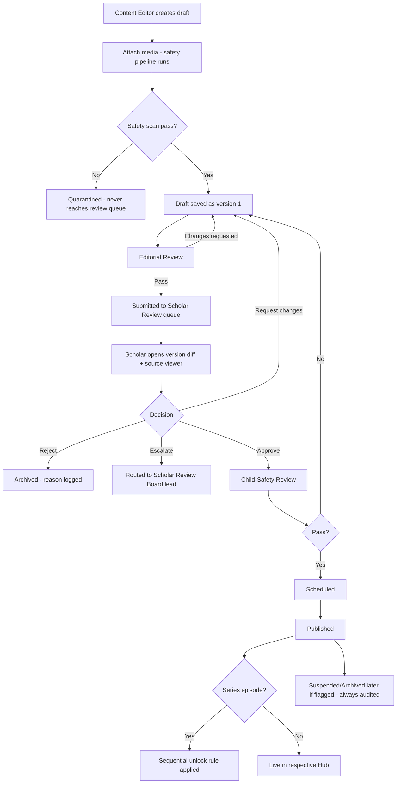
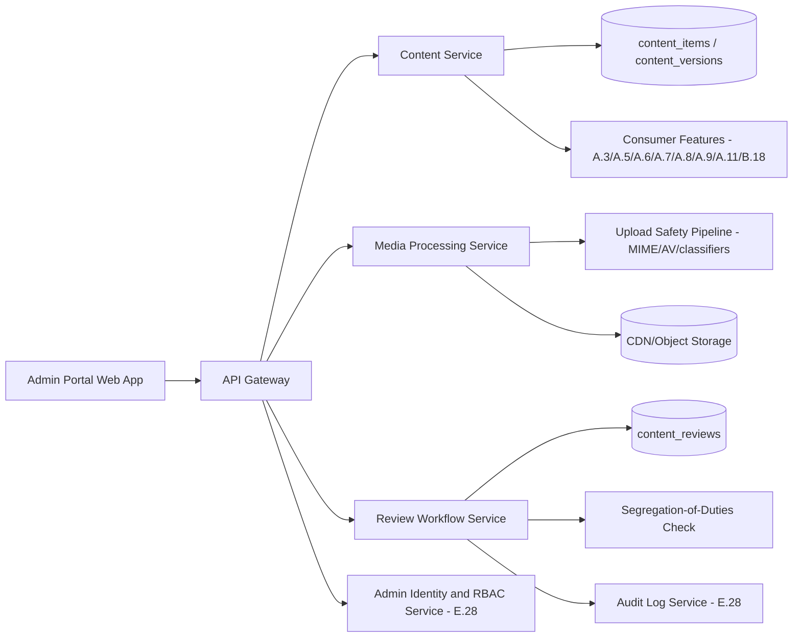

# Feature E.29 — Content CMS & Scholar Review Workflow

**App:** NoorHeroes — Islamic Learning App for Children
**Feature Owner:** Content & Editorial / Scholar Review Board / Platform
**Status:** Implementation-ready
**Version:** 1.0
**Depends on:** E.28 (Admin Auth/RBAC — role-scoped access, maker-checker, audit log)
**Feeds into:** A.3 (Stories), A.5 (Quran/Arabic), A.6 (Dua Learning), A.8 (Quiz Engine), A.9 (Mastery Engine), B.18 (Islamic Facts), A.7 (Habit Templates), A.11 (Missions/Rewards content), E.30 (Child-Safety/Moderation Review — downstream gate), E.34 (Localization — per-locale content versions)

> **Scope note:** This document is the canonical specification for the **Content CMS** (the editorial authoring surface for every content type: Story, Episode, Video, Audio, Text, Lesson, Quiz, Fact, Dua, Habit Template, Mission, Reward) and the **Scholar Review Workflow** that gates Islamic-content-adjacent items before publish. It covers the Story Editor, Quiz Builder, Media Manager, and the full Draft → Editorial → Automated Safety → Scholar Review → Child-Safety Review → Schedule/Publish → Post-Publish Monitoring → Suspend pipeline, with its non-negotiable segregation-of-duties rule (a reviewer cannot silently edit and approve the same version). The **AI Moderation Console** and **Child-Safety/Appeals Queue** are downstream consumers of this pipeline's output and are specified in their own document (E.30); this document owns content authorship and the scholar-approval gate itself.

---

## Table of Contents

1. [Product Requirements](#1-product-requirements)
2. [UX/UI Requirements](#2-uxui-requirements)
3. [Backend Requirements](#3-backend-requirements)
4. [Database Design](#4-database-design)
5. [Backend AI Code-Generation Prompt](#5-backend-ai-code-generation-prompt)
6. [Frontend (Admin Web) Requirements](#6-frontend-admin-web-requirements)
7. [Frontend AI Code-Generation Prompt](#7-frontend-ai-code-generation-prompt)
8. [Admin Requirements](#8-admin-requirements)
9. [Admin AI Code-Generation Prompt](#9-admin-ai-code-generation-prompt)
10. [DevOps Requirements](#10-devops-requirements)
11. [Analytics Requirements](#11-analytics-requirements)
12. [Security Requirements](#12-security-requirements)
13. [QA Requirements](#13-qa-requirements)
14. [Marketing Requirements](#14-marketing-requirements)
15. [Release & Rollback Plan](#15-release--rollback-plan)

---

## 1. Product Requirements

### 1.1 Problem Statement

NoorHeroes' entire content catalog — stories, Quran/dua content, quizzes, facts, habit templates, missions, and rewards — must be authored, versioned, and rigorously reviewed (editorially, for safety, by scholars for Islamic accuracy, and for age/child-safety fit) before ever reaching a child, with strict segregation of duties preventing any single person from silently editing and approving their own work, and with every piece of media passing a safety pipeline before it can even enter a review queue (source: NoorHeroes Blueprint module 4 "Content Management": "Only an approved immutable version can publish; every upload passes MIME validation, AV scan, and safety classifiers before entering the review queue"; §11.3/§23.7 "Segregation of duties (non-negotiable): A reviewer cannot silently edit and approve the same version. Publication is a separate permission from review approval").

### 1.2 Business Goals

- Provide editorial teams a genuinely productive authoring environment (Story Editor, Quiz Builder, Media Manager) covering every content type the platform needs, without sacrificing the rigor that makes NoorHeroes' scholar-review promise credible.
- Maintain zero-tolerance segregation of duties as a structural, not policy-level, guarantee — this is the foundation of the platform's "every piece of content is scholar-reviewed" trust claim referenced throughout the consumer-facing feature set (A.3/A.5/A.6/B.18).
- Support efficient, full versioning/rollback so a publishing mistake or a later-discovered issue can always be corrected without losing historical context.
- Keep the review pipeline auditable end-to-end — every transition records actor, reason, version, and audit ID.

### 1.3 User Goals

- **Content Editor:** Author and iterate on content drafts efficiently, with clear feedback at every review stage, never accidentally able to publish their own work.
- **Scholar Reviewer:** Review assigned content with full source context, version diffs, and timestamped media comments, making a clear Approve/Request Changes/Reject/Escalate decision.
- **Publisher:** Confirm a fully-approved version is ready and schedule/publish it, trusting that nothing reaches this stage without having genuinely passed every prior gate.
- **Child Safety Reviewer:** Perform the age/safety-fit pass as a distinct, final gate before anything goes live.

### 1.4 Success Metrics

| Metric | Target |
|---|---|
| Content items with a complete, gapless review-history audit trail | 100% (hard guarantee) |
| Segregation-of-duties violations (reviewer self-approving) | 0 (hard, zero-tolerance) |
| Scholar review queue average cycle time | ≤ 3 business days |
| Media items quarantined by the safety pipeline before reaching review | Tracked (a content-pipeline health signal) |
| Post-publish suspension rate (content needing correction after going live) | ≤ 2% |
| Content Editor satisfaction with authoring tools | ≥ 80% (qualitative survey) |

### 1.5 Stakeholders

Content & Editorial Lead, Scholar Review Board, Child Safety Reviewer team, Platform/Security Engineering (E.28 RBAC dependency), Backend Architect, Frontend (Admin Web) Engineer, Data Analyst, QA Lead, Legal/Compliance, every consumer-facing feature owner whose content this pipeline produces (A.3/A.5/A.6/A.7/A.8/A.9/A.11/B.18).

### 1.6 User Stories

1. As a Content Editor, I want to draft a story with metadata, script/scenes, interactive choices, a moral summary, a quiz, references, and media — all in one editor.
2. As a Content Editor, I want to build quiz questions from a reusable question bank with skill tags, difficulty, and distractor-quality checks.
3. As a Content Editor, I want to upload media and trust that it's automatically scanned for safety before it ever reaches a reviewer.
4. As a Scholar Reviewer, I want my assigned queue, a source viewer, a side-by-side version diff, and the ability to leave timestamped comments on audio/video.
5. As a Scholar Reviewer, I want to Approve, Request Changes, Reject, or Escalate — and know I can never approve something I personally edited.
6. As a Child Safety Reviewer, I want a distinct final review pass after scholar approval, focused specifically on age/safety fit.
7. As a Publisher, I want to schedule or immediately publish only content that has passed every required gate, never anything still mid-review.
8. As anyone with appropriate access, I want to see a content item's complete version history and review-decision trail.
9. As a Safety Role holder, I want to be able to emergency-suspend live content, with that action always audited.

### 1.7 Functional Requirements

**FR-1** Content model supports the complete type list (canonical, source §23.3/§11.3): Story, Episode, Video, Audio, Text, Lesson, Quiz, Fact, Dua, Habit Template, Mission, Reward — each carrying locale, age band, difficulty, duration, free/premium flag, and seasonal windows; sources, scholar notes, learning objectives, moral lesson; media tracks, captions, transcripts, thumbnails, download policy; versioning, preview, scheduling, rollback, archive.
**FR-2** Story Editor sections (canonical, source §23.4): Metadata, Script/Scene Blocks, Interactive Choices, Moral Summary, Quiz, References, Media Timeline, Captions/Audio Tracks, Age/Region/Locale Eligibility, Review History.
**FR-3** Quiz Builder (canonical, source §23.5): Question bank with reusable skill tags; question types (multiple choice, ordering, audio/image match, true/false); correct answer + explanation; difficulty/age/locale/skill tags; distractor-quality checks; preview for mobile and screen reader; **version lock after publication**.
**FR-4** Media Manager (canonical, source §23.6): Multipart upload; virus scanning; transcoding/thumbnail jobs; loudness normalization; caption validation; audio-track mapping; rights/license fields; CDN purge and emergency disable.
**FR-5** **Only an approved immutable version can publish; every upload passes MIME validation, AV scan, and safety classifiers before entering the review queue** (source: module 4 Validation Rules — a hard, zero-exception rule; failed media is **quarantined and never reaches the review queue at all**, per the Content Creation Flow diagram).
**FR-6** **Episode N+1 cannot publish without episode N's unlock threshold configured** (source: module 4 Validation Rules) — preventing a sequential-unlock content series (cross-ref A.3's sequential-unlock rule) from ever being publishable in a broken, gap-containing state.
**FR-7** The canonical content lifecycle (source module 4 Workflow / §11.9 Content Creation Flow / Content Creation Flow diagram): Draft → Attach media (safety pipeline; quarantine on fail) → Editorial Review → Automated Safety/Metadata Checks → Scholar Review → Child-Safety Review → Scheduled → Published → Suspended/Archived. **Every transition records actor, reason, version, and audit ID.**
**FR-8** Scholar Review tools (canonical, source §23.7/§11.3): Assigned queue, source viewer, side-by-side version diff, timestamped comments for audio/video, regional/jurisprudential notes, and Approve/Request Changes/Reject/Escalate actions.
**FR-9** **Segregation of duties (non-negotiable): a reviewer cannot silently edit and approve the same version. Publication is a separate permission from review approval. Emergency suspension is available to safety roles only and is always audited** (source §11.3/§23.7 — three distinct hard rules, each independently enforced).
**FR-10** Quran content publishing follows a **stricter, distinct path**: ayah text is immutable; only translations/tafseer/recitations version; proposed changes link to an existing immutable ayah record, undergo scholar review at an **elevated confidence threshold**, and on approval publish with locale + age tags (source: "Quran Publishing Flow" diagram — restated, cross-ref A.5's `ayah` immutability guarantee, this document's authoring-side enforcement point for that guarantee).
**FR-11** Reward/XP-rule content creation never disturbs historical ledger entries: a new XP rule or badge-criteria version is validated (references a valid event type), saved as a new version while the old version stays active until cutover, and on publish, the Reward Engine picks up the new rule **for future events only** — existing ledger entries remain unaffected (source: "Reward Creation Flow" diagram, restated; cross-ref A.11's non-retroactivity principle, this document's authoring-side origin point).
**FR-12** Content versioning is append-only per version — editing a published item creates a new version requiring fresh review, never mutating an already-published version in place (consistent with the platform-wide content-versioning pattern already established throughout A.3/A.5/A.6/A.11/B.18).
**FR-13** Localization windows into the Content CMS at the per-locale-version level (cross-ref E.34) — this document owns the base content-authoring/review pipeline; per-locale translation/coverage tooling is owned by E.34's Localization Management module, referenced here only as a downstream dependency consumer.

### 1.8 Non-Functional Requirements

- **Segregation of Duties Integrity:** The reviewer-cannot-approve-their-own-edit guarantee must be enforced structurally (comparing the actual editor identity against the approver identity at the database/service layer), never merely a UI convention.
- **Media Safety Gate:** No media file reaches any human reviewer's queue without first passing MIME validation, AV scanning, and safety classification — a quarantine-by-default, fail-closed design.
- **Versioning Completeness:** Every content item's full version and review-decision history must be reconstructable from the audit trail at any time.
- **Quran Content Rigor:** The elevated-confidence-threshold, ayah-immutable design must never be weakened or bypassed by any general content-editing tooling shared with other content types.

### 1.9 Acceptance Criteria

- Given a Content Editor drafts a new story with media attached, when the media is uploaded, then it passes (or fails and is quarantined by) the safety pipeline before any reviewer can see it.
- Given a content item completes Editorial Review and Automated Safety Checks, when it enters Scholar Review, then the assigned scholar sees the full source viewer, version diff, and can leave timestamped media comments.
- Given a scholar reviewer personally edited a specific version of a content item, when they attempt to approve that same version, then the system rejects this as a segregation-of-duties violation.
- Given a content item passes Scholar Review, when it proceeds, then it requires a separate Child-Safety Review pass before becoming eligible for scheduling/publish — scholar approval alone is never sufficient to publish.
- Given a Publisher attempts to publish a content item, when they try, then only a version that has completed every required gate (editorial, safety, scholar, child-safety) is publishable — no partial-approval state is publishable.
- Given an episode in a series is being published, when episode N+1 is submitted, then it cannot publish unless episode N's unlock threshold is already configured.
- Given a proposed change to Quran-adjacent content, when reviewed, then it is evaluated against the ayah's immutable text and at the elevated confidence threshold specific to this content category.
- Given an emergency suspension of live content occurs, when reviewed later, then a complete, audited record exists showing who suspended it and why.

### 1.10 Edge Cases

1. A Content Editor drafts a story, submits it for review, then is also assigned as the Scholar Reviewer for an unrelated content item in the same batch → this is fine; segregation of duties applies per-content-item/per-version, not as a blanket "this person can never review anything" rule — the restriction is specifically "cannot approve a version they personally edited," not "cannot hold multiple roles across different content."
2. A Scholar Reviewer requests changes on a content item, the Content Editor makes the requested edits, and the **same** scholar reviewer is then assigned to re-review the updated version → this is permitted (reviewing a *different* version than the one being edited is the normal review cycle); the segregation-of-duties rule specifically prevents a reviewer from being the *editor* of the *exact version* they are also approving, not from reviewing multiple iterations of an item over time.
3. A media file passes the automated safety pipeline but a human reviewer later notices a subtle issue the automated classifiers missed → the human review stages (Editorial/Scholar/Child-Safety) exist precisely to catch what automated classification cannot; this is the expected, intended function of having human review stages downstream of the automated gate, not a pipeline failure.
4. An episode's sequential-unlock threshold is configured, then later an editor wants to change episode N's content after episode N+1 has already been configured and even published → editing episode N creates a new version requiring its own fresh review cycle (FR-12); episode N+1's existing publish status and unlock-threshold configuration are unaffected by episode N's new draft existing in parallel, since only the *published* version of episode N is what's currently live and referenced.
5. A scholar reviewer attempts to "Escalate" a content item, but no clear escalation path/assignee exists for the specific jurisprudential question at hand → the escalation action still succeeds in marking the item as escalated and removing it from the normal queue flow, with the resulting escalation routed to a Scholar Review Board lead or equivalent senior role for triage, rather than the escalation action failing or the item being silently stuck.
6. A content item is suspended via emergency suspension while a parent's child happens to be actively viewing/playing it at that exact moment → consistent with the platform's general withdrawn-content handling pattern (established throughout A.3/A.5/A.6/A.8/A.9), the active session may complete its current natural unit, but the content is excluded from any future search/browse/recommendation surfacing immediately, with downstream caches/CDNs purged per the Media Manager's emergency-disable capability (FR-4).
7. A Reward/XP-rule version is proposed, approved, and published, but its cutover timing coincides with a child mid-activity whose reward would be calculated under either the old or new rule depending on exact timing → consistent with FR-11/A.11's non-retroactivity principle, the rule version active at the moment the activity actually completes is the one applied, never retroactively recalculated after the fact based on which rule was live at request-processing time versus actual-event time, mirroring A.9's established "rule version active at time of completion" pattern.
8. Two different Content Editors attempt to simultaneously edit the same content item's same draft version → standard optimistic-concurrency handling applies (consistent with C.21's established pattern for similar concurrent-edit scenarios) — the second save attempt is rejected with a "this has changed, please refresh" response rather than silently overwriting the first editor's work.
9. A Publisher role holder attempts to also personally approve a Scholar Review decision (role conflation) → since "Publisher" and "Scholar Reviewer" are distinct roles in the RBAC model (E.28 FR-4), a single admin would need to hold both role assignments for this to even be possible, and even then, the segregation-of-duties check operates on the specific action (cannot approve a version you edited) rather than blanket-preventing someone from holding multiple distinct roles — the system's actual protection is narrower and more precise than "no one person touches more than one stage," matching the documented rule's exact wording.

### 1.11 Error Handling

| Scenario | System Behavior |
|---|---|
| Media fails the safety pipeline (MIME/AV/safety classifier) | Quarantined, never reaches the review queue (FR-5) |
| Reviewer attempts to approve their own edited version | Rejected as a segregation-of-duties violation |
| Episode N+1 submitted without episode N's unlock threshold configured | Publish blocked until configured (FR-6) |
| Concurrent edit conflict on the same draft version | Second save rejected with a "this has changed, please refresh" response (Edge Case 8) |
| Escalation with no clear assignee | Still succeeds, routed to a senior/lead role for triage (Edge Case 5) |
| Attempt to publish a partially-approved content version | Blocked — only a version that has completed every required gate is publishable |

### 1.12 Empty States
- A newly-created Content Editor account with zero assigned drafts → a clear "no drafts yet, create your first" framing on the Content List screen.
- A Scholar Reviewer's queue with zero pending items → a calm "Queue clear" state.

### 1.13 Loading States
- Content List / Story Editor / Scholar Review Queue: standard skeleton-list/form shimmer while data loads.

### 1.14 Offline States
- N/A (internal operator tool assumed to run on a connected network); standard reconnection-banner handling applies.

### 1.15 Permission States
- Every CMS/review action is gated by E.28's RBAC model — a Content Editor cannot publish (no Publisher permission), a Scholar Reviewer cannot edit content they're reviewing in a way that would taint their own approval eligibility, etc., consistent with the role definitions in E.28 FR-4.

### 1.16 User Flow (Narrative)

A Content Editor drafts a new content item (story, quiz, fact, etc.) using the appropriate editor (Story Editor, Quiz Builder) → attaches media via the Media Manager, which automatically runs the safety pipeline → the draft passes Editorial Review and Automated Safety/Metadata Checks → enters the Scholar Review queue, where an assigned scholar uses the source viewer, version diff, and timestamped comments to Approve, Request Changes, Reject, or Escalate → on scholar approval, the item proceeds to Child-Safety Review, a distinct final gate → on passing, a Publisher schedules or immediately publishes it → post-publish monitoring continues, with any safety-role holder able to emergency-suspend if an issue is later found, always audited.

### 1.17 Detailed Flow Diagram (Mermaid)

**Content Creation & Review Flow (canonical, combining source's Content Creation Flow + Story Publishing Flow diagrams):**



### 1.18 Screen Inventory (Complete — Zero Missing)

| # | Screen | Type | Entry Points | Exit Points |
|---|---|---|---|---|
| 1 | Content List | Primary | Admin Portal Content navigation group | Story Editor, Quiz Builder, Media Manager, item detail |
| 2 | Story Editor — Metadata Tab | Screen | Content List, new draft | Script/Scene Blocks tab |
| 3 | Story Editor — Script/Scene Blocks | Screen | Story Editor tabs | Interactive Choices tab |
| 4 | Story Editor — Interactive Choices | Screen | Story Editor tabs | Moral Summary tab |
| 5 | Story Editor — Moral Summary | Screen | Story Editor tabs | Quiz tab |
| 6 | Story Editor — Quiz (linked, embedded Quiz Builder context) | Screen | Story Editor tabs | References tab |
| 7 | Story Editor — References | Screen | Story Editor tabs | Media Timeline tab |
| 8 | Story Editor — Media Timeline | Screen | Story Editor tabs | Captions/Audio Tracks tab |
| 9 | Story Editor — Captions/Audio Tracks | Screen | Story Editor tabs | Age/Region/Locale Eligibility tab |
| 10 | Story Editor — Age/Region/Locale Eligibility | Screen | Story Editor tabs | Review History tab |
| 11 | Story Editor — Review History | Screen | Story Editor tabs | Submit for Review action |
| 12 | Quiz Builder — Question Bank | Screen | Content List, Story Editor's Quiz tab | Question Editor |
| 13 | Quiz Builder — Question Editor (type-specific: MC/ordering/audio-image-match/true-false) | Screen | Question Bank | Distractor Quality Check, Preview |
| 14 | Quiz Builder — Mobile/Screen-Reader Preview | Screen variant | Question Editor | Back |
| 15 | Media Manager — Upload | Screen | Story Editor's Media Timeline, standalone Media navigation | Safety Pipeline Status |
| 16 | Media Manager — Safety Pipeline Status (pass/quarantine) | Screen variant | Media Upload | Media Library (if passed) / Quarantine Detail (if failed) |
| 17 | Media Manager — Quarantine Detail | Screen | Safety Pipeline Status, failed | N/A (never reaches review) |
| 18 | Media Manager — Library (browse, CDN purge, emergency disable) | Screen | Content List, standalone Media navigation | Media Detail |
| 19 | Scholar Review — Assigned Queue | Primary | Admin Portal Review navigation group | Scholar Review Detail |
| 20 | Scholar Review — Detail (source viewer + version diff + timestamped comments) | Screen | Assigned Queue | Approve/Request Changes/Reject/Escalate confirmation |
| 21 | Scholar Review — Decision Confirmation | Modal | Scholar Review Detail | Assigned Queue (item resolved) |
| 22 | Segregation-of-Duties Violation Block (component) | Component | Scholar Review Detail, self-edited-version approval attempt | N/A (blocked) |
| 23 | Child-Safety Review Queue | Screen | Admin Portal Review navigation group | Child-Safety Review Detail |
| 24 | Child-Safety Review Detail | Screen | Child-Safety Review Queue | Pass/Request Changes confirmation |
| 25 | Quran Content Proposal Editor (translation/tafseer/recitation, distinct stricter path) | Screen | Content List, Quran-specific navigation | Quran Scholar Review (elevated threshold) |
| 26 | Quran Scholar Review (elevated confidence threshold) | Screen | Quran Content Proposal Editor | Publish (locale + age tags) |
| 27 | Reward/XP-Rule Version Editor | Screen | Content List, Engagement navigation cross-reference | Publish (future-events-only cutover) |
| 28 | Publish/Schedule Screen | Screen | Fully-approved content item | Published state |
| 29 | Emergency Suspension Action (component, safety roles only) | Component | Published content item detail | Suspended state, audited |
| 30 | Version History / Diff Viewer | Screen | Story Editor's Review History tab, any content item detail | Back |

### 1.19 Events (Complete Analytics Event List)

`content_draft_created`, `content_media_uploaded`, `content_media_quarantined`, `content_submitted_for_editorial_review`, `content_editorial_review_decision`, `content_submitted_for_scholar_review`, `scholar_review_opened`, `scholar_review_decision` (with `decision: approve|request_changes|reject|escalate`), `segregation_of_duties_violation_blocked` (internal/security signal), `content_submitted_for_child_safety_review`, `child_safety_review_decision`, `content_published`, `content_scheduled`, `content_suspended` (with `actor`, `reason`), `content_archived`, `quiz_question_created`, `quiz_question_distractor_check_run`, `quran_proposal_submitted`, `quran_scholar_review_decision`, `reward_rule_version_published`, `episode_unlock_threshold_validation_blocked`.

---

## 2. UX/UI Requirements

> The Content CMS and Scholar Review tools follow the Admin Portal's dense, professional-tool visual register established in E.28 §2.1 — information-dense, task-efficient, with the Scholar Review Detail screen specifically optimized for careful, deliberate reading and comparison rather than rapid scanning.

### 2.1 CMS-Specific Design System Extensions

- **Story Editor Tab Structure:** A persistent left or top tab rail across the 10 sections (Metadata through Review History), with a clear draft/version-status indicator always visible regardless of which tab is active.
- **Version Diff Visual Language:** A clear side-by-side or inline-highlighted diff view (additions/removals/changes color-coded, consistent with standard code/document diff conventions familiar to most professional tool users) for the Scholar Review Detail screen.
- **Timestamped Media Comment Pins:** For audio/video review, comment pins anchored to specific timestamps on a scrubber/waveform, each expandable to show the comment text — a standard pattern for media-review tools.
- **Segregation-of-Duties Block Visual Language:** A clear, explanatory blocked-state message (never just a disabled button with no explanation) when a reviewer attempts to approve their own edited version — explaining *why*, not just *that*, the action is unavailable.

### 2.2 Screen-Level Design Requirements (Key Screens)

#### Screen: Scholar Review — Detail

- **Purpose:** Give a scholar everything needed to make a confident, well-informed Islamic-accuracy decision.
- **Components:** Source viewer (referenced texts/citations), side-by-side version diff, media player with timestamped-comment scrubber, regional/jurisprudential notes field, decision action bar (Approve/Request Changes/Reject/Escalate).
- **States:** Default, Commenting (timestamp-pin active), Decision-confirming, Segregation-of-duties-blocked (if applicable).
- **Accessibility:** All diff content and comments are screen-reader-navigable in linear reading order, not solely positional/visual.

#### Screen: Media Manager — Safety Pipeline Status

- **Purpose:** Give clear, immediate feedback on whether an uploaded media file passed or failed the safety pipeline.
- **Components:** A processing-stage indicator (Uploading → Scanning → Transcoding → Ready, or → Quarantined), with quarantine reason detail shown plainly if applicable.
- **States:** Uploading, Scanning, Transcoding, Ready, Quarantined.

### 2.3 Tab Structure

Content CMS and Scholar Review are reached from the Admin Portal's "Content" and "Review" navigation groups respectively (cross-ref E.28 §2.3's persistent sidebar). Click mapping:

| Click Target | Destination | API Called | Analytics Event | Permission Check | Error Handling |
|---|---|---|---|---|---|
| "New Draft" (Content List) | Story Editor / Quiz Builder (by type) | `POST /v1/admin/content` | `content_draft_created` | `content_editor` role | Standard handling |
| Media upload | Safety Pipeline Status | `POST /v1/admin/media` | `content_media_uploaded` | `content_editor` role | Quarantine state on failure |
| "Submit for Scholar Review" | Scholar Review queue (item added) | `POST /v1/admin/reviews` | `content_submitted_for_scholar_review` | `content_editor`/`publisher` role | Standard handling |
| Scholar "Approve" | Child-Safety Review queue (item moves) | `PATCH /v1/admin/reviews/{id}` | `scholar_review_decision` | `scholar_reviewer` role, segregation-of-duties check | Blocked state if self-edited |
| "Publish" (fully-approved item) | Published state | `PATCH /v1/admin/content/{id}` (status transition) | `content_published` | `publisher` role | Blocked if not fully-approved |
| Emergency Suspend | Suspended state | `POST /v1/admin/content/{id}/suspend` | `content_suspended` | Safety role only | Always audited |

### 2.4 Wireframe Description (Composite)

The Content List follows a standard data-table/grid browse pattern; the Story Editor follows a tabbed-form pattern; the Scholar Review Detail follows a document-review/diff-tool pattern — each chosen to match the closest widely-recognized professional-tool convention for its specific task, consistent with the Admin Portal's overall design philosophy.

### 2.5 Screen Image Generation Prompts

**Screen: Scholar Review — Detail**
- *Prompt 1 (English):* "Desktop web admin scholar review detail screen UI mockup, dense professional document-review tool aesthetic. Cool neutral grey-white background. Left panel shows a source/reference text viewer with citation footnotes. Right panel shows a side-by-side version diff with highlighted additions (green) and removals (red) in a text block. Below, a media player waveform with small numbered comment pin markers at specific timestamps. At the bottom, a horizontal action bar with four buttons: 'Approve', 'Request Changes', 'Reject', 'Escalate'. Clean, dense, professional document-tool aesthetic, sharp corners, muted blue/grey accents, no realistic human faces."
- *Prompt 2 (Arabic RTL):* "نفس شاشة تفاصيل المراجعة الشرعية لتطبيق ويب إداري لسطح المكتب، بطابع أداة مراجعة وثائق مهنية كثيفة، بتخطيط من اليمين إلى اليسار بالكامل. خلفية رمادية باردة محايدة. اللوحة اليمنى تعرض عارض نص مصدر/مرجعي بحواشي استشهاد. اللوحة اليسرى تعرض مقارنة فروقات نسخ جنبًا إلى جنب مع تمييز الإضافات (أخضر) والحذوفات (أحمر) في كتلة نصية. أسفل ذلك مشغل وسائط بموجة صوتية مع علامات تعليق صغيرة مرقمة عند طوابع زمنية محددة. في الأسفل شريط إجراءات أفقي بأربعة أزرار: 'موافقة'، 'طلب تغييرات'، 'رفض'، 'تصعيد'. طابع نظيف وكثيف وأداة وثائق مهنية، زوايا حادة، لمسات زرقاء/رمادية باهتة، بدون وجوه بشرية واقعية."

**Screen: Story Editor — Media Timeline**
- *Prompt 1 (English):* "Desktop web admin story editor screen UI mockup, dense professional CMS tool aesthetic. Cool neutral grey-white background. Top tab rail showing 10 small tabs ('Metadata', 'Script', 'Choices', 'Moral Summary', 'Quiz', 'References', 'Media Timeline' highlighted active, 'Captions', 'Eligibility', 'Review History'). Main content area shows a horizontal media timeline track with small thumbnail clips, an upload button, and a small status badge per clip reading 'Ready' (green) or 'Scanning' (amber). Clean, dense, professional CMS tool aesthetic, sharp corners, muted blue/grey accents, no realistic human faces."
- *Prompt 2 (Arabic RTL):* "نفس شاشة محرر القصة الإدارية لتطبيق ويب لسطح المكتب، بطابع أداة CMS مهنية كثيفة، بتخطيط من اليمين إلى اليسار بالكامل. خلفية رمادية باردة محايدة. شريط علامات تبويب علوي يعرض 10 علامات تبويب صغيرة ('البيانات الوصفية'، 'النص'، 'الخيارات'، 'الملخص الأخلاقي'، 'الاختبار'، 'المراجع'، 'الخط الزمني للوسائط' مميزة كنشطة، 'الترجمة'، 'الأهلية'، 'سجل المراجعة'). منطقة المحتوى الرئيسية تعرض مسار خط زمني أفقي للوسائط بمقاطع صور مصغرة صغيرة، وزر تحميل، وشارة حالة صغيرة لكل مقطع تقول 'جاهز' (أخضر) أو 'جاري الفحص' (عنبري). طابع نظيف وكثيف وأداة CMS مهنية، زوايا حادة، لمسات زرقاء/رمادية باهتة، بدون وجوه بشرية واقعية."

---

## 3. Backend Requirements

### 3.1 System Design Overview

The Content CMS is served by a **Content Service** (the canonical authoring/versioning store for every content type), a **Media Processing Service** (the upload/safety-pipeline/transcoding pipeline), and a **Review Workflow Service** (the state machine driving Editorial → Scholar → Child-Safety review, enforcing segregation of duties) — all consuming E.28's RBAC for authorization and writing to E.28's shared Audit Log.

### 3.2 Architecture Diagram (Mermaid)



### 3.3 Service Breakdown

| Service | Responsibility |
|---|---|
| Content Service | Content-item/version CRUD, the versioning/rollback/archive lifecycle |
| Media Processing Service | Upload handling, safety pipeline orchestration, transcoding/thumbnailing |
| Review Workflow Service | The Editorial → Scholar → Child-Safety state machine, segregation-of-duties enforcement |
| Admin Identity and RBAC Service (reused, E.28) | Role-scoped authorization for every action in this service |
| Audit Log Service (reused, E.28) | Service-layer audit writes for every content/review transition |

### 3.4 API List

#### `POST /v1/admin/content` / `GET /v1/admin/content` / `PATCH /v1/admin/content/{id}`
- **Auth:** `content_editor`+ role
- **Validation:** PATCH against a `published` status content item creates a **new version**, never mutates the published version in place (FR-12).

#### `GET /v1/admin/content/{id}/versions`
- **Response 200:** Full version history with diffs available between any two versions.

#### `POST /v1/admin/media`
- **Auth:** `content_editor`+ role
- **Business Logic:** Triggers the safety pipeline (MIME validation → AV scan → safety classifiers) asynchronously; the media item is **not visible to any review queue** until this pipeline reports `pass` — a failed result transitions the item to `quarantined`, a terminal state requiring re-upload, never a retryable "fix in place" state for the same upload.

#### `POST /v1/admin/questions` (Quiz Builder)
- **Validation:** Distractor-quality checks run automatically on save; `version_lock=true` is set automatically once the parent quiz is published, after which this specific question version becomes immutable (consistent with FR-3).

#### `GET /v1/admin/reviews` (Scholar/Child-Safety queue)
- **Response 200:** Items assigned to the requesting reviewer's queue, scoped by role (`scholar_reviewer` sees Scholar Review queue items; `child_safety_reviewer` sees Child-Safety queue items).

#### `PATCH /v1/admin/reviews/{id}`
- **Auth:** `scholar_reviewer` or `child_safety_reviewer` role, matching the review stage
- **Request:** `{ "decision": "approve|request_changes|reject|escalate", "comments": [...], "timestamped_comments": [...] }`
- **Validation:** **Rejects (`403 SEGREGATION_OF_DUTIES_VIOLATION`)** if the reviewing admin's identity matches the `last_edited_by` admin identity on the specific content version under review — compared at the service layer against the actual edit-history record, never a client-supplied claim.
- **Business Logic:** On `approve` from Scholar Review, transitions the item to the Child-Safety Review queue; on `approve` from Child-Safety Review, transitions to `scheduled`/eligible-for-publish; `reject` archives with the reason logged; `escalate` routes to a Scholar Review Board lead role.

#### `PATCH /v1/admin/content/{id}/publish`
- **Auth:** `publisher` role (distinct from `scholar_reviewer`/`content_editor`, per FR-9's separate-permission rule)
- **Validation:** Rejects unless the target version has a complete, passed review-stage history (Editorial + Scholar + Child-Safety) — there is no partial-approval-publishable state.

#### `POST /v1/admin/content/{id}/suspend`
- **Auth:** Safety roles only (`child_safety_reviewer`, `super_admin`)
- **Business Logic:** Immediately removes the content from active serving (catalog/search/recommendation eligibility) and purges relevant CDN caches; **always writes an audit entry**, no exception.

#### Quran-specific: `POST /v1/admin/quran-proposals` / `PATCH /v1/admin/quran-proposals/{id}`
- **Validation:** Must reference an existing `ayah_id` (immutable record, cross-ref A.5); review confidence-threshold parameters for this content category are configured at an elevated level relative to general content review.

#### Reward-specific: `POST /v1/admin/rewards` (XP rules/badge criteria)
- **Validation:** New version creation only — never an in-place mutation of a rule version that's already been used to compute historical ledger entries (cross-ref A.11 §5's identical guarantee, this document's authoring-side enforcement point).

### 3.5 Cross-Cutting API Concerns

- **Segregation-of-duties enforcement:** The single most important guarantee in this service — enforced by comparing actual edit-history records against the approving identity at the service layer, never a client-supplied or UI-only check.
- **Fail-closed media safety:** No media reaches a review queue without a passed safety-pipeline result; the default for any uncertain/failed result is exclusion, never inclusion.
- **Versioning immutability:** Published versions are never mutated in place; every edit is a new version requiring its own review cycle.
- **Audit completeness:** Every status transition (Draft→Editorial, Editorial→Scholar, Scholar→Child-Safety, →Published, →Suspended/Archived) writes a service-layer audit entry capturing actor, reason, version, and a unique audit ID.

---

## 4. Database Design

### 4.1 ER Diagram (Mermaid)

```mermaid
erDiagram
    CONTENT_ITEM ||--o{ CONTENT_VERSION : "has many"
    CONTENT_VERSION ||--o{ CONTENT_REVIEW : "has many"
    CONTENT_VERSION ||--o| MEDIA_ASSET : "may reference"
    MEDIA_ASSET ||--|| SAFETY_PIPELINE_RESULT : "has one"
    CONTENT_ITEM ||--o{ QUIZ_QUESTION : "may have many"

    CONTENT_ITEM {
        uuid content_id PK
        string content_type
        string status
        timestamptz created_at
    }
    CONTENT_VERSION {
        uuid version_id PK
        uuid content_id FK
        int version_number
        jsonb content_json
        uuid last_edited_by FK
        string review_stage
        timestamptz created_at
    }
    CONTENT_REVIEW {
        uuid review_id PK
        uuid version_id FK
        string stage
        uuid reviewer_id FK
        string decision
        jsonb comments
        timestamptz decided_at
    }
    MEDIA_ASSET {
        uuid media_id PK
        uuid content_version_id FK
        string mime_type
        string storage_url
        timestamptz uploaded_at
    }
    SAFETY_PIPELINE_RESULT {
        uuid media_id PK_FK
        string status
        jsonb classifier_results
        timestamptz processed_at
    }
    QUIZ_QUESTION {
        uuid question_id PK
        uuid content_id FK
        string question_type
        jsonb skill_tags
        boolean version_locked
    }
```

### 4.2 Tables, Relationships, Constraints

| Table | Key Constraints | Indexes |
|---|---|---|
| `content_item` | CHECK `content_type IN ('story','episode','video','audio','text','lesson','quiz','fact','dua','habit_template','mission','reward')`; CHECK `status IN ('draft','in_review','scheduled','published','suspended','archived')` | Index `(content_type, status)` |
| `content_version` | FK `content_id`, `last_edited_by`; UNIQUE(`content_id`, `version_number`); **published versions are never UPDATEd — a new row is always inserted for any subsequent edit** | Index `(content_id, version_number DESC)` |
| `content_review` | FK `version_id`, `reviewer_id`; CHECK `decision IN ('approve','request_changes','reject','escalate')`; **CHECK `reviewer_id != (SELECT last_edited_by FROM content_version WHERE version_id = content_review.version_id)`** — the database-level segregation-of-duties constraint, defense-in-depth alongside the application-layer check | Index `(version_id, stage)` |
| `media_asset` | FK `content_version_id` | Index `(content_version_id)` |
| `safety_pipeline_result` | PK = FK `media_id`; CHECK `status IN ('pending','pass','quarantined')` | — |
| `quiz_question` | FK `content_id`; `version_locked` set to `true` automatically on parent-content publish, never reversible to `false` | Index `(content_id)` |

### 4.3 Audit Fields
`content_version.created_at`, `content_review.decided_at` — append-only historical facts. The platform's shared `audit_log` (E.28) additionally records every transition with actor/reason/version/audit-ID per FR-7.

### 4.4 Soft Delete Rules
`content_item.status = 'archived'` used instead of deletion — preserves the full version/review history indefinitely, consistent with the platform-wide withdrawn-content pattern applied here at its authoring source.

### 4.5 Retention Rules
`content_version`/`content_review` retained indefinitely as the permanent provenance record for every piece of content the platform has ever published — this is foundational evidence for the platform's scholar-review trust claim and must never be purged.

---

## 5. Backend AI Code-Generation Prompt

```
You are building the Content Service, Media Processing Service, and
Review Workflow Service for "NoorHeroes." Reuse E.28's existing Admin
Identity/RBAC Service and Audit Log Service -- do not reimplement
authorization or audit-writing here.

Stack: FastAPI (Python 3.12), PostgreSQL (SQLAlchemy 2.0), Redis, Kafka/
Celery for async media processing, an AV-scanning integration (e.g.,
ClamAV or a cloud equivalent) and content-safety classifier integration.

Hard requirements:
1. Implement the segregation-of-duties check at BOTH the application
   layer AND the database layer (a CHECK constraint on content_review
   comparing reviewer_id against the target version's last_edited_by) --
   write a test attempting a direct database INSERT that would violate
   this constraint and confirming the database itself rejects it,
   independent of any application-layer check. Also write an API-level
   test: a fixture admin edits a content_version, then attempts to
   submit a content_review decision for that SAME version as the
   reviewer, and confirm 403 SEGREGATION_OF_DUTIES_VIOLATION.
2. Implement media upload to ALWAYS route through the safety pipeline
   asynchronously, with the media_asset/safety_pipeline_result NOT
   visible to any GET /v1/admin/reviews queue response until
   status='pass' -- write a test confirming a media item with
   status='pending' or 'quarantined' is excluded from any review-queue
   listing query, never returned even in a partial/draft-visible state.
3. Implement content_version as append-only for already-published
   versions: write a test confirming a PATCH against a content_item
   whose current version has status='published' creates a NEW
   content_version row rather than mutating the existing one, and that
   the database role has no UPDATE grant on already-published
   content_version rows (a permission-lockout test mirroring A.11's
   reward-ledger pattern).
4. Implement quiz_question.version_locked to be set to true automatically
   exactly once, at the moment the PARENT content_item transitions to
   published -- write a test confirming this field can never be reset to
   false via any application code path once set, and that an edit
   attempt against a version-locked question is rejected.
5. Implement the publish-eligibility check: PATCH
   /v1/admin/content/{id}/publish must verify the target version has a
   content_review row with decision='approve' for BOTH stage='scholar'
   AND stage='child_safety' before allowing the transition -- write a
   test confirming a version with only scholar approval (missing
   child-safety approval) is rejected from publishing.
6. Implement episode-sequencing validation: a content_item of type
   'episode' with a configured sequence_position cannot be published if
   the immediately-preceding sequence_position's episode does not have
   its unlock_threshold field populated -- write a test for this
   validation blocking publish of episode N+1 when episode N's
   threshold is unconfigured.
7. Implement Quran-content proposals (quran_proposal) to require a valid
   FK reference to an existing, immutable ayah_id, and to apply an
   ELEVATED confidence-threshold configuration value distinct from
   general content review's threshold -- write a test confirming the
   threshold value used for Quran-category review differs from (is
   stricter than) the general content-review default.
8. Implement reward-rule versioning (POST /v1/admin/rewards) to NEVER
   update an existing, already-live rule version in place -- always
   insert a new version row, with the Reward Engine (A.11, external to
   this service) responsible for picking up the new version for future
   events only. Write a test confirming this endpoint's implementation
   contains no UPDATE statement against an existing rule-version row
   under any code path.

Deliver: FastAPI routers, SQLAlchemy models, Alembic migrations
(including the database-level segregation-of-duties CHECK constraint and
the published-version permission lockout), Pydantic schemas, and a
pytest suite covering all 8 items, with items 1 (segregation of duties,
dual-layer) and 2 (fail-closed media safety gate) treated as the two
highest-priority guarantees in this entire service.
```

---

## 6. Frontend (Admin Web) Requirements

### 6.1 Technical Requirements
React + TypeScript SPA, consistent with E.28's established Admin Portal technology choice and design-token package; a rich-text/structured-content editor library for the Story Editor's script/scene-block authoring; a media-scrubber/waveform component library for timestamped comments.

### 6.2 Screen Mapping
Each of the 30 screens in §1.18 maps to a route/page component within the Admin Portal's broader application shell (reusing E.28's navigation/auth-context infrastructure).

### 6.3 Navigation Flow
Reached from the Admin Portal's "Content" and "Review" navigation groups (sidebar items computed from the admin's role per E.28's pattern); the Story Editor's 10 tabs form a sub-navigation within a single content-authoring session.

### 6.4 State Management
A shared `ContentEditorContext` per content-item-editing session holds draft state with periodic autosave; the Scholar Review Detail screen's decision actions call directly into the shared Review Workflow API, with the UI-level segregation-of-duties hint (disabling the Approve action and showing an explanatory message) derived from the server's own `last_edited_by` field on the version being reviewed — never a client-side-only guess.

### 6.5 API Mapping
`ContentRepository.create()/update()/getVersions()`, `MediaRepository.upload()/getStatus()`, `ReviewRepository.getQueue()/decide()`, `QuizRepository.createQuestion()` map to their respective endpoints.

### 6.6 Analytics Mapping
`ContentCmsAnalytics`/`ScholarReviewAnalytics` fire events per §1.19.

### 6.7 Offline Support
N/A (internal operator tool); standard reconnection handling, with draft autosave providing resilience against connectivity blips during authoring.

### 6.8 Deep Linking
Standard web routes per screen within the Admin Portal's domain (e.g., `/content/{id}/editor`, `/review/scholar-queue`, `/review/{id}`).

### 6.9 Push Notifications
N/A directly; review-queue-assignment alerts to scholars/reviewers are handled via the platform's existing admin-notification tooling (cross-ref E.31's Notification Manager, used here for internal operator alerting rather than parent/child-facing campaigns).

### 6.10 Testing Strategy
- Unit: `ContentEditorContext`'s autosave/draft-state logic; the Scholar Review Detail's UI-level segregation-of-duties-hint derivation logic.
- UI tests: the Approve action is disabled with an explanatory message when the current reviewer's identity matches the version's `last_edited_by`; the Publish action is unavailable/disabled until both Scholar and Child-Safety approval are present on the target version.
- Integration: full draft → media-upload → editorial → scholar-review → child-safety-review → publish flow using fixture multi-role admin identities; full quarantine flow confirming a failed-safety-pipeline media item never appears in any review queue UI.

---

## 7. Frontend AI Code-Generation Prompt

```
Build the Content CMS and Scholar Review Workflow frontend module for
the NoorHeroes Admin Portal as a React + TypeScript SPA, reusing E.28's
existing navigation shell, AdminAuthContext, and design-token package.

Hard requirements:
1. Implement the Story Editor as a 10-tab authoring session
   (Metadata/Script/Choices/Moral Summary/Quiz/References/Media Timeline/
   Captions/Eligibility/Review History) with periodic autosave -- write a
   test confirming draft state survives a simulated connectivity blip
   mid-session via the autosave mechanism.
2. Implement the Media Manager's upload flow to show a distinct
   Uploading -> Scanning -> Transcoding -> Ready|Quarantined state
   sequence, NEVER allowing a "Ready" media item to be selectable for
   attachment to content until the server confirms status='pass' -- write
   a test confirming a media item in 'pending' or 'quarantined' state
   cannot be attached to a content draft via the UI.
3. Implement the Scholar Review Detail screen to derive its
   segregation-of-duties UI hint EXCLUSIVELY from the server-provided
   last_edited_by field on the version under review, comparing it
   against the current admin's own identity from AdminAuthContext --
   write a test using a fixture version where last_edited_by matches the
   current admin, confirming the Approve/Request-Changes/Reject action
   bar renders a disabled state with an explanatory message instead of
   active buttons.
4. Implement the Publish action's availability check to require BOTH a
   passed scholar_reviewer decision AND a passed child_safety_reviewer
   decision on the target version, sourced from the server's review-
   history response -- write a test confirming this action remains
   disabled with only one of the two approvals present.
5. Implement the Quiz Builder's question editor to render a
   "Version Locked" read-only state for any question where
   version_locked=true (sourced from the server, never a local
   client-side flag) -- write a test confirming no edit interaction is
   possible on such a question.
6. Implement the Emergency Suspend action to be visible ONLY for admins
   whose role includes a safety-role flag (sourced from
   AdminAuthContext's resolved permission set) -- write a test confirming
   this action is absent from the UI entirely for non-safety roles, not
   merely disabled.

Use E.28's established admin design-token package and dense professional-
tool visual register consistently across this module.
```

---

## 8. Admin Requirements

This document **is** itself the Admin Portal's Content/Review module specification — there is no further "admin of the CMS" layer beyond what §3/§5/§6/§7 already cover. The role-permission boundaries governing who can do what within this module are owned by E.28's RBAC matrix (Content Editor/Publisher/Scholar Reviewer/Child Safety Reviewer roles, per E.28 FR-4), referenced here rather than re-specified.

---

## 9. Admin AI Code-Generation Prompt

```
This document's own §5 (Backend) and §7 (Frontend) prompts ARE the
admin-tooling build specification for the Content CMS and Scholar Review
Workflow modules. Role/permission definitions governing access to these
modules are owned by E.28's RBAC matrix and should be referenced, not
reimplemented, here.
```

---

## 10. DevOps Requirements

- **Infrastructure:** Media Processing Service requires dedicated async-job-processing infrastructure (transcoding, AV scanning) given its potentially heavy per-upload compute cost; Content Service and Review Workflow Service are standard moderate-traffic CRUD-style services.
- **CI/CD:** The dual-layer segregation-of-duties test, the fail-closed media-safety-gate test, and the publish-eligibility-requires-both-approvals test (§5 items 1, 2, 5) are mandatory, non-bypassable CI gates.
- **Monitoring/Logging/Alerting:** Alert (P0) on any detected segregation-of-duties violation reaching production (should be structurally impossible, monitored as a defense-in-depth canary). Alert on media-quarantine-rate spikes (a content-pipeline or upload-source-quality signal). Alert on Scholar Review queue average cycle time exceeding the SLA target. Alert on any emergency-suspension event (always worth immediate visibility given its safety-critical nature).
- **Disaster Recovery:** `content_version`/`content_review` at the platform's highest content-reference durability tier, given their role as permanent provenance evidence; `media_asset`/CDN-stored assets at standard-to-high tier with CDN-level redundancy.
- **Rollback Strategy:** Any deploy touching the segregation-of-duties logic, the media-safety-gate logic, or the publish-eligibility check requires a staging verification (attempt a self-approval, attempt to attach an unscanned media item, attempt to publish with only one of two required approvals) before promotion.
- **Backup Strategy:** Highest tier for `content_version`/`content_review`; standard-to-high for `media_asset` metadata (the underlying media files themselves rely on CDN/object-storage redundancy).
- **Environment Setup:** Staging supports fixture multi-role admin identities (distinct content_editor/scholar_reviewer/child_safety_reviewer/publisher fixtures) and a sandboxed/mocked safety-pipeline integration for reliable QA without depending on real AV-scanning infrastructure in every test run.

---

## 11. Analytics Requirements

### 11.1 Event Taxonomy
Full list in §1.19.

### 11.2 Funnel Analysis
`content_draft_created` → `content_submitted_for_editorial_review` → `content_submitted_for_scholar_review` → `scholar_review_decision` (approve) → `content_submitted_for_child_safety_review` → `child_safety_review_decision` (approve) → `content_published` — the complete content-lifecycle funnel, measuring stage-by-stage drop-off/cycle-time and informing where editorial process bottlenecks actually occur.

### 11.3 Dashboard Metrics
Scholar Review average cycle time (a named platform success metric), media-quarantine rate (content-pipeline health), post-publish suspension rate (a quality/process signal), reviewer decision distribution (approve/request-changes/reject/escalate rates by reviewer and by content type, informing both process calibration and potential reviewer-training needs).

### 11.4 Cohort & Retention
N/A in the consumer sense; this module's "health" is better measured via the cycle-time and quality metrics above than a cohort/retention framework.

### 11.5 Learning Metrics
None directly — this module produces the content that downstream features' own learning metrics later measure engagement with.

---

## 12. Security Requirements

### 12.1 Threat Analysis
- **Segregation-of-duties bypass (this feature's single defining risk):** mitigated at both the application layer and the database layer via a CHECK constraint, true defense-in-depth.
- **Unsafe media reaching a review queue or, worse, publication:** mitigated by the fail-closed, asynchronous safety-pipeline gate excluding any non-passed media from queue visibility entirely.
- **Published-version tampering (in-place mutation undermining the audit trail's integrity):** mitigated by the database-level permission lockout on already-published `content_version` rows.
- **Partial-approval publication (something reaching children without genuinely completing every required review stage):** mitigated by the publish-eligibility check requiring both Scholar and Child-Safety approval records to exist before the transition is permitted.

### 12.2 OWASP Checklist (Applied)
Broken Access Control: the role-scoped action permissions (Content Editor cannot publish, Scholar Reviewer cannot approve their own edit) are a direct, structural implementation of this control category. Security Misconfiguration: the database-level segregation-of-duties CHECK constraint and the published-version permission lockout are both misconfiguration-defense patterns ensuring even an application-layer bug cannot result in either guarantee actually failing in production.

### 12.3 API Security
The dual-layer segregation-of-duties enforcement and the fail-closed media-safety gate are this service's two most important security properties.

### 12.4 Mobile Security
N/A — this is a web-only internal tool.

### 12.5 Admin Security
Role-permission boundaries inherited entirely from E.28's RBAC matrix; this module introduces no parallel authorization mechanism.

### 12.6 Data Encryption & PII Protection
No child PII is directly handled by this module (it's content-authoring, not child-data-facing); media assets follow standard rights/license-field governance per FR-4.

### 12.7 Child Safety Requirements
This entire module is, fundamentally, a child-safety infrastructure component — it is the mechanism by which the platform's "scholar-reviewed, age-appropriate, safety-vetted" content promise (referenced throughout A.3/A.5/A.6/B.18) is actually fulfilled before any content reaches a child. Its segregation-of-duties and fail-closed-media-safety guarantees are the operational backbone behind that consumer-facing trust claim.

### 12.8 Compliance Requirements
The complete, append-only version/review-history retention directly supports the platform's content-governance compliance posture and provides the evidentiary basis for the scholar-review claim in any future audit or dispute.

### 12.9 Security Checklist (Pre-Launch)
- [ ] Dual-layer (application + database) segregation-of-duties enforcement verified
- [ ] Fail-closed media-safety gate verified (no non-passed media visible to any review queue)
- [ ] Published-version immutability verified (database permission lockout on already-published `content_version` rows)
- [ ] Publish-eligibility-requires-both-approvals check verified
- [ ] Episode-sequencing (N+1 cannot publish without N's unlock threshold) validation verified
- [ ] Quran-content elevated-confidence-threshold and ayah-reference-validity verified
- [ ] Reward-rule append-only versioning verified (no in-place mutation of a live rule version)

---

## 13. QA Requirements

### 13.1 Test Plan Summary
Coverage spans: dual-layer segregation of duties (signature test), fail-closed media safety gate (signature test), publish-eligibility completeness, episode-sequencing validation, Quran-content elevated rigor, and all 9 edge cases from §1.10.

### 13.2 Test Cases — Happy Path
1. A Content Editor drafts a story, uploads media that passes the safety pipeline, submits for review, and it progresses cleanly through Editorial → Scholar → Child-Safety → Publish.
2. A Scholar Reviewer reviews an assigned item, leaves timestamped comments on a video clip, and requests changes; the editor revises and resubmits; the same scholar approves the revised version.
3. A Publisher attempts to publish a fully-approved version and succeeds; an attempt to publish a partially-approved version is correctly blocked.

### 13.3 Edge Cases
All 9 items from §1.10.

### 13.4 Negative Cases
- Attempt a database-level INSERT into `content_review` violating the segregation-of-duties CHECK constraint → rejected at the database layer.
- Attempt to query the Scholar Review queue and confirm a `quarantined` media-referencing draft never appears.
- Attempt to PATCH a `published` content_version directly → rejected at the database permission layer; a new version is created instead via the proper API path.
- Attempt to publish a version with only Scholar approval (no Child-Safety approval) → rejected.
- Attempt to publish episode N+1 without episode N's unlock threshold configured → rejected.

### 13.5 Regression Cases
Full Content CMS & Scholar Review suite re-run on every release touching the Content Service, Media Processing Service, or Review Workflow Service.

### 13.6 Automation Cases
End-to-end: full draft-to-publish lifecycle flow across at least two content types (story, quiz); segregation-of-duties dual-layer automated test (CI-blocking); media-quarantine-exclusion automated test (CI-blocking); publish-eligibility-completeness automated test (CI-blocking).

---

## 14. Marketing Requirements

N/A directly — this is an internal editorial/operator tool. Its output (rigorously scholar-reviewed, safety-vetted content) is the substance behind the platform's consumer-facing trust marketing claims referenced throughout A.3/A.5/A.6/B.18's own marketing sections.

---

## 15. Release & Rollback Plan

### 15.1 Release Plan
Phased rollout 25% → 75% → 100% of the editorial/scholar/safety reviewer user base over 3–5 days, with the dual-layer segregation-of-duties and fail-closed media-safety-gate test suites required to pass at every stage.

### 15.2 Rollback Plan
Rollback triggers (all P0): any confirmed segregation-of-duties violation reaching production, any confirmed unsafe/unscanned media reaching a review queue or publication, any confirmed in-place mutation of an already-published content version, any confirmed publication of a partially-approved content item. Mechanism: standard deployment rollback; given this module's role as the source of all platform content, an incident here triggers coordinated review with Content & Editorial and Scholar Review Board leadership alongside Engineering.

### 15.3 Success Metrics for Go/No-Go
Matches §1.4 targets. Go/no-go requires sign-off from Content & Editorial Lead, Scholar Review Board, Platform/Security Engineering, and Legal/Compliance jointly — the segregation-of-duties and fail-closed-media-safety guarantees specifically require confirmation that their respective dual-layer test suites are green before this module's tooling is used to author and approve any content destined for children.
