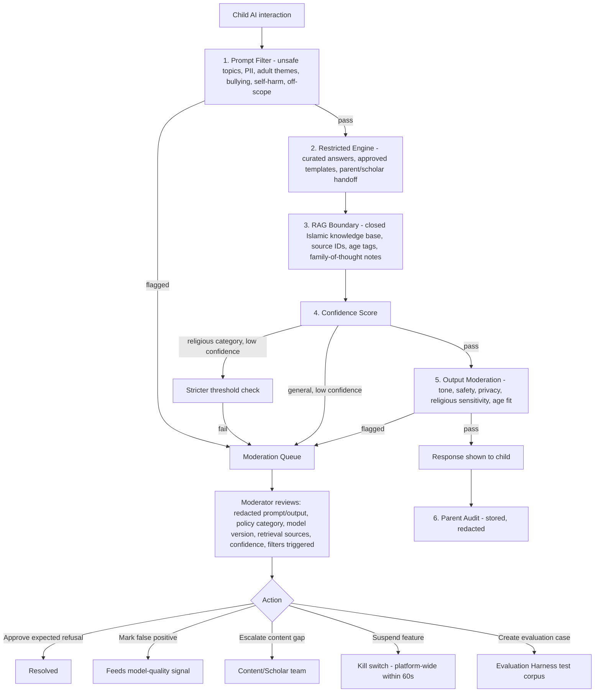
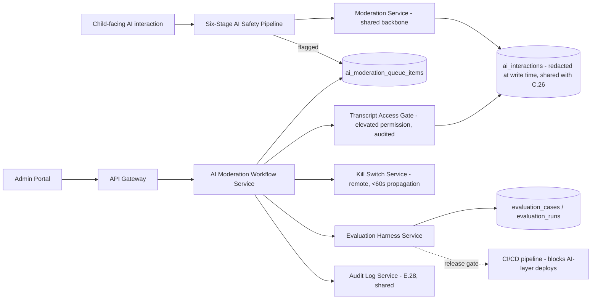
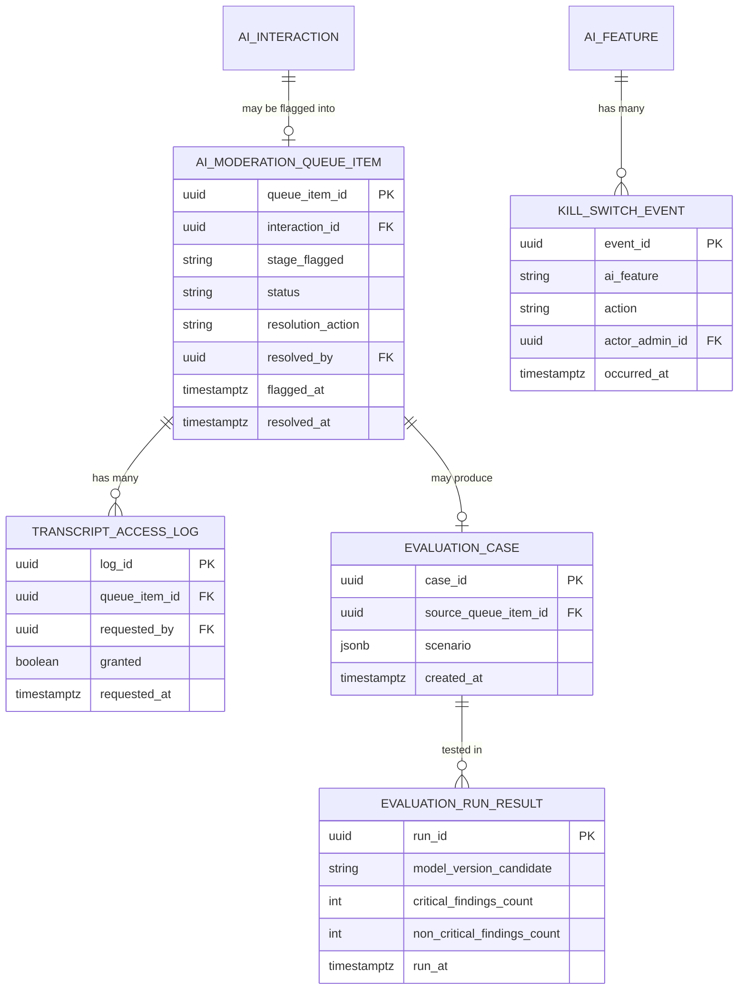

# Feature E.30 — AI Moderation Console & Safety Evaluation Harness

**App:** NoorHeroes — Islamic Learning App for Children
**Feature Owner:** Trust & Safety / AI/ML Engineering / Platform
**Status:** Implementation-ready
**Version:** 1.0
**Depends on:** E.28 (Admin Auth/RBAC — role-limited transcript access, audit log), E.29 (Content CMS — approved-corpus content that AI retrieval is bounded by)
**Feeds into:** A.5 (Quran/Arabic — AI pronunciation coaching consumer), B.13 (Search — voice/semantic search consumer), every AI-touching child-facing feature; C.22/C.26 (Per-Child Reports/AI Interaction History — read the same `ai_interactions` records this console moderates)

> **Scope note:** This document specifies the **AI Moderation Console** itself — the prompt/output review queue with redacted child identifiers, the six-stage AI safety pipeline it sits downstream of (Prompt Filter → Restricted Engine → RAG Boundary → Confidence Score → Output Moderation → Parent Audit), the moderator action set (approve expected refusal / mark false positive / escalate content gap / suspend feature / create evaluation case), the platform-wide AI kill switch, and the Evaluation Harness that gates any AI-layer change before it can reach children. C.26 already specified the parent-facing redacted AI Interaction History display; this document specifies the upstream pipeline and moderator tooling that produces the data C.26 reads, plus the operator-only moderation actions C.26 has no equivalent of.

---

## Table of Contents

1. [Product Requirements](#1-product-requirements)
2. [UX/UI Requirements](#2-uxui-requirements)
3. [Backend Requirements](#3-backend-requirements)
4. [Database Design](#4-database-design)
5. [Backend AI Code-Generation Prompt](#5-backend-ai-code-generation-prompt)
6. [Frontend (Admin Web) Requirements](#6-frontend-admin-web-requirements)
7. [Frontend AI Code-Generation Prompt](#7-frontend-ai-code-generation-prompt)
8. [Admin Requirements](#8-admin-requirements)
9. [Admin AI Code-Generation Prompt](#9-admin-ai-code-generation-prompt)
10. [DevOps Requirements](#10-devops-requirements)
11. [Analytics Requirements](#11-analytics-requirements)
12. [Security Requirements](#12-security-requirements)
13. [QA Requirements](#13-qa-requirements)
14. [Marketing Requirements](#14-marketing-requirements)
15. [Release & Rollback Plan](#15-release--rollback-plan)

---

## 1. Product Requirements

### 1.1 Problem Statement

Every AI-touching interaction a child has with NoorHeroes — a learning question, a pronunciation attempt, a recommendation — must pass through a bounded, scholar-governed safety pipeline before it ever reaches a child, with moderators able to review what happened (redacted, role-limited, fully audited), correct false positives/negatives, and pull an emergency kill switch if something goes wrong — and no AI-layer change may ever reach children without passing a documented safety evaluation harness with zero unresolved critical findings (source: NoorHeroes Blueprint AI Safety Pipeline: "1. Prompt Filter... 2. Restricted Engine... 3. RAG Boundary... 4. Confidence Score... 5. Output Moderation... 6. Parent Audit"; Consolidated Blueprint §18.4 Exit Criteria: "AI safety evaluation gates pass with zero unresolved critical findings"; §11.4: "Access to transcripts is role-limited and fully audited").

### 1.2 Business Goals

- Operationalize the platform's "AI should increase trust, not risk" principle as an engineering-enforced pipeline with a human moderation layer, not just a model-quality aspiration.
- Maintain zero-tolerance content-safety standards for AI specifically, given its inherently less-predictable output compared to scholar-reviewed static content (E.29).
- Provide moderators with genuinely useful tooling (redacted transcripts, full pipeline-stage visibility, a clear action set) so moderation is fast and accurate rather than reluctantly thorough.
- Gate every AI-layer change behind a documented evaluation harness before it can reach a single child, preventing model-update risk from silently degrading safety.

### 1.3 User Goals

- **Moderator (Child Safety Reviewer role):** Review flagged AI interactions with full pipeline context (policy category, model version, retrieval sources, confidence, filters triggered), take the right action quickly, and trust that transcript access itself is appropriately role-limited and audited.
- **AI/ML Engineer:** Have a documented evaluation harness that genuinely gates risky changes before they reach production, and a kill switch that actually works instantly when something goes wrong.
- **Trust & Safety:** See escalated content gaps and false positives feed back into model/policy improvement, not disappear into an unreviewed queue.

### 1.4 Success Metrics

| Metric | Target |
|---|---|
| AI safety evaluation gate pass rate before any production change | 100% with zero unresolved critical findings (hard, zero-tolerance, Phase 3 exit criterion) |
| Moderation queue average review time | ≤ 4 business hours |
| False-positive rate (legitimate interactions incorrectly blocked) | Tracked, target ≤ 5% |
| Kill-switch activation-to-effect latency | ≤ 60 seconds (hard requirement) |
| Transcript-access audit completeness | 100% (every access logged) |
| Escalated content gaps resolved within SLA | ≥ 90% within 5 business days |

### 1.5 Stakeholders

Trust & Safety Lead, AI/ML Engineering Lead, Child Safety Reviewers, Scholar Review Board (for religious-answer-category escalations), Backend Architect, Admin Frontend Engineer, Legal/Compliance, QA Lead, feature owners of every AI-touching child-facing feature (A.5/B.13).

### 1.6 User Stories

1. As a moderator, I want to review a flagged AI interaction with redacted child identifiers, full pipeline context, and a clear action set.
2. As a moderator, I want to approve an expected refusal (confirming the system correctly blocked something) without it lingering as an open flag.
3. As a moderator, I want to mark a false positive when the system over-blocked something legitimate, feeding that signal back to model quality.
4. As a moderator, I want to escalate a genuine content gap (a question the approved corpus simply doesn't cover yet) to the content/scholar team.
5. As a moderator or AI/ML engineer with appropriate authority, I want to suspend an AI feature entirely if something is going wrong, with that action instant and fully audited.
6. As an AI/ML engineer, I want every AI-layer change to pass a documented evaluation harness with zero unresolved critical findings before it can reach a single child.
7. As anyone accessing a transcript, I want my access itself to be role-limited and logged, never an unrestricted lookup.

### 1.7 Functional Requirements

**FR-1** The six-stage AI Safety Pipeline (canonical, source NoorHeroes Blueprint, every child-facing AI interaction passes through all six stages in order): (1) **Prompt Filter** — detects unsafe topics, personal data, adult themes, bullying, self-harm, and off-scope questions; (2) **Restricted Engine** — routes children to curated answers, approved templates, or parent/scholar handoff; (3) **RAG Boundary** — uses a closed Islamic knowledge base with source IDs, age tags, and family-of-thought notes; (4) **Confidence Score** — blocks or escalates low-confidence Islamic answers before display; (5) **Output Moderation** — checks tone, safety, privacy, religious sensitivity, and age fit; (6) **Parent Audit** — stores AI interaction history, controls, reports, and kill-switch events.
**FR-2** **Religious answers must map to approved knowledge cards. Anything about rulings, aqeedah, halal/haram, prayer, or fiqh receives stricter confidence thresholds and review paths** (source: "Scholar-Reviewed AI Responses" — a hard, category-specific elevated-rigor rule, distinct from the platform's general confidence-threshold default).
**FR-3** **The AI layer blocks unsafe topics, refuses sensitive conversations, strips personal data, and offers warm redirects suitable for children** (source: "Child-Safe Moderation" — the output-shaping principle governing what a child actually sees when the pipeline intervenes, never a cold or alarming refusal).
**FR-4** AI Moderation Console contents (canonical, source §11.4/§23.8): prompt/output display with **redacted child identifiers**; policy category; model version; retrieval sources; confidence score; filters triggered; action set: **approve expected refusal, mark false positive, escalate content gap, suspend feature, create an evaluation case**.
**FR-5** **Access to transcripts is role-limited and fully audited** (source §11.4/§23.8 — a hard rule: not every admin role with general AI-moderation visibility automatically gets transcript-level access; transcript access is its own elevated permission tier, and every access event is logged regardless of role).
**FR-6** **Moderation Service controls (canonical, source "Moderation Service" microservice card): filters prompts, outputs, search, admin content, and child-generated text. Controls: audit logs, remote kill switch, parent review, admin queue** — the Moderation Service is the shared backbone behind both the Prompt Filter and Output Moderation pipeline stages, and behind Search's (B.13) voice-query content-safety filtering.
**FR-7** **AI safety evaluation gates must pass with zero unresolved critical findings before any AI-layer change reaches production** (source §18.4 Exit Criteria — a hard release-gating requirement, not a recommended practice).
**FR-8** **The AI recommendation corpus should remain small and curated rather than a general LLM tutor, especially while the user base doesn't yet justify the cost/risk of a broader approach** (source §18.4 Risks — a deliberate scope-discipline principle shaping what the Confidence Score/RAG Boundary stages are actually bounded against).
**FR-9** **A kill switch exists at the feature level (suspend a specific AI capability) and is remote-activatable** (source: Moderation Service controls, "remote kill switch"; cross-ref §11.4's "suspend feature" moderator action) — kill-switch activation must take effect platform-wide within the §1.4 latency target, not merely flip a flag that propagates on its own schedule.
**FR-10** **No child voice cloning without explicit consent** (source: Narration Service controls — a hard rule scoping what the broader AI Microservices Architecture is permitted to do with any captured voice data, directly relevant to this console's oversight of AI-feature behavior generally).
**FR-11** Evaluation Case creation (one of the five moderator actions, FR-4) produces a structured record used by the Evaluation Harness (FR-7) to test future model/policy changes against real flagged scenarios — moderation findings feed forward into release-gating, not just backward into a closed incident.
**FR-12** Documented runbooks exist for "Harmful AI response" (cross-ref E.28/Consolidated Blueprint §20.3) — this console's "suspend feature" action is the operational trigger point for that runbook.

### 1.8 Non-Functional Requirements

- **Pipeline Completeness:** Every child-facing AI interaction must pass through all six pipeline stages in order — no AI feature may have a shortcut bypassing any stage.
- **Transcript Access Rigor:** Role-limited and fully audited access is a structural, service-layer-enforced guarantee, not a UI convention — mirroring E.28's general transcript/PII-access-restriction pattern.
- **Kill-Switch Latency:** ≤60 seconds activation-to-effect is a hard operational SLA, not a best-effort target, given the severity class of incidents this control exists for.
- **Evaluation-Gate Rigor:** Zero unresolved critical findings is a literal release blocker, never overridden by schedule pressure.

### 1.9 Acceptance Criteria

- Given any child-facing AI interaction occurs, when reviewed, then it has passed through all six pipeline stages, with each stage's outcome (filters triggered, confidence score, retrieval sources, model version) recorded.
- Given a religious-rulings-category question reaches the Confidence Score stage, when evaluated, then it is held to a stricter confidence threshold than a general/non-religious question.
- Given a moderator opens a flagged interaction in the Console, when it renders, then child identifiers are redacted, and full pipeline context (policy category, model version, retrieval sources, confidence, filters triggered) is shown.
- Given a moderator takes any of the five canonical actions, when completed, then it is correctly recorded and, for "create an evaluation case," feeds into the Evaluation Harness's test corpus.
- Given any access to a raw, unredacted transcript occurs, when reviewed, then it required an elevated, role-limited permission and is fully logged in the audit trail.
- Given a kill switch is activated for a specific AI feature, when triggered, then the feature is suspended platform-wide within 60 seconds.
- Given an AI-layer change is proposed for production release, when evaluated, then it must pass the Evaluation Harness with zero unresolved critical findings before release.

### 1.10 Edge Cases

1. A child's AI interaction is flagged by the Prompt Filter for an off-scope question that, on moderator review, turns out to be a legitimate, age-appropriate learning question simply phrased unusually → the moderator marks this a false positive, the child still received the system's safe redirect/refusal in the moment (the pipeline doesn't retroactively un-block a past interaction), and the false-positive signal feeds back into model-quality improvement for future, similarly-phrased questions.
2. A religious-rulings question receives a confidence score just above the stricter category-specific threshold (FR-2) but a moderator reviewing it post-hoc believes the answer, while technically passing, was theologically imprecise → this is escalated to the Scholar Review Board (not merely "mark false positive," since the issue isn't that the system over-blocked — it's a potential accuracy concern requiring scholar judgment, routed via the "escalate content gap" action with scholar-specific routing).
3. A kill switch is activated for a specific AI feature (e.g., pronunciation coaching) while a child is mid-session actively using that exact feature → consistent with A.5's own established graceful-degradation pattern, the in-progress UI gracefully falls back to a non-AI/listen-only mode on the next app-state check, never an abrupt crash or broken UI state.
4. Two different moderators simultaneously open the same flagged interaction from the queue → both can view it; the first to submit a resolving action (approve/false-positive/escalate/evaluation-case) resolves it, and the second's attempted action on an already-resolved item is handled gracefully (recognized as already-resolved, not double-processed), consistent with the platform's general choreographer-resolution pattern (mirroring E.28's maker-checker redundant-approval handling).
5. An AI-layer change passes the Evaluation Harness with zero *critical* findings but several *non-critical* findings → release may proceed (the hard gate is specifically "zero unresolved critical," not "zero findings of any severity"), though non-critical findings should still be tracked and addressed in a reasonable follow-up timeframe rather than indefinitely ignored.
6. A transcript-access request is made by an admin whose role has general AI-moderation-queue visibility but not the elevated transcript-access permission specifically → the request is rejected at the service layer, with the rejection itself logged (since even a rejected access attempt to sensitive data is a security-relevant event worth recording).
7. An evaluation case created from a real flagged interaction references content that has since been withdrawn from the approved corpus (cross-ref E.29's content-lifecycle) → the evaluation case itself remains valid as a test scenario (it's testing the AI pipeline's *behavior*, not asserting the specific content must remain available), but any reference within it to since-withdrawn content is clearly annotated as such for the engineer reviewing it.
8. A "suspend feature" kill-switch action is taken by a role that, per FR-9, should be limited to safety roles, but is attempted by a non-safety admin role → rejected at the service layer; consistent with the platform's general role-scoped-action pattern, this isn't merely hidden in the UI but actually rejected if attempted via a direct API call.

### 1.11 Error Handling

| Scenario | System Behavior |
|---|---|
| Religious-rulings question below the stricter confidence threshold | Blocked or escalated before display, per FR-2's elevated rigor — never shown to the child as if confidently answered |
| Two moderators act on the same queued item simultaneously | First resolving action wins; second is handled as a graceful no-op (Edge Case 4) |
| Transcript-access attempt by an insufficiently-privileged role | Rejected at the service layer, and the rejected attempt itself is logged |
| Kill-switch action attempted by a non-safety role | Rejected at the service layer (Edge Case 8) |
| AI feature suspended mid-session for an active child | Graceful fallback to non-AI mode, never an abrupt crash (Edge Case 3) |
| Evaluation case referencing since-withdrawn content | Remains valid, clearly annotated (Edge Case 7) |

### 1.12 Empty States
- Zero items in the moderation queue → calm "Nothing flagged right now" state.
- Zero evaluation cases yet for a newly-deployed AI feature → "No evaluation cases recorded yet" framing.

### 1.13 Loading States
- Standard Admin Portal skeleton-loading pattern, consistent with E.28/E.29.

### 1.14 Offline States
- N/A (internal operator tool, connectivity assumed).

### 1.15 Permission States
- Transcript access is its own elevated permission tier, distinct from general moderation-queue visibility — an admin with queue access but not transcript-access permission sees the redacted prompt/output summary but cannot drill into the raw content, consistent with FR-5.

### 1.16 User Flow (Narrative)

A child-facing AI interaction passes through the six-stage pipeline; if any stage flags it (a filter triggered, a low-confidence religious answer, an output-moderation concern), it enters the Moderation Console's queue → a Child Safety Reviewer opens the flagged item, sees redacted prompt/output, policy category, model version, retrieval sources, confidence score, and filters triggered → takes one of the five actions (approve expected refusal / mark false positive / escalate content gap / suspend feature / create evaluation case) → escalations route to the appropriate team (content/scholar for content gaps, AI/ML engineering for evaluation cases) → separately, any proposed AI-layer change must pass the Evaluation Harness, incorporating accumulated evaluation cases, with zero unresolved critical findings, before it can ever reach production.

### 1.17 Detailed Flow Diagram (Mermaid)

**AI Safety Pipeline (canonical, source NoorHeroes Blueprint):**



### 1.18 Screen Inventory (Complete — Zero Missing)

| # | Screen | Type | Entry Points | Exit Points |
|---|---|---|---|---|
| 1 | AI Moderation Queue | Primary | Admin Portal "Review"/"Intelligence" navigation group | AI Moderation Detail |
| 2 | AI Moderation Detail (redacted prompt/output, pipeline context, action set) | Screen | AI Moderation Queue | Resolved / Escalation / Evaluation Case Created / Kill Switch Confirmation |
| 3 | Transcript-Access Elevated Permission Gate | Modal | AI Moderation Detail, "View Full Transcript" action | Full Transcript View (if authorized) / Rejected |
| 4 | Full Transcript View (role-limited, audited) | Screen | Transcript-Access Gate (success) | Back |
| 5 | Kill Switch Confirmation (safety roles only, audited) | Modal | AI Moderation Detail "Suspend Feature" action | Feature Suspended state |
| 6 | Feature Suspended State / Active Kill Switches List | Screen | AI Moderation Detail, Operations Dashboard | Reinstate Action |
| 7 | Reinstate Suspended Feature Confirmation | Modal | Feature Suspended State | Feature reinstated |
| 8 | Evaluation Case Detail (created from a flagged interaction) | Screen | AI Moderation Detail "Create Evaluation Case" | Evaluation Harness Test Corpus |
| 9 | Evaluation Harness Dashboard | Screen | Admin Portal "Intelligence" navigation group | Evaluation Run Detail |
| 10 | Evaluation Run Detail (findings, critical/non-critical breakdown) | Screen | Evaluation Harness Dashboard | Release Gate Decision |
| 11 | Release Gate Decision (pass/blocked) | Screen variant | Evaluation Run Detail | Back |
| 12 | Content Gap Escalation Detail (routes to Content/Scholar team) | Screen | AI Moderation Detail "Escalate Content Gap" | E.29's content-creation flow (cross-ref) |
| 13 | False-Positive Feedback Log (Read-only, model-quality signal) | Screen | Admin Portal "Intelligence" navigation group | N/A |
| 14 | Model Version / Blocked Topics Registry | Screen | Admin Portal "Intelligence" navigation group | Model Version Detail |
| 15 | Model Version Detail | Screen | Model Version Registry | Back |

### 1.19 Events (Complete Analytics Event List)

`ai_interaction_flagged` (with `stage`, `policy_category`), `ai_moderation_queue_viewed`, `ai_moderation_detail_viewed`, `ai_moderation_transcript_access_requested`, `ai_moderation_transcript_access_granted`, `ai_moderation_transcript_access_rejected` (internal/security signal), `ai_moderation_approve_expected_refusal`, `ai_moderation_mark_false_positive`, `ai_moderation_escalate_content_gap`, `ai_moderation_kill_switch_activated`, `ai_moderation_kill_switch_reinstated`, `ai_moderation_evaluation_case_created`, `ai_evaluation_harness_run_completed` (with `critical_findings_count`, `non_critical_findings_count`), `ai_evaluation_release_gate_passed`, `ai_evaluation_release_gate_blocked`, `ai_religious_category_strict_threshold_applied` (internal), `ai_queue_redundant_action_noop` (internal).

---

## 2. UX/UI Requirements

> Follows the Admin Portal's dense, professional-tool visual register established in **E.28 §2.1**, with content-safety-specific visual treatments consistent with **E.29 §2.1**'s segregation-of-duties visual cues, adapted here for the transcript-redaction and kill-switch contexts.

### 2.1 Moderation-Specific Design System Extensions

- **Redacted-Transcript Visual Language:** Prompt/output text shown in the default Moderation Detail view with child identifiers replaced by a consistent placeholder token (e.g., `[Child]`), visually distinguished from genuine content text (e.g., a subtly different background shade) so moderators always know what's been redacted versus original.
- **Pipeline-Stage Breadcrumb:** A small, consistent visual trail showing which of the six pipeline stages flagged this specific interaction, helping moderators immediately understand the nature of the flag without reading the full context first.
- **Kill-Switch Visual Severity:** The "Suspend Feature" action uses the platform's most visually serious treatment in the entire Admin Portal (a clearly differentiated red-toned confirmation modal, distinct from E.29's "serious but calm" content-suspension treatment, since an active AI safety incident warrants a more urgent visual register) — reserved exclusively for this action given its severity class.

### 2.2 Screen-Level Design Requirements (Key Screens)

#### Screen: AI Moderation Detail

- **Purpose:** Give the moderator everything needed for a fast, accurate, well-informed decision.
- **Components:** Redacted prompt/output panel, pipeline-stage breadcrumb, policy category tag, model version, retrieval-sources list, confidence score, filters-triggered list, "View Full Transcript" action (gated), and the five-action button row.
- **States:** Default, Transcript-gate-pending, Action-confirming, Resolved.
- **Accessibility:** Redacted-content placeholders are screen-reader-announced distinctly from genuine text.

#### Screen: Kill Switch Confirmation

- **Purpose:** Make an emergency suspension deliberate but fast — no unnecessary friction, but unmistakably serious.
- **Components:** A clear statement of which feature will be suspended and the immediate platform-wide effect, a single confirm action, and a note that this is fully audited.
- **States:** Default, Confirming, Confirmed (feature suspended).

### 2.3 Tab Structure

Reached from the Admin Portal's "Review" and "Intelligence" navigation groups.

| Click Target | Destination | API Called | Analytics Event | Permission Check | Error Handling |
|---|---|---|---|---|---|
| Flagged item in queue | AI Moderation Detail | `GET /v1/admin/ai-moderation/{id}` | `ai_moderation_detail_viewed` | `child_safety_reviewer`+ role | Standard handling |
| "View Full Transcript" | Transcript-Access Gate | `POST /v1/admin/ai-moderation/{id}/transcript-access-request` | `ai_moderation_transcript_access_requested` | Elevated transcript-access permission | Rejected + logged if insufficient privilege |
| "Suspend Feature" | Kill Switch Confirmation | `POST /v1/admin/ai-features/{feature}/suspend` | `ai_moderation_kill_switch_activated` | Safety roles only | Rejected if non-safety role attempts |
| "Create Evaluation Case" | Evaluation Case Detail | `POST /v1/admin/ai-evaluations` | `ai_moderation_evaluation_case_created` | `child_safety_reviewer`+ role | Standard handling |

### 2.4 Wireframe Description (Composite)

The Moderation Queue follows the same dense filterable-list pattern as E.29's review queues; the Moderation Detail screen follows a similar "detail with context panels and a decisive action row" pattern as E.29's Scholar Review Detail, adapted for AI-specific context fields.

### 2.5 Screen Image Generation Prompts

**Screen: AI Moderation Detail**
- *Prompt 1 (English):* "Desktop web admin AI moderation detail screen UI mockup, dense professional SaaS tool aesthetic. Cool neutral grey-white background. Top shows a small breadcrumb trail of 6 pipeline stage icons with the 4th one ('Confidence Score') highlighted in amber to indicate where this item was flagged. Below, a panel showing a redacted prompt/output exchange with '[Child]' placeholder tokens in a subtly shaded box. Below that, a row of metadata tags: 'Policy Category: Religious Ruling', 'Model v2.3', 'Confidence: 0.61', 'Filters Triggered: low_confidence_religious'. At the bottom, a row of five buttons: 'Approve Refusal', 'Mark False Positive', 'Escalate Content Gap', 'Create Evaluation Case', and a separated, red-toned 'Suspend Feature' button visually distinct from the others. Clean, dense, professional engineering-tool aesthetic, sharp corners, muted blue/grey accents with the one red exception, no realistic human faces."
- *Prompt 2 (Arabic RTL):* "نفس شاشة تفاصيل مراجعة الذكاء الاصطناعي لتطبيق ويب إداري لسطح المكتب، بطابع أداة SaaS مهنية كثيفة، بتخطيط من اليمين إلى اليسار بالكامل. خلفية رمادية باردة محايدة. يعرض الأعلى مسار تتبع صغير لست أيقونات لمراحل الأنابيب مع تمييز الرابعة ('درجة الثقة') بالعنبري للإشارة إلى مكان الإعلام بهذا العنصر. أسفل ذلك لوحة تعرض تبادل سؤال/جواب منقّى برموز نائبة '[طفل]' في صندوق مظلل بخفة. أسفل ذلك صف من علامات البيانات الوصفية: 'فئة السياسة: حكم شرعي'، 'النموذج 2.3'، 'الثقة: 0.61'، 'المرشحات المُفعّلة: ثقة منخفضة دينية'. في الأسفل صف من خمسة أزرار: 'قبول الرفض'، 'علامة إيجابية خاطئة'، 'تصعيد فجوة محتوى'، 'إنشاء حالة تقييم'، وزر منفصل بدرجة حمراء بعنوان 'تعليق الميزة' متميز بصريًا عن البقية. طابع مهني وكثيف وأداة هندسية نظيفة، زوايا حادة، لمسات زرقاء/رمادية باهتة مع الاستثناء الأحمر الواحد، بدون وجوه بشرية واقعية."

**Screen: Kill Switch Confirmation**
- *Prompt 1 (English):* "Desktop web admin emergency kill-switch confirmation modal UI mockup, urgent but controlled tone, clearly the most serious visual treatment in this admin tool. Cool neutral grey-white background dimmed behind a centered modal with a prominent red border and a warning icon. Headline text reading 'Suspend AI Pronunciation Coaching for all users?' below it a short line: 'This takes effect platform-wide within 60 seconds and is fully audited.' Two buttons: a muted 'Cancel' and a solid red 'Suspend Now' button. Clean, serious, urgent-but-controlled typography, no flashing or strobing effects, sharp corners, no realistic human faces."
- *Prompt 2 (Arabic RTL):* "نفس نافذة تأكيد مفتاح الإيقاف الطارئ لتطبيق ويب إداري، بطابع عاجل لكن متحكم به، وهو بوضوح أخطر معالجة بصرية في أداة الإدارة هذه، بتخطيط من اليمين إلى اليسار. خلفية رمادية باردة محايدة معتمة خلف نافذة مركزية بحد أحمر بارز وأيقونة تحذير. نص عنوان يقول 'تعليق تدريب النطق بالذكاء الاصطناعي لجميع المستخدمين؟' وتحته سطر قصير: 'يسري هذا على مستوى المنصة بالكامل في غضون 60 ثانية ويتم تدقيقه بالكامل.' زرّان: 'إلغاء' خافت وزر 'تعليق الآن' أحمر معبأ. خط نظيف وجاد وعاجل لكن متحكم به، بدون تأثيرات وميض أو ومضات، زوايا حادة، بدون وجوه بشرية واقعية."

---

## 3. Backend Requirements

### 3.1 System Design Overview

The AI Moderation Console sits atop the **Moderation Service** (the shared backbone behind Prompt Filter and Output Moderation, per FR-6), reads/writes `ai_interactions` (the same redacted-at-write-time table specified in C.26), and is served administratively by an **AI Moderation Workflow Service** plus the **Evaluation Harness Service** gating production AI-layer releases.

### 3.2 Architecture Diagram (Mermaid)



### 3.3 Service Breakdown

| Service | Responsibility |
|---|---|
| Moderation Service (reused) | Filters prompts/outputs/search/admin-content/child-generated text; remote kill-switch enforcement point |
| AI Moderation Workflow Service | Queue management, moderator action processing |
| Transcript Access Gate | Elevated-permission check + audit on every raw-transcript access |
| Kill Switch Service | Remote, platform-wide, <60s feature suspension/reinstatement |
| Evaluation Harness Service | Maintains the evaluation-case test corpus, runs evaluation suites, gates CI/CD release |

### 3.4 API List

#### `GET /v1/admin/ai-moderation?status=flagged&policy_category=`
- **Auth:** `child_safety_reviewer`+ role
- **Response 200:** Queue listing with redacted summaries.

#### `GET /v1/admin/ai-moderation/{id}`
- **Response 200:** `{ "redacted_prompt": "...", "redacted_output": "...", "policy_category": "...", "model_version": "...", "retrieval_sources": [...], "confidence_score": 0.61, "filters_triggered": [...], "stage_flagged": "confidence_score" }` — **never the raw, unredacted prompt/output** in this default response.

#### `POST /v1/admin/ai-moderation/{id}/transcript-access-request`
- **Auth:** Elevated `transcript_access` permission, distinct from general `child_safety_reviewer` queue access
- **Response 200:** `{ "raw_prompt": "...", "raw_output": "..." }`
- **Validation:** Rejects (`403 INSUFFICIENT_TRANSCRIPT_PRIVILEGE`) for a role lacking this elevated permission, **and this rejection itself is logged** (Edge Case 6) — every call to this endpoint, successful or not, writes an audit entry.

#### `POST /v1/admin/ai-moderation/{id}/resolve`
- **Request:** `{ "action": "approve_refusal|mark_false_positive|escalate_content_gap|create_evaluation_case" }`
- **Validation:** Idempotent against an already-resolved item — a second resolution attempt returns the existing resolved state as a no-op (Edge Case 4), mirroring E.28's maker-checker redundant-approval pattern.

#### `POST /v1/admin/ai-features/{feature}/suspend` / `POST /v1/admin/ai-features/{feature}/reinstate`
- **Auth:** Safety roles only (`child_safety_reviewer`, `super_admin`) — rejected at the service layer for any other role (Edge Case 8)
- **Business Logic:** Propagates the suspension to the live AI pipeline within the 60-second SLA (e.g., via a fast-propagating config/cache invalidation mechanism, not a slow deploy-dependent toggle).

#### `POST /v1/admin/ai-evaluations` / `GET /v1/admin/ai-evaluations/runs/{id}`
- **Business Logic:** New evaluation cases are added to the persistent test corpus; an evaluation run executes the full corpus against a candidate model/policy change and reports `critical_findings_count`/`non_critical_findings_count`; the CI/CD pipeline's release gate consults this run's result, blocking deployment if `critical_findings_count > 0`.

### 3.5 Cross-Cutting API Concerns

- **Transcript-access elevation and audit-on-every-call (success or rejection):** The single most important guarantee in this entire service.
- **Kill-switch latency guarantee:** Enforced via a fast-propagating mechanism (e.g., Redis pub/sub or a similarly low-latency config-distribution path), never dependent on a standard deploy cycle.
- **Idempotent queue-item resolution:** Prevents double-processing under concurrent moderator access.
- **Religious-category stricter-threshold enforcement:** Applied at the Confidence Score pipeline stage itself, not merely a moderation-console-side after-the-fact check.

---

## 4. Database Design

### 4.1 ER Diagram (Mermaid)



### 4.2 Tables, Relationships, Constraints

| Table | Key Constraints | Indexes |
|---|---|---|
| `ai_moderation_queue_item` | FK `interaction_id` (referencing `ai_interactions`, the redacted-at-write-time table shared with C.26); CHECK `status IN ('pending','resolved')` | Index `(status, flagged_at DESC)` |
| `transcript_access_log` | FK `queue_item_id`, `requested_by`; **append-only — every access attempt, granted or rejected, is permanently recorded** | Index `(requested_by, requested_at DESC)` |
| `evaluation_case` | FK `source_queue_item_id` (nullable — not every case originates from a flagged interaction) | Index `(created_at DESC)` |
| `evaluation_run_result` | CHECK `critical_findings_count >= 0` | Index `(model_version_candidate, run_at DESC)` |
| `kill_switch_event` | FK `actor_admin_id`; append-only; CHECK `action IN ('suspend','reinstate')` | Index `(ai_feature, occurred_at DESC)` |

### 4.3 Audit Fields
`transcript_access_log` and `kill_switch_event` are themselves append-only audit trails, in addition to whatever E.28's shared `audit_log` also records for these actions (intentional redundancy given the severity class of both action types).

### 4.4 Soft Delete Rules
N/A — all tables here are append-only or current-state-with-history (queue items transition `status` in place but retain full history via `resolution_action`/`resolved_by`/`resolved_at`).

### 4.5 Retention Rules
`transcript_access_log`/`kill_switch_event` retained per the platform's highest safety-audit retention standard; `ai_moderation_queue_item`/`evaluation_case` retained indefinitely as the platform's AI-safety-process evidentiary record.

---

## 5. Backend AI Code-Generation Prompt

```
You are building the AI Moderation Workflow Service, Transcript Access
Gate, Kill Switch Service, and Evaluation Harness Service for "NoorHeroes."
Reuse the EXISTING ai_interactions table (redacted at write time, shared
with C.26) -- do not duplicate it or create a parallel raw-content store.

Stack: FastAPI (Python 3.12), PostgreSQL (SQLAlchemy 2.0), Redis (for
fast kill-switch propagation), a CI/CD integration point for the
Evaluation Harness release gate.

Hard requirements:
1. Implement GET /v1/admin/ai-moderation/{id} to return ONLY the
   redacted fields from ai_interactions by default -- write a test
   confirming this endpoint's response schema never includes a raw/
   unredacted field, mirroring C.26's own structural write-time-
   redaction guarantee (this endpoint simply reads what's already safe).
2. Implement POST /v1/admin/ai-moderation/{id}/transcript-access-request
   as requiring an ELEVATED permission distinct from general
   child_safety_reviewer queue access -- write a test confirming a
   child_safety_reviewer WITHOUT this elevated permission is rejected,
   and write a SECOND test confirming this rejection itself creates a
   transcript_access_log row with granted=false (the rejection is
   audited, not silently dropped).
3. Implement POST /v1/admin/ai-moderation/{id}/resolve as IDEMPOTENT
   against an already-resolved queue item -- write a test simulating two
   concurrent resolution attempts and confirming exactly one resolution
   is recorded, with the second receiving the same resolved-state
   response rather than erroring or double-processing.
4. Implement the Kill Switch Service to propagate a suspend/reinstate
   action via a FAST mechanism (e.g., Redis pub/sub triggering an
   in-memory flag update on every consuming service instance) achieving
   sub-60-second platform-wide effect -- write a test measuring the
   actual propagation latency in a simulated multi-instance environment
   and asserting it's under the 60-second SLA. Write a SECOND test
   confirming this endpoint is rejected for any role other than the
   designated safety roles, even for a role with general AI-moderation
   queue access.
5. Implement the religious-category stricter-confidence-threshold
   enforcement at the PIPELINE's Confidence Score stage itself (not as a
   moderation-console-side filter) -- write a test confirming a
   religious-rulings-category interaction with a confidence score that
   would PASS the general threshold but FAILS the stricter
   religious-specific threshold is correctly blocked/escalated before
   ever reaching the child.
6. Implement the Evaluation Harness's release-gate check: a CI/CD
   pipeline query against the latest evaluation_run_result for a
   candidate model_version must block deployment if
   critical_findings_count > 0 -- write a test for both the
   zero-critical-findings (gate passes) and nonzero-critical-findings
   (gate blocks) cases.
7. Implement evaluation_case creation from a resolved
   ai_moderation_queue_item (the "create_evaluation_case" resolution
   action) -- write a test confirming this correctly references the
   source queue item and is then queryable as part of the persistent
   evaluation-case test corpus for future runs.

Deliver: FastAPI routers, SQLAlchemy models, Alembic migrations,
Pydantic schemas, and a pytest suite covering all 7 items, with items 2
(audited transcript-access rejection) and 4 (kill-switch latency and
role-restriction) treated as the two highest-priority guarantees in this
entire service.
```

---

## 6. Frontend (Admin Web) Requirements

### 6.1 Technical Requirements
React + TypeScript, consistent with E.28/E.29's Admin Portal shell and design-token package.

### 6.2 Screen Mapping
Each of the 15 screens in §1.18 maps to a route/page component within the Admin Portal's "Review"/"Intelligence" navigation groups.

### 6.3 Navigation Flow
AI Moderation Queue is the landing route under the relevant navigation group; Evaluation Harness Dashboard is a sibling route; kill-switch actions are reachable both from the Moderation Detail screen and a standalone Active Kill Switches list (cross-referenced from the Operations Dashboard, E.28).

### 6.4 State Management
A shared `AiModerationContext` manages queue/detail state; the "View Full Transcript" action's gate state is derived strictly from the server's response (granted/rejected), never assumed client-side based on the admin's general role.

### 6.5 API Mapping
`AiModerationRepository.getQueue()/getDetail()/requestTranscript()/resolve()`, `KillSwitchRepository.suspend()/reinstate()/listActive()`, `EvaluationRepository.createCase()/getRuns()` map to their respective endpoints.

### 6.6 Analytics Mapping
`AiModerationAnalytics` fire events per §1.19.

### 6.7 Offline Support
N/A (internal operator tool).

### 6.8 Deep Linking
Standard web routes (e.g., `/review/ai-moderation`, `/intelligence/evaluation-harness`).

### 6.9 Push Notifications
N/A within this document's scope; kill-switch activations should trigger the platform's existing engineering/incident-paging tooling (outside this document's scope, cross-ref E.28's runbook-linkage pattern).

### 6.10 Testing Strategy
- Unit: the kill-switch confirmation modal's visually-distinct severity treatment, confirmed via a snapshot/style test against the design-token specification.
- UI tests: the "Suspend Feature" action is rendered/available only for safety-role fixtures; the redacted-prompt panel never renders raw content unless the transcript-gate has been explicitly passed in that session.
- Integration: full flagged-item → moderator-resolve flow for each of the five actions; full kill-switch activate → (simulated) child-side graceful-degradation verification; full evaluation-case-creation → evaluation-run → release-gate flow.

---

## 7. Frontend AI Code-Generation Prompt

```
Build the AI Moderation Console and Evaluation Harness Dashboard
frontend module for the NoorHeroes Admin Portal as a React + TypeScript
SPA, reusing E.28's Admin Portal shell and design tokens.

Hard requirements:
1. Implement the AI Moderation Detail screen to render the redacted
   prompt/output panel BY DEFAULT, with "View Full Transcript" as a
   separate, explicit action that only reveals raw content after the
   server grants access -- write a test confirming the raw transcript
   text is never present in the component tree/DOM until this explicit
   gated action succeeds (not merely visually hidden via CSS, since that
   would still expose it to inspection).
2. Implement the "Suspend Feature" kill-switch action and its
   confirmation modal using the platform's MOST visually severe design
   tokens (the distinct red-toned treatment described in this spec's UX
   section) -- write a test confirming this is the only action in the
   entire AI Moderation module using this specific visual treatment,
   reserving it exclusively for this severity class of action.
3. Implement role-based rendering for the "Suspend Feature" action --
   write a test confirming this button is absent (not merely disabled)
   for any role fixture other than the designated safety roles.
4. Implement the Evaluation Harness Dashboard's Release Gate Decision
   display to clearly distinguish critical from non-critical findings,
   with the gate-blocked state rendered only when critical_findings_count
   > 0 -- write a test for both the gate-passed and gate-blocked
   rendering states based on this exact condition.
5. Implement idempotent UI handling for queue-item resolution: if a
   moderator's resolve action returns an "already resolved" response
   (because another moderator resolved it first), show a clear "this was
   already resolved by [reviewer]" message rather than an error -- write
   a test for this exact response handling.

Use the Admin Portal's existing dense, professional-tool design tokens
established in E.28, applying the one deliberate exception (kill-switch
severity treatment) described above.
```

---

## 8. Admin Requirements

This document **is** the AI Moderation Console's own admin-requirements specification — fully detailed in §1.18's screen inventory and §3.4's API list. No further meta-layer exists beyond E.28's RBAC role definitions (`child_safety_reviewer`, `super_admin`, and the elevated `transcript_access` permission), which this module consumes.

---

## 9. Admin AI Code-Generation Prompt

```
This document's own §5 (Backend) and §7 (Frontend) prompts ARE the full
admin-tooling build specification for the AI Moderation Console and
Evaluation Harness -- there is no separate, distinct meta-layer to build
beyond what those sections already cover.
```

---

## 10. DevOps Requirements

- **Infrastructure:** The Moderation Service and Kill Switch Service must be low-latency and highly available, given the kill switch's hard ≤60-second SLA — likely backed by a fast pub/sub or distributed-cache invalidation mechanism rather than a standard deploy-dependent configuration path.
- **CI/CD:** The Evaluation Harness's release-gate check (§5 item 6) is itself a **mandatory CI/CD pipeline gate** for any AI-layer deploy — not optional, not bypassable by any role, given §1.4/§18.4's zero-unresolved-critical-findings exit criterion.
- **Monitoring/Logging/Alerting:** Alert (P0) on any kill-switch activation (this is itself an incident-severity event, regardless of root cause). Alert on transcript-access-rejection-attempt spikes (a potential probing/insider-risk signal). Alert on moderation-queue average-time-in-queue exceeding the §1.4 SLA. Alert if a kill-switch's measured propagation latency in production exceeds the 60-second SLA (a direct violation of a hard operational requirement).
- **Disaster Recovery:** `transcript_access_log`/`kill_switch_event` at the platform's highest safety-audit durability tier; `evaluation_case`/`evaluation_run_result` at a similarly high tier given their role gating production AI releases.
- **Rollback Strategy:** Any deploy touching the Kill Switch Service's propagation mechanism requires a staging latency-verification test (confirming sub-60-second effect across a simulated multi-instance deployment) before promotion; any deploy touching the Confidence Score pipeline stage's religious-category threshold logic requires a staging verification against fixture religious-rulings-category test scenarios.
- **Backup Strategy:** Highest tier across all tables in this service given their safety-audit and release-gating significance.
- **Environment Setup:** Staging supports fixture flagged interactions across every pipeline stage, fixture religious-rulings-category test scenarios at varying confidence levels, and a simulated multi-instance environment for reliable kill-switch latency testing.

---

## 11. Analytics Requirements

### 11.1 Event Taxonomy
Full list in §1.19.

### 11.2 Funnel Analysis
`ai_interaction_flagged` → `ai_moderation_queue_viewed` → `ai_moderation_detail_viewed` → one of the five resolution actions — measures moderation throughput and action-type distribution, informing whether the pipeline's flagging thresholds are well-calibrated (e.g., a high false-positive-mark rate suggests over-aggressive filtering worth tuning).

### 11.3 Dashboard Metrics
Flag rate by pipeline stage and policy category, average queue-resolution time, false-positive rate trend, escalated-content-gap resolution rate, kill-switch activation frequency and average propagation latency, evaluation-run critical/non-critical findings trend over successive model versions.

### 11.4 Cohort & Retention
N/A in the traditional product sense — this module's "health" is best measured by pipeline-effectiveness and moderation-throughput metrics rather than user cohorts.

### 11.5 Learning Metrics
Indirect — false-positive and content-gap signals from this console directly inform model/corpus quality improvements that ultimately affect every AI-touching child-facing feature's own learning-experience quality (A.5/B.13).

---

## 12. Security Requirements

### 12.1 Threat Analysis
- **Unauthorized raw-transcript access (this feature's single defining risk):** mitigated by an elevated, distinct permission tier with every access attempt — granted or rejected — fully audited.
- **Kill-switch abuse or insufficient-privilege activation:** mitigated by strict safety-role-only enforcement at the service layer, rejected even for roles with general AI-moderation queue access.
- **AI-layer change reaching production with unresolved critical safety findings:** mitigated by the Evaluation Harness as a mandatory, non-bypassable CI/CD release gate.
- **Religious-content accuracy risk:** mitigated by the category-specific stricter confidence threshold enforced at the pipeline stage itself, not merely a downstream console-side check.

### 12.2 OWASP Checklist (Applied)
Broken Access Control: the elevated transcript-access permission tier and the safety-role-only kill-switch restriction are both textbook applications of this control category. Security Misconfiguration: the religious-category stricter-threshold enforcement living at the actual pipeline stage (not a bolt-on filter) is a misconfiguration-defense pattern — there's no separate, potentially-forgotten check to bypass.

### 12.3 API Security
The audited transcript-access gate and the role-restricted kill switch are this service's two most important security properties.

### 12.4 Mobile Security
N/A directly — this is a web-only internal tool, though its correct operation governs the safety of AI features that do run within the mobile child-facing app.

### 12.5 Admin Security
`transcript_access` is modeled as its own elevated permission, distinct from general moderation-queue roles, consistent with the principle of least privilege.

### 12.6 Data Encryption & PII Protection
This module reads the same write-time-redacted `ai_interactions` data already governed by C.26's structural redaction guarantee; the elevated transcript-access path is the platform's sole sanctioned exception to that redaction, itself fully audited.

### 12.7 Child Safety Requirements
This entire module is one of the platform's most direct child-safety mechanisms — the six-stage pipeline, the moderation console, the kill switch, and the evaluation harness together constitute the operational reality behind every AI-touching feature's safety claims.

### 12.8 Compliance Requirements
The permanent `transcript_access_log`/`kill_switch_event`/`evaluation_run_result` records directly support any future AI-safety regulatory inquiry or incident investigation.

### 12.9 Security Checklist (Pre-Launch)
- [ ] Transcript-access elevation and full audit-on-every-attempt (including rejections) verified
- [ ] Kill-switch role-restriction and sub-60-second propagation latency verified
- [ ] Religious-category stricter-confidence-threshold enforcement verified at the pipeline stage
- [ ] Evaluation Harness CI/CD release-gate verified to block deploys with nonzero critical findings
- [ ] Idempotent queue-item resolution verified under concurrent moderator access

---

## 13. QA Requirements

### 13.1 Test Plan Summary
Coverage spans: audited transcript-access elevation (signature test), kill-switch role-restriction and latency (signature test), religious-category threshold enforcement, evaluation-harness release-gating, and all 8 edge cases from §1.10.

### 13.2 Test Cases — Happy Path
1. A flagged interaction is reviewed by a moderator with redacted context, correctly resolved as an approved expected refusal.
2. A moderator with elevated transcript-access permission successfully views a full transcript, with the access logged.
3. A model-update candidate passes the Evaluation Harness with zero critical findings and is permitted to deploy.

### 13.3 Edge Cases
All 8 items from §1.10.

### 13.4 Negative Cases
- A `child_safety_reviewer` without elevated transcript-access permission attempts to view a full transcript → rejected, and the rejection itself is logged.
- A non-safety admin role attempts to call the kill-switch suspend endpoint → rejected.
- A religious-rulings-category interaction with a confidence score passing the general threshold but failing the stricter religious threshold → correctly blocked/escalated.
- An evaluation run with one or more critical findings → the CI/CD release gate blocks deployment.

### 13.5 Regression Cases
Full suite re-run on every release touching the Moderation Service, AI Moderation Workflow Service, Kill Switch Service, or Evaluation Harness Service.

### 13.6 Automation Cases
End-to-end flagged-item-to-resolution flow for each of the five moderator actions; kill-switch latency automated test in a simulated multi-instance environment (CI-blocking); evaluation-harness release-gate automated test (CI-blocking); audited-rejection-on-insufficient-privilege automated test.

---

## 14. Marketing Requirements

N/A — internal operator tool. Its correct operation is the engineering-enforced foundation behind every AI-touching child-facing feature's "AI should increase trust, not risk" marketing claim.

---

## 15. Release & Rollback Plan

### 15.1 Release Plan
Phased rollout 25% → 75% → 100% of the Trust & Safety/AI-ML team over 3–5 days, with the audited-transcript-access and kill-switch-latency test suites required to pass at every stage, given this module's role as the platform's primary AI-safety operational control.

### 15.2 Rollback Plan
Rollback triggers (all P0): any confirmed unauthorized/unaudited transcript access, any confirmed kill-switch activation taking longer than 60 seconds to propagate, any confirmed AI-layer change reaching production despite unresolved critical evaluation findings, any confirmed religious-category content bypassing its stricter confidence threshold. Mechanism: standard deployment rollback; given the safety-criticality, an incident here triggers the platform's highest-severity cross-team incident response, equivalent to E.28's own foundational-module severity class.

### 15.3 Success Metrics for Go/No-Go
Matches §1.4 targets, explicitly including the Phase 3 exit criterion (AI safety evaluation gates pass with zero unresolved critical findings). Go/no-go requires sign-off from Trust & Safety, AI/ML Engineering, Scholar Review Board, and Security jointly — this module's correctness is a precondition for every AI-touching child-facing feature's safety claims to actually hold in practice.
