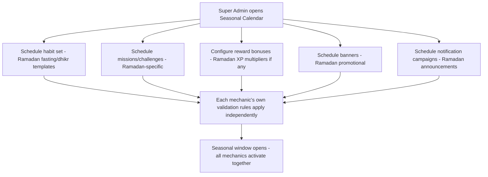
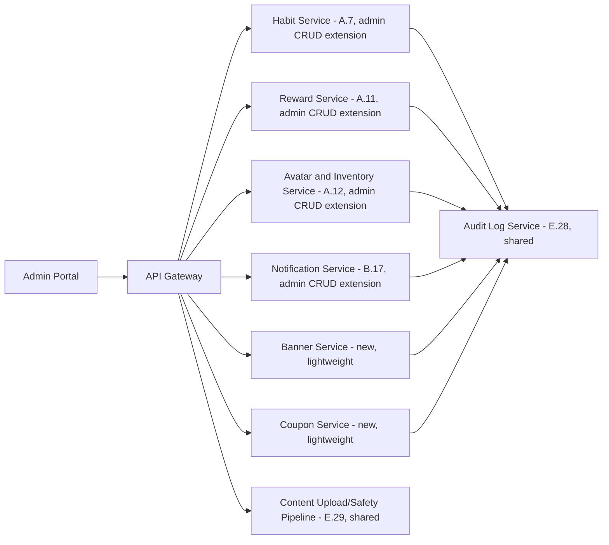
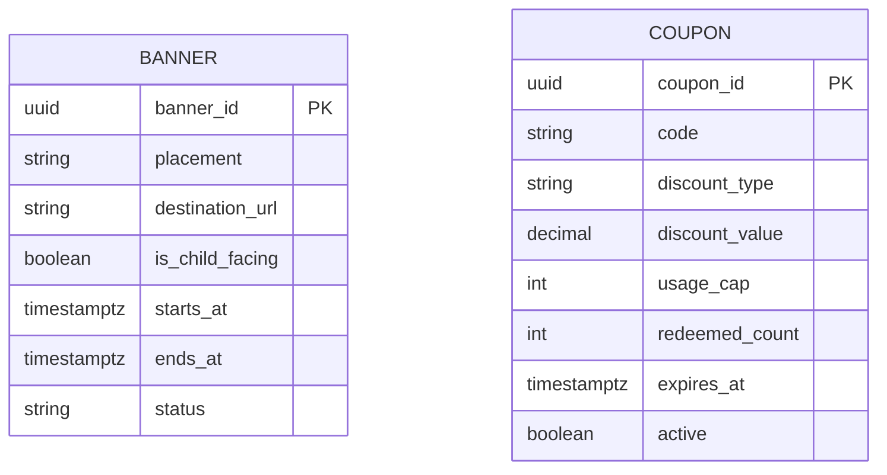

# Feature E.31 — Engagement Tools Admin Suite (Habits, Challenges, Rewards, Badges, Avatar, Banners, Notifications)

**App:** NoorHeroes — Islamic Learning App for Children
**Feature Owner:** Product / Growth & Engagement / Content & Editorial
**Status:** Implementation-ready
**Version:** 1.0
**Depends on:** E.28 (Admin Auth/RBAC, Audit Log, maker-checker), E.29 (Content CMS — shared upload-safety pipeline for icon/banner assets), A.7 (Habit Tracker — consumes Habit Templates), A.11 (Reward System — consumes XP Rules/Badges/Missions), A.12 (Avatar System — consumes Avatar Items), B.17 (Notifications — consumes Templates/Campaigns)
**Feeds into:** Nothing further downstream within the Admin Portal; every output of this module is consumed by the child-facing/parent-facing features named above

> **Scope note:** A.7, A.11, A.12, and B.17 each already specified their own admin section in narrative form (e.g., A.11 §8 "Favoriting Pattern Monitor," A.12 §8 "Item Catalog Editor," B.17 §8 "Notification Template Library"). This document is the **single, consolidated, fully-detailed specification** for the seven Engagement-group admin modules named at the navigation-group level (source §5.5/§11.8): **Habit Management, Challenge Management, Reward Management, Badge Management, Avatar Management, Banner Management, Notification Management** — each specified to the full Purpose/Screens/CRUD/Validation/Dependencies/Workflow depth, reusing every backend engine those prior documents already built (the Reward Engine, Habit Service, Avatar/Inventory Service, Notification Service) rather than introducing new business logic. Where a prior document's own admin section already sketched a piece of this, this document is the authoritative, complete version.

---

## Table of Contents

1. [Product Requirements](#1-product-requirements)
2. [UX/UI Requirements](#2-uxui-requirements)
3. [Backend Requirements](#3-backend-requirements)
4. [Database Design](#4-database-design)
5. [Backend AI Code-Generation Prompt](#5-backend-ai-code-generation-prompt)
6. [Frontend (Admin Web) Requirements](#6-frontend-admin-web-requirements)
7. [Frontend AI Code-Generation Prompt](#7-frontend-ai-code-generation-prompt)
8. [Admin Requirements](#8-admin-requirements)
9. [Admin AI Code-Generation Prompt](#9-admin-ai-code-generation-prompt)
10. [DevOps Requirements](#10-devops-requirements)
11. [Analytics Requirements](#11-analytics-requirements)
12. [Security Requirements](#12-security-requirements)
13. [QA Requirements](#13-qa-requirements)
14. [Marketing Requirements](#14-marketing-requirements)
15. [Release & Rollback Plan](#15-release--rollback-plan)

---

## 1. Product Requirements

### 1.1 Problem Statement

Content/growth admins need one consolidated, consistently-governed set of tools to author and operate every engagement mechanic — habit templates, missions/weekly challenges/seasonal events, the XP/reward rule table, badges, avatar items, promotional banners, and notification campaigns — each with content-type-specific validation rules that protect already-established platform guarantees (XP changes never apply retroactively, badge criteria changes never revoke already-awarded badges, child-targeted notification copy is template-only, items are never sold for real money in child mode) without admins needing to remember these rules manually (source: NoorHeroes Blueprint modules 7–12, restated and consolidated; Consolidated Blueprint §11.8 Additional Admin Module Specifications).

### 1.2 Business Goals

- Give growth/content teams genuine operational velocity for seasonal campaigns (e.g., launching a full Ramadan event — stories, missions, rewards, notifications — from one coordinated set of tools) without compromising any of the platform's hard-won child-safety/economy-integrity guarantees.
- Enforce every engagement-mechanic validation rule at the service layer, consistent with the rigor already established for the underlying engines (A.7/A.11/A.12/B.17), so this admin layer cannot accidentally introduce a bypass.
- Reduce the risk of inconsistent or manual engagement-content management by providing one coherent admin surface per mechanic.

### 1.3 User Goals

- **Content/Growth Admin:** Create and manage habit templates, missions/challenges, rewards rules, badges, avatar items, banners, and notification campaigns from one consistent set of tools, with confidence that validation rules (no retroactive changes, no orphaned criteria, no unsafe content) are enforced automatically.
- **Super Admin:** Launch a coordinated seasonal event spanning multiple engagement mechanics with appropriate scheduling and oversight.

### 1.4 Success Metrics

| Metric | Target |
|---|---|
| Engagement-content authoring time (e.g., time to configure a new mission) | Tracked, target meaningful reduction vs. ad-hoc/manual process |
| Validation-rule rejection rate (admin attempts blocked by a guardrail) | Tracked, informs whether rules are well-understood or need clearer UI guidance |
| Seasonal campaign launch lead time (all mechanics coordinated and ready before the seasonal window opens) | ≥ 3 weeks ahead of the date (cross-ref the platform's hard internal deadline for Ramadan Mode) |
| Retroactive-change-attempt block rate | 100% (hard, zero-tolerance) |
| Crash-free Admin Engagement Tools sessions | ≥ 99.5% |

### 1.5 Stakeholders

Product Manager (Growth/Engagement), Content/Editorial Lead, Backend Architect (reusing A.7/A.11/A.12/B.17's engines), Admin Frontend Engineer, QA Lead, feature owners of A.7/A.11/A.12/B.17.

### 1.6 User Stories

1. As a content admin, I want to create and manage habit templates with cadence, XP value, icon, and age applicability.
2. As a content admin, I want to build daily missions, weekly challenges, and seasonal events with rewards and date ranges.
3. As a content admin, I want to manage the XP rule table per activity type, with changes applying only to future activity.
4. As a content admin, I want to define badge criteria as a rule expression, knowing changes never revoke already-awarded badges.
5. As a content admin, I want to manage the avatar item catalog with unlock rules mapped to real badges/levels/milestones.
6. As a content admin, I want to manage promotional/seasonal banners without ever linking a child-facing banner to an external destination.
7. As a content admin, I want to build notification campaigns from approved templates and audience segments, with quiet-hours/bedtime always enforced regardless of my campaign settings.
8. As a support agent, I want a read-only, fully-audited manual reward-grant tool for confirmed missing-reward tickets.
9. As a super admin, I want to coordinate a full seasonal event (stories, missions, rewards, notifications) launching together.

### 1.7 Functional Requirements

> **Maker-Checker Security Guardrail:** Any manual administrative grant of XP exceeding **500 XP** (or equivalent 250 Noor Points) requires dual-operator sign-off (Maker submits request, second Operator B / Supervisor approves via `Screens/Admin Web/64-Manual Reward Grant-01.png`) before balance mutation occurs.


**FR-1** Habit Management (canonical, source module 7): screens — habit template list (Salah, Quran, dua, good deed, dhikr, fasting), template editor (cadence, XP value, icon, age applicability), seasonal habit set builder (Ramadan/Eid/Jummah). CRUD: Create habit template; Read usage stats per template; Update XP value/cadence; Retire template (existing logs preserved). **Validation: XP-value changes apply only to future check-ins, never retroactively; retiring a template never deletes historical `habit_logs`.**
**FR-2** Challenge Management (canonical, source module 8/§11.8): screens — daily mission template pool, weekly challenge builder (target, reward, date range), seasonal event scheduler, challenge calendar view. CRUD: Create mission/challenge template; Read completion rates; Update reward/threshold; Archive a challenge. **Validation: daily mission pool must contain enough templates per age band to avoid repetition; weekly challenges cannot overlap in date range per age band; `ends_at > starts_at`; `goal_type` must match a supported event type.**
**FR-3** Reward Management (canonical, source module 9): screens — XP rule table (per activity type), reward ledger viewer (read-only, append-only), manual reward grant tool (support use, fully audited). CRUD: Create XP rule; Read ledger entries per child; Update XP rule (versioned); Deactivate a rule. **Validation: ledger entries are never edited or deleted, only appended; manual grants require a reason code and create their own audited ledger row with an idempotency key.**
**FR-4** Badge Management (canonical, source module 10): screens — badge library, criteria builder (rule-based, e.g., "7-day streak", "5 stories completed"), icon/asset upload. CRUD: Create badge + criteria; Read award count; Update criteria (new badges only, not retroactive); Retire badge. **Validation: criteria changes never revoke already-awarded badges; criteria must reference an existing, valid event type.**
**FR-5** Avatar Management (canonical, source module 11): screens — avatar base library, item catalog (outfits, glow states), unlock-rule mapping to badges/levels. CRUD: Create avatar item; Read ownership distribution; Update unlock rule; Retire item (owned items remain equippable). **Validation: items are never sold for real money in child mode; unlock rules must map to an existing badge, level, or habit milestone — no arbitrary or opaque unlocks.**
**FR-6** Notification Management (canonical, source module 12): screens — notification template library (push + in-app), campaign scheduler, segment builder (age band, locale, plan, engagement state), delivery report. CRUD: Create template/campaign; Read delivery/open rates; Update scheduled campaign (pre-send only); Cancel a scheduled send. **Validation: child-targeted campaigns are restricted to approved templates only — no free-text admin-authored copy reaches a child surface without review; quiet-hours and bedtime policy are enforced server-side regardless of campaign settings.**
**FR-7** Banner Management (canonical, source §11.8 table): screens — banner list, banner editor, placement scheduler. CRUD: Create/Read/Update/Delete `banners`. **Validation: banner imagery passes the content-safety pipeline; no banner may link to an external (non-NoorHeroes) destination for child-facing placements.**
**FR-8** Coupon Management (canonical, source §11.8 table, included here for navigation-group completeness given its adjacency to engagement/growth tooling): screens — coupon list, coupon editor, redemption report. CRUD: Create/Read/Update/Deactivate `coupons`. **Validation: discount percentage/amount bounds enforced server-side; usage caps and expiry are mandatory fields, not optional.**
**FR-9** Every CRUD/Update operation across all seven modules writes to the shared Audit Log Service (E.28) — no module maintains an independent log.
**FR-10** Asset uploads (badge icons, avatar items, banner imagery) route through E.29's shared content-safety/upload-validation pipeline — no module implements its own parallel upload-safety check.
**FR-11** Seasonal-event coordination: a Super Admin or Content Admin may schedule habit sets, challenges, rewards, banners, and notification campaigns under one shared seasonal window/calendar view, but each underlying mechanic's own validation rules still apply independently — coordination is a scheduling convenience, never a bypass of any individual module's own rules.

### 1.8 Non-Functional Requirements

- **No-Retroactivity Enforcement:** XP-value changes and badge-criteria changes apply only going forward — enforced at the service layer for both, consistent with the platform's broader non-retroactive-restriction philosophy already established in the child-facing features these admin tools configure.
- **Ledger Append-Only Integrity:** Reward ledger entries (including manual grants) are never edited or deleted — this admin layer reuses A.11's exact append-only-permission-lockout pattern, never a parallel writable log.
- **Real-Money Exclusion:** Avatar items can never be configured as purchasable with real money in child mode — a structural, not just UI-level, constraint.
- **Child-Notification-Copy Governance:** No free-text admin-authored copy reaches a child surface without going through B.17's approved-template content-safety review.

### 1.9 Acceptance Criteria

- Given an admin updates a habit template's XP value, when checked against historical check-ins, then those past check-ins' awarded XP is unaffected — only future check-ins use the new value.
- Given an admin retires a habit template, when checked, then all historical `habit_logs` referencing it remain fully intact.
- Given an admin updates a badge's criteria, when checked, then no previously-awarded instance of that badge is revoked, regardless of whether the new criteria would or wouldn't have qualified those children.
- Given an admin attempts to create an avatar item with a real-money purchase option for child mode, when they try, then no such configuration is possible — the field/option doesn't exist.
- Given an admin builds a notification campaign targeting children, when they attempt to enter free-text copy instead of selecting an approved template, then this is blocked — only approved templates are usable for this targeting.
- Given a support agent uses the manual reward-grant tool, when the grant completes, then it required a reason code and created a new, fully-audited, idempotent ledger entry — never an edit to an existing one.
- Given an admin attempts to overlap two weekly challenges' date ranges for the same age band, when they try, then this is rejected.
- Given an admin schedules a coordinated seasonal event across multiple mechanics, when reviewed, then each individual mechanic (habits, challenges, rewards, banners, notifications) still independently enforces its own validation rules.

### 1.10 Edge Cases

1. An admin retires a habit template that is currently part of an active, in-progress weekly challenge referencing it → the challenge itself isn't automatically invalidated; the retired template's historical association with the challenge remains intact for children already mid-challenge, while new challenge instances going forward should reference only active templates (an editorial-process responsibility, not necessarily a hard system-enforced block, since the underlying habit-check-in mechanism for an already-retired template per A.7's own established pattern still functions for historical continuity).
2. An admin attempts to update a badge's icon (a purely cosmetic asset change, not a criteria change) for an already-awarded badge → this is permitted; the no-retroactivity rule specifically protects *criteria* (who qualifies), not cosmetic presentation — children who already earned the badge simply see the updated icon going forward, consistent with how an icon refresh isn't a "criteria" change in the sense the rule is protecting against.
3. Two different admins simultaneously attempt to create overlapping weekly challenges for the same age band → the validation check (FR-2) must correctly catch this regardless of submission order — the second submission to actually complete (by timestamp) is rejected, even if both were being drafted concurrently.
4. An avatar item's unlock rule references a badge that is later retired (cross-ref E.29-adjacent content lifecycle for engagement assets) → the unlock rule's reference becomes unresolvable for new unlock evaluation going forward; consistent with the platform's general graceful-handling pattern (A.12's own "currently unavailable to unlock" state), the avatar item shows this gracefully rather than erroring, while children who already unlocked it via the badge before retirement keep it.
5. A manual reward grant is issued by a support agent, but the underlying reason (e.g., "habit check-in bug") is later found to be based on a misunderstanding — no actual bug existed → consistent with the append-only ledger's permanent nature, this manual grant is **not reversed by deleting the entry**; if a correction is genuinely needed, an equal-and-opposite adjustment entry (also reason-coded and audited) is the only mechanism, never an edit or deletion of the original.
6. A coupon's usage cap is reached exactly as two different parents attempt to redeem it within the same second → the server-side usage-cap enforcement (FR-8) must correctly allow only up to the cap, rejecting the redemption that would exceed it, regardless of submission-timing closeness (an atomic counter-check, not a race-prone read-then-write).
7. A notification campaign scheduled for a seasonal event is built entirely from approved templates, but the campaign's audience segment definition inadvertently includes a locale where none of the selected templates have been translated → the campaign should fail validation or clearly flag this gap before scheduling completes, rather than sending an empty/broken notification to that locale's audience, consistent with the platform's general translation-coverage-threshold principle (cross-ref Localization Management's coverage-threshold rule).
8. A banner is configured for a child-facing placement and an admin attempts to set its destination link to an external URL → rejected at validation time (FR-7); the same banner type configured for a parent-facing placement (e.g., a Subscription upsell banner) may legitimately link externally if that's an intentional, reviewed exception — the external-link restriction is scoped specifically to child-facing placements, not banners universally.

### 1.11 Error Handling

| Scenario | System Behavior |
|---|---|
| Attempt to retroactively change XP value for past check-ins | Rejected — only future check-ins use the updated rule |
| Attempt to revoke an already-awarded badge via a criteria change | Not possible — criteria changes only affect future qualification evaluation |
| Attempt to configure a real-money avatar-item purchase for child mode | No such field/option exists |
| Attempt free-text notification copy for a child-targeted campaign | Rejected — only approved templates selectable |
| Attempt overlapping weekly challenges for the same age band | Rejected |
| Coupon redemption attempted beyond usage cap | Rejected via atomic server-side counter check |

### 1.12 Empty States
- Zero habit templates/missions/badges/avatar items yet for a brand-new content category → simple "Nothing here yet, create your first [item]" framing per module.

### 1.13 Loading States
- Standard Admin Portal skeleton-loading pattern, consistent with E.28/E.29/E.30.

### 1.14 Offline States
- N/A (internal operator tool, connectivity assumed).

### 1.15 Permission States
- Each module's CRUD actions are role-scoped per E.28's RBAC matrix (e.g., `content_editor` for drafting, manual reward grants restricted to `support`/`billing_ops` roles per A.11's own established pattern).

### 1.16 User Flow (Narrative)

A content admin navigates to the relevant Engagement module (Habits/Challenges/Rewards/Badges/Avatar/Banners/Notifications) → drafts or edits an item, with type-specific validation rules enforced inline → publishes (where applicable, subject to any review requirements already established by the underlying engine, e.g., avatar item asset safety review) → the change becomes live and is consumed by the relevant child/parent-facing feature → for a coordinated seasonal event, the admin uses the shared seasonal calendar view to schedule multiple mechanics together, while each mechanic's own independent validation still applies.

### 1.17 Detailed Flow Diagram (Mermaid)

**Seasonal Event Coordination (illustrative, source "Launch Ramadan event" use case):**



### 1.18 Screen Inventory (Complete — Zero Missing)

| # | Screen | Module | Entry Points | Exit Points |
|---|---|---|---|---|
| 1 | Habit Template List | Habit | Admin Portal "Engagement" navigation group | Template Editor |
| 2 | Habit Template Editor (cadence/XP/icon/age) | Habit | Habit Template List | Template List (saved) |
| 3 | Seasonal Habit Set Builder | Habit | Habit Template List | Template List |
| 4 | Daily Mission Template Pool | Challenge | Engagement navigation group | Mission Editor |
| 5 | Weekly Challenge Builder (target/reward/date range) | Challenge | Engagement navigation group | Challenge List |
| 6 | Seasonal Event Scheduler / Challenge Calendar View | Challenge | Engagement navigation group | Challenge Editor |
| 7 | XP Rule Table | Reward | Engagement navigation group | XP Rule Editor |
| 8 | XP Rule Editor (versioned) | Reward | XP Rule Table | XP Rule Table (saved) |
| 9 | Reward Ledger Viewer (read-only, append-only) | Reward | Engagement navigation group, Support Case context | Ledger Entry Detail |
| 10 | Manual Reward Grant Tool (audited) | Reward | Support Case context | Ledger Viewer (new entry visible) |
| 11 | Badge Library | Badge | Engagement navigation group | Badge Criteria Builder |
| 12 | Badge Criteria Builder (rule-based) | Badge | Badge Library | Badge Library (saved) |
| 13 | Badge Icon/Asset Upload | Badge | Badge Criteria Builder | (returns to editor) |
| 14 | Avatar Base Library | Avatar | Engagement navigation group | Avatar Item Catalog |
| 15 | Avatar Item Catalog | Avatar | Avatar Base Library | Item Editor |
| 16 | Avatar Item Editor (unlock-rule mapping) | Avatar | Avatar Item Catalog | Item Catalog (saved) |
| 17 | Avatar Ownership Distribution (read-only) | Avatar | Avatar Item Catalog | N/A |
| 18 | Notification Template Library | Notification | Engagement navigation group | Template Editor |
| 19 | Notification Template Editor | Notification | Template Library | Template Library (saved) |
| 20 | Campaign Scheduler | Notification | Engagement navigation group | Segment Builder, Test-Device Send |
| 21 | Segment Builder (age band/locale/plan/engagement state) | Notification | Campaign Scheduler | Campaign Scheduler |
| 22 | Test-Device Send & Approval | Notification | Campaign Scheduler | Campaign Scheduler (approved) |
| 23 | Delivery Report | Notification | Campaign Scheduler, Engagement navigation group | N/A |
| 24 | Banner List | Banner | Engagement navigation group | Banner Editor |
| 25 | Banner Editor (with placement scheduler) | Banner | Banner List | Banner List (saved) |
| 26 | Coupon List | Coupon | Engagement navigation group | Coupon Editor |
| 27 | Coupon Editor | Coupon | Coupon List | Coupon List (saved) |
| 28 | Coupon Redemption Report | Coupon | Coupon List | N/A |
| 29 | Seasonal Calendar (cross-mechanic coordination view) | Cross-cutting | Engagement navigation group landing | Each module's own editor |

### 1.19 Events (Complete Analytics Event List)

`habit_template_created`, `habit_template_updated`, `habit_template_retired`, `mission_created`, `weekly_challenge_created`, `weekly_challenge_overlap_rejected` (internal), `seasonal_event_scheduled`, `xp_rule_created`, `xp_rule_updated`, `manual_reward_grant_issued` (with `reason_code`), `badge_created`, `badge_criteria_updated`, `avatar_item_created`, `avatar_item_unlock_rule_updated`, `avatar_item_realmoney_attempt_blocked` (internal/security signal), `notification_template_created`, `notification_campaign_scheduled`, `notification_campaign_freetext_child_copy_blocked` (internal/security signal), `notification_test_device_send_completed`, `banner_created`, `banner_external_link_child_facing_blocked` (internal/security signal), `coupon_created`, `coupon_redemption_cap_reached`.

---

## 2. UX/UI Requirements

> Follows the Admin Portal's dense, professional-tool visual register established in **E.28 §2.1**, with content-editor patterns consistent with **E.29 §2.1**.

### 2.1 Engagement-Specific Design System Extensions

- **Rule-Builder Visual Language:** Badge criteria, avatar unlock rules, and challenge goal types all use a consistent structured rule-builder component (dropdown-driven, not free-form text), reused across all three modules rather than each implementing its own.
- **Seasonal Calendar View:** A shared, cross-module calendar visualization showing scheduled habit sets, challenges, banners, and notification campaigns on one timeline, color-coded by mechanic type, supporting the coordinated-seasonal-launch workflow.
- **Append-Only Ledger Visual Cue:** The Reward Ledger Viewer renders with no edit/delete affordances anywhere in its UI (consistent with E.29's established pattern for read-only audit-style screens), reinforcing visually that this is a permanent record.

### 2.2 Screen-Level Design Requirements (Key Screens)

#### Screen: Badge Criteria Builder

- **Purpose:** Let an admin define badge-unlock criteria safely, without arbitrary/opaque rules.
- **Components:** A structured rule-builder (event-type dropdown + threshold/condition fields, e.g., "streak_length >= 7"), a live validation indicator confirming the referenced event type exists, icon upload, award-count preview (read-only).
- **States:** Default, Validating, Saved, Error (invalid event-type reference).

#### Screen: Campaign Scheduler

- **Purpose:** Build and schedule a notification campaign safely.
- **Components:** Template selector (approved templates only for child-targeted segments — free-text entry is structurally unavailable in that mode), Segment Builder link, schedule date/time picker, Test-Device Send action, Approve-before-full-send gate.
- **States:** Draft, Test-sent, Approved, Scheduled, Sent, Canceled.

### 2.3 Tab Structure

All seven modules are reached from the Admin Portal's "Engagement" navigation group (per E.28's role-scoped sidebar pattern).

| Click Target | Destination | API Called | Analytics Event | Permission Check | Error Handling |
|---|---|---|---|---|---|
| "Create Habit Template" | Template Editor | `POST /v1/admin/habit-templates` | `habit_template_created` | `content_editor`+ | Standard handling |
| "Create Weekly Challenge" | Challenge Builder | `POST /v1/admin/challenges` | `weekly_challenge_created` | `content_editor`+ | Date-range-overlap rejection |
| "Update XP Rule" | XP Rule Editor (new version) | `PATCH /v1/admin/xp-rules/{id}` | `xp_rule_updated` | `content_editor`+ | N/A |
| "Issue Manual Grant" | Manual Reward Grant Tool | `POST /v1/admin/reward-ledger/manual-grant` | `manual_reward_grant_issued` | `support`/`billing_ops` role | Reason-code required |
| "Update Badge Criteria" | Badge Criteria Builder | `PATCH /v1/admin/badges/{id}/criteria` | `badge_criteria_updated` | `content_editor`+ | Invalid-event-type rejection |
| "Create Avatar Item" | Item Editor | `POST /v1/admin/avatar-items` | `avatar_item_created` | `content_editor`+ | Real-money-field absent by design |
| "Schedule Campaign" | Delivery Report (post-send) | `POST /v1/admin/notification-campaigns` | `notification_campaign_scheduled` | `content_editor`+/`notification_manager` | Free-text-for-child-segment rejection |

### 2.4 Wireframe Description (Composite)

Each module follows a standard "list → editor" data-table pattern consistent with E.29's Content Library/editor pattern; the Seasonal Calendar is a shared, distinct timeline-visualization screen layered across all seven modules.

### 2.5 Screen Image Generation Prompts

**Screen: Badge Criteria Builder**
- *Prompt 1 (English):* "Desktop web admin badge criteria builder screen UI mockup, dense professional SaaS tool aesthetic. Cool neutral grey-white background. A form showing a badge icon upload thumbnail at top, below it a structured rule-builder row with a dropdown reading 'Event Type: Habit Streak' and a numeric input 'Threshold: 7 days', a small green checkmark icon indicating the event type is valid. Below, a read-only stat card showing 'Awarded 1,204 times'. A 'Save' button at bottom, with helper text reading 'Changes apply only to new badge awards going forward.' Clean, dense, professional engineering-tool aesthetic, sharp corners, muted blue/grey accents, no realistic human faces."
- *Prompt 2 (Arabic RTL):* "نفس شاشة منشئ معايير الوسام لتطبيق ويب إداري، بطابع أداة SaaS مهنية كثيفة، بتخطيط من اليمين إلى اليسار بالكامل. خلفية رمادية باردة محايدة. نموذج يعرض صورة مصغرة لتحميل أيقونة الوسام في الأعلى، تحته صف منشئ قواعد منظم بقائمة منسدلة تقول 'نوع الحدث: متتالية عادة' وحقل رقمي 'العتبة: 7 أيام'، وأيقونة علامة صح خضراء صغيرة تشير إلى أن نوع الحدث صالح. أسفل ذلك بطاقة إحصائية للقراءة فقط تعرض 'تم منحه 1,204 مرة'. زر 'حفظ' في الأسفل، مع نص مساعد يقول 'التغييرات تنطبق فقط على منح الأوسمة الجديدة مستقبلاً.' طابع مهني وكثيف وأداة هندسية نظيفة، زوايا حادة، لمسات زرقاء/رمادية باهتة، بدون وجوه بشرية واقعية."

**Screen: Seasonal Calendar (cross-mechanic coordination view)**
- *Prompt 1 (English):* "Desktop web admin seasonal calendar timeline screen UI mockup, dense professional SaaS tool aesthetic. Cool neutral grey-white background. A horizontal calendar timeline spanning several weeks, with color-coded bars on different rows labeled 'Habits', 'Challenges', 'Banners', 'Notifications', each showing scheduled blocks aligned to a highlighted 'Ramadan Window' date range shaded in soft gold. Clean, dense, professional engineering-tool aesthetic, sharp corners, muted blue/grey accents with the one gold seasonal highlight, no realistic human faces."
- *Prompt 2 (Arabic RTL):* "نفس شاشة الجدول الزمني للتقويم الموسمي لتطبيق ويب إداري، بطابع أداة SaaS مهنية كثيفة، بتخطيط من اليمين إلى اليسار. خلفية رمادية باردة محايدة. جدول زمني أفقي يمتد لعدة أسابيع، بأشرطة مرمزة بالألوان في صفوف مختلفة بعناوين 'العادات'، 'التحديات'، 'اللافتات'، 'الإشعارات'، كل منها يعرض كتل مجدولة محاذية لنطاق تاريخ 'نافذة رمضان' المميز والمظلل بذهبي ناعم. طابع مهني وكثيف وأداة هندسية نظيفة، زوايا حادة، لمسات زرقاء/رمادية باهتة مع التمييز الذهبي الموسمي الوحيد، بدون وجوه بشرية واقعية."

---

## 3. Backend Requirements

### 3.1 System Design Overview

This module extends six already-existing backend services — A.7's Habit Service, A.11's Reward Service, A.12's Avatar & Inventory Service, B.17's Notification Service, plus new lightweight **Banner Service** and **Coupon Service** — with their respective admin-authoring CRUD endpoints. No new core business logic is introduced; this is the admin-authoring layer atop already-hardened engines.

### 3.2 Architecture Diagram (Mermaid)



### 3.3 Service Breakdown

| Service | Responsibility |
|---|---|
| Habit Service (extended, A.7) | Habit template CRUD, versioned XP-value handling |
| Reward Service (extended, A.11) | XP rule CRUD, badge criteria CRUD, append-only manual-grant ledger writes |
| Avatar & Inventory Service (extended, A.12) | Avatar item CRUD, unlock-rule validation |
| Notification Service (extended, B.17) | Template/campaign CRUD, segment builder, approved-template-only enforcement for child segments |
| Banner Service (new) | Banner CRUD, child-facing external-link restriction |
| Coupon Service (new) | Coupon CRUD, atomic usage-cap enforcement |

### 3.4 API List

#### `POST /v1/admin/habit-templates` / `PATCH /v1/admin/habit-templates/{id}`
- **Validation:** `PATCH` to `xp_value` creates a new effective-dated rule rather than altering past-applied values — historical `habit_logs.xp_awarded` references the rule version active at check-in time, never recalculated.
- **Delete semantics:** "Delete" relabeled `retire`; sets `active=false`, never removes the row or cascades to `habit_logs`.

#### `POST /v1/admin/challenges` / `PATCH /v1/admin/challenges/{id}`
- **Validation:** Rejects (`409 DATE_RANGE_OVERLAP`) if a weekly challenge's `[starts_at, ends_at)` overlaps an existing challenge for the same `age_band`; rejects if `ends_at <= starts_at`.

#### `GET /v1/admin/xp-rules` / `PATCH /v1/admin/xp-rules/{id}`
- **Validation:** `PATCH` always creates a new versioned rule (consistent with A.11's `reward_rule_version` pattern) — never an in-place mutation of a rule that's already been applied historically.

#### `GET /v1/admin/reward-ledger?child_id=` (read-only)
- **Validation:** No corresponding `PATCH`/`DELETE` endpoint exists anywhere in this service's API surface — the ledger is genuinely read-only from this admin layer, consistent with A.11's database-permission lockout.

#### `POST /v1/admin/reward-ledger/manual-grant`
- **Auth:** `support`/`billing_ops` role
- **Request:** `{ "child_id": "...", "amount": 50, "currency": "noor_points", "reason_code": "...", "idempotency_key": "..." }`
- **Validation:** `reason_code` is required; writes a new, distinctly-tagged (`reason_type='manual_grant'`) ledger row — never edits any existing row.

#### `POST /v1/admin/badges` / `PATCH /v1/admin/badges/{id}/criteria`
- **Validation:** `criteria` must reference a real, registered event type (validated against an event-type registry, rejecting unrecognized types); updating criteria has **zero effect** on already-existing `child_badges` rows.

#### `POST /v1/admin/avatar-items` / `PATCH /v1/admin/avatar-items/{id}`
- **Validation:** The request/response schema for this resource **has no field representing a real-money price** — structurally absent, consistent with A.12's established hard rule; `unlock_rule` must validate against an existing badge/level/habit-milestone reference (reusing A.12's existing validated-schema check).

#### `POST /v1/admin/notification-campaigns`
- **Validation:** If the campaign's resolved audience includes any child-mode-targeted recipients, the `template_id` field is **required** and `free_text_body` is **rejected** if supplied — only approved, pre-reviewed templates are usable for this audience class (cross-ref B.17's existing content-safety-governed template pattern).

#### `POST /v1/admin/banners` / `PATCH /v1/admin/banners/{id}`
- **Validation:** For `placement` values flagged child-facing, `destination_url` is validated to be an internal (`noorheroes://` or `noorheroes.com`) destination only — an external URL is rejected for this placement class specifically (Edge Case 8's scoped restriction).

#### `POST /v1/admin/coupons` / `PATCH /v1/admin/coupons/{id}` / `POST /v1/admin/coupons/{id}/deactivate`
- **Validation:** `discount_percent`/`discount_amount`, `usage_cap`, and `expires_at` are all mandatory, server-bounds-checked fields; redemption enforcement uses an atomic counter increment-with-check (e.g., a single `UPDATE ... WHERE redeemed_count < usage_cap` statement) to prevent race-condition over-redemption (Edge Case 6).

### 3.5 Cross-Cutting API Concerns

- **No-retroactivity via versioning, not mutation:** XP rules and badge criteria both use the "new version, never edit the old" pattern, ensuring historical correctness is structurally guaranteed, not dependent on careful admin behavior.
- **Real-money exclusion is a missing field, not a validated-empty one:** The avatar item schema simply has no price field for child-mode purchase — there's nothing to validate against because the capability doesn't exist.
- **Approved-template-only enforcement for child-targeted notification campaigns:** Reuses B.17's existing content-safety governance rather than introducing a second, parallel copy-review mechanism.

---

## 4. Database Design

### 4.1 ER Diagram (Mermaid)

> Most tables here are extensions of already-defined schemas (`habit_templates` extends A.7's tables, `reward_rule_version`/`badges`/`child_badges` extend A.11's, `avatar_items` extends A.12's, `notification_*` extend B.17's). Only `banners` and `coupons` are genuinely new.



### 4.2 Tables, Relationships, Constraints

| Table | Key Constraints | Indexes |
|---|---|---|
| `banner` | CHECK: if `is_child_facing = true`, `destination_url` must match an internal-domain pattern (enforced at the application/service layer given regex constraints aren't ideal as a raw DB CHECK, but documented here as the binding rule) | Index `(placement, starts_at, ends_at)` |
| `coupon` | CHECK `redeemed_count <= usage_cap`; CHECK `expires_at IS NOT NULL`; CHECK `usage_cap IS NOT NULL` — both mandatory, never nullable | Index `(code)`, UNIQUE(`code`) |

### 4.3 Audit Fields
Every table in this module's scope writes its mutations to E.28's shared `audit_log` — no module-local audit table exists.

### 4.4 Soft Delete Rules
`habit_template.active=false` (retire), `badge.active=false` (retire), `avatar_item.is_retired=true` (retire, owned items remain equippable per A.12), `coupon.active=false` (deactivate) — none of these ever cascade-delete their historical reference data (`habit_logs`, `child_badges`, `child_inventory`, redemption records respectively).

### 4.5 Retention Rules
All historical reference data referenced above is retained indefinitely, consistent with each owning feature's own established retention policy (A.7/A.11/A.12).

---

## 5. Backend AI Code-Generation Prompt

```
You are extending the EXISTING Habit Service (A.7), Reward Service
(A.11), Avatar and Inventory Service (A.12), and Notification Service
(B.17) with admin-authoring CRUD endpoints, and building two new
lightweight services (Banner Service, Coupon Service) for "NoorHeroes."
Reuse every existing engine's business logic and tables -- do NOT
reimplement reward issuance, badge-awarding, avatar-unlock evaluation, or
notification delivery here; this is purely the admin-authoring layer
atop those already-hardened systems.

Stack: FastAPI (Python 3.12), PostgreSQL (SQLAlchemy 2.0), Redis.

Hard requirements:
1. Implement PATCH /v1/admin/habit-templates/{id} and
   PATCH /v1/admin/xp-rules/{id} to ALWAYS create a new versioned/
   effective-dated row rather than mutating a value that's already been
   applied to a historical habit_log or reward_ledger entry -- write a
   test confirming that updating a habit template's xp_value does NOT
   change the xp_awarded value recorded on a fixture historical
   habit_log entry that predates the change.
2. Implement PATCH /v1/admin/badges/{id}/criteria to have ZERO effect on
   existing child_badges rows -- write a test confirming a fixture
   child's already-awarded badge row is completely unaffected by a
   subsequent criteria update, even if the new criteria would not have
   qualified that child.
3. Implement the avatar_items request/response schema to have NO FIELD
   representing a real-money price for child-mode purchase -- write a
   contract/schema test asserting no such field exists anywhere in this
   resource's Pydantic schema.
4. Implement POST /v1/admin/notification-campaigns to REQUIRE
   template_id and REJECT any free_text_body field when the resolved
   target audience includes child-mode recipients -- write a test for
   this exact rejection, and a second test confirming a parent-only-
   targeted campaign MAY use free-text body content (the restriction is
   scoped to child-targeted audiences specifically, consistent with
   B.17's existing child-vs-parent notification governance distinction).
5. Implement POST /v1/admin/challenges to REJECT (409 DATE_RANGE_OVERLAP)
   any weekly challenge whose date range overlaps an existing challenge
   for the same age_band -- write a test for this rejection, including a
   test simulating two near-simultaneous overlapping submissions and
   confirming only one succeeds.
6. Implement the Coupon Service's redemption-cap enforcement as a SINGLE
   ATOMIC database statement (e.g., UPDATE coupon SET redeemed_count =
   redeemed_count + 1 WHERE coupon_id = ? AND redeemed_count < usage_cap
   RETURNING *) rather than a read-then-write pattern -- write a test
   firing 10 concurrent redemption attempts against a coupon with
   usage_cap=5 and confirming EXACTLY 5 succeed, never more, regardless
   of request timing.
7. Implement the Banner Service to reject (at the service layer) any
   destination_url that resolves to an external domain when
   is_child_facing=true -- write a test for this rejection, and a second
   test confirming a parent-facing banner (is_child_facing=false) MAY
   use an external destination_url successfully.

Deliver: FastAPI router extensions for each existing service, two new
FastAPI services (Banner, Coupon), SQLAlchemy models/migrations, Pydantic
schemas, and a pytest suite covering all 7 items, with items 1/2 (no-
retroactivity) and 6 (atomic coupon-cap enforcement) treated as the
highest-priority guarantees in this deliverable.
```

---

## 6. Frontend (Admin Web) Requirements

### 6.1 Technical Requirements
React + TypeScript, consistent with E.28/E.29/E.30's Admin Portal shell and design-token package.

### 6.2 Screen Mapping
Each of the 29 screens in §1.18 maps to a route/page component within the Admin Portal's "Engagement" navigation group.

### 6.3 Navigation Flow
The Seasonal Calendar is the Engagement group's landing route, with each of the seven modules reachable as sibling routes/sections; the calendar view links into each module's own editor for the underlying scheduling action.

### 6.4 State Management
Each module maintains its own `*Context`/repository state, but all share the same `ContentUploadRepository` (reused from E.29) for any asset-upload action (badge icons, avatar items, banner imagery) — no module implements its own parallel upload client.

### 6.5 API Mapping
Each module's repository (`HabitAdminRepository`, `ChallengeAdminRepository`, `RewardAdminRepository`, `BadgeAdminRepository`, `AvatarAdminRepository`, `NotificationAdminRepository`, `BannerAdminRepository`, `CouponAdminRepository`) maps to its respective endpoint set from §3.4.

### 6.6 Analytics Mapping
`EngagementAdminAnalytics` fires events per §1.19.

### 6.7 Offline Support
N/A (internal operator tool).

### 6.8 Deep Linking
Standard web routes per module (e.g., `/engagement/habits`, `/engagement/challenges`, `/engagement/calendar`).

### 6.9 Push Notifications
N/A; this module configures notification campaigns but is not itself a notification recipient surface.

### 6.10 Testing Strategy
- Unit: each module's no-retroactivity-aware form behavior (e.g., the XP Rule Editor clearly communicates "this creates a new version, past awards are unaffected" rather than implying an in-place edit).
- UI tests: the Avatar Item Editor never renders any real-money price input field; the Notification Campaign Scheduler's template-vs-free-text mode correctly switches based on detected audience composition (child-inclusive vs. parent-only).
- Integration: full habit-template-update-without-retroactive-effect flow; full coupon-concurrent-redemption-cap test reflected correctly in the Redemption Report; full child-facing-banner-external-link-rejection flow.

---

## 7. Frontend AI Code-Generation Prompt

```
Build the Engagement Tools Admin Suite frontend (Habit, Challenge,
Reward, Badge, Avatar, Notification, Banner, Coupon modules) for the
NoorHeroes Admin Portal as a React + TypeScript SPA, reusing E.28's shell/
design tokens and E.29's shared ContentUploadRepository for any asset
upload.

Hard requirements:
1. Implement the XP Rule Editor and Badge Criteria Builder to display
   clear, consistent helper text ("Changes apply only going forward;
   past awards are never affected") on every edit form -- write a UI
   test confirming this text is present on both screens.
2. Implement the Avatar Item Editor's form schema to have NO real-money
   price input field anywhere -- write a UI test confirming no such
   input exists in the rendered form, mirroring the backend's structural
   schema-absence guarantee.
3. Implement the Notification Campaign Scheduler to detect whether the
   built segment includes child-mode recipients and, if so, FORCE
   template-selection mode (disabling/hiding any free-text body input)
   -- write a test for both the child-inclusive (template-only) and
   parent-only (free-text-permitted) segment compositions.
4. Implement the Weekly Challenge Builder to show an inline date-range-
   overlap warning BEFORE submission if the selected dates and age band
   match an existing challenge (a fast client-side pre-check for UX,
   while the server's own rejection remains authoritative) -- write a
   test for this inline warning.
5. Implement the Banner Editor to conditionally show/validate the
   destination_url field based on the selected placement's
   is_child_facing flag -- write a test confirming an external URL
   entry is flagged invalid for a child-facing placement selection and
   permitted for a parent-facing one.

Use the Admin Portal's existing dense, professional-tool design tokens
established in E.28.
```

---

## 8. Admin Requirements

This document **is** the Engagement Tools admin-requirements specification in full — §1.18's screen inventory and §3.4's API list constitute the complete admin surface for all seven modules. No further meta-layer exists beyond E.28's RBAC role definitions, which every module here consumes.

---

## 9. Admin AI Code-Generation Prompt

```
This document's own §5 (Backend) and §7 (Frontend) prompts ARE the full
admin-tooling build specification for the Engagement Tools Admin Suite
(Habit, Challenge, Reward, Badge, Avatar, Notification, Banner, Coupon
modules) -- there is no separate, distinct meta-layer to build beyond
what those sections already cover.
```

---

## 10. DevOps Requirements

- **Infrastructure:** This module extends already-provisioned services (A.7/A.11/A.12/B.17) plus two new lightweight services (Banner, Coupon) requiring only standard CRUD-scale infrastructure.
- **CI/CD:** The no-retroactivity tests (habit XP, badge criteria) and the atomic coupon-redemption-cap test (§5 items 1, 2, 6) are mandatory CI gates.
- **Monitoring/Logging/Alerting:** Alert on any detected retroactive XP/badge-criteria change taking effect on historical data (should be structurally impossible, monitored as a defense-in-depth canary). Alert on coupon over-redemption beyond cap (should be impossible given atomic enforcement). Alert on child-facing-banner external-link-rejection-bypass attempts.
- **Disaster Recovery:** Inherits each underlying owning service's DR tier; `banner`/`coupon` at standard tier.
- **Rollback Strategy:** Any deploy touching the versioned-rule (XP/badge-criteria) logic requires a staging verification confirming historical data remains unaffected by a test update.
- **Backup Strategy:** Standard tier for new tables; inherited tiers for extended existing tables.
- **Environment Setup:** Staging supports fixture historical habit-log/child-badge data for reliable no-retroactivity regression testing, plus a concurrent-request-simulation harness for the coupon-cap atomicity test.

---

## 11. Analytics Requirements

### 11.1 Event Taxonomy
Full list in §1.19.

### 11.2 Funnel Analysis
`mission_created`/`weekly_challenge_created` → (downstream completion-rate metrics already tracked by A.11's own analytics) — this admin module's events feed the authoring side of funnels whose consumption side is specified in A.7/A.11/A.12/B.17's own analytics sections.

### 11.3 Dashboard Metrics
Engagement-content authoring volume by type, validation-rejection frequency by rule type (informs whether admins understand the guardrails or need better UI guidance), seasonal-campaign coordination lead time, coupon redemption-cap-reached frequency.

### 11.4 Cohort & Retention
N/A in the traditional product sense — internal authoring-efficiency metrics matter more here.

### 11.5 Learning Metrics
None directly; this module's outputs feed every downstream feature's own learning/engagement metrics.

---

## 12. Security Requirements

### 12.1 Threat Analysis
- **Retroactive XP/badge-criteria manipulation:** mitigated by the versioned-not-mutated pattern, ensuring historical correctness is structurally guaranteed.
- **Real-money child-mode purchase configuration:** mitigated by the structural absence of any such field in the avatar-item schema.
- **Unreviewed free-text copy reaching a child via a notification campaign:** mitigated by mandatory approved-template enforcement for any child-inclusive audience.
- **Coupon over-redemption beyond cap:** mitigated by atomic, race-condition-proof server-side enforcement.
- **External-link child-facing banners:** mitigated by placement-scoped validation rejecting external URLs specifically for child-facing contexts.

### 12.2 OWASP Checklist (Applied)
Security Misconfiguration: every one of this module's core guarantees (no-retroactivity, no-real-money-field, approved-template-only, atomic-cap, internal-link-only) is enforced as a structural absence or an atomic database operation rather than an application-layer convention that could be misconfigured around.

### 12.3 API Security
Each module's mutating endpoints are role-scoped per E.28's RBAC matrix; manual reward grants specifically require `support`/`billing_ops` role and a mandatory reason code.

### 12.4 Mobile Security
N/A — this is a web-only internal tool, though its outputs directly configure mobile-app-facing mechanics.

### 12.5 Admin Security
No module here introduces a capability beyond what E.28's RBAC roles already scope; this document consumes that foundation rather than extending it.

### 12.6 Data Encryption & PII Protection
No child PII is handled directly by this module; manual reward grants reference `child_id` but carry no additional sensitive data beyond what A.11's existing ledger already governs.

### 12.7 Child Safety Requirements
The real-money exclusion, approved-template-only notification governance, and child-facing-banner external-link restriction are this module's three most direct child-safety/trust-economy-integrity contributions, each inherited and enforced from the already-established guarantees of A.11, B.17, and the platform's general anti-manipulation principles respectively.

### 12.8 Compliance Requirements
Coupon discount-bounds and mandatory-expiry/usage-cap fields support standard promotional-offer compliance practice; the audit trail for every mutation supports general operational-governance compliance.

### 12.9 Security Checklist (Pre-Launch)
- [ ] No-retroactivity verified for both XP-value and badge-criteria changes against fixture historical data
- [ ] Real-money-field structural absence verified in the avatar-item schema
- [ ] Approved-template-only enforcement verified for child-inclusive notification campaigns
- [ ] Atomic coupon-redemption-cap enforcement verified under concurrent load
- [ ] Child-facing-banner external-link rejection verified, with parent-facing exception confirmed to work correctly

---

## 13. QA Requirements

### 13.1 Test Plan Summary
Coverage spans: no-retroactivity (signature test), real-money exclusion, approved-template enforcement, atomic coupon-cap, date-range-overlap rejection, and all 8 edge cases from §1.10.

### 13.2 Test Cases — Happy Path
1. An admin creates a habit template, later updates its XP value, and confirms historical check-ins retain their original XP award.
2. An admin builds a weekly challenge with a valid, non-overlapping date range for a given age band, and it schedules successfully.
3. A support agent issues a manual reward grant with a reason code, and it appears as a new, audited, idempotent ledger entry.

### 13.3 Edge Cases
All 8 items from §1.10.

### 13.4 Negative Cases
- Update a badge's criteria and confirm a fixture already-awarded `child_badges` row is completely unaffected.
- Attempt to configure a real-money price for a child-mode avatar item → no such field exists.
- Attempt free-text copy for a child-inclusive notification campaign → rejected.
- Fire 10 concurrent coupon redemptions against a cap of 5 → exactly 5 succeed.
- Attempt a child-facing banner with an external destination URL → rejected.

### 13.5 Regression Cases
Full suite re-run on every release touching any of the seven Engagement modules or their underlying owning services (A.7/A.11/A.12/B.17).

### 13.6 Automation Cases
End-to-end no-retroactivity automated tests for both XP and badge criteria (CI-blocking); atomic coupon-cap concurrency automated test (CI-blocking); child-facing-banner-link-restriction automated test; approved-template-enforcement automated test.

---

## 14. Marketing Requirements

N/A — internal operator tool. Its correct, validation-rich operation is what makes the platform's seasonal-campaign velocity and economy-integrity claims operationally real.

---

## 15. Release & Rollback Plan

### 15.1 Release Plan
Phased rollout 25% → 75% → 100% of the content/growth admin team over 2–3 days, with the no-retroactivity and atomic-coupon-cap test suites required to pass at every stage.

### 15.2 Rollback Plan
Rollback triggers (all P0): any confirmed retroactive XP/badge-criteria change affecting historical data, any confirmed real-money child-mode purchase path appearing, any confirmed free-text copy reaching a child via a campaign, any confirmed coupon over-redemption beyond cap, any confirmed external-link child-facing banner. Mechanism: standard deployment rollback.

### 15.3 Success Metrics for Go/No-Go
Matches §1.4 targets. Go/no-go reviewed by Product (Growth/Engagement), Content/Editorial Lead, and Security jointly — the no-retroactivity and child-safety-economy-integrity guarantees specifically require confirmation that their respective test suites are green before this module's content/configuration tools go live in production.
