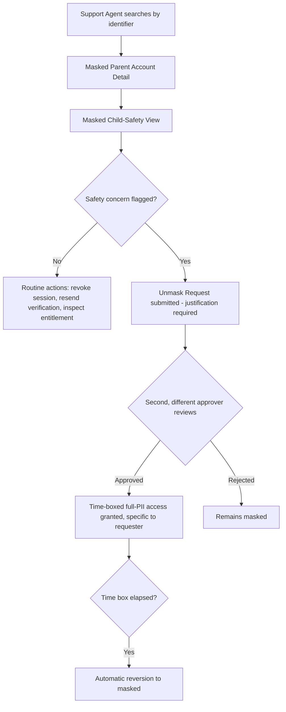
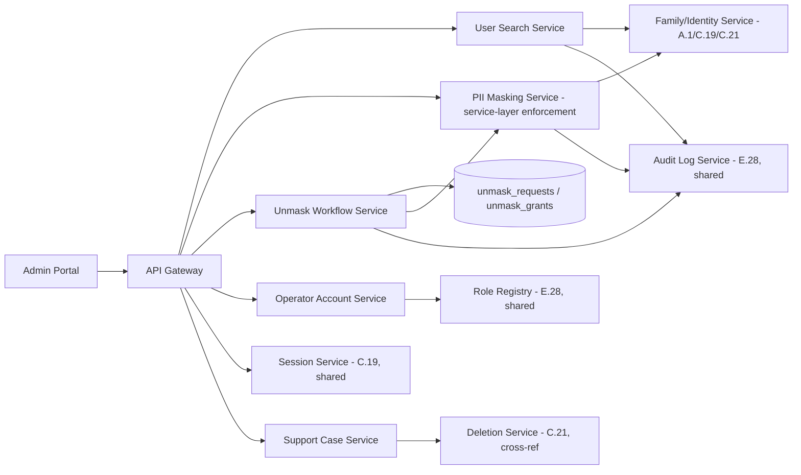
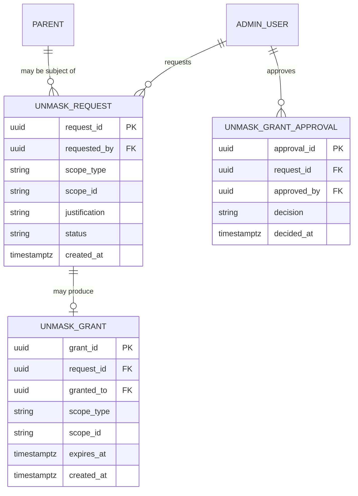

# Feature E.32 — User Management & Child Safety View

**App:** NoorHeroes — Islamic Learning App for Children
**Feature Owner:** Customer Support / Trust & Safety / Platform
**Status:** Implementation-ready
**Version:** 1.0
**Depends on:** E.28 (Admin Auth/RBAC — role-scoped masking, audit log, maker-checker), C.19 (Parent PIN/Gate — session model this module reads/revokes), C.21 (Multi-Child Management — deletion/disable mechanics this module's support actions trigger)
**Feeds into:** Nothing further downstream within the Admin Portal; this module's "unmask" and account-recovery actions are themselves terminal support operations

> **Scope note:** This document is the canonical specification for the Admin Portal's **"Users" navigation group** — Parent Account List/Detail (masked child data by default), the Child-Safety View (read-only, audited unmask access), the Moderator/Admin/Scholar Roster (account provisioning, distinct from E.28's role/permission *matrix*, which this module consumes), and the Support Case Queue. Its single most important property is the **masking-by-default, unmask-by-justified-exception** model: child PII (real name, DOB, contact) is never visible to support/content roles under normal operation — only nickname, age band, and progress are — and any full-PII access requires a logged, time-boxed safety-investigation justification with a second approver, mirroring E.28's and E.29's dual-layer defense patterns exactly.

---

## Table of Contents

1. [Product Requirements](#1-product-requirements)
2. [UX/UI Requirements](#2-uxui-requirements)
3. [Backend Requirements](#3-backend-requirements)
4. [Database Design](#4-database-design)
5. [Backend AI Code-Generation Prompt](#5-backend-ai-code-generation-prompt)
6. [Frontend (Admin Web) Requirements](#6-frontend-admin-web-requirements)
7. [Frontend AI Code-Generation Prompt](#7-frontend-ai-code-generation-prompt)
8. [Admin Requirements](#8-admin-requirements)
9. [Admin AI Code-Generation Prompt](#9-admin-ai-code-generation-prompt)
10. [DevOps Requirements](#10-devops-requirements)
11. [Analytics Requirements](#11-analytics-requirements)
12. [Security Requirements](#12-security-requirements)
13. [QA Requirements](#13-qa-requirements)
14. [Marketing Requirements](#14-marketing-requirements)
15. [Release & Rollback Plan](#15-release--rollback-plan)

---

## 1. Product Requirements

### 1.1 Problem Statement

Support agents and Trust & Safety staff need to find and assist parent accounts, view child profile metadata for legitimate support purposes, revoke sessions, resend verification, inspect entitlements, and — in genuine safety investigations only — access full child PII through a logged, time-boxed, second-approved process, while content/moderator roles provisioning admin/scholar accounts never gain unconditional visibility into child PII at all (source: NoorHeroes Blueprint module 3: "Child PII (real name, DOB, contact) is never shown to support/content roles — only nickname, age band, and progress are visible; full PII access requires a logged, time-boxed 'safety investigation' justification"; Consolidated Blueprint §11.2/§23.2: "Never display raw child voice, unrestricted AI transcripts, or more PII than the role needs — enforced as a permission rule, not a UI convention, so it cannot be bypassed via direct API calls").

### 1.2 Business Goals

- Enable effective customer support and safety investigation without making child PII routinely visible to a broad set of operator roles.
- Maintain the masking-by-default model as an engineering-enforced guarantee, mirroring the rigor already established for self-elevation prevention (E.28) and segregation of duties (E.29).
- Provide a genuinely useful, fast search/lookup experience for support agents (by parent identifier, internal family ID, subscription ID, or support case) without requiring a full-PII unmask for the vast majority of routine tickets.
- Support clean account provisioning and lifecycle management for moderator/admin/scholar accounts, consuming but not duplicating E.28's RBAC matrix.

### 1.3 User Goals

- **Support Agent:** Search for a parent account quickly by any of several identifiers, view masked child metadata sufficient for most tickets, revoke a session or resend verification, and escalate to an audited unmask request only when a genuine safety concern requires it.
- **Trust & Safety:** Review and approve unmask requests as the required second approver, with full confidence every access is logged and time-boxed.
- **Super Admin / HR-adjacent operator:** Provision and manage moderator/admin/scholar accounts, assign roles (consuming E.28's matrix), and disable accounts without ever hard-deleting user-initiated data.

### 1.4 Success Metrics

| Metric | Target |
|---|---|
| Masked-data access compliance (no PII shown beyond role's documented need) | 100% (hard, zero-tolerance) |
| Unmask request approval cycle time | ≤ 2 business hours for genuine safety investigations |
| Search-to-resolution time for routine support tickets | ≤ 5 minutes |
| Unmask requests without a valid justification reason | 0 (hard, zero-tolerance) |
| Account-recovery completion rate (once initiated) | ≥ 95% |
| Crash-free User Management sessions | ≥ 99.5% |

### 1.5 Stakeholders

Customer Support Lead, Trust & Safety Lead, Backend Architect, Admin Frontend Engineer, Legal/Compliance, QA Lead, every admin role consuming this module (Support Agent, Billing Ops, Analyst — read-only — Super Admin).

### 1.6 User Stories

1. As a support agent, I want to search for a parent account by parent identifier, family ID, subscription ID, or support case number.
2. As a support agent, I want to see masked child profile metadata (nickname, age band, progress) sufficient for most tickets, without seeing real name, DOB, or contact details.
3. As a support agent, I want to revoke a session, resend a verification email/SMS, or inspect an entitlement without needing any escalation.
4. As a support agent investigating a genuine safety concern, I want to request a time-boxed, justified unmask of full child PII, requiring a second approver.
5. As a Trust & Safety reviewer, I want to approve or reject unmask requests, with every decision logged.
6. As a super admin, I want to provision and manage moderator/admin/scholar accounts, assigning roles from the existing RBAC matrix.
7. As a super admin, I want to disable an account without ever hard-deleting any user-initiated data tied to it.

### 1.7 Functional Requirements

**FR-1** User Management screens (canonical, source module 3/§23.2): Parent Account List/Detail (masked child data); Child-Safety View (read-only, audited access); Moderator/Admin/Scholar User List; Scholar Roster.
**FR-2** Search capabilities (canonical, source §23.2): by parent identifier, internal family ID, subscription ID, or support case.
**FR-3** Support-agent capabilities (canonical, source §23.2/role definitions): view masked parent details and child profile metadata; revoke sessions; resend verification; inspect entitlements; correct support-safe metadata; initiate account recovery only with auditable verification; process child-deletion support cases and parent-deletion-cancellation requests (cross-ref C.21's Support-mediated-only cancellation mechanism, which this module's Support Case Queue is the actual operational home of).
**FR-4** **Child PII (real name, DOB, contact) is never shown to support/content roles — only nickname, age band, and progress are visible; full PII access requires a logged, time-boxed "safety investigation" justification** (source module 3 — a hard rule with a specific, narrow exception process, not a routine capability).
**FR-5** **The unmask escalation process: support views a masked parent record → if a safety concern is flagged → escalation creates an audited, time-limited unmask request requiring a second approver** (source module 3 Workflow — restated as the canonical, complete unmask-exception process).
**FR-6** **Never display raw child voice, unrestricted AI transcripts, or more PII than the role needs — enforced as a permission rule, not a UI convention, so it cannot be bypassed via direct API calls** (source §11.2/§23.2 — restated as the service-layer enforcement requirement, consistent with the rigor applied to E.30's transcript-access gate, which this module's PII-masking logic directly parallels).
**FR-7** **Disable account, never hard-delete user-initiated data** (source module 3 CRUD row, "Delete = Disable account (never hard-delete user-initiated data)") — applies to moderator/admin/scholar account lifecycle management, distinct from but philosophically consistent with C.21's child/parent disable-vs-delete distinction.
**FR-8** **Account recovery is initiated only with auditable verification** (source §23.2) — this module's account-recovery action for a parent is the same mechanism already specified in A.1/C.19's recovery flow and C.19's Support-Tool-triggers-standard-OTP-recovery pattern, never a direct credential reset.
**FR-9** The Child-Safety View specifically (distinct from the general masked Parent Account Detail) surfaces age-band, progress summaries, moderation/flag history, and AI-safety-flag counts for a specific child — still without real name/DOB/contact — intended for genuine safety-context review without requiring a full unmask in most cases.
**FR-10** Every masked-data access, regardless of role, is itself logged (not just unmask events) — consistent with E.28's "sensitive reads and all mutations are audited at the service layer" principle, applied here specifically to child-metadata reads.

### 1.8 Non-Functional Requirements

- **Masking-by-Default Integrity:** Enforced at the service layer as a permission rule, never a UI convention — a direct API call from any non-unmask-elevated role must never return real name/DOB/contact, regardless of UI behavior.
- **Unmask Time-Boxing:** An approved unmask grant has a defined expiry; access reverts to masked automatically once the time box elapses, never requiring a manual re-mask action.
- **Second-Approver Distinctness:** The unmask approver must be a different individual from the requester, mirroring E.28's self-approval-prevention pattern exactly.
- **Account-Lifecycle Data Preservation:** Disabling any account (parent, moderator, admin, scholar) never hard-deletes user-initiated data tied to it.

### 1.9 Acceptance Criteria

- Given a support agent searches for a parent account by any supported identifier, when results return, then the agent sees masked child data (nickname, age band, progress) only — no real name, DOB, or contact details.
- Given a support agent attempts to access full child PII without an approved unmask grant, when they try (including via a direct API call), then this is rejected at the service layer.
- Given a support agent escalates a genuine safety concern, when they submit an unmask request, then it requires a second, different approver before any PII is revealed, and the grant is time-boxed.
- Given an unmask grant's time box elapses, when subsequently queried, then the data reverts to masked automatically, with no manual re-mask step required.
- Given a super admin disables a moderator/admin/scholar account, when checked, then all user-initiated data tied to that account remains fully intact.
- Given a support agent initiates account recovery for a parent, when this occurs, then it routes through the existing auditable OTP-recovery mechanism, never a direct credential reset by the agent.
- Given any masked-data access occurs, when reviewed in the Audit Log, then it is present and attributable, regardless of whether it was a routine masked view or an escalated unmask.

### 1.10 Edge Cases

1. A support agent's unmask request is approved, and they view full child PII; before the time box elapses, a second support agent attempts to view the same child's record → the second agent, lacking their own approved unmask grant, sees only the masked view — an unmask grant is specific to the requesting individual, never a shared/family-wide unlock visible to any agent who happens to look.
2. An unmask request is submitted but never acted upon by any approver before the underlying safety concern is otherwise resolved → the request simply remains pending; there is no auto-approval timeout, though a stale-pending-request monitoring alert is appropriate for operational hygiene.
3. A support agent attempts to correct a piece of "support-safe metadata" that turns out to actually be a piece of restricted PII mistakenly classified as support-safe → caught by the field-classification system itself (PII fields are explicitly enumerated and excluded from the support-safe metadata set at the schema level, not determined by an agent's judgment call) — if such a misclassification is ever discovered, it's a data-model bug requiring a fix.
4. A moderator/admin/scholar account is disabled, then later needs to be re-enabled → re-enabling is supported and restores the account's prior role assignment, distinct from a fresh account-creation flow.
5. A child-safety investigation legitimately requires reviewing a child's AI interaction history in addition to their basic profile PII → this requires its own separate elevated permission (E.30's `transcript_access`), not granted automatically by a Child-Safety-View unmask — the two elevated-access mechanisms are independent, each with its own justification and approval requirement.
6. A parent's account is searched by family ID, and the family has multiple children — the support agent needs to look at a specific one for the ticket at hand → the masked Child-Safety View correctly scopes to the specific child referenced in the ticket without incidentally surfacing sibling data more broadly than necessary.
7. A super admin attempts to assign a role to a new moderator account that doesn't exist in E.28's role registry → rejected, since role assignment here always references the registry's currently-valid role set, never an arbitrary string.

### 1.11 Error Handling

| Scenario | System Behavior |
|---|---|
| Direct API call attempting to bypass masking | Rejected at the service layer (FR-6) |
| Unmask grant time box elapsed | Automatic reversion to masked view, no manual step required |
| Unmask request pending with no approver action | Remains pending indefinitely, flagged for staleness monitoring |
| Role assignment referencing an invalid/non-existent role | Rejected |
| Account-recovery attempted as a direct credential reset | No such path exists — only the standard auditable recovery mechanism is available |

### 1.12 Empty States
- Zero search results for a given identifier → clear "No matching account found" state.
- Zero pending unmask requests in the approval queue → simple "Nothing pending" state.

### 1.13 Loading States
- Standard Admin Portal skeleton-loading pattern, consistent with E.28-E.31.

### 1.14 Offline States
- N/A (internal operator tool, connectivity assumed).

### 1.15 Permission States
- Parent Account Detail and Child-Safety View render the masked variant by default for every role; the unmasked variant renders only for the duration of an active, approved, time-boxed grant specific to the requesting individual.

### 1.16 User Flow (Narrative)

A support agent searches for a parent account by identifier → views the masked Parent Account Detail and, if relevant, the masked Child-Safety View → performs routine actions without escalation → if a genuine safety concern arises, submits an unmask request with a justification → a different, designated approver reviews and approves or rejects it → on approval, the agent has time-boxed access to full PII, automatically reverting to masked once the window elapses → separately, a super admin manages moderator/admin/scholar account provisioning, role assignment, and disable/re-enable lifecycle actions.

### 1.17 Detailed Flow Diagram (Mermaid)



### 1.18 Screen Inventory (Complete — Zero Missing)

| # | Screen | Type | Entry Points | Exit Points |
|---|---|---|---|---|
| 1 | Search (by identifier) | Primary | Admin Portal "Users" navigation group | Parent Account Detail |
| 2 | Parent Account Detail (masked by default) | Screen | Search results | Child-Safety View, Session List, Entitlement Inspector, Account Recovery, Unmask Request |
| 3 | Child-Safety View (read-only, masked by default) | Screen | Parent Account Detail (per child) | Unmask Request, Moderation/Flag History |
| 4 | Moderation/Flag History (still masked) | Screen | Child-Safety View | Back |
| 5 | Session List | Component | Parent Account Detail | Session Revocation Confirmation |
| 6 | Session Revocation Confirmation | Modal | Session List | Session List (updated) |
| 7 | Entitlement Inspector (read-only) | Screen | Parent Account Detail | Back |
| 8 | Support-Safe Metadata Correction | Screen | Parent Account Detail | Parent Account Detail (saved) |
| 9 | Account Recovery Initiation | Screen | Parent Account Detail | Recovery-in-progress state |
| 10 | Unmask Request Submission | Screen | Parent Account Detail, Child-Safety View | Unmask Approval Queue (pending) |
| 11 | Unmask Approval Queue | Screen | Admin Portal "Users" navigation group | Unmask Request Detail |
| 12 | Unmask Request Detail (approve/reject) | Screen | Unmask Approval Queue | Resolved |
| 13 | Unmasked Full-PII View (time-boxed, requester-specific) | Screen variant | Approved request, subsequent visits within window | Reverts to masked automatically |
| 14 | Moderator/Admin/Scholar User List | Screen | Admin Portal "Users" navigation group | User Detail/Provisioning |
| 15 | Account Provisioning (create, assign role) | Screen | User List | User List (created) |
| 16 | Account Detail, role reassignment | Screen | User List | User List (updated) |
| 17 | Disable Account Confirmation | Modal | Account Detail | Account List (disabled) |
| 18 | Re-enable Account Confirmation | Modal | Account Detail (disabled) | Account List (re-enabled) |
| 19 | Support Case Queue | Primary | Admin Portal "Users" navigation group | Support Case Detail |
| 20 | Support Case Detail | Screen | Support Case Queue | Resolved / Linked admin action |

### 1.19 Events (Complete Analytics Event List)

`user_search_performed`, `parent_account_detail_viewed`, `child_safety_view_viewed`, `masked_data_access_logged`, `session_revoked`, `verification_resent`, `entitlement_inspected`, `support_safe_metadata_corrected`, `account_recovery_initiated`, `unmask_request_submitted`, `unmask_request_approved`, `unmask_request_rejected`, `unmask_grant_active_view`, `unmask_grant_expired_reverted`, `unmask_bypass_attempt_blocked`, `moderator_account_provisioned`, `moderator_role_reassigned`, `moderator_account_disabled`, `moderator_account_reenabled`, `support_case_viewed`, `support_case_resolved`.

---

## 2. UX/UI Requirements

> Follows the Admin Portal's dense, professional-tool visual register established in **E.28 §2.1**, with redaction-visual-language consistent with **E.30 §2.1**'s transcript-redaction treatment, adapted here for PII masking.

### 2.1 User-Management-Specific Design System Extensions

- **Masked-Field Visual Language:** Real name/DOB/contact fields, when masked, render as a consistent placeholder (e.g., `••••••` with a small lock icon), visually distinct from genuinely-empty fields.
- **Unmask-Active Banner:** When a screen is rendering under an active, time-boxed unmask grant, a persistent banner displays the grant's remaining time and the original justification.
- **Account-Status Visual Treatment:** Disabled moderator/admin/scholar accounts use the same muted/greyed card treatment established for disabled child profiles in C.21.

### 2.2 Screen-Level Design Requirements (Key Screens)

#### Screen: Parent Account Detail

- **Purpose:** Give a support agent everything needed for routine tickets without exposing PII.
- **Components:** Masked parent identifier summary, child list (each with masked Child-Safety View link), session list, entitlement summary, support-safe-metadata fields (editable), account-recovery action, unmask-request entry point.
- **States:** Default (masked), Unmask-active, Loading.
- **Accessibility:** Masked-field placeholders are screen-reader-announced as "masked," not silently skipped.

#### Screen: Unmask Request Submission

- **Purpose:** Make the justification requirement explicit and the second-approver requirement clear before submission.
- **Components:** A required justification text field, a clear statement of the time-box duration, a note that a different individual must approve.
- **States:** Default, Submitting, Submitted (pending).

### 2.3 Tab Structure

Reached from the Admin Portal's "Users" navigation group.

| Click Target | Destination | API Called | Analytics Event | Permission Check | Error Handling |
|---|---|---|---|---|---|
| Search submit | Parent Account Detail | `GET /v1/admin/users/search?query=` | `user_search_performed` | `support`+ role | Empty-results state |
| "Revoke Session" | Session Revocation Confirmation | `DELETE /v1/admin/users/{id}/sessions/{session_id}` | `session_revoked` | `support`+ role | Standard handling |
| "Request Unmask" | Unmask Request Submission | `POST /v1/admin/users/{id}/unmask-requests` | `unmask_request_submitted` | `support`+ role, justification required | Standard handling |
| "Approve" (unmask) | Resolved | `POST /v1/admin/unmask-requests/{id}/approve` | `unmask_request_approved` | distinct approver | Self-approval rejection |
| "Disable Account" | Disable Confirmation | `POST /v1/admin/operators/{id}/disable` | `moderator_account_disabled` | `super_admin` role | Standard handling |

### 2.4 Wireframe Description (Composite)

A standard search-then-detail pattern, with the unmask workflow following the same maker-checker visual pattern already established in E.28's Approval Queue.

### 2.5 Screen Image Generation Prompts

**Screen: Parent Account Detail (masked)**
- *Prompt 1 (English):* "Desktop web admin parent account detail screen UI mockup, dense professional SaaS tool aesthetic. Cool neutral grey-white background. Top shows account identifier fields, with name and contact fields rendered as small grey dot-masked placeholders with a tiny lock icon next to each, clearly distinct from a blank field. Below, a child list section showing two child cards with nickname, age band, and a small progress bar, but no name/DOB fields visible at all. A row of action buttons: 'Revoke Session', 'Resend Verification', 'Inspect Entitlement', and a separated 'Request Unmask' button. Clean, dense, professional engineering-tool aesthetic, sharp corners, muted blue/grey accents, no realistic human faces."
- *Prompt 2 (Arabic RTL):* "نفس شاشة تفاصيل حساب الوالد المنقّى لتطبيق ويب إداري، بطابع أداة SaaS مهنية كثيفة، بتخطيط من اليمين إلى اليسار بالكامل. خلفية رمادية باردة محايدة. يعرض الأعلى حقول معرف الحساب، مع عرض حقلي الاسم والاتصال كعناصر نائبة رمادية منقّطة صغيرة مع أيقونة قفل صغيرة بجانب كل منها، متميزة بوضوح عن الحقل الفارغ. أسفل ذلك قسم قائمة الأطفال يعرض بطاقتي طفل بالاسم المستعار والفئة العمرية وشريط تقدم صغير، بدون أي حقول اسم/تاريخ ميلاد ظاهرة على الإطلاق. صف من أزرار الإجراءات: 'إلغاء الجلسة'، 'إعادة إرسال التحقق'، 'فحص الاستحقاق'، وزر منفصل 'طلب إلغاء التنقية'. طابع مهني وكثيف وأداة هندسية نظيفة، زوايا حادة، لمسات زرقاء/رمادية باهتة, بدون وجوه بشرية واقعية."

**Screen: Unmask-Active Banner State**
- *Prompt 1 (English):* "Desktop web admin screen UI mockup showing the same parent account detail page but now with full data visible (a real name and contact field shown in plain text), with a prominent, unmissable amber banner pinned at the top of the page reading 'Unmask active: 14 minutes remaining — Justification: Safety investigation #4521'. Clean, dense, professional engineering-tool aesthetic, sharp corners, muted blue/grey accents with the one amber banner exception, no realistic human faces."
- *Prompt 2 (Arabic RTL):* "نفس شاشة ويب إدارية تعرض صفحة تفاصيل حساب الوالد نفسها لكن الآن مع ظهور البيانات الكاملة، مع شريط عنبري بارز لا يمكن تفويته مثبت في أعلى الصفحة يقول 'إلغاء التنقية نشط: باقي 14 دقيقة — التبرير: تحقيق سلامة #4521'. طابع مهني وكثيف وأداة هندسية نظيفة، زوايا حادة، لمسات زرقاء/رمادية باهتة مع الاستثناء العنبري الوحيد، بدون وجوه بشرية واقعية."

---

## 3. Backend Requirements

### 3.1 System Design Overview

This module extends the **Family/Identity Service** (already specified in A.1/C.19/C.21) with admin-facing search/masked-read endpoints, introduces a **PII Masking Service** (the central enforcement point for the masking-by-default rule), an **Unmask Workflow Service** (the maker-checker-style time-boxed exception process), and a lightweight **Operator Account Service** for moderator/admin/scholar provisioning, consuming E.28's role registry.

### 3.2 Architecture Diagram (Mermaid)



### 3.3 Service Breakdown

| Service | Responsibility |
|---|---|
| User Search Service | Multi-identifier search (parent ID, family ID, subscription ID, support case) |
| PII Masking Service | Central enforcement point deciding what fields a given request may see |
| Unmask Workflow Service | Request/approval/time-boxed-grant lifecycle, second-approver enforcement |
| Operator Account Service | Moderator/admin/scholar account provisioning, role assignment, disable/re-enable |
| Support Case Service | Case queue, including child-deletion and parent-deletion-cancellation cases |

### 3.4 API List

#### `GET /v1/admin/users/search?query=&type=parent_id|family_id|subscription_id|support_case`
- **Auth:** `support`+ role
- **Response 200:** Matching account summary (masked).

#### `GET /v1/admin/users/{id}` (Parent Account Detail) / `GET /v1/admin/users/{id}/children/{child_id}` (Child-Safety View)
- **Response 200:** Always passes through the PII Masking Service before returning — the response schema for an unprivileged request structurally substitutes real name/DOB/contact with a masked placeholder marker, never returning the actual values to be hidden client-side.
- **Validation:** A request bearing an active, valid, time-boxed unmask grant for that specific requester and that specific child/family returns the genuine values instead — checked against the grant record on every single call, not cached as a session-wide unlock.

#### `POST /v1/admin/users/{id}/unmask-requests`
- **Request:** `{ "justification": "...", "scope": "child_id or family_id" }`
- **Response 200:** `{ "request_id": "...", "status": "pending" }`
- **Validation:** `justification` is required and non-empty.

#### `POST /v1/admin/unmask-requests/{id}/approve` / `/reject`
- **Auth:** `trust_safety`/designated approver role
- **Validation:** Rejected (`403 SAME_ADMIN_CANNOT_APPROVE_OWN_PROPOSAL`) if the approving admin's identity matches the requesting admin's identity — reuses the exact same self-approval-prevention pattern (application + database-layer CHECK constraint) already established in E.28/E.29.
- **Business Logic:** On approval, creates an `unmask_grants` row with a server-computed `expires_at` — the PII Masking Service consults this row on every subsequent request from that specific requester for that specific scope until it expires.

#### `DELETE /v1/admin/users/{id}/sessions/{session_id}` (reused from C.19)
#### `POST /v1/admin/users/{id}/resend-verification`
#### `GET /v1/admin/users/{id}/entitlements` (read-only, reused from C.24)
#### `PATCH /v1/admin/users/{id}/support-safe-metadata`
- **Validation:** Only fields explicitly enumerated in the support-safe-metadata schema are editable here — PII fields are structurally absent from this endpoint's schema, not merely excluded by convention.

#### `POST /v1/admin/operators` / `PATCH /v1/admin/operators/{id}/role` / `POST /v1/admin/operators/{id}/disable` / `/reenable`
- **Validation:** `role` must reference a currently-valid role in E.28's registry — rejected if not; `disable` never cascades to delete any content/review-decision/audit data the operator authored.

### 3.5 Cross-Cutting API Concerns

- **Masking enforced at the service layer, checked per-request against the grant record:** never a session-wide unlock, never a client-side-only hiding convention.
- **Self-approval prevention reused exactly from E.28/E.29.**
- **Structural absence of PII fields from the support-safe-metadata endpoint.**

---

## 4. Database Design

### 4.1 ER Diagram (Mermaid)



### 4.2 Tables, Relationships, Constraints

| Table | Key Constraints | Indexes |
|---|---|---|
| `unmask_request` | FK `requested_by`; CHECK `status IN ('pending','approved','rejected','expired')`; CHECK `justification IS NOT NULL AND length(justification) > 0` | Index `(status, created_at DESC)` |
| `unmask_grant` | FK `request_id`, `granted_to`; time-boxed via `expires_at`, the Masking Service treats any row past this timestamp as inactive without requiring a cleanup job | Index `(granted_to, scope_type, scope_id, expires_at)` |
| `unmask_grant_approval` | FK `request_id`, `approved_by`; CHECK `approved_by != (SELECT requested_by FROM unmask_request WHERE request_id = unmask_grant_approval.request_id)` — database-level self-approval prevention, mirroring E.28/E.29's pattern | Index `(request_id)` |

### 4.3 Audit Fields
`unmask_request`/`unmask_grant`/`unmask_grant_approval` are themselves the audit trail for this workflow, in addition to E.28's general shared `audit_log`.

### 4.4 Soft Delete Rules
N/A for unmask tables. `admin_user`/`operator` account disabling uses `active=false`, never a row deletion.

### 4.5 Retention Rules
`unmask_request`/`unmask_grant`/`unmask_grant_approval` retained per the platform's highest safety-audit retention standard.

---

## 5. Backend AI Code-Generation Prompt

```
You are building the User Search Service, PII Masking Service, Unmask
Workflow Service, and Operator Account Service for "NoorHeroes." Reuse
E.28's existing self-approval-prevention pattern (application + database
CHECK constraint) for the unmask-approval workflow -- do not reinvent it.

Stack: FastAPI (Python 3.12), PostgreSQL (SQLAlchemy 2.0), Redis.

Hard requirements:
1. Implement the PII Masking Service as a MANDATORY pass-through for
   GET /v1/admin/users/{id} and GET /v1/admin/users/{id}/children/{child_id}
   -- the response schema for real_name/dob/contact fields must be a
   MASKED PLACEHOLDER STRUCTURE by default, with the genuine value
   substituted in ONLY if a valid, non-expired unmask_grant exists for
   THIS SPECIFIC requester and THIS SPECIFIC scope -- write a test
   confirming a request without a grant never receives the genuine
   value, and a SECOND test confirming a different admin (even with
   their own valid grant for a different scope) also never receives
   this specific child's genuine value.
2. Implement the unmask_grant check as a PER-REQUEST query against the
   grant table's expires_at, never a cached session-wide flag -- write a
   test simulating a grant that expires mid-session and confirming the
   VERY NEXT request after expiry correctly reverts to masked.
3. Implement the database-level self-approval-prevention CHECK constraint
   on unmask_grant_approval -- write a test attempting a direct database
   INSERT violating this constraint and confirming rejection at the
   database layer.
4. Implement PATCH /v1/admin/users/{id}/support-safe-metadata with a
   schema that STRUCTURALLY EXCLUDES any PII field -- write a schema-
   introspection test confirming no such field exists anywhere in this
   endpoint's request/response model.
5. Implement POST /v1/admin/operators/{id}/role to validate the
   requested role against E.28's CURRENT role registry, rejecting any
   role name not found there.
6. Implement POST /v1/admin/operators/{id}/disable to set active=false
   WITHOUT cascading any delete to historical attribution referencing
   this operator -- write a test confirming a fixture piece of content
   authored/reviewed by a disabled operator remains fully intact and
   correctly attributed after the disable action.

Deliver: FastAPI routers, SQLAlchemy models, Alembic migrations, Pydantic
schemas, and a pytest suite covering all 6 items, with items 1 and 3
treated as the two highest-priority guarantees.
```

---

## 6. Frontend (Admin Web) Requirements

### 6.1 Technical Requirements
React + TypeScript, consistent with E.28-E.31's Admin Portal shell and design-token package.

### 6.2 Screen Mapping
Each of the 20 screens in §1.18 maps to a route/page component within the Admin Portal's "Users" navigation group.

### 6.3 Navigation Flow
Search is the landing route under "Users"; Parent Account Detail and Child-Safety View render their masked/unmasked variant entirely from the server's response shape; the Operator Account List/Provisioning flow is a sibling section.

### 6.4 State Management
A shared `UserDetailContext` renders masked-placeholder UI elements whenever the server response indicates masking, and the genuine value whenever it doesn't — the client never independently decides to mask/unmask.

### 6.5 API Mapping
`UserSearchRepository.search()`, `UserDetailRepository.getParent()/getChild()`, `UnmaskRepository.request()/approve()/reject()`, `OperatorRepository.create()/updateRole()/disable()/reenable()`, `SupportCaseRepository.getQueue()/getDetail()` map to their respective endpoints.

### 6.6 Analytics Mapping
`UserManagementAnalytics` fires events per §1.19.

### 6.7 Offline Support
N/A.

### 6.8 Deep Linking
Standard web routes (e.g., `/users/search`, `/users/{id}`, `/users/unmask-queue`, `/users/operators`).

### 6.9 Push Notifications
N/A.

### 6.10 Testing Strategy
- Unit: `UserDetailContext`'s purely-server-driven masked/unmasked rendering logic.
- UI tests: a masked field never renders identically to an empty field; the Unmask-Active Banner is present and accurate on every screen rendering under an active grant.
- Integration: full search → masked-detail → unmask-request → second-approver-approve → time-boxed-unmasked-view → automatic-revert-on-expiry flow.

---

## 7. Frontend AI Code-Generation Prompt

```
Build the User Management and Child Safety View frontend module for the
NoorHeroes Admin Portal as a React + TypeScript SPA, reusing E.28's Admin
Portal shell and design tokens.

Hard requirements:
1. Implement masked-field rendering DRIVEN ENTIRELY by the server's
   response shape -- write a test confirming the component never
   attempts its own client-side masking decision.
2. Implement a distinct visual treatment for masked-placeholder fields
   vs. genuinely-empty fields.
3. Implement the Unmask-Active Banner to render on EVERY screen showing
   data under an active grant.
4. Implement the Unmask Approval Queue/Detail screens to disable/hide the
   approve action when the current admin's identity matches the
   request's requester.
5. Implement the Operator Role Reassignment dropdown to populate options
   EXCLUSIVELY from E.28's live role registry.

Use the Admin Portal's existing dense, professional-tool design tokens
established in E.28.
```

---

## 8. Admin Requirements

This document **is** the User Management & Child Safety View admin-requirements specification in full. No further meta-layer exists beyond E.28's RBAC role definitions.

---

## 9. Admin AI Code-Generation Prompt

```
This document's own §5 (Backend) and §7 (Frontend) prompts ARE the full
admin-tooling build specification for User Management & Child Safety
View.
```

---

## 10. DevOps Requirements

- **Infrastructure:** The PII Masking Service is consulted on every Parent Account Detail/Child-Safety View request — provisioned for fast per-request grant lookups (e.g., Redis-cached grant-validity checks backed by the authoritative PostgreSQL record).
- **CI/CD:** The per-requester/per-scope masking-enforcement test and the self-approval-prevention test are mandatory CI gates.
- **Monitoring/Logging/Alerting:** Alert (P0) on any PII returned without a valid matching grant. Alert on unmask-request volume spikes. Alert on stale-pending unmask requests.
- **Disaster Recovery:** Unmask-related tables at the platform's highest safety-audit durability tier.
- **Rollback Strategy:** Any deploy touching the PII Masking Service's grant-check logic requires staging penetration-test-style verification before promotion.
- **Backup Strategy:** Highest tier for unmask-related tables; standard for general user-search/operator-account tables.
- **Environment Setup:** Staging supports fixture multi-admin scenarios and deliberately-expiring grant fixtures.

---

## 11. Analytics Requirements

### 11.1 Event Taxonomy
Full list in §1.19.

### 11.2 Funnel Analysis
`unmask_request_submitted` → `unmask_request_approved`/`_rejected` → `unmask_grant_active_view` → `unmask_grant_expired_reverted`.

### 11.3 Dashboard Metrics
Search-to-resolution time, unmask-request volume and approval cycle time, account-recovery completion rate, operator provisioning/disable frequency.

### 11.4 Cohort & Retention
N/A.

### 11.5 Learning Metrics
None directly.

---

## 12. Security Requirements

### 12.1 Threat Analysis
- **Routine PII exposure:** mitigated by masking-by-default, checked per-request.
- **Self-approval of one's own unmask request:** mitigated at both application and database layer.
- **Stale unmask access:** mitigated by per-request expiry checking.
- **PII misclassification:** mitigated by structural schema exclusion.

### 12.2 OWASP Checklist (Applied)
Broken Access Control; Security Misconfiguration — both addressed via structural, repeatedly-verified enforcement.

### 12.3 API Security
Per-request grant check and dual-layer self-approval prevention.

### 12.4 Mobile Security
N/A.

### 12.5 Admin Security
Role assignment validates exclusively against E.28's live registry.

### 12.6 Data Encryption & PII Protection
Masking-by-default is this module's defining purpose.

### 12.7 Child Safety Requirements
Masking-by-default with a narrow, justified, second-approved, time-boxed exception is this module's defining commitment.

### 12.8 Compliance Requirements
Permanent unmask records support regulatory inquiry into PII access history.

### 12.9 Security Checklist (Pre-Launch)
- [ ] Per-requester, per-scope masking enforcement verified
- [ ] Automatic reversion-on-expiry verified
- [ ] Dual-layer self-approval prevention verified
- [ ] Structural PII-field absence from support-safe-metadata verified
- [ ] Operator role-assignment validated against live registry
- [ ] Operator disable verified to never cascade-delete attribution

---

## 13. QA Requirements

### 13.1 Test Plan Summary
Coverage spans masking enforcement, self-approval prevention, automatic expiry, structural exclusion, and all 7 edge cases.

### 13.2 Test Cases — Happy Path
1. Search and view masked account, perform routine session revocation.
2. Submit unmask request, different approver approves, time-boxed view, automatic revert.
3. Provision moderator account, assign role, later disable with attribution intact.

### 13.3 Edge Cases
All 7 items from §1.10.

### 13.4 Negative Cases
- Direct API access without grant → masked.
- Second agent without own grant → masked.
- Self-approval DB insert → rejected.
- Invalid role assignment → rejected.

### 13.5 Regression Cases
Full suite re-run on every related release.

### 13.6 Automation Cases
End-to-end unmask lifecycle (CI-blocking); masking-isolation test (CI-blocking); self-approval-prevention test (CI-blocking); operator-disable-attribution test.

---

## 14. Marketing Requirements

N/A — internal operator tool.

---

## 15. Release & Rollback Plan

### 15.1 Release Plan
Phased rollout 25% → 75% → 100% over 3–5 days, with masking-enforcement and self-approval-prevention suites required to pass at every stage.

### 15.2 Rollback Plan
Rollback triggers (all P0): PII exposure without valid grant, self-approved unmask request, grant active past expiry, attribution data loss from operator disable.

### 15.3 Success Metrics for Go/No-Go
Matches §1.4 targets. Go/no-go requires sign-off from Customer Support Lead, Trust & Safety, Legal/Compliance, and Security jointly.
