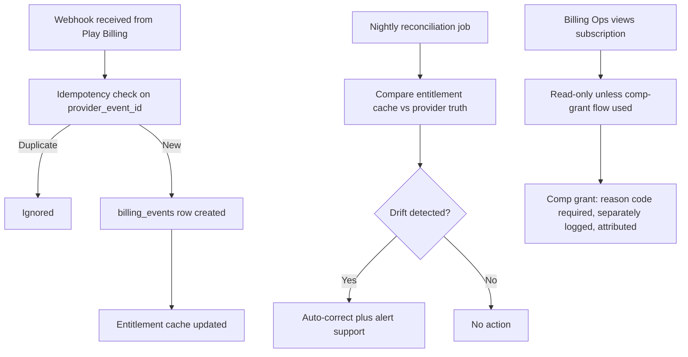
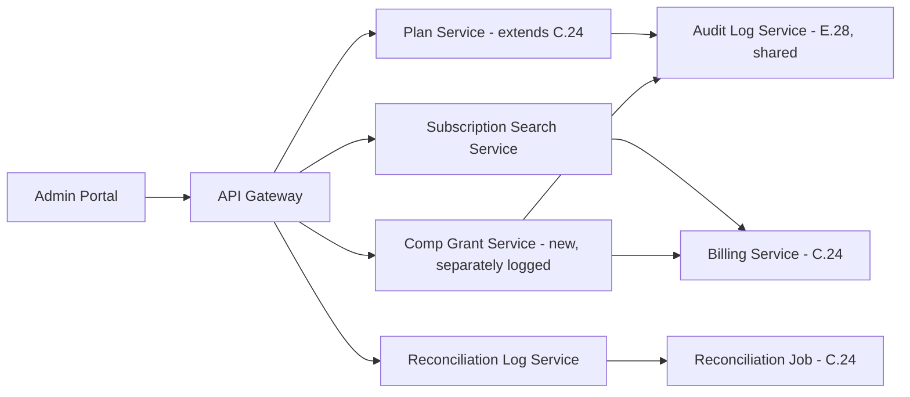
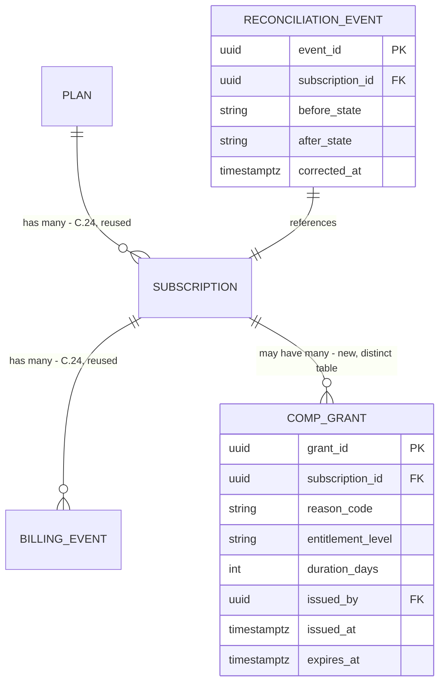

# Feature E.33 — Subscription Management & Billing Ops (Admin)

**App:** NoorHeroes — Islamic Learning App for Children
**Feature Owner:** Billing Ops / Finance / Platform
**Status:** Implementation-ready
**Version:** 1.0
**Depends on:** E.28 (Admin Auth/RBAC — Billing Ops role, maker-checker, audit log), E.32 (User Management — account search this module's subscription search is a sibling of), C.24 (Subscription & Billing — the consumer-facing entitlement/billing engine this module administers)
**Feeds into:** Nothing further downstream within the Admin Portal; this module's comp-grant and reconciliation actions are themselves terminal billing operations, read by C.24's consumer-facing entitlement checks

> **Scope note:** C.24 specified the consumer-facing subscription lifecycle (trial, renewal, cancellation, the receipt/webhook-is-truth principle) and its own admin section sketched the Plan Catalog Manager, Subscription/Entitlement Lookup, Receipt/Refund Management, Revenue Analytics, and Reconciliation Job Monitor at a high level. This document is the **complete, detailed specification** for that admin surface — the Plan/Pricing Editor, the Entitlement Matrix, Active-Subscription Search, the Billing-Event/Reconciliation Log Viewer, and the audited Comp-Grant tool — reusing C.24's billing engine and receipt/webhook pipeline entirely, introducing no new entitlement-determination logic of its own. Its single defining rule, inherited directly from C.24: **store webhook/receipt is always the entitlement source of truth; an admin cannot manually flip a subscription to "active" without a corresponding billing event — only support-tier comp grants, which are separately logged.**

---

## Table of Contents

1. [Product Requirements](#1-product-requirements)
2. [UX/UI Requirements](#2-uxui-requirements)
3. [Backend Requirements](#3-backend-requirements)
4. [Database Design](#4-database-design)
5. [Backend AI Code-Generation Prompt](#5-backend-ai-code-generation-prompt)
6. [Frontend (Admin Web) Requirements](#6-frontend-admin-web-requirements)
7. [Frontend AI Code-Generation Prompt](#7-frontend-ai-code-generation-prompt)
8. [Admin Requirements](#8-admin-requirements)
9. [Admin AI Code-Generation Prompt](#9-admin-ai-code-generation-prompt)
10. [DevOps Requirements](#10-devops-requirements)
11. [Analytics Requirements](#11-analytics-requirements)
12. [Security Requirements](#12-security-requirements)
13. [QA Requirements](#13-qa-requirements)
14. [Marketing Requirements](#14-marketing-requirements)
15. [Release & Rollback Plan](#15-release--rollback-plan)

---

## 1. Product Requirements

### 1.1 Problem Statement

Billing Ops needs to configure plans/pricing/entitlements centrally, search and inspect any subscription, investigate billing events and reconciliation drift, and — for genuine support cases only — issue a separately-logged comp grant, all while the store webhook/receipt remains the unconditional entitlement source of truth and no admin action can ever manually flip a subscription to "active" outside that pipeline (source: NoorHeroes Blueprint module 14: "Store webhook/receipt is always the entitlement source of truth; admin cannot manually flip a subscription to 'active' without a corresponding billing event — only support-tier comp grants, which are separately logged"; "Subscription Flow (Admin/Billing Ops)" diagram: "Webhook received → Idempotency check → billing_events row created → Entitlement cache updated... Nightly reconciliation job → Compare entitlement cache vs provider truth → Drift detected? → Auto-correct + alert support").

### 1.2 Business Goals

- Give Billing Ops genuine operational control over plan/pricing configuration and billing investigation without ever creating a path to fabricate entitlement outside the store's own purchase record.
- Maintain the reconciliation job as a continuously-running integrity backstop, catching webhook-delivery gaps automatically rather than relying on support noticing drift manually.
- Support a clean, fully-audited exception process (comp grants) for genuine customer-service cases, distinct from and never confusable with a real purchase.
- Ensure plan/entitlement changes never retroactively affect already-existing subscribers — only new subscribers see updated entitlements for a given plan.

### 1.3 User Goals

- **Billing Ops:** Configure plans and pricing, search and inspect any subscription's state and billing history, investigate reconciliation drift, and issue a properly-justified, audited comp grant when genuinely warranted.
- **Finance/Product:** Trust that revenue and entitlement reporting reflects the actual store-verified truth, with comp grants clearly separated from real revenue in all reporting.

### 1.4 Success Metrics

| Metric | Target |
|---|---|
| Entitlement-drift detection-to-correction latency (nightly reconciliation) | 100% of detected drift auto-corrected within one job cycle |
| Manual-activation-bypass attempts blocked | 100% (hard, zero-tolerance) |
| Comp-grant issuance requiring proper justification/audit | 100% (hard, zero-tolerance) |
| Subscription-search-to-resolution time for billing tickets | ≤ 5 minutes |
| Plan-change retroactive-impact incidents | 0 (hard, zero-tolerance) |
| Crash-free Subscription Management sessions | ≥ 99.5% |

### 1.5 Stakeholders

Billing Ops Lead, Finance, Backend Architect (reusing C.24's Billing Service), Admin Frontend Engineer, Legal/Compliance, QA Lead, feature owner of C.24.

### 1.6 User Stories

1. As Billing Ops, I want to configure plans and pricing centrally, with entitlement changes applying only to new subscribers.
2. As Billing Ops, I want to search for any subscription by family/parent/subscription identifier and see its full state and billing-event history.
3. As Billing Ops, I want to view the nightly reconciliation job's results and any drift it has corrected.
4. As Billing Ops, I want to issue a comp grant for a genuine support case, with mandatory justification and full audit logging, never confusable with a real billing event.
5. As Billing Ops, I want certainty that I cannot manually set a subscription to "active" without a corresponding real billing event.
6. As Finance, I want revenue reporting to clearly separate real, store-verified revenue from comp grants.
7. As Billing Ops, I want to deactivate a plan without affecting existing subscribers' entitlements.

### 1.7 Functional Requirements

**FR-1** Subscription Management screens (canonical, source module 14): Plan/Pricing Editor; Entitlement Matrix; Active-Subscription Search; Billing-Event/Reconciliation Log Viewer.
**FR-2** CRUD (canonical, source module 14): Create plan; Read subscription/billing-event detail; Update plan entitlements (new subscribers only); Deactivate a plan (existing subscribers keep entitlements).
**FR-3** **Store webhook/receipt is always the entitlement source of truth; admin cannot manually flip a subscription to "active" without a corresponding billing event — only support-tier comp grants, which are separately logged** (source module 14 Validation Rules — the hard, central rule of this entire module).
**FR-4** **Subscription Flow (canonical, source "Subscription Flow (Admin/Billing Ops)" diagram): webhook received from Play Billing → idempotency check on `provider_event_id` → duplicate → ignored; new → `billing_events` row created → entitlement cache updated. Nightly reconciliation job → compare entitlement cache vs. provider truth → drift detected → auto-correct + alert support; no drift → no action. Support views subscription → read-only unless the comp-grant flow is used.**
**FR-5** **Plans configured centrally → mobile app reads via `/v1/billing/plans` → purchases flow through Play Billing → webhook updates entitlement → reconciliation job catches drift nightly** (source module 14 Workflow — restated as the canonical end-to-end picture this admin module operates within, reusing C.24's exact consumer-facing contract).
**FR-6** Comp grants are a **distinct, separately-logged entitlement-grant mechanism** from real billing events — never written to the same `billing_events`/webhook-sourced table, always carrying its own reason code and issuing admin attribution, and always visible as a clearly-labeled exception in any subscription's history (never blended indistinguishably with real purchase history).
**FR-7** Plan deactivation **never retroactively affects existing subscribers** — they retain their current entitlements for the remainder of their subscription lifecycle (consistent with the platform's general non-retroactive-restriction philosophy already established throughout the consumer-facing app); only new subscription attempts against the deactivated plan are blocked.
**FR-8** Entitlement updates to an existing (active, non-deactivated) plan apply **only to new subscribers** going forward — existing subscribers on that plan retain whatever entitlement set was in effect when they subscribed, unless a separate, explicit "apply to existing subscribers too" administrative action is taken (a distinct, higher-friction action from a routine plan edit, given its broader blast radius).
**FR-9** The Reconciliation Log Viewer surfaces every drift-correction event with before/after entitlement state, the affected subscription, and the timestamp — supporting both operational monitoring and dispute investigation.

### 1.8 Non-Functional Requirements

- **Manual-Activation Impossibility:** There is structurally no API path to set a subscription's `state` to `active_paid` without either a valid billing-event reference or a comp-grant reference — both clearly attributed and distinguishable in the data model itself.
- **Non-Retroactivity:** Plan/entitlement changes never alter the experience of existing subscribers unless an explicit, distinct, higher-friction action is taken.
- **Reconciliation Reliability:** The nightly job must run reliably and correct 100% of detected drift within one cycle, consistent with C.24's own reconciliation-job guarantees.
- **Comp-Grant Distinctness:** Comp grants must be visually and structurally unmistakable from real revenue everywhere they appear (UI, reports, exports).

### 1.9 Acceptance Criteria

- Given Billing Ops attempts to set a subscription's state to `active_paid` without a valid billing-event or comp-grant reference, when they try (including via a direct API call), then this is rejected.
- Given Billing Ops issues a comp grant, when reviewed, then it required a reason code, is attributed to the issuing admin, and is clearly, visibly distinct from real billing-event-derived entitlement everywhere it's displayed.
- Given Billing Ops deactivates a plan, when checked, then existing subscribers on that plan retain their current entitlements unaffected; only new subscription attempts against it are blocked.
- Given Billing Ops updates an active plan's entitlements, when checked, then only new subscribers receive the updated entitlement set — existing subscribers are unaffected unless the separate, explicit broader-application action is taken.
- Given the nightly reconciliation job runs, when drift is detected between the entitlement cache and provider truth, then it is auto-corrected within that job cycle and support is alerted.
- Given Billing Ops searches for a subscription by any supported identifier, when results return, then they include the full billing-event history with comp grants clearly, visibly distinguished from real billing events.
- Given Finance reviews revenue reporting, when reviewed, then comp-grant-derived entitlement is excluded from real-revenue figures, reported separately if reported at all.

### 1.10 Edge Cases

1. A comp grant is issued for a subscription that, before the grant's intended duration elapses, also receives a genuine billing event (e.g., the customer separately purchases a real subscription) → the system correctly resolves to the **more-privileged or more-current** of the two states rather than conflict — consistent with the general principle that a real billing event is always authoritative going forward, with the comp grant's remaining "value" simply becoming moot rather than causing a data-integrity conflict.
2. A plan is deactivated, then later an admin wants to reactivate it (e.g., a seasonal pricing tier returning) → reactivation is supported and restores the plan's prior configuration, distinct from creating a brand-new plan, consistent with the general "disable is reversible" philosophy already established platform-wide.
3. The nightly reconciliation job itself fails to run (e.g., an infrastructure issue) → this is itself an alertable incident (cross-ref E.28's general job-failure monitoring), and the next successful run must still correctly catch and correct any drift that accumulated during the gap, never silently treating a missed run as "nothing to reconcile."
4. Two billing-ops admins simultaneously attempt to update the same plan's pricing → standard last-write-wins semantics apply for this relatively low-stakes configuration conflict (distinct from the higher-stakes optimistic-concurrency protection applied to child profile state transitions in C.21), though the resulting value is always clearly visible to both admins on next view.
5. A comp grant's issuing admin later leaves the company / their account is disabled → the comp grant record's attribution remains intact and queryable (consistent with E.32's general disable-never-deletes-historical-attribution principle), never orphaned or anonymized.
6. A webhook event references a `provider_event_id` that was already processed, but its payload differs slightly from the original (e.g., a metadata field changed on a retried delivery) → the idempotency check still correctly treats this as a duplicate based on `provider_event_id` alone, never reprocessing based on payload-content differences, consistent with the platform-wide idempotency-key-is-authoritative principle.
7. A subscription search returns a family with both real billing-event-derived history and one or more comp grants spanning different time periods → the timeline view must clearly interleave and label both types chronologically, never grouping them separately in a way that obscures the actual sequence of what happened when.

### 1.11 Error Handling

| Scenario | System Behavior |
|---|---|
| Attempt to manually set subscription state to active without a billing-event/comp-grant reference | Rejected — no such API path exists |
| Comp grant issued without a reason code | Rejected — reason code is mandatory |
| Reconciliation job fails to run | Alertable incident; next successful run still catches accumulated drift |
| Duplicate webhook delivery with a slightly different payload | Still correctly recognized as a duplicate via `provider_event_id`, never reprocessed |
| Plan entitlement update attempted to retroactively affect existing subscribers without the explicit broader-application action | Rejected — only the explicit, distinct action can have this broader effect |

### 1.12 Empty States
- Zero billing events yet for a brand-new subscription (e.g., still in trial, webhook pending) → friendly "Awaiting first billing event" framing rather than a blank history.
- Zero reconciliation drift detected in a given period → calm "No drift detected — all entitlements in sync" state.

### 1.13 Loading States
- Standard Admin Portal skeleton-loading pattern, consistent with E.28-E.32.

### 1.14 Offline States
- N/A (internal operator tool, connectivity assumed).

### 1.15 Permission States
- This module's mutating actions (plan CRUD, comp grants) are restricted to the `billing_ops`/`super_admin` roles per E.28's RBAC matrix; read-only subscription search/inspection may be available to a broader `support`+ scope, consistent with E.32's general support-visibility pattern, though comp-grant issuance itself remains `billing_ops`-restricted.

### 1.16 User Flow (Narrative)

Billing Ops configures a plan's pricing/entitlements in the Plan/Pricing Editor → the mobile app reads this via the consumer-facing `/v1/billing/plans` contract (C.24) → a parent purchases through Play Billing → the webhook updates entitlement, visible in this module's Billing-Event Log → the nightly reconciliation job continuously verifies entitlement-cache-vs-provider-truth alignment, auto-correcting any drift → separately, Billing Ops searches for a specific subscription to investigate a ticket, optionally issuing a properly-justified, audited comp grant if genuinely warranted — never a direct, unattributed activation.

### 1.17 Detailed Flow Diagram (Mermaid)

**Subscription Flow (canonical, source "Subscription Flow (Admin/Billing Ops)" diagram):**



### 1.18 Screen Inventory (Complete — Zero Missing)

| # | Screen | Type | Entry Points | Exit Points |
|---|---|---|---|---|
| 1 | Plan/Pricing List | Primary | Admin Portal "Commerce" navigation group | Plan Editor |
| 2 | Plan Editor (pricing, entitlements, child capacity) | Screen | Plan List | Plan List (saved) |
| 3 | Plan Deactivation Confirmation | Modal | Plan List/Editor | Plan List (deactivated state) |
| 4 | Plan Reactivation Confirmation | Modal | Plan List (deactivated) | Plan List (reactivated state) |
| 5 | Entitlement Matrix (cross-plan comparison view) | Screen | Commerce navigation group | Plan Editor |
| 6 | Active-Subscription Search | Primary | Commerce navigation group | Subscription Detail |
| 7 | Subscription Detail (state, billing-event/comp-grant timeline) | Screen | Subscription Search results | Comp Grant Tool, Billing Event Detail |
| 8 | Billing Event Detail | Screen | Subscription Detail | Back |
| 9 | Comp Grant Tool (reason code, audited) | Screen | Subscription Detail | Subscription Detail (new comp grant visible) |
| 10 | Reconciliation Log Viewer | Screen | Commerce navigation group | Reconciliation Event Detail |
| 11 | Reconciliation Event Detail (before/after state) | Screen | Reconciliation Log Viewer | Back |
| 12 | Reconciliation Job Health Monitor (run history, failures) | Screen | Commerce navigation group, cross-ref E.28 job-failure widget | Back |
| 13 | Revenue vs. Comp-Grant Reporting View (Finance-facing, read-only) | Screen | Commerce navigation group | N/A |

### 1.19 Events (Complete Analytics Event List)

`plan_created`, `plan_entitlement_updated`, `plan_deactivated`, `plan_reactivated`, `plan_manual_activation_attempt_blocked` (internal/security signal), `subscription_search_performed`, `subscription_detail_viewed`, `billing_event_viewed`, `comp_grant_issued` (with `reason_code`), `comp_grant_viewed`, `reconciliation_job_run_completed` (with `drift_count`), `reconciliation_drift_corrected`, `reconciliation_job_failed` (internal/alerting signal), `revenue_comp_grant_report_viewed`.

---

## 2. UX/UI Requirements

> Follows the Admin Portal's dense, professional-tool visual register established in **E.28 §2.1**.

### 2.1 Subscription-Management-Specific Design System Extensions

- **Comp-Grant Visual Distinctness:** Comp grants render with a consistent, unmistakable visual tag (e.g., a distinct badge color and label "Comp Grant — Not Real Revenue") everywhere they appear — the subscription timeline, reports, exports — never blending visually with real billing-event entries.
- **Billing Timeline Visual Language:** A standard chronological timeline component interleaving billing events and comp grants in actual time order, each with a type-distinguishing icon/color, consistent with the platform's general timeline-visualization pattern (similar in spirit to C.22's Activity Timeline, but in the Admin Portal's denser register).
- **Reconciliation Drift Visual Cue:** Drift-correction entries use a clear before/after comparison display (similar to E.29's diff-view pattern), making the actual nature of the correction immediately legible.

### 2.2 Screen-Level Design Requirements (Key Screens)

#### Screen: Subscription Detail

- **Purpose:** Give Billing Ops a complete, trustworthy picture of one subscription's state and history.
- **Components:** Current state/plan summary, chronological billing-event/comp-grant timeline (visually distinguished per type), entitlement summary, "Issue Comp Grant" action (role-gated).
- **States:** Default, Loading, Comp-grant-issuing.
- **Accessibility:** The comp-grant-vs-billing-event distinction is conveyed via both visual styling and accessible label text, never color alone.

#### Screen: Comp Grant Tool

- **Purpose:** Make issuing a comp grant deliberate, justified, and fully traceable.
- **Components:** A required reason-code dropdown/field, a duration/scope specification, a clear preview of the resulting entitlement effect, and a confirmation step.
- **States:** Default, Confirming, Issued.

### 2.3 Tab Structure

Reached from the Admin Portal's "Commerce" navigation group.

| Click Target | Destination | API Called | Analytics Event | Permission Check | Error Handling |
|---|---|---|---|---|---|
| "Create Plan" | Plan Editor | `POST /v1/admin/plans` | `plan_created` | `billing_ops`/`super_admin` | Standard handling |
| "Deactivate Plan" | Deactivation Confirmation | `POST /v1/admin/plans/{id}/deactivate` | `plan_deactivated` | `billing_ops`/`super_admin` | Standard handling, never affects existing subscribers |
| Subscription search submit | Subscription Detail | `GET /v1/admin/subscriptions/search?query=` | `subscription_search_performed` | `support`+ (read-only)/`billing_ops` (full) | Empty-results state |
| "Issue Comp Grant" | Comp Grant Tool | `POST /v1/admin/subscriptions/{id}/comp-grant` | `comp_grant_issued` | `billing_ops` role, reason code required | Standard handling |
| Reconciliation Log entry | Reconciliation Event Detail | `GET /v1/admin/reconciliation-log/{id}` | N/A (view) | `billing_ops`/`super_admin` | Standard handling |

### 2.4 Wireframe Description (Composite)

The Plan Editor and Subscription Search follow standard list/editor and search-then-detail patterns consistent with E.28-E.32's established conventions; the Subscription Detail's billing timeline follows a vertical chronological-event pattern familiar from general billing/account-history tooling.

### 2.5 Screen Image Generation Prompts

**Screen: Subscription Detail (Billing Timeline)**
- *Prompt 1 (English):* "Desktop web admin subscription detail screen UI mockup, dense professional SaaS tool aesthetic. Cool neutral grey-white background. Top shows current plan/state summary card ('Mobile Family - Active'). Below, a vertical chronological timeline with alternating entry types: a blue-icon row labeled 'Billing Event: Renewal Succeeded - March 1', another blue row 'Billing Event: Trial Started - Feb 1', and one entry with a distinctly different amber badge reading 'Comp Grant - Not Real Revenue - Reason: Goodwill Credit - issued by admin_042'. A button at the bottom 'Issue Comp Grant'. Clean, dense, professional engineering-tool aesthetic, sharp corners, muted blue/grey accents with the one amber comp-grant exception, no realistic human faces."
- *Prompt 2 (Arabic RTL):* "نفس شاشة تفاصيل الاشتراك لتطبيق ويب إداري، بطابع أداة SaaS مهنية كثيفة، بتخطيط من اليمين إلى اليسار بالكامل. خلفية رمادية باردة محايدة. يعرض الأعلى بطاقة ملخص الباقة/الحالة الحالية ('باقة الموبايل العائلية - نشطة'). أسفل ذلك جدول زمني عمودي بترتيب زمني بأنواع إدخالات متناوبة: صف بأيقونة زرقاء بعنوان 'حدث فوترة: تجديد ناجح - 1 مارس'، صف أزرق آخر 'حدث فوترة: بدء التجربة - 1 فبراير'، وإدخال واحد بشارة عنبرية متميزة بوضوح تقول 'منحة تعويضية - ليست إيرادًا حقيقيًا - السبب: رصيد حسن نية - صادر عن admin_042'. زر في الأسفل 'إصدار منحة تعويضية'. طابع مهني وكثيف وأداة هندسية نظيفة، زوايا حادة، لمسات زرقاء/رمادية باهتة مع الاستثناء العنبري الوحيد لمنحة التعويض، بدون وجوه بشرية واقعية."

**Screen: Reconciliation Log Viewer**
- *Prompt 1 (English):* "Desktop web admin reconciliation log screen UI mockup, dense professional SaaS tool aesthetic. Cool neutral grey-white background. A data table with columns: 'Subscription ID', 'Drift Detected', 'Before State', 'After State', 'Corrected At'. One row expanded showing a small before/after comparison chip ('past_due' struck through, arrow, 'active_paid' highlighted in green). Clean, dense, professional engineering-tool aesthetic, sharp corners, muted blue/grey accents, no realistic human faces."
- *Prompt 2 (Arabic RTL):* "نفس شاشة سجل التوفيق لتطبيق ويب إداري، بطابع أداة SaaS مهنية كثيفة، بتخطيط من اليمين إلى اليسار. خلفية رمادية باردة محايدة. جدول بيانات بأعمدة: 'معرف الاشتراك'، 'الانحراف المكتشف'، 'الحالة السابقة'، 'الحالة اللاحقة'، 'وقت التصحيح'. صف واحد موسّع يعرض رقاقة مقارنة صغيرة قبل/بعد ('متأخر السداد' مشطوب، سهم، 'نشط مدفوع' مميز بالأخضر). طابع مهني وكثيف وأداة هندسية نظيفة، زوايا حادة، لمسات زرقاء/رمادية باهتة، بدون وجوه بشرية واقعية."

---

## 3. Backend Requirements

### 3.1 System Design Overview

This module extends C.24's existing **Billing Service**, **Webhook Receiver**, and **Reconciliation Job** with admin-authoring/inspection endpoints (Plan CRUD, Subscription Search, Billing-Event/Reconciliation Log read access) and introduces a new, clearly-separated **Comp Grant Service** — no entitlement-determination logic is duplicated; this module is purely the admin-authoring/inspection layer atop C.24's already-hardened receipt/webhook-is-truth engine.

### 3.2 Architecture Diagram (Mermaid)



### 3.3 Service Breakdown

| Service | Responsibility |
|---|---|
| Plan Service (extended, C.24) | Plan/pricing/entitlement CRUD, deactivate/reactivate |
| Subscription Search Service | Multi-identifier search over C.24's subscription records |
| Comp Grant Service (new) | Separately-logged, justified, attributed entitlement-grant exception |
| Reconciliation Log Service | Read access to the reconciliation job's run history and drift-correction events |

### 3.4 API List

#### `POST /v1/admin/plans` / `PATCH /v1/admin/plans/{id}` / `POST /v1/admin/plans/{id}/deactivate` / `/reactivate`
- **Validation:** `PATCH` to entitlement fields applies only to new subscribers going forward by default; a separate, explicit `apply_to_existing=true` flag is required (and itself a higher-friction, distinctly-confirmed action) to extend a change to current subscribers (FR-8). `deactivate` sets `active=false` without affecting any existing subscriber's current entitlement (FR-7).

#### `GET /v1/admin/subscriptions/search?query=&type=family_id|parent_id|subscription_id`
- **Response 200:** Matching subscription summary.

#### `GET /v1/admin/subscriptions/{id}` (Subscription Detail)
- **Response 200:** `{ "state": "...", "plan": "...", "timeline": [ { "type": "billing_event", ... }, { "type": "comp_grant", ... } ] }` — the `type` field is always present and unambiguous, ensuring the two entry types are never confusable at the data layer either.

#### `POST /v1/admin/subscriptions/{id}/comp-grant`
- **Auth:** `billing_ops` role
- **Request:** `{ "reason_code": "...", "entitlement_level": "...", "duration_days": 30 }`
- **Validation:** `reason_code` required; **this endpoint writes to a `comp_grants` table, never to `billing_events`** — the two tables are structurally distinct, so no comp grant can ever be misidentified as (or accidentally aggregated with) a real, store-verified billing event in any downstream query, including revenue reporting.
- **Business Logic:** Effective entitlement resolution (consulted by C.24's `GET /v1/entitlements/check`) considers the **most current/privileged** of any active billing-event-derived state or comp-grant state when both exist for the same subscription — never a conflicting dual-state (Edge Case 1).

#### **Explicitly absent:** No endpoint anywhere in this service accepts a direct `state=active_paid` write without a `billing_event_id` or `comp_grant_id` reference — this is a structural omission, not a validated-rejected field (FR-3's "no such API path exists" guarantee).

#### `GET /v1/admin/reconciliation-log?date_from=&date_to=`
- **Response 200:** Drift-correction event list with before/after state.

#### `GET /v1/admin/reconciliation-job/health` (cross-ref E.28's general job-failure widget)
- **Response 200:** Run history, last-successful-run timestamp, failure count.

### 3.5 Cross-Cutting API Concerns

- **Structural absence of a manual-activation path:** The single most important guarantee in this entire service — not a rejected request, but a genuinely non-existent capability.
- **Comp grants in a structurally distinct table:** Prevents any accidental conflation with real billing-event-derived revenue at the data-model level, not just the UI-presentation level.
- **Non-retroactive plan changes by default, with an explicit, higher-friction opt-in for the rare broader-application case.**

---

## 4. Database Design

### 4.1 ER Diagram (Mermaid)



### 4.2 Tables, Relationships, Constraints

| Table | Key Constraints | Indexes |
|---|---|---|
| `comp_grant` | FK `subscription_id`, `issued_by`; CHECK `reason_code IS NOT NULL`; **structurally distinct from `billing_event` — no shared table, no shared identifier namespace** | Index `(subscription_id, issued_at DESC)` |
| `reconciliation_event` | FK `subscription_id`; append-only | Index `(subscription_id, corrected_at DESC)` |

### 4.3 Audit Fields
`comp_grant.issued_at`/`issued_by` and `reconciliation_event.corrected_at` are themselves the audit trail for this module's two most sensitive action types, in addition to E.28's general shared `audit_log`.

### 4.4 Soft Delete Rules
`plan.active=false` (deactivate), never deleted, preserving the historical record for any existing subscriber still referencing it.

### 4.5 Retention Rules
`comp_grant`/`reconciliation_event` retained indefinitely as permanent financial/integrity-audit records, consistent with the platform's highest financial-recordkeeping rigor (mirroring C.24's `invoice` retention standard).

---

## 5. Backend AI Code-Generation Prompt

```
You are extending C.24's existing Billing Service, Webhook Receiver, and
Reconciliation Job for "NoorHeroes" with admin Plan CRUD, Subscription
Search, and a NEW, structurally-distinct Comp Grant Service. Reuse C.24's
entitlement-determination logic entirely -- do not reimplement receipt
validation, webhook idempotency, or the reconciliation algorithm here;
this is purely the admin-authoring/inspection layer.

Stack: FastAPI (Python 3.12), PostgreSQL (SQLAlchemy 2.0), Redis.

Hard requirements:
1. Confirm, via an OpenAPI-schema-scanning test, that NO endpoint
   anywhere in the full admin API surface accepts a direct
   subscription.state=active_paid write without an accompanying
   billing_event_id or comp_grant_id reference -- this must be a
   structural absence (no matching field/endpoint exists at all), not a
   validated-and-rejected field. Write this as the single highest-
   priority test in this entire deliverable.
2. Implement POST /v1/admin/subscriptions/{id}/comp-grant to write
   EXCLUSIVELY to the NEW comp_grant table, never to billing_events --
   write a test confirming a comp grant never appears in any query
   selecting from billing_events, and confirming the two tables share no
   foreign key or identifier namespace that could cause accidental
   conflation in a future join query.
3. Implement effective-entitlement resolution (consulted by C.24's
   existing GET /v1/entitlements/check) to correctly resolve to the
   MOST CURRENT/PRIVILEGED of an active billing-event-derived state or
   comp-grant state when both exist for the same subscription -- write a
   test for a fixture subscription with an active comp grant that then
   receives a genuine billing event, confirming the billing-event-derived
   state takes precedence going forward without any conflict error.
4. Implement PATCH /v1/admin/plans/{id} entitlement updates to apply
   ONLY to new subscribers by default -- write a test confirming a
   fixture EXISTING subscriber's entitlement is unaffected by a plan
   entitlement change, UNLESS the request explicitly includes
   apply_to_existing=true, in which case write a SECOND test confirming
   this broader-application path correctly updates existing subscribers
   too, but only when this explicit flag is present.
5. Implement POST /v1/admin/plans/{id}/deactivate to set active=false
   WITHOUT affecting any existing subscriber's current entitlement --
   write a test confirming a fixture existing subscriber on a newly-
   deactivated plan retains their entitlement unchanged, while a NEW
   subscription attempt against that plan is rejected.
6. Implement GET /v1/admin/reconciliation-log to read from C.24's
   existing reconciliation-job output (no new reconciliation algorithm)
   -- write a test confirming this endpoint correctly surfaces a
   fixture drift-correction event with accurate before/after state.

Deliver: FastAPI routers, SQLAlchemy models, Alembic migrations
(including the new comp_grant table, structurally separate from
billing_events), Pydantic schemas, and a pytest suite covering all 6
items, with items 1 (structural absence of manual activation) and 2
(structural separation of comp grants from real billing events) treated
as the two highest-priority guarantees in this entire deliverable.
```

---

## 6. Frontend (Admin Web) Requirements

### 6.1 Technical Requirements
React + TypeScript, consistent with E.28-E.32's Admin Portal shell and design-token package.

### 6.2 Screen Mapping
Each of the 13 screens in §1.18 maps to a route/page component within the Admin Portal's "Commerce" navigation group.

### 6.3 Navigation Flow
Plan/Pricing List is the landing route under "Commerce"; Subscription Search and the Reconciliation Log are sibling sections.

### 6.4 State Management
The Subscription Detail screen's timeline component renders each entry's `type` field directly from the server response to select the correct visual treatment (billing-event vs. comp-grant styling) — never inferring type from any other heuristic.

### 6.5 API Mapping
`PlanRepository.create()/update()/deactivate()/reactivate()`, `SubscriptionSearchRepository.search()/getDetail()`, `CompGrantRepository.issue()`, `ReconciliationRepository.getLog()/getJobHealth()` map to their respective endpoints.

### 6.6 Analytics Mapping
`SubscriptionAdminAnalytics` fire events per §1.19.

### 6.7 Offline Support
N/A (internal operator tool).

### 6.8 Deep Linking
Standard web routes (e.g., `/commerce/plans`, `/commerce/subscriptions`, `/commerce/reconciliation`).

### 6.9 Push Notifications
N/A; reconciliation-job-failure alerts route through the platform's existing engineering/operational alerting tooling.

### 6.10 Testing Strategy
- Unit: the timeline component's type-driven rendering logic.
- UI tests: the Comp Grant Tool always requires a reason code before its submit action is enabled; comp-grant entries in the timeline always render the distinct amber badge, never the standard billing-event styling.
- Integration: full plan-creation → consumer-app-visible-via-C.24-contract flow (a cross-reference sanity test); full comp-grant-issuance → subscription-detail-reflects-it flow; full plan-deactivation → existing-subscriber-unaffected flow.

---

## 7. Frontend AI Code-Generation Prompt

```
Build the Subscription Management & Billing Ops frontend module for the
NoorHeroes Admin Portal as a React + TypeScript SPA, reusing E.28's Admin
Portal shell and design tokens.

Hard requirements:
1. Implement the Subscription Detail timeline component to select its
   visual treatment (billing-event styling vs. comp-grant amber-badge
   styling) ENTIRELY from each entry's server-provided `type` field --
   write a test confirming no client-side heuristic or string-matching
   logic is used to make this determination.
2. Implement the Comp Grant Tool to require a non-empty reason_code
   selection/entry before the submit action is enabled -- write a test
   confirming submission is blocked without it.
3. Implement the Plan Editor's entitlement-update form to default to
   new-subscribers-only scope, with the "apply to existing subscribers"
   option presented as a SEPARATE, explicitly-confirmed action (e.g., a
   secondary checkbox with its own confirmation step) rather than a
   default-checked option -- write a test confirming the default
   submission never includes apply_to_existing=true unless explicitly
   checked and confirmed.
4. Implement the Reconciliation Log Viewer to render a clear before/
   after comparison for each drift-correction entry -- write a test for
   this rendering using fixture before/after state values.

Use the Admin Portal's existing dense, professional-tool design tokens
established in E.28, applying the comp-grant visual-distinctness tokens
described in this spec's UX section.
```

---

## 8. Admin Requirements

This document **is** the Subscription Management & Billing Ops admin-requirements specification in full — §1.18's screen inventory and §3.4's API list constitute the complete admin surface. No further meta-layer exists beyond E.28's RBAC role definitions, which this module consumes (`billing_ops`, `super_admin`, with read-only `support`+ visibility per E.32's pattern).

---

## 9. Admin AI Code-Generation Prompt

```
This document's own §5 (Backend) and §7 (Frontend) prompts ARE the full
admin-tooling build specification for Subscription Management & Billing
Ops -- there is no separate, distinct meta-layer to build beyond what
those sections already cover.
```

---

## 10. DevOps Requirements

- **Infrastructure:** This module extends C.24's already-provisioned Billing Service infrastructure; the new Comp Grant Service is a lightweight, low-volume CRUD service.
- **CI/CD:** The structural-absence-of-manual-activation test and the comp-grant-table-separation test (§5 items 1 and 2) are mandatory, non-bypassable CI gates.
- **Monitoring/Logging/Alerting:** Alert (P0) on any detected successful manual activation bypass attempt (should be structurally impossible, monitored as a defense-in-depth canary). Alert on comp-grant issuance-rate spikes (a financial-control signal worth visibility). Alert on reconciliation-job failures (cross-ref E.28's general job-failure monitoring, applied specifically here given its financial-integrity significance).
- **Disaster Recovery:** `comp_grant`/`reconciliation_event` at the platform's highest financial-recordkeeping durability tier, consistent with C.24's `invoice` standard.
- **Rollback Strategy:** Any deploy touching the entitlement-resolution logic (billing-event vs. comp-grant precedence) requires a staging verification against fixture dual-state scenarios before promotion.
- **Backup Strategy:** Highest tier for `comp_grant`/`reconciliation_event`; standard for `plan`.
- **Environment Setup:** Staging integrates with C.24's store-sandbox billing environment, with additional fixture comp-grant scenarios and deliberately-injected reconciliation-drift fixtures for reliable QA.

---

## 11. Analytics Requirements

### 11.1 Event Taxonomy
Full list in §1.19.

### 11.2 Funnel Analysis
N/A in the traditional engagement-funnel sense — this module's events are operational/financial-control signals rather than a user-facing conversion funnel (that funnel is owned by C.24's own analytics section).

### 11.3 Dashboard Metrics
Comp-grant issuance volume and reason-code distribution (a financial-control health signal), reconciliation drift-correction frequency, plan-configuration-change frequency, subscription-search-to-resolution time.

### 11.4 Cohort & Retention
N/A — internal financial-operations metrics matter more here than user cohorts.

### 11.5 Revenue Metrics
This module is directly adjacent to the platform's primary revenue-metrics-generating feature (C.24); its specific contribution is ensuring comp grants are always cleanly excluded from real-revenue reporting, never inflating or distorting actual MRR/ARR figures.

---

## 12. Security Requirements

### 12.1 Threat Analysis
- **Manual entitlement fabrication (this feature's single defining risk):** mitigated by the structural absence of any API path to directly set `active_paid` state without a billing-event or comp-grant reference.
- **Comp grants conflated with real revenue:** mitigated by structurally separate tables with no shared identifier namespace.
- **Retroactive plan changes silently affecting existing subscribers:** mitigated by the non-retroactive-by-default design, with broader application requiring an explicit, higher-friction opt-in.

### 12.2 OWASP Checklist (Applied)
Security Misconfiguration: the structural absence of a manual-activation endpoint and the structurally-separate comp-grant table are both textbook misconfiguration-defense patterns — the dangerous capability/conflation risk simply isn't representable.

### 12.3 API Security
The structural absence of manual activation and the comp-grant table separation are this service's two most important security properties.

### 12.4 Mobile Security
N/A — this is a web-only internal tool, though it directly governs the entitlement state the mobile app's own `/v1/entitlements/check` (C.24) ultimately resolves.

### 12.5 Admin Security
Comp-grant issuance is restricted to the `billing_ops` role specifically, distinct from broader `support` read-only visibility, consistent with the principle of least privilege.

### 12.6 Data Encryption & PII Protection
No new PII surface; this module handles billing/entitlement state, not child data directly.

### 12.7 Child Safety Requirements
Indirect — correct entitlement administration ensures families receive exactly the access tier they're actually entitled to, supporting the platform's broader trust-led monetization commitments.

### 12.8 Compliance Requirements
`comp_grant`/`reconciliation_event` retention directly supports financial-recordkeeping and revenue-recognition compliance requirements, ensuring comp grants are auditable and distinguishable from real revenue for accounting purposes.

### 12.9 Security Checklist (Pre-Launch)
- [ ] Structural absence of manual-activation endpoint verified via full OpenAPI schema scan
- [ ] Comp-grant/billing-event table separation verified (no shared namespace, no accidental join-based conflation)
- [ ] Non-retroactive plan-change default verified, with explicit broader-application opt-in working correctly
- [ ] Plan deactivation verified to never affect existing subscribers
- [ ] Effective-entitlement dual-state resolution verified for the comp-grant-then-real-billing-event scenario

---

## 13. QA Requirements

### 13.1 Test Plan Summary
Coverage spans: structural absence of manual activation (signature test), comp-grant/billing-event separation (signature test), non-retroactive plan changes, reconciliation log accuracy, and all 7 edge cases from §1.10.

### 13.2 Test Cases — Happy Path
1. Billing Ops creates a new plan; it becomes available via C.24's consumer-facing contract.
2. Billing Ops searches for a subscription, views its full timeline, and issues a properly-justified comp grant.
3. The nightly reconciliation job detects and auto-corrects a fixture drift scenario, visible in the Reconciliation Log.

### 13.3 Edge Cases
All 7 items from §1.10.

### 13.4 Negative Cases
- Scan the full admin API surface for any endpoint accepting a direct `active_paid` state write without a billing-event/comp-grant reference → none found.
- Query `billing_events` for any row matching a known comp-grant ID → none found.
- Update a plan's entitlements without `apply_to_existing=true` → existing subscribers unaffected.
- Deactivate a plan → existing subscribers' entitlements unaffected; new subscription attempts rejected.

### 13.5 Regression Cases
Full suite re-run on every release touching C.24's Billing Service, Webhook Receiver, Reconciliation Job, or this module's Plan/Comp-Grant services.

### 13.6 Automation Cases
End-to-end plan-creation-to-consumer-visibility flow; comp-grant-issuance-and-separation automated test (CI-blocking); non-retroactive-plan-change automated test (CI-blocking); reconciliation-drift-correction automated test.

---

## 14. Marketing Requirements

N/A — internal operator tool. Its correct operation is the financial-integrity foundation behind the platform's billing-correctness and entitlement-trust commitments referenced throughout C.24's consumer-facing documentation.

---

## 15. Release & Rollback Plan

### 15.1 Release Plan
Phased rollout 25% → 75% → 100% of the Billing Ops/Finance team over 3–5 days, with the structural-absence-of-manual-activation and comp-grant-separation test suites required to pass at every stage, given this module's direct financial-integrity significance.

### 15.2 Rollback Plan
Rollback triggers (all P0): any confirmed manual entitlement fabrication, any confirmed comp grant conflated with real revenue, any confirmed retroactive plan-change impact on existing subscribers without the explicit opt-in, any confirmed reconciliation-job failure to correct detected drift. Mechanism: standard deployment rollback; given the financial-integrity stakes, an incident here triggers coordinated Finance/Engineering incident response.

### 15.3 Success Metrics for Go/No-Go
Matches §1.4 targets. Go/no-go requires sign-off from Billing Ops, Finance, and Security jointly — the structural manual-activation-absence and comp-grant-separation guarantees specifically require confirmation that their respective test suites are green before this module goes live in production.
