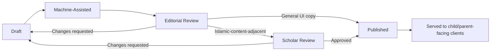
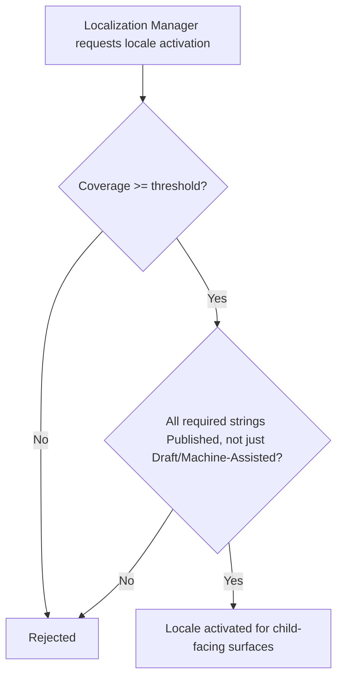
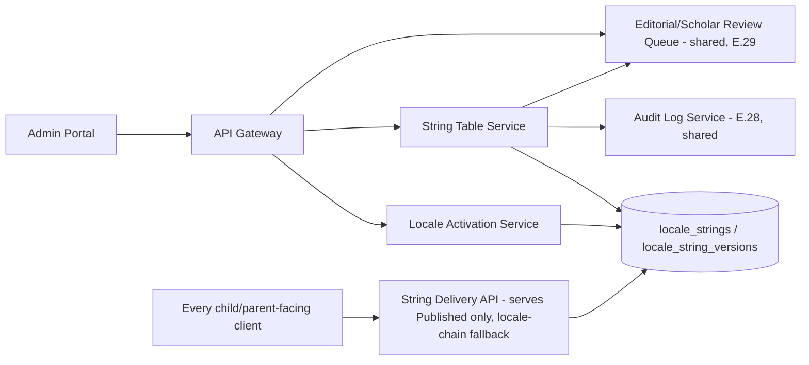

# Feature E.34 — Localization Management

**App:** NoorHeroes — Islamic Learning App for Children
**Feature Owner:** Localization / Content & Editorial / Platform
**Status:** Implementation-ready
**Version:** 1.0
**Depends on:** E.28 (Admin Auth/RBAC — Localization Manager role, audit log), E.29 (Content CMS — per-locale content versions this module's coverage reporting cross-references)
**Feeds into:** Every child-facing and parent-facing UI surface (string-table consumer), E.29's content versioning (per-locale content eligibility), B.13/E.30 (Search/AI — locale-aware behavior)

> **Scope note:** This document specifies the **Localization Management** admin module — the string-table editor, translation-status dashboard (missing/draft/approved), RTL preview, locale activation toggles gated by a coverage threshold, and the five-stage translation workflow (Draft → Machine-Assisted → Editorial Review → Scholar Review → Published) that any UI string or content-adjacent translation passes through. Its defining rule: **unreviewed translations never reach child delivery APIs**, and **a locale cannot be activated for child-facing surfaces below a configurable translation-coverage threshold** — both hard, structural gates, not editorial guidelines.

---

## Table of Contents

1. [Product Requirements](#1-product-requirements)
2. [UX/UI Requirements](#2-uxui-requirements)
3. [Backend Requirements](#3-backend-requirements)
4. [Database Design](#4-database-design)
5. [Backend AI Code-Generation Prompt](#5-backend-ai-code-generation-prompt)
6. [Frontend (Admin Web) Requirements](#6-frontend-admin-web-requirements)
7. [Frontend AI Code-Generation Prompt](#7-frontend-ai-code-generation-prompt)
8. [Admin Requirements](#8-admin-requirements)
9. [Admin AI Code-Generation Prompt](#9-admin-ai-code-generation-prompt)
10. [DevOps Requirements](#10-devops-requirements)
11. [Analytics Requirements](#11-analytics-requirements)
12. [Security Requirements](#12-security-requirements)
13. [QA Requirements](#13-qa-requirements)
14. [Marketing Requirements](#14-marketing-requirements)
15. [Release & Rollback Plan](#15-release--rollback-plan)

---

## 1. Product Requirements

### 1.1 Problem Statement

NoorHeroes needs a centralized way to manage UI string translations and locale activation across English, Hindi, Urdu, and Arabic today (with Bahasa Indonesia/Malay and Turkish schema-ready for future activation), ensuring no child ever sees a raw, untranslated string key, a draft/machine-translated string, or a locale that hasn't met a genuine translation-coverage bar — and ensuring locale activation itself is a publishing toggle, never an engineering project (source: NoorHeroes Blueprint module 22: "Draft/machine translations are flagged and never served to children; missing translations fall back through an explicit locale chain rather than rendering a raw key"; §11.8: "A locale cannot be activated for child-facing surfaces below a configurable translation-coverage threshold"; §14.9: "Activation is a publishing toggle, not an engineering project").

### 1.2 Business Goals

- Make adding a new supported locale a content/localization-team operation, not a re-engineering effort, by keeping the schema future-ready for additional languages today.
- Guarantee zero raw-key or unreviewed-translation leakage to any child-facing surface, protecting both the product-quality and the theological-accuracy dimensions of every translated string.
- Provide localization managers and scholars genuinely useful tooling (coverage dashboards, RTL preview, versioned diffs) to make translation quality assurance fast and reliable.

### 1.3 User Goals

- **Localization Manager:** Import/edit translation strings, track coverage per locale, preview RTL rendering for Arabic/Urdu, and activate a locale only once it genuinely clears the coverage bar.
- **Scholar Reviewer:** Review and approve Islamic-content-adjacent translations (e.g., dua transliterations, tafseer-linked strings) through the same scholar-review discipline already established for content generally.
- **Every child/parent-facing feature:** Consume a translated string table that is guaranteed never to contain an unreviewed or raw-key fallback for an active locale.

### 1.4 Success Metrics

| Metric | Target |
|---|---|
| Raw-key-leak incidents to any child-facing surface | 0 (hard, zero-tolerance) |
| Unreviewed (draft/machine) translation reaching a child surface | 0 (hard, zero-tolerance) |
| Locale activation below coverage threshold | 0 (hard, zero-tolerance) |
| Translation-coverage-dashboard accuracy | 100% (matches actual queryable string-table state) |
| Time to add a new locale (schema-ready) from decision to activation | ≤ 4 weeks (a publishing timeline, not an engineering sprint) |
| RTL-preview defect catch rate before locale activation | ≥ 95% of RTL layout issues caught pre-activation |

### 1.5 Stakeholders

Localization Lead, Content/Editorial Lead, Scholar Review Board, Backend Architect, Admin Frontend Engineer, QA Lead, every feature owner whose UI consumes the string table.

### 1.6 User Stories

1. As a localization manager, I want to import and edit translation strings per locale key, tracking their review status.
2. As a localization manager, I want a coverage dashboard showing missing/draft/approved counts per locale.
3. As a localization manager, I want an RTL preview for Arabic/Urdu before activating or updating a locale.
4. As a localization manager, I want to activate a locale only once it crosses a configurable coverage threshold, with the system enforcing this rather than relying on my own judgment alone.
5. As a scholar reviewer, I want to review Islamic-content-adjacent translation strings through the same approval discipline as other scholar-reviewed content.
6. As any feature engineer, I want confidence that the string table I consume will never serve a raw key or an unreviewed translation to a child.

### 1.7 Functional Requirements

**FR-1** Localization Management screens (canonical, source module 22): String table editor per locale key; translation-status dashboard (missing/draft/approved); RTL preview for Arabic/Urdu.
**FR-2** CRUD (canonical, source module 22): Create locale key; Read translation coverage; Update translation (versioned); Deprecate unused key.
**FR-3** **Draft/machine translations are flagged and never served to children; missing translations fall back through an explicit locale chain rather than rendering a raw key** (source module 22 Validation Rules — two distinct hard rules: unreviewed-content exclusion, and a defined, ordered fallback chain rather than ever exposing an internal key string).
**FR-4** **A locale cannot be activated for child-facing surfaces below a configurable translation-coverage threshold** (source §11.8 — restated as the canonical activation gate, enforced at the service layer, not a manual checklist item).
**FR-5** **Translation workflow (canonical, source §14.9): Draft → Machine-Assisted → Editorial Review → Scholar Review → Published. Unreviewed translations never reach child delivery APIs.**
**FR-6** **Currently supported languages: English, Hindi, Urdu, Arabic. Future-ready (schema exists today): Bahasa Indonesia/Malay, Turkish — activation is a publishing toggle, not an engineering project** (source §14.9 — restated as the canonical current/future locale roster and the activation-is-a-toggle architectural commitment).
**FR-7** **Full RTL mirroring for Arabic and Urdu** (source §14.9) — the RTL Preview screen specifically validates this mirroring before a string/locale goes live, consistent with the RTL-layout requirements already established throughout every prior child/parent-facing feature's own UX specifications.
**FR-8** **ICU plural/gender/date formatting rules per locale** (source §14.9) — the string-table editor must support ICU message-format syntax for any string requiring pluralization/gender/date variation, not a simplistic single-string-per-key model.
**FR-9** Locale-chain fallback is explicit and ordered (e.g., a missing Urdu string falls back to English, never to a raw key) — configured per-locale, not a single global default applied uniformly regardless of linguistic/regional appropriateness.
**FR-10** Islamic-content-adjacent translation strings (e.g., dua transliterations, prayer-related UI copy) route through the same scholar-review discipline established in E.29, distinct from general UI-copy translations which require only editorial review.
**FR-11** Updating a translation creates a new version (consistent with the platform's general versioning-not-mutation pattern) — never an in-place edit of an already-published, currently-served translation string.

### 1.8 Non-Functional Requirements

- **Zero Raw-Key Leakage:** Enforced at the service layer (the API serving the string table to any client structurally cannot return a raw key as a fallback) — never a client-side defensive catch that might occasionally be forgotten.
- **Unreviewed-Translation Exclusion:** Draft/machine-translated strings are structurally excluded from the child-delivery API response, not merely flagged for a client to optionally ignore.
- **Coverage-Threshold Enforcement:** Locale activation is blocked at the service layer if coverage falls below the configured threshold — not a manual pre-activation checklist item that could be skipped under time pressure.
- **RTL Correctness:** Full mirroring for Arabic/Urdu verified via the RTL Preview tool before any locale-affecting change ships.

### 1.9 Acceptance Criteria

- Given a string key has no translation for the requesting locale, when the client requests it, then the response resolves through the explicit locale-chain fallback — never a raw key string.
- Given a translation is in draft or machine-assisted status, when any child-facing client requests the string table, then this translation is excluded — only published, scholar/editorial-approved strings are served.
- Given a localization manager attempts to activate a locale below the configured coverage threshold, when they try, then this is rejected at the service layer.
- Given a translation update is made to an already-published string, when checked, then a new version is created — the prior published version remains servable until the new version itself completes review and publication.
- Given an Islamic-content-adjacent translation string is submitted, when reviewed, then it passes through scholar review, not merely editorial review.
- Given a localization manager previews a locale in RTL, when rendered, then full mirroring is shown for Arabic/Urdu specifically.
- Given a string requiring pluralization (e.g., "1 story" vs. "5 stories") is authored, when entered, then the editor supports ICU message-format syntax for this variation per locale's own grammatical rules.

### 1.10 Edge Cases

1. A locale's coverage drops below the activation threshold *after* it's already active (e.g., new strings are added to the platform faster than they're translated for that locale) → the locale is **not automatically deactivated** — deactivating an already-active, in-use locale would be far more disruptive than blocking a *new* activation below threshold; instead, the coverage dashboard flags this drop clearly, and any individual new string still falls back through the locale chain (FR-9) for the gap, while the localization team is alerted to catch up.
2. A scholar reviewer rejects a dua-transliteration translation, requesting changes → it returns to Draft for that specific locale's version, while the same dua's already-published translations in other locales remain entirely unaffected.
3. A locale-chain fallback itself terminates at a locale that also lacks the requested string (a multi-level gap) → the chain must have a guaranteed terminal locale (typically English) that always has 100% coverage, ensuring the chain can never bottom out into a raw-key scenario regardless of how many intermediate locales are missing the string.
4. An ICU-formatted string's plural/gender rules are correctly authored for one locale but a content update changes the underlying variable's possible value range (e.g., a count that previously was always 1-5 can now reasonably be 0 or 100+) → this requires the ICU rule itself to be re-validated/re-authored for edge values, treated as a content-quality review item rather than a system failure, since ICU rule correctness for a given variable's actual range is fundamentally an authoring-quality concern.
5. A locale is deprecated/deactivated entirely (a rare, significant decision, distinct from a coverage dip) → existing users currently on that locale should gracefully fall back to a sensible default (e.g., English) rather than being left in a broken state, with this transition itself requiring its own careful, explicit handling distinct from routine string-level fallback.
6. Two localization managers simultaneously edit the same string key for the same locale → standard last-write-wins semantics apply for this configuration-level conflict (distinct from higher-stakes content versioning), though the resulting value is always clearly visible to both on next view, and the version history preserves both edit attempts for audit purposes.
7. A new locale (e.g., Turkish, schema-ready but not yet activated) has its string table populated entirely via machine-assisted translation as a starting point, with zero editorial/scholar review yet completed → this locale must remain unavailable for child-facing activation regardless of how complete its raw coverage *percentage* looks, since FR-5's review-stage gate is independent of and in addition to FR-4's coverage-percentage gate — both must be satisfied, not either/or.

### 1.11 Error Handling

| Scenario | System Behavior |
|---|---|
| Missing translation for a requested locale | Resolves through the explicit locale chain, never a raw key |
| Locale-chain fallback reaching an also-missing intermediate locale | Continues to the guaranteed terminal (English) locale, never bottoming out |
| Locale activation attempted below coverage threshold | Rejected at the service layer |
| Draft/machine-translated string requested by a child-facing client | Excluded from the response; only published strings served |
| Concurrent edit conflict on the same string key | Last-write-wins, both edits preserved in version history |

### 1.12 Empty States
- A brand-new locale with zero translations yet → coverage dashboard shows 0% with a clear "Import strings to begin" framing, not an error.

### 1.13 Loading States
- Standard Admin Portal skeleton-loading pattern, consistent with E.28-E.33.

### 1.14 Offline States
- N/A (internal operator tool, connectivity assumed).

### 1.15 Permission States
- String-table CRUD and locale-activation actions are restricted to the `localization_manager`/`super_admin` roles per E.28's RBAC matrix; scholar-review actions on Islamic-content-adjacent strings are restricted to `scholar_reviewer` role.

### 1.16 User Flow (Narrative)

A localization manager imports or edits strings per locale key → each string passes through Draft → Machine-Assisted → Editorial Review → (for Islamic-content-adjacent strings) Scholar Review → Published → the coverage dashboard tracks missing/draft/approved counts per locale → once a locale's coverage crosses the configured threshold and its strings have completed review, the manager activates it for child-facing surfaces → every child/parent-facing client thereafter consumes only published, reviewed strings, with any gap resolved through the explicit locale-chain fallback, never a raw key.

### 1.17 Detailed Flow Diagram (Mermaid)

**Translation Workflow (canonical, source §14.9):**



**Locale Activation Gate:**



### 1.18 Screen Inventory (Complete — Zero Missing)

| # | Screen | Type | Entry Points | Exit Points |
|---|---|---|---|---|
| 1 | String Table Editor (per locale key) | Primary | Admin Portal "Platform" navigation group | String Detail/Version History |
| 2 | String Detail / Version History | Screen | String Table Editor | Back |
| 3 | Translation Status Dashboard (missing/draft/approved per locale) | Primary | Platform navigation group | String Table Editor (filtered) |
| 4 | RTL Preview (Arabic/Urdu) | Screen | Translation Status Dashboard, String Table Editor | Back |
| 5 | ICU Plural/Gender/Date Rule Editor (component, within String Detail) | Component | String Detail | String Detail (saved) |
| 6 | Locale List (current + future-ready) | Screen | Platform navigation group | Locale Activation Detail |
| 7 | Locale Activation Detail (coverage check, activate/deactivate) | Screen | Locale List | Locale List (state updated) |
| 8 | Locale Activation Blocked State (below threshold) | Screen variant | Locale Activation Detail, coverage insufficient | Translation Status Dashboard (gap detail) |
| 9 | Locale Chain Configuration | Screen | Platform navigation group | Locale List |
| 10 | Editorial Review Queue (general UI copy) | Screen | Admin Portal "Review" navigation group | Editorial Review Detail |
| 11 | Scholar Review Queue (Islamic-content-adjacent strings, shared with E.29) | Screen | Admin Portal "Review" navigation group | Scholar Review Detail |
| 12 | Coverage-Drop Alert / Stale-Locale Monitor | Screen | Translation Status Dashboard | String Table Editor (filtered to gaps) |
| 13 | Locale Deprecation Confirmation | Modal | Locale List | Locale List (deprecated state) |

### 1.19 Events (Complete Analytics Event List)

`string_key_created`, `translation_updated` (with `locale`, `review_stage`), `string_key_deprecated`, `locale_activation_attempted`, `locale_activation_blocked_coverage` (internal), `locale_activated`, `locale_deactivated`, `locale_chain_fallback_triggered` (internal/quality signal), `rtl_preview_viewed`, `coverage_dashboard_viewed`, `coverage_drop_alert_shown`, `editorial_review_completed`, `scholar_review_completed` (shared event type with E.29).

---

## 2. UX/UI Requirements

> Follows the Admin Portal's dense, professional-tool visual register established in **E.28 §2.1**, with content-review patterns consistent with **E.29 §2.1**.

### 2.1 Localization-Specific Design System Extensions

- **Coverage Dashboard Visual Language:** A per-locale progress-bar/percentage grid (Missing/Draft/Approved segments, color-coded) giving an at-a-glance sense of translation health, with the activation-threshold line clearly marked on each locale's bar.
- **RTL Preview Visual Language:** A genuine side-by-side LTR/RTL rendering comparison for any previewed screen/string, not merely a text-direction toggle — letting the localization manager see actual mirrored layout fidelity.
- **Review-Stage Pill:** A consistent status indicator (Draft/Machine-Assisted/Editorial Review/Scholar Review/Published) shown identically across the String Table Editor and Status Dashboard, reusing E.29's established review-status-pill visual pattern.

### 2.2 Screen-Level Design Requirements (Key Screens)

#### Screen: Translation Status Dashboard

- **Purpose:** Give the localization manager an immediate, accurate sense of each locale's readiness.
- **Components:** A per-locale row showing missing/draft/approved counts and percentages, the configured activation threshold marked visually, an "Activate" action (disabled/explained if below threshold).
- **States:** Default, Locale-below-threshold (activation disabled with explanatory text), Locale-active.

#### Screen: RTL Preview

- **Purpose:** Verify genuine RTL mirroring fidelity before a locale-affecting change ships.
- **Components:** A side-by-side LTR-reference / RTL-rendering comparison for a selected screen/string set, with a toggle to preview different child/parent-facing screens.
- **States:** Default, Screen-selector-active.

### 2.3 Tab Structure

Reached from the Admin Portal's "Platform" navigation group (string table, locale list) and "Review" navigation group (editorial/scholar queues, shared infrastructure with E.29).

| Click Target | Destination | API Called | Analytics Event | Permission Check | Error Handling |
|---|---|---|---|---|---|
| "Add String Key" | String Table Editor (new entry) | `POST /v1/admin/locales/strings` | `string_key_created` | `localization_manager`+ | Standard handling |
| "Update Translation" | String Detail (new version) | `PATCH /v1/admin/locales/strings/{id}` | `translation_updated` | `localization_manager`+ | Standard handling |
| "Activate Locale" | Locale Activation Detail | `POST /v1/admin/locales/{code}/activate` | `locale_activated` | `localization_manager`+/`super_admin` | Coverage-threshold rejection |
| RTL Preview entry | RTL Preview | `GET /v1/admin/locales/{code}/rtl-preview` | `rtl_preview_viewed` | `localization_manager`+ | Standard handling |

### 2.4 Wireframe Description (Composite)

The String Table Editor follows a standard filterable-data-table-plus-detail-editor pattern consistent with E.29's Content Library; the Coverage Dashboard is a dedicated metrics-grid screen; the RTL Preview is a distinct side-by-side comparison view.

### 2.5 Screen Image Generation Prompts

**Screen: Translation Status Dashboard**
- *Prompt 1 (English):* "Desktop web admin localization coverage dashboard screen UI mockup, dense professional SaaS tool aesthetic. Cool neutral grey-white background. A vertical list of locale rows: 'English' with a fully-green progress bar at 100%, 'Arabic' with a mostly-green bar at 92% and a small marker line labeled 'Activation Threshold: 90%', 'Urdu' at 78% with a yellow-orange bar and the threshold marker showing it's below the line, 'Turkish (future)' with a thin grey bar at 15% and a 'Not Yet Active' tag. Each row has an 'Activate' button, greyed out for Urdu and Turkish with a small tooltip. Clean, dense, professional engineering-tool aesthetic, sharp corners, muted blue/grey accents with green/amber progress indicators, no realistic human faces."
- *Prompt 2 (Arabic RTL):* "نفس شاشة لوحة تحكم تغطية الترجمة لتطبيق ويب إداري، بطابع أداة SaaS مهنية كثيفة، بتخطيط من اليمين إلى اليسار بالكامل. خلفية رمادية باردة محايدة. قائمة عمودية من صفوف اللغات: 'الإنجليزية' بشريط تقدم أخضر بالكامل عند 100%، 'العربية' بشريط أخضر في معظمه عند 92% وخط علامة صغير بعنوان 'عتبة التفعيل: 90%'، 'الأردية' عند 78% بشريط أصفر-برتقالي وعلامة العتبة تظهر أنها أسفل الخط، 'التركية (مستقبلية)' بشريط رمادي رقيق عند 15% وشارة 'غير مفعّلة بعد'. كل صف به زر 'تفعيل'، رمادي معطل للأردية والتركية مع تلميح صغير. طابع مهني وكثيف وأداة هندسية نظيفة، زوايا حادة، لمسات زرقاء/رمادية باهتة مع مؤشرات تقدم خضراء/عنبرية، بدون وجوه بشرية واقعية."

**Screen: RTL Preview**
- *Prompt 1 (English):* "Desktop web admin RTL preview comparison screen UI mockup, dense professional SaaS tool aesthetic. Cool neutral grey-white background. Two side-by-side mobile-screen-shaped preview panels: left panel labeled 'LTR Reference (English)' showing a simple mock app screen with left-aligned text and a left-side navigation icon; right panel labeled 'RTL Preview (Arabic)' showing the same mock screen correctly mirrored, with right-aligned text and the navigation icon flipped to the right side. A small screen-selector dropdown above reading 'Previewing: Home Screen'. Clean, dense, professional engineering-tool aesthetic, sharp corners, muted blue/grey accents, no realistic human faces."
- *Prompt 2 (Arabic RTL):* "نفس شاشة مقارنة معاينة الاتجاه من اليمين إلى اليسار لتطبيق ويب إداري، بطابع أداة SaaS مهنية كثيفة، بتخطيط من اليمين إلى اليسار. خلفية رمادية باردة محايدة. لوحتا معاينة على شكل شاشة جوال جنبًا إلى جنب: اللوحة اليسرى بعنوان 'المرجع من اليسار إلى اليمين (الإنجليزية)' تعرض شاشة تطبيق نموذجية بسيطة بنص محاذٍ لليسار وأيقونة تنقل على اليسار؛ اللوحة اليمنى بعنوان 'معاينة من اليمين إلى اليسار (العربية)' تعرض الشاشة النموذجية نفسها معكوسة بشكل صحيح، بنص محاذٍ لليمين وأيقونة التنقل منقولة إلى اليمين. قائمة منسدلة صغيرة لاختيار الشاشة أعلاه تقول 'المعاينة: الشاشة الرئيسية'. طابع مهني وكثيف وأداة هندسية نظيفة، زوايا حادة، لمسات زرقاء/رمادية باهتة، بدون وجوه بشرية واقعية."

---

## 3. Backend Requirements

### 3.1 System Design Overview

Localization Management is served by a **String Table Service** (the canonical, locale-keyed translation store with versioning and review-stage tracking), a **Locale Activation Service** (the coverage-threshold gate), and reuses E.29's scholar-review queue infrastructure for Islamic-content-adjacent strings.

### 3.2 Architecture Diagram (Mermaid)



### 3.3 Service Breakdown

| Service | Responsibility |
|---|---|
| String Table Service | Locale-keyed string CRUD, versioning, ICU-format storage |
| Locale Activation Service | Coverage-threshold + review-stage-completeness gate enforcement |
| Editorial/Scholar Review Queue (reused, E.29) | Review workflow for translation strings |
| String Delivery API | The actual child/parent-facing-consumable contract — serves Published-only strings, resolves missing strings through the locale chain |

### 3.4 API List

#### `POST /v1/admin/locales/strings` / `GET /v1/admin/locales/strings` / `PATCH /v1/admin/locales/strings/{id}`
- **Validation:** `PATCH` always creates a new version (FR-11); ICU-format syntax is validated at submission time, rejecting malformed plural/gender/date rules before they could ever reach a client.

#### `GET /v1/admin/locales/coverage?locale=`
- **Response 200:** `{ "locale": "ur", "total_keys": 1200, "missing": 50, "draft": 30, "approved": 1120, "coverage_percent": 93.3 }`

#### `POST /v1/admin/locales/{code}/activate`
- **Validation:** Rejects (`409 COVERAGE_BELOW_THRESHOLD`) if `coverage_percent` is below the configured threshold for that locale; **additionally rejects if any required string's current best version is not `status='published'`** (Edge Case 7's both-gates-required rule) — coverage percentage alone is insufficient if those covered strings haven't actually completed review.

#### `POST /v1/admin/locales/{code}/deactivate`
- **Business Logic:** Triggers the graceful existing-user-fallback transition (Edge Case 5) rather than an abrupt cutoff.

#### `GET /v1/strings?locale=&keys=` (the String Delivery API, consumed by every child/parent-facing client)
- **Response 200:** `{ "ur.home.greeting": "...", "ur.habit.streak_label": "..." }`
- **Validation:** **Only `status='published'` string versions are ever included in this response** — draft/machine-assisted versions are structurally excluded from this endpoint's query, never merely filtered client-side. For any requested key with no published translation in the requested locale, the response resolves through the configured locale chain (e.g., `ur → en`) and, if even the chain's terminal locale somehow lacks it (should be structurally impossible given English's mandated 100% coverage), the key is omitted entirely from the response rather than ever including the raw key string itself.

#### `GET /v1/admin/locales/{code}/rtl-preview?screen=`
- **Response 200:** Rendered preview data for the RTL Preview tool.

### 3.5 Cross-Cutting API Concerns

- **Structural exclusion of unreviewed translations from the Delivery API:** The single most important guarantee in this entire service.
- **Locale-chain fallback never bottoms out into a raw key:** English (or whatever locale is designated terminal) is mandated to maintain 100% published coverage at all times, making a chain-exhaustion scenario structurally impossible.
- **Dual-gate locale activation:** Coverage percentage AND review-stage completeness, both required, neither sufficient alone.

---

## 4. Database Design

### 4.1 ER Diagram (Mermaid)

```mermaid
erDiagram
    LOCALE ||--o{ LOCALE_STRING : "has many"
    LOCALE_STRING ||--o{ LOCALE_STRING_VERSION : "has many"
    LOCALE ||--o| LOCALE_CHAIN_CONFIG : "has one"

    LOCALE {
        string locale_code PK
        boolean active
        boolean is_rtl
        timestamptz activated_at
    }
    LOCALE_STRING {
        uuid string_id PK
        string key
        string locale_code FK
        uuid current_published_version_id
    }
    LOCALE_STRING_VERSION {
        uuid version_id PK
        uuid string_id FK
        string value_icu
        string status
        string review_stage
        timestamptz created_at
    }
    LOCALE_CHAIN_CONFIG {
        string locale_code PK_FK
        string fallback_locale_code
        int priority_order
    }
```

### 4.2 Tables, Relationships, Constraints

| Table | Key Constraints | Indexes |
|---|---|---|
| `locale` | PK `locale_code`; CHECK: English (or the designated terminal locale) cannot be set `active=false` while it remains any locale's chain terminus | — |
| `locale_string` | UNIQUE(`key`, `locale_code`) | Index `(locale_code)` |
| `locale_string_version` | FK `string_id`; CHECK `status IN ('draft','machine_assisted','editorial_review','scholar_review','published')`; **the Delivery API's query filters exclusively on `status='published'`** | Index `(string_id, created_at DESC)` |
| `locale_chain_config` | FK `locale_code`, `fallback_locale_code`; CHECK `fallback_locale_code != locale_code` (no self-referential loop) | Index `(locale_code, priority_order)` |

### 4.3 Audit Fields
`locale_string_version.created_at` per version; `locale.activated_at` tracks activation history.

### 4.4 Soft Delete Rules
`locale_string` deprecation uses a `deprecated=true` flag rather than deletion, preserving historical reference for any content version still keyed to it.

### 4.5 Retention Rules
`locale_string_version` retained indefinitely as the platform's permanent translation-provenance record, consistent with E.29's content-versioning retention rigor.

---

## 5. Backend AI Code-Generation Prompt

```
You are building the String Table Service, Locale Activation Service,
and String Delivery API for "NoorHeroes." Reuse E.29's existing Editorial/
Scholar Review Queue infrastructure for translation review -- do not
build a parallel review workflow.

Stack: FastAPI (Python 3.12), PostgreSQL (SQLAlchemy 2.0), Redis (for
fast string-table read caching).

Hard requirements:
1. Implement GET /v1/strings (the String Delivery API) to query
   EXCLUSIVELY locale_string_version rows where status='published' --
   write a test confirming a fixture string with only a draft or
   machine_assisted version (no published version yet) is NEVER returned
   by this endpoint for that locale, regardless of how "complete" its
   draft content looks.
2. Implement the locale-chain fallback resolution: for any requested key
   missing a published translation in the requested locale, recursively
   resolve through locale_chain_config until a published version is
   found -- write a test confirming a multi-level fallback (e.g.,
   ur -> en) correctly resolves, and a SECOND test confirming the
   terminal locale (English) is database-CONSTRAINED to always remain
   active and is the practical guarantee against ever bottoming out
   into a missing-key scenario.
3. Implement POST /v1/admin/locales/{code}/activate with a DUAL GATE:
   reject if coverage_percent < threshold OR if any in-scope string's
   current best version is not status='published' -- write separate
   tests for each gate failing independently, and a third test
   confirming activation succeeds only when BOTH gates pass.
4. Implement PATCH /v1/admin/locales/strings/{id} to validate ICU
   message-format syntax at submission time, rejecting malformed plural/
   gender/date rules before they can ever be saved as any version status
   -- write a test for both valid and invalid ICU syntax submissions.
5. Implement PATCH /v1/admin/locales/strings/{id} to ALWAYS create a new
   version row rather than mutating an existing published version --
   write a test confirming an update to an already-published string
   results in a new version row with status reset to 'draft', while the
   prior published version remains queryable/servable by the Delivery
   API until the new version itself completes review and is published.

Deliver: FastAPI routers, SQLAlchemy models, Alembic migrations
(including the terminal-locale-always-active constraint), Pydantic
schemas, and a pytest suite covering all 5 items, with item 1
(structural exclusion of unreviewed translations) treated as the single
highest-priority guarantee in this entire deliverable.
```

---

## 6. Frontend (Admin Web) Requirements

### 6.1 Technical Requirements
React + TypeScript, consistent with E.28-E.33's Admin Portal shell and design-token package, an ICU message-format editor component, an RTL-rendering preview iframe/component.

### 6.2 Screen Mapping
Each of the 13 screens in §1.18 maps to a route/page component within the Admin Portal's "Platform" and "Review" navigation groups.

### 6.3 Navigation Flow
String Table Editor and Translation Status Dashboard are sibling landing routes under "Platform"; Editorial/Scholar Review Queues are reached under "Review" (shared infrastructure with E.29).

### 6.4 State Management
A shared `LocalizationContext` tracks the current locale/coverage state; the Locale Activation Detail screen's "Activate" button disabled-state derives entirely from the server's dual-gate check response, never a client-side-only coverage estimate.

### 6.5 API Mapping
`LocaleStringRepository.create()/update()/getCoverage()`, `LocaleActivationRepository.activate()/deactivate()/getRtlPreview()` map to their respective endpoints.

### 6.6 Analytics Mapping
`LocalizationAdminAnalytics` fire events per §1.19.

### 6.7 Offline Support
N/A (internal operator tool).

### 6.8 Deep Linking
Standard web routes (e.g., `/platform/locales`, `/platform/strings`, `/platform/locales/{code}/rtl-preview`).

### 6.9 Push Notifications
N/A; coverage-drop alerts route through the platform's existing engineering/operational alerting tooling.

### 6.10 Testing Strategy
- Unit: ICU message-format editor's syntax-validation logic (client-side fast check, server remains authoritative).
- UI tests: the "Activate Locale" button is disabled with explanatory text whenever either gate (coverage or review-completeness) fails, per the server's response; the RTL Preview correctly renders mirrored layout for a fixture Arabic/Urdu screen.
- Integration: full string-creation → review-workflow → publication → Delivery-API-visibility flow; full locale-activation-blocked-then-succeeding flow as coverage/review state improves.

---

## 7. Frontend AI Code-Generation Prompt

```
Build the Localization Management frontend module for the NoorHeroes Admin
Portal as a React + TypeScript SPA, reusing E.28's Admin Portal shell
and E.29's review-queue UI components where applicable.

Hard requirements:
1. Implement the Locale Activation Detail screen's "Activate" button
   disabled-state and explanatory tooltip text to derive ENTIRELY from
   the server's dual-gate check response (a structured
   {coverage_ok: bool, review_complete: bool} shape) -- write a test
   confirming the UI never independently estimates or overrides this
   server-provided gate state.
2. Implement the ICU message-format string editor with inline syntax
   validation -- write a test for both valid and deliberately-malformed
   ICU input, confirming the malformed case shows an inline error before
   submission is even attempted.
3. Implement the RTL Preview screen to render an actual side-by-side
   LTR/RTL comparison (not merely a text-direction CSS toggle on a single
   panel) -- write a test confirming both panels render simultaneously
   for a fixture screen/string set.
4. Implement the Translation Status Dashboard's coverage bars to mark the
   configured activation threshold visually on each locale's bar -- write
   a test confirming this threshold marker's position reflects the
   server-configured value, not a hardcoded percentage.

Use the Admin Portal's existing dense, professional-tool design tokens
established in E.28.
```

---

## 8. Admin Requirements

This document **is** the Localization Management admin-requirements specification in full — §1.18's screen inventory and §3.4's API list constitute the complete admin surface. No further meta-layer exists beyond E.28's RBAC role definitions (`localization_manager`, `scholar_reviewer` for Islamic-content-adjacent strings, `super_admin`), which this module consumes.

---

## 9. Admin AI Code-Generation Prompt

```
This document's own §5 (Backend) and §7 (Frontend) prompts ARE the full
admin-tooling build specification for Localization Management -- there
is no separate, distinct meta-layer to build beyond what those sections
already cover.
```

---

## 10. DevOps Requirements

- **Infrastructure:** The String Delivery API is a high-call-volume, latency-sensitive service (consumed by every client app screen render) — heavily cached (e.g., Redis or CDN-edge-cached per locale bundle), invalidated on publish events.
- **CI/CD:** The structural-exclusion-of-unreviewed-translations test and the dual-gate locale-activation test (§5 items 1 and 3) are mandatory, non-bypassable CI gates.
- **Monitoring/Logging/Alerting:** Alert (P0) on any detected raw-key or unreviewed-translation reaching the Delivery API's response in production (should be structurally impossible, monitored as a defense-in-depth canary). Alert on coverage-drop-below-threshold for an already-active locale (Edge Case 1's monitoring signal). Alert on locale-chain-fallback-trigger-rate spikes for an active locale (a translation-completeness quality signal).
- **Disaster Recovery:** `locale_string_version` at the platform's standard content-reference durability tier, consistent with E.29's content-versioning standard.
- **Rollback Strategy:** Any deploy touching the Delivery API's status-filtering query or the locale-chain-resolution logic requires a staging verification confirming zero unreviewed-translation leakage and correct multi-level fallback resolution before promotion.
- **Backup Strategy:** Standard-to-high tier for `locale_string_version`; standard for `locale`/`locale_chain_config`.
- **Environment Setup:** Staging supports fixture locales at varying coverage/review-completeness states (some passing both gates, some failing each independently) for reliable QA of the dual-gate activation logic.

---

## 11. Analytics Requirements

### 11.1 Event Taxonomy
Full list in §1.19.

### 11.2 Funnel Analysis
`string_key_created` → `editorial_review_completed` → (`scholar_review_completed` for Islamic-content-adjacent strings) → publication → eventual `coverage_dashboard` reflection — the complete translation-production funnel, identifying bottleneck review stages.

### 11.3 Dashboard Metrics
Coverage percentage and review-stage distribution per locale, locale-chain-fallback-trigger frequency (a translation-completeness signal — ideally low for active locales), time-to-locale-activation from decision to launch.

### 11.4 Cohort & Retention
N/A — internal localization-process metrics matter more here.

### 11.5 Learning Metrics
Indirect — translation quality and coverage directly affect every locale-specific user's experience quality across every feature, but this module doesn't generate learning metrics of its own.

---

## 12. Security Requirements

### 12.1 Threat Analysis
- **Raw-key or unreviewed-translation leakage to children (this feature's single defining risk):** mitigated by structural exclusion at the Delivery API's query layer — there is no status-filter to forget or bypass, since the query itself only ever selects published rows.
- **Locale activation below genuine readiness:** mitigated by the dual-gate (coverage + review-completeness) enforcement, neither sufficient alone.
- **Locale-chain exhaustion leading to a raw-key fallback:** mitigated by the database-level constraint mandating the terminal locale's permanent active, 100%-covered status.

### 12.2 OWASP Checklist (Applied)
Security Misconfiguration: the structural query-layer exclusion of unreviewed translations and the database-level terminal-locale constraint are both misconfiguration-defense patterns — the dangerous leakage path simply isn't representable in the data model or query logic.

### 12.3 API Security
The String Delivery API's structural status-filtering and the dual-gate activation check are this service's two most important integrity properties.

### 12.4 Mobile Security
N/A directly — this is a web-only internal tool, though its Delivery API is consumed by every mobile-app screen.

### 12.5 Admin Security
Islamic-content-adjacent string review is restricted to `scholar_reviewer` role, consistent with E.29's segregation-of-duties discipline applied here.

### 12.6 Data Encryption & PII Protection
No PII surface; this module handles UI string content exclusively.

### 12.7 Child Safety Requirements
The zero-raw-key and zero-unreviewed-translation guarantees ensure no child ever encounters a confusing internal key string or an unvetted (and potentially theologically or linguistically inaccurate) translation, directly supporting both the product-quality and the scholar-accuracy dimensions of the platform's trust commitments.

### 12.8 Compliance Requirements
Region-aware locale handling (cross-ref the platform's general region-not-device-locale-as-source-of-truth principle for region-sensitive behavior) supports broader regulatory/compliance variation needs as they arise.

### 12.9 Security Checklist (Pre-Launch)
- [ ] Structural exclusion of unreviewed translations from the Delivery API verified
- [ ] Locale-chain fallback verified to never bottom out into a raw key, with the terminal-locale constraint enforced
- [ ] Dual-gate locale activation verified (coverage AND review-completeness both required)
- [ ] ICU syntax validation verified to reject malformed rules at submission time
- [ ] Versioned (not in-place) translation updates verified

---

## 13. QA Requirements

### 13.1 Test Plan Summary
Coverage spans: structural unreviewed-translation exclusion (signature test), locale-chain fallback correctness, dual-gate activation, ICU validation, and all 7 edge cases from §1.10.

### 13.2 Test Cases — Happy Path
1. A localization manager adds a new string, it passes editorial review, is published, and immediately appears via the Delivery API for that locale.
2. A dua-transliteration string passes through scholar review specifically, distinct from general UI copy's editorial-only path.
3. A locale crosses both the coverage and review-completeness gates and is successfully activated.

### 13.3 Edge Cases
All 7 items from §1.10.

### 13.4 Negative Cases
- Query the Delivery API for a key with only a draft/machine-assisted version → never returned; resolves through the locale chain instead.
- Attempt locale activation with sufficient coverage but several required strings still in draft → rejected (review-completeness gate fails).
- Attempt locale activation with all strings published but coverage below threshold → rejected (coverage gate fails).
- Submit a malformed ICU plural rule → rejected at submission time.
- Attempt to deactivate the terminal (English) locale → rejected by the database constraint.

### 13.5 Regression Cases
Full suite re-run on every release touching the String Table Service, Locale Activation Service, or String Delivery API.

### 13.6 Automation Cases
End-to-end string-creation-to-Delivery-API-visibility flow; structural unreviewed-translation-exclusion automated test (CI-blocking); dual-gate activation automated test (CI-blocking); multi-level locale-chain-fallback automated test.

---

## 14. Marketing Requirements

N/A — internal operator tool. Its correct operation is the engineering-enforced foundation behind the platform's multi-language accessibility and translation-accuracy trust claims.

---

## 15. Release & Rollback Plan

### 15.1 Release Plan
Phased rollout 25% → 75% → 100% of the Localization/Content team over 2–3 days, with the structural-exclusion and dual-gate-activation test suites required to pass at every stage.

### 15.2 Rollback Plan
Rollback triggers (all P0): any confirmed raw-key leakage to a child-facing surface, any confirmed unreviewed (draft/machine-assisted) translation reaching a child-facing surface, any confirmed locale activated below either gate's requirement, any confirmed locale-chain exhaustion incident. Mechanism: standard deployment rollback.

### 15.3 Success Metrics for Go/No-Go
Matches §1.4 targets. Go/no-go reviewed by Localization Lead, Content/Editorial Lead, Scholar Review Board, and Security jointly — the structural exclusion and dual-gate-activation guarantees specifically require confirmation that their respective test suites are green before this module's outputs are consumed by any child-facing surface.
