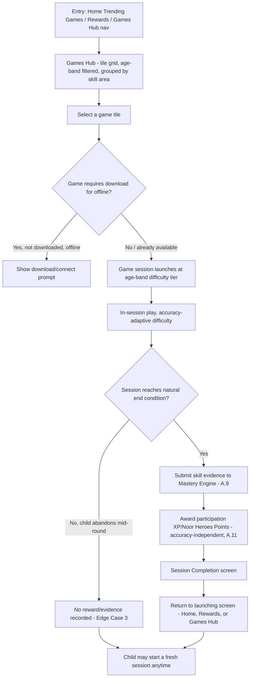
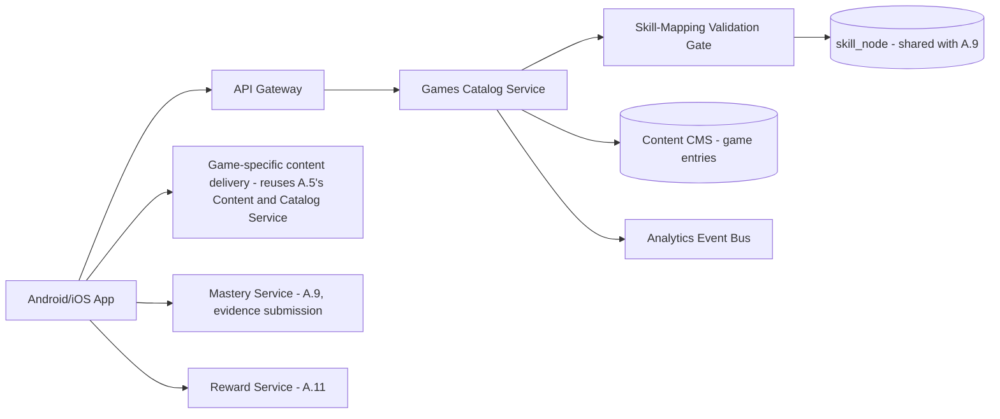
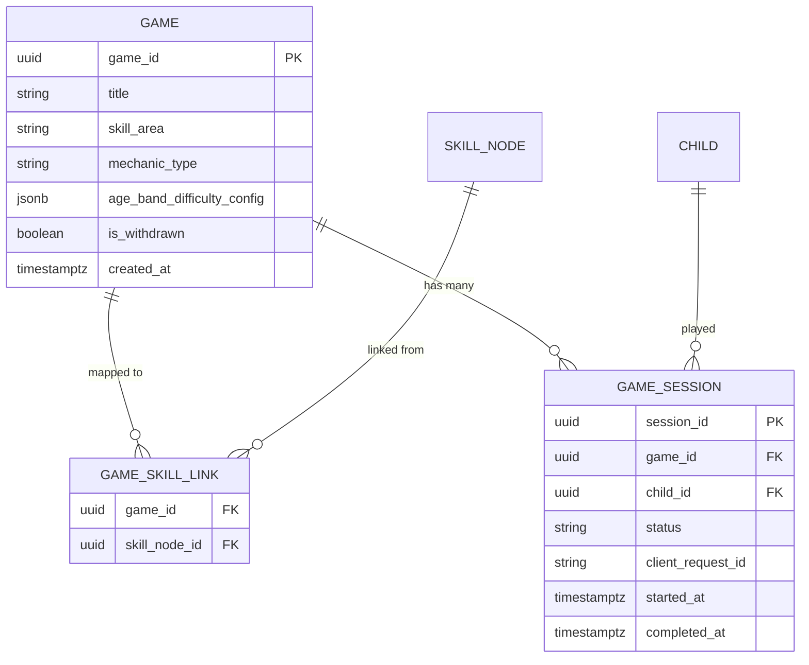

# Feature A.10 — Games Module (Skill-Reinforcement Mini-Games)

**App:** NoorHeroes — Islamic Learning App for Children
**Feature Owner:** Product / Learning Science / Game Design
**Status:** Implementation-ready
**Version:** 1.0
**Depends on:** A.1 (Auth & Onboarding), A.5 (Quran/Arabic/Tajweed content & mini-game mechanics), A.8 (Quiz Engine — shared scoring/idempotency patterns), A.9 (Mastery Engine — skill-evidence linkage)
**Feeds into:** A.9 Mastery Engine (every game session is a skill-evidence source), A.11 Rewards (XP/Noor Heroes Points), A.2 Home (Trending Games / Recommended)

> **Scope note:** A.5 already specified several mini-game *mechanics* in detail as part of the Quran/Arabic learning domain (ayah ordering, listen-and-select, missing word, hear-and-match, tracing, word-building, etc.) and A.8 specified the shared Quiz Engine. This document specifies the **Games Module as a distinct, dedicated surface** — the "Games" tile grid/hub itself (reachable from Home and Rewards per the source navigation map), its session lifecycle, its difficulty-by-age-band system, and the hard platform rule that **every game must map to a learning skill — none are content-free filler** (source: NoorHeroes Consolidated Blueprint navigation table, "Games | Light skill-reinforcement mini-games | Game tile grid, difficulty by age band | Select game, Play | Home, Rewards | Game session, then back to launching screen | Games always map to a learning skill — none are content-free filler"). Where a specific game's internal mechanic is already detailed in A.5, this document references it rather than re-specifying it, and focuses on what's new: the Games Hub itself, cross-domain game cataloging, age-band difficulty tiering, and the session lifecycle wrapping any individual game.

---

## Table of Contents

1. [Product Requirements](#1-product-requirements)
2. [UX/UI Requirements](#2-uxui-requirements)
3. [Backend Requirements](#3-backend-requirements)
4. [Database Design](#4-database-design)
5. [Backend AI Code-Generation Prompt](#5-backend-ai-code-generation-prompt)
6. [Android Requirements](#6-android-requirements)
7. [Android AI Code-Generation Prompt](#7-android-ai-code-generation-prompt)
8. [Admin Requirements](#8-admin-requirements)
9. [Admin AI Code-Generation Prompt](#9-admin-ai-code-generation-prompt)
10. [DevOps Requirements](#10-devops-requirements)
11. [Analytics Requirements](#11-analytics-requirements)
12. [Security Requirements](#12-security-requirements)
13. [QA Requirements](#13-qa-requirements)
14. [Marketing Requirements](#14-marketing-requirements)
15. [Release & Rollback Plan](#15-release--rollback-plan)

---

## 1. Product Requirements

### 1.1 Problem Statement

Children benefit from light, playful, replayable practice moments that reinforce specific learning skills — but a "Games" surface in a children's app is also exactly where content-free, addictive filler mechanics most commonly creep in. NoorHeroes needs a Games Hub where every single game, without exception, is explicitly mapped to a real learning skill, age-band-appropriately difficulty-tiered, and built on the same non-exploitative reward principles as the rest of the platform (source: Consolidated Blueprint navigation table — "Games always map to a learning skill — none are content-free filler"; cross-reference §6.3 Quran Game: "Accuracy changes difficulty; speed never outranks correctness").

### 1.2 Business Goals

- Provide a dedicated, discoverable "Games" surface that increases replay/practice frequency for skills already taught elsewhere (Quran, Arabic, Tajweed), without introducing any new, ungoverned content category.
- Maintain the platform's anti-filler commitment as a literal, enforced product/engineering constraint, not just a design aspiration.
- Drive incremental mastery-evidence volume into the shared Mastery Engine (A.9) through low-friction, replayable practice sessions.
- Support age-band difficulty tiering so the same underlying skill-game can serve a 4-year-old and a 13-year-old appropriately.

### 1.3 User Goals

- **Child:** Find fun, replayable mini-games grouped by skill area, play at a difficulty that feels right for me, and see my practice count toward real progress, not just a meaningless score.
- **Parent:** Trust that anything labeled a "game" in this app is still genuinely educational — never a disconnected, content-free distraction.

### 1.4 Success Metrics

| Metric | Target |
|---|---|
| Games Hub → game-session-start conversion rate | ≥ 50% |
| Game session completion rate | ≥ 70% |
| Game-driven mastery-evidence contribution (% of total evidence volume originating from Games vs. other practice surfaces) | Tracked, informs whether Games meaningfully supplements core learning flows |
| Replay rate (same game played ≥2 times within a week) | ≥ 35% |
| Age-band difficulty-tier accuracy (post-session survey or implicit signal: are children landing in an appropriately-challenging tier) | Reviewed qualitatively each quarter |
| Zero-filler-content audit pass rate | 100% (every published game entry must pass the skill-mapping audit — a hard gate, not a target to approach) |
| Crash-free game sessions | ≥ 99.5% |

### 1.5 Stakeholders

Product Manager, Game Designer, Learning Science Lead, Content/Editorial Lead, Backend Architect, Android Architect, Data Analyst, QA Lead, Scholar Review Board (for any game involving Quran/Tajweed/Dua content), Child Wellbeing Advisor (anti-filler/anti-addictive-mechanic review).

### 1.6 User Stories

1. As a child, I want a "Games" place where I can find fun ways to practice what I'm learning.
2. As a child, I want games grouped by skill area (Quran, Arabic, Tajweed) so I can find what fits my mood.
3. As a child, I want a game that's the right difficulty for me — not too easy, not too hard.
4. As a child, I want to replay a game I enjoyed without it feeling repetitive or pointless.
5. As a child, I want my game practice to count toward my real skill progress, not be a separate disconnected thing.
6. As a parent, I want confidence that every single game in this app actually teaches something — I never have to wonder if my child is "just playing a game" with no learning value.
7. As a child, after finishing a game, I want to go right back to where I started (Home, Rewards, etc.) rather than getting lost in a different part of the app.

### 1.7 Functional Requirements

**FR-1** The Games Hub presents a tile grid of available games, with UI sections: Daily Quiz (entry point into the shared A.8 engine), Arabic Letters games (per A.5), and mini-game tiles grouped by skill area (source: NoorHeroes Blueprint screen catalog "Games — UI Sections: Daily Quiz, Arabic Letters games, mini-game tiles grouped by skill area").
**FR-2** Every game catalog entry must declare exactly one or more linked `skill_node_id` references (from A.9's domain-agnostic skill graph) — **a game with zero linked skill nodes cannot be published**, enforced as a hard validation rule, not a content-review guideline (source: hard platform rule, "Games always map to a learning skill — none are content-free filler").
**FR-3** Game difficulty is tiered by age band (4 to 6, 6 to 9, 9 to 12, 12 to 15, 15 to 18+, per the platform's standard age-group taxonomy), with each tier adjusting parameters such as time pressure, number of distractor options, and complexity of the underlying skill content — never the correctness-evaluation logic itself.
**FR-4** Within a single game session, difficulty may adapt based on in-session accuracy (consistent with A.5/§6.3's principle: "Accuracy changes difficulty; speed never outranks correctness" — a rule restated here as binding across every game in this hub, not just Quran Game specifically).
**FR-5** Every completed game session emits skill-evidence events to the shared Mastery Engine (A.9), using the same evidence contract as quiz attempts (FR shared with A.9 §3.4 `POST /v1/mastery/evidence`) — game-derived evidence is first-class, not a lesser/ignored signal.
**FR-6** Game session completion awards XP/Noor Heroes Points via the shared Reward Service (A.11), following the same accuracy-independent-participation-reward principle established in A.8 FR-5/A.9 FR-4 — a child who plays earnestly but performs poorly still receives a participation reward; accuracy affects mastery evidence, never the base reward.
**FR-7** On game-session completion, the child returns to the screen that launched the session (Home, Rewards, or the Games Hub itself) — never to an unrelated or unexpected destination (source: navigation table, "Game session, then back to launching screen").
**FR-8** The Games Hub tile grid must be filterable/groupable by skill area (Quran, Arabic, Tajweed, and any future domain per A.9's extensible domain registry), age-band-appropriate filtering applied automatically (a child only sees tiles appropriate to their own age band by default, with no manual override exposed to the child).
**FR-9** Replaying a completed game is always available (no re-locking after first completion, consistent with A.3's "rewatching is always available" principle for stories) — repeat play is explicitly encouraged for skill reinforcement, distinct from a content-consumption context where repetition might be less valuable.
**FR-10** A game entry tagged with Quran, Tajweed, or Dua content must pass the same scholar-review/content-governance pipeline as any other content of that type (cross-reference A.5/A.6's scholar-approval gates) before publish — "it's just a game" is never an exemption from content governance.
**FR-11** No game in this hub may implement loot-box mechanics, variable/randomized paid rewards, or purchasable in-game advantages — consistent with the platform-wide reward-economy rule (source §21.12: "No purchasing virtual currency in child mode... No loot-box mechanics or variable paid rewards").
**FR-12** Each game session is bounded in length (no infinitely-replayable single-session loop designed to maximize time-on-device) — a session has a clear natural end state (e.g., a fixed round count or a completion condition), after which the child is returned per FR-7, rather than auto-continuing into a new round without an explicit child action.

### 1.8 Non-Functional Requirements

- **Performance:** Games Hub tile grid load p95 < 600ms (cached); individual game session start p95 < 800ms.
- **Content Governance:** 100% of published games pass the skill-mapping validation (FR-2) — a zero-tolerance, CI/admin-enforced gate.
- **Accessibility:** Every game must have a non-gesture-dependent core interaction path (consistent with A.5's tracing-alternative and A.8's sequence-ordering tap-to-place requirements) — drag-only or timing-only interactions are not acceptable as the sole interaction method for any game.
- **Localization:** All game UI text/audio/visual content localized and RTL-correct.
- **Age-appropriateness:** Difficulty-tier parameters must be genuinely calibrated per age band (reviewed by Learning Science, not just arbitrarily scaled numbers).

### 1.9 Acceptance Criteria

- Given the Games Hub is opened, when the tile grid renders, then every visible tile is age-band-appropriate for the active child and groupable by skill area.
- Given an admin attempts to publish a game catalog entry with zero linked `skill_node_id` values, when they submit, then publication is blocked with a clear validation error.
- Given a child completes a game session with low accuracy, when the session ends, then they still receive the standard participation XP/Noor Heroes Points reward — accuracy affects only the mastery-evidence signal sent to A.9.
- Given a child finishes a game launched from Home, when the session ends, then they are returned to Home (not the Games Hub or any other unrelated screen) — the same game launched from the Games Hub returns to the Games Hub.
- Given a child replays a previously-completed game, when they start a new session, then it functions identically to the first play (no lock, no degraded experience).
- Given a game involves Quran/Tajweed/Dua content, when it is submitted for publish, then it is routed through the same scholar-review pipeline as any other content of that type — there is no "games" content-governance shortcut.
- Given a game session reaches its natural end condition, when the round/session concludes, then the game does not automatically begin a new round without an explicit child action.

### 1.10 Edge Cases

1. A child's age band changes (birthday rollover) mid-way through frequent play of a specific game tile → the next session launched reflects the new age band's difficulty tier; historical session/evidence data is preserved and attributed under whichever tier was active at the time of each past session (no retroactive reclassification).
2. A game is linked to skill nodes across two different domains simultaneously (e.g., a hypothetical cross-domain matching game) → completing it emits evidence correctly to both domains' respective skill states via the shared A.9 evidence contract, without conflation (consistent with A.9 Edge Case 3).
3. A child abandons a game session mid-round (closes the app or navigates away) → no reward or evidence is recorded for that incomplete session (distinct from A.8's quiz-resume pattern, since games are typically short enough that resuming a specific mid-round state is less valuable than simply restarting fresh — this is a deliberate design simplification specific to Games, documented as such rather than an oversight) — the child can simply start a new session at any time per FR-9.
4. Admin disables/unpublishes a game while a child has an active in-progress session → the current session is allowed to complete gracefully (not abruptly terminated), but the tile no longer appears in the Hub for future sessions once the change propagates.
5. A child plays the same game many times in rapid succession in an apparent attempt to farm participation rewards → the shared Reward Service's existing daily-cap/anti-farming mechanisms (consistent with A.7's habit daily-cap pattern, generalized) apply — rewards beyond a reasonable daily threshold for a given game/skill combination taper or cap, while the child can still play for enjoyment/practice value without an artificial hard block on play itself.
6. Two age bands (e.g., 6 to 9 and 9 to 12) overlap in practice for a borderline-age child whose parent has configured a different effective learning level than their raw age would suggest (cross-reference A.1's Add Child "learning level" field) → difficulty tiering should respect the configured learning level where it diverges from raw age-band default, not blindly apply raw-age-derived difficulty.
7. A game's linked skill node is later deprecated/marked inactive in the skill graph (A.9 §4.4) → the game tile is automatically hidden/unpublished going forward (since it would otherwise violate FR-2's "must map to an active learning skill" intent), with historical evidence/session data preserved.
8. Offline play: a child plays a downloaded/cached game while offline → the session functions fully offline (most game mechanics are self-contained, similar to A.8's offline question-bank pattern), with evidence/reward events queuing for sync on reconnect, idempotently.
9. A child using an assistive-technology-only interaction path (per the accessibility requirement) completes a game meaningfully slower than a typical touch/drag interaction would allow within an in-game time-pressure mechanic → time-pressure-based difficulty parameters must have an accessibility-aware adjustment (extended or removed time pressure) rather than penalizing a child for using their necessary interaction method.
10. A new game is added to the catalog that reuses an existing skill node already heavily represented by other games/quizzes → no special handling needed; this is healthy content variety, though the Admin's content-distribution monitor (analogous to A.8's Assembly Monitor) may flag heavy skill-node concentration for editorial awareness.
11. A child plays a game, then immediately requests "Try Again" or replays — does this count as the "more than one session" requirement for A.9's no-single-session-mastery rule? → No: per A.9 FR-5, mastery requires evidence across genuinely distinct sessions (different calendar days or sufficiently time-separated attempts per A.9 §5 item 3's documented rule) — rapid immediate replay within the same sitting does not satisfy this, consistent with the shared Mastery Engine's existing anti-single-session-mastery protection, inherited automatically by Games since they use the same evidence pipeline.
12. A game session's evidence references a quiz-style question that has since been withdrawn for safety reasons (where a game internally reuses quiz-bank content) → the same withdrawn-question exclusion rule from A.8/A.9 applies identically, since Games route through the same shared evidence contract.

### 1.11 Error Handling

| Scenario | System Behavior |
|---|---|
| Games Hub catalog fetch failure | Cached last-known catalog rendered with a subtle "may be outdated" indicator |
| Game asset (media/sprite) fails to load | Graceful retry with backoff; falls back to a simpler asset tier if configured, never a hard crash |
| Evidence/reward submission fails post-session (network) | Session completion screen still shows (the child's experience isn't blocked); evidence/reward queued for retry, consistent with A.9's general resilience pattern |
| Game tile references a since-deprecated skill node | Tile automatically hidden from the Hub (Edge Case 7), no error shown to the child |

### 1.12 Empty States
- A skill-area filter with zero available games for the child's age band → friendly "more games for this area are coming soon" message with a link to a populated skill area, consistent with A.3/A.6's empty-category pattern.

### 1.13 Loading States
- Games Hub: skeleton tile-grid shimmer.
- Individual game session: lightweight loading state appropriate to the specific game's assets (reusing each game's own loading pattern where it already exists per A.5).

### 1.14 Offline States
- Downloaded/cached games fully playable offline (Edge Case 8); non-downloaded games show a clear "connect to internet or download" affordance rather than a dead tile.

### 1.15 Permission States
- No new runtime permissions beyond what individual games may already require via their underlying mechanics (e.g., a tracing game's standard touch input — no microphone/camera involved in any game covered by this hub's standard catalog).

### 1.16 User Flow (Narrative)

Child opens the Games Hub (from Home's "Trending Games" rail, the Rewards screen, or a dedicated nav entry) → browses tiles grouped by skill area, automatically age-band-filtered → selects a game → a session launches at the appropriate difficulty tier → plays through to a natural completion point → skill evidence and participation reward are recorded → child is returned to whichever screen launched the session → may immediately replay or browse another tile.

### 1.17 Detailed Flow Diagram (Mermaid)



### 1.18 Screen Inventory (Complete — Zero Missing)

> Individual game mechanics already detailed in A.5 (Quran Game variants, Arabic Letters variants) are not re-inventoried here; this lists the Games Hub's own screens plus the generic session-lifecycle screens that wrap any game.

| # | Screen / Component | Type | Entry Points | Exit Points |
|---|---|---|---|---|
| 1 | Games Hub (tile grid landing) | Primary | Home "Trending Games" rail, Rewards screen, dedicated nav entry (if present) | Individual game session |
| 2 | Skill-Area Filter/Group Selector | Component | Games Hub | Filtered tile grid |
| 3 | Game Tile (component, age-band-filtered) | Component | Games Hub | Game Session Launch |
| 4 | Daily Quiz Entry Tile (routes into shared A.8 engine) | Component | Games Hub | A.8 Quiz Session |
| 5 | Game Session — Generic Loading State | Screen variant | Any game tile tap | Game-specific play screen |
| 6 | Game-Specific Play Screen (per game, mechanics detailed in A.5 for Quran/Arabic games; new mini-games follow the same wrapper) | Screen | Game Session Loading | Session Completion |
| 7 | In-Session Difficulty-Adaptive Feedback (component, generic) | Component | Within any game session | N/A |
| 8 | Session Abandonment (implicit, no dedicated screen — simply exits without reward per Edge Case 3) | N/A (absence of state) | N/A | Returns to launching screen |
| 9 | Session Completion Screen (generic wrapper, reuses A.9's "strengths + next step" framing where applicable) | Screen | End of any game session | Replay / Return to launching screen |
| 10 | Offline/Download-Required Notice | Component | Game tile tap, offline + not downloaded | Dismiss, suggests downloaded alternative |
| 11 | Empty State — No Games for Skill Area/Age Band | Screen variant | Filtered Games Hub view | Alternate skill area |
| 12 | Admin Game-Skill-Mapping Validation Error (Admin-side, surfaced at publish time) | Admin screen variant | Admin Game Catalog Editor | Blocks publish until resolved |

### 1.19 Events (Complete Analytics Event List)

`games_hub_viewed`, `games_skill_area_filtered`, `game_tile_tapped`, `game_session_started` (with `game_id`, `skill_node_ids`, `age_band_tier`), `game_difficulty_adapted_in_session`, `game_session_abandoned`, `game_session_completed` (with `accuracy_percent` internal, `duration_ms`), `game_evidence_submitted` (to A.9), `game_reward_awarded`, `game_replayed`, `games_offline_download_prompted`, `games_offline_download_completed`, `game_tile_hidden_due_to_deprecated_skill` (internal/admin-facing signal).

---

## 2. UX/UI Requirements

> Global Design System tokens defined in **Feature A.1 §2.1**; individual game visual treatments largely inherit from A.5's existing Quran Game/Arabic Letters visual language. This section covers the Games Hub itself and the generic session-completion wrapper.

### 2.1 Games-Specific Design System Extensions

- **Tile Grid Visual Language:** Consistent rounded tile cards (matching A.3's category-rail card treatment) with a small skill-area icon badge (reusing the same iconography family as A.5's domain tagging) and an age-band-tier indicator that is informational only (e.g., a subtle "for ages 6-9" micro-label), never a separate selectable control on the child's own view (tiering is automatic per FR-8).
- **Difficulty-Adaptive Feedback:** In-session difficulty shifts are never visually jarring or called out explicitly to the child (e.g., no "Level Up!" interruption mid-game) — the experience should feel smoothly responsive, not gamified in a way that creates pressure.
- **Session Completion Wrapper:** Reuses A.9's "Strengths + one next step" framing where the underlying game maps cleanly to that pattern (e.g., a quiz-like game), or a simpler "Nice work! 🌟 [XP earned]" celebratory wrapper for more free-form mini-games where a strengths/next-step breakdown wouldn't make sense — the choice of wrapper style is a per-game content-configuration decision, not a hardcoded split.

### 2.2 Screen-Level Design Requirements (Key Screens)

#### Screen: Games Hub

- **Purpose:** Discoverable, organized entry point into all available skill-reinforcement games.
- **Components:** Skill-area filter chips/tabs (Quran, Arabic, Tajweed, etc., per the extensible domain registry), a "Daily Quiz" tile always pinned near the top (high-frequency entry point), a tile grid below grouped by skill area, each tile showing a small illustrative thumbnail, title, and skill-area icon badge.
- **States:** Default, Filtered-by-skill-area, Loading (skeleton grid), Empty-for-filter (Edge Case/empty state), Offline (downloaded tiles only actionable).
- **Accessibility:** Tile grid navigable in a logical reading order via screen reader; filter chips clearly labeled with their current selected/unselected state.
- **Responsive Rules:** 2-column grid on mobile, 3-4 columns on tablet.

#### Screen: Session Completion Screen (generic wrapper)

- **Purpose:** Close out any game session positively and route back correctly.
- **Components:** Celebratory but calm visual treatment (consistent with A.8/A.9's accuracy-independent tone), XP/Noor Heroes Points reveal, optional strengths/next-step block (per-game-configurable), "Play Again" and "Done" (returns to launching screen) actions.
- **States:** Standard-completion, Mastery-threshold-crossed-this-session (layered celebratory accent, consistent with A.9's pattern).

### 2.3 Tab Structure

Games Hub is reachable from Home and Rewards (per the source navigation table), not necessarily its own bottom-nav tab. Click mapping:

| Click Target | Destination | API Called | Analytics Event | Permission Check | Error Handling |
|---|---|---|---|---|---|
| Home "Trending Games" rail item | Game Session (direct launch) | `GET /v1/games/{game_id}/manifest` | `game_session_started` | Age-band/entitlement check | Falls back to Games Hub if unavailable |
| Rewards screen "Games" entry | Games Hub | `GET /v1/games?age_band=` | `games_hub_viewed` | None | Cached fallback |
| Games Hub tile | Game Session | `GET /v1/games/{game_id}/manifest` | `game_tile_tapped` → `game_session_started` | Age-band-appropriate (filtered at list time, re-validated at launch) | Graceful unavailable message |
| Skill-area filter chip | Filtered tile grid | `GET /v1/games?skill_area=` | `games_skill_area_filtered` | None | Cached fallback |

### 2.4 Wireframe Description (Composite)

Games Hub: a filter-chip row at top, then a responsive tile grid below — visually similar in density to A.3's Stories Library but with a flatter, less hierarchical structure (no "categories as full-width rails," just a straightforward grouped grid, reflecting Games' lighter, more snackable nature compared to Stories' longer-form content). Session Completion: single-column, consistent with the platform's general result-screen pattern (A.8/A.9).

### 2.5 Screen Image Generation Prompts

**Screen: Games Hub**
- *Prompt 1 (English):* "Mobile app games hub screen UI mockup for a children's Islamic learning app. Warm off-white background. A row of rounded filter chips at top labeled with skill areas and small icons (a book for Quran, Arabic letter shape for Arabic, a musical-note-like symbol for Tajweed). Below, a responsive grid of rounded square game tiles, each showing a simple colorful playful illustration (geometric shapes, friendly abstract icons, no realistic human faces), a short title, and a small subtle age-range micro-label in the corner. One tile near the top visually distinct and slightly larger, labeled 'Daily Quiz' with a small lightning-bolt-like icon. Bright, playful, organized aesthetic, rounded corners, soft shadows, warm teal and gold accents, bottom navigation bar visible."
- *Prompt 2 (Arabic RTL):* "نفس شاشة مركز الألعاب لتطبيق تعليم إسلامي للأطفال، بتخطيط من اليمين إلى اليسار بالكامل. خلفية بيج فاتح دافئ. صف من رقاقات تصفية مستديرة في الأعلى موسومة بمجالات المهارات وأيقونات صغيرة (كتاب للقرآن، شكل حرف عربي للعربية، رمز يشبه نوتة موسيقية للتجويد). أسفل ذلك شبكة متجاوبة من بطاقات ألعاب مربعة مستديرة الزوايا، كل منها تعرض رسمة بسيطة وملونة ومرحة (أشكال هندسية، أيقونات تجريدية ودودة، بدون وجوه بشرية واقعية)، وعنوانًا قصيرًا، وتسمية صغيرة وخفية للفئة العمرية في الزاوية. بطاقة واحدة قرب الأعلى مميزة بصريًا وأكبر قليلاً بعنوان 'اختبار اليوم' مع أيقونة صغيرة تشبه البرق. طابع مشرق ومرح ومنظم، زوايا دائرية، ظلال خفيفة، لمسات فيروزية وذهبية دافئة، شريط تنقل سفلي ظاهر."

*(Session Completion Screen follows the same two-prompt EN/AR template, visually consistent with A.8/A.9's result-screen prompts already provided; available on request.)*

---

## 3. Backend Requirements

### 3.1 System Design Overview

The Games Module is served by a thin **Games Catalog Service** (tile grid, age-band filtering, skill-area grouping) sitting in front of the shared A.5/A.8/A.9 infrastructure for actual game-content delivery, evidence submission, and reward issuance. This service owns only the catalog/discovery layer and the publish-time skill-mapping validation gate — it deliberately does not duplicate scoring, mastery, or reward logic.

### 3.2 Architecture Diagram (Mermaid)



### 3.3 Service Breakdown

| Service | Responsibility |
|---|---|
| Games Catalog Service | Tile grid assembly, age-band filtering, skill-area grouping, publish-time validation gate |
| Skill-Mapping Validation Gate | Enforces FR-2 — rejects any game catalog entry with zero linked skill nodes |
| (Reused) Content & Catalog Service (A.5) | Actual game asset/content delivery for domain-specific games |
| (Reused) Mastery Service (A.9) | Receives evidence from every game session via the shared contract |
| (Reused) Reward Service (A.11) | Issues accuracy-independent participation rewards |

### 3.4 API List

#### `GET /v1/games?age_band=&skill_area=&domain=`
- **Auth:** Bearer (child-mode)
- **Response 200:** `{ "games": [ { "game_id": "...", "title": "...", "skill_area": "quran", "skill_node_ids": [...], "thumbnail_url": "...", "age_band_tier": "6-9" } ] }`
- **Validation:** Age-band filtering applied server-side based on the active child's profile — the child cannot manually override this via query parameters (server re-derives age band from the authenticated child session, ignoring any client-supplied override attempt).
- **Caching:** Short-to-medium TTL, invalidated on catalog publish events.

#### `GET /v1/games/{game_id}/manifest`
- **Response 200:** Game-specific manifest (content/asset references, difficulty-tier parameters resolved for the requesting child's age band/learning level) — reuses A.5's manifest pattern where the underlying game is domain-specific content.
- **Error Codes:** `403 AGE_BAND_MISMATCH` (defense-in-depth re-validation at launch time, mirroring A.3's unlock-state re-validation pattern), `410 GAME_WITHDRAWN`.

#### `POST /v1/games/{game_id}/sessions/{session_id}/complete`
- **Request:** `{ "responses": [...], "client_request_id": "uuid..." }`
- **Response 200:** `{ "completed": true, "reward": {...} }`
- **Business Logic:** Internally calls the shared `POST /v1/mastery/evidence` (A.9) and the Reward Service exactly as A.8's quiz-completion flow does — this endpoint is a thin orchestration wrapper, not a parallel implementation.
- **Idempotency:** `client_request_id` unique, consistent with platform-wide pattern.

#### Admin: `POST /admin/v1/games` / `PATCH /admin/v1/games/{id}`
- **Validation:** Rejects (`422`) any submission where `skill_node_ids` is empty — the hard FR-2 gate, enforced server-side regardless of what the Admin UI might otherwise allow a careless editor to attempt.

### 3.5 Cross-Cutting API Concerns

- **Server-side age-band enforcement:** Never trust a client-supplied age-band override for filtering or difficulty-tier resolution.
- **Skill-mapping validation:** Enforced at both create and update time for any game catalog entry — a previously-valid game cannot be edited into an invalid (zero-skill-node) state either.
- **Idempotency/Reward decoupling:** Fully delegated to and consistent with A.8/A.9's already-hardened patterns.

---

## 4. Database Design

### 4.1 ER Diagram (Mermaid)



### 4.2 Tables, Relationships, Constraints

| Table | Key Constraints | Indexes |
|---|---|---|
| `game` | CHECK `skill_area` is a registered domain (shared lookup with A.9's domain registry) | Index `(skill_area)` |
| `game_skill_link` | FK `game_id`, `skill_node_id`; composite PK; **a database-level trigger or application-enforced rule rejects any `game` row transitioning to a published state while it has zero corresponding `game_skill_link` rows** — the FR-2 hard gate | Index `(skill_node_id)` |
| `game_session` | FK `game_id`, `child_id`; UNIQUE(`client_request_id`) | Index `(child_id, game_id, started_at DESC)` |

### 4.3 Audit Fields
`game.created_at`; `game_session.started_at`/`completed_at` (a session with `completed_at IS NULL` represents an abandoned session per Edge Case 3 — no reward/evidence ever associated with it).

### 4.4 Soft Delete Rules
`game.is_withdrawn = true` used instead of deletion, consistent with the platform-wide withdrawn-content pattern — preserves historical `game_session` data.

### 4.5 Retention Rules
`game_session` retained as standard learning-history data, consistent with other progress-tracking tables across the platform.

---

## 5. Backend AI Code-Generation Prompt

```
You are building the Games Catalog Service for "NoorHeroes" -- a thin
orchestration layer over the already-built A.5 Content & Catalog Service,
A.9 Mastery Service, and A.11 Reward Service. Do NOT reimplement scoring,
mastery, or reward logic here -- this service owns only: catalog/discovery,
age-band filtering, and the hard skill-mapping publish gate.

Stack: FastAPI (Python 3.12), PostgreSQL (SQLAlchemy 2.0), Redis, Kafka.

Hard requirements:
1. Implement the skill-mapping validation gate as a HARD, non-bypassable
   rule: any POST or PATCH to a game catalog entry that would result in
   zero rows in game_skill_link for that game_id, while the game's status
   is being set to (or remains) 'published', must be REJECTED with 422,
   regardless of which admin role is making the request -- there is no
   override flag anywhere in this API. Write a test attempting to publish
   a game with an empty skill_node_ids array and asserting rejection, AND
   a test attempting to PATCH an already-published game to remove its
   last remaining skill link, asserting that is also rejected.
2. GET /v1/games must filter strictly by the AUTHENTICATED child's
   server-derived age band -- write a test confirming that a client
   passing a different age_band query parameter than the child's actual
   profile age band has NO effect on the returned results (server ignores
   the client-supplied override and uses its own derived value).
3. GET /v1/games/{game_id}/manifest must re-validate age-band
   appropriateness at launch time (defense in depth beyond the list-time
   filter, mirroring A.3's unlock-state re-validation pattern) -- write a
   test simulating a stale client request for a game outside the child's
   current age band, asserting 403 AGE_BAND_MISMATCH.
4. POST /v1/games/{game_id}/sessions/{session_id}/complete must internally
   delegate to the EXISTING POST /v1/mastery/evidence (A.9) and the
   existing Reward Service completion path used by A.8's quiz engine --
   do not write new evidence-scoring or reward-calculation code in this
   service. Write an integration test confirming a game-session completion
   produces an IDENTICAL mastery_evidence_log row shape and an IDENTICAL
   reward-ledger entry shape as an equivalent quiz-attempt completion,
   proving genuine reuse rather than a parallel reimplementation.
5. Implement game.is_withdrawn handling consistent with the platform-wide
   pattern: when a linked skill_node becomes inactive (is_active=false in
   A.9's skill_node table), automatically set any game whose
   game_skill_link rows ALL point to now-inactive skill nodes to
   is_withdrawn=true via a scheduled reconciliation job (Edge Case 7) --
   write a test for this exact cascade scenario.
6. Write Alembic migrations matching the ER diagram, including the
   skill-mapping constraint enforcement (a database trigger is acceptable
   if it cleanly expresses the "cannot publish with zero skill links"
   rule, otherwise enforce it transactionally in the service layer with
   a dedicated test covering the constraint).

Deliver: FastAPI routers, SQLAlchemy models, Alembic migrations, Pydantic
schemas, and a pytest suite covering all 6 items, with item 1 (the
skill-mapping hard gate) treated as the single most important test in
this deliverable, given it is this feature's entire reason for existing
as a distinct governance layer.
```

---

## 6. Android Requirements

### 6.1 Technical Requirements
Kotlin, Jetpack Compose, MVVM, Clean Architecture, module `:feature:games`, depends on `:core:mastery-engine` (A.9), `:core:quiz-engine` (A.8, for the Daily Quiz entry tile), `:core:design-system`, `:core:network`, `:core:offline-cache`.

### 6.2 Screen Mapping
`GamesHubScreen` Composable with a filter-chip row and a `LazyVerticalGrid` of `GameTile` composables; individual game play screens are implemented per-game (reusing A.5's existing Quran Game/Arabic Letters composables where applicable) behind a common `GameSessionWrapper` that handles the generic completion/evidence/reward submission flow.

### 6.3 Navigation Flow
`GameSessionWrapper` accepts a `returnDestination` parameter captured at launch time (Home, Rewards, or Games Hub) and navigates back there explicitly on completion — implemented via a typed navigation argument, not relying on a generic back-stack pop (which could be fragile if intermediate screens were pushed during the session).

### 6.4 State Management
`GamesHubViewModel` applies age-band filtering purely by trusting the server's already-filtered response (no client-side re-filtering logic that could drift from the server's authoritative age-band derivation). `GameSessionWrapper`'s ViewModel delegates evidence/reward submission to the shared `MasteryRepository`/`RewardRepository` interfaces from A.9/A.11 rather than implementing its own submission logic.

### 6.5 API Mapping
`GamesRepository.getCatalog()` → `GET /v1/games`; `GamesRepository.getManifest()` → `GET /v1/games/{id}/manifest`; session completion delegates through the shared Mastery/Reward repositories.

### 6.6 Analytics Mapping
`GamesAnalytics` fires `games_hub_viewed`/`game_tile_tapped`/`game_session_started`/`game_session_completed`/`game_session_abandoned`; abandonment is detected via a ViewModel lifecycle check (session not completed before the screen is destroyed) rather than requiring an explicit "I'm abandoning" signal from the child.

### 6.7 Offline Support
Downloadable game content follows A.5's existing offline-manifest pattern; session completion while offline queues evidence/reward submission via the shared outbox pattern already established in A.8/A.9, requiring no new offline infrastructure.

### 6.8 Deep Linking
`noorheroes://games`, `noorheroes://games/{game_id}`.

### 6.9 Push Notifications
Not a notification source itself; Home's "Trending Games" recommendations may surface via existing notification channels owned by A.12.

### 6.10 Testing Strategy
- Unit: `GameSessionWrapper`'s return-destination routing logic (Home vs. Rewards vs. Games Hub, captured correctly at launch and honored at completion).
- UI tests: Games Hub tile grid never renders a tile the server didn't include (no client-side age-band override logic exists to test against, by design — this is itself a test of *absence* of such logic); abandonment correctly results in zero evidence/reward submission calls (mocked repository verification).
- Integration: full game-session-complete → shared Mastery/Reward delegation flow, verified to call the exact same repository methods A.8's quiz completion uses (a structural reuse-verification test, mirroring the backend's item-4 test).

---

## 7. Android AI Code-Generation Prompt

```
Build the `:feature:games` Android module for NoorHeroes using Kotlin,
Jetpack Compose, MVVM, Clean Architecture. This module is a THIN WRAPPER over
existing shared infrastructure (`:core:mastery-engine` from A.9,
`:core:quiz-engine` from A.8) -- do not implement parallel scoring/reward
logic.

Hard requirements:
1. Build GamesHubScreen with a filter-chip row and a LazyVerticalGrid of
   GameTile composables, sourced ENTIRELY from the server's
   GET /v1/games response -- do not implement any client-side age-band
   filtering logic in this module. Write a test asserting GamesHubViewModel
   contains no age-band comparison/filtering code path at all (a structural
   absence test, since the correct behavior here is to do nothing extra,
   simply trusting the server).
2. Build GameSessionWrapper as a reusable composable/navigation host
   accepting (gameId: String, returnDestination: ReturnDestination) where
   ReturnDestination is a sealed class (Home, Rewards, GamesHub) captured
   at the moment of launch from whichever screen initiated the session --
   on completion, navigate explicitly back to that captured destination,
   not via a generic NavController.popBackStack() call. Write a test
   covering all three ReturnDestination values, verifying correct
   navigation target in each case even if intermediate screens were pushed
   during the session.
3. On game session completion, GameSessionWrapper's ViewModel must call
   the EXISTING MasteryRepository.submitEvidence() (from
   :core:mastery-engine, A.9) and RewardRepository (from A.11) -- write an
   integration test using Mockito/MockK verifying these exact shared
   repository methods are invoked with correctly-shaped parameters,
   and that NO new, parallel evidence-submission or reward-calculation
   code exists anywhere in this module.
4. Implement abandonment detection: if GameSessionWrapper's lifecycle
   reaches ON_DESTROY (or the Composable leaves composition) before a
   completion event has been recorded, fire game_session_abandoned and
   explicitly do NOT call submitEvidence() or any reward method. Write a
   test simulating this exact lifecycle sequence and asserting zero calls
   to the evidence/reward repositories.
5. Reuse A.5's existing Quran Game and Arabic Letters game-play composables
   directly inside GameSessionWrapper rather than reimplementing their
   mechanics in this module -- this module supplies only the Hub, the
   generic session wrapper/lifecycle, and the routing; the actual
   game-play UI for domain-specific games continues to live in
   `:feature:learn` (A.5) and is invoked from here via its existing public
   composables.

Use Hilt, Retrofit+OkHttp, Room for catalog caching. Follow Global Design
System tokens from `:core:design-system`.
```

---

## 8. Admin Requirements

- **Games Catalog Editor:** CRUD for game entries — title, `skill_area`, `mechanic_type` (referencing an existing mechanic implementation, e.g., "ayah_ordering," "letter_tracing" — admins configure content/parameters for existing mechanics rather than defining wholly new interaction code through this UI), `age_band_difficulty_config`, and the **mandatory `skill_node_ids` linkage** enforced as a hard publish gate (FR-2/§5 item 1).
- **Skill-Mapping Compliance Dashboard (Read-only):** A standing compliance view showing 100% of published games have valid, active skill-node links — surfaces any drift (e.g., a game whose only linked skill became inactive, per Edge Case 7) for editorial follow-up before the automated reconciliation job even runs, giving editorial a heads-up window.
- **Age-Band Difficulty Tuning:** Per-game configuration of difficulty parameters per age band (time pressure, distractor count, complexity), reviewed/approved by Learning Science before publish.
- **Anti-Filler Content Audit Log:** A standing, auditable record confirming every game ever published passed the skill-mapping gate at publish time — supports the platform's "100% zero-filler-content audit pass rate" success metric (§1.4) with a concrete, inspectable artifact.

CRUD permissions: Games Catalog Editor = full CRUD (delete = withdraw) behind `content_editor` role, scholar-approval-gated for Quran/Tajweed/Dua-linked games (FR-10); Skill-Mapping Compliance Dashboard = Read-only; Age-Band Difficulty Tuning = Update-only behind `content_editor` + `learning_science` sign-off; Anti-Filler Audit Log = Read-only, restricted to `product_admin`/`trust_safety` roles.

---

## 9. Admin AI Code-Generation Prompt

```
Build an internal admin module (React + TypeScript, existing NoorHeroes Admin
Portal shell) for managing the Games Catalog.

Pages:
1. Games Catalog Editor -- CRUD form for game entries: title, skill_area
   (dropdown sourced from A.9's domain registry), mechanic_type (dropdown
   of existing implemented mechanics -- this UI configures parameters for
   EXISTING mechanics, it does not define new interaction code),
   age_band_difficulty_config (a structured sub-form per age band: 4 to 6,
   6 to 9, 9 to 12, 12 to 15, 15 to 18+, each with time-pressure/distractor-count/complexity
   fields), and a REQUIRED skill_node_ids multi-select picker. The
   "Publish" action is DISABLED (not just validated-on-submit) while
   skill_node_ids is empty -- grey out the Publish button with a tooltip
   explaining why, in addition to the backend's hard rejection, so editors
   get immediate UI feedback rather than only a server error after
   attempting to save.
2. Skill-Mapping Compliance Dashboard -- read-only table of all published
   games with a status column showing "Compliant" or "At Risk" (the
   latter if any of its linked skill_node rows have is_active=false),
   sourced from GET /admin/v1/games/compliance. Games shown "At Risk"
   link directly to their editor for an editor to either re-link to an
   active skill or acknowledge the upcoming auto-withdrawal.
3. Age-Band Difficulty Tuning -- accessible from within the Games Catalog
   Editor (not a separate page), requiring an additional learning_science
   role sign-off checkbox/field before difficulty-parameter changes can be
   saved to a published (not just draft) game.
4. Anti-Filler Content Audit Log -- a read-only, append-only log view
   showing every game's publish-time skill-mapping-gate validation result
   (game_id, validated_skill_node_ids, validating_admin_id, timestamp),
   restricted to product_admin/trust_safety roles, supporting periodic
   compliance reporting.

Enforce RBAC via the existing Admin Portal role context. Games linked to
Quran/Tajweed/Dua skill nodes additionally require routing through the
existing scholar-review workflow component (reused from A.5/A.6's admin
modules) before publish. Every mutating action writes an immutable
audit_log row.
```

---

## 10. DevOps Requirements

- **Infrastructure:** Games Catalog Service is lightweight (a thin orchestration layer) and can share infrastructure tier with A.5's Content & Catalog Service rather than requiring dedicated heavy provisioning.
- **CI/CD:** The skill-mapping hard-gate test (§5 item 1) is a **mandatory, non-bypassable** CI gate on any PR touching the Games Catalog Service.
- **Monitoring/Logging/Alerting:** Alert if the nightly skill-mapping-compliance reconciliation job (Edge Case 7's auto-withdrawal cascade) fails to run — a silent failure here could let a now-orphaned (zero-active-skill-link) game remain visible to children, directly violating the platform's anti-filler commitment. Alert on `game_session_abandoned` rate spiking unusually for a specific game (a UX/difficulty-calibration quality signal).
- **Disaster Recovery:** `game_session` covered by standard learning-history DR tier, consistent with A.8/A.9's progress tables.
- **Rollback Strategy:** Any deploy touching the skill-mapping validation gate requires a staging verification that the existing game catalog (100% compliant at time of deploy) remains 100% compliant post-deploy — a regression here is treated with the same severity as a regression in A.2's billing-content-absence guarantee, given both are zero-tolerance product commitments.
- **Backup Strategy:** Standard tier for `game`/`game_session`/`game_skill_link`.
- **Environment Setup:** Staging supports fixture games with deliberately-deprecated skill links to reliably test the auto-withdrawal reconciliation job without waiting for organic content lifecycle events.

---

## 11. Analytics Requirements

### 11.1 Event Taxonomy
Full list in §1.19. `game_session_completed` and `game_session_abandoned` together give a complete picture of session outcomes (no session should be unaccounted for by one or the other).

### 11.2 Funnel Analysis
`games_hub_viewed` → `game_tile_tapped` → `game_session_started` → `game_session_completed` → `game_evidence_submitted` → `game_reward_awarded`. Comparing this funnel's completion rate against A.8's quiz-completion funnel highlights whether the lighter, more playful Games surface achieves meaningfully higher completion than formal quizzes (a key hypothesis behind the feature's existence).

### 11.3 Dashboard Metrics
Per-game/per-skill-area replay rate, age-band-tier distribution of actual play (confirms tiering is reaching the intended audience), abandonment-rate-by-game (a difficulty/UX-calibration signal), skill-mapping-compliance rate (should be a flat 100% line — any dip is itself the alert, not just a dashboard curiosity).

### 11.4 Cohort & Retention
Cohort by first-game-played; correlate Games-Hub engagement with subsequent engagement in the corresponding formal learning domain (A.5) — testing whether Games genuinely function as a gateway/reinforcement layer rather than a disconnected distraction, the feature's core value hypothesis.

### 11.5 Learning Metrics
Game-derived mastery-evidence volume as a proportion of total evidence (per §1.4), cross-format-transfer contribution (does game-based evidence meaningfully diversify the question-format mix feeding A.9's transfer-bonus formula component, a genuinely useful pedagogical side-benefit worth tracking).

---

## 12. Security Requirements

### 12.1 Threat Analysis
- **Filler-content drift (the feature's defining governance risk):** mitigated by the hard, non-bypassable skill-mapping gate at create/update/publish time, plus a standing compliance dashboard and audit log.
- **Age-band filter bypass:** mitigated by server-side-only age-band derivation, never trusting client-supplied overrides, at both list time and launch time (defense in depth).
- **Reward-farming via rapid replay:** mitigated by the shared Reward Service's existing daily-cap mechanisms, generalized from A.7's pattern.
- **Parallel/divergent scoring logic emerging over time (an architectural-drift risk specific to a "thin wrapper" service):** mitigated by the explicit reuse-verification tests (§5 item 4, §7 item 3) asserting this service calls into shared infrastructure rather than reimplementing it.

### 12.2 OWASP Checklist (Applied)
Security Misconfiguration: the skill-mapping hard gate and server-side age-band derivation are both misconfiguration-defense patterns enforced at the data/logic layer, not merely UI conventions.

### 12.3 API Security
Standard idempotency/auth patterns inherited from the shared services this module wraps; no novel attack surface introduced.

### 12.4 Mobile Security
No new sensitive data handling; game session data is standard learning-progress metadata.

### 12.5 Admin Security
Publish-button UI-level disabling (§9 item 1) is a UX courtesy, not the actual security boundary — the backend's hard rejection (§5 item 1) is the real enforcement point, and this distinction is explicitly preserved in both implementations.

### 12.6 Data Encryption & PII Protection
No new PII surface; standard child-data handling applies.

### 12.7 Child Safety Requirements
The skill-mapping gate, accuracy-independent reward, and bounded-session-length (FR-12, no infinite auto-continuing loops) requirements are this feature's core child-wellbeing commitments, directly extending the platform's established anti-filler and anti-exploitative-engagement principles into a new surface area.

### 12.8 Compliance Requirements
No additional regulatory surface beyond the platform baseline; the anti-filler commitment is a voluntary product/ethical standard held to engineering-enforced rigor.

### 12.9 Security Checklist (Pre-Launch)
- [ ] Skill-mapping hard gate verified via direct API bypass attempt (publish/update with empty skill_node_ids, confirm rejection regardless of role)
- [ ] Server-side age-band derivation verified (client-supplied age-band override has zero effect on results)
- [ ] Reuse-verification tests passing confirming no parallel scoring/reward logic exists in this module
- [ ] Auto-withdrawal reconciliation job verified for the deprecated-skill-link cascade scenario
- [ ] 100% skill-mapping-compliance confirmed across the full existing game catalog before launch

---

## 13. QA Requirements

### 13.1 Test Plan Summary
Coverage spans: the skill-mapping hard gate (signature governance test), server-side age-band enforcement, shared-infrastructure-reuse verification, session abandonment handling, and all 12 edge cases from §1.10.

### 13.2 Test Cases — Happy Path
1. Child opens Games Hub from Home, filters by "Quran," plays a game to completion, receives participation reward, and is returned to Home (not the Games Hub).
2. Child replays a previously-completed game multiple times across different days, eventually contributing to a `Mastered` transition on the linked skill via A.9's standard multi-session evidence rule.
3. Admin attempts to publish a new game without linking any skill node and is blocked; after linking a skill node, publish succeeds.

### 13.3 Edge Cases
All 12 items from §1.10.

### 13.4 Negative Cases
- Attempt to publish/update a game to have zero `skill_node_ids` via direct admin API call → `422`, regardless of role.
- Request the games catalog with a client-supplied `age_band` query parameter different from the authenticated child's actual age band → results reflect the server-derived age band, not the client's claim.
- Abandon a game session mid-round → confirm zero evidence/reward repository calls were made.
- Deprecate a skill node that is the sole link for a published game → confirm the reconciliation job sets that game to `is_withdrawn=true`.

### 13.5 Regression Cases
Full Games Module suite re-run on every release touching `:feature:games`, the Games Catalog Service, or any of the shared services it wraps (A.5/A.8/A.9/A.11).

### 13.6 Automation Cases
End-to-end: full Games Hub browse → play → complete → reward/evidence flow; skill-mapping-gate automated test (CI-blocking); auto-withdrawal cascade automated test; reuse-verification automated test confirming no scoring/reward logic drift over time (run as a standing regression check, not just at initial launch, given the architectural-drift risk it specifically guards against).

---

## 14. Marketing Requirements

- **Launch Plan:** Position the Games Hub as "every game teaches something real" — a direct, testable trust claim distinguishing it from typical children's-app game hubs.
- **Push Notifications:** Indirect — Home's "Trending Games" recommendations may be surfaced via existing A.12 notification channels, but Games itself owns no dedicated notification type.
- **Release Notes:** New game additions get standard release-note entries, each explicitly naming the skill it reinforces (reinforcing the anti-filler positioning even in routine release communication).
- **App/Play Store Description:** "Every single game in NoorHeroes teaches a real skill — no filler, no mindless taps" as a genuine, audit-backed claim.
- **ASO Keywords:** "Islamic learning games for kids," "Arabic letter games app," "Quran practice games children."

---

## 15. Release & Rollback Plan

### 15.1 Release Plan
Phased rollout 25% → 75% → 100% over 2–3 days (lower-risk given full reuse of already-hardened A.5/A.8/A.9/A.11 infrastructure) — the skill-mapping-compliance check against the full existing catalog must show 100% before any rollout stage advances.

### 15.2 Rollback Plan
Rollback triggers: any confirmed game published/visible with zero valid skill-node links (P0, zero tolerance, the feature's defining governance failure mode), age-band filter bypass confirmed (high severity), confirmed divergence between this module's evidence/reward submission and the shared A.8/A.9/A.11 contracts (architectural-drift regression, high severity). Mechanism: standard deployment rollback; given the thin-wrapper architecture, most underlying risk actually lives in the shared services this module calls, so a Games-specific rollback is unlikely to be needed in isolation from those services' own rollback plans.

### 15.3 Success Metrics for Go/No-Go
Matches §1.4 targets. Go/no-go reviewed by Product, Game Design Lead, and Child Wellbeing Advisor jointly — the skill-mapping/anti-filler guarantee requires explicit sign-off confirming the compliance dashboard shows 100% across the full catalog and the hard-gate tests are green, consistent with the rigor applied to this app's other defining trust commitments.
