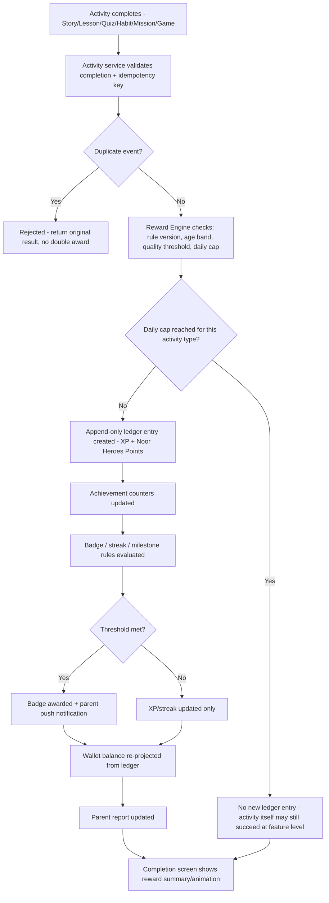
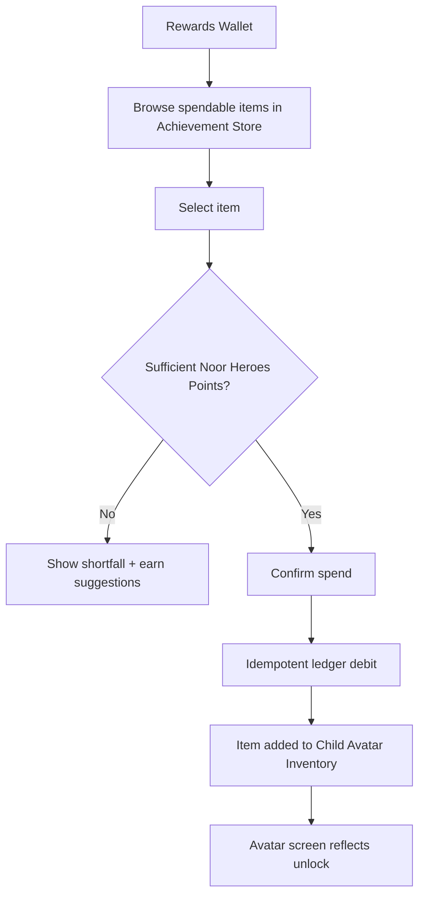
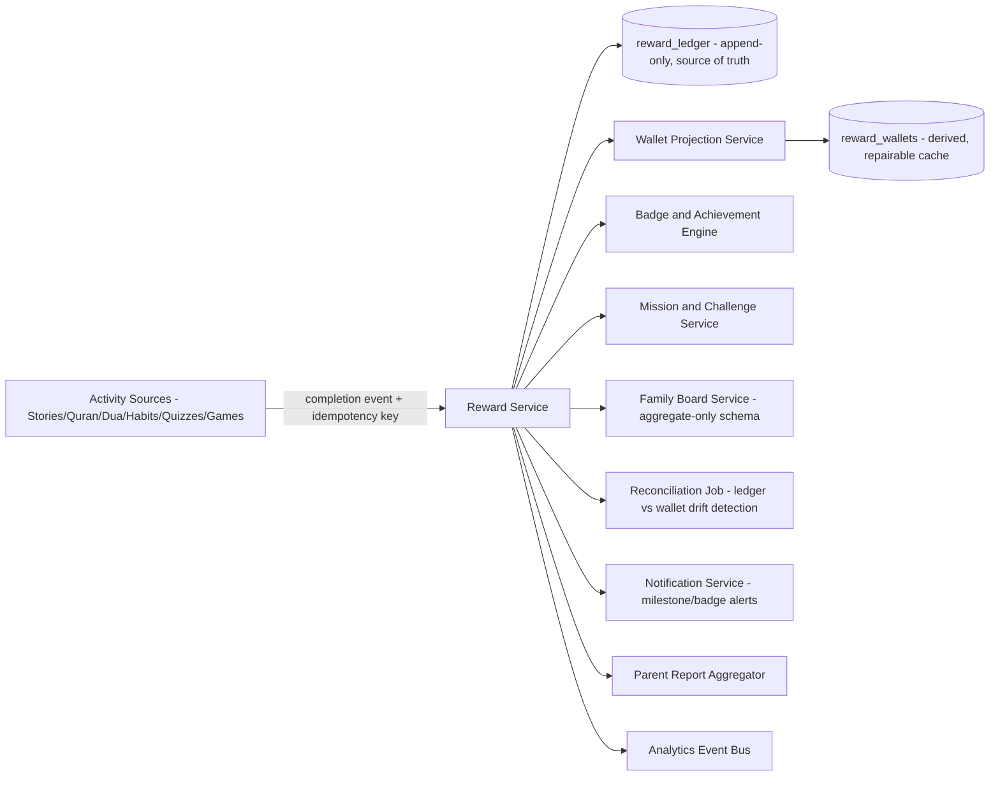

# Feature A.11 — Rewards System (Gamified Learning Ecosystem)

**App:** NoorHeroes — Islamic Learning App for Children
**Feature Owner:** Product / Economy Design / Child Wellbeing
**Status:** Implementation-ready
**Version:** 1.0
**Depends on:** A.1 (Auth & Onboarding), A.3/A.5/A.6/A.7/A.8/A.9/A.10 (every reward-emitting activity source)
**Feeds into:** A.12 Avatar System (inventory/equip), C.22 Parent Progress Reports, A.2 Home (Milestones & reward summary widget)

> **Scope note:** This document is the single authoritative specification for NoorHeroes' entire reward economy — XP, Noor Heroes Points (the closed virtual currency), Badges, Achievements, Missions/Weekly Challenges, the Rewards Wallet, the Achievement Store, and the private Family Board. Every other feature (Stories, Quran/Arabic, Dua, Habits, Quizzes, Games) emits reward events *into* this system rather than implementing its own reward logic — this is the platform's "Reward Service," referenced throughout prior feature docs (A.7 §3.3, A.8 §3.3, A.9 §3.3, A.10 §3.3) as a shared dependency. This document is where that dependency is actually specified end-to-end.

---

## Table of Contents

1. [Product Requirements](#1-product-requirements)
2. [UX/UI Requirements](#2-uxui-requirements)
3. [Backend Requirements](#3-backend-requirements)
4. [Database Design](#4-database-design)
5. [Backend AI Code-Generation Prompt](#5-backend-ai-code-generation-prompt)
6. [Android Requirements](#6-android-requirements)
7. [Android AI Code-Generation Prompt](#7-android-ai-code-generation-prompt)
8. [Admin Requirements](#8-admin-requirements)
9. [Admin AI Code-Generation Prompt](#9-admin-ai-code-generation-prompt)
10. [DevOps Requirements](#10-devops-requirements)
11. [Analytics Requirements](#11-analytics-requirements)
12. [Security Requirements](#12-security-requirements)
13. [QA Requirements](#13-qa-requirements)
14. [Marketing Requirements](#14-marketing-requirements)
15. [Release & Rollback Plan](#15-release--rollback-plan)

---

## 1. Product Requirements

### 1.1 Problem Statement

Every learning activity in NoorHeroes needs a single, trustworthy, non-exploitative reward economy that genuinely reflects effort and real learning — not manipulative mechanics designed to maximize screen time or spending — with parents able to fully trust that XP, Noor Heroes Points, and badges mean something real (source: Consolidated Blueprint §6.6: "As a parent, I want to be confident my child's rewards reflect real learning and effort, not manipulative mechanics designed to maximize screen time or spending").

### 1.2 Business Goals

- Provide one deterministic, auditable, append-only reward ledger consumed by every learning feature, eliminating the risk of inconsistent or exploitable reward logic emerging per-feature.
- Maintain Noor Heroes Points as a genuinely closed economy (earned only through learning, never purchasable) — a core trust differentiator versus typical freemium children's apps.
- Drive sustained engagement through Missions, Weekly Challenges, and the Family Board, without resorting to loot boxes, public leaderboards for minors, or sibling ranking.
- Power a meaningful, non-pay-to-win Achievement Store and Avatar customization system that gives real purpose to earned currency.

### 1.3 User Goals

- **Child:** Earn XP and Noor Heroes Points for things I actually do, collect badges that mean something, spend my points on cool avatar items, and see my family's shared achievements grow together.
- **Parent:** Trust that every reward reflects real effort/learning, never worry about my child being pushed to spend real money on the reward economy, and never see my children compared or ranked against each other.

### 1.4 Success Metrics

| Metric | Target |
|---|---|
| Reward-ledger integrity (zero duplicate awards from retries) | 100% (hard guarantee, not a target to approach) |
| Wallet-balance projection accuracy (matches ledger sum) | 100%, verified via standing reconciliation job |
| Weekly Challenge participation rate | ≥ 45% of active children |
| Achievement Store redemption rate (Noor Heroes Points actually spent, not just accumulated) | ≥ 50% of children with a positive balance redeem something within 30 days |
| Badge-unlock celebration → Achievements screen view-through rate | ≥ 60% |
| Family Board engagement rate (multi-child families) | ≥ 30% |
| Crash-free reward-related sessions | ≥ 99.7% |

### 1.5 Stakeholders

Product Manager, Economy/Game Designer, Child Wellbeing Advisor, Backend Architect, Android Architect, Data Analyst, Security Engineer, QA Lead, Customer Support Lead, every feature owner emitting reward events (A.3/A.5/A.6/A.7/A.8/A.9/A.10).

### 1.6 User Stories

1. As a child, I want to see my XP and Noor Heroes Points grow as I learn, watch stories, and build habits.
2. As a child, I want to collect badges for specific accomplishments and see my overall achievement progress.
3. As a child, I want to join a weekly challenge and daily missions that give me something fun to work toward.
4. As a child, I want to spend my Noor Heroes Points on avatar items and story-world cosmetics in a store.
5. As a child, I want my family's shared achievements (siblings working together) to feel special, without me being compared to my brother or sister.
6. As a parent, I want assurance there's no way to buy Noor Heroes Points with real money, and no loot-box-style randomness anywhere in the reward economy.
7. As a parent, I want to see my child's actual mastered skills behind their rewards, not just a pile of points that doesn't mean anything.
8. As a child, when I try to claim a reward I already claimed, I want it to just work normally, not show a confusing error.
9. As a child, I want a seasonal event (Ramadan, Eid) to bring special challenges and rewards.

### 1.7 Functional Requirements

> **Maker-Checker Security Guardrail:** Any manual administrative grant of XP exceeding **500 XP** (or equivalent 250 Noor Points) requires dual-operator sign-off (Maker submits request, second Operator B / Supervisor approves via `Screens/Admin Web/64-Manual Reward Grant-01.png`) before balance mutation occurs.


**FR-1** XP represents effort/progression; Noor Heroes Points are a closed virtual currency earned exclusively through learning activities and **never purchasable** with real money, in child mode or otherwise (source §6.6, §21.12 — a hard, zero-exception rule).
**FR-2** Badges represent specific named achievements (discrete unlocks); Achievements are cumulative milestone tracking, **distinct from Badges** — achievements track cumulative progress toward a milestone level (e.g., "Seedling → Hafiz Hero"), while badges are individual discrete unlocks (source: Consolidated Blueprint navigation table, "Rewards — Achievements... Distinct from Badges: achievements are cumulative, badges are discrete").
**FR-3** The reward ledger (`reward_ledger`) is **append-only** and is the system's sole source of truth; the wallet balance (`reward_wallets.cached_balance`) is a repairable, derived projection — **never** edited directly (source §9.4: "Repairable projection — never the source of truth"; "this table is the source of truth").
**FR-4** Every reward award uses a deterministic, versioned reason (`reason_type`, `reason_id`) and a unique idempotency key; retries return the original result, never a duplicate award (source §6.6 Validation Rules, §9.4).
**FR-5** Reward Engine Flow (canonical, source §6.6/the "Reward Engine Flow" diagram block, items 1–9): (1) activity service validates completion + idempotency key, (2) reward engine checks rule version, age band, quality threshold, daily cap, and duplicate key, (3) XP/Noor Heroes Points appended to the ledger, (4) achievement counters update, (5) badge/streak/milestone rules evaluated, (6) wallet balance re-projected from the ledger, (7) parent report updates, (8) an eligible push notification is sent, (9) the completion screen displays a reward summary/animation.
**FR-6** Reward rules are versioned by activity type, difficulty, and age band, with a daily cap per activity type to prevent farming; offline completions queue and validate on sync, remaining "pending" until server validation succeeds (source §6.6, §21.12, navigation table notes).
**FR-7** The complete XP/Noor Heroes Points table (admin-configurable, representative defaults per source §6.6): Watch full story +50XP/+25pts, Complete lesson +30XP/+15pts, Pass quiz 100% +40XP/+20pts, Pass quiz ≥80% +25XP/+10pts, Daily habit check-in +20XP/+10pts, 3-day streak +75XP/+30pts, 7-day streak +200XP/+100pts, 30-day streak +750XP/+300pts, Complete daily mission +60XP/+25pts, Complete weekly challenge +300XP/+150pts, Complete Quran recitation +45XP/+20pts, Complete Tajweed lesson +35XP/+15pts, Help family member (logged good deed) +25XP/+10pts, Complete story series +200XP/+100pts.
**FR-8** No loot-box mechanics or variable/randomized paid rewards of any kind exist anywhere in the system (source §6.6/§21.12 — a hard rule with zero exceptions, including for premium-tier content).
**FR-9** No global public leaderboard for minors exists. Reward/progress comparison is limited to: private self-improvement views, anonymized age-band cohorts, or a **parent-controlled, private Family Board** — siblings are never ranked against each other in any UI surface, including parent-facing reports (source §6.6/§21.12/A.7 FR-12, restated here as the canonical platform-wide rule this system enforces).
**FR-10** Daily Missions (3 per day) and the Weekly Challenge are time-boxed; progress resets at window close, but **expired seasonal challenges archive rather than disappear** (source: NoorHeroes Blueprint screen catalog "Challenges — Navigation Flow: Surfaced as a Home card and as its own tile under Rewards; expired seasonal challenges archive rather than disappear").
**FR-11** The Achievement Store (`catalog_items`) sells cosmetic/avatar/story-world items priced exclusively in Noor Heroes Points — items are sourced only from the admin-managed catalog, never user-uploaded content (source §9.4, Consolidated Blueprint navigation table "Avatar... Items are sourced only from AvatarItems catalog; no user uploads").
**FR-12** Achievement-card sharing is parent-gated: generating a shareable card requires Parent Profile verification, routes through the OS share sheet only after that gate, and the card itself never includes child ID, DOB, or location (source: screen catalog "Achievements — Navigation Flow: Sharing routes through the OS share sheet only after Parent Profile verification; no child ID/DOB/location ever appears on the card").
**FR-13** Client-side XP/Noor Heroes Points display is optimistic and reconciled on sync; the server is always authoritative for the actual ledger and balance (source §6.6 Validation Rules).
**FR-14** A standing reconciliation job verifies wallet-balance-projection integrity against the ledger's actual sum, self-healing any detected drift (source §6.6 Error Handling: "a reconciliation job runs to confirm wallet projection integrity").
**FR-15** Family Board / Family Achievements allow siblings to complete shared Islamic goals together, displaying only aggregate/combined progress — never a per-sibling comparative breakdown (shared architectural principle with A.7's Noor Garden Family view; this system and A.7's are the same underlying no-comparison guarantee applied to two different visual surfaces).

### 1.8 Non-Functional Requirements

- **Integrity:** Ledger append-only durability and idempotency are the system's highest-priority non-functional requirements — zero tolerance for duplicate awards or balance drift.
- **Performance:** Wallet fetch p95 < 400ms (served from the cached projection, not a live ledger sum, for normal reads); reward-award processing p95 < 300ms so completion screens never feel delayed.
- **Auditability:** Every ledger entry must be traceable to a deterministic reason and a specific rule version, supporting dispute resolution and model/rule-quality review.
- **Offline tolerance:** Offline-completed activities queue and reconcile correctly on sync (FR-6), never silently lost.
- **Anti-exploitation:** Daily caps, deterministic rules, and the hard no-loot-box/no-purchase rules are treated as P0 product/ethical commitments, not nice-to-haves.

### 1.9 Acceptance Criteria

- Given a child completes any reward-eligible activity, when the completion event is processed, then a corresponding `reward_ledger` entry is created with a deterministic reason and idempotency key, and the wallet's cached balance reflects the update.
- Given the same completion event is submitted twice (e.g., a network retry), when both are processed, then only one ledger entry exists and the response to both requests is identical.
- Given a child reaches a daily cap for a specific activity type, when they attempt additional reward-eligible repetitions of that same activity, then no further ledger entries are created for that type that day (engagement/evidence tracking may continue per other features' specs, but reward issuance stops at the cap).
- Given a parent or child attempts to purchase Noor Heroes Points with real money, when they look for such an option anywhere in the app, then none exists — there is no UI path, no IAP product, no code path supporting this.
- Given two siblings both contribute to a Family Board goal, when either child or their parent views the Family Board, then only the combined/aggregate progress is shown — no per-sibling breakdown appears anywhere.
- Given a weekly challenge window closes, when a parent or child looks at the Challenges screen afterward, then the expired challenge is shown in an archived state, not deleted/disappeared.
- Given a child generates a shareable achievement card, when the share action is initiated, then a Parent Profile verification gate appears first, and the resulting card contains no child ID, DOB, or location data.
- Given the standing reconciliation job runs, when it compares a wallet's cached balance against the actual ledger sum for that child, then any detected drift is corrected automatically and logged for investigation.

### 1.10 Edge Cases

1. A reward-eligible activity completes offline and queues locally, but by the time it syncs, the relevant reward rule version has been updated by Admin → the ledger entry is processed using the rule version that was **active at the time the activity was actually completed** (timestamped client-side, validated server-side within a reasonable bound), not the rule version active at sync time — consistent with the platform's general principle of not retroactively penalizing a child for a timing artifact of connectivity.
2. A child crosses a daily cap exactly mid-activity (e.g., their 5th of 5 capped habit check-ins for the day, then attempts a 6th) → the 6th attempt's underlying activity (e.g., the habit check-in itself, per A.7) still succeeds at the feature level if that feature's own rules allow it, but this Reward Service simply does not append a 6th ledger entry — the cap is a reward-issuance boundary, not necessarily a feature-functionality boundary.
3. A badge's unlock criteria reference an achievement counter that gets corrected/recalculated due to a data-quality fix → if the correction would cause a badge to newly qualify, it is awarded retroactively with its actual original criteria-met timestamp where determinable; if a correction would mean a badge *should not* have been awarded, the badge is **not** revoked once granted (consistent with the platform's "badges are sticky once earned" principle established in A.6 Edge Case 2, generalized here as the canonical rule for this entire system).
4. A seasonal Weekly Challenge spans a calendar boundary where a child's account is mid-subscription-downgrade → reward eligibility for completing the challenge is unaffected by subscription tier, consistent with A.6's always-free-tier philosophy extended in spirit here — premium-gated content's rewards are naturally unavailable only because the content itself isn't accessible, not because of a reward-tier restriction layered on top.
5. Two different consuming features (e.g., A.8's Quiz Engine and A.10's Games Module) both attempt to award XP for what is essentially the same underlying skill-practice moment → each emits its own distinct, correctly-attributed ledger entry — this is not treated as a duplicate/farming pattern unless the exact same `idempotency_key`/event is involved.
6. A family's Family Board goal is met by combined sibling contributions, but one sibling's contributing event is still offline/unsynced at the moment the combined total appears to cross the threshold from a different sibling's freshly-synced perspective → consistent with A.7's Family Streak handling, the Family Board's authoritative server-side evaluation only counts confirmed, synced contributions.
7. A child's Achievement Store purchase succeeds, but the subsequent avatar-inventory "equip" call fails (network) → the Noor Heroes Points debit and the inventory-ownership grant are committed atomically as part of the purchase transaction; equip is a separate, retriable, idempotent action that doesn't need to re-succeed for ownership to be valid.
8. A duplicate Achievement Store claim is attempted (e.g., a double-tap on "Claim" before the UI disables) → resolved via idempotency, shown to the child as "already claimed" rather than an error or a double-debit (source: navigation table, "Duplicate-claim and ledger-conflict states resolve via idempotency, shown as 'already claimed'").
9. A store webhook for a related entitlement check (e.g., confirming premium status that gates a specific cosmetic item's availability) is delayed → the app uses the last verified entitlement plus a grace window, then reconciles once the webhook arrives.
10. A child attempts to claim a Weekly Challenge reward a second time after the challenge has already been claimed once and the window has since closed and re-opened for a new challenge instance → each challenge instance has its own distinct identity/ledger-reason-id, so a "second" claim against a genuinely new instance is legitimate — only a literal repeat claim against the same instance is blocked.
11. A reconciliation job detects a wallet-balance discrepancy that cannot be cleanly explained by normal ledger-sum logic → the job corrects the cached balance to match the ledger's true sum and flags the incident for manual review rather than silently "fixing" it without any record.
12. A badge has a `season_id` (a seasonal/Ramadan-specific badge) and the season ends before a child who was close to qualifying actually completes the criteria → the badge becomes unavailable for new qualification going forward, but a child who did qualify within the season window retains it permanently once earned — seasonal scoping affects earnability, not retention of an already-earned badge.

### 1.11 Error Handling

| Scenario | System Behavior |
|---|---|
| Duplicate reward-award request (network retry) | Ledger's unique idempotency constraint prevents the second post; standing reconciliation job confirms wallet projection integrity (FR-4/FR-14) |
| Store webhook delayed (entitlement-gated cosmetic item) | Last verified entitlement + grace window used, reconciled later (Edge Case 9) |
| Achievement Store duplicate claim | Resolved via idempotency, shown as "already claimed" (Edge Case 8) |
| Wallet-balance projection drift detected | Standing reconciliation job self-heals and logs the incident |
| Offline reward-eligible activity completion | Queues as "pending" locally, validates and finalizes on sync (FR-6) |
| Purchase succeeds but equip call fails | Ownership already committed; equip is independently retriable |

### 1.12 Empty States
- New child, zero reward history → Wallet shows a friendly "Start learning to earn your first XP!" framing rather than a stark "0" balance with no context.
- Zero badges earned yet → Achievements screen shows the first achievable milestone as a clear, motivating teaser rather than an empty grid.
- Zero Family Board contributions yet (new multi-child family) → shows the first shared goal's description with a "let's start together" framing.

### 1.13 Loading States
- Wallet: skeleton balance/ledger-list shimmer.
- Achievement Store: skeleton item-grid shimmer.

### 1.14 Offline States
- Wallet displays last-synced cached balance with an "offline, may be outdated" indicator; reward-eligible activity completions queue per FR-6.
- Achievement Store purchases require connectivity.

### 1.15 Permission States
- No new runtime permissions specific to this system.

### 1.16 User Flow (Narrative)

Any reward-eligible activity completes in any consuming feature (Story watched, lesson completed, quiz passed, habit checked in, mission/challenge completed, game session finished) → that feature emits a completion event with an idempotency key → the Reward Engine validates, checks rules/caps, appends to the ledger, updates achievement counters, evaluates badge/milestone/streak rules, re-projects the wallet balance → the child sees a reward summary/animation on their current completion screen → parent reports update → the child may later browse the Rewards Wallet, Achievements, Challenges, or Achievement Store to review and spend their accumulated rewards.

### 1.17 Detailed Flow Diagram (Mermaid)

**Reward Engine Flow (canonical, source §6.6):**



**Reward Redemption Flow (Achievement Store):**



### 1.18 Screen Inventory (Complete — Zero Missing)

| # | Screen | Type | Entry Points | Exit Points |
|---|---|---|---|---|
| 1 | Rewards Hub / Wallet (landing) | Primary | Bottom nav "Rewards" tab, Home Milestones widget, completion-screen "View Rewards" link | Achievements, Challenges, Achievement Store, Avatar |
| 2 | Noor Heroes Points Balance + Transaction History | Component/Screen | Rewards Wallet | Transaction Detail (per entry) |
| 3 | Transaction Detail (single ledger entry) | Screen | Transaction History | Back |
| 4 | Badge Shelf Preview (component, on Wallet) | Component | Rewards Wallet | Achievements (full grid) |
| 5 | Achievements Screen (badge grid + cumulative level progress) | Screen | Rewards Wallet, Profile | Badge Detail, Achievement Level Detail |
| 6 | Badge Detail / Criteria View | Screen | Achievements grid | Back, or relevant activity |
| 7 | Achievement Level Detail | Screen | Achievements screen | Back |
| 8 | Shareable Achievement Card Preview | Screen | Achievements/Badge Detail "Share" action | Parent Gate → OS Share Sheet, or cancel |
| 9 | Parent Gate for Sharing | Modal | Shareable Card Preview "Share" tap | OS Share Sheet (on success) / cancel |
| 10 | Weekly Challenge Card (component) | Component | Home, Rewards Hub | Weekly Challenge Detail |
| 11 | Weekly Challenge Detail | Screen | Weekly Challenge Card | Relevant activity that advances it, Claim action |
| 12 | Daily Mission List (3/day) | Component/Screen | Rewards Hub, Home | Relevant activity per mission |
| 13 | Seasonal Event Banner | Component | Home, Rewards Hub | Seasonal Event Screen |
| 14 | Seasonal Event Screen | Screen | Seasonal Event Banner | Seasonal-specific missions/challenges |
| 15 | Archived Challenge View | Screen variant | Challenges screen, expired challenge tap | Back |
| 16 | Reward Claim Confirmation (generic) | Component | Any completed mission/challenge | Wallet update reflected in place |
| 17 | Achievement Store (catalog browse) | Screen | Rewards Hub, Avatar screen "Shop" entry | Item Detail |
| 18 | Achievement Store — Item Detail | Screen | Achievement Store grid | Purchase Confirmation |
| 19 | Purchase Confirmation / Insufficient-Points Shortfall Screen | Screen variant | Item Detail "Buy" | Success → Avatar Inventory; Shortfall → earn-suggestions |
| 20 | Family Board (private, multi-child families) | Screen | Rewards Hub, Home (if surfaced) | Family Goal Detail |
| 21 | Family Goal Detail | Screen | Family Board | Back |
| 22 | Family Achievement Unlock Celebration | Modal | Family Board, threshold crossed | Dismiss → Family Board |
| 23 | Reward Unlock Animation (generic, in-line) | Component | Any activity completion across the platform | Continues to that feature's own next step |
| 24 | Badge Unlock Modal | Modal | Any activity completion crossing a badge threshold | Dismiss → Achievements |
| 25 | Empty State — Zero Reward History | Screen variant | Wallet, new child | N/A |
| 26 | Empty State — Zero Badges Yet | Screen variant | Achievements, new child | First-achievable-badge teaser |
| 27 | Empty State — Zero Family Contributions Yet | Screen variant | Family Board, new multi-child family | N/A |
| 28 | Offline Wallet State | Screen variant | Wallet, no connectivity | N/A |

### 1.19 Events (Complete Analytics Event List)

`reward_ledger_entry_created` (with `reason_type`, `xp`, `noor_points`), `reward_daily_cap_reached` (internal), `reward_duplicate_claim_resolved`, `badge_unlocked`, `achievement_level_progressed`, `wallet_viewed`, `wallet_reconciliation_drift_corrected` (internal), `weekly_challenge_viewed`, `weekly_challenge_joined`, `weekly_challenge_completed`, `weekly_challenge_claimed`, `weekly_challenge_archived_viewed`, `daily_mission_viewed`, `daily_mission_completed`, `seasonal_event_banner_viewed`, `seasonal_event_entered`, `achievement_store_viewed`, `achievement_store_item_viewed`, `achievement_store_purchase_attempted`, `achievement_store_purchase_completed`, `achievement_store_purchase_insufficient_points`, `avatar_item_equipped_post_purchase`, `family_board_viewed`, `family_goal_progress_updated` (aggregate only), `family_achievement_unlocked`, `achievement_share_gate_opened`, `achievement_share_completed`.

---

## 2. UX/UI Requirements

> Global Design System tokens defined in **Feature A.1 §2.1**; non-comparison structural design principle established in **Feature A.7 §2.1** (applied here to the Family Board); accuracy-independent/non-judgmental celebratory tone established in **Features A.8/A.9 §2.1**.

### 2.1 Rewards-Specific Design System Extensions

- **XP vs. Noor Heroes Points Visual Distinction:** XP uses a progress-bar/level-style visual metaphor (effort/progression framing); Noor Heroes Points use a coin/currency-style visual metaphor (a spendable-resource framing) — consistently distinguished across every screen.
- **Badge vs. Achievement Visual Distinction:** Badges render as discrete collectible tile icons; Achievement levels render as a single progressive path/ladder visual (e.g., "Seedling → Sprout → ... → Hafiz Hero") — reinforcing FR-2's discrete-vs-cumulative distinction visually.
- **No-Comparison Family Board Layout:** Identical structural principle to A.7's Noor Garden — aggregate-only or single-child-at-a-time views, never simultaneous side-by-side sibling comparison, enforced as a layout constraint.
- **Reward Unlock Animation:** Brief (≤2s), consistent, non-randomized presentation (per the platform's anti-dark-pattern Ethical Rule established in A.3 §2.1) — the same activity type always produces a visually consistent reward reveal, never a "surprise" slot-machine-style randomized reveal.

### 2.2 Screen-Level Design Requirements (Key Screens)

#### Screen: Rewards Wallet (Landing)

- **Purpose:** Give the child a clear, trustworthy view of their accumulated XP/Noor Heroes Points and recent activity.
- **Components:** XP level/progress bar, Noor Heroes Points coin balance, recent transaction list (each with a deterministic reason label e.g. "Completed Surah Al-Fatiha lesson +30 XP"), Badge Shelf preview rail, Weekly Challenge card, Daily Mission list, entry points to Achievement Store and Family Board.
- **States:** Default, Loading (skeleton), Offline (cached balance), Empty (new child).
- **Accessibility:** Every transaction entry's reason text is screen-reader-readable in full.
- **Responsive Rules:** Single column mobile; tablet may show Wallet + Badge Shelf side-by-side.

#### Screen: Achievement Store

- **Purpose:** Let children spend earned Noor Heroes Points on genuine, non-pay-to-win cosmetic items.
- **Components:** Item grid, price-in-Noor-Heroes-Points tag per item, owned/locked-for-insufficient-points visual states, category filter.
- **States:** Default, Item-detail-expanded, Purchase-confirming, Purchase-success, Insufficient-points-shortfall (shows the gap and links to "earn more" activities, never a "buy more points" option).
- **Accessibility:** Price tags always paired with text, never icon-only.

#### Screen: Family Board

- **Purpose:** Celebrate shared sibling accomplishment without competitive comparison.
- **Components:** Shared goal progress visualization (aggregate only), combined contribution summary, Family Achievement Unlock celebration trigger.
- **States:** Default, Goal-in-progress, Goal-completed-celebration, Empty (new family).
- **Accessibility:** Aggregate progress announced clearly; no per-child breakdown exists to accidentally expose via accessibility tooling either.

### 2.3 Tab Structure

Rewards is Tab 4 of 5 (Home / Learn / Stories / **Rewards** / Profile). Click mapping:

| Click Target | Destination | API Called | Analytics Event | Permission Check | Error Handling |
|---|---|---|---|---|---|
| Wallet balance/history | Transaction Detail | `GET /v1/children/{id}/wallet` | `wallet_viewed` | None | Cached offline fallback |
| Badge Shelf preview | Achievements screen | `GET /v1/children/{id}/wallet` (badges subset) | N/A (view) | None | Cached fallback |
| Weekly Challenge card | Weekly Challenge Detail | `GET /v1/missions` | `weekly_challenge_viewed` | None | Archived-state fallback if expired |
| Achievement Store entry | Achievement Store | `GET /v1/catalog-items` | `achievement_store_viewed` | None | Cached fallback |
| Item "Buy" | Purchase Confirmation | `POST /v1/rewards/claims` | `achievement_store_purchase_attempted` | Sufficient-balance check | Idempotent duplicate-claim handling |
| Family Board entry | Family Board | `GET /v1/family/{family_id}/board` | `family_board_viewed` | None | Aggregate-only response, cached fallback |
| Achievement "Share" | Parent Gate Modal | None until gate passes | `achievement_share_gate_opened` | Parent PIN/biometric | Cancel returns to Achievements |

### 2.4 Wireframe Description (Composite)

Wallet: a vertically-scrolling dashboard composed of distinct cards (balance header, recent transactions, badge shelf rail, challenge card, mission list) — consistent with the platform's general "card-based dashboard" pattern shared with Home (A.2) and Habit Builder (A.7). Achievement Store: a standard grid-browse pattern consistent with A.3's Stories Library and A.10's Games Hub. Family Board: a single immersive, illustrated "shared garden/journey" visual treatment, conceptually paired with (but visually distinct from) A.7's Noor Garden.

### 2.5 Screen Image Generation Prompts

**Screen: Rewards Wallet**
- *Prompt 1 (English):* "Mobile app rewards wallet dashboard UI mockup for a children's Islamic learning app. Warm off-white background. Top header card shows a circular XP progress ring with a level number inside, next to a separate gold coin-shaped balance display labeled with a Noor Heroes Points count. Below, a horizontally scrollable row of small badge icon tiles (some colorful and glowing, some greyed/locked silhouettes). Below that, a rounded card showing a weekly challenge progress bar with a small label. Below that, a simple checklist-style card showing three daily mission rows with small icons. Warm teal and gold accents, rounded corners, soft shadows, joyful and trustworthy aesthetic, no realistic human faces, bottom navigation visible with 5 icons."
- *Prompt 2 (Arabic RTL):* "نفس واجهة لوحة محفظة المكافآت لتطبيق تعليم إسلامي للأطفال، بتخطيط من اليمين إلى اليسار بالكامل. خلفية بيج فاتح دافئ. بطاقة رأس علوية تعرض حلقة تقدم دائرية لنقاط الخبرة مع رقم المستوى بداخلها، بجانبها عرض رصيد منفصل بشكل عملة ذهبية موسوم بعدد نقاط نور. أسفل ذلك صف قابل للتمرير أفقيًا من أيقونات أوسمة صغيرة (بعضها ملون ومتوهج، وبعضها رمادي/مقفل كظل). أسفل ذلك بطاقة مستديرة تعرض شريط تقدم لتحدي الأسبوع مع تسمية صغيرة. أسفل ذلك بطاقة بسيطة على شكل قائمة تحقق تعرض ثلاثة صفوف لمهام اليوم بأيقونات صغيرة. لمسات فيروزية وذهبية دافئة، زوايا دائرية، ظلال خفيفة، طابع مرح وموثوق، بدون وجوه بشرية واقعية، شريط تنقل سفلي ظاهر بخمس أيقونات."

**Screen: Family Board**
- *Prompt 1 (English):* "Mobile app full-screen illustrated family achievement screen UI mockup for a children's app. Warm, magical scene showing a shared glowing tree or lantern path that multiple small abstract glowing orbs (representing siblings, NOT individual human figures) are feeding light into together, growing the shared structure taller/brighter. A progress label below shows combined family progress toward a shared milestone (e.g., '70 of 100 duas together') with NO individual breakdown of who contributed what. Warm sunset gradient background, soft glowing particles, calm and celebratory mood, no realistic human faces or competitive scoreboard elements anywhere, rounded soft shapes, teal and gold color palette."
- *Prompt 2 (Arabic RTL):* "نفس شاشة إنجاز العائلة المصورة بملء الشاشة لتطبيق أطفال، بتخطيط من اليمين إلى اليسار للعناصر النصية. مشهد دافئ وسحري يعرض شجرة متوهجة مشتركة أو مسار فوانيس تتغذى بالضوء من عدة كرات مجردة متوهجة صغيرة (تمثل الأشقاء، وليست شخصيات بشرية فردية) تنمو معًا وتصبح أطول وأكثر سطوعًا. تسمية تقدم أسفلها تعرض تقدم العائلة المشترك نحو إنجاز مشترك (مثل '70 من 100 دعاء معًا') بدون أي تفصيل فردي لمن ساهم بماذا. خلفية متدرجة بلون غروب الشمس الدافئ، جزيئات متوهجة ناعمة، طابع هادئ واحتفالي، بدون وجوه بشرية واقعية أو أي عناصر لوحة نتائج تنافسية في أي مكان، أشكال ناعمة مستديرة، لوحة ألوان فيروزية وذهبية."

*(Remaining screens — Achievements grid, Badge Detail, Shareable Card Preview, Weekly Challenge Detail, Achievement Store grid, Purchase Confirmation — follow the same two-prompt EN/AR template; full set available on request.)*

---

## 3. Backend Requirements

### 3.1 System Design Overview

The Rewards System is served by a central **Reward Service** that is the sole writer to the append-only `reward_ledger`, with a **Wallet Projection Service** maintaining the derived, repairable `reward_wallets` cache, a **Badge & Achievement Engine** evaluating unlock criteria, a **Mission/Challenge Service** managing time-boxed Daily Missions and Weekly Challenges, and a **Family Board Service** structurally enforcing aggregate-only sibling data (consistent with A.7's `family_streak` pattern).

### 3.2 Architecture Diagram (Mermaid)



### 3.3 Service Breakdown

| Service | Responsibility |
|---|---|
| Reward Service | Central orchestrator: validates completion events, enforces caps/rules, writes ledger entries |
| Wallet Projection Service | Maintains the derived `reward_wallets` cache, rebuildable from the ledger at any time |
| Badge & Achievement Engine | Evaluates discrete badge criteria and cumulative achievement-level progress |
| Mission & Challenge Service | Daily Missions (3/day) and Weekly/Seasonal Challenge lifecycle, including archiving |
| Family Board Service | Aggregate-only multi-child goal tracking, structurally no per-sibling fields |
| Reconciliation Job | Standing integrity check between ledger sum and wallet cache |
| Achievement Store Service | Catalog browsing and Noor-Heroes-Points-only purchase processing |

### 3.4 API List

#### `POST /v1/rewards/complete` (internal, called by every consuming feature)
- **Request:** `{ "child_id": "...", "activity_type": "story_complete", "reason_id": "episode_042", "rule_version": "v3", "idempotency_key": "uuid...", "metadata": {...} }`
- **Response 200:** `{ "ledger_entry_id": "...", "xp_awarded": 50, "noor_points_awarded": 25, "daily_cap_reached": false, "badges_unlocked": [], "achievement_progress": [...] }`
- **Idempotency:** `UNIQUE(idempotency_key)` at the database layer — replayed requests return the original result.
- **Validation:** Rule version, age band, and daily cap checked per FR-5/FR-6; if the daily cap for `activity_type` is already reached, no ledger entry is created but the response still returns `200` with `daily_cap_reached: true` (never an error for this expected case).

#### `GET /v1/children/{id}/wallet`
- **Auth:** Bearer (own child only)
- **Response 200:** `{ "xp": 1240, "level": 6, "noor_points": 380, "badges": [...], "recent_ledger": [...] }`
- **Caching:** Served from the wallet projection cache; short TTL, invalidated immediately on any new ledger entry for that child.

#### `GET /v1/missions?child_id=`
- **Response 200:** `{ "daily_missions": [ {...3 items...} ], "weekly_challenge": { "id": "...", "progress": 0.4, "expires_at": "..." }, "seasonal_event": {...or null} }`

#### `POST /v1/missions/{id}/progress` (usually internal, server-side event-consumer-driven)
- **Idempotency:** Standard idempotency-key pattern.

#### `GET /v1/catalog-items?child_id=`
- **Response 200:** Array of purchasable cosmetic/avatar items with `price_points`, `eligibility_json`-derived availability, owned-state per child.

#### `POST /v1/rewards/claims`
- **Request:** `{ "catalog_item_id": "...", "child_id": "...", "idempotency_key": "uuid..." }`
- **Response 200:** `{ "claimed": true, "item_id": "...", "new_balance": 130 }` or, on replay, the identical original result framed as "already claimed."
- **Error Codes:** `402 INSUFFICIENT_POINTS` (returns the shortfall amount).
- **Validation:** Atomic transaction — Noor Heroes Points debit and `child_inventory` grant happen together or not at all.

#### `GET /v1/family/{family_id}/board`
- **Response 200:** `{ "goals": [ { "goal_id": "...", "title": "...", "aggregate_progress": 70, "target": 100 } ] }` — **no per-child field exists in this schema at all**, identical structural guarantee to A.7 §3.4's Family Garden endpoint.

#### `POST /v1/achievements/{id}/share-card`
- **Auth:** Bearer (parent session only — requires Parent Profile verification per FR-12)
- **Response 200:** `{ "card_image_url": "...", "expires_at": "..." }` — generated card contains no child ID/DOB/location.

### 3.5 Cross-Cutting API Concerns

- **Idempotency:** Universal `idempotency_key`/`client_request_id` pattern across every mutating endpoint.
- **No purchase-with-real-money path:** No endpoint in this service accepts a payment method or store-receipt reference to mint Noor Heroes Points — structurally absent, not merely unused.
- **No per-sibling comparison fields:** Family Board schema is aggregate-only by design, mirroring A.7's guarantee.
- **Analytics:** All events from §1.19 emitted.

---

## 4. Database Design

### 4.1 ER Diagram (Mermaid)

```mermaid
erDiagram
    CHILD ||--|| REWARD_WALLET : "has one (projection)"
    CHILD ||--o{ REWARD_LEDGER : "has many (source of truth)"
    CHILD ||--o{ CHILD_BADGE : "has many"
    BADGE ||--o{ CHILD_BADGE : "earned by"
    CHILD ||--o{ MISSION_PROGRESS : "has many"
    MISSION ||--o{ MISSION_PROGRESS : "tracked by"
    CATALOG_ITEM ||--o{ CHILD_INVENTORY : "owned via"
    CHILD ||--o{ CHILD_INVENTORY : "owns"
    ACHIEVEMENT_DEFINITION ||--o{ ACHIEVEMENT_PROGRESS : "tracked by"
    CHILD ||--o{ ACHIEVEMENT_PROGRESS : "has many"
    CHILD ||--o{ MILESTONE_EVENT : "has many"
    FAMILY ||--o{ FAMILY_BOARD_GOAL : "has"

    REWARD_WALLET {
        uuid child_id PK_FK
        string currency
        int cached_balance
        timestamptz updated_at
    }
    REWARD_LEDGER {
        uuid id PK
        uuid child_id FK
        string currency
        int amount
        string reason_type
        string reason_id
        string idempotency_key
        timestamptz created_at
    }
    BADGE {
        uuid id PK
        string code
        jsonb criteria_json
        string locale_key
        uuid season_id
    }
    CHILD_BADGE {
        uuid child_id FK
        uuid badge_id FK
        timestamptz earned_at
        string reason_id
    }
    MISSION {
        uuid id PK
        string type
        jsonb eligibility_json
        jsonb criteria_json
        jsonb reward_json
        timestamptz starts_at
        timestamptz ends_at
    }
    MISSION_PROGRESS {
        uuid child_id FK
        uuid mission_id FK
        jsonb progress_json
        timestamptz completed_at
        timestamptz claimed_at
    }
    CATALOG_ITEM {
        uuid id PK
        string type
        int price_points
        jsonb eligibility_json
        boolean active
    }
    CHILD_INVENTORY {
        uuid child_id FK
        uuid item_id FK
        timestamptz acquired_at
        timestamptz equipped_at
    }
    ACHIEVEMENT_DEFINITION {
        uuid id PK
        jsonb criteria_json
        uuid badge_id FK
        int xp_value
    }
    ACHIEVEMENT_PROGRESS {
        uuid child_id FK
        uuid achievement_id FK
    }
    MILESTONE_EVENT {
        uuid id PK
        uuid child_id FK
        string type
        timestamptz occurred_at
    }
    FAMILY_BOARD_GOAL {
        uuid goal_id PK
        uuid family_id FK
        string title
        int aggregate_progress
        int target
    }
```

### 4.2 Tables, Relationships, Constraints

| Table | Key Constraints | Indexes |
|---|---|---|
| `reward_wallets` | PK = FK `child_id`; **repairable projection, never a write target outside the Wallet Projection Service** | — |
| `reward_ledger` | FK `child_id`; UNIQUE(`idempotency_key`); append-only (no UPDATE/DELETE grant for any application role) | Index `(child_id, created_at DESC)`, Index `(reason_type, reason_id)` |
| `badges` | UNIQUE(`code`) | Index `(season_id)` |
| `child_badges` | UNIQUE(`child_id`, `badge_id`); append-only, never deleted (badge-stickiness guarantee) | Index `(child_id, earned_at DESC)` |
| `missions` | CHECK `type IN ('daily','weekly','seasonal')` | Index `(type, starts_at, ends_at)` |
| `mission_progress` | UNIQUE(`child_id`, `mission_id`) | Index `(child_id)` |
| `catalog_items` | CHECK `price_points > 0` | Index `(active, type)` |
| `child_inventory` | UNIQUE(`child_id`, `item_id`) | Index `(child_id)` |
| `family_board_goal` | FK `family_id`; **no `child_id` column anywhere on this table**, identical structural guarantee to A.7's `family_streak` | Index `(family_id)` |

### 4.3 Audit Fields
`reward_ledger`, `child_badges`, `milestone_events` are append-only/immutable historical facts. `reward_wallets.updated_at` tracks last projection refresh.

### 4.4 Soft Delete Rules
`catalog_items.active = false` used to retire an item from the store without breaking existing `child_inventory` ownership records. `missions` naturally expire via `ends_at` rather than deletion (FR-10's archive-not-disappear rule).

### 4.5 Retention Rules
`reward_ledger` retained indefinitely — it is the system's permanent source of truth and audit trail, never purged. `mission_progress` for expired missions retained for historical/archive display (FR-10).

---

## 5. Backend AI Code-Generation Prompt

```
You are building the central Reward Service for "NoorHeroes" -- the single
source-of-truth reward economy consumed by every other feature (Stories,
Quran/Arabic, Dua, Habits, Quizzes, Games). This is one of the most
integrity-critical services in the entire platform.

Stack: FastAPI (Python 3.12), PostgreSQL (SQLAlchemy 2.0), Redis, Kafka.

Hard requirements:
1. reward_ledger is APPEND-ONLY at the database permission layer: the
   application's database role must have INSERT and SELECT grants on
   this table but NOT UPDATE or NOT DELETE. Write a migration that
   explicitly revokes those grants, and a test that attempts an UPDATE
   and DELETE directly against the table and asserts both are rejected
   at the database layer (not just discouraged by application code).
2. Implement POST /v1/rewards/complete with a UNIQUE(idempotency_key)
   constraint on reward_ledger. On a constraint violation (replayed
   request), catch it and return the ORIGINAL result (not an error) --
   write a test firing 10 concurrent identical requests and asserting
   exactly one ledger row exists and all 10 requests receive the same
   200 response with identical xp_awarded/noor_points_awarded values.
3. Implement daily-cap enforcement per (child_id, activity_type,
   local_date): query existing ledger entries for that combination
   today; if the cap (configurable per activity_type) is already met,
   return 200 with daily_cap_reached=true and create NO new ledger row
   -- this must never be treated as an error condition. Write a test
   confirming the 1st through Nth requests (N = cap) create ledger rows
   and the (N+1)th does not, with all N+1 requests still receiving 200.
4. Implement the Wallet Projection Service as a fully REBUILDABLE
   projection: write a function recompute_wallet(child_id) that sums
   ALL reward_ledger rows for that child from scratch and writes the
   result to reward_wallets.cached_balance. Write a test that manually
   corrupts a wallet's cached_balance (simulating drift), runs
   recompute_wallet, and asserts the cache is corrected to exactly match
   the ledger's true sum.
5. Implement a scheduled reconciliation job that runs recompute_wallet
   for every child whose wallet's cached_balance does not match a live
   ledger-sum query, logs each correction as a distinct audit event
   (child_id, old_balance, new_balance, timestamp), and runs on a
   configurable interval (e.g., hourly). Write a test simulating drift
   for a subset of children and confirming only those children's wallets
   are touched/corrected, with audit log entries created for each.
6. Implement POST /v1/rewards/claims (Achievement Store purchases) as an
   ATOMIC database transaction: debit reward_ledger (a negative-amount
   entry with reason_type='store_purchase') AND insert into
   child_inventory together, or roll back both together on any failure.
   Enforce idempotency via UNIQUE(idempotency_key) on this operation as
   well. Write a test simulating a failure injected between the debit and
   the inventory insert, asserting NEITHER side-effect persisted (full
   rollback), and a separate test for a duplicate claim returning the
   original "already claimed" result without a second debit.
7. Implement the Family Board with NO child_id column or per-child
   breakdown field anywhere in family_board_goal's schema or its API
   response model -- write a structural introspection test (mirroring
   A.7's pattern) asserting no field name containing "child" exists
   anywhere in this table or response schema.
8. Implement badge-stickiness: child_badges has no DELETE grant for any
   application role and no UPDATE grant either (badges are write-once
   facts). Write a test confirming a badge, once earned, cannot be
   removed via any application code path, even if the underlying
   achievement_progress data is later corrected downward.
9. Implement the NO-PURCHASE-WITH-REAL-MONEY guarantee structurally:
   audit every endpoint in this service and confirm NONE of them accept
   a payment_method, store_receipt, or any IAP-related field as input
   for minting Noor Heroes Points or XP. Write a test that scans this service's
   full OpenAPI schema for any field name matching
   /payment|receipt|price_usd|iap/i on any endpoint that could mint
   currency, asserting zero matches.

Deliver: FastAPI routers, SQLAlchemy models, Alembic migrations (including
the permission-revocation migration for reward_ledger and child_badges),
Pydantic schemas, and a pytest suite covering all 9 items, with items 1
(append-only ledger), 2 (idempotent awards), and 9 (no real-money purchase
path) treated as the three highest-priority guarantees in this entire
service.
```

---

## 6. Android Requirements

### 6.1 Technical Requirements
Kotlin, Jetpack Compose, MVVM, Clean Architecture, module `:feature:rewards`, depends on `:core:design-system`, `:core:network`, `:core:offline-cache`. Exposes a `:core:reward-client` shared module providing the `RewardRepository`/`MasteryRepository`-style interfaces already referenced as dependencies by A.7/A.8/A.9/A.10's Android specs.

### 6.2 Screen Mapping
Each screen in §1.18 maps to a Composable; `WalletViewModel` exposes `StateFlow<WalletUiState>` with optimistic local updates (per FR-13) reconciled against server responses.

### 6.3 Navigation Flow
Rewards Hub is the default destination of the Rewards bottom-nav tab; Achievement Store, Family Board, and Challenges are sibling destinations off the Hub.

### 6.4 State Management
`RewardRepository` (in `:core:reward-client`) is the **single shared entry point** every other feature module's ViewModel uses to report a completion event (`reportCompletion(activityType, reasonId, idempotencyKey)`) and to read wallet/badge state — no feature module independently re-implements wallet-balance display logic; they all delegate here.

### 6.5 API Mapping
`RewardRepository.reportCompletion()` → `POST /v1/rewards/complete`; `WalletRepository.getWallet()` → `GET /v1/children/{id}/wallet`; `AchievementStoreRepository.purchase()` → `POST /v1/rewards/claims` with a UUID `idempotency_key` generated once at tap-time and reused on retry.

### 6.6 Analytics Mapping
`RewardAnalytics` fires `reward_ledger_entry_created`-equivalent client events tied to actual server-confirmed responses (not optimistic UI state alone), ensuring analytics reflect real ledger outcomes.

### 6.7 Offline Support
Completion events from any feature queue in a shared local outbox (keyed by `idempotency_key`) when offline, syncing via WorkManager on reconnect; Wallet display falls back to last-synced cached balance with an offline indicator.

### 6.8 Deep Linking
`noorheroes://rewards`, `noorheroes://rewards/store`, `noorheroes://rewards/family-board`, `noorheroes://rewards/challenges`.

### 6.9 Push Notifications
Landing targets for milestone-completion and badge-unlock notifications (owned by the Notifications feature) — this feature owns the deep-link destinations and the in-app Badge Unlock Modal trigger logic.

### 6.10 Testing Strategy
- Unit: `WalletViewModel's` optimistic-update/reconcile logic; idempotency-key generation/reuse-on-retry logic in `RewardRepository`.
- UI tests: Family Board screen renders with zero per-child comparative UI elements; Achievement Store purchase flow correctly shows the shortfall screen (never a "buy more points" option).
- Integration: full completion-event → ledger-confirmation → wallet-update → badge-unlock-modal flow, verified across at least two different originating features using the same shared `:core:reward-client` code path.

---

## 7. Android AI Code-Generation Prompt

```
Build `:core:reward-client` as a SHARED Android module for NoorHeroes (Kotlin,
Jetpack Compose, MVVM, Clean Architecture), consumed by every other feature
module (`:feature:stories`, `:feature:learn`, `:feature:habits`,
`:feature:dua-learning`, `:feature:games`, and this document's own
`:feature:rewards`).

Hard requirements:
1. Define RewardRepository as the SOLE interface any feature module uses
   to report a reward-eligible completion:
   suspend fun reportCompletion(activityType: String, reasonId: String,
   idempotencyKey: String): RewardResult. Document and enforce via code
   review checklist that no feature module implements its own parallel
   wallet-mutation or ledger-writing logic -- all reward issuance flows
   through this single repository method.
2. Implement idempotencyKey generation as a UUID created ONCE at the
   moment the underlying activity actually completes (not at submission/
   retry time) and reused identically across any retry -- write a unit
   test simulating a network failure and retry, asserting the SAME
   idempotencyKey string is used on both the original and retried call.
3. Build WalletViewModel with optimistic local balance updates that are
   ALWAYS reconciled against the next successful server response (never
   left permanently optimistic) -- write a test simulating a server
   response with a different balance than the optimistic local guess and
   asserting the UI state is corrected to the server's authoritative
   value, with no lingering discrepancy.
4. Build the Family Board screen and its corresponding response DTO with
   NO field anywhere capable of holding a per-child breakdown (mirroring
   A.7's reflection-based structural test) -- write a reflection test
   enumerating all fields in the Family Board DTO and asserting none are
   collection types containing a nested childId/child_id field.
5. Implement the Achievement Store purchase flow: on insufficient points
   (a 402 INSUFFICIENT_POINTS response), render the shortfall screen
   showing the gap amount and "earn more" suggestions (deep links into
   other feature modules) -- write a UI test asserting this screen NEVER
   renders any "buy points," "add funds," or payment-related UI element,
   since no such capability exists in this app by design.
6. Implement a shared local outbox (Room) for queued completion-report
   calls when offline, keyed by idempotencyKey, synced via WorkManager on
   reconnect in the order they were originally queued. Write an
   integration test queuing 3 completions from 3 different feature
   contexts (a story, a habit, a quiz) while offline, then verifying all
   3 sync correctly on reconnect with their original idempotencyKeys
   preserved.
7. Write an end-to-end integration test: a fixture "Story complete" event
   and a fixture "Habit check-in" event both call
   RewardRepository.reportCompletion() through their respective feature
   modules' ViewModels, and assert both successfully produce a
   server-confirmed ledger entry and an updated Wallet state visible via
   the SAME WalletViewModel, proving genuine cross-feature shared-module
   reuse rather than per-feature reimplementation.

Use Hilt, Retrofit+OkHttp, Room, WorkManager. Follow Global Design System
tokens from `:core:design-system`, adding the XP-vs-Noor-Heroes-Points and
Badge-vs-Achievement visual distinction tokens described in this spec's UX
section as reusable themed components available to every consuming
feature module.
```

---

## 8. Admin Requirements

- **XP/Noor Heroes Points Rule Table Editor:** CRUD for the activity-type → XP/Noor-Heroes-Points reward-rule table (per FR-7's representative defaults), versioned (editing creates a new rule version, never mutating a live version mid-flight), with per-age-band and daily-cap configuration.
- **Badge & Achievement Definition Manager:** CRUD for `badges` (discrete) and `achievement_definitions` (cumulative), criteria authored as structured rule JSON, with a validation/preview tool simulating whether a given activity history would trigger a specific badge.
- **Mission & Weekly Challenge Scheduler:** CRUD for `missions` (daily/weekly/seasonal types), eligibility/criteria/reward configuration, scheduling (`starts_at`/`ends_at`), with the archive-not-disappear behavior automatic on expiry.
- **Achievement Store Catalog Manager:** CRUD for `catalog_items` — cosmetic/avatar/story-world items, Noor Heroes Points pricing, eligibility rules. Delete = `active=false` only, preserving existing `child_inventory` ownership.
- **Reward Ledger Audit Viewer (Read-only):** Search by masked child/family identifier, view the full append-only ledger history for support/dispute-resolution purposes — read-only, no edit/delete capability exists for any role.
- **Reconciliation Incident Log (Read-only):** Visibility into every wallet-balance correction the standing reconciliation job has ever made, supporting trust/integrity auditing.

CRUD permissions: Rule Table Editor = full CRUD (new-version-only edit pattern) behind `economy_design`/`product_admin` role; Badge & Achievement Manager = full CRUD behind `content_editor` role; Mission/Challenge Scheduler = full CRUD behind `content_editor` role; Achievement Store Catalog = full CRUD (delete = deactivate) behind `content_editor` role; Ledger Audit Viewer = Read-only behind `support`/`trust_safety` role; Reconciliation Incident Log = Read-only behind `trust_safety`/`product_admin` role.

---

## 9. Admin AI Code-Generation Prompt

```
Build an internal admin module (React + TypeScript, existing NoorHeroes Admin
Portal shell) for managing the Rewards economy.

Pages:
1. XP/Noor Heroes Points Rule Table Editor -- a table of activity_type rows,
   each editable for xp_value, noor_points_value, age_band overrides, and
   daily_cap. Editing a rule creates a NEW VERSION (never mutates a value
   that's already been used to compute past ledger entries) -- show a
   version history per activity_type. Restricted to economy_design or
   product_admin role.
2. Badge & Achievement Definition Manager -- CRUD forms for badges
   (code, criteria_json structured builder, locale_key, optional
   season_id) and achievement_definitions (criteria_json, linked badge_id,
   xp_value). Include a "Simulate" tool: given a pasted/selected sample
   activity history for a fixture child, show whether the criteria would
   trigger -- this is a dry-run preview only, it does NOT write any real
   data, clearly labeled as such.
3. Mission & Weekly Challenge Scheduler -- CRUD for missions (type:
   daily/weekly/seasonal, eligibility_json, criteria_json, reward_json,
   starts_at, ends_at). No manual "archive" action needed -- expired
   missions automatically display with an "Archived" status pill in this
   table based on ends_at having passed, never deleted.
4. Achievement Store Catalog Manager -- CRUD for catalog_items (type,
   price_points, eligibility_json, active toggle). Delete relabeled
   "Deactivate" (sets active=false only) to preserve existing ownership
   records referencing this item.
5. Reward Ledger Audit Viewer -- read-only, search-by-masked-identifier
   table of reward_ledger entries for support/dispute investigation.
   NO edit or delete controls exist anywhere on this page, matching the
   backend's database-level permission lockout. Restricted to support/
   trust_safety role.
6. Reconciliation Incident Log -- read-only table of every wallet-balance
   correction the standing reconciliation job has made (child_id masked,
   old_balance, new_balance, timestamp), restricted to trust_safety/
   product_admin role, supporting integrity-trust auditing over time.

Enforce RBAC via the existing Admin Portal role context. Every mutating
action (rule edits, badge/achievement/mission/catalog changes) writes an
immutable audit_log row. The Ledger Audit Viewer and Reconciliation
Incident Log pages are read-only by design -- do not add any edit
affordance to either, even behind a high-privilege role, since the
backend has no corresponding write capability for these tables to begin
with.
```

---

## 10. DevOps Requirements

- **Infrastructure:** Reward Service is a Tier-0 shared dependency (every learning feature calls it) — scaled and monitored with the highest-criticality SLA in the platform, alongside A.1's Identity Service and A.8/A.9's shared engines.
- **CI/CD:** The append-only-ledger, idempotent-award, and no-real-money-purchase-path tests (§5 items 1, 2, 9) are **mandatory, non-bypassable** CI gates on any PR touching the Reward Service.
- **Monitoring/Logging/Alerting:** Alert immediately (P0 paging severity) on any detected `reward_ledger` UPDATE/DELETE attempt at the database layer. Alert on reconciliation-job correction volume spiking unexpectedly. Alert on daily-cap-reached rate spiking for a specific activity type (could indicate a farming attempt worth investigating, even though the cap itself already prevents actual harm).
- **Disaster Recovery:** `reward_ledger` is backed up at the **highest durability tier in the platform** — it is irreplaceable financial-equivalent record-keeping.
- **Rollback Strategy:** Any deploy touching the Reward Engine's core award/idempotency logic requires a staging replay against historical fixture completion-event sequences confirming byte-for-byte identical ledger outcomes to the pre-deploy version, before promotion.
- **Backup Strategy:** `reward_ledger`/`child_badges` at the highest tier; `reward_wallets` (a rebuildable cache) at a lower tier since it can always be regenerated from the ledger if ever lost.
- **Environment Setup:** Staging supports injecting fixture completion-event sequences with deliberately-introduced duplicate/retry patterns to reliably test idempotency without depending on organic race conditions.

---

## 11. Analytics Requirements

### 11.1 Event Taxonomy
Full list in §1.19. Every event is taggable by `activity_type`/`reason_type`, enabling cross-feature analysis of which activities drive the most engagement-per-reward.

### 11.2 Funnel Analysis
`reward_ledger_entry_created` → `wallet_viewed` → (`achievement_store_viewed` → `achievement_store_purchase_completed`) OR (`weekly_challenge_viewed` → `_completed` → `_claimed`). This funnel measures whether accumulated rewards actually translate into engaged spending/goal-pursuit, not just passive accumulation.

### 11.3 Dashboard Metrics
Reward-issuance volume by activity type, Achievement Store redemption rate and most/least popular items, Weekly Challenge participation and completion rate, Family Board engagement rate among eligible multi-child families, reconciliation-job correction frequency (an economy-health/integrity metric, ideally trending toward zero).

### 11.4 Cohort & Retention
Cohort by first-badge-earned; correlate badge/achievement engagement with overall retention.

### 11.5 Revenue Metrics
None directly (Noor Heroes Points are non-purchasable by design, per FR-1) — this system has zero direct revenue surface; its indirect business value is entirely retention/trust-driven, a deliberate and notable characteristic worth highlighting to stakeholders evaluating the economy's ROI in non-monetary terms.

---

## 12. Security Requirements

### 12.1 Threat Analysis
- **Duplicate/farmed reward issuance (the system's single highest-stakes integrity risk):** mitigated by the append-only-ledger database permission lockout plus idempotency-key uniqueness constraints, tested exhaustively.
- **Wallet-balance manipulation via direct cache tampering:** mitigated by the wallet being a fully rebuildable projection, never independently writable, with a standing reconciliation job as a continuous integrity check.
- **Real-money-purchase-path introduction (an architectural-drift risk over time):** mitigated by the explicit schema-scanning test (§5 item 9).
- **Sibling-comparison data leakage in the Family Board:** mitigated structurally via the same no-child_id-field schema design pattern established in A.7.
- **Badge-criteria gaming:** mitigated by deterministic, versioned, server-side-only criteria evaluation — no client-side badge-award logic exists anywhere.

### 12.2 OWASP Checklist (Applied)
Broken Access Control: wallet/ledger endpoints strictly scoped to the authenticated child's own `child_id`. Security Misconfiguration: the append-only database permission lockout and the aggregate-only Family Board schema are both misconfiguration-defense patterns enforced at the data layer.

### 12.3 API Security
Idempotency-key + database-unique-constraint double protection on every reward-issuing and purchase endpoint, the strongest idempotency posture in the platform given the stakes.

### 12.4 Mobile Security
No new sensitive data handling; reward/wallet data is standard progress-equivalent metadata, though held to elevated integrity (not confidentiality) scrutiny.

### 12.5 Admin Security
Ledger Audit Viewer and Reconciliation Incident Log are read-only with no write capability for any role — preventing even well-intentioned manual "corrections" that could undermine the ledger's pure append-only integrity guarantee.

### 12.6 Data Encryption & PII Protection
No new PII surface; standard child-data handling applies. Achievement-card generation (FR-12) is specifically audited to exclude child ID/DOB/location.

### 12.7 Child Safety Requirements
The no-loot-box, no-real-money-purchase, no-public-leaderboard, and no-sibling-comparison rules (FR-1/FR-8/FR-9) are this system's defining child-wellbeing commitments — together they represent the platform's most comprehensive anti-exploitative-monetization stance in any single feature area.

### 12.8 Compliance Requirements
The closed-currency, non-purchasable design likely simplifies certain regulatory considerations around virtual-currency/in-app-purchase regulations targeting minors in various jurisdictions, though this should be confirmed with Legal/Compliance as a benefit of the architecture rather than assumed compliance coverage.

### 12.9 Security Checklist (Pre-Launch)
- [ ] Append-only ledger database permission lockout verified via direct UPDATE/DELETE attempt
- [ ] Idempotent reward-award concurrency test passing (10 concurrent identical requests → 1 ledger row)
- [ ] No-real-money-purchase-path schema scan passing (zero payment/receipt/price_usd/iap fields anywhere in this service)
- [ ] Family Board structural no-child-field test passing on both backend schema and Android DTO
- [ ] Badge-stickiness verified (no UPDATE/DELETE capability on child_badges via any code path)
- [ ] Atomic purchase transaction verified (debit + inventory grant succeed or roll back together, no partial state)

---

## 13. QA Requirements

### 13.1 Test Plan Summary
Coverage spans: append-only ledger integrity (signature test), idempotent reward issuance, daily-cap enforcement, wallet-reconciliation self-healing, atomic Achievement Store purchases, Family Board no-comparison guarantee, and all 12 edge cases from §1.10.

### 13.2 Test Cases — Happy Path
1. Child completes a story, a habit check-in, and a quiz in one session → three correctly-attributed, distinct ledger entries appear, wallet balance reflects the sum, and the Achievements screen shows updated progress.
2. Child purchases an Achievement Store item with sufficient Noor Heroes Points → atomic debit + inventory grant succeed, item appears equippable on the Avatar screen.
3. Two siblings jointly complete a Family Board goal → the celebration triggers, and the Family Board shows only the combined total, never a per-child breakdown.

### 13.3 Edge Cases
All 12 items from §1.10.

### 13.4 Negative Cases
- Fire 10 concurrent identical completion requests → exactly one ledger row, identical response across all 10.
- Attempt a direct database UPDATE/DELETE on `reward_ledger` or `child_badges` → rejected at the permission layer.
- Attempt to purchase an item with insufficient Noor Heroes Points → `402`, shortfall amount returned, no debit occurs.
- Scan the full Reward Service OpenAPI schema for payment/receipt-related fields → none found.
- Corrupt a wallet's cached balance directly in the database, run the reconciliation job → balance corrected to match the true ledger sum, incident logged.

### 13.5 Regression Cases
Full Rewards System suite re-run on every release touching the Reward Service, Wallet Projection Service, Badge & Achievement Engine, Mission/Challenge Service, Family Board Service, or Achievement Store Service — given this system's Tier-0 shared-dependency status, regression testing here carries platform-wide blast-radius importance.

### 13.6 Automation Cases
End-to-end: full cross-feature completion → ledger → wallet → badge-unlock flow across at least three distinct originating features; atomic-purchase-rollback automated test (injected mid-transaction failure); reconciliation-job self-healing automated test; Family Board structural no-comparison test (backend + Android, CI-blocking).

---

## 14. Marketing Requirements

- **Launch Plan:** Position the reward economy's integrity guarantees (real learning, no loot boxes, no pay-to-win, no sibling ranking) as a flagship trust pillar alongside this app's other defining commitments (bedtime sleep-timer reliability, voice-data zero-retention, always-free duas, anti-shaming habits).
- **Push Notifications:** Milestone-completion and badge-unlock notifications (parent-bound) are this system's primary notification surface, owned by the Notifications feature with this system supplying the trigger events.
- **Release Notes:** New seasonal badges, missions, or Achievement Store items get standard release-note entries, especially around Ramadan/Eid seasonal events.
- **App/Play Store Description:** "A reward system with no loot boxes, no pay-to-win, and a currency you can only ever earn — never buy" as a genuine, audit-backed differentiator.
- **ASO Keywords:** "Islamic kids app rewards no ads," "kids learning app no in-app purchases for currency," "safe gamified Islamic learning."

---

## 15. Release & Rollback Plan

### 15.1 Release Plan
Given this is a Tier-0 shared dependency every other feature relies on, release is gated on the full integrity test suite passing at 100%, with phased rollout 10% → 50% → 100% over 5–7 days (longer than most other features given its foundational, cross-cutting nature) and explicit per-consuming-feature monitoring.

### 15.2 Rollback Plan
Rollback triggers (all P0, zero tolerance): any confirmed duplicate/double-awarded reward, any confirmed wallet-balance drift not self-healed by reconciliation, any confirmed real-money-purchase path discovered, any confirmed sibling-comparison data leak in the Family Board, any confirmed badge revocation (violating the stickiness guarantee). Mechanism: immediate standard deployment rollback; given the Tier-0 blast radius, a Reward Service incident triggers cross-team incident response involving every consuming feature's on-call.

### 15.3 Success Metrics for Go/No-Go
Matches §1.4 targets. Go/no-go requires explicit sign-off from Product, Economy/Game Design, Security, and Child Wellbeing jointly — given this system underpins every other feature's reward loop and embodies several of the platform's most fundamental anti-exploitation commitments simultaneously, its launch bar is the highest in the entire documentation suite produced so far.
