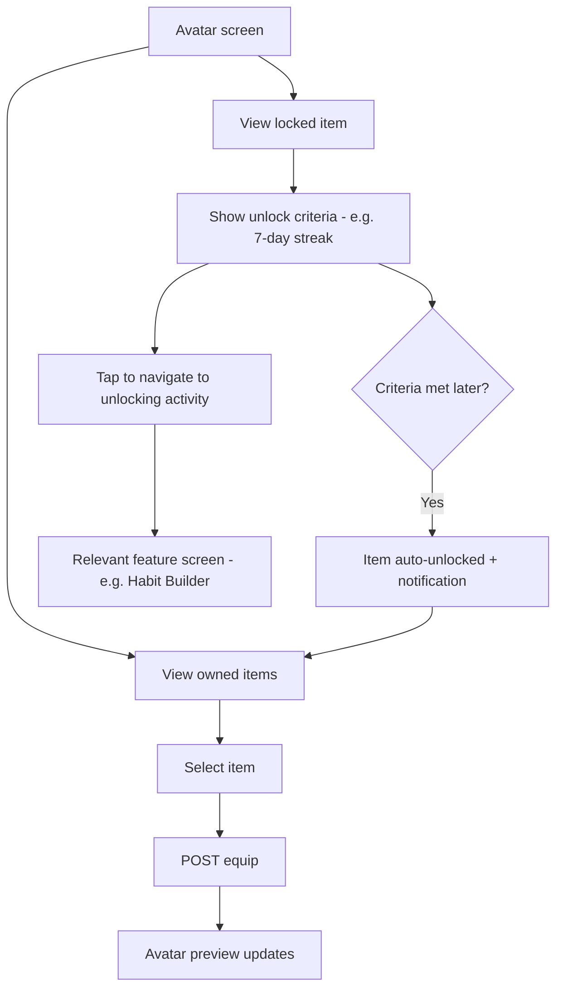
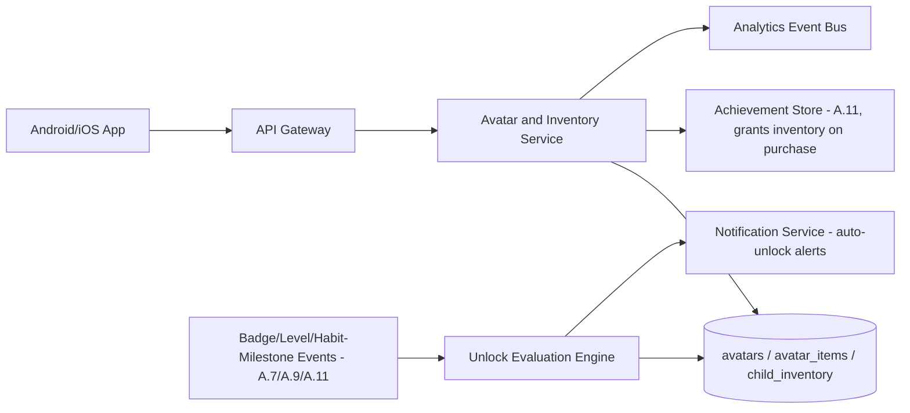
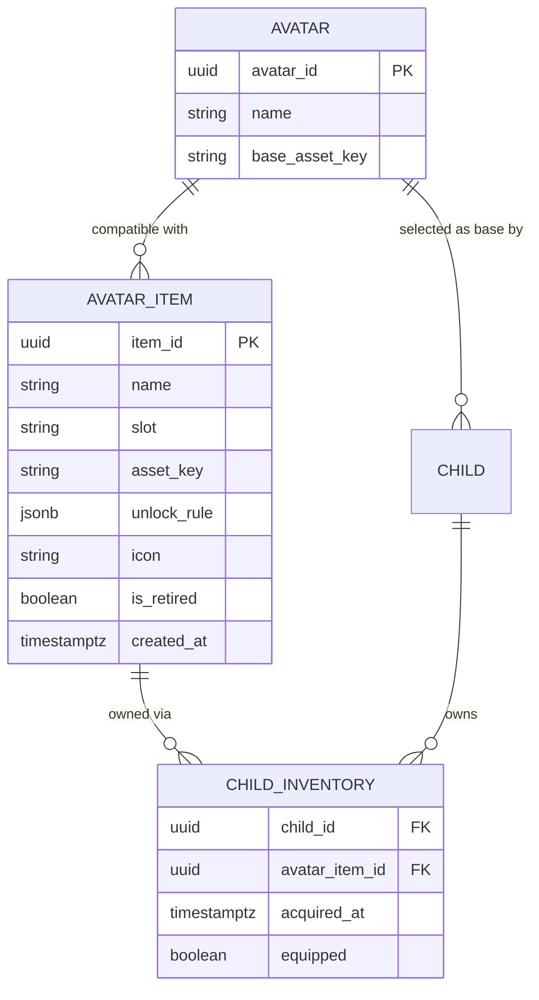

# Feature A.12 — Avatar System (Character Evolution & Customization)

**App:** NoorHeroes — Islamic Learning App for Children
**Feature Owner:** Product / Game Design / Content & Editorial
**Status:** Implementation-ready
**Version:** 1.0
**Depends on:** A.1 (Auth & Onboarding — avatar selection at child creation), A.11 (Rewards System — Achievement Store purchases, badge/level unlock criteria)
**Feeds into:** A.2 Home (Noor companion presentation), A.11 Rewards (Achievement Store → equip), C.22 Parent Progress Reports

> **Scope note:** This document specifies the Avatar System as its own distinct surface: the avatar base library, the `avatar_items` catalog (outfits/glow states/accessories), the equip/unlock lifecycle, and Character Evolution (avatars and the Noor companion evolving through learning-based progression). A.11 already specified the Achievement Store's purchase transaction (Noor Heroes Points debit + `child_inventory` grant) — this document is where that granted inventory actually becomes wearable, previewable, and where unlock criteria tie back to badges/levels/habit milestones. No purchase logic is re-specified here; this document owns equip/preview/unlock-evaluation only.

---

## Table of Contents

1. [Product Requirements](#1-product-requirements)
2. [UX/UI Requirements](#2-uxui-requirements)
3. [Backend Requirements](#3-backend-requirements)
4. [Database Design](#4-database-design)
5. [Backend AI Code-Generation Prompt](#5-backend-ai-code-generation-prompt)
6. [Android Requirements](#6-android-requirements)
7. [Android AI Code-Generation Prompt](#7-android-ai-code-generation-prompt)
8. [Admin Requirements](#8-admin-requirements)
9. [Admin AI Code-Generation Prompt](#9-admin-ai-code-generation-prompt)
10. [DevOps Requirements](#10-devops-requirements)
11. [Analytics Requirements](#11-analytics-requirements)
12. [Security Requirements](#12-security-requirements)
13. [QA Requirements](#13-qa-requirements)
14. [Marketing Requirements](#14-marketing-requirements)
15. [Release & Rollback Plan](#15-release--rollback-plan)

---

## 1. Product Requirements

### 1.1 Problem Statement

Children need a personal, evolving avatar that visibly grows alongside their real learning and habits — outfits, glow states, and companion evolution that are earned through genuine progression (badges, levels, habit milestones) rather than arbitrary or opaque unlocks, with zero user-generated content risk (no uploads) and zero real-money purchase pressure in child mode (source: NoorHeroes Blueprint Admin module 11 "Avatar Management" Validation Rules: "Items are never sold for real money in child mode; unlock rules must map to an existing badge, level, or habit milestone — no arbitrary or opaque unlocks"; Consolidated Blueprint navigation table: "Items are sourced only from `AvatarItems` catalog; no user uploads").

### 1.2 Business Goals

- Give earned Noor Heroes Points genuine spending purpose (via A.11's Achievement Store) and give earned badges/levels genuine visual payoff, reinforcing the platform's "rewards reflect real learning" trust commitment.
- Drive sustained engagement through Character Evolution — the Noor companion and avatar visibly maturing as a tangible, motivating reflection of real progress.
- Maintain zero user-generated-content risk: every visual asset a child can ever equip comes from the admin-managed `avatar_items` catalog, never a user upload, eliminating an entire class of child-safety/moderation risk by architectural design.
- Support low-end Android performance targets for any 3D/animated avatar rendering, per the platform's accessibility/performance commitments.

### 1.3 User Goals

- **Child:** Customize my avatar with outfits and glow effects I've earned, see locked items and know exactly what I need to do to unlock them, and watch my avatar and Noor companion evolve as I keep learning.
- **Parent:** Trust that every avatar item came from a vetted, age-appropriate catalog — never something my child uploaded or that came from an unmoderated source — and that there's no way to spend real money on cosmetics in child mode.

### 1.4 Success Metrics

| Metric | Target |
|---|---|
| Avatar customization engagement rate (children who equip at least one non-default item) | ≥ 60% |
| Locked-item-teaser → unlocking-activity conversion rate (child views a locked item's criteria, then engages the relevant activity within 7 days) | ≥ 30% |
| Character Evolution milestone view-through rate | ≥ 70% |
| Avatar screen load performance (low-end Android) | p95 < 1s |
| Equip action latency | p95 < 300ms |
| Crash-free Avatar sessions | ≥ 99.5% |

### 1.5 Stakeholders

Product Manager, Game/Character Designer, 3D/Animation Artist, Content/Editorial Lead, Backend Architect, Android Architect (3D rendering performance), Data Analyst, QA Lead, A.11 Rewards feature owner (cross-dependency), Child Safety/Trust Advisor (modesty/appropriateness review of all character assets).

### 1.6 User Stories

1. As a child, I want to see my avatar in a clear preview and try on different outfits and glow effects I own.
2. As a child, I want to see items I haven't unlocked yet, with a clear explanation of what I need to do to get them.
3. As a child, I want to tap a locked item and go straight to the activity that would unlock it.
4. As a child, I want my avatar and Noor companion to visibly change/level up as I keep learning and building habits.
5. As a parent, I want confidence every avatar item is appropriate and modest, vetted by the same content team that reviews everything else in the app.
6. As a parent, I want assurance there's no way for my child to upload their own image as an avatar, and no way to buy cosmetics with real money.
7. As a child, when I unlock a new item automatically (by meeting its criteria), I want to be told about it, not just discover it silently.

### 1.7 Functional Requirements

**FR-1** Avatar screen sections: 3D avatar preview, owned-items grid (organized by slot: outfit/glow/accessory), locked-item teasers showing unlock criteria (source: screen catalog "Avatar — UI Sections: 3D avatar preview, owned-items grid (outfits, glow states), locked-item teasers with unlock criteria").
**FR-2** User actions: equip/unequip an owned item, preview a locked item (a non-committal visual preview without actually equipping it), and navigate directly to the activity that would unlock a given locked item (source: screen catalog "User Actions: Equip/unequip an item, preview a locked item, navigate to the activity that unlocks it").
**FR-3** Avatar items are sourced **only** from the admin-managed `avatar_items` catalog — there is no user-upload path anywhere in the app for avatar customization (source: navigation table, "Items are sourced only from `AvatarItems` catalog; no user uploads" — a hard, zero-exception architectural rule).
**FR-4** Every `avatar_item`'s `unlock_rule` must map to an existing badge, level threshold, or habit milestone — admin tooling must reject any attempt to define an arbitrary or opaque unlock condition with no underlying verifiable criteria (source: Admin module Validation Rules — restated here as the rule this feature's read/evaluation path depends on).
**FR-5** Items are never sold for real money in child mode — equivalent to and consistent with A.11 FR-1's Noor-Heroes-Points-only economy; this feature's equip/unlock layer has no payment-related code path at all (source: Admin module Validation Rules).
**FR-6** Equipping an item is immediate (optimistic client update, server-confirmed) and instantly reflected in the avatar preview (source: Avatar Flow diagram, "POST equip → Avatar preview updates").
**FR-7** Locked items display their specific unlock criteria (e.g., "7-day streak") rather than a generic lock icon with no explanation, consistent with the platform's general locked-content transparency principle established in A.3/A.5.
**FR-8** When a child's activity causes a locked item's criteria to become met, the item is **auto-unlocked** and a notification is sent — the child is never required to manually "claim" an avatar-item unlock the way they might claim a mission/challenge reward in A.11 (source: Avatar Flow diagram, "Criteria met later? → Yes → Item auto-unlocked + notification").
**FR-9** Character Evolution: avatars and Noor companions evolve through learning-based progression — Quran skills, story morals, kindness actions, and habit consistency unlock new outfits, glow states, and story-world abilities (source: "Character Evolution" feature card — "Avatars and Noor companions evolve through learning-based progression... unlock new outfits, glow states, and story-world abilities").
**FR-10** Retiring an `avatar_item` from the catalog (Admin "Delete" action) never revokes it from children who already own it — retired items remain fully equippable for existing owners, only new acquisition is prevented (source: Admin module CRUD Operations, "Retire item (owned items remain equippable)").
**FR-11** Avatar base selection happens at child-profile creation (A.1) from the `avatars` base library; this feature does not re-implement avatar-base selection, only the items/customization layered on top of the chosen base.
**FR-12** All avatar assets (base avatars and every `avatar_item`) must pass a modesty/age-appropriateness review by the same content governance pipeline used for other content types — "it's just a cosmetic" is never an exemption from this review.

### 1.8 Non-Functional Requirements

- **Performance:** Avatar preview rendering optimized for low-end Android (per the platform's general low-end-device commitment) — 3D/animated assets must be lightweight; Avatar screen load p95 < 1s.
- **Content Safety:** Zero user-generated-content surface — enforced architecturally (no upload endpoint exists), not merely as a policy.
- **Unlock Integrity:** Every unlock criteria evaluation must be deterministic and traceable back to an actual badge/level/habit-milestone record (FR-4) — no opaque or random unlock logic.
- **Accessibility:** 3D preview must have a static-image accessibility fallback (a screen-reader-friendly text description of the currently-equipped look) for assistive-technology users who cannot perceive the 3D render meaningfully.

### 1.9 Acceptance Criteria

- Given a child opens the Avatar screen, when it renders, then they see their 3D preview, an owned-items grid organized by slot, and locked-item teasers each showing specific unlock criteria.
- Given a child taps an owned item, when they equip it, then the avatar preview updates immediately and the change persists across app sessions.
- Given a child taps a locked item, when they view its detail, then they see the specific unlock criteria and a direct navigation link to the relevant unlocking activity.
- Given a child's activity causes a locked item's criteria to be met, when this is evaluated server-side, then the item auto-unlocks and a notification is sent — no manual claim action is required.
- Given an Admin retires an `avatar_item` from the catalog, when a child who already owns it opens their Avatar screen, then the item remains fully visible and equippable.
- Given an Admin attempts to create an `avatar_item` with an unlock rule that doesn't reference an existing badge/level/habit-milestone, when they submit, then the system rejects it with a clear validation error.
- Given a parent or child looks for any avatar-customization path involving a photo upload or real-money purchase, when they search the entire Avatar screen and flow, then no such path exists.

### 1.10 Edge Cases

1. A child equips an item from a slot (e.g., "outfit"), then later that specific item is retired by Admin (FR-10) → the item remains equipped and visible exactly as it was; retirement only prevents *new* acquisition by other children, never affects an existing owner's equipped state.
2. Two avatar items from different slots have a default-equipped state when a child's profile is first created → the system must have a well-defined default outfit/glow/accessory combination at child-creation time (set during A.1's Add Child avatar selection) so the Avatar screen never renders an avatar with an undefined or null equipped state in any slot.
3. A child's age-band changes (birthday rollover) and a previously-displayed avatar item was only ever intended for a younger age band visually (e.g., a more babyish design) → items are not retroactively un-equipped based on age-band changes (a child keeps what they've earned and equipped), though the *available-to-unlock* catalog going forward may reasonably skew toward age-appropriate new items via the standard age-banded content filtering already used elsewhere in the platform.
3. *(renumbered)* A locked item's unlock criteria references a badge that has since been deprecated/retired by Admin (an unusual content-lifecycle edge case) → the item's locked-teaser state should gracefully indicate "currently unavailable to unlock" rather than show a broken/dangling reference to a non-existent badge, and should not block rendering of the rest of the Avatar screen.
4. A child rapidly taps "equip" on multiple different items within the same slot in quick succession → idempotent, last-tap-wins handling ensures the final equipped state matches the child's actual last intended selection, without a race condition leaving an inconsistent or flickering state.
5. A child previews a locked item (FR-2's non-committal preview action) and then closes the app without equipping anything → the preview action has zero persistent side effects; on reopening, the avatar shows whatever was actually equipped before the preview, not the previewed item.
6. An item's `unlock_rule` references a habit milestone (e.g., "30-day Quran-reading streak") and that streak is later broken (per A.7's streak state machine transitioning to `Broken`) after the item was already unlocked → consistent with the platform's general "badges/unlocks are sticky once earned" principle (A.6/A.11), the avatar item remains unlocked permanently; a broken streak never retroactively re-locks a previously-earned item.
7. Two siblings share a device; switching from Child A to Child B mid-session → the Avatar screen must fully reset to Child B's own avatar base, owned items, and equipped state — zero visual or data carryover from Child A's session (consistent with the platform-wide multi-child session-isolation rule).
8. A child's Noor companion "evolves" (Character Evolution, FR-9) crossing a visible milestone while the child is actively on the Home screen looking at the companion → the evolution visual update should apply gracefully (e.g., on next Home load or via a graceful in-place transition), never an abrupt jarring change mid-interaction that could startle a young child.
9. An `avatar_item`'s asset fails to load (CDN/media issue) → the owned-items grid shows a graceful placeholder/retry state for that specific item rather than a broken image or a crash, and the 3D preview falls back to the last successfully-rendered equipped state rather than showing a broken avatar.
10. A child attempts to equip an item they do not actually own (e.g., via a tampered/replayed client request referencing a locked item's ID) → the server validates ownership at equip time and rejects the request; the locked item remains locked regardless of the client-side request.
11. An Admin updates an existing `avatar_item`'s `unlock_rule` (e.g., changing the streak length required) after some children have already unlocked it under the old rule → consistent with the platform's non-retroactivity principle (A.9 Edge Case 9), children who already unlocked it keep it; the new rule applies only to children who haven't yet unlocked it going forward.

### 1.11 Error Handling

| Scenario | System Behavior |
|---|---|
| Equip request fails (network) | Optimistic local UI update shown immediately; retried via background sync; reconciled with server state on next successful response |
| Avatar item asset fails to load | Graceful placeholder/retry for that specific grid item; 3D preview falls back to last successfully-rendered state (Edge Case 9) |
| Equip request for an unowned item (tampered/stale client state) | Server rejects with a clear "not yet unlocked" response; client re-syncs ownership state |
| Locked item's unlock_rule references a deprecated badge/level | Locked-teaser shows "currently unavailable to unlock" gracefully (Edge Case 3) |
| Auto-unlock notification fails to deliver | The unlock itself (the `child_inventory` grant) is unaffected; the child will simply see the newly-unlocked item next time they open the Avatar screen even if the notification was missed |

### 1.12 Empty States
- New child, default avatar/items only → owned-items grid shows the default set with no "empty" framing needed (every child starts with at least a base equipped look); locked-item teasers populate normally from the catalog.

### 1.13 Loading States
- Avatar screen: skeleton 3D-preview placeholder + skeleton items-grid shimmer while loading.

### 1.14 Offline States
- Last-synced avatar state (owned items, equipped state) renders fully offline; equip actions taken offline queue and sync on reconnect, consistent with the platform's offline-first equip pattern (FR-6).
- Locked-item criteria display uses cached catalog data; auto-unlock evaluation itself requires connectivity (it's a server-side process) but the child is never blocked from viewing/equipping their already-owned items offline.

### 1.15 Permission States
- No new runtime permissions; explicitly **no camera/photo-library permission is ever requested by this feature**, since there is no upload path (FR-3) — this absence is itself a deliberate, testable property.

### 1.16 User Flow (Narrative)

Child opens the Avatar screen (from Rewards or the Profile tab's avatar thumbnail) → views their 3D preview and owned-items grid → equips/unequips items, seeing instant preview updates → browses locked-item teasers, optionally taps one to preview it or to navigate directly to the activity that would unlock it → continues using the app normally; whenever an activity elsewhere in the app causes a locked item's criteria to be met, the item auto-unlocks server-side and the child receives a notification, discoverable next time they open the Avatar screen (now showing the item as owned) or immediately via the notification's deep link.

### 1.17 Detailed Flow Diagram (Mermaid)

**Avatar Flow (canonical, source "Avatar Flow" diagram):**



### 1.18 Screen Inventory (Complete — Zero Missing)

| # | Screen / Component | Type | Entry Points | Exit Points |
|---|---|---|---|---|
| 1 | Avatar Screen (3D preview + owned grid + locked teasers) | Primary | Rewards Hub (A.11), Profile tab avatar thumbnail | Item Detail, Locked Item Detail, relevant unlocking feature |
| 2 | 3D Avatar Preview (component) | Component | Avatar Screen | N/A |
| 3 | Owned-Items Grid, grouped by slot (outfit/glow/accessory) | Component | Avatar Screen | Item Detail |
| 4 | Item Detail (owned) — Equip/Unequip | Screen/Modal | Owned-Items Grid | Avatar Screen (preview updated) |
| 5 | Locked-Item Teaser (component) | Component | Avatar Screen | Locked Item Detail |
| 6 | Locked Item Detail — Unlock Criteria View | Screen/Modal | Locked-Item Teaser | "Go to activity" deep link, or dismiss |
| 7 | Locked-Item Non-Committal Preview | Screen/Modal variant | Locked Item Detail "Preview" action | Dismiss (no persistent change) |
| 8 | Auto-Unlock Celebration Notification (in-app banner/modal) | Component | Server-evaluated criteria-met event | Dismiss → Avatar Screen (item now owned) |
| 9 | Character Evolution Milestone Reveal | Modal | Noor companion/avatar crossing an evolution threshold | Dismiss → returns to current screen (e.g., Home) |
| 10 | Asset-Load-Failure Placeholder (per grid item) | Component | Owned-Items Grid, asset failure | Retry |
| 11 | Locked Item — "Currently Unavailable to Unlock" State | Component variant | Locked Item Detail, deprecated unlock-rule reference | Dismiss |
| 12 | Offline Avatar State | Screen variant | Avatar Screen, no connectivity | N/A (fully functional from cache except new-unlock evaluation) |

### 1.19 Events (Complete Analytics Event List)

`avatar_screen_viewed`, `avatar_item_equipped`, `avatar_item_unequipped`, `avatar_locked_item_viewed`, `avatar_locked_item_previewed`, `avatar_locked_item_unlock_activity_navigated`, `avatar_item_auto_unlocked`, `avatar_unlock_notification_shown`, `character_evolution_milestone_reached`, `character_evolution_reveal_viewed`, `avatar_item_asset_load_failed`, `avatar_equip_rejected_unowned_item` (internal/security signal).

---

## 2. UX/UI Requirements

> Global Design System tokens defined in **Feature A.1 §2.1**; locked-content transparency principle established in **Features A.3/A.5**; badge/unlock-stickiness principle established in **Features A.6/A.11**.

### 2.1 Avatar-Specific Design System Extensions

- **3D Preview Lighting/Staging:** A consistent, warm, soft-lit staging environment (a subtle radial glow, no busy background) frames the 3D avatar regardless of which outfit/glow is equipped, keeping focus on the character itself.
- **Modesty-by-Default Asset Guidelines:** Every outfit asset (by content-authoring guideline, enforced via the admin review pipeline per FR-12) adheres to modest, age-appropriate design — there is no "swimwear," overly form-fitting, or otherwise immodest item category in the catalog by design, consistent with the platform's Islamic values orientation.
- **Locked-Item Visual Language:** A soft greyscale/desaturated silhouette (never a harsh blackout or a "?" mystery-box treatment, which could imply gacha-style randomness contrary to the platform's anti-loot-box principle) with the unlock-criteria text always visible beneath, not hidden behind an additional tap.
- **Character Evolution Visual Language:** Evolution milestones use a gentle, growth-themed transition (e.g., a soft glow bloom, consistent with A.7's Noor Garden growth metaphor) rather than an abrupt "transform" effect — reinforcing the "gradual real progress" framing over a sudden game-like power-up.

### 2.2 Screen-Level Design Requirements (Key Screens)

#### Screen: Avatar Screen

- **Purpose:** Let the child view, customize, and understand the progression path of their personal avatar.
- **Components:** Large centered 3D preview (rotatable via simple swipe/drag gesture, with a non-gesture rotation-arrow alternative for accessibility), a tabbed or segmented control for slot categories (Outfits/Glow/Accessories), a scrollable grid of items per slot showing owned (tappable, equip-state-indicated) and locked (desaturated, criteria-labeled) items together in a unified browsing experience.
- **States:** Default, Loading (skeleton), Item-equip-in-progress (brief optimistic transition), Offline (cached state), Asset-load-failure (per-item placeholder).
- **Accessibility:** 3D preview has a text-description fallback ("Currently wearing: Garden Explorer outfit, Golden Glow"); rotation gesture has a button-based alternative; locked-item criteria text always present and screen-reader-readable, never icon-only.
- **Responsive Rules:** Single-column preview-on-top/grid-below on mobile; tablet may show preview and grid side-by-side.

#### Screen: Locked Item Detail

- **Purpose:** Clearly communicate what's needed to unlock a specific item and offer a direct path there.
- **Components:** Item illustration (desaturated/locked styling), unlock criteria text (specific, e.g., "Complete a 7-day Quran reading streak"), a "Preview" action (non-committal try-on), and a "Go to [Activity]" primary action deep-linking to the relevant feature.
- **States:** Default, Criteria-recently-progressed (an optional subtle "you're getting close!" framing if progress data is available and meaningful to surface), Unavailable (deprecated unlock-rule reference, Edge Case 3).

### 2.3 Tab Structure

Avatar is reachable from Rewards (Tab 4) and from the Profile tab's (Tab 5) avatar thumbnail — not its own bottom-nav tab. Click mapping:

| Click Target | Destination | API Called | Analytics Event | Permission Check | Error Handling |
|---|---|---|---|---|---|
| Rewards Hub "Avatar" entry / Profile avatar thumbnail | Avatar Screen | `GET /v1/children/{id}/inventory` | `avatar_screen_viewed` | None | Cached fallback |
| Owned item tap | Item Detail / direct equip | `POST /v1/children/{id}/inventory/{itemId}/equip` | `avatar_item_equipped` | Ownership check (server-side) | Optimistic + retry |
| Locked item tap | Locked Item Detail | None (client-rendered from cached catalog criteria) | `avatar_locked_item_viewed` | None | "Unavailable" fallback if criteria reference is stale |
| Locked item "Go to [Activity]" | Relevant feature screen (deep link) | N/A | `avatar_locked_item_unlock_activity_navigated` | None | Standard deep-link fallback |

### 2.4 Wireframe Description (Composite)

A single, immersive screen with the 3D preview dominating the upper portion and a segmented, scrollable item grid below — consistent with the platform's general "hero visual + browsable grid" pattern shared with A.3's Story Detail (cover + episode list) and A.5's Surah Learning (companion presence + ayah list).

### 2.5 Screen Image Generation Prompts

**Screen: Avatar Screen**
- *Prompt 1 (English):* "Mobile app avatar customization screen UI mockup for a children's app. Warm off-white background. Top half shows a large centered 3D-style friendly character illustration (a soft, rounded, child-safe abstract character wearing a simple modest outfit with a gentle golden glow aura, NOT a realistic human figure) staged on a soft circular glowing platform with subtle radial light. Below, a segmented tab control labeled 'Outfits / Glow / Accessories', and beneath that a scrollable grid of rounded square item tiles -- some colorful and clearly owned, some desaturated grey silhouettes with a small text label underneath reading something like '7-day streak to unlock'. Warm teal and gold accents, rounded corners, soft shadows, joyful and magical aesthetic, no realistic human faces, bottom navigation visible."
- *Prompt 2 (Arabic RTL):* "نفس شاشة تخصيص الصورة الرمزية لتطبيق أطفال، بتخطيط من اليمين إلى اليسار بالكامل. خلفية بيج فاتح دافئ. النصف العلوي يعرض شخصية ودودة كبيرة بأسلوب ثلاثي الأبعاد في المنتصف (شخصية تجريدية ناعمة ومستديرة وآمنة للأطفال ترتدي زيًا بسيطًا ومحتشمًا مع هالة توهج ذهبية لطيفة، ليست شخصية بشرية واقعية) موضوعة على منصة دائرية متوهجة ناعمة بإضاءة شعاعية خفيفة. أسفل ذلك عنصر تحكم مقسم بعنوان 'الأزياء / التوهج / الإكسسوارات'، وتحته شبكة قابلة للتمرير من بطاقات عناصر مربعة مستديرة الزوايا — بعضها ملون وواضح أنه مملوك، وبعضها ظل رمادي غير مشبع مع تسمية نصية صغيرة أسفله تقول مثلاً 'متتالية 7 أيام للفتح'. لمسات فيروزية وذهبية دافئة، زوايا دائرية، ظلال خفيفة، طابع مرح وسحري، بدون وجوه بشرية واقعية، شريط تنقل سفلي ظاهر."

**Screen: Character Evolution Milestone Reveal**
- *Prompt 1 (English):* "Mobile app full-screen celebratory modal UI mockup for a children's app character evolution moment. Centered soft abstract companion character (a friendly lantern or crescent-moon-shaped creature, not a human figure) shown mid-transformation with a gentle blooming golden-light particle effect radiating outward, suggesting graceful growth rather than a sudden power-up. Warm gradient background transitioning from soft teal to warm gold. Below the character, a short celebratory text line about the milestone reached, and a single rounded 'Continue' button. No realistic human faces, no aggressive flash/strobe effects, calm-but-joyful magical mood, soft particle glow, rounded shapes."
- *Prompt 2 (Arabic RTL):* "نفس النافذة الاحتفالية بملء الشاشة لتطبيق أطفال، لحظة تطور الشخصية، بتخطيط من اليمين إلى اليسار. شخصية رفيق مجردة ناعمة في المنتصف (مخلوق ودود على شكل فانوس أو هلال، ليست شخصية بشرية) تظهر في وسط عملية تحول مع تأثير جزيئات ضوء ذهبي متوهج ينتشر للخارج بلطف، يشير إلى نمو رشيق وليس قوة مفاجئة. خلفية متدرجة دافئة تتحول من فيروزي ناعم إلى ذهبي دافئ. تحت الشخصية سطر نصي احتفالي قصير عن الإنجاز الذي تم الوصول إليه، وزر مستدير واحد بعنوان 'استمرار'. بدون وجوه بشرية واقعية، بدون تأثيرات وميض أو ومضات عدوانية، طابع سحري هادئ لكن مفرح، توهج جزيئات ناعم، أشكال مستديرة."

---

## 3. Backend Requirements

### 3.1 System Design Overview

The Avatar System is served by an **Avatar & Inventory Service** that owns the `avatars`/`avatar_items`/`child_inventory` data model (shared schema already partially defined in A.11 §4.1's `catalog_items`/`child_inventory` reference — this service is the canonical owner of `avatar_items` specifically as a typed subset/extension of the general catalog concept), with an **Unlock Evaluation Engine** that subscribes to badge/level/habit-milestone events from A.11/A.7/A.9 and evaluates `unlock_rule` criteria to drive auto-unlocking.

### 3.2 Architecture Diagram (Mermaid)



### 3.3 Service Breakdown

| Service | Responsibility |
|---|---|
| Avatar & Inventory Service | Catalog browsing, equip/unequip processing, ownership validation |
| Unlock Evaluation Engine | Subscribes to badge/level/habit-milestone events, evaluates `unlock_rule` JSON criteria, grants `child_inventory` rows on match |
| (Reused) Achievement Store (A.11) | Also grants `child_inventory` rows on Noor-Heroes-Points purchase — same underlying ownership table, two distinct acquisition paths (earn-via-criteria vs. buy-via-points) |
| (Reused) Notification Service | Delivers auto-unlock notifications |

### 3.4 API List

#### `GET /v1/children/{id}/inventory`
- **Auth:** Bearer (own child only)
- **Response 200:** `{ "avatar_base": {...}, "owned_items": [ { "item_id": "...", "slot": "outfit", "equipped": true } ], "locked_items": [ { "item_id": "...", "slot": "glow", "unlock_rule_description": "Complete a 7-day Quran reading streak", "unlock_rule_available": true } ] }`
- **Validation:** `locked_items` includes a human-readable `unlock_rule_description` resolved server-side from the structured `unlock_rule` JSON (the client never needs to interpret raw criteria JSON itself); `unlock_rule_available: false` flags a deprecated-reference case (Edge Case 3) so the client can render the "currently unavailable to unlock" state.

#### `POST /v1/children/{id}/inventory/{itemId}/equip`
- **Auth:** Bearer (own child only)
- **Response 200:** `{ "equipped": true, "slot": "outfit" }`
- **Validation:** Server-side ownership check — rejects (`403 ITEM_NOT_OWNED`) if the requesting child does not have a `child_inventory` row for this item, regardless of client-side state (Edge Case 10).
- **Business Logic:** Equipping an item in a given slot automatically unequips any other item previously equipped in that same slot (one equipped item per slot, enforced server-side).

#### `POST /v1/children/{id}/inventory/{itemId}/unequip`
- **Response 200:** `{ "equipped": false }`

#### Internal: Unlock Evaluation Engine consumer (not a public API, triggered by event consumption)
- Subscribes to badge-unlocked, achievement-level-progressed, and habit-streak-state-changed events (from A.7/A.9/A.11's event bus topics).
- For each event, evaluates all `avatar_items` whose `unlock_rule` references the matching badge/level/milestone; on match, inserts a `child_inventory` row (idempotent — checks for existing ownership first) and triggers a notification.

### 3.5 Cross-Cutting API Concerns

- **No payment path:** No endpoint in this service accepts any payment-related field — equip/unequip are the only mutating actions this service exposes; acquisition happens either via the Unlock Evaluation Engine (criteria-based, free) or via A.11's Achievement Store (Noor-Heroes-Points-based) — never real money.
- **Ownership re-validation:** Every equip action re-validates ownership server-side, never trusting client state.
- **Idempotency:** Unlock-grant insertion is idempotent (checks existing ownership before insert) to safely handle event-redelivery from the event bus.

---

## 4. Database Design

### 4.1 ER Diagram (Mermaid)

> `avatar_items` and `child_inventory` are sourced directly from the Admin Database Schema table already referenced in the source material; this is their canonical definition.



### 4.2 Tables, Relationships, Constraints

| Table | Key Constraints | Indexes |
|---|---|---|
| `avatars` | — | — |
| `avatar_items` | CHECK `slot IN ('outfit','glow','accessory')`; `unlock_rule` jsonb must conform to a validated schema referencing an existing `badge_id`/level-threshold/habit-milestone-type — enforced at write time by the Admin API (not a raw free-form JSON blob) | Index `(slot)`, Index `(is_retired)` |
| `child_inventory` | FK `child_id`, `avatar_item_id`; **UNIQUE(`child_id`, `avatar_item_id`)** — prevents duplicate ownership rows from either acquisition path (criteria-unlock or store-purchase); CHECK at most one row per `(child_id, slot-of-this-item)` may have `equipped = true` (enforced via a partial unique index on `(child_id, slot)` WHERE `equipped` is true, derived via a join to `avatar_items.slot`, or maintained via application-transaction logic with an equivalent guarantee) | Index `(child_id)`, Index `(child_id, equipped)` |

### 4.3 Audit Fields
`child_inventory.acquired_at` records the historical fact of acquisition (never altered). `avatar_items.created_at` standard.

### 4.4 Soft Delete Rules
`avatar_items.is_retired = true` used instead of deletion (FR-10) — preserves all existing `child_inventory` ownership rows referencing it; retired items are excluded from new-unlock evaluation and from the Achievement Store's purchasable catalog, but remain fully equippable for existing owners.

### 4.5 Retention Rules
`child_inventory` retained indefinitely (a child's permanent collection record, consistent with the platform's "unlocks are sticky" principle).

---

## 5. Backend AI Code-Generation Prompt

```
You are building the Avatar & Inventory Service and the Unlock Evaluation
Engine for "NoorHeroes." This service owns avatars, avatar_items, and
child_inventory -- the same child_inventory table referenced by Feature
A.11's Achievement Store (which grants ownership via Noor Heroes Points purchase).
This service does NOT re-implement purchase logic; it owns equip/unequip
and criteria-based auto-unlocking only.

Stack: FastAPI (Python 3.12), PostgreSQL (SQLAlchemy 2.0), Kafka consumer
for badge/level/habit-milestone events.

Hard requirements:
1. Implement POST /v1/children/{id}/inventory/{itemId}/equip with a
   SERVER-SIDE ownership check: query child_inventory for
   (child_id, item_id) before allowing the equip; return
   403 ITEM_NOT_OWNED if no such row exists, regardless of any client-
   supplied claim. Write a test attempting to equip an item_id the child
   does not own and asserting rejection.
2. Enforce "one equipped item per slot": when equipping item X in slot
   "outfit", any other child_inventory row for that same child where the
   joined avatar_item.slot = "outfit" and equipped=true must be set to
   equipped=false in the SAME transaction. Write a test equipping two
   different outfits in sequence and asserting only the most recently
   equipped one has equipped=true afterward, with no slot ever having
   more than one simultaneously-equipped item.
3. Implement the unlock_rule field as a VALIDATED structured JSON schema
   (not a free-form blob) at the Admin write-path level: it must reference
   one of badge_id (existing badges.id), level_threshold (an existing
   achievement_definitions level concept), or habit_milestone_type +
   threshold (an existing, recognized habit/streak type from A.7). Reject
   any avatar_item creation/update where unlock_rule references a
   non-existent badge_id or an unrecognized milestone type. Write a test
   attempting to create an avatar_item with an unlock_rule referencing a
   fake/non-existent badge_id and asserting rejection.
4. Implement the Unlock Evaluation Engine as a Kafka consumer subscribing
   to badge_unlocked, achievement_level_progressed, and
   habit_streak_state_changed events. For each event, query avatar_items
   whose unlock_rule matches the event's criteria, and for each matching
   item, INSERT into child_inventory ON CONFLICT (child_id, avatar_item_id)
   DO NOTHING (idempotent -- safe against event redelivery), then if a
   new row was actually inserted, publish a notification trigger. Write a
   test that processes the SAME badge_unlocked event twice (simulating
   redelivery) and asserts only one child_inventory row exists and only
   one notification was triggered, not two.
5. Implement avatar_items.is_retired handling: retiring an item (setting
   is_retired=true) must NOT cascade-delete or otherwise affect existing
   child_inventory rows referencing it -- write a test retiring an item
   that a fixture child already owns, then confirming that child's
   GET /v1/children/{id}/inventory response still lists it as owned and
   equippable.
6. Implement GET /v1/children/{id}/inventory to resolve each locked
   item's unlock_rule into a human-readable unlock_rule_description
   string server-side (e.g., "Complete a 7-day Quran reading streak")
   -- the client must never need to parse raw unlock_rule JSON itself.
   If an unlock_rule references a badge/milestone that has since been
   deprecated/retired, set unlock_rule_available=false in the response
   rather than crashing or omitting the item. Write a test for this
   exact deprecated-reference scenario.
7. Confirm via a schema-scan test (consistent with A.11's pattern) that
   NO endpoint in this service accepts a payment_method, store_receipt,
   or any IAP-related field -- this service has no purchase capability
   at all, by design.

Deliver: FastAPI routers, SQLAlchemy models, Alembic migrations (extending
the existing avatar_items/child_inventory schema referenced by A.11, not
duplicating it), Pydantic schemas, and a pytest suite covering all 7 items,
with items 1 (ownership re-validation), 2 (one-equipped-per-slot), and 4
(idempotent event-driven unlock) treated as the highest-priority tests.
```

---

## 6. Android Requirements

### 6.1 Technical Requirements
Kotlin, Jetpack Compose, MVVM, Clean Architecture, module `:feature:avatar`, depends on `:core:design-system`, `:core:network`, `:core:offline-cache`, and a 3D-rendering capability (e.g., Filament or a lightweight glTF-based renderer wrapped in `AndroidView`/Compose interop) optimized for low-end device performance per the platform's general performance commitment.

### 6.2 Screen Mapping
`AvatarScreen` Composable hosts the 3D preview (via the rendering engine's view wrapped in Compose) plus the segmented owned/locked items grid; `AvatarViewModel` exposes `StateFlow<AvatarUiState>` covering both.

### 6.3 Navigation Flow
Reachable from Rewards Hub and the Profile tab's avatar thumbnail; Locked Item Detail and its "Go to Activity" action deep-link into the relevant other feature module (e.g., `noorheroes://habits` for a streak-based unlock).

### 6.4 State Management
`AvatarViewModel`'s equip action is optimistic (immediately updates the local equipped state and re-renders the 3D preview) then reconciled against the server response — consistent with the platform's standard optimistic-update pattern (A.2/A.7). Locked-item criteria descriptions are rendered directly from the server's pre-resolved `unlock_rule_description` string; the client never parses raw criteria JSON.

### 6.5 API Mapping
`InventoryRepository.getInventory()` → `GET /v1/children/{id}/inventory`; `InventoryRepository.equip()` → `POST /v1/children/{id}/inventory/{itemId}/equip`.

### 6.6 Analytics Mapping
`AvatarAnalytics` fires events per §1.19; `avatar_item_auto_unlocked` is fired client-side upon detecting a newly-owned item in a fresh `GET /v1/children/{id}/inventory` response compared to the previously-cached state (a diffing approach, since the unlock itself happens server-side asynchronously).

### 6.7 Offline Support
Last-synced inventory state (Room-cached) renders fully offline; equip/unequip actions queue in a local outbox and sync via WorkManager on reconnect, consistent with the platform's standard offline-action pattern.

### 6.8 Deep Linking
`noorheroes://avatar`, `noorheroes://avatar/item/{itemId}` (for a notification deep link landing directly on a newly-unlocked item's detail).

### 6.9 Push Notifications
Landing target for the auto-unlock notification (owned by the Notifications feature) and for Character Evolution milestone alerts.

### 6.10 Testing Strategy
- Unit: `AvatarViewModel`'s optimistic-equip/reconcile logic; one-equipped-per-slot client-side state consistency (mirroring backend's invariant for fast local UX, though the server remains authoritative).
- UI tests: Locked-item teaser never renders a raw/unparsed JSON criteria string (always the server-resolved human-readable description); 3D preview accessibility fallback text renders correctly for the current equipped state.
- Integration: full equip → preview-update → app-restart-persists flow; offline equip → reconnect → sync flow; auto-unlock-detection-via-diffing flow against a mocked server response sequence.

---

## 7. Android AI Code-Generation Prompt

```
Build the `:feature:avatar` Android module for NoorHeroes using Kotlin,
Jetpack Compose, MVVM, Clean Architecture, with a lightweight 3D/glTF
rendering capability wrapped via AndroidView interop, optimized for
low-end Android performance.

Hard requirements:
1. AvatarViewModel's equip() action must be OPTIMISTIC: immediately
   update local UI state (re-rendering the 3D preview with the newly
   selected item) before the server response returns, then RECONCILE
   against the actual server response -- if the server rejects (e.g.,
   403 ITEM_NOT_OWNED due to stale client state), roll back the optimistic
   change and show a brief "couldn't equip that" message. Write a test
   simulating a server rejection and asserting the UI state rolls back
   to the previously-equipped item, not left in the optimistic
   (incorrect) state.
2. Enforce one-equipped-item-per-slot in the CLIENT's local state model
   as well (mirroring the server's invariant for instant, correct local
   UX): equipping a new item in a slot must locally and immediately
   un-equip any other item previously shown as equipped in that same
   slot, before the server confirms. Write a unit test for this exact
   local-state transition.
3. Render locked-item criteria EXCLUSIVELY from the server-provided
   unlock_rule_description string -- write a UI test asserting the
   Locked Item Detail screen never attempts to parse or render any raw
   JSON-looking text (a regex check against the displayed criteria text
   for JSON-like patterns such as curly braces, asserting none are
   present).
4. Implement 3D preview accessibility: provide a
   contentDescription/semantics property on the preview composable that
   describes the currently-equipped combination in plain text (e.g.,
   "Currently wearing: Garden Explorer outfit with Golden Glow") --
   write a test that changes the equipped state and asserts this
   description text updates accordingly.
5. Implement auto-unlock detection via diffing: on each successful
   GET /v1/children/{id}/inventory response, compare the owned_items
   list against the previously locally-cached list; for any item present
   in the new response but absent from the old cached list, fire
   avatar_item_auto_unlocked and optionally surface an in-app celebration
   (if the app is foregrounded) -- write a test feeding two sequential
   mocked responses (the second containing one additional owned item) and
   asserting the diffing logic correctly identifies exactly the new item.
6. Implement a local Room-backed outbox for equip/unequip actions taken
   offline, synced via WorkManager on reconnect -- write an integration
   test for the offline-equip-then-reconnect-then-sync flow.

Use Hilt, Retrofit+OkHttp, Room. Follow Global Design System tokens from
`:core:design-system`, adding the locked-item desaturated-silhouette and
Character Evolution glow-bloom transition tokens described in this spec's
UX section as reusable themed components.
```

---

## 8. Admin Requirements

Per the existing Admin Portal's "Avatar Management" module (source: NoorHeroes Blueprint module 11):

- **Avatar Base Library:** CRUD for `avatars` (name, `base_asset_key`).
- **Item Catalog Editor (Outfits/Glow States/Accessories):** Create avatar item (asset upload, slot assignment, icon), Read ownership distribution (how many children own/equip a given item — a content-popularity signal), Update unlock rule (subject to FR-4's validation), Delete = "Retire item" (owned items remain equippable, per FR-10/§5 item 5).
- **Unlock Rule Mapping Tool:** A structured builder (not free-form JSON entry) for defining `unlock_rule` as a reference to an existing badge, level threshold, or habit milestone type — the validated-schema approach specified in §5 item 3, surfaced as a guided UI rather than raw JSON editing.
- **Modesty/Appropriateness Review Queue:** Every new avatar item asset routes through the same content-governance review pipeline used elsewhere (scholar/trust-and-safety sign-off on modesty/appropriateness) before publish — surfaced here as a dedicated review queue specific to avatar assets.

CRUD permissions: Avatar Base Library = full CRUD behind `content_editor` role; Item Catalog Editor = full CRUD (delete = retire) behind `content_editor` role; Unlock Rule Mapping Tool = part of the Item Catalog Editor's form, same role; Modesty Review Queue = approval gate behind `trust_safety`/`content_editor` roles jointly (segregation of duties: the asset's original creator should not be the sole approver, consistent with the platform's general content-governance segregation-of-duties principle established in A.3's Scholar Review Workflow).

---

## 9. Admin AI Code-Generation Prompt

```
Build/extend the NoorHeroes Admin Portal's Avatar Management module (React +
TypeScript).

Pages:
1. Avatar Base Library -- simple CRUD table for avatars (name,
   base_asset_key upload).
2. Item Catalog Editor -- CRUD form for avatar_items: name, slot
   (outfit|glow|accessory dropdown), asset upload, icon upload, and a
   STRUCTURED Unlock Rule Builder (not a raw JSON text field) offering
   three mutually-exclusive options: (a) "Tied to badge" -- a searchable
   dropdown of existing badges, (b) "Tied to achievement level" -- a
   dropdown of existing achievement_definitions levels, (c) "Tied to
   habit milestone" -- a dropdown of recognized habit/streak milestone
   types (sourced from A.7's habit type registry) plus a threshold
   number input. The form's "Save" action calls a backend validation
   endpoint that rejects any selection referencing a non-existent
   badge/level/milestone type, surfacing that error inline. The "Delete"
   button is relabeled "Retire Item" and only sets is_retired=true,
   with explanatory copy: "Children who already own this item keep it.
   It just won't be unlockable by new children going forward."
3. Read-only "Ownership Distribution" tab on each item's detail page,
   showing aggregate counts of how many children own vs. have equipped
   this item, sourced from a read-only aggregated endpoint (never listing
   individual child identities).
4. Modesty/Appropriateness Review Queue -- a queue of newly-submitted
   avatar item assets pending review, requiring a trust_safety (or a
   content_editor who is NOT the original submitter -- enforce
   segregation of duties by checking the submitting admin_id differs from
   the approving admin_id) sign-off before the item can be set
   status='published'.

Enforce RBAC via the existing Admin Portal role context. Every mutating
action writes an immutable audit_log row.
```

---

## 10. DevOps Requirements

- **Infrastructure:** Avatar & Inventory Service is a moderate-traffic service (read-heavy on inventory fetch, light on equip mutations); the Unlock Evaluation Engine runs as a standing Kafka consumer process, scaled for the event volume produced by A.7/A.9/A.11's badge/level/streak event topics.
- **CI/CD:** The ownership re-validation test, the one-equipped-per-slot test, and the idempotent event-driven unlock test (§5 items 1, 2, 4) are **mandatory, non-bypassable** CI gates on any PR touching this service.
- **Monitoring/Logging/Alerting:** Alert on Unlock Evaluation Engine consumer lag (a stuck/slow consumer means children's earned items aren't unlocking promptly, a trust/satisfaction issue). Alert on any detected duplicate `child_inventory` row for the same `(child_id, avatar_item_id)` pair (should be structurally impossible given the unique constraint, monitored as a defense-in-depth canary).
- **Disaster Recovery:** `child_inventory`/`avatar_items` backed up at standard-to-high tier given their permanent-collection-record nature (consistent with other "sticky unlock" data across the platform).
- **Rollback Strategy:** Any deploy changing the unlock-rule validation schema or the Unlock Evaluation Engine's matching logic requires a staging replay against historical fixture badge/level/streak events confirming no previously-correct unlock outcome regresses.
- **Backup Strategy:** Standard tier for all tables in this service.
- **Environment Setup:** Staging supports injecting fixture badge/level/streak events directly onto the Kafka topics this engine consumes, enabling reliable QA of auto-unlock behavior without needing to organically earn badges through full feature flows.

---

## 11. Analytics Requirements

### 11.1 Event Taxonomy
Full list in §1.19. `avatar_locked_item_unlock_activity_navigated` → eventual `avatar_item_auto_unlocked` forms a measurable funnel testing whether the locked-item-teaser pattern actually drives engagement with the underlying unlocking activity, the feature's core engagement hypothesis.

### 11.2 Funnel Analysis
`avatar_screen_viewed` → `avatar_locked_item_viewed` → `avatar_locked_item_unlock_activity_navigated` → (eventual) `avatar_item_auto_unlocked` → `avatar_item_equipped`. This is the complete "discover a locked item → go earn it → unlock it → wear it" engagement loop, the feature's defining value chain.

### 11.3 Dashboard Metrics
Most/least-popular equipped items (an editorial signal for future asset investment), locked-item-teaser engagement rate by unlock-criteria-type (badge vs. level vs. habit-milestone — informs which unlock mechanism is most motivating), Character Evolution milestone reveal view-through rate.

### 11.4 Cohort & Retention
Cohort by first-avatar-customization-action; correlate avatar engagement with overall retention (testing whether personalization/identity-expression is a meaningful stickiness driver alongside the platform's other engagement hypotheses already tested in prior features).

### 11.5 Learning Metrics
Indirect — this feature's "learning metric" is really about whether avatar-unlock incentives meaningfully drive engagement with genuine learning/habit activities elsewhere (the locked-item → unlock-activity funnel above is the relevant signal, shared conceptually with A.11's mission/challenge participation metrics).

---

## 12. Security Requirements

### 12.1 Threat Analysis
- **Unowned-item equip bypass:** mitigated by server-side ownership re-validation on every equip request, never trusting client state.
- **Opaque/arbitrary unlock-rule creation (a content-integrity risk):** mitigated by the validated-schema requirement (FR-4/§5 item 3) rejecting any unlock rule that doesn't reference a real, existing badge/level/milestone.
- **User-generated-content risk:** structurally eliminated — there is no upload endpoint anywhere in this feature, the strongest possible mitigation for this risk class.
- **Duplicate-unlock-grant from event redelivery:** mitigated by the idempotent `ON CONFLICT DO NOTHING` insert pattern in the Unlock Evaluation Engine.

### 12.2 OWASP Checklist (Applied)
Broken Access Control: equip/unequip strictly scoped and ownership-validated per request. Security Misconfiguration: the validated unlock-rule schema and the structurally-absent upload path are both misconfiguration-defense patterns (the dangerous capability simply doesn't exist to be misconfigured).

### 12.3 API Security
Standard idempotency/auth patterns; ownership re-validation is this service's most important access-control check.

### 12.4 Mobile Security
No new sensitive data handling; no camera/photo permission ever requested (FR-3/§1.15), eliminating an entire class of mobile-permission risk.

### 12.5 Admin Security
Modesty/Appropriateness Review enforces segregation of duties (submitter ≠ approver), consistent with A.3's Scholar Review Workflow's "a reviewer cannot silently edit and approve the same version" principle.

### 12.6 Data Encryption & PII Protection
No new PII surface; inventory/equip data is standard, low-sensitivity progress-adjacent metadata.

### 12.7 Child Safety Requirements
The zero-user-upload architecture and the modesty/appropriateness review gate are this feature's defining child-safety commitments — together they eliminate the most common content-safety risk vectors typically associated with avatar/customization features in children's apps.

### 12.8 Compliance Requirements
No additional regulatory surface beyond the platform baseline; the no-user-upload design likely simplifies certain content-moderation regulatory considerations, though this should be confirmed with Legal/Compliance as an architectural benefit rather than assumed compliance coverage.

### 12.9 Security Checklist (Pre-Launch)
- [ ] Ownership re-validation verified via direct API attempt to equip an unowned item
- [ ] One-equipped-per-slot invariant verified under concurrent/rapid equip requests
- [ ] Unlock-rule validated-schema rejection verified (fake badge_id reference attempt)
- [ ] Idempotent unlock-grant verified under simulated Kafka event redelivery
- [ ] Confirmed zero upload endpoints exist anywhere in this feature's API surface
- [ ] Modesty/Appropriateness Review segregation-of-duties verified (submitter cannot self-approve)

---

## 13. QA Requirements

### 13.1 Test Plan Summary
Coverage spans: ownership re-validation, one-equipped-per-slot invariant, idempotent criteria-based auto-unlock, retired-item-remains-equippable guarantee, and all 12 edge cases from §1.10.

### 13.2 Test Cases — Happy Path
1. Child equips an owned outfit and a glow effect simultaneously (different slots) → both apply to the preview correctly, persisting across app restart.
2. Child completes a 7-day Quran streak whose criteria matches a locked avatar item → the item auto-unlocks server-side, a notification is sent, and the item appears owned next time the Avatar screen loads.
3. Admin retires an item that a child already owns → the child's Avatar screen still shows it as owned and fully equippable.

### 13.3 Edge Cases
All edge cases from §1.10 (12 items, noting the duplicate "3" numbering in the source list corresponds to two distinct scenarios both covered as discrete test cases).

### 13.4 Negative Cases
- Attempt to equip an item_id the requesting child does not own → `403`.
- Equip two different outfits in rapid succession → exactly one ends up equipped in that slot, never both.
- Attempt to create an avatar_item via direct Admin API call with an unlock_rule referencing a fake badge_id → rejected.
- Replay the same badge_unlocked Kafka event twice → exactly one `child_inventory` row created, exactly one notification sent.

### 13.5 Regression Cases
Full Avatar System suite re-run on every release touching `:feature:avatar`, the Avatar & Inventory Service, the Unlock Evaluation Engine, or any upstream event producer (A.7/A.9/A.11).

### 13.6 Automation Cases
End-to-end: full equip/unequip flow across multiple slots; criteria-based auto-unlock triggered via a fixture badge event through to Avatar-screen reflection; offline equip → reconnect → sync flow; retired-item-remains-equippable regression test (run standingly, not just at initial launch, given its importance to the platform's trust commitments).

---

## 14. Marketing Requirements

- **Launch Plan:** Position Character Evolution and the zero-upload, modesty-reviewed catalog as a natural extension of the platform's existing trust narrative (no UGC risk, no pay-to-win, rewards reflect real learning).
- **Push Notifications:** Auto-unlock notifications ("You unlocked a new outfit! 🎉") and Character Evolution milestone alerts are this feature's primary notification surface.
- **Release Notes:** New seasonal avatar item drops (Ramadan/Eid-themed outfits) get standard release-note entries.
- **App/Play Store Description:** "Every avatar item is reviewed for appropriateness — no uploads, no random loot boxes, just real outfits earned through real progress" as a genuine differentiator.
- **ASO Keywords:** "Islamic kids avatar app," "safe avatar customization kids," "Islamic character evolution game."

---

## 15. Release & Rollback Plan

### 15.1 Release Plan
Phased rollout 25% → 75% → 100% over 2–3 days (moderate risk, given reuse of A.11's already-hardened `child_inventory` schema) — the ownership re-validation and idempotent-unlock tests must pass at each stage.

### 15.2 Rollback Plan
Rollback triggers: any confirmed unowned-item-equip bypass (P0), any confirmed duplicate-unlock-grant from event redelivery (high severity), any confirmed retired item becoming un-equippable for an existing owner (a trust-guarantee violation, high severity). Mechanism: standard deployment rollback.

### 15.3 Success Metrics for Go/No-Go
Matches §1.4 targets. Go/no-go reviewed by Product, Game/Character Design, and Trust & Safety (for the modesty/appropriateness review pipeline's first full content batch) jointly before launch.
