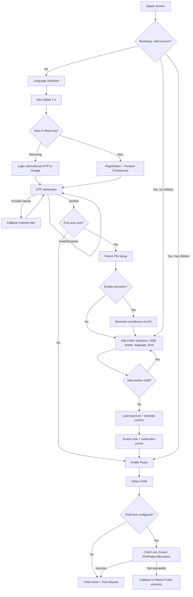
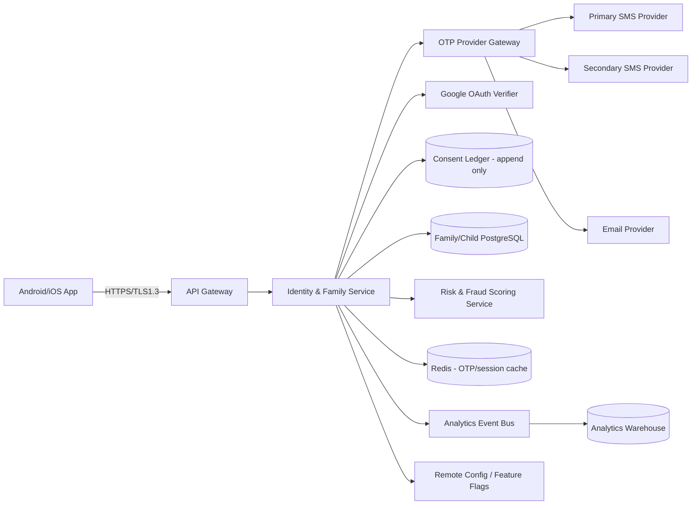
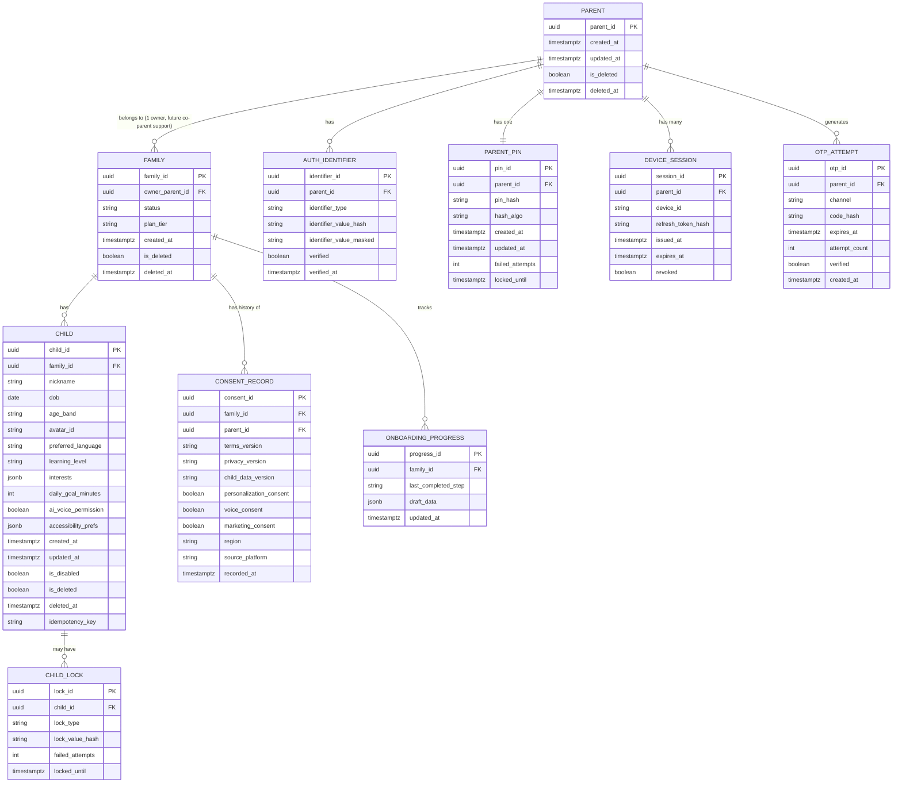

# Feature A.1 — Splash, Language Selection, Authentication & Onboarding

**App:** NoorHeroes — Islamic Learning App for Children
**Feature Owner:** Product / Growth / Trust & Safety
**Status:** Implementation-ready
**Version:** 1.0
**Depends on:** None (entry feature). **Feeds into:** A.2 Home Dashboard, C.19 Parent PIN Gate, C.21 Multi-Child Management, E.31 User & Safety Management

---

## Table of Contents

1. [Product Requirements](#1-product-requirements)
2. [UX/UI Requirements](#2-uxui-requirements)
3. [Backend Requirements](#3-backend-requirements)
4. [Database Design](#4-database-design)
5. [Backend AI Code-Generation Prompt](#5-backend-ai-code-generation-prompt)
6. [Android Requirements](#6-android-requirements)
7. [Android AI Code-Generation Prompt](#7-android-ai-code-generation-prompt)
8. [Admin Requirements](#8-admin-requirements)
9. [Admin AI Code-Generation Prompt](#9-admin-ai-code-generation-prompt)
10. [DevOps Requirements](#10-devops-requirements)
11. [Analytics Requirements](#11-analytics-requirements)
12. [Security Requirements](#12-security-requirements)
13. [QA Requirements](#13-qa-requirements)
14. [Marketing Requirements](#14-marketing-requirements)
15. [Release & Rollback Plan](#15-release--rollback-plan)

---

## 1. Product Requirements

### 1.1 Problem Statement

Parents need a fast, trustworthy, and child-safe way to create a family account, prove their identity, give legally meaningful consent before any child data is collected, and set up one or more child profiles — without friction-driven drop-off, and without ever allowing a child to bypass parental gating. There is no "Guest Mode" or "skip login" path anywhere: login is mandatory before any content, including unauthenticated browsing, is reachable (source: Consolidated Blueprint §6.1, "Login is mandatory... There is no skip login or try without account path anywhere in the app").

### 1.2 Business Goals

- Maximize signup → first-child-profile-created completion rate (target ≥ 80%, per roadmap exit criteria).
- Establish a compliant, auditable consent record before any child PII is collected (COPPA / GDPR-K / regional equivalents).
- Minimize OTP delivery cost and fraud (SMS pumping, OTP abuse) while keeping conversion high.
- Create the trust foundation that all later monetization and engagement features depend on.

### 1.3 User Goals

- **Parent:** Sign up quickly, understand what data is collected and why, set a PIN once, add my child(ren) without re-entering data per child, and get to content in one session.
- **Child:** (Not a direct actor pre-auth — children never see signup/OTP/consent screens. Children only enter via the Profile Picker after a parent has authenticated.)

### 1.4 Success Metrics

| Metric | Target | Source |
|---|---|---|
| Onboarding completion rate (signup → first child profile) | ≥ 70% (Phase 1 exit), ≥ 80% (steady state) | Roadmap §18.2 |
| OTP delivery success rate | ≥ 98% | Derived |
| OTP verification success on first attempt | ≥ 85% | Derived |
| Time to first child profile created | ≤ 3 minutes median | Derived |
| Consent record completeness (no orphaned accounts without consent) | 100% | Compliance hard requirement |
| Crash-free onboarding sessions | ≥ 99.5% | Roadmap §18.2 |
| Drop-off rate at OTP step | ≤ 15% | Derived |

### 1.5 Stakeholders

Product Manager, UX Research/Design, Backend Architect (Auth/Identity), Android Architect, Admin/Support tooling owner, DevOps (SMS/Email provider infra), Data Analyst, Security Engineer (identity, child-data compliance), QA Lead, Customer Support Lead, Growth Marketing Manager, Legal/Compliance (consent language), Scholar/Trust board (not content-related here, but sign-off on consent copy).

### 1.6 User Stories

1. As a new parent, I want to see what NoorHeroes offers before being asked to sign up, so I can decide if it's right for my family.
2. As a new parent, I want to register with just my phone number or email, so I don't have to create/remember a new password.
3. As a parent, I want to verify my identity via OTP, so my account is secure from the start.
4. As a parent, I want to clearly understand and explicitly consent to how my child's data will be used, before any child data is collected.
5. As a parent, I want to set a PIN that gates settings, purchases, and parent-mode, so my child cannot change controls or make purchases.
6. As a parent, I want to add my child's profile (nickname, birthdate, avatar) quickly, so they can start learning the same session.
7. As a parent with multiple children, I want to add more than one child profile under one family account.
8. As a returning parent, I want to log back in quickly via OTP or Google, and land on the profile picker, not redo onboarding.
9. As a parent, I want onboarding to resume from where I left off if I close the app mid-flow, so I don't have to start over.
10. As a parent, I want to choose my app language at first launch, so the entire experience (including consent text) is in a language I understand.
11. As a parent, I want to know my child's data is safe and that there's no way to access content without my involvement.
12. As a support agent, I want to see (masked) where in onboarding a parent got stuck, so I can help them.

### 1.7 Functional Requirements

**FR-1** App must determine session validity at launch via `GET /v1/bootstrap` and route accordingly (valid session + children → Profile Picker; valid session, no children → Add Child; no session → Intro/Login).
**FR-2** App must support forced update (blocking) and recommended update (dismissible) gates evaluated at bootstrap.
**FR-3** Language selection must be available before or alongside the intro sequence and must persist locally and to the parent profile once authenticated.
**FR-4** Intro/value sequence is exactly 4 screens; skip is available starting from screen 1; no paywall/subscription screen may appear before intro completes.
**FR-5** Registration must require explicit, separable consent checkboxes: (a) Terms of Service [required], (b) Privacy Policy [required], (c) Child-data-processing consent [required], (d) Personalization/AI consent [optional, revocable], (e) Voice-feature consent [optional, revocable], (f) Marketing consent [optional, revocable]. Submit is disabled until all required boxes are checked.
**FR-6** Parent identity may be established via Phone OTP, Email OTP, or Google Login. **Apple Login is explicitly not supported** (source §6.1).
**FR-7** OTP must be 6 digits, support paste, support auto-submit on 6th digit, and enforce a server-authoritative resend countdown.
**FR-8** Repeated OTP failure must trigger progressive cooldown (e.g., exponential backoff on resend, lockout after N invalid attempts) and flag the attempt for risk review — never indefinite retry.
**FR-9** The system must never reveal, via response timing or content, whether a phone/email is already registered before OTP verification succeeds (enumeration-safe).
**FR-10** On first successful verification, new users must be routed to Consent → PIN Setup → Add Child. Returning users must be routed to Profile Picker (or step-up auth if required).
**FR-11** Parent PIN must be 4–6 digits, parent's choice, stored only as a slow salted hash (e.g., Argon2id), never stored or logged in plaintext.
**FR-12** PIN setup must offer optional enrollment in OS-level biometric (Fingerprint/Face) as an alternate unlock; biometric data itself is never transmitted to or stored by NoorHeroes servers.
**FR-13** Add Child must require: nickname, date of birth, avatar, preferred language, learning level. It must NOT expose a raw "age" input field — age band is always server-derived from DOB and recalculated automatically on the child's birthday.
**FR-14** Add Child optional fields: interests (multi-select), daily learning goal, AI/voice permission toggle (default OFF), accessibility preferences.
**FR-15** Duplicate child nicknames within a family are allowed only if distinguished by avatar/color, with explicit parent confirmation at save time.
**FR-16** Onboarding must be resumable from the last completed step after app kill, crash, or network loss — never restarted from scratch.
**FR-17** Child profile creation must be idempotent via a client-generated idempotency key on `POST /v1/family/children`, preventing duplicate profiles from retried requests.
**FR-18** After at least one child profile exists, the parent is routed to Profile Picker, and selecting a child routes into the Child Home with a recommended First Mission.
**FR-19** All consent decisions must be recorded with: consent text version, timestamp, IP-derived region (not raw IP stored long-term), source platform, and the specific toggles granted/denied.
**FR-20** Each optional consent (personalization, voice, marketing) must be independently revocable later from Settings → Privacy & Support, without requiring re-onboarding.
**FR-21** Google Login must map to the same downstream flow as OTP-verified users (consent still required if new; profile picker if returning).
**FR-22** "Forgot access" / account recovery must route through phone/email OTP re-verification — never through a parent-PIN-bypass shortcut.

### 1.8 Non-Functional Requirements

- **Performance:** Bootstrap response p95 < 400ms; OTP send request p95 < 1.5s; app cold start to Splash render < 1.5s on low-end Android (per Phase-1 "low-end Android optimization" requirement).
- **Availability:** Auth service ≥ 99.9% uptime; OTP provider failover to secondary provider within 5s of primary failure.
- **Scalability:** Must support burst registration traffic (marketing campaign launch) without OTP provider rate-limit breach — backpressure/queueing at the API layer.
- **Localization:** All onboarding copy, including legal consent text, must support full localization and RTL (Arabic) layout mirroring, not just text translation.
- **Accessibility:** WCAG 2.1 AA equivalent for all onboarding screens (color contrast, screen-reader labels, tap target ≥ 44x44dp, dynamic text scaling).
- **Offline tolerance:** Splash/bootstrap must gracefully degrade with a clear "no connection" state; OTP/registration explicitly require connectivity and must say so.
- **Data residency/compliance:** Consent and PII storage must comply with applicable child-data regulations (COPPA, GDPR-K, and regional equivalents) for all supported markets.

### 1.9 Acceptance Criteria

- Given a fresh install, when the app launches, then the user sees Splash → (Language Selection, if first launch) → Intro slides → Login/Register, with no content or paywall reachable before this sequence.
- Given a returning parent with an existing session and at least one child, when the app launches, then the user lands directly on the Profile Picker without repeating intro/login.
- Given a new parent completing registration, when required consent boxes are unchecked, then the Submit action is disabled and an inline validation message is shown.
- Given a parent entering a wrong OTP 5 times, when the 6th attempt is made, then the system locks further attempts for a cooldown window and logs the event for risk review.
- Given a parent who closes the app mid-onboarding (e.g., after OTP, before Add Child), when they reopen the app, then they resume exactly at Add Child, not back at Splash.
- Given a parent submitting Add Child twice due to a network retry, when the server processes both requests, then only one child profile is created (idempotency enforced).
- Given a parent who denies marketing consent at registration, when they view Settings → Privacy later, then marketing consent shows as OFF and can be toggled independently of other consents.
- Given a child DOB is entered, when the form is submitted, then no manual "age" field exists anywhere in the UI, and the system stores DOB only, deriving age band server-side.

### 1.10 Edge Cases

1. Parent enters a phone number already registered to a different family → enumeration-safe generic OTP flow proceeds; if OTP succeeds, route to existing account's Profile Picker (not a new registration), with a "looks like you already have an account" message shown **after** verification, never before.
2. Parent changes device language mid-onboarding (OS-level change while app is backgrounded) → app re-renders current step in new language on resume, without losing entered data.
3. Parent's OTP SMS arrives after the resend cooldown already expired and a second code was requested → both codes valid within their respective TTL windows; entering either succeeds (server tracks multiple active codes per session, not just the latest).
4. Parent attempts registration with a VOIP/disposable number flagged by carrier-lookup → allowed but flagged for elevated risk scoring; not auto-blocked unless explicit fraud policy dictates.
5. Parent loses connectivity exactly between OTP verify success and consent screen render → on reconnect, app re-fetches session state via bootstrap and resumes at Consent (token already issued server-side).
6. Two children with identical nickname and identical DOB and identical avatar are attempted → second save blocked with a clarification prompt forcing differentiation.
7. Parent's device clock is significantly skewed → OTP TTL validation must use server time, not device time, to avoid false-expired codes.
8. Parent attempts to use Google account already linked to a deleted/soft-deleted NoorHeroes family → recovery/reactivation flow triggered instead of fresh registration, with Support escalation if data retention window has lapsed.
9. Parent is mid-"Add Child" and backgrounds the app for >30 days → on return, session token has expired; app re-authenticates (silent refresh if refresh token valid, else re-login) before resuming Add Child with previously entered draft data restored locally.
10. Parent enters child DOB that implies age > 17 → system either blocks (children only) or routes to an age-band ceiling with a warning, per business policy (must be explicitly defined; default: block with explanatory copy).
11. Parent enters child DOB implying age < 3 (below supported minimum) → blocked with explanatory copy and link to support.
12. SMS OTP provider returns success but message never arrives (carrier issue) → "Resend" available immediately offers fallback channel (email or alternate SMS route) without waiting full cooldown, after first failed delivery confirmation.

### 1.11 Error Handling

| Scenario | System Behavior |
|---|---|
| OTP provider outage | Show non-blocking error, auto-retry via secondary provider, allow manual retry, never show raw provider error text to user |
| Invalid/expired OTP | Inline error on OTP field, do not clear other entered digits unnecessarily, allow immediate correction |
| Network failure during Add Child submit | Local draft preserved, submit retried with idempotency key, user shown "saving..." then "saved" or actionable retry |
| Consent text fails to load (CDN/localization failure) | Block progression (consent is mandatory), show retry, fall back to cached last-known-good version if available and not expired |
| Duplicate account detection conflict | Generic "verification required" messaging pre-OTP; specific resolution only post-OTP-success |
| Server-side validation failure on Add Child (e.g., DOB out of range) | Field-level inline error, form state preserved, no full-screen reset |
| Token refresh failure on resume | Silent re-login attempt; if that fails, route to Login with "session expired" toast, preserving any resumable onboarding draft locally |

### 1.12 Empty States

- **Profile Picker with zero children** (should not normally occur post-onboarding, but possible after child deletion) → show "Add Child" as the primary tile with friendly illustration, no error framing.
- **Intro slides with no remote content loaded** → fallback to bundled offline copies of the 4 intro slides (never block first-launch experience on network).

### 1.13 Loading States

- Splash: branded loading animation, max display time capped (e.g., 2.5s) even if bootstrap is slow — bootstrap continues in background, splash transitions to a lightweight "connecting..." state if it overruns.
- OTP send: button shows spinner + disables re-tap for the request duration; timeout at 10s shows retry option.
- Add Child submit: button shows spinner, screen remains interactive for other fields disabled only on the submit control.

### 1.14 Offline States

- Splash/bootstrap: if no network at launch, show "No internet connection — retry" with explicit retry control; intro slides (bundled) still viewable offline.
- Login/Registration/OTP: require connectivity; show clear "this step needs an internet connection" messaging rather than a generic error.
- Add Child: if connectivity drops after intro fields are filled, preserve all entered data locally; block only the final submit with a clear offline indicator and auto-submit-on-reconnect option.

### 1.15 Permission States

- **SMS auto-read (Android, optional):** if granted, auto-fill OTP from incoming SMS; if denied, manual entry only — never block flow on this permission.
- **Notifications (requested later, not during onboarding core path):** deferred to post-onboarding to avoid front-loading permission fatigue, per child-friendly/low-friction design guidance.
- **Biometric enrollment (optional, at PIN setup):** if device has no biometric hardware, option is hidden, not shown-disabled.

### 1.16 User Flow (Narrative)

New parent: Splash → Language Selection → Intro (4 slides, skippable from slide 1) → Registration (phone/email or Google + consent checkboxes) → OTP Verification → Parent PIN Setup (+ optional biometric) → Add Child (required + optional fields) → optional "Add another child?" loop → Learning level/interests confirmation → Screen-time & notification preference primer → Profile Picker → Child Home (first session) with First Mission surfaced.

Returning parent: Splash → bootstrap detects valid session + children → Profile Picker directly (no intro/login/consent repeated) → Child Home or Parent Profile (PIN/biometric gated).

### 1.17 Detailed Flow Diagram (Mermaid)



### 1.18 Screen Inventory (Complete — Zero Missing)

| # | Screen Name | Type | Entry Points | Exit Points |
|---|---|---|---|---|
| 1 | Splash Screen | System | App cold start | Bootstrap routing decision |
| 2 | Language Selection | Pre-auth | First launch only (re-accessible from Settings post-auth) | Intro Slides |
| 3 | Intro Slide 1 (Stories) | Pre-auth | Language Selection | Slide 2 / Skip → Login |
| 4 | Intro Slide 2 (Quran/Arabic/Tajweed) | Pre-auth | Slide 1 | Slide 3 / Skip → Login |
| 5 | Intro Slide 3 (Habits & Rewards) | Pre-auth | Slide 2 | Slide 4 / Skip → Login |
| 6 | Intro Slide 4 (Parent Control) | Pre-auth | Slide 3 | Login/Registration |
| 7 | Login (phone/email + Google) | Auth | Intro, session expiry, logout, switch account | OTP Verification, Registration |
| 8 | Registration + Consent | Auth | Intro, Login "Register" link | OTP Verification |
| 9 | Consent Detail / Full Text Modal | Auth (modal) | Registration "read full text" links | Back to Registration |
| 10 | OTP Verification | Auth | Login, Registration, Forgot Access | Profile Picker / Parent PIN Setup |
| 11 | OTP Fallback Channel Offer | Auth (modal/inline) | OTP delivery failure | OTP Verification (new channel) |
| 12 | Parent PIN Setup | Auth | First-time post-OTP; Settings → Security (reset) | Biometric Enrollment / Add Child |
| 13 | Biometric Enrollment Prompt | Auth (modal) | Parent PIN Setup | Add Child |
| 14 | Add Child | Onboarding | Parent PIN Setup, bootstrap (session, no children), "Add Child" tile | "Add another?" / Learning Level Confirm |
| 15 | Avatar Selection | Onboarding (sub-step of Add Child) | Add Child | Add Child (continued) |
| 16 | Interest Selection | Onboarding (sub-step) | Add Child | Add Child (continued) |
| 17 | Learning Level Setup | Onboarding (sub-step) | Add Child | Add Child (continued) / Learning Level Confirm |
| 18 | "Add Another Child?" Prompt | Onboarding | After Add Child save | Add Child (loop) / Learning Level Confirm |
| 19 | Learning Level + Interests Confirmation (family-level summary) | Onboarding | After all children added | Screen Time / Notification Primer |
| 20 | Screen Time & Notification Primer | Onboarding | Learning level confirm | Profile Picker |
| 21 | Personalized Path Reveal | Onboarding | Screen Time primer (per child, optional delight screen) | Profile Picker |
| 22 | Profile Picker ("Who Is Learning") | Routing hub | Bootstrap (returning), end of onboarding | Child Lock Screen / Parent PIN Gate / Add Child |
| 23 | Child Lock Screen (PIN/Pattern/Biometric) | Gate | Profile Picker (child tile, if lock configured) | Child Home / Lock Recovery |
| 24 | Lock Recovery (via verified Parent Profile) | Recovery | Child Lock Screen "forgot lock" | Parent PIN Gate → Child Lock reset |
| 25 | First Mission Screen | Onboarding (first session only) | Child Home, first entry only | Child Home (mission content) |
| 26 | Forced Update Blocking Screen | System | Bootstrap (version below minimum) | App store / exit |
| 27 | Recommended Update Banner/Dismissible | System | Bootstrap (version below recommended) | Dismiss → continues flow |
| 28 | Maintenance Mode Screen | System | Bootstrap (maintenance flag) | Retry / exit |
| 29 | No Connectivity Screen (pre-auth) | System | Splash/bootstrap with no network | Retry |
| 30 | Forgot Access / Account Recovery Entry | Auth | Login screen | OTP Verification (recovery mode) |
| 31 | Terms of Service (full document) | Legal | Registration, Settings | Back |
| 32 | Privacy Policy (full document) | Legal | Registration, Settings | Back |
| 33 | Child-Data Processing Consent (full document) | Legal | Registration | Back |

### 1.19 Events (Complete Analytics Event List)

See §11 (Analytics Requirements) for the full taxonomy with properties. Summary list:

`app_splash_viewed`, `bootstrap_completed`, `bootstrap_failed`, `forced_update_blocked`, `language_selected`, `intro_slide_viewed`, `intro_skipped`, `login_started`, `login_method_selected`, `registration_started`, `consent_toggle_changed`, `consent_full_text_opened`, `registration_submitted`, `otp_requested`, `otp_resend_requested`, `otp_verification_attempted`, `otp_verification_succeeded`, `otp_verification_failed`, `otp_lockout_triggered`, `otp_fallback_channel_offered`, `pin_setup_started`, `pin_setup_completed`, `biometric_enrollment_offered`, `biometric_enrollment_completed`, `biometric_enrollment_skipped`, `add_child_started`, `avatar_selected`, `interest_selected`, `learning_level_selected`, `add_child_submitted`, `add_child_succeeded`, `add_child_failed`, `add_another_child_prompted`, `onboarding_completed`, `profile_picker_viewed`, `child_profile_selected`, `child_lock_prompted`, `child_lock_success`, `child_lock_failed`, `lock_recovery_initiated`, `first_mission_shown`, `onboarding_abandoned` (with `last_step` property), `account_recovery_started`.

---

## 2. UX/UI Requirements

> Per instructions: no images are generated — only image-generation prompts, provided per screen in §2.6.

### 2.1 Global Design System

**Brand Strategy:** Warm, joyful, trustworthy, age-appropriate Islamic identity. Visual language balances calm spirituality (soft golds, deep teal, night-sky motifs from Splash) with playful child-friendly shapes for in-app moments. Pre-auth screens (Splash, Intro, Login, Consent) skew calmer/more premium-trustworthy to reassure parents; post-auth child screens skew brighter/more playful.

**Typography:**
- **Primary (Latin):** Geometric humanist sans-serif (e.g., a font in the style of "Poppins" or "Nunito") for UI text — friendly, rounded terminals, high legibility at small sizes.
- **Display (Latin headings):** A serif with character (e.g., in the style of "Playfair Display") for hero/brand moments only (Splash logo lockup, Intro slide headlines) — never for body text or form labels.
- **Arabic:** A modern Naskh-style typeface optimized for screen legibility (e.g., in the style of "Noto Naskh Arabic" or "Dubai font") for all Arabic UI and Quranic text contexts elsewhere in-app; onboarding Arabic UI uses the same family as Latin UI font's Arabic-script counterpart for consistency, not the Quranic Naskh (reserved for actual Quran/Dua content).
- **Font Sizes (base scale, sp/dp):** Display 28/32, H1 24, H2 20, H3 18, Body Large 16, Body 14, Caption 12, Micro 11.
- **Font Weights:** Regular (400) body, Medium (500) for emphasis/labels, SemiBold (600) for headings, Bold (700) reserved for brand lockups and primary CTAs only.

**Color Palette:**
- *Light Theme:* Ink `#1C2B33` (primary text), Teal `#0E7C7B` (primary brand/CTA), Gold `#D4A24C` (accent/highlight), Background `#FAF7F0` (warm off-white), Surface `#FFFFFF`, Border `#E5E0D5`, Muted text `#6B7280`, Success `#2E8B57`, Error `#C0392B`, Info `#2E86C1`.
- *Dark Theme:* Background `#10181C`, Surface `#16232A`, Ink-inverse `#F4F1E8`, Teal (brightened) `#3FB6B4`, Gold (brightened) `#E8C27A`, Border `#28363D`, Muted `#9AA5AA`, Success `#4CAF7D`, Error `#E0594B`, Info `#5AA9D6`.
- Color contrast for all text/background pairs must meet WCAG AA (≥4.5:1 body, ≥3:1 large text).

**Spacing System:** 4dp base unit grid: 4, 8, 12, 16, 24, 32, 48, 64. Screen horizontal padding: 20dp mobile. Component internal padding: 12–16dp.

**Grid System:** 4-column grid on mobile (360–420dp width reference), 8dp gutters. Tablet: 8-column grid, 16dp gutters.

**Icon System:** Rounded line icons, 2dp stroke weight, 24x24dp default size, consistent corner radius matching brand rounding (8dp). No sharp/aggressive iconography anywhere in onboarding (child-safety-adjacent screens, even though pre-child, set the trust tone).

**Illustration Style:** Soft, rounded, warm flat illustration with gentle gradients (night-sky moon/stars motif for Splash and Intro), diverse and modest character representation, no photorealism, no human face close-ups for branding consistency with child-content illustration style used elsewhere in-app.

**Animation Guidelines:** Splash logo: gentle fade+scale, ≤1200ms. Screen transitions: slide+fade, 250–300ms, ease-in-out. Button press: scale to 0.96, 100ms. No flashing/strobing effects anywhere (seizure-safety, child-product standard even on parent-facing screens). Loading spinners use brand teal, not platform-default blue/grey.

**Accessibility Rules:** Minimum tap target 44x44dp. All interactive elements have accessible labels. Form errors are announced via screen reader live regions. Dynamic type scaling supported up to 200% without truncation/overlap. Color is never the sole indicator of state (icons/text accompany color).

**RTL Rules:** Full mirroring for Arabic and other RTL locales — layout direction, icon directionality (e.g., back arrows), text alignment, OTP digit-entry order (left-to-right digit entry is preserved per numeral convention even in RTL context, per standard OTP UX pattern — explicitly tested case).

**Arabic Support Rules:** All onboarding and legal text must have a scholar/legal-reviewed Arabic translation (not machine translation) given the consent/legal weight of this content. Numerals: use Arabic-Indic or Western Arabic numerals based on locale convention (configurable).

**Child-Friendly Design Guidelines by Age Group:** Not directly applicable to onboarding screens (parent-only), EXCEPT: Avatar Selection, Interest Selection, and Learning Level Setup are filled out by the parent **on behalf of** the child, so visuals there should appeal across age bands 4 to 6, 6 to 9, 9 to 12, 12 to 15, 15 to 18+ simultaneously (parent is choosing for a specific child whose age band is already known from DOB entry) — show age-appropriate avatar/interest sets filtered by the just-entered DOB, not the full catalog.

### 2.2 Home Page Requirements
Not applicable to this feature (covered in Feature A.2 — Home Dashboard).

### 2.3 Tab Structure
Not applicable — this feature is entirely pre-tab-navigation (occurs before bottom nav exists).

### 2.4 Per-Screen Design Requirements

Due to volume (33 screens), full detail is given for the highest-complexity/highest-risk screens below; the remaining screens follow the same template structure (Purpose / Components / States / Accessibility / Responsive / Empty / Error / Loading / Success / Offline) and are summarized in the table that follows.

#### Screen: Registration + Consent

- **Purpose:** Capture parent identity input and legally binding, granular consent before any child data exists.
- **Components:** Country code selector, phone/email segmented input, Google login button, 6 consent rows (3 required + 3 optional) each with toggle + "read full text" link, Submit CTA, "Already have an account? Log in" link.
- **States:** Default (all optional unchecked, required unchecked — submit disabled), Partially complete (required still unchecked — submit disabled, helper text visible), Valid (submit enabled), Submitting (spinner, fields locked), Error (inline field-level + banner for server errors).
- **Accessibility:** Each consent row independently focusable and toggleable via screen reader with full label read ("Required: I agree to the Privacy Policy, link, toggle, currently off"). Required vs optional clearly differentiated with both text label and visual marker, not color alone.
- **Responsive Rules:** Single column on mobile; on tablet, form constrained to 480dp max-width, centered, not stretched full-width.
- **Empty State:** N/A (form, not list).
- **Error State:** Banner at top for server/network errors ("Couldn't reach our servers — check your connection and try again"); field-level for validation (e.g., invalid phone format).
- **Loading State:** Submit button shows spinner, label changes to "Creating account...".
- **Success State:** Immediate transition to OTP Verification (no separate "success" splash needed — transition itself is the confirmation).
- **Offline State:** Form remains fillable; Submit disabled with "Connect to the internet to continue" helper text replacing the spinner state.

#### Screen: OTP Verification

- **Purpose:** Confirm phone/email ownership via time-limited code.
- **Components:** 6 individual digit cells, masked phone/email display ("Code sent to •••-•••-1234"), countdown timer, Resend link (disabled during countdown), "Wrong number/email?" link, auto-submit on 6th digit entry.
- **States:** Empty, Partial entry, Verifying (spinner overlay on cells), Error (cells shake/red outline + message, auto-clears after re-focus), Resend-available, Resend-cooling-down, Locked-out (post max attempts).
- **Accessibility:** Each cell labeled "Digit 1 of 6" etc.; error announced via live region ("Incorrect code, please try again"); countdown announced at intervals, not continuously (avoid screen-reader spam).
- **Responsive Rules:** Cell size scales with viewport but maintains 44dp min tap target even on smallest supported screen width.
- **Empty State:** N/A.
- **Error State:** Inline under cells; after 5 failures, replace resend/retry UI with lockout messaging + estimated cooldown time + Support link.
- **Loading State:** Cells dim slightly with center spinner during server verification (sub-second typically, but state must exist for slow networks).
- **Success State:** Brief checkmark micro-animation (≤500ms) before auto-navigating forward — confirms success without requiring a tap.
- **Offline State:** If connectivity drops while waiting for code, show "Reconnecting..." persistent banner; cells remain enterable but submit queues until connection restored, with explicit timeout if OTP TTL expires while offline.

#### Screen: Add Child

- **Purpose:** Capture child profile required to use the app; sets the foundation for age-band-gated content.
- **Components:** Nickname text input, DOB picker (date-of-birth selector — wheel or calendar, never free-text to avoid format errors), Avatar grid (filtered by resulting age band, live-updating as DOB changes), Language dropdown, Learning Level selector (cards: Beginner/Intermediate/Advanced with plain-language descriptions, not numeric levels), collapsible "Optional details" section (Interests multi-select chips, Daily goal slider, AI/voice permission toggle off by default, accessibility preference checkboxes).
- **States:** Empty/draft, Partial (required fields incomplete — Save disabled), Valid, Saving, Saved (brief confirmation), Error (duplicate-nickname conflict resolution modal; out-of-range DOB inline error).
- **Accessibility:** DOB picker fully operable via screen reader/keyboard, not gesture-only; avatar grid items each labeled descriptively, not just "image 3".
- **Responsive Rules:** Avatar grid: 3 columns mobile, 5 columns tablet.
- **Empty State:** Avatar grid before DOB entered shows a neutral "enter birthdate to see avatars for this age" placeholder rather than an empty grid or generic avatars, to reinforce age-band-driven personalization correctly.
- **Error State:** Duplicate nickname → modal: "You already have a child named [X] — add an avatar/color to tell them apart" with side-by-side comparison.
- **Loading State:** Save button spinner; rest of form remains visible/scrollable.
- **Success State:** Transition to "Add another child?" prompt with the just-created child's name/avatar shown for warmth/confirmation.
- **Offline State:** All fields fillable offline; Save disabled until connectivity returns, draft persisted locally (per FR-16) so nothing is lost.

#### Remaining Screens — Summary Table

| Screen | Key Components | Critical State to Note |
|---|---|---|
| Splash | Logo lockup, loading indicator | Hard timeout cap at 2.5s |
| Language Selection | Flag/language list, search (if >8 languages) | Persists immediately on tap, no separate "confirm" |
| Intro Slides 1–4 | Illustration, headline, body, page dots, Skip, Next | Skip available from slide 1 onward |
| Login | Phone/email toggle, Google button, Register link | Generic error only (no enumeration) |
| Consent Detail Modal | Scrollable legal text, version stamp, close | Must show consent version number visibly |
| OTP Fallback Offer | Channel options (SMS/Email), explanation | Only appears after a delivery failure signal |
| Parent PIN Setup | PIN pad x2 (set+confirm), strength-neutral (no "weak/strong" judgment on a 4-6 digit PIN) | Confirm must exactly match; mismatch clears confirm only |
| Biometric Enrollment | OS biometric prompt, Skip | Hidden entirely if no biometric hardware |
| Avatar/Interest/Level sub-steps | Selection grids/cards | Embedded within Add Child step flow, not separate full navigation stack entries |
| Add Another Child Prompt | Child summary card, Yes/No | Defaults focus to "No" not "Yes" to avoid pressure-driven over-adding |
| Learning Level/Interests Confirm | Per-child summary cards | Editable inline before final confirm |
| Screen Time/Notification Primer | Toggle list, plain-language explanations | All defaults OFF except safety-critical notifications |
| Personalized Path Reveal | Animated reveal of recommended first content | Skippable, non-blocking delight moment |
| Profile Picker | Child tiles, Parent Profile tile, Add Child tile | Disabled children hidden from this screen, visible only inside Parent Profile |
| Child Lock Screen | PIN pad / pattern grid / biometric prompt (per child config) | "Forgot lock" routes to Parent Profile verification only |
| Lock Recovery | Parent PIN re-entry, then child lock reset | Never a generic password-reset-style bypass |
| First Mission | Recommended content card, Start CTA | First-session-only, never reappears |
| Forced Update | Illustration, version message, Update CTA only | No dismiss/back option |
| Recommended Update | Banner, Update CTA, Dismiss | Reappears next session if dismissed |
| Maintenance Mode | Illustration, message, estimated time if known | Retry control polls bootstrap |
| No Connectivity (pre-auth) | Illustration, Retry | Distinguish from Maintenance via copy |
| Forgot Access | Phone/email re-entry | Routes into existing OTP flow, not a separate system |
| ToS / Privacy / Child-Data Consent (full docs) | Scrollable legal document, version footer | Identical content source as Consent Detail Modal — single source of truth |

### 2.5 Wireframe Description (Composite)

The onboarding sequence follows a strict **single-column, single-primary-action-per-screen** wireframe pattern: every screen has exactly one prominent primary CTA at the bottom (full-width button), secondary/tertiary actions as text links above or below it, and a persistent minimal header (back arrow + step indicator dots where multi-step, e.g., Add Child's sub-steps) — no screen in this feature ever presents two equally-weighted primary actions, to minimize decision friction during a trust-critical, legally-weighted flow.

### 2.6 Screen Image Generation Prompts

> Per instructions, these are prompts for an external image-generation tool — no images are produced here.

**Screen: Splash Screen**
- *Prompt 1 (English):* "Mobile app splash screen for a children's Islamic learning app called NoorHeroes. Centered logo lockup combining a crescent moon and gentle stars motif with the wordmark 'NoorHeroes' in a warm gold (#D4A24C) geometric sans-serif font on a deep teal-to-night-sky gradient background (#0E7C7B to #10181C). Minimal, calm, premium feel. No text other than the wordmark. Soft glowing star particles. Flat vector illustration style, no photorealism. 1080x2400px mobile aspect ratio."
- *Prompt 2 (Arabic RTL):* "نفس تصميم شاشة البداية لتطبيق نور هيروز لتعليم الأطفال القيم الإسلامية. شعار مركزي يجمع بين هلال ونجوم لطيفة مع الاسم 'نور هيروز' بخط عربي نسخ حديث وواضح بلون ذهبي دافئ (#D4A24C) على خلفية متدرجة من الفيروزي الغامق إلى لون السماء الليلية (#0E7C7B إلى #10181C). تصميم متجه مسطح هادئ وفاخر بدون صور واقعية. أبعاد 1080×2400 بكسل للهاتف المحمول، مع التأكد من أن اتجاه أي عناصر نصية مساندة يدعم القراءة من اليمين إلى اليسار."

**Screen: Intro Slide 2 — Quran/Arabic/Tajweed**
- *Prompt 1 (English):* "Onboarding illustration slide for a children's Islamic education app. Warm, soft flat-vector illustration of a diverse group of small cartoon children (modest clothing, gentle rounded shapes, no photorealism, no detailed faces) sitting cross-legged around an open book glowing softly with warm gold light, with small decorative Islamic geometric patterns in the background. Color palette: warm off-white background (#FAF7F0), teal and gold accents. Headline text area reserved at top, body text area reserved below illustration, page indicator dots and a rounded 'Next' button at the bottom. Friendly, calm, educational mood."
- *Prompt 2 (Arabic RTL):* "نفس شريحة التعريف التوضيحية لتطبيق تعليم إسلامي للأطفال، بأسلوب رسم متجه مسطح ودافئ. مجموعة متنوعة من شخصيات أطفال كرتونية صغيرة بأشكال مستديرة لطيفة وملابس محتشمة بدون تفاصيل واقعية للوجوه، يجلسون متربعين حول كتاب مفتوح يتوهج بضوء ذهبي دافئ، مع زخارف هندسية إسلامية بسيطة في الخلفية. الألوان: خلفية بيج فاتح دافئ (#FAF7F0) مع لمسات فيروزية وذهبية. مساحة محجوزة للعنوان في الأعلى والنص التوضيحي أسفل الرسمة، مع نقاط مؤشر الصفحات وزر دائري للمتابعة في الأسفل، مع التأكد من أن تخطيط العناصر يدعم اتجاه القراءة من اليمين إلى اليسار."

**Screen: Registration + Consent**
- *Prompt 1 (English):* "Clean mobile app registration form UI mockup for a family/parenting app. Light theme: warm off-white background (#FAF7F0), white card surface, teal primary button (#0E7C7B), gold accent details. Top shows a friendly small illustration of a parent and child silhouette icon. Form contains a phone/email segmented toggle, a 'Continue with Google' button, and three checkbox rows for consent labeled clearly as required, plus a collapsed optional section. Bottom full-width teal 'Create Account' button. Rounded corners (12-16px radius), soft drop shadows, generous 16-20px spacing, modern geometric sans-serif typography. Minimalist, trustworthy, parent-facing tone, not childish."
- *Prompt 2 (Arabic RTL):* "نفس واجهة نموذج تسجيل حساب لتطبيق عائلي موجه للوالدين، بتخطيط RTL كامل من اليمين إلى اليسار. الوضع الفاتح: خلفية بيج دافئ (#FAF7F0)، بطاقة بيضاء، زر أساسي فيروزي (#0E7C7B)، تفاصيل ذهبية مساندة. أيقونة صغيرة ودودة في الأعلى توضح ظل أحد الوالدين مع طفل. يحتوي النموذج على مفتاح تبديل لإدخال رقم الهاتف أو البريد الإلكتروني، زر 'الاستمرار باستخدام جوجل'، وثلاث صفوف اختيار للموافقة موضحة بأنها مطلوبة، بالإضافة إلى قسم اختياري قابل للطي. زر فيروزي بعرض كامل في الأسفل بعنوان 'إنشاء حساب'. زوايا دائرية وظلال خفيفة وتباعد مريح بين العناصر، وخط عربي حديث وواضح. طابع بسيط وموثوق يناسب الوالدين."

**Screen: OTP Verification**
- *Prompt 1 (English):* "Mobile app OTP verification screen UI mockup. Light theme, warm off-white background. Centered illustration of a small envelope/message icon with a soft glow. Six individual rounded digit-entry boxes in a row, teal focus outline on the active box, below a masked phone number text '+1 •••-•••-1234'. Below that, a light grey countdown timer text and a teal 'Resend code' link (visually disabled/greyed during countdown). Clean modern sans-serif font, generous spacing, minimalist trustworthy parent-app aesthetic, rounded UI elements throughout."
- *Prompt 2 (Arabic RTL):* "نفس واجهة شاشة تأكيد رمز التحقق لتطبيق جوال، بتخطيط من اليمين إلى اليسار بالكامل. خلفية بيج فاتح دافئ. رسمة مركزية بسيطة لأيقونة مغلف أو رسالة مع توهج خفيف. ستة خانات مستديرة فردية لإدخال الأرقام في صف واحد مع الحفاظ على ترتيب إدخال الأرقام من اليسار إلى اليمين كعرف رقمي قياسي، إطار تركيز فيروزي على الخانة النشطة، وتحتها رقم الهاتف المقنّع '+966 •••-•••-1234'. أسفل ذلك عداد تنازلي بلون رمادي فاتح ورابط فيروزي 'إعادة إرسال الرمز' (يظهر باهتًا أثناء العد التنازلي). خط عربي حديث وواضح، تباعد مريح، وطابع بسيط وموثوق."

**Screen: Parent PIN Setup**
- *Prompt 1 (English):* "Mobile app PIN setup screen UI mockup. Light theme, warm off-white background, centered lock icon illustration in teal and gold. Title text area, then a row of 4-6 circular PIN indicator dots above a numeric keypad (rounded square buttons, 3x4 grid layout, large legible digits). Bottom area reserved for a small 'Enable fingerprint unlock instead' toggle row with a fingerprint icon. Clean, secure, trustworthy aesthetic, generous spacing, rounded corners, modern sans-serif typography, no childish elements (this screen is parent-only)."
- *Prompt 2 (Arabic RTL):* "نفس واجهة شاشة إعداد رمز الحماية (PIN) للوالدين، بتخطيط RTL كامل. خلفية بيج فاتح دافئ، رسمة مركزية لأيقونة قفل بألوان فيروزية وذهبية. مساحة للعنوان، ثم صف من 4 إلى 6 نقاط دائرية لمؤشر الرمز فوق لوحة أرقام (أزرار مربعة الزوايا الدائرية، شبكة 3×4، أرقام كبيرة وواضحة). مساحة محجوزة في الأسفل لصف تبديل صغير بعنوان 'تفعيل فتح القفل بالبصمة' مع أيقونة بصمة. طابع نظيف وآمن وموثوق، تباعد مريح، زوايا دائرية، خط عربي حديث، بدون أي عناصر طفولية لأن هذه الشاشة مخصصة للوالدين فقط."

**Screen: Add Child**
- *Prompt 1 (English):* "Mobile app 'add child profile' form UI mockup, warm and friendly but still parent-facing (not childish). Light theme, off-white background. Top shows a nickname text input field, below it a date-of-birth wheel picker component, then a horizontal scrollable row of small round cartoon avatar options (diverse, simple, friendly faces, soft colors), a language dropdown selector, and three large rounded selector cards labeled for learning level with simple icons (a seedling, a growing plant, a tree — representing beginner to advanced, no numbers). Bottom full-width teal 'Save & Continue' button. Soft shadows, 12-16px rounded corners, warm gold accent highlights on selected items, modern clean sans-serif typography."
- *Prompt 2 (Arabic RTL):* "نفس نموذج شاشة 'إضافة ملف الطفل' لتطبيق جوال، بتخطيط من اليمين إلى اليسار بالكامل، بطابع ودود لكن موجه للوالدين وليس طفوليًا بالكامل. خلفية بيج فاتح. في الأعلى حقل إدخال نص للقب الطفل، وتحته منتقي عجلة لتاريخ الميلاد، ثم صف قابل للتمرير أفقيًا من الصور الرمزية الكرتونية الصغيرة والمستديرة (متنوعة، بسيطة، وجوه ودودة، ألوان هادئة)، قائمة منسدلة لاختيار اللغة، وثلاث بطاقات اختيار كبيرة مستديرة الزوايا لمستوى التعلم مع أيقونات بسيطة (بذرة، نبتة صغيرة، شجرة — لتمثيل المستويات من المبتدئ إلى المتقدم بدون أرقام). زر فيروزي بعرض كامل في الأسفل بعنوان 'حفظ واستمرار'. ظلال خفيفة، زوايا دائرية، لمسات ذهبية دافئة على العناصر المختارة، وخط عربي حديث ونظيف."

**Screen: Profile Picker**
- *Prompt 1 (English):* "Mobile app family profile picker screen UI mockup. Warm off-white background with a soft night-sky gradient header. Grid of 2-3 large rounded square tiles, each showing a colorful cartoon child avatar and first name beneath, plus one distinctly styled tile with a parent silhouette icon labeled 'Parent', and a final dashed-outline tile with a plus icon labeled 'Add Child'. Soft shadows under each tile, gold highlight ring on a recently-used tile, generous spacing, playful but clean rounded typography for names, modern child-app aesthetic."
- *Prompt 2 (Arabic RTL):* "نفس واجهة شاشة اختيار الملف الشخصي للعائلة لتطبيق جوال، بتخطيط RTL كامل. خلفية بيج فاتح دافئ مع رأس بتدرج لوني هادئ يشبه سماء الليل. شبكة من بطاقتين أو ثلاث بطاقات مربعة كبيرة مستديرة الزوايا، تعرض كل منها صورة رمزية كرتونية ملونة لطفل واسمه الأول أسفلها، بالإضافة إلى بطاقة مميزة بأيقونة ظل للوالد بعنوان 'الوالد'، وبطاقة أخيرة بخط متقطع وأيقونة زائد بعنوان 'إضافة طفل'. ظلال خفيفة تحت كل بطاقة، حلقة تمييز ذهبية على البطاقة المستخدمة مؤخرًا، تباعد مريح، خط عربي مرح لكن نظيف للأسماء، بطابع تطبيق أطفال حديث."

*(Remaining 26 screens follow the identical two-prompt structure — English + Arabic RTL — using the same Global Design System tokens defined in §2.1. Full prompt set for all 33 screens can be generated on request in a follow-up batch to keep this document at a reviewable length.)*

---

## 3. Backend Requirements

### 3.1 System Design Overview

Auth & Onboarding is served by an **Identity & Family Service** sitting behind the API Gateway, with dependencies on an OTP Provider Gateway (SMS + Email, multi-provider failover), Google OAuth, a Consent Ledger (append-only), and the core Family/Child data store. All onboarding writes are idempotent and event-sourced into the Consent Ledger and an Analytics Event Bus.

### 3.2 Architecture Diagram (Mermaid)



### 3.3 Service Breakdown

| Service | Responsibility |
|---|---|
| Identity & Family Service | Registration, login, OTP orchestration, session/token issuance, PIN management, child CRUD |
| OTP Provider Gateway | Abstracts SMS/Email providers, handles failover, rate limiting, delivery status callbacks |
| Risk & Fraud Scoring Service | Scores registration/OTP attempts for abuse signals (VOIP numbers, velocity, device fingerprint) |
| Consent Ledger Service | Append-only store of every consent decision with version/timestamp/region |
| Remote Config Service | Serves minimum/recommended app version, maintenance flag, feature flags consumed at bootstrap |
| Session/Token Service | Issues and rotates JWT access + refresh tokens, manages revocation |

### 3.4 API List

#### `GET /v1/bootstrap`
- **Auth:** Optional (works unauthenticated, returns more if a valid session token is present)
- **Request:** Headers: `Authorization: Bearer <token>` (optional), `X-App-Version`, `X-Platform`, `X-Locale`
- **Response 200:**
```json
{
  "session_valid": true,
  "family_id": "fam_8a1c...",
  "has_children": true,
  "min_supported_version": "4.2.0",
  "recommended_version": "5.1.0",
  "maintenance_mode": false,
  "remote_config": { "intro_slides_version": "3", "consent_version": "2025-11-01" }
}
```
- **Validation:** App version semver-compared server-side, never trust client claims about its own version for forced-update logic.
- **Error Codes:** `503 MAINTENANCE_MODE`, `426 UPGRADE_REQUIRED` (forced update).
- **Rate Limiting:** 60 req/min/IP (cheap, cacheable endpoint).
- **Caching:** Remote config portion cacheable client-side for 5 min; session validity never cached.

#### `POST /v1/auth/register`
- **Auth:** None (pre-auth endpoint)
- **Request:**
```json
{
  "identifier_type": "phone",
  "identifier": "+15551234567",
  "consent": {
    "terms_version": "2025-11-01",
    "privacy_version": "2025-11-01",
    "child_data_version": "2025-11-01",
    "personalization": false,
    "voice": false,
    "marketing": true
  },
  "locale": "en-US",
  "device_id": "dev_uuid..."
}
```
- **Response 200:** `{ "registration_token": "reg_tmp_...", "otp_channel": "sms", "otp_ttl_seconds": 300 }`
- **Validation:** Phone normalized to E.164 server-side; required consent fields must all be `true` or request is rejected with `422`; enumeration-safe — response shape identical whether identifier exists or not.
- **Error Codes:** `400 INVALID_IDENTIFIER`, `422 CONSENT_REQUIRED_MISSING`, `429 RATE_LIMITED`.
- **Rate Limiting:** 5 req/hour/identifier, 20 req/hour/device, 100 req/hour/IP.
- **Security:** Risk score computed synchronously (non-blocking unless score exceeds hard threshold).

#### `POST /v1/identity/auth/otp/request (canonical; legacy /v1/auth/otp/request redirects via 307)`
- **Auth:** `registration_token` or existing-session-step-up context
- **Request:** `{ "registration_token": "reg_tmp_...", "channel": "sms" }`
- **Response 200:** `{ "otp_id": "otp_...", "expires_at": "2026-06-22T10:05:00Z", "resend_available_at": "2026-06-22T10:01:00Z" }`
- **Error Codes:** `429 OTP_PROVIDER_RATE_LIMITED`, `503 OTP_PROVIDER_UNAVAILABLE` (triggers client fallback offer).
- **Rate Limiting:** Server-authoritative resend cooldown (60s, escalating to 120s, 300s on repeat resends within a session).

#### `POST /v1/identity/auth/otp/verify (canonical; legacy /v1/auth/otp/verify redirects via 307)`
- **Auth:** `otp_id` + code
- **Request:** `{ "otp_id": "otp_...", "code": "482913" }`
- **Response 200 (new user):** `{ "access_token": "...", "refresh_token": "...", "is_new_family": true, "next_step": "consent_already_captured_pin_setup" }`
- **Response 200 (returning user):** `{ "access_token": "...", "refresh_token": "...", "is_new_family": false, "next_step": "profile_picker" }`
- **Validation:** Code must match within TTL using server time; max 5 attempts per `otp_id` then lockout.
- **Error Codes:** `400 INVALID_CODE`, `410 OTP_EXPIRED`, `423 LOCKED_TOO_MANY_ATTEMPTS`.
- **Security:** All failed attempts logged with device/IP for Risk Service; codes hashed at rest, never stored or logged in plaintext.

#### `POST /v1/auth/google`
- **Auth:** Google ID token from client
- **Request:** `{ "id_token": "..." }`
- **Response 200:** Same shape as OTP verify success.
- **Validation:** Server verifies token signature/audience/issuer directly with Google, never trusts client-decoded claims.
- **Error Codes:** `401 INVALID_GOOGLE_TOKEN`.

#### `POST /v1/auth/pin`
- **Auth:** Bearer (post-OTP session)
- **Request:** `{ "pin": "4821" }`
- **Response 200:** `{ "pin_set": true }`
- **Validation:** 4-6 numeric digits; server hashes with Argon2id + per-record salt; rejects sequential/repeated trivial PINs only as a soft warning, not a hard block (parent's choice per FR-11).
- **Error Codes:** `422 INVALID_PIN_FORMAT`.
- **Security:** Plaintext PIN never logged, never stored, discarded from memory immediately post-hash.

#### `POST /v1/family/children`
- **Auth:** Bearer (parent session)
- **Request Headers:** `Idempotency-Key: <client-generated-uuid>`
- **Request:**
```json
{
  "nickname": "Amina",
  "dob": "2018-04-12",
  "avatar_id": "avatar_042",
  "preferred_language": "en",
  "learning_level": "beginner",
  "interests": ["stories", "quran"],
  "daily_goal_minutes": 15,
  "ai_voice_permission": false,
  "accessibility": { "text_scale": "default" }
}
```
- **Response 201:** `{ "child_id": "child_...", "age_band": "6 to 9" }`
- **Validation:** DOB required; age band always computed server-side; rejects DOB implying age outside supported min/max with `422`; duplicate-nickname conflict returns `409 DUPLICATE_NICKNAME` with existing-child summary for client-side disambiguation UI.
- **Error Codes:** `422 INVALID_DOB`, `409 DUPLICATE_NICKNAME`, `403 CHILD_LIMIT_REACHED` (if a family plan caps child count).
- **Idempotency:** Required header; replays with the same key return the original `201` response, not a duplicate record.
- **Rate Limiting:** 10 req/min/family.

#### `GET /v1/family/me`
- **Auth:** Bearer (parent session)
- **Response 200:** Family profile + children summary list, used to render Profile Picker.
- **Caching:** Short TTL (30s) client-side cache, invalidated on any child mutation.

#### `POST /v1/family/consent`
- **Auth:** Bearer
- **Request:** `{ "personalization": true, "voice": false, "marketing": false }` (only optional consents are ever updated post-onboarding — required consents cannot be revoked without account deletion flow)
- **Response 200:** `{ "updated": true, "effective_at": "..." }`
- **Audit:** Every call appends a new Consent Ledger entry; ledger is append-only, never overwritten/deleted.

#### `POST /v1/auth/recovery/start`
- **Auth:** None
- **Request:** `{ "identifier_type": "email", "identifier": "parent@example.com" }`
- **Response 200:** Enumeration-safe generic response identical to `/register` shape, routes into the OTP flow.

### 3.5 Cross-Cutting API Concerns

- **Authentication:** JWT access tokens (15 min TTL) + refresh tokens (30 day TTL, rotated on use, revocable per-device).
- **Pagination:** N/A for this feature (no list endpoints exceed a single page — child counts are small).
- **Caching:** Bootstrap remote-config portion only; never cache auth/session state.
- **Security:** All endpoints TLS 1.3 only; request signing/HMAC on OTP endpoints to deter scripted abuse; WAF rules on registration/OTP endpoints specifically tuned for OTP-bombing patterns.
- **Analytics Events:** Every endpoint above emits a corresponding event from the §1.19 taxonomy on both success and failure paths.

---

## 4. Database Design

### 4.1 ER Diagram (Mermaid)



### 4.2 Tables, Relationships, Constraints

| Table | Key Constraints | Indexes |
|---|---|---|
| `parent` | PK `parent_id` | — |
| `auth_identifier` | UNIQUE(`identifier_type`, `identifier_value_hash`); FK `parent_id` | Index on `identifier_value_hash` for fast, hash-only lookup (never index plaintext) |
| `parent_pin` | UNIQUE(`parent_id`) — one PIN per parent | — |
| `family` | FK `owner_parent_id`; CHECK `plan_tier IN ('free','premium','family')` | Index on `owner_parent_id` |
| `child` | FK `family_id`; CHECK `dob <= current_date - interval '3 years'` AND `dob >= current_date - interval '18 years'`; UNIQUE(`family_id`, `idempotency_key`) | Index on `(family_id)`; Index on `(family_id, nickname)` non-unique (duplicates allowed per FR-15) |
| `child_lock` | FK `child_id`; CHECK `lock_type IN ('pin','pattern','biometric_flag')` | Index on `child_id` |
| `consent_record` | FK `family_id`, `parent_id`; append-only — no UPDATE/DELETE grants at the DB role level | Index on `(family_id, recorded_at DESC)` |
| `otp_attempt` | FK `parent_id`; TTL-style cleanup job | Index on `(parent_id, created_at DESC)` |
| `device_session` | FK `parent_id`; UNIQUE(`device_id`, `parent_id`) | Index on `refresh_token_hash` |
| `onboarding_progress` | UNIQUE(`family_id`) | — |

### 4.3 Audit Fields
All tables (except the explicitly append-only `consent_record` and `otp_attempt`, which are audit logs themselves) carry `created_at`, `updated_at`. Mutable PII tables (`parent`, `child`, `family`) additionally carry `is_deleted`, `deleted_at` for soft delete.

### 4.4 Soft Delete Rules
- `child` records: soft-deleted on parent-initiated removal; hard-deleted only after the regulatory retention window (see §4.5) and only via the verified parent-deletion-request flow (never directly).
- `parent`/`family`: soft-deleted immediately on deletion request; hard delete executed by a scheduled job after the mandatory wait period (per Consolidated Blueprint's "seven-day status" deletion pattern referenced in the Feature Reference doc).
- `consent_record`: **never deleted**, soft or hard — it is the legal proof of historical consent; superseded by new rows, not removed.

### 4.5 Retention Rules
- `otp_attempt` rows purged after 30 days regardless of outcome (no business need beyond fraud-window analysis).
- `device_session` (revoked/expired) purged after 90 days.
- `consent_record`: retained indefinitely (or per applicable regulation's minimum, whichever is longer) even after account deletion, in anonymized form (family/parent identifiers tokenized, decision content preserved) to prove historical compliance.
- `child` PII: hard-deleted (not just soft) within the regulatory-mandated window after a verified deletion request completes, per the seven-day confirmation pattern.

---

## 5. Backend AI Code-Generation Prompt

```
You are building the Identity & Family Service for "NoorHeroes," a child-safety-first
Islamic learning app. Build a production-grade backend module covering registration,
OTP-based authentication, Google OAuth, parent PIN management, child profile CRUD,
and a granular, append-only consent ledger.

Stack: FastAPI (Python 3.12), PostgreSQL (SQLAlchemy 2.0 + Alembic migrations),
Redis (OTP/session cache), Argon2id for PIN/code hashing, JWT (access 15min,
refresh 30day rotating).

Hard requirements:
1. Implement enumeration-safe registration/recovery endpoints: identical response
   shape and timing whether or not an identifier already exists, until OTP success.
2. OTP codes are 6 digits, hashed at rest (never plaintext, never logged), TTL 5
   minutes, server-time-only expiry validation, max 5 verify attempts per otp_id
   then lock for an escalating cooldown (60s -> 120s -> 300s).
3. Idempotency-Key header required and enforced (via a unique constraint, not
   just in-memory dedup) on POST /v1/family/children.
4. Child DOB is the only age input ever accepted; age_band is always computed
   server-side via a pure function from dob + current_date, recalculated nightly
   via a scheduled job (not just at creation time) to roll children into new
   age bands on their birthday.
5. Consent records are append-only at the database-role permission level: the
   API user/role for this service must NOT have UPDATE or DELETE grants on the
   consent_record table -- enforce this in the migration, not just in app code.
6. Build the bootstrap endpoint to compare semver app versions server-side
   (use a proper semver library) against min_supported_version and
   recommended_version stored in a remote-config table editable by Admin.
7. Implement full audit logging of every failed auth attempt (OTP, PIN, lock)
   with device_id, IP (hashed after 30 days), and timestamp, queryable by an
   internal Risk Service but never exposed to the client.
8. Write Alembic migrations that exactly match the ER diagram and constraints
   in this spec, including the DOB CHECK constraint (age between 4 and 18 years)
   and the soft-delete columns on parent/family/child.
9. Emit every analytics event listed below to a Kafka/event-bus topic
   `onboarding.events` as structured JSON with a consistent envelope
   (event_name, family_id, parent_id, child_id, timestamp, properties):
   app_splash_viewed, bootstrap_completed, bootstrap_failed, forced_update_blocked,
   language_selected, intro_slide_viewed, intro_skipped, login_started,
   registration_started, consent_toggle_changed, registration_submitted,
   otp_requested, otp_resend_requested, otp_verification_attempted,
   otp_verification_succeeded, otp_verification_failed, otp_lockout_triggered,
   pin_setup_completed, add_child_succeeded, add_child_failed,
   onboarding_completed, onboarding_abandoned.
10. Write integration tests covering: enumeration-safety, idempotent child
    creation under simulated duplicate requests, OTP lockout/cooldown escalation,
    DOB boundary rejection (exactly 3 years minus 1 day, exactly 18 years),
    and consent-ledger immutability (attempt an UPDATE and assert it is rejected
    at the DB layer).

Deliver: FastAPI routers, SQLAlchemy models, Alembic migration files, Pydantic
schemas with full validation matching the API contracts above, pytest suite,
and a README documenting environment variables for OTP/Google provider secrets
(referenced by name only, never hardcoded).
```

---

## 6. Android Requirements

### 6.1 Technical Requirements
- Kotlin, Jetpack Compose, MVVM, Clean Architecture (presentation / domain / data layers), modular Gradle structure (`:feature:onboarding`, `:core:network`, `:core:auth`, `:core:design-system`), KMP-ready (business logic in `commonMain` where feasible — OTP/PIN validation logic, age-band calculation, are pure-Kotlin and KMP-shareable from day one).

### 6.2 Screen Mapping
Each screen in §1.18 maps 1:1 to a Composable in `feature.onboarding.ui`, with a corresponding `ViewModel` exposing a single `StateFlow<UiState>` (sealed class per screen: `Loading`, `Content`, `Error`, `Submitting`).

### 6.3 Navigation Flow
Single-activity Compose Navigation graph (`onboarding_nav_graph`), each screen a distinct route; deep navigation back-stack popped entirely on reaching Profile Picker (no back-navigation into onboarding after completion). Forced-update and maintenance screens are graph-level interceptors evaluated before the graph renders, not standard back-stack entries.

### 6.4 State Management
`OnboardingState` held in a shared `ViewModel` scoped to the nav graph (survives individual screen navigation, cleared only on graph exit), persisted to local Room/DataStore as a draft after every field change (debounced 500ms) to satisfy FR-16 resumability — restored on process death via `SavedStateHandle` + DataStore fallback.

### 6.5 API Mapping
Each Android repository method maps directly to the backend endpoint of the same name in §3.4 (e.g., `AuthRepository.verifyOtp()` → `POST /v1/identity/auth/otp/verify (canonical; legacy /v1/auth/otp/verify redirects via 307)`); idempotency keys generated client-side via `UUID.randomUUID()` once per child-creation attempt and persisted alongside the draft so retries reuse the same key.

### 6.6 Analytics Mapping
A single `OnboardingAnalytics` interface wraps the event bus client; every ViewModel calls exactly one analytics method per user action — never duplicated across both ViewModel and Composable layers.

### 6.7 Offline Support
Room-backed local draft store for Add Child fields; WorkManager-scheduled retry for queued submissions when connectivity returns (respecting idempotency key); Splash/Bootstrap offline path renders the No-Connectivity screen via a `ConnectivityObserver` rather than waiting for a request timeout.

### 6.8 Deep Linking
`noorheroes://onboarding/resume` supported for push/notification re-entry into an abandoned onboarding session (e.g., an abandonment-recovery campaign link), validated server-side via the existing session/registration token before resuming any step.

### 6.9 Push Notifications
Not applicable during onboarding itself (permission deferred per §1.15); however, an abandonment-recovery notification ("Finish setting up Amina's profile") may be scheduled server-side and is handled by the general Notifications feature, not built here — only the deep-link resume target is this feature's responsibility.

### 6.10 Testing Strategy
- Unit tests: ViewModels (state transitions, validation logic, idempotency-key generation/reuse).
- UI tests (Compose Test): each screen's empty/error/loading/success states via `ComposeTestRule`.
- Integration tests: full onboarding happy path + resume-after-kill scenario via Robolectric/Espresso.
- Accessibility tests: TalkBack traversal order verified for Registration, OTP, Add Child screens specifically (highest-risk for accessibility regressions due to custom input components).

---

## 7. Android AI Code-Generation Prompt

```
Build the `:feature:onboarding` Android module for NoorHeroes using Kotlin, Jetpack
Compose, MVVM, and Clean Architecture, KMP-ready where logic is pure.

Implement these Compose screens with full state handling (Loading/Content/
Error/Submitting) per spec, each backed by its own ViewModel exposing a single
StateFlow<UiState>:
Splash, LanguageSelection, IntroSlides (4, pager-based, skip from slide 1),
Login, RegistrationConsent, OtpVerification, OtpFallbackOffer, ParentPinSetup,
BiometricEnrollment, AddChild (with embedded sub-steps: Avatar, Interests,
LearningLevel), AddAnotherChildPrompt, LearningLevelConfirm,
ScreenTimeNotificationPrimer, ProfilePicker, ChildLockScreen, LockRecovery,
FirstMission, ForcedUpdate, RecommendedUpdate, MaintenanceMode,
NoConnectivity, ForgotAccess.

Hard requirements:
1. A shared OnboardingViewModel, scoped to the nav graph, persists draft state
   (all Add Child fields, current step) to DataStore after every change
   (500ms debounce), and restores it on process death via SavedStateHandle
   first, DataStore second. The user must NEVER lose entered data or restart
   from Splash after a kill mid-onboarding.
2. Idempotency keys for child creation are generated once via
   UUID.randomUUID() at the start of the Add Child step and reused across
   retries -- never regenerated on resubmission.
3. OTP screen: 6 individual Compose text fields with auto-advance focus,
   paste-distribution across all 6 cells on a single paste event, auto-submit
   on the 6th digit, and a server-driven (not client-guessed) countdown for
   resend availability.
4. Age band is NEVER computed or displayed as editable on-device from a raw
   "age" field -- only a DOB picker (Material3 DatePicker) is shown; the
   resulting age band comes back from the server response and is used only
   to filter the Avatar/Interest grids.
5. Registration/Consent screen disables its Submit button via derived state
   (`combine` of all three required-consent BooleanStates) -- never a manual
   boolean flag that can drift from the actual checkbox states.
6. Full RTL support via Compose's LayoutDirection -- explicitly test the OTP
   cells render left-to-right digit order even when the rest of the screen
   mirrors RTL.
7. Accessibility: every interactive element has `contentDescription` /
   `semantics { }` matching the spec's accessibility notes (e.g., OTP cells
   labeled "Digit 1 of 6"); minimum touch target 44dp enforced via Modifier.
8. ConnectivityObserver (Flow<Boolean>) drives NoConnectivity screen display
   at Splash/Bootstrap -- do not rely on request timeout alone.
9. WorkManager-backed retry queue for any submission (registration, add child)
   that fails due to connectivity, resuming automatically on reconnect using
   the persisted idempotency key.
10. Write Compose UI tests for empty/error/loading/success states of
    RegistrationConsent, OtpVerification, and AddChild, plus a Robolectric
    integration test simulating process death mid-AddChild and asserting
    full state restoration.

Use Hilt for DI, Retrofit+OkHttp for networking against the API contracts
in the backend spec, Room+DataStore for local persistence, and Coil for
avatar image loading. Follow the Global Design System tokens (colors,
spacing, typography) as Compose theme values, not hardcoded literals.
```

---

## 8. Admin Requirements

Relevant admin surfaces for this feature (full detail lives in Feature E.31 — User & Safety Management; summarized here for completeness):

- **Onboarding Funnel Dashboard:** Step-by-step drop-off visualization (Splash → Intro → Registration → OTP → PIN → Add Child → Complete), filterable by platform/locale/date range.
- **OTP Health Monitor:** Real-time delivery success rate per provider/channel/region, with alerting on threshold breach.
- **Consent Audit Viewer (read-only):** Search by masked parent identifier/family ID, view full consent history (immutable ledger) for compliance/support purposes — never shows raw plaintext identifiers, only masked.
- **Support Case Lookup:** Given a masked phone/email or family ID, support agents can see (without PII exposure) which onboarding step a parent last completed, to assist a support ticket — explicitly cannot see PIN, OTP codes, or raw identifiers.
- **Remote Config Management:** Admin can update `min_supported_version`, `recommended_version`, `maintenance_mode`, and `consent_version` pointers (publishing a new consent version requires a second-approver workflow given its legal weight).
- **Risk/Fraud Review Queue:** Flagged registration attempts (VOIP numbers, high-velocity device fingerprints) surfaced for manual review/allow/block decision.

CRUD permissions: Remote Config = Create/Update only (no delete — versioned, not destructive); Consent Audit = Read-only, no Update/Delete role exists for any admin role; Risk Queue = Read + Update (decision field) only.

---

## 9. Admin AI Code-Generation Prompt

```
Build an internal admin module (React + TypeScript, existing NoorHeroes Admin
Portal shell) for monitoring the Onboarding & Auth funnel.

Pages:
1. Onboarding Funnel Dashboard -- a Sankey or step-funnel chart (recharts)
   showing counts/drop-off at each step from the event taxonomy
   (app_splash_viewed through onboarding_completed), filterable by date range,
   platform, and locale, backed by a read-only aggregated analytics API
   (GET /admin/v1/onboarding/funnel?from=&to=&platform=&locale=).
2. OTP Health Monitor -- real-time table + line chart of delivery success
   rate by provider/channel/region over the last 24h/7d, with a red banner
   if success rate drops below a configurable threshold (default 95%).
3. Consent Audit Viewer -- search by family_id or masked identifier, render
   a read-only timeline of consent_record rows (version, decision, region,
   timestamp) -- this page must have ZERO update or delete UI controls;
   the underlying API role must be read-only at the database grant level.
4. Risk/Fraud Review Queue -- paginated table of flagged registration
   attempts with risk score, signals (VOIP flag, velocity flag, device
   fingerprint reuse count), and an Approve/Block action that calls
   POST /admin/v1/risk/{attempt_id}/decision -- every decision is itself
   audit-logged with the reviewing admin's ID.
5. Remote Config panel -- form to update min_supported_version,
   recommended_version, maintenance_mode toggle, with the consent_version
   field requiring a second admin's approval (build a simple two-step
   approval workflow: propose -> pending -> approve/reject by a different
   admin_id than the proposer).

Enforce role-based access control on every page using the existing Admin
Portal's RBAC context -- Consent Audit visible only to roles with
`compliance_read` permission; Risk Queue only to `trust_safety` role.
Every admin action (config change, risk decision) writes an immutable
audit_log row with admin_id, action, before/after diff, and timestamp.
```

---

## 10. DevOps Requirements

- **Infrastructure:** OTP Provider Gateway deployed as an independently scalable service (separate from core API) to isolate provider-outage blast radius; multi-region failover for the primary SMS provider.
- **CI/CD:** Backend service has its own pipeline with mandatory DB-migration dry-run against a staging snapshot before any production deploy touching `auth_identifier`, `parent_pin`, `consent_record`, or `child` schemas.
- **Docker/Kubernetes:** Identity & Family Service runs as its own Deployment with HPA scaled on request latency + queue depth; Redis (OTP cache) as a managed/clustered instance, not a single pod.
- **Monitoring/Logging/Alerting:** Alert on OTP delivery success rate < 95% (5 min sustained), on `otp_verification_failed` rate spike (possible credential-stuffing/abuse pattern), on `consent_record` write failure (zero-tolerance alert — paging severity, since this blocks compliant operation), on bootstrap p95 latency > 600ms.
- **Disaster Recovery:** Consent Ledger included in the highest-tier backup policy (point-in-time recovery, cross-region replica) given its legal/compliance role — explicitly tested in DR drills, not assumed.
- **Rollback Strategy:** Any deploy touching the consent flow or PIN hashing algorithm requires a feature-flagged rollout (percentage-based) with an automatic rollback trigger if `add_child_failed`/`registration_submitted`-failure rate exceeds baseline by 2x within 15 minutes post-deploy.
- **Backup Strategy:** Daily full + continuous WAL backup of the Family/Child Postgres cluster; OTP/session Redis cache is explicitly NOT backed up (ephemeral by design) but its absence after a restore must not break onboarding (it self-heals via re-request).
- **Environment Setup:** Dev/QA/Stage use sandbox OTP providers (no real SMS cost) with a fixed test-code bypass (`000000` accepted only in non-prod, behind an environment flag that is hard-disabled in production build config, not just an env var).

---

## 11. Analytics Requirements

### 11.1 Event Taxonomy (Full, with Properties)

| Event | Key Properties |
|---|---|
| `app_splash_viewed` | platform, app_version, locale |
| `bootstrap_completed` | session_valid, has_children, latency_ms |
| `bootstrap_failed` | error_code |
| `forced_update_blocked` | current_version, min_supported_version |
| `language_selected` | language_code, is_first_launch |
| `intro_slide_viewed` | slide_number |
| `intro_skipped` | slide_number_at_skip |
| `login_started` | method (phone/email/google) |
| `registration_started` | identifier_type |
| `consent_toggle_changed` | consent_key, new_value |
| `consent_full_text_opened` | document_type |
| `registration_submitted` | required_consents_complete |
| `otp_requested` | channel, attempt_number |
| `otp_resend_requested` | attempt_number, cooldown_tier |
| `otp_verification_attempted` | attempt_number |
| `otp_verification_succeeded` | channel, latency_ms |
| `otp_verification_failed` | error_reason |
| `otp_lockout_triggered` | total_failed_attempts |
| `otp_fallback_channel_offered` | original_channel, offered_channel |
| `pin_setup_completed` | biometric_offered |
| `biometric_enrollment_completed` / `_skipped` | — |
| `add_child_started` | family_existing_child_count |
| `avatar_selected` / `interest_selected` / `learning_level_selected` | selection_id |
| `add_child_submitted` | has_optional_fields_filled |
| `add_child_succeeded` | age_band, latency_ms |
| `add_child_failed` | error_code |
| `add_another_child_prompted` | response (yes/no) |
| `onboarding_completed` | total_duration_seconds, child_count |
| `onboarding_abandoned` | last_step, time_in_funnel_seconds |
| `profile_picker_viewed` | child_count |
| `child_profile_selected` | child_id (hashed), age_band |
| `child_lock_success` / `child_lock_failed` | lock_type |
| `lock_recovery_initiated` | — |
| `first_mission_shown` | content_id |
| `account_recovery_started` | identifier_type |

### 11.2 Funnel Analysis
Primary funnel: `app_splash_viewed` → `registration_submitted` → `otp_verification_succeeded` → `pin_setup_completed` → `add_child_succeeded` → `onboarding_completed`. Tracked with step-over-step conversion and median time-per-step, segmented by platform, locale, and acquisition source.

### 11.3 Dashboard Metrics
Daily/weekly: onboarding completion rate, OTP delivery success rate by provider, median time-to-complete, abandonment-by-step heatmap, new-vs-returning split, consent opt-in rates per optional category (personalization/voice/marketing) — the last is a key input to data-strategy decisions.

### 11.4 Cohort & Retention
Cohort by signup week; track Day-1/7/30 retention correlated with onboarding completion speed (hypothesis: faster completion correlates with higher retention — validate, don't assume) and with number of children added (1 vs 2+).

### 11.5 Revenue Metrics
Not directly applicable (no monetization in this feature), but `marketing_consent` opt-in rate feeds the Subscription/Marketing feature's addressable-audience sizing.

---

## 12. Security Requirements

### 12.1 Threat Analysis
- **OTP bombing / SMS pumping fraud:** mitigated by per-identifier, per-device, and per-IP rate limits plus Risk Scoring before OTP send (not just after).
- **Account enumeration:** mitigated by uniform response timing/shape on register and recovery endpoints regardless of identifier existence.
- **Credential stuffing against PIN:** mitigated by progressive lockout + Argon2id hashing (resistant to GPU brute-force) + no PIN-based remote login (PIN only gates local app state post-session, never used as a standalone server credential).
- **Child-data interception:** all child PII transits TLS 1.3 only; DOB and nickname encrypted at rest (column-level encryption) in addition to disk-level encryption, given child-data sensitivity.
- **Consent record tampering:** append-only ledger with no UPDATE/DELETE database grant for the application role (defense in depth beyond app-layer checks).
- **Session hijacking:** refresh tokens bound to device_id, rotated on every use, revocable individually from a future "manage devices" admin/support action.

### 12.2 OWASP Checklist (Applied)
Broken Access Control: child-mode sessions cannot access parent-only endpoints, enforced server-side per request, not client-trust. Cryptographic Failures: Argon2id for PIN/OTP, TLS1.3 transit, AES-256 at-rest for PII columns. Injection: parameterized queries only (SQLAlchemy ORM, no raw string interpolation). Identification/Auth Failures: rate limiting, lockout, enumeration-safety as above. Security Logging/Monitoring Failures: every auth failure logged to a SIEM-forwarded audit stream.

### 12.3 API Security
Mutual rate-limiting at gateway + service layer; HMAC request signing on `/otp/*` endpoints; strict CORS (mobile app + admin portal origins only); input validation via Pydantic schemas rejecting unexpected fields (no silent extra-field acceptance).

### 12.4 Mobile Security
Certificate pinning for the API host; PIN never cached in app memory beyond the immediate hashing call; OTP auto-read (Android) scoped to the specific SMS Retriever API (not broad SMS permission) to avoid over-permissioning.

### 12.5 Admin Security
Admin Consent Audit Viewer requires `compliance_read` role + step-up MFA re-auth if session is older than 15 minutes (sensitive-data viewing gets shorter trust windows than general admin browsing).

### 12.6 Data Encryption & PII Protection
Column-level encryption for `child.nickname`, `child.dob`; `auth_identifier.identifier_value` never stored — only its hash plus a separately-encrypted masked display value for UI purposes (e.g., showing last 4 digits).

### 12.7 Child Safety Requirements
No child-facing screen in this feature ever collects data directly from the child — every input field in Add Child is filled by an authenticated parent. AI/voice permission defaults to OFF and requires explicit parent opt-in (FR-14). No marketing consent is ever required to use core functionality (must remain genuinely optional, not dark-patterned).

### 12.8 Compliance Requirements
COPPA-aligned verifiable parental consent before child-data collection; GDPR-K equivalent data-subject rights honored via the deletion-request flow; consent ledger retained as compliance proof per §4.5.

### 12.9 Security Checklist (Pre-Launch)
- [ ] Enumeration-safety verified via penetration test on register/recovery endpoints
- [ ] OTP rate limits load-tested against simulated bombing pattern
- [ ] Argon2id parameters benchmarked for acceptable latency vs. brute-force resistance tradeoff
- [ ] Consent Ledger DB role permissions verified to exclude UPDATE/DELETE
- [ ] Column-level encryption verified on child PII fields in production schema
- [ ] Certificate pinning verified on release build (not just debug)
- [ ] Full security review sign-off from Security Engineer before Phase 1 exit

---

## 13. QA Requirements

### 13.1 Test Plan Summary
Coverage spans: happy path (new + returning parent), all edge cases in §1.10, all error states in §1.11, accessibility pass on Registration/OTP/Add Child, RTL visual regression pass on all 33 screens, and load/performance testing on bootstrap and OTP endpoints.

### 13.2 Test Cases — Happy Path
1. New parent completes full flow phone→OTP→PIN→1 child→lands on Child Home with First Mission.
2. New parent completes flow via Google login (no OTP step) → consent still required → PIN → child.
3. Returning parent with 2 children opens app → lands directly on Profile Picker.
4. Parent adds 3 children in one onboarding session via the "Add another?" loop.

### 13.3 Edge Cases
All 12 items from §1.10, each as a discrete, reproducible test case with defined expected system behavior (mapped 1:1).

### 13.4 Negative Cases
- Submit registration with only 2 of 3 required consents checked → blocked client-side AND server-side (defense in depth — test both layers independently).
- Submit Add Child with DOB = today → rejected (`422`).
- Submit Add Child with DOB = 19 years ago → rejected (`422`).
- Enter OTP code 6 times rapidly (script-simulated) → lockout triggers exactly at attempt 6, not 5 or 7.
- Attempt `POST /v1/family/children` twice with the same Idempotency-Key but different body content → server returns the original response (idempotency key wins over body diff — explicitly test this exact ambiguity).

### 13.5 Regression Cases
Full onboarding suite re-run on every release touching `:feature:onboarding`, `:core:auth`, or the Identity & Family Service, gated in CI before merge to main.

### 13.6 Automation Cases
End-to-end (Android Espresso + backend contract tests via Pact or similar) automating: happy path, OTP lockout, idempotent child creation, resume-after-kill. Visual regression (Percy/Chromatic-equivalent) on all 33 screens in both LTR and RTL, light and dark theme — 132 visual snapshot baselines minimum.

---

## 14. Marketing Requirements

- **Launch Plan:** Onboarding is the conversion-critical surface for all acquisition campaigns — no separate "feature launch" messaging needed, but funnel metrics (§11.3) are the primary KPI dashboard for marketing efficiency.
- **Push Notifications:** Abandonment-recovery notification ("Finish setting up [Child]'s profile") scheduled 1 hour and 24 hours after abandonment, respecting the "Safety alerts cannot be muted; marketing ones can" rule — this qualifies as a product-lifecycle nudge, opt-out respected if marketing consent was denied.
- **Email Campaigns:** Welcome email triggered on `onboarding_completed`, localized to the parent's selected language.
- **Release Notes:** N/A for initial launch (this is the foundational flow); future PIN/biometric enhancements get standard release-note treatment.
- **App Store / Play Store Description:** Should emphasize "no guest mode, full parental consent" as a trust differentiator, since this is a genuine product decision worth surfacing to safety-conscious parents.
- **ASO Keywords:** "Islamic kids app parental control," "child-safe Quran app," "Islamic learning consent," "family Islamic app."

---

## 15. Release & Rollback Plan

### 15.1 Release Plan
Phased rollout: 5% → 25% → 100% of new installs over 3 days, gated on funnel-conversion parity with the prior flow (if replacing an existing onboarding) or against the Phase-1 exit-criteria targets (§1.4) for a first launch. Feature flag `onboarding_v1_enabled` controls the entire flow server-side (bootstrap response can redirect legacy clients if needed).

### 15.2 Rollback Plan
Rollback trigger: completion rate drops > 15 percentage points from baseline, or `add_child_failed`/`registration_submitted` error rate exceeds 2x baseline, sustained 15 minutes. Rollback mechanism: feature flag flip (no app redeploy needed for backend-driven behavior) +, if a schema migration was part of the release, a tested-in-advance down-migration for `consent_record`-adjacent tables only if it does not violate the append-only retention guarantee (prefer additive-only migrations for this reason — never ship a migration for this feature that requires a destructive rollback).

### 15.3 Success Metrics for Go/No-Go
Matches §1.4 targets; go/no-go decision reviewed by Product + Security + Compliance jointly given the consent/legal weight of this feature — not a unilateral engineering call.
