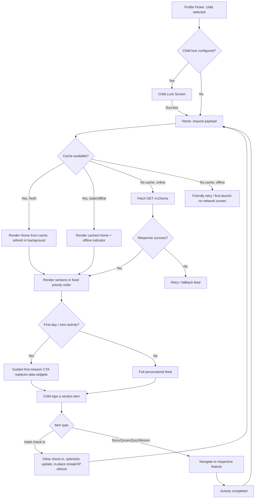
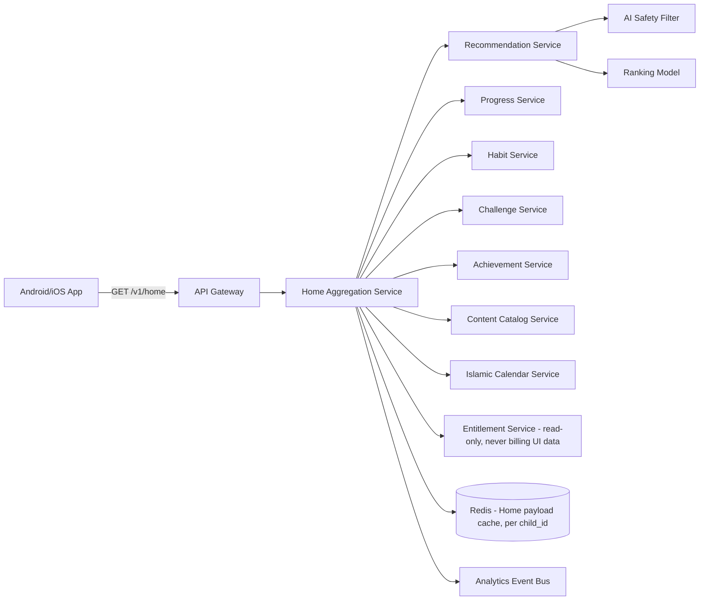
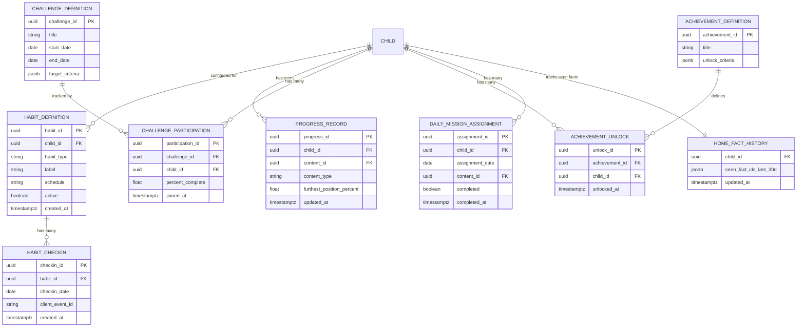

# Feature A.2 — Child Home Dashboard & AI Personalization

**App:** NoorHeroes — Islamic Learning App for Children
**Feature Owner:** Product / AI & Personalization / UX
**Status:** Implementation-ready
**Version:** 1.0
**Depends on:** A.1 (Auth & Onboarding), C.23 (Parental Controls — screen time/bedtime), Content Catalog (Stories, Quran, Duas, Habits, Quizzes)
**Feeds into:** A.3 Stories, A.5 Quran/Arabic, A.7 Habit Tracker, A.8 Daily Quiz, A.11 Rewards, C.22 Parent Progress Reports

---

## Table of Contents

1. [Product Requirements](#1-product-requirements)
2. [UX/UI Requirements](#2-uxui-requirements)
3. [Backend Requirements](#3-backend-requirements)
4. [Database Design](#4-database-design)
5. [Backend AI Code-Generation Prompt](#5-backend-ai-code-generation-prompt)
6. [Android Requirements](#6-android-requirements)
7. [Android AI Code-Generation Prompt](#7-android-ai-code-generation-prompt)
8. [Admin Requirements](#8-admin-requirements)
9. [Admin AI Code-Generation Prompt](#9-admin-ai-code-generation-prompt)
10. [DevOps Requirements](#10-devops-requirements)
11. [Analytics Requirements](#11-analytics-requirements)
12. [Security Requirements](#12-security-requirements)
13. [QA Requirements](#13-qa-requirements)
14. [Marketing Requirements](#14-marketing-requirements)
15. [Release & Rollback Plan](#15-release--rollback-plan)

---

## 1. Product Requirements

### 1.1 Problem Statement

A child opening NoorHeroes needs to immediately understand "what should I do today" without browsing menus, while the system must surface the single best next activity given age, mastery gaps, recent activity, habits, and bedtime/screen-time policy — without ever feeling like an addictive infinite-scroll feed, without shaming missed streaks, and without ever exposing billing/subscription messaging to the child (source: Feature Reference §21.8, "Home must not... Show subscription or billing messages to the child").

### 1.2 Business Goals

- Maximize Day-1/Day-7 retention by making the Home screen the highest-converting "start an activity" surface in the app.
- Drive habit formation (Salah, Quran, dhikr, good deeds) through frictionless check-in widgets directly on Home.
- Surface AI-personalized recommendations that increase content completion rate without resorting to addictive mechanics (explicit non-goal: dwell-time maximization).
- Give parents (via the Parent Dashboard preview) confidence that "today's overview" reflects real learning, not just app-open counts.

### 1.3 User Goals

- **Child:** Open the app and immediately see "what's my one thing to do," resume what I was doing yesterday, check in my habits, and feel celebrated for progress.
- **Parent (indirect, via preview widget only):** Glance at today's progress without entering full Parent Mode.

### 1.4 Success Metrics

| Metric | Target |
|---|---|
| Home → activity-start click-through rate | ≥ 55% of sessions start an activity within 30s of Home render |
| "Continue Learning/Watching" resume rate | ≥ 40% of sessions with an in-progress item resume it |
| Daily habit check-in rate from Home widget | ≥ 50% of active children check in ≥1 habit/day |
| AI recommendation acceptance rate | ≥ 30% of AI-recommended cards are opened |
| Home load time (cold) | p95 < 1.2s on low-end Android |
| Home load time (warm, cached) | p95 < 300ms |
| Crash-free Home sessions | ≥ 99.5% |
| "First day" empty-state completion (child completes ≥1 activity on day of profile creation) | ≥ 60% |

### 1.5 Stakeholders

Product Manager, UX Researcher/Designer, AI/Personalization Engineer, Backend Architect (Recommendation Service), Android Architect, Content/Editorial team (feed inputs), Data Analyst, Security Engineer (AI-safety filter), QA Lead, Child Psychology/Trust advisor (ethical-rule compliance — "never shame a missed streak").

### 1.6 User Stories

1. As a child, I want to see one clear "Today's Mission" so I know exactly what to do without browsing.
2. As a child, I want to resume the story/lesson/quiz I was doing yesterday with one tap.
3. As a child, I want my Noor companion to greet me by name and mention today's Islamic occasion (e.g., Jummah, Ramadan).
4. As a child, I want to check in my habits (Salah, Quran, dhikr, good deed) right from Home without navigating elsewhere.
5. As a child, I want a quick daily quiz I can do in under a minute.
6. As a child, I want to see my streak and XP without feeling punished if I missed a day.
7. As a child, I want a calm "Bedtime Corner" to appear in the evening with softer content.
8. As a child with no usage history (first day), I want Home to still feel welcoming and give me something easy to start.
9. As a parent, I want to glimpse "today's progress" without fully entering Parent Mode, so I get a quick reassurance.
10. As a parent, I want to be confident the Home feed never shows my child a subscription prompt or billing message.
11. As a child without internet, I want Home to still show my downloaded/cached content so I'm not stuck on an error screen.
12. As a system, I want every Home recommendation to pass through the AI-safety filter before being shown, with zero exceptions.

### 1.7 Functional Requirements

**FR-1** Home must render the following sections **in this fixed priority order**, not user-reorderable (source §21.8 / §5.8): (1) Greeting/streak/XP bar + notifications + search, (2) Today's Mission, (3) Continue Learning / Continue Watching, (4) Recommended Next Step, (5) Daily Quiz / quick practice, (6) Habit & Good Deed check-in, (7) Weekly Challenge & progress map, (8) Milestones & reward summary, (9) Bedtime Corner (conditional on time window), (10) Islamic Fact of the Day.
**FR-2** Greeting must include the child's name and, where applicable, a reference to the current Islamic occasion (Jummah, Ramadan, Eid, etc.) sourced from an Islamic calendar service.
**FR-3** "Continue Learning/Watching" must surface the furthest-valid resume position per content type (story episode, Quran lesson, quiz-in-progress), sourced from the Progress Service — never duplicate entries for the same content across "Continue Learning" and "Continue Watching" (type-segmented, not content-deduplicated incorrectly).
**FR-4** Today's Mission is system-assigned (not child-selectable) and must be achievable within the child's typical session length; default cap is 3 daily missions (source: "Daily Missions (3 per day)").
**FR-5** The Recommendation Engine must accept: age band, locale, parent restrictions, skill-gap/mastery confidence, incomplete activity, variety/fatigue controls, recent dislikes/skips, time-of-day/bedtime state, and offline content availability as ranking inputs (source §21.8 "Home ranking inputs").
**FR-6** Every AI-generated recommendation must pass through an AI Safety Filter service before being eligible for display; recommendations failing the filter are silently excluded (never shown with a "blocked" placeholder that could intrigue a child).
**FR-7** Habit check-in widget must support same-screen check-in (no navigation away from Home required) for at least: Salah, Quran reading, daily dua, good deed, dhikr — and deep-link to the full Habit Builder for fasting tracker and detailed logging.
**FR-8** Streak display must never use shaming language or visual treatment (e.g., no red "broken streak" warnings); a missed day must be handled via "Mercy Day" protection logic (defined in A.7 Habit Tracker, referenced here as a Home-display rule).
**FR-9** Home must NEVER display subscription, billing, paywall, or upsell messaging to the child profile context, under any system state (hard rule, zero exceptions — enforced at the API response-shaping layer, not just client-side hiding).
**FR-10** Home must NEVER autoplay video with sound (source §21.8).
**FR-11** Home must NOT implement infinite scroll; the feed is a fixed, bounded set of sections per FR-1, each internally scrollable (e.g., a horizontal rail) but the page itself terminates after section 10.
**FR-12** Bedtime Corner section appears only within the parent-configured bedtime window for that specific child; outside the window it is omitted entirely from the response (not rendered-but-hidden).
**FR-13** Islamic Fact of the Day must be scholar-approved content, versioned, and not repeat for the same child within a rolling 30-day window where catalog size allows.
**FR-14** Parent Summary Preview (a condensed widget, visible only when the Parent Profile views a child's Home in "preview" sub-mode, not visible to the child) shows today's completed activities and healthy-usage status without requiring full Parent PIN re-entry if already in an active Parent session.
**FR-15** First-day empty state must replace data-dependent sections (Continue Learning, Weekly Challenge, Milestones) with a guided "Let's start your first mission" single CTA rather than rendering empty/broken-looking widgets.
**FR-16** Offline mode must render Home using the last successfully cached payload, visually marked as offline, with only downloaded content actionable; non-downloaded recommended content shows a "download to access offline" affordance rather than a dead link.
**FR-17** Home must refresh its data on: app foreground after >15 minutes background, pull-to-refresh gesture, and immediately after completing any activity that affects its own sections (e.g., completing a habit check-in updates the streak bar in place, not on next full reload).
**FR-18** The Noor companion greeting must vary phrasing/tone across repeated sessions (non-repetitive script pool) to avoid feeling robotic, while staying within scholar-approved language bounds — no AI-freeform-generated greeting text is shown unfiltered.

### 1.8 Non-Functional Requirements

- **Performance:** Cold load p95 < 1.2s, warm/cached p95 < 300ms (low-end Android baseline device per Phase-1 standard).
- **Availability:** Recommendation Service degrades gracefully to a rule-based fallback feed (not an error state) if the AI/ML ranking service is unavailable.
- **Scalability:** Recommendation Service must handle full DAU peak (regional evening/Maghrib usage spike) without latency degradation beyond p95 targets.
- **Localization:** All Home copy, including AI-generated greeting variants and Islamic Fact content, fully localized and RTL-mirrored.
- **Accessibility:** All Home widgets screen-reader navigable in the fixed section order; horizontal rails individually swipeable via accessibility gestures, not mouse/touch-only.
- **Offline tolerance:** Per FR-16 — full graceful degradation, never a blank/error screen for a child with prior cached data.
- **Ethical/Trust constraint:** No dark patterns, no variable/random reward timing tied to engagement maximization (explicit conflict with the "AI Reward Psychology Engine" framing in source docs — engine must optimize for meaningful progress, not addictive randomness, per the Ethical Rule in the blueprint).

### 1.9 Acceptance Criteria

- Given a child with an in-progress story, when Home loads, then "Continue Learning/Watching" shows that story at its last saved position, not from the beginning.
- Given a child profile created today with zero activity, when Home loads, then the First-Day empty-state guided flow renders instead of empty data widgets.
- Given the current time falls within the parent-configured bedtime window, when Home loads, then the Bedtime Corner section is present; outside that window, it is absent entirely from the API response.
- Given the AI Safety Filter rejects a candidate recommendation, when Home renders, then that item never appears in any section, with no visible gap or error indicating something was removed.
- Given a child is offline with cached Home data, when Home loads, then all previously-downloaded actionable items remain tappable, and non-downloaded items show a clear "needs internet/download" state rather than a broken link.
- Given a child checks in a habit directly from the Home widget, when the check-in succeeds, then the streak/XP bar updates in place without a full page reload.
- Given a child's account is in any state, when Home renders, then no subscription/billing/upsell content is present anywhere on the page (verified via automated content-audit test, not just manual QA).
- Given a parent is in an active Parent session and opens "Preview [Child]'s Home," when the preview renders, then it does not re-prompt for PIN and shows the condensed Parent Summary widget overlay, not the child's literal habit-check-in controls.

### 1.10 Edge Cases

1. Child has two equally "furthest-valid" in-progress items of the same content type (e.g., two stories both 50% complete due to a sync race) → Continue Learning shows only the most-recently-interacted-with one; the other surfaces lower in Recommended Next Step, not duplicated.
2. Recommendation Engine returns zero eligible items after AI Safety Filter exclusion (e.g., new low-content-volume locale) → Recommended Next Step section falls back to scholar-curated "evergreen" content set, never renders empty.
3. Child's age band changes (birthday rollover) between sessions → Home recommendations must reflect the new age band immediately on next load, not stale-cached from the prior band.
4. Bedtime window spans midnight (e.g., 8pm–6am) → Bedtime Corner logic must correctly evaluate window crossing midnight, not just simple start<now<end comparison.
5. Parent changes screen-time/AI-permission settings while child is mid-session on Home → per Parent Dashboard rule, "changes apply at the next child-app session, not mid-session" — Home must not abruptly mutate mid-session even if settings change server-side.
6. Child completes the Today's Mission item, then re-opens Home same day → Today's Mission shows a completed state with positive reinforcement, not a re-assignment of a new mission (missions are daily-bounded, max 3, not infinitely regenerating).
7. Multiple siblings share a device and switch profiles rapidly → Home payload for child B must never contain any cached fragment of child A's session (cache keyed strictly per child_id, cleared on switch per the multi-child session-isolation rule).
8. Islamic calendar service is unavailable at request time → Greeting gracefully omits the occasion reference rather than showing an error or stale/incorrect date claim.
9. Child has zero habits configured yet (parent hasn't set any up) → Habit & Good Deed check-in section shows a friendly "ask a grown-up to set up your first habit" prompt instead of an empty checklist.
10. Network reconnects mid-session after an offline period → Home should reconcile any locally-queued offline habit check-ins (synced in causal order, deduplicated via idempotency keys) before showing "live" data, to avoid a visible streak regression flash.
11. Daily Quiz has already been completed for the day but the child navigates back to Home → quiz widget shows a completed/celebratory state with a "come back tomorrow" framing, not a re-playable quiz (unless retry-for-mastery is explicitly permitted by design — must be a deliberate decision, defaulting to not-replayable for the "Quiz of the Day" framing).
12. Recommendation payload includes content that was withdrawn by Admin between cache time and tap time → tapping shows a graceful "this content is no longer available" message and silently removes it from the cached Home payload, not a raw 404.

### 1.11 Error Handling

| Scenario | System Behavior |
|---|---|
| Recommendation Service timeout/failure | Serve rule-based fallback feed (deterministic, scholar-curated) seamlessly — child never sees an error for this specific failure |
| Progress Service failure (Continue Learning data) | Section gracefully hides rather than showing a broken card; other sections render normally |
| Habit check-in submit fails (network) | Optimistic UI update locally, queued for retry via background sync, with a subtle "saving..." indicator; never blocks the rest of Home |
| Full Home payload fetch failure (no cache available — true first launch on flaky network) | Show a friendly retry screen, never a raw technical error message |
| Islamic calendar/occasion service failure | Omit occasion phrase from greeting silently |
| Content item withdrawn/unavailable on tap | Graceful "no longer available" toast + silent removal from local cache |

### 1.12 Empty States

- First-day / zero-activity child: guided single-CTA "start your first mission" replacing data-dependent widgets (FR-15).
- Zero habits configured: friendly parent-setup prompt (Edge Case 9).
- Zero weekly-challenge participation yet: challenge widget shows the challenge description and a "Join Challenge" CTA instead of progress bar.
- Zero achievements yet: milestone summary shows the next achievable milestone as a preview/teaser, not a blank module.

### 1.13 Loading States

- Skeleton-screen loading per section (shimmer placeholders matching each widget's shape), not a single full-screen spinner — sections that resolve faster render progressively rather than waiting for the slowest section.
- Pull-to-refresh shows a brand-consistent (non-default-platform) refresh indicator.

### 1.14 Offline States

- Full cached-Home rendering per FR-16, with a persistent small "offline" indicator (not alarming, not blocking).
- Habit check-ins queue locally and sync on reconnect (Edge Case 10).
- Non-cached recommended content shows "download to access offline" rather than disabled-greyed-out-no-explanation.

### 1.15 Permission States

- No new runtime permissions are requested by this feature itself (notifications/microphone are requested by other features); Home simply reflects whatever permission state already exists (e.g., if notification permission was denied, the notification bell still renders but indicates no push capability via a subtle badge state).

### 1.16 User Flow (Narrative)

Child selects profile from Profile Picker (passes through Child Lock if configured, per A.1) → Home loads (skeleton → progressive section render) → Greeting/streak bar renders first → child either taps Today's Mission, Continue Learning, a Recommended item, the Quiz widget, or a Habit check-in → each tap routes to the relevant feature (Stories/Quran/Quiz/Habits) with the originating Home section recorded for analytics attribution → on completion, child is typically routed back to Home (not deep into another flow), where the relevant section now reflects the completed state.

### 1.17 Detailed Flow Diagram (Mermaid)



### 1.18 Screen Inventory (Complete — Zero Missing)

| # | Screen / Component | Type | Entry Points | Exit Points |
|---|---|---|---|---|
| 1 | Child Home (composite screen) | Primary | Profile Picker, app resume, bottom nav "Home" tab | All feature tabs, Search, Notifications |
| 2 | Greeting / Streak / XP / Notification Bell / Search Bar (header widget) | Component | Top of Home | Notifications screen, Search screen |
| 3 | Today's Mission Card | Component | Home | Relevant feature (Story/Quran/Quiz/Habit) |
| 4 | Continue Learning Rail | Component | Home | Story Detail / Quran Lesson / Quiz-in-progress |
| 5 | Continue Watching Rail | Component | Home | Story Player (video) |
| 6 | Recommended Next Step Card(s) | Component | Home | Relevant content detail screen |
| 7 | Daily Quiz Widget | Component | Home | Quiz Player (inline or full screen) |
| 8 | Habit & Good Deed Check-in Widget | Component | Home | Inline check-in (no nav) / Habit Builder (full) |
| 9 | Weekly Challenge & Progress Map Widget | Component | Home | Weekly Challenge Detail screen |
| 10 | Milestones & Reward Summary Widget | Component | Home | Achievements screen / Rewards Wallet |
| 11 | Bedtime Corner Widget (conditional) | Component | Home, within bedtime window only | Bedtime Mode / Audio Bedtime Player |
| 12 | Islamic Fact of the Day Card | Component | Home | Fact Detail / related Quiz item |
| 13 | First-Day Guided Empty State | Screen variant | Home, zero-activity child | First Mission flow |
| 14 | Offline Home State | Screen variant | Home, no connectivity | Retry / downloaded content |
| 15 | Home Loading Skeleton State | Screen variant | Home, initial/refresh load | Resolves to full Home |
| 16 | "Content No Longer Available" Toast/Modal | Component | Tap on withdrawn content | Dismiss, returns to Home |
| 17 | Parent Summary Preview Widget (Parent-mode "Preview Child Home" sub-view) | Screen variant | Parent Dashboard → "Preview [Child]" | Back to Parent Dashboard |
| 18 | No-Habits-Configured Empty State | Component | Habit widget, zero habits | Parent setup deep link |
| 19 | Zero-Challenge-Participation Empty State | Component | Weekly Challenge widget | Join Challenge action |
| 20 | Zero-Achievement Teaser State | Component | Milestones widget | Achievements screen |
| 21 | Full-Screen Retry (no cache, no network) | Screen | Home, true cold-start offline | Retry → Home |

### 1.19 Events (Complete Analytics Event List)

`home_viewed`, `home_load_failed`, `home_section_rendered` (per section), `greeting_occasion_shown`, `today_mission_viewed`, `today_mission_started`, `today_mission_completed`, `continue_learning_viewed`, `continue_learning_resumed`, `continue_watching_resumed`, `recommendation_shown` (with `source_signal` property), `recommendation_clicked`, `recommendation_ai_filtered_count` (internal/aggregate, not per-user-visible), `daily_quiz_widget_viewed`, `daily_quiz_started_from_home`, `habit_checkin_widget_viewed`, `habit_checkin_completed_from_home`, `habit_checkin_failed_queued_offline`, `weekly_challenge_widget_viewed`, `weekly_challenge_joined`, `milestones_widget_viewed`, `bedtime_corner_shown`, `bedtime_corner_entered`, `islamic_fact_viewed`, `islamic_fact_clicked`, `home_first_day_empty_state_shown`, `home_first_mission_started_from_empty_state`, `home_offline_state_shown`, `home_content_unavailable_shown`, `home_pull_to_refresh`, `home_section_scroll` (per rail), `parent_preview_child_home_opened`.

---

## 2. UX/UI Requirements

> Global Design System tokens (typography, color, spacing, icons, RTL/Arabic rules, accessibility, child-friendly age-group guidance) are defined once in **Feature A.1 §2.1** and reused here without restatement. Only Home-specific extensions are listed below.

### 2.1 Home-Specific Design System Extensions

- **Section Card Elevation:** Each Home section uses a consistent card surface (`Surface` token, 12dp radius, soft shadow `0 2px 8px rgba(0,0,0,0.06)` light / glow-based separation in dark theme) so the fixed-order feed reads as a coherent list of distinct "todo" cards, not a single dense page.
- **Age-Group Visual Density:** Ages 4 to 6: larger illustration-to-text ratio, fewer simultaneous on-screen elements per card, bigger tap targets (≥56dp). Ages 6 to 9: balanced icon+text. Ages 9 to 12 / 12 to 15 / 15 to 18+: more text density permitted, smaller decorative illustration footprint, stat-forward (XP numbers, streak counts shown more prominently).
- **Streak/XP Bar:** Always positive-framed — uses a warm gold progress fill, never red/orange "warning" hues even at a broken streak; a missed-streak state shows a "Mercy Day" icon (gentle moon/star) rather than a crossed-out flame.
- **Bedtime Corner Theme:** Automatically applies the app's dimmed Bedtime/Dark theme variant to this single widget even if the rest of Home is in light theme (visually signals "wind-down" contextually).

### 2.2 Home Page Requirements (Full Section Spec)

| Section | Purpose | Components | Empty State | Error State | Loading State | Offline State |
|---|---|---|---|---|---|---|
| Greeting/Streak/XP header | Orientation + quick stats + entry to search/notifications | Noor companion avatar, name greeting text, occasion tag, streak flame-equivalent icon, XP bar, notification bell (badge count), search icon | N/A (always renders once child exists) | Falls back to name-only greeting, no occasion | Shimmer bar | Renders from cache, occasion omitted if stale >24h |
| Today's Mission | Single clear daily focus | Mission card, icon, short label, progress ring if partially done | N/A — system always assigns up to 3 | Hides card if assignment service fails, does not block rest of Home | Shimmer card | Last cached mission shown, marked "may be outdated" only if >24h stale |
| Continue Learning | Resume reading/lesson | Horizontal rail of resume cards w/ progress bar overlay | Section omitted entirely if nothing in progress | Section hides on error | Shimmer rail | Shows only downloaded resumable items |
| Continue Watching | Resume video | Horizontal rail, thumbnail + progress bar | Section omitted if nothing in progress | Section hides on error | Shimmer rail | Shows only downloaded video |
| Recommended Next Step | AI-personalized suggestion(s) | 1–3 cards, "Why this?" optional micro-explanation tag (e.g., "Because you liked Prophet Stories") | Falls back to curated evergreen set (Edge Case 2) | Falls back to evergreen set | Shimmer cards | Shows only downloaded/cached recommendations |
| Daily Quiz | Quick practice | Quiz widget card, "X questions, ~1 min", completed-state checkmark variant | N/A | Hides if quiz service fails | Shimmer card | Cached quiz-of-day playable offline if pre-downloaded |
| Habit & Good Deed Check-in | Frictionless habit logging | Checklist rows (icon + label + checkbox/tap target), streak mini-calendar peek | Friendly parent-setup prompt (no habits) | Optimistic local update even on submit failure (queued) | Shimmer checklist | Fully functional offline, queued sync |
| Weekly Challenge & Progress Map | Multi-day goal visualization | Progress map illustration, % complete, days remaining | "Join Challenge" CTA state | Hides progress map, shows static challenge description | Shimmer | Cached progress shown, "may be outdated" if stale |
| Milestones & Reward Summary | Celebrate recent achievement | Badge/achievement mini-cards, "view all" link | Teaser of next achievable milestone | Hides section | Shimmer | Cached badges shown |
| Bedtime Corner (conditional) | Calm wind-down content | Dimmed-theme card, audio bedtime story shortcut, dua/reflection prompt | N/A (absent outside window) | Section simply absent on error (fails safe to "not shown") | Shimmer (only within window) | Cached bedtime audio playable offline |
| Islamic Fact of the Day | Light daily learning nugget | Fact card, source/scholar badge, optional related-quiz link | N/A — always has a fallback evergreen fact pool | Hides card | Shimmer | Cached fact shown |

### 2.3 Tab Structure

Home is Tab 1 of 5 (Home / Learn / Stories / Rewards / Profile per the Feature Reference navigation table). For every Home-originating click:

| Click Target | Destination Screen | API Called | Analytics Event | Permission Check | Error Handling |
|---|---|---|---|---|---|
| Notification bell | Notifications screen | `GET /v1/notifications` | `notifications_opened` (defined in Feature A.12) | None | Standard list error/empty states |
| Search icon | Search screen | N/A until query typed | `search_opened` (Feature A.13) | None | N/A |
| Today's Mission card | Relevant feature screen (deep link by content_type) | `GET /v1/content/{id}` | `today_mission_started` | Entitlement check (free/premium) | "Content unavailable" graceful toast |
| Continue Learning/Watching item | Story Detail / Quran Lesson / Quiz Player | `GET /v1/progress/{content_id}` | `continue_learning_resumed` / `continue_watching_resumed` | Entitlement + download-availability check if offline | Withdrawn-content graceful handling |
| Recommended card | Relevant content detail | `GET /v1/content/{id}` | `recommendation_clicked` | Entitlement check | Same as above |
| Daily Quiz widget | Inline quiz player (modal) or Quiz tab | `GET /v1/quizzes/daily` | `daily_quiz_started_from_home` | None (quizzes always free-tier accessible per child-safety/equity principle — confirm with Subscription feature) | Quiz-load failure → retry inline |
| Habit checklist row | Inline check-in (no navigation) | `POST /v1/habits/check-ins` | `habit_checkin_completed_from_home` | None | Optimistic update + offline queue |
| Weekly Challenge widget | Weekly Challenge Detail | `GET /v1/challenges/weekly` | `weekly_challenge_widget_viewed` → `_joined` | None | Static fallback description on error |
| Milestones widget | Achievements screen | `GET /v1/children/{id}/achievements` | `milestones_widget_viewed` | None | Teaser fallback |
| Bedtime Corner card | Bedtime Mode / Audio Player | `GET /v1/content/{id}?context=bedtime` | `bedtime_corner_entered` | Download-availability if offline | Section absent if unavailable, no error shown |
| Islamic Fact card | Fact Detail / related quiz | `GET /v1/facts/daily` | `islamic_fact_clicked` | None | Evergreen fallback |

### 2.4 Wireframe Description (Composite)

Single vertically-scrolling screen with a sticky-on-scroll condensed header (avatar + streak only, once the full greeting scrolls past), followed by the 10 sections in strict fixed order, each as a distinct rounded card or horizontally-scrollable rail. No tab/filter controls exist on Home itself (all filtering/personalization happens server-side, invisibly) — this is intentional to avoid turning Home into a "browse" surface, which is reserved for Stories/Learn tabs.

### 2.5 Screen Image Generation Prompts

**Screen: Child Home Dashboard (full composite)**
- *Prompt 1 (English):* "Mobile app home screen UI mockup for a children's Islamic learning app, designed for a child user aged 6-9. Warm, bright, playful flat-vector illustration style. Top header shows a friendly round cartoon companion character (crescent-moon-shaped mascot with a gentle smiling face) next to a greeting text area, a horizontal gold progress/XP bar, a small streak icon shaped like a glowing star, and a notification bell icon. Below, a large rounded card labeled 'Today's Mission' with a simple icon. Below that, a horizontally scrollable row of rounded thumbnail cards with progress bars labeled 'Continue Learning'. Further down, a checklist-style card with rounded checkboxes for habits like prayer, Quran, kind deeds, each with a small icon. Bottom navigation bar with 5 rounded icons: home, book, play, star, profile. Color palette: warm off-white background, teal and gold accents, soft shadows, rounded corners throughout, no sharp edges, no realistic human faces, joyful and calm mood."
- *Prompt 2 (Arabic RTL):* "نفس واجهة الشاشة الرئيسية لتطبيق تعليم إسلامي للأطفال، مصممة لطفل بعمر 6-9 سنوات، بتخطيط كامل من اليمين إلى اليسار. أسلوب رسم متجه دافئ ومرح ومسطح. يعرض الرأس العلوي شخصية كرتونية ودودة على شكل هلال بوجه مبتسم بجانب نص ترحيب، وشريط تقدم ذهبي أفقي للنقاط، وأيقونة صغيرة لمتتالية الإنجاز على شكل نجمة متوهجة، وأيقونة جرس للإشعارات. أسفل ذلك بطاقة كبيرة مستديرة الزوايا بعنوان 'مهمة اليوم' مع أيقونة بسيطة. وتحتها صف قابل للتمرير أفقيًا من البطاقات المصغرة المستديرة مع أشرطة تقدم بعنوان 'استمر في التعلم'. وأسفل ذلك بطاقة على شكل قائمة تحقق بمربعات اختيار مستديرة لعادات مثل الصلاة والقرآن والأعمال الطيبة، كل منها بأيقونة صغيرة. شريط تنقل سفلي بخمس أيقونات مستديرة: الرئيسية، كتاب، تشغيل، نجمة، الملف الشخصي. الألوان: خلفية بيج فاتح دافئ، لمسات فيروزية وذهبية، ظلال خفيفة، زوايا دائرية في كل مكان، بدون وجوه بشرية واقعية، بطابع مرح وهادئ."

**Screen: First-Day Guided Empty State**
- *Prompt 1 (English):* "Mobile app empty-state/welcome screen UI mockup for a children's app, shown on a child's very first day. Centered warm flat-vector illustration of a small friendly crescent-moon mascot waving, surrounded by soft sparkle stars, with a single large rounded gold button below labeled 'Start My First Mission'. Minimal layout, lots of breathing room, warm off-white background, teal and gold accent colors, soft shadows, no clutter, joyful and inviting mood, no realistic human faces."
- *Prompt 2 (Arabic RTL):* "نفس شاشة الترحيب/الحالة الأولى لتطبيق أطفال، تظهر في أول يوم للطفل، بتخطيط من اليمين إلى اليسار. رسمة متجهة دافئة ومسطحة مركزية لشخصية هلال ودودة تلوّح بيدها محاطة بنجوم متلألئة لطيفة، مع زر ذهبي كبير مستدير الزوايا أسفلها بعنوان 'ابدأ مهمتي الأولى'. تخطيط بسيط مع مساحات فارغة كافية، خلفية بيج فاتح دافئ، ألوان فيروزية وذهبية ظلال خفيفة، بدون ازدحام، بطابع مرح ومرحب، بدون وجوه بشرية واقعية."

**Screen: Bedtime Corner Widget**
- *Prompt 1 (English):* "Mobile app widget card UI mockup, dimmed dark-theme 'bedtime mode' card embedded within a lighter home screen. Deep navy/teal night-sky gradient background within the card, small twinkling star illustrations, a crescent moon icon, soft warm gold text reading 'Bedtime Corner', a small play button icon suggesting an audio story, calm and soothing visual tone, rounded card corners, contrasts gently against a brighter surrounding page, no harsh contrast, no realistic faces."
- *Prompt 2 (Arabic RTL):* "نفس بطاقة عنصر واجهة 'ركن وقت النوم' بنمط الوضع الداكن الخافت، مدمجة داخل شاشة رئيسية أكثر إضاءة، بتخطيط من اليمين إلى اليسار. خلفية متدرجة بلون كحلي وفيروزي غامق يشبه سماء الليل داخل البطاقة، رسومات نجوم متلألئة صغيرة، أيقونة هلال، نص بلون ذهبي دافئ وهادئ بعنوان 'ركن وقت النوم'، أيقونة زر تشغيل صغيرة تشير إلى قصة صوتية، طابع بصري هادئ ومريح للغاية، زوايا بطاقة مستديرة، تباين لطيف مع الصفحة المحيطة الأكثر سطوعًا، بدون تباين قاسٍ وبدون وجوه بشرية واقعية."

*(Remaining widget-level screens — Habit Checklist, Daily Quiz Widget, Weekly Challenge Map, Milestones Summary, Islamic Fact Card, Parent Summary Preview, Offline State, Loading Skeleton — follow the same two-prompt EN/AR template using the Global Design System tokens from A.1 §2.1; full set generated on request.)*

---

## 3. Backend Requirements

### 3.1 System Design Overview

Home is served by a **Home Aggregation Service** that fans out in parallel to the Recommendation Service, Progress Service, Habit Service, Challenge Service, Achievement Service, Content Catalog, and Islamic Calendar Service, merges results into the fixed 10-section contract, and applies the AI Safety Filter to any AI-sourced content before response shaping. Subscription/billing data is explicitly never queried by this service (architectural enforcement of FR-9, not just a display-layer omission).

### 3.2 Architecture Diagram (Mermaid)



### 3.3 Service Breakdown

| Service | Responsibility |
|---|---|
| Home Aggregation Service | Orchestrates fan-out, enforces fixed section order, enforces "no billing content" rule at response-shaping layer |
| Recommendation Service | Ranks candidate content using age/mastery/fatigue/time-of-day signals |
| AI Safety Filter | Final gate on every AI-sourced recommendation/greeting variant before it can reach a child |
| Progress Service | Tracks furthest-valid resume position per content item per child |
| Habit Service | Habit definitions, check-ins, streak calculation, Mercy Day logic |
| Challenge Service | Weekly/seasonal challenge definitions and per-child progress |
| Achievement Service | Badge/milestone catalog and per-child unlock state |
| Islamic Calendar Service | Resolves current Islamic date/occasion for greeting personalization |

### 3.4 API List

#### `GET /v1/home`
- **Auth:** Bearer (child-mode session, scoped to `family_id` + `child_id`)
- **Request Headers:** `X-Child-Session-Id`, `X-Timezone`, `X-App-Version`, `If-None-Match` (ETag support for cache validation)
- **Response 200:**
```json
{
  "child_id": "child_...",
  "generated_at": "2026-06-22T10:00:00Z",
  "greeting": { "text": "Good morning, Amina!", "occasion": "Jummah Mubarak" },
  "streak": { "current": 5, "mercy_day_active": false, "xp": 1240, "xp_to_next_level": 260 },
  "sections": {
    "today_mission": { "items": [ { "content_id": "...", "type": "quiz", "title": "...", "progress": 0 } ] },
    "continue_learning": { "items": [ ... ] },
    "continue_watching": { "items": [ ... ] },
    "recommended": { "items": [ { "content_id": "...", "reason_tag": "because_you_liked_prophet_stories" } ] },
    "daily_quiz": { "quiz_id": "...", "question_count": 5, "completed_today": false },
    "habits": { "items": [ { "habit_id": "...", "label": "Fajr", "checked_today": false } ] },
    "weekly_challenge": { "challenge_id": "...", "percent_complete": 40, "days_remaining": 3 },
    "milestones": { "recent": [ ... ], "next_teaser": { ... } },
    "bedtime_corner": null,
    "islamic_fact": { "fact_id": "...", "text": "..." }
  },
  "is_first_day": false
}
```
- **Validation:** `bedtime_corner` is `null` (key present, value null) when outside window — explicit contract so clients never need time-window logic duplicated client-side; server is the single source of truth for window evaluation given timezone header.
- **Error Codes:** `401 INVALID_SESSION`, `403 CHILD_LOCKED` (if a concurrent lock event occurred), `503 PARTIAL_DEGRADATION` is never returned as a top-level error — partial failures degrade individual sections per §1.11, response is still `200`.
- **Rate Limiting:** 30 req/min/child_session (covers pull-to-refresh abuse).
- **Caching:** ETag-based; ranking/ML-derived sections have a shorter effective freshness (5 min) than deterministic sections (habits/challenges, which are mutation-driven, not time-driven).
- **Security:** Response shaping layer has a hard allowlist of permitted top-level keys — any billing/subscription field accidentally added upstream is stripped before serialization (defense in depth for FR-9).

#### `POST /v1/habits/check-ins`
- **Auth:** Bearer (child-mode)
- **Request:** `{ "habit_id": "habit_...", "date": "2026-06-22", "client_event_id": "uuid..." }`
- **Response 200:** `{ "checked": true, "current_streak": 6, "xp_awarded": 10 }`
- **Validation:** `client_event_id` enforces idempotency (offline-queued duplicate submissions deduped).
- **Error Codes:** `409 ALREADY_CHECKED_TODAY` (idempotent success response, not a hard error — client treats as success).
- **Rate Limiting:** 60 req/min/child (generous, since legitimate rapid multi-habit check-in is normal).

#### `GET /v1/progress/resume` (used internally by Home Aggregation, also directly by feature screens)
- **Response 200:** Array of furthest-valid positions per content type, deduplicated per content item.

#### `GET /v1/challenges/weekly`
- **Response 200:** Current challenge definition + child's progress; `null` challenge object if none active for the locale/age band.

#### `GET /v1/children/{id}/achievements`
- **Response 200:** Recent unlocks (last 7 days) + computed "next achievable" teaser.

#### `GET /v1/facts/daily`
- **Response 200:** Scholar-approved fact for the day, deduped against the child's last-30-days-seen list server-side.

### 3.5 Cross-Cutting API Concerns

- **Pagination:** N/A — all Home sections are bounded-size arrays (max items per rail enforced server-side, e.g., max 10 in Continue Learning rail).
- **Caching:** Redis cache keyed `home:{child_id}`, 5-minute TTL for ranking-derived content, invalidated immediately on any mutating action (habit check-in, mission completion) for the affected section only (partial cache invalidation, not full-payload busting).
- **Security:** AI Safety Filter call is synchronous and blocking for any AI-sourced field — Home Aggregation Service will not return unfiltered AI content even under latency pressure (fails closed: excludes the item rather than risk showing unfiltered content).
- **Analytics:** Every section render and click emits the corresponding event from §1.19.

---

## 4. Database Design

### 4.1 ER Diagram (Mermaid)



### 4.2 Tables, Relationships, Constraints

| Table | Key Constraints | Indexes |
|---|---|---|
| `habit_definition` | FK `child_id`; CHECK `habit_type IN ('salah','quran','dua','good_deed','dhikr','fasting')` | Index on `(child_id, active)` |
| `habit_checkin` | FK `habit_id`; UNIQUE(`habit_id`, `checkin_date`) — enforces one check-in per day per habit at the DB layer, not just app logic; UNIQUE(`client_event_id`) for idempotency | Index on `(habit_id, checkin_date DESC)` |
| `progress_record` | FK `child_id`, `content_id`; UNIQUE(`child_id`, `content_id`) | Index on `(child_id, content_type, updated_at DESC)` |
| `challenge_participation` | FK `challenge_id`, `child_id`; UNIQUE(`challenge_id`, `child_id`) | Index on `(child_id)` |
| `daily_mission_assignment` | FK `child_id`, `content_id`; UNIQUE(`child_id`, `assignment_date`, `content_id`); CHECK max 3 rows per `(child_id, assignment_date)` enforced via trigger | Index on `(child_id, assignment_date)` |
| `achievement_unlock` | FK `achievement_id`, `child_id`; UNIQUE(`achievement_id`, `child_id`) — no duplicate unlocks | Index on `(child_id, unlocked_at DESC)` |

### 4.3 Audit Fields
All tables carry `created_at`; mutable tables (`habit_definition`, `challenge_participation`) carry `updated_at`. `habit_checkin` and `achievement_unlock` are append-only/immutable by design (a check-in or unlock is a historical fact, never edited).

### 4.4 Soft Delete Rules
`habit_definition.active = false` is used instead of deletion when a parent disables a habit, preserving historical `habit_checkin` rows for accurate streak/report history. No hard delete of `habit_checkin` ever occurs except via the global account-deletion data-purge job.

### 4.5 Retention Rules
`home_fact_history.seen_fact_ids_last_30d` is a rolling window, pruned by a nightly job. `daily_mission_assignment` rows older than 90 days are archived to cold storage (still queryable for Parent Reports' historical trends, just not in the hot path).

---

## 5. Backend AI Code-Generation Prompt

```
You are building the Home Aggregation Service for "NoorHeroes," a child-safety-first
Islamic learning app. This service powers the single most-used screen in the app
and has one non-negotiable architectural rule: IT MUST NEVER RETURN BILLING,
SUBSCRIPTION, OR PAYWALL CONTENT IN ANY FORM, under any code path.

Stack: FastAPI (Python 3.12), PostgreSQL (SQLAlchemy 2.0), Redis (per-child
payload cache), async fan-out to internal services via httpx, Kafka for
analytics events.

Build a GET /v1/home endpoint that:
1. Fans out concurrently (asyncio.gather, not sequential) to: Recommendation
   Service, Progress Service, Habit Service, Challenge Service, Achievement
   Service, Content Catalog, Islamic Calendar Service.
2. Applies a response-shaping allowlist filter as the LAST step before
   serialization: define an explicit Pydantic response model with ONLY the
   fields in the contract below. Any extra field returned by an upstream
   service (e.g., if Recommendation Service accidentally includes a
   "subscription_upsell" field) must be silently dropped by the Pydantic
   model's strict schema, not merely ignored by convention.
3. Routes every AI-sourced recommendation and every AI-generated greeting
   variant through a synchronous call to the AI Safety Filter service before
   inclusion. If the Safety Filter call itself fails or times out, EXCLUDE
   the item (fail closed) rather than including unfiltered content.
4. Implements the fixed section order as a literal ordered structure in the
   response model -- sections key order in the JSON model definition mirrors
   the required priority order in this spec, and is covered by a snapshot
   test that fails if the order ever changes accidentally during refactors.
5. Implements bedtime_corner as `null` (not omitted key) outside the
   parent-configured per-child bedtime window, evaluated using the
   X-Timezone request header and stored bedtime config, correctly handling
   windows that cross midnight.
6. Implements graceful per-section degradation: if any single upstream
   service call fails or times out (set a 400ms per-call timeout), that
   section is set to null/empty in the response and the overall response
   still returns 200 -- never propagate a single upstream failure into a
   500 for the whole Home payload.
7. Implements Redis caching keyed `home:{child_id}` with a 5 minute TTL for
   recommendation-derived sections, and immediate partial invalidation
   (single-section, not full-key) when a mutating event occurs (e.g., a
   habit check-in invalidates only the habits cache fragment for that child).
8. POST /v1/habits/check-ins: enforce a UNIQUE(habit_id, checkin_date)
   database constraint (not just app-level dedup) so a double-submit
   (including offline-queued duplicates) cannot create two check-ins for
   the same day; treat the resulting unique-violation as an idempotent
   success response, not an error surfaced to the client.
9. Daily mission assignment: implement and test a database trigger or
   equivalent constraint that hard-caps assignments at 3 per
   (child_id, assignment_date) -- this must be enforced at the database
   layer, not only in application code.
10. Write a dedicated automated "content safety audit" test suite that
    issues GET /v1/home for a matrix of fixture child profiles (varying
    age, subscription tier, locale) and asserts that the serialized JSON
    response, when recursively searched as a string, contains NONE of a
    configurable blocklist of terms: "subscribe", "upgrade", "$", "price",
    "billing", "trial", "renew". This test must run in CI on every PR
    touching this service.

Deliver: FastAPI router, Pydantic strict response models, SQLAlchemy models
+ Alembic migrations matching the ER diagram, the content-safety-audit
pytest suite described above, and async integration tests for the
graceful-degradation behavior (simulate each upstream dependency failing
independently).
```

---

## 6. Android Requirements

### 6.1 Technical Requirements
Kotlin, Jetpack Compose, MVVM, Clean Architecture, module `:feature:home`, depends on `:core:design-system`, `:core:network`, `:core:offline-cache`. Pure ranking-irrelevant logic (e.g., bedtime-window evaluation for client-side display nuance, streak display formatting) is KMP-shareable.

### 6.2 Screen Mapping
`HomeScreen` Composable composed of independent section Composables (`TodayMissionSection`, `ContinueLearningRail`, `HabitChecklistSection`, etc.), each driven by its own slice of a single `HomeUiState` exposed from `HomeViewModel` as `StateFlow<HomeUiState>` — sections render independently so a slow/failed section never blocks others (mirrors backend's graceful per-section degradation).

### 6.3 Navigation Flow
Home is the default start destination of the main bottom-nav graph. Each section item navigates via a typed `NavigationEvent` sealed class consumed once (no re-trigger on rotation/recomposition) routing to the appropriate feature module's entry point.

### 6.4 State Management
`HomeUiState` models each section as `Loading | Content(data) | Error | Hidden` independently (not one global enum for the whole screen) — this directly reflects the backend's per-section null/degraded contract. Optimistic updates for habit check-ins mutate local state immediately, with a reconciliation step against the server response (or queued offline job) afterward.

### 6.5 API Mapping
`HomeRepository.getHome()` → `GET /v1/home`; `HabitRepository.checkIn()` → `POST /v1/habits/check-ins` with a locally-generated `client_event_id` (UUID) attached at the moment of tap, reused on any retry.

### 6.6 Analytics Mapping
`HomeAnalytics` interface fires `home_viewed` once per successful render (not per recomposition) and `home_section_rendered` once per section as each resolves — implemented via a one-shot `LaunchedEffect` keyed on the resolved-section identity, not on every state emission.

### 6.7 Offline Support
`HomeLocalCache` (Room) stores the last successful `/v1/home` payload per `child_id`; on cold start without connectivity, render from this cache immediately, then attempt a background refresh. Habit check-ins write to a local outbox table and sync via WorkManager on reconnect, using the same `client_event_id` idempotency pattern as the backend.

### 6.8 Deep Linking
`noorheroes://home/section/{section_id}` supported for push-notification deep links (e.g., a habit-reminder notification opens Home scrolled to the Habit section, not a separate screen).

### 6.9 Push Notifications
Home itself does not send notifications, but is the landing target for habit-reminder, mission-reminder, and streak-encouragement notifications managed by Feature A.12 (Notifications) and A.7 (Habit Tracker) — this feature only needs to support the scroll-to-section deep link target.

### 6.10 Testing Strategy
- Unit: `HomeViewModel` state-reduction logic per section, including the "first-day empty state" branching and bedtime-window display logic.
- Compose UI tests: each section's Loading/Content/Error/Hidden visual states independently, snapshot tests verifying section order never changes.
- Integration: full Home load with simulated backend partial-failure responses (mocked per-section nulls) verifying graceful degradation client-side.
- Content-safety regression test: an automated UI test that asserts no view in the Home screen tree contains text matching a billing/subscription term blocklist (Android-side mirror of the backend audit test).

---

## 7. Android AI Code-Generation Prompt

```
Build the `:feature:home` Android module for NoorHeroes using Kotlin, Jetpack
Compose, MVVM, Clean Architecture.

Implement HomeScreen as a composition of independent section Composables,
each bound to its own state slice from a single HomeUiState exposed via
HomeViewModel: StateFlow<HomeUiState> where each section type is modeled
as a sealed interface SectionState { Loading, Content(data), Error, Hidden }
-- NOT a single screen-wide loading/error flag. This must allow, e.g., the
Habit Checklist to render fully interactive while Recommended Next Step is
still loading or has failed.

Hard requirements:
1. Sections render in the exact fixed priority order: Greeting/Streak/XP ->
   Today's Mission -> Continue Learning -> Continue Watching -> Recommended
   -> Daily Quiz -> Habits -> Weekly Challenge -> Milestones -> Bedtime
   Corner (conditionally null/absent) -> Islamic Fact. Write a Compose UI
   test asserting this exact order via semantics tree traversal, which must
   fail the build if reordered.
2. Bedtime Corner section composable returns nothing (emits no node) when
   the corresponding state is null/absent -- do not render an empty card
   or placeholder for it.
3. Habit check-in taps trigger an OPTIMISTIC local state update (checkbox
   ticks immediately) before the network call resolves; on failure, the
   tap is queued to a local Room-backed outbox with a UUID client_event_id
   generated at tap-time (not retry-time) and retried via WorkManager on
   reconnect, reusing the same UUID.
4. Implement a HomeLocalCache (Room) that persists the last successful
   /v1/home response per child_id, used to render the screen instantly
   on cold start when offline, with a subtle persistent "offline" badge --
   never show a blank or error screen if a cache exists.
5. Build a Compose UI test suite that recursively walks the rendered
   semantics tree of HomeScreen (across multiple fixture states: free tier,
   premium tier, first-day, offline) and FAILS if any text node matches a
   blocklist of billing-related substrings (case-insensitive): "subscribe",
   "upgrade", "$", "price", "billing", "trial", "renew". This is a
   non-negotiable CI gate for this module.
6. Implement deep link noorheroes://home/section/{section_id} that, on
   navigation, scrolls the LazyColumn to the matching section using
   bringIntoViewRequester, without re-triggering a full data reload if the
   screen is already in memory.
7. First-day empty state: when HomeUiState.isFirstDay is true, replace the
   Continue Learning, Weekly Challenge, and Milestones sections with a
   single centered "Start My First Mission" CTA composable -- implement
   this as a state-driven conditional render, not a separate Activity/screen.
8. Write unit tests for HomeViewModel covering: per-section independent
   failure handling, optimistic habit check-in + rollback-on-permanent-
   failure (e.g., a 409 ALREADY_CHECKED_TODAY response should NOT roll back
   the optimistic UI -- it should be treated as success), and bedtime-window
   client-side display logic for windows crossing midnight.

Use Hilt for DI, Retrofit+OkHttp, Room for local cache/outbox, WorkManager
for offline sync, Coil for images. Follow Global Design System tokens from
the Android module built for Feature A.1 (`:core:design-system`) -- do not
redefine colors/spacing/typography locally in this module.
```

---

## 8. Admin Requirements

- **Home Composition Monitor:** Read-only dashboard showing live distribution of which sections are rendering vs. degraded (null) across the active user base, segmented by region — surfaces upstream service health from the product's perspective, not just infra metrics.
- **Daily Mission Curation Tool:** Editorial interface for content team to configure the candidate pool and weighting rules that feed the up-to-3-per-day mission assignment algorithm (CRUD: Create/Read/Update on mission-pool entries; Delete soft-only, since historical assignments reference them).
- **Recommendation Explainability Viewer:** Given a `child_id` (masked) and timestamp, support/trust staff can see which signals drove a specific recommendation and confirm it passed the AI Safety Filter — critical for investigating a parent complaint about an inappropriate suggestion.
- **Islamic Fact & Occasion Calendar Manager:** CRUD for the fact pool and the Islamic calendar occasion mappings used in greetings (Create/Read/Update/Delete, scholar-approval-gated before publish, mirroring the Content CMS approval pattern from A.1's admin section).
- **Billing-Content Safety Audit Log Viewer:** Read-only log of the automated content-safety-audit test results from CI, plus any production-sampling audit runs — gives Trust & Safety visibility into the FR-9 guarantee's continuous verification, not just a one-time test.

CRUD permissions: Mission Curation = Create/Read/Update (soft-delete only); Fact/Calendar Manager = full CRUD behind scholar-approval gate; Recommendation Explainability = Read-only; Safety Audit Log = Read-only, restricted to `trust_safety` role.

---

## 9. Admin AI Code-Generation Prompt

```
Build an internal admin module (React + TypeScript, existing NoorHeroes Admin
Portal shell) for managing and monitoring the Child Home Dashboard feature.

Pages:
1. Home Composition Monitor -- real-time dashboard (recharts) showing, per
   region/locale over the last 1h/24h, the percentage of /v1/home responses
   where each section was Content vs Hidden/degraded, sourced from a
   read-only aggregated metrics API (GET /admin/v1/home/section-health).
   Alert banner if any section's degraded rate exceeds 5% sustained.
2. Daily Mission Curation -- CRUD table for mission-pool entries
   (content_id, target_age_bands, weight, active_date_range). Delete is
   soft-delete only (sets active=false) because historical
   daily_mission_assignment rows reference these entries by ID and must
   never become orphaned/broken references.
3. Recommendation Explainability Viewer -- search by masked child
   identifier + date, render a read-only breakdown of a specific historical
   /v1/home recommendation response: which signals were used (age band,
   mastery gap, recent skips, etc.), the candidate set before and after the
   AI Safety Filter, and confirmation of filter-pass status. This page is
   read-only -- no edit/delete actions exist here, it exists purely for
   investigation.
4. Islamic Fact & Occasion Calendar Manager -- full CRUD for fact entries
   (text per locale/age-band, source citation, scholar approval status) and
   for calendar-occasion mappings (Hijri date ranges -> greeting phrase
   keys). New/edited facts require scholar_status = 'approved' before they
   can be set active=true -- enforce this as a hard validation rule in the
   form, not just a warning.
5. Billing-Content Safety Audit Log -- read-only paginated table of CI test
   run results for the "content safety audit" test suite (pass/fail,
   timestamp, commit SHA, any failing blocklist terms found), restricted to
   the trust_safety RBAC role.

Enforce RBAC per the existing Admin Portal's role context. Every CRUD action
on Mission Curation and the Fact/Calendar Manager writes an immutable
audit_log row (admin_id, action, before/after diff, timestamp).
```

---

## 10. DevOps Requirements

- **Infrastructure:** Home Aggregation Service deployed as its own horizontally-scaled Deployment, given it is the highest-traffic endpoint in the app (every app open hits it); Redis cache cluster sized for full DAU peak.
- **CI/CD:** The content-safety-audit test suite (§5, item 10) is a **mandatory, non-skippable** CI gate on any PR touching the Home Aggregation Service, Recommendation Service, or the shared response-shaping Pydantic models — build fails red if this suite fails, with no override flag available to engineers (only a designated Trust & Safety lead can approve an emergency bypass, logged).
- **Monitoring/Logging/Alerting:** Alert on per-section degraded-rate exceeding 5% sustained 10 minutes (mirrors the Admin Composition Monitor); alert on AI Safety Filter call latency p95 > 350ms (risk of forcing fail-closed exclusions and visibly thinning the Recommended section); alert on Home p95 latency breach.
- **Disaster Recovery:** Recommendation Service outage must not take down Home — verified via a scheduled chaos-engineering drill (inject Recommendation Service failure in staging, assert Home still returns 200 with fallback feed).
- **Rollback Strategy:** Any deploy to the response-shaping allowlist model is treated as a security-sensitive change requiring the content-safety-audit suite to pass in staging against production-like data before promotion; automatic rollback if production sampling-based safety audit (a lightweight periodic re-run of the blocklist check against live sampled responses) ever fails post-deploy.
- **Backup Strategy:** `habit_checkin`, `achievement_unlock` tables included in standard backup tier (not the highest compliance tier like Consent Ledger, but still full point-in-time recovery given their role in parent-facing progress reports).
- **Environment Setup:** Staging environment runs a synthetic Recommendation Service mode that deterministically returns fixture data, enabling reliable visual-regression testing of Home without ML-model non-determinism.

---

## 11. Analytics Requirements

### 11.1 Event Taxonomy
Full list in §1.19. Naming convention: `home_*` for screen/section-level events, `*_from_home` suffix for actions that could also originate elsewhere (e.g., `habit_checkin_completed_from_home` vs. a hypothetical `habit_checkin_completed_from_habit_builder`), to allow cross-surface funnel comparison without ambiguity.

### 11.2 Funnel Analysis
Primary funnel: `home_viewed` → `home_section_rendered` (any) → (`today_mission_started` OR `continue_learning_resumed` OR `recommendation_clicked` OR `habit_checkin_completed_from_home`) → activity completion event (defined in respective feature docs). This funnel answers "does Home successfully launch a learning activity," the feature's core KPI.

### 11.3 Dashboard Metrics
Section-level engagement rate (views vs. clicks per section, to identify underperforming widgets), recommendation acceptance rate trended over time (key input to ML model iteration), habit check-in completion rate from Home vs. from the full Habit Builder (validates the "frictionless from Home" hypothesis), first-day empty-state conversion rate.

### 11.4 Cohort & Retention
Cohort by signup week, segmented by whether the child's first session included a Home-originated activity completion — hypothesis: first-session activity completion correlates with D7 retention (validate via cohort analysis, do not assume).

### 11.5 Engagement Metrics
Average sections engaged with per session, average time-to-first-tap on Home, repeat-visit rate to Bedtime Corner within its active window (signals whether the calming-wind-down value proposition resonates).

---

## 12. Security Requirements

### 12.1 Threat Analysis
- **Billing-content leakage:** the single highest-severity risk specific to this feature — mitigated via the allowlist response model (§5) plus the mandatory CI audit gate plus periodic production sampling.
- **Cross-child data leakage:** Redis cache keys strictly namespaced per `child_id`; any cache-key collision risk mitigated via UUID-based keys, never sequential/guessable IDs.
- **Recommendation manipulation/poisoning:** Recommendation Service inputs validated and bounded (e.g., a malformed "recent dislikes" payload cannot be used to inject arbitrary content into the ranking pipeline) — input sanitization at the service boundary.
- **AI Safety Filter bypass via timing/race:** the fail-closed design (§5 item 3) ensures a filter outage cannot become a filter bypass.

### 12.2 OWASP Checklist (Applied)
Broken Access Control: `/v1/home` strictly scoped to the authenticated child-mode session's own `child_id`, server-enforced (a request cannot pass another child's ID and receive their data, even within the same family). Security Misconfiguration: the response-shaping allowlist is itself a misconfiguration-defense pattern (default-deny on fields). Insecure Design: the fail-closed AI Safety Filter pattern is an explicit insecure-design mitigation by design.

### 12.3 API Security
Strict scoping of the bearer token to a single `child_id` (not just `family_id`) prevents a compromised child-mode token from querying sibling data via `/v1/home`.

### 12.4 Mobile Security
Local Room cache for Home payload is stored within the app's sandboxed encrypted storage where supported by the OS; cache content, while not legally as sensitive as PII, is still child-usage data and is cleared on profile switch/logout per the multi-child isolation rule.

### 12.5 Admin Security
Recommendation Explainability Viewer requires `trust_safety` role; given it surfaces (masked) per-child behavioral signal data, access is itself logged in the audit trail as a sensitive-data view event.

### 12.6 Data Encryption & PII Protection
No new raw PII is introduced by this feature beyond what already exists on the `child` record; habit/progress data is pseudonymized by `child_id` reference only in analytics exports.

### 12.7 Child Safety Requirements
This entire feature exists in service of child safety/wellbeing framing (no shaming, no dark patterns, no autoplay-with-sound, no billing exposure) — these are treated as P0 launch blockers, not enhancements, consistent with the Ethical Rule defined in the source blueprint's Habit Engine section, extended here to the Home surface generally.

### 12.8 Compliance Requirements
No additional regulatory surface beyond the platform baseline (A.1); this feature's main compliance-adjacent obligation is honoring parent-configured screen-time/bedtime settings accurately (a trust commitment, not strictly a legal one, but treated with equivalent rigor).

### 12.9 Security Checklist (Pre-Launch)
- [ ] Content-safety-audit CI suite passing and confirmed non-bypassable without `trust_safety` sign-off
- [ ] Cross-child data isolation verified via penetration test (attempt to query sibling `child_id` with a valid sibling-family token)
- [ ] AI Safety Filter fail-closed behavior verified via chaos test (kill the filter service, confirm zero unfiltered content reaches a test client)
- [ ] Redis cache key namespacing verified under load (no collision across concurrent child sessions in load test)
- [ ] Production sampling-based safety audit job deployed and alerting verified

---

## 13. QA Requirements

### 13.1 Test Plan Summary
Coverage spans: fixed-section-order verification, graceful per-section degradation, billing-content-absence audit (the feature's signature non-negotiable test), offline caching/sync, bedtime-window edge cases, multi-child session isolation, and all 12 edge cases from §1.10.

### 13.2 Test Cases — Happy Path
1. Child with in-progress story, active habit streak, and an active weekly challenge opens Home → all 10 sections (minus conditional Bedtime Corner if outside window) render with correct data within performance targets.
2. Child checks in all configured habits directly from Home → streak/XP bar updates in place, no full reload.
3. Child taps a Recommended card → routes correctly to the content detail screen with the originating section recorded in analytics.

### 13.3 Edge Cases
All 12 items from §1.10, each as a discrete test case.

### 13.4 Negative Cases
- Recursively scan a full matrix of `/v1/home` fixture responses (free/premium/trial-expired/various locales) for billing-blocklist terms → must return zero matches, automated, blocking CI.
- Submit duplicate habit check-in (same `client_event_id`, replayed) → exactly one `habit_checkin` row exists in DB afterward.
- Force Recommendation Service to time out → `/v1/home` still returns `200` with `recommended` falling back to evergreen content within the same response.
- Request `/v1/home` with a token scoped to a different child than the one referenced by a manually-tampered path/header → `403`, zero data leakage in the response body (not even an error message confirming the other child's existence).

### 13.5 Regression Cases
Full Home suite re-run on every release touching `:feature:home`, Home Aggregation Service, Recommendation Service, or the AI Safety Filter — gated pre-merge.

### 13.6 Automation Cases
End-to-end: cold-start-offline-with-cache scenario, bedtime-window-crossing-midnight scenario, first-day-empty-state scenario, full content-safety-audit matrix (automated, CI-blocking, re-run nightly against production-sampled data as well).

---

## 14. Marketing Requirements

- **Launch Plan:** Home is not separately "launched" (it's foundational), but its section-engagement metrics become a standing input to all future feature-prioritization marketing/product decisions.
- **Feature Banner:** N/A for initial launch; future new-section additions (e.g., a future "Friends Activity" section per the original feature-reference Home requirements list) would get a one-time in-app announcement banner, scoped narrowly and never overlapping with the no-billing-content-on-Home rule (banners here are content-discovery, not upsell, framing).
- **Release Notes:** Standard release-note entry for any visible Home change (new section, reordered priority — though reordering is a high-bar decision per FR-1).
- **App/Play Store Description:** Can reference "a single, calm daily home screen — no endless scrolling, no ads, no upsells shown to your child" as a genuine differentiator worth surfacing.
- **ASO Keywords:** "Islamic kids daily missions app," "child habit tracker Islamic," "no ads kids learning app."

---

## 15. Release & Rollback Plan

### 15.1 Release Plan
Phased rollout 10% → 50% → 100% over 3–5 days, gated on: (a) the content-safety-audit suite passing against production-sampled traffic at each stage, (b) Home p95 latency within target, (c) section-engagement metrics showing no regression vs. the rule-based-fallback-only baseline (i.e., confirm the ML ranking layer is actually adding value before fully relying on it). Feature flag `home_ai_ranking_enabled` allows instantly falling back to the deterministic rule-based feed without a full rollback if only the ranking layer (not the whole feature) misbehaves.

### 15.2 Rollback Plan
Rollback triggers: any single confirmed instance of billing/subscription content reaching a real child session (P0, immediate full rollback + incident review, zero tolerance — this is the feature's defining failure mode); Home p95 latency regression > 50% sustained 15 minutes; section-degraded-rate exceeding 15% sustained. Rollback mechanism: feature flag flip for the ranking layer (fast path); full service rollback via standard deployment rollback if the issue is in the Aggregation Service contract itself.

### 15.3 Success Metrics for Go/No-Go
Matches §1.4 targets. Go/no-go reviewed jointly by Product, AI/Personalization lead, and Trust & Safety — the billing-content-absence guarantee specifically requires explicit Trust & Safety sign-off before any production rollout stage advances, not just an engineering green CI check.
