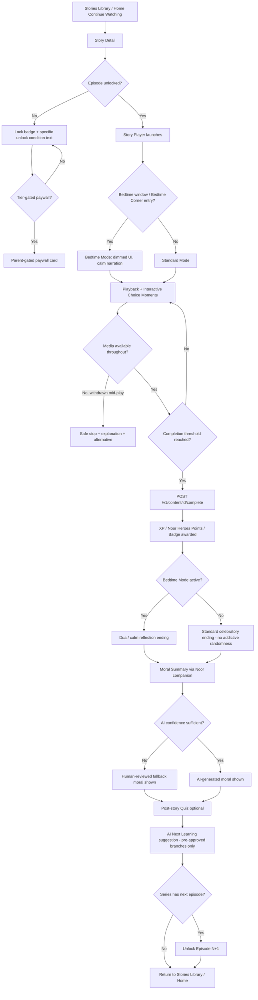
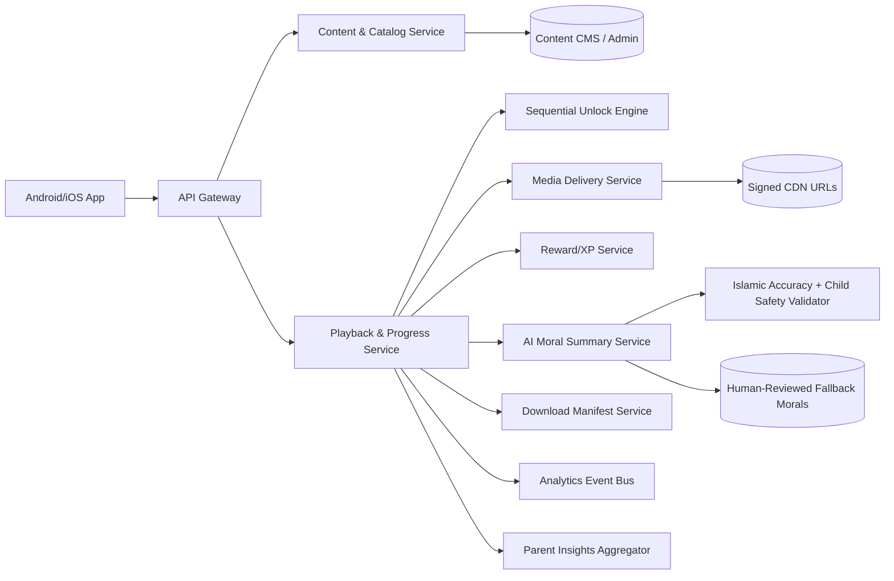
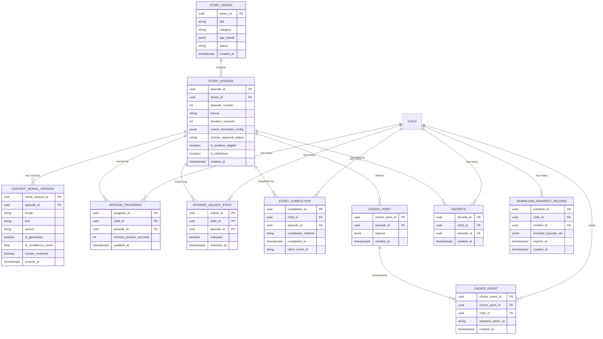

# Feature A.3 — Stories Module (Animated Storytelling System)

**App:** NoorHeroes — Islamic Learning App for Children
**Feature Owner:** Content & Editorial / Media Engineering
**Status:** Implementation-ready
**Version:** 1.0
**Depends on:** A.1 (Auth & Onboarding), A.2 (Home Dashboard — surfaces Continue Watching/Listening), Content CMS (Admin), Scholar Review Pipeline
**Feeds into:** A.7 Habit Tracker (story-linked habits), A.8 Daily Quiz (post-story quiz), A.11 Rewards (XP/Noor Heroes Points/badges), A.16 Offline Downloads, C.22 Parent Progress Reports

---

## Table of Contents

1. [Product Requirements](#1-product-requirements)
2. [UX/UI Requirements](#2-uxui-requirements)
3. [Backend Requirements](#3-backend-requirements)
4. [Database Design](#4-database-design)
5. [Backend AI Code-Generation Prompt](#5-backend-ai-code-generation-prompt)
6. [Android Requirements](#6-android-requirements)
7. [Android AI Code-Generation Prompt](#7-android-ai-code-generation-prompt)
8. [Admin Requirements](#8-admin-requirements)
9. [Admin AI Code-Generation Prompt](#9-admin-ai-code-generation-prompt)
10. [DevOps Requirements](#10-devops-requirements)
11. [Analytics Requirements](#11-analytics-requirements)
12. [Security Requirements](#12-security-requirements)
13. [QA Requirements](#13-qa-requirements)
14. [Marketing Requirements](#14-marketing-requirements)
15. [Release & Rollback Plan](#15-release--rollback-plan)

---

## 1. Product Requirements

### 1.1 Problem Statement

Children need an emotionally engaging, scholar-accurate way to absorb Islamic stories, Seerah moments, and moral lessons — delivered as a calm, cinematic, non-addictive media experience that never resorts to autoplay-with-sound, cliffhanger manipulation without bound, or open-ended infinite consumption. Parents need confidence that every story their child watches is sourced, age-appropriate, and ends with a genuine, scholar-validated moral rather than an ambiguous or commercially-driven hook (source: Consolidated Blueprint §7.5 — bedtime stories must be "calming, doctrinally accurate," ending "with a clear, gentle moral — not an open-ended cliffhanger or a sales prompt").

### 1.2 Business Goals

- Make Stories the primary daily-engagement driver and the #1 source of habit-loop formation (bedtime ritual, series continuation).
- Maintain 100% content traceability to an approved scholar-reviewed source — zero unreviewed content ever reaches a child.
- Drive completion-linked reward economy engagement (XP/Noor Heroes Points) without addictive mechanics (no variable-ratio reward randomness, no autoplay).
- Support offline-first consumption for low-connectivity markets (sequential-unlock-aware download manifests).

### 1.3 User Goals

- **Child:** Watch/listen to engaging animated stories about Prophets and Islamic values, make meaningful choices during the story, get rewarded for finishing, and understand the lesson learned — including a calm bedtime version at night.
- **Parent:** See what stories my child watched, what moral they learned, control downloads, and configure bedtime story timing/sleep timer — all without the story experience itself ever pushing a sale or an open-ended hook.

### 1.4 Success Metrics

| Metric | Target |
|---|---|
| Story completion rate (started → reached completion threshold) | ≥ 65% |
| Post-story quiz attempt rate | ≥ 70% of completions |
| Series continuation rate (Episode N complete → Episode N+1 started within 7 days) | ≥ 45% |
| Bedtime Mode usage rate (among eligible evening sessions) | ≥ 35% |
| Story Player crash-free rate | ≥ 99.5% |
| Offline playback success rate (downloaded content) | ≥ 99% |
| Moral-summary AI confidence pass rate (vs. human-fallback rate) | ≥ 90% AI-pass, fallback always available |
| Median time-to-first-frame (story player cold start) | < 1.5s on low-end Android, cached manifest |

### 1.5 Stakeholders

Product Manager, Content/Editorial Lead, Scholar Review Board, UX/Motion Designer, Media/Streaming Backend Architect, Android Architect (video/audio player), Data Analyst, Security Engineer (DRM/media security, child-safety AI review), QA Lead, Child Psychology/Trust Advisor, Customer Support Lead (playback issue triage), Growth Marketing (seasonal Ramadan/Eid content packs).

### 1.6 User Stories

1. As a child, I want to browse stories by category (Bedtime, Prophet Stories, Islamic Shorts, Series, Values & Manners, Ramadan & Eid) so I can find what I'm in the mood for.
2. As a child, I want to see a story's cover, short description, and length before I start it.
3. As a child, I want to make a choice during the story that reflects an Islamic value, and see what happens next based on my choice.
4. As a child, I want a short quiz after the story to check what I remember.
5. As a child, I want a calm "Noor says: here's what we learned" moment at the end so I understand the moral clearly.
6. As a child, I want to earn XP, Noor Heroes Points, or a badge when I finish a story.
7. As a child, I want to know which episode comes next and what I need to do to unlock it.
8. As a child, I want a special, dimmer, calmer version of the player at bedtime, with a sleep timer and a dua at the end.
9. As a child, I want to download stories so I can watch them without internet.
10. As a parent, I want to see what story my child watched, the moral they learned, and their quiz score.
11. As a parent, I want to control whether downloads are allowed and configure the bedtime story window and sleep timer.
12. As a parent, I want assurance that if my child wants to "share" a moment from a story, it goes through me first, never directly out of the app.
13. As a child, when a story I'm watching becomes unavailable mid-playback (content pulled), I want a clear, non-scary explanation and a suggested alternative — not a crash.
14. As a system, I want every AI-generated moral summary to pass an Islamic-accuracy and child-safety check before being shown, with a human-reviewed fallback always available.

### 1.7 Functional Requirements

**FR-1** Stories Library must organize content into the categories: Bedtime Stories, Prophet Stories, Islamic Shorts, Animated Series, Values & Manners, Ramadan & Eid, Downloads (source §21.11).
**FR-2** Library filters must include: age band, duration, language, format (video/audio/text), topic, downloaded-only, free/premium.
**FR-3** Story Detail must show: cover art, synopsis, episode list (for series), age/source/scholar-approval tags, related stories, and current per-episode progress.
**FR-4** Sequential Episode Unlock applies to every episodic series: Episode 1 unlocked by default; Episode N+1 unlocks only after Episode N reaches a per-series-configured completion threshold (playback %, final interaction, or quiz completion).
**FR-5** Locked episodes must display the specific unlock prerequisite text (e.g., "Complete Episode 2 to unlock") — never a generic lock icon with no explanation, and never presented as a paywall unless the series is genuinely tier-gated (in which case it shows a parent-gated paywall card, not a hidden item).
**FR-6** Rewatching a completed episode is always available; there is no re-locking after completion.
**FR-7** Story Player supports video, audio, and text formats with: play/pause, caption toggle, audio-track selection, quality selection, in-story interactive choice overlays, pause-and-quiz moments, and a moral-summary card at the end.
**FR-8** Every story interaction is tracked via `POST /v1/playback/{id}` events and finalized via `POST /v1/content/{id}/complete` on reaching the completion threshold.
**FR-9** On completion: award XP/Noor Heroes Points/badge per the content's configured reward rule, then display the AI-generated (or human-fallback) moral summary via the Noor companion, then optionally show the post-story quiz, then offer "Next Learning" AI-suggested continuation from pre-approved branches only.
**FR-10** Moral Summary Generation: must be generated only from the approved story version and its approved sources (never free-form from unlicensed content); vocabulary adapted to the child's age band; run through Islamic-accuracy and child-safety validation; if AI confidence is below threshold, use a human-reviewed fallback moral instead; accepted moral stored as a versioned artifact (`content_moral_versions`) and surfaced to parents in story insights.
**FR-11** Bedtime Mode: dims the player UI, disables stimulating reward animations, uses calmer/slower narration, soft nasheed underscore, and always ends with a dua or calm reflection — never a bright "level up" animation (source §7.5, §"Bedtime Emotional Mode").
**FR-12** Bedtime Mode supports a parent-configured sleep timer that fades audio/dims screen and can auto-pause/auto-exit the player at expiry.
**FR-13** Sharing any story moment must open a parent gate and produce either an approved deep link or a parent-facing card — direct, ungated sharing is never available in child mode (source §7.5).
**FR-14** Story "comments"/reactions are never public; only moderated child-safe reaction stickers or parent-facing feedback exist — no open comment system anywhere in Stories.
**FR-15** Offline download manifests must include only the currently unlocked episodes of a series at manifest-generation time — never pre-bundling locked future episodes.
**FR-16** Media removed/withdrawn mid-playback must stop playback safely, explain unavailability in age-appropriate language, and recommend an approved alternative — never a silent failure or crash (source §7.5 Error Handling).
**FR-17** Admin/Support preview or override access to locked episodes (for troubleshooting) must be fully audited and must never grant the child any reward (XP/badge) as a side effect.
**FR-18** AI "Personalized Story Continuation" must only suggest from a pre-approved branch set per story (e.g., "learn more about sabr," "try the dua," "watch the next Prophet story") — never an open-ended free-text AI suggestion.
**FR-19** Dynamic Narration Tone adapts per playback context: energetic (afternoon/general), calm (bedtime), Ramadan reflection, Eid celebration, low-stimulation focus mode — selected server-side based on time-of-day, active seasonal mode, and parent-configured sensory preferences (accessibility).
**FR-20** Parent Story Insights view must show: stories watched, time spent, quiz scores, and the moral lessons learned — accessible only from the Parent Area, never duplicated into the child's own view in a way that exposes analytics framing to the child.

### 1.8 Non-Functional Requirements

- **Performance:** Story Player cold start (cached manifest) p95 < 1.5s; video start-to-first-frame p95 < 2s on 3G-equivalent throttled connection (graceful adaptive bitrate).
- **Availability:** Media CDN ≥ 99.9% uptime; signed-URL issuance service fails over within 5s.
- **Scalability:** CDN/streaming infra must handle regional evening peak (post-Maghrib bedtime-story surge) without buffering degradation.
- **Localization:** Captions, audio tracks, and on-screen text fully localized; RTL caption rendering correct for Arabic.
- **Accessibility:** Captions always available and screen-reader-discoverable as a toggle; player controls fully operable via switch-access/assistive tech; text-format stories support dynamic text scaling.
- **Offline tolerance:** Per FR-15 — full playback of downloaded, currently-unlocked content with zero network dependency once downloaded; entitlement re-validated on next connectivity per platform offline policy (§ from A.1/A.16 cross-reference).
- **Media security:** All video/audio delivered via signed, time-limited URLs; no permanently public media URLs.

### 1.9 Acceptance Criteria

- Given a series with Episode 1 complete below threshold, when the child opens Story Detail, then Episode 2 shows a lock badge with the specific unlock condition text, not a generic lock.
- Given a child completes Episode 1 past its threshold, when they return to Story Detail, then Episode 2 is unlocked immediately (real-time, not requiring app restart).
- Given a story ends, when the moral-summary AI confidence is below the configured threshold, then the human-reviewed fallback moral is shown instead, and the low-confidence event is logged for editorial review.
- Given the current time falls within the parent-configured bedtime window, when the child opens any story marked eligible for Bedtime Mode (or explicitly opens via Bedtime Corner), then the player renders in dimmed/calm mode and ends with a dua, never a bright reward animation.
- Given a child attempts to share a story moment, when they tap Share, then a parent gate (PIN/biometric) appears before any link/card is generated — no direct ungated share path exists.
- Given media is withdrawn by Admin while a child is mid-playback, when the next playback heartbeat fails to resolve the media, then the player stops safely with an age-appropriate explanation and a recommended alternative — never a crash or blank freeze.
- Given a parent generates an offline download manifest for a series with 5 episodes where only 2 are currently unlocked, when the manifest is built, then it contains exactly those 2 episodes' media, not all 5.
- Given Support uses the admin override to preview a locked episode for a troubleshooting ticket, when the preview session ends, then no XP/badge/reward was granted to the actual child account, and the override action is recorded in the audit log.

### 1.10 Edge Cases

1. Child completes Episode 2 exactly at the threshold boundary while offline (no connectivity to report completion) → local completion recorded immediately (unlocking Episode 3 locally for continued offline browsing), event queued with a client ID, reconciled with the server on reconnect; server is authoritative on conflict (e.g., if server-side threshold differs due to a mid-flight config change, server value wins on sync, but the child is never abruptly re-locked once unlocked locally without clear explanation).
2. A series' unlock-threshold configuration is changed by Admin after a child has already unlocked Episode 3 under the old rule → previously unlocked episodes remain unlocked (no retroactive re-locking); only future episodes are governed by the new threshold.
3. Child rapidly taps through interactive choice moments faster than the narration/animation completes → choice overlay inputs are debounced/queued so no choice is silently dropped or double-counted.
4. Two siblings share a device; Child A downloads a series, then the device switches to Child B who does not have entitlement to that series (different age band or parent restriction) → downloaded media remains on-device but is not exposed in Child B's Stories Library (entitlement-checked at the UI/data layer per active child session, not just at download time).
5. AI moral-summary generation service times out entirely (not just low-confidence, but unavailable) → falls back immediately to the human-reviewed fallback moral, same as the low-confidence path — never blocks the completion flow waiting on AI.
6. A bedtime-eligible story is started just before the bedtime window begins and finishes just after it starts → Bedtime Mode visual/narration treatment is evaluated at story-start time and held consistent for that session (does not flicker into dimmed mode mid-playback), but the ending dua/reflection treatment respects the window state at completion time if materially different.
7. Parent disables downloads entirely while a child has in-progress downloads → in-progress downloads are halted gracefully (not silently failed); already-completed downloads remain playable until parent additionally revokes offline access explicitly (two distinct controls: "allow new downloads" vs. "revoke existing offline content").
8. Child's locale changes mid-session (e.g., device language changed while app backgrounded) → on resume, captions/audio-track defaults re-evaluate to the new locale's available tracks; if the new locale lacks a dub, audio falls back to original with captions, never silent/blank audio.
9. Quiz-completion-gated unlock threshold is configured, but the child skips the quiz entirely (closes app) → Episode N+1 remains locked until the quiz is actually completed; app resume routes back to the pending quiz state, not silently abandoning the gate.
10. Story is withdrawn entirely from the catalog while several children have it fully downloaded and completed → already-completed progress history is preserved (per the general "withdrawn content becomes unavailable... while safe progress history remains" rule), but the content becomes non-replayable/non-discoverable going forward.
11. A child's "favorite" story is later re-categorized or merged into a different series by Admin (content restructuring) → favorite reference must resolve to the new canonical content ID, not silently break or point to a 404.
12. Two completion-triggering events arrive out of order due to network retry (e.g., a retried `/complete` call arrives after a newer playback heartbeat) → server applies idempotency/event-ordering logic (timestamp + client event ID) so the furthest-valid state is never regressed by a stale retried event.

### 1.11 Error Handling

| Scenario | System Behavior |
|---|---|
| Media fails to load/stream (CDN issue) | Player shows a friendly retry state with an explicit retry control; auto-retries with backoff before surfacing the error UI |
| Media withdrawn mid-playback | Safe stop, age-appropriate explanation, recommended alternative content card (FR-16) |
| AI moral-summary generation failure/timeout | Immediate fallback to human-reviewed moral, no visible delay or error to the child |
| Quiz service unavailable post-story | Story completion (XP/reward) still finalizes independently; quiz step is skipped with a "quiz coming back soon" note rather than blocking reward issuance |
| Download manifest request fails | Clear retry option in Downloads Manager; partial downloads resumable, not restarted from zero |
| Interactive choice overlay fails to record choice (network) | Choice still drives the immediate in-story branching locally (deterministic client-side branch logic mirrors server logic), and the choice event is queued for later sync — playback is never blocked waiting on a network round-trip for a choice |
| Sequential unlock check fails (service error) | Fails closed for newly-encountered episodes (treat as locked, retry check) but never fails closed for already-unlocked episodes the child has previously accessed (cached unlock state persists) |

### 1.12 Empty States

- Library category with zero content for the child's age band/locale → "More stories for you are on the way" friendly message with a link to a different, populated category — never a blank grid.
- Downloads Manager with zero downloads → friendly illustration + "Download a story to watch offline" CTA pointing to the Library.
- Story Insights (parent view) with zero stories watched yet → "Once [Child] watches their first story, you'll see their progress here."

### 1.13 Loading States

- Library: skeleton category rails while catalog loads.
- Story Detail: skeleton cover/synopsis block, episode list shimmer.
- Story Player: branded loading spinner with the story's own cover art as background (not a generic platform spinner) while media buffers; minimum perceived-loading time avoided (show as soon as first frame is ready, don't artificially delay).

### 1.14 Offline States

- Library: "Downloads" category always available offline, fully functional; other categories show cached metadata (browsable) but non-downloaded items show a clear "connect to internet or download" affordance rather than a dead tap.
- Story Player: downloaded content plays identically offline as online, including interactive choices (deterministic client-side logic) and quiz (if quiz content was included in the download package) — completion/reward events queue for sync.
- Story Insights (parent): shows last-synced data with a "may not reflect today's offline activity yet" note if relevant.

### 1.15 Permission States

- No new runtime permissions specific to this feature beyond storage access already covered by the Downloads feature (A.16) for offline media; microphone is not used by Stories (interactive choices are tap-based, not voice-based, unless a future voice-narration-practice feature explicitly extends this).

### 1.16 User Flow (Narrative)

Child taps "Stories" tab or a Home "Continue Watching" card → Stories Library (if from tab) with category rails and filters → taps a story → Story Detail (cover, synopsis, episode list with lock states) → taps Play on an unlocked episode → Story Player (full-screen, format-appropriate controls) → encounters interactive choice moment(s) → reaches completion threshold → completion event fires → XP/reward awarded → moral summary shown via Noor companion → optional post-story quiz → "Next Learning" AI-suggested continuation offered → child either continues to next episode/story or returns to Stories Library/Home.

Bedtime variant: child enters via Home's Bedtime Corner widget (or Stories Library's "Bedtime Stories" category within the bedtime window) → Story Player renders in dimmed Bedtime Mode automatically → calmer narration tone → sleep timer control visible → ends with dua/reflection card instead of a bright reward animation, though XP/reward is still quietly recorded.

### 1.17 Detailed Flow Diagram (Mermaid)



### 1.18 Screen Inventory (Complete — Zero Missing)

| # | Screen | Type | Entry Points | Exit Points |
|---|---|---|---|---|
| 1 | Stories Library (Landing) | Primary | Bottom nav "Stories" tab, Home, Search results | Story Detail |
| 2 | Category Filter Panel | Modal/Sheet | Library filter icon | Library (filtered) |
| 3 | Story Detail | Primary | Library, Search, Home "Continue", Favorites | Story Player, Episode list items |
| 4 | Episode List (within Story Detail, series only) | Component | Story Detail | Story Player (per unlocked episode) |
| 5 | Lock Badge / Unlock Condition Tooltip | Component | Episode List, locked items | Dismiss / stays inline |
| 6 | Parent-Gated Paywall Card | Component | Episode List / Story Detail, tier-gated content | Parent PIN gate → Subscription (A.14) |
| 7 | Story Player — Video | Primary | Story Detail, Continue Watching | Completion flow / Back to Detail |
| 8 | Story Player — Audio | Primary | Story Detail, Continue Listening, Bedtime Corner | Completion flow / Back to Detail |
| 9 | Story Player — Text | Primary | Story Detail (text-format stories) | Completion flow / Back to Detail |
| 10 | Interactive Choice Overlay | Component (in-player) | Mid-playback, scripted choice points | Resumes playback with branch |
| 11 | Pause-and-Quiz Moment Overlay | Component (in-player) | Mid-playback, scripted quiz points | Resumes playback |
| 12 | Bedtime Mode Player Variant | Primary (theme variant of 7/8) | Bedtime Corner, bedtime window auto-trigger | Dua/reflection ending |
| 13 | Sleep Timer Control | Component (in-player, Bedtime Mode) | Bedtime Mode player | Auto-pause/exit at expiry |
| 14 | Media Unavailable / Safe-Stop Screen | Screen variant | Mid-playback withdrawal event | Recommended alternative card |
| 15 | Completion / Reward Reveal Screen | Screen variant | End of playback, threshold reached | Moral Summary |
| 16 | Moral Summary Card ("Noor says...") | Screen variant | Post-completion | Post-story Quiz or Next Learning |
| 17 | Post-Story Quiz | Screen (shared with A.8 Daily Quiz engine) | Moral Summary | Next Learning suggestion |
| 18 | AI "Next Learning" Suggestion Card | Component | Post-quiz / post-moral-summary | Next episode / related story / Stories Library |
| 19 | Achievement/Badge Unlock Modal | Modal | Completion flow, if a badge threshold is crossed | Dismiss → returns to flow |
| 20 | Share Story Moment — Parent Gate | Modal | Player "Share" action | Approved share card/deep link, or cancel |
| 21 | Approved Share Card Preview | Screen | Parent gate success | Send/cancel |
| 22 | Favorites List | Screen | Profile/Library "Favorites" entry | Story Detail |
| 23 | Downloads Manager (Stories scope) | Screen | Library "Downloads" category, Settings | Story Player (offline) |
| 24 | Caption/Audio-Track/Quality Settings Sheet | Modal (in-player) | Player settings icon | Resumes playback with new settings |
| 25 | Empty State — No content in category | Screen variant | Library, sparse category | Alternate category |
| 26 | Empty State — No downloads yet | Screen variant | Downloads Manager | Library |
| 27 | Parent Story Insights (per-child) | Screen (Parent Area) | Parent Dashboard → Child Progress → Stories | Story Detail (parent preview) |
| 28 | Parent Story Insights — Individual Story Detail (moral + quiz score) | Screen (Parent Area) | Parent Story Insights list | Back |
| 29 | Admin/Support Preview Mode Banner (overlay on Story Player) | Screen variant (internal use) | Admin override tool | Exit preview (no reward granted) |

### 1.19 Events (Complete Analytics Event List)

`stories_library_viewed`, `stories_category_filtered`, `story_detail_viewed`, `episode_lock_viewed`, `episode_unlock_condition_tapped`, `paywall_card_shown`, `story_player_opened`, `story_playback_started`, `story_playback_heartbeat` (periodic, with position), `story_playback_paused`, `story_playback_resumed`, `story_choice_made` (with `choice_id`, `branch_taken`), `story_quiz_moment_answered`, `story_media_unavailable_shown`, `story_completion_threshold_reached`, `story_completed`, `story_reward_awarded`, `story_badge_unlocked`, `moral_summary_shown` (with `source: ai|human_fallback`), `moral_summary_ai_confidence_score` (internal/aggregate), `post_story_quiz_started`, `post_story_quiz_completed`, `next_learning_suggested`, `next_learning_accepted`, `episode_unlocked` (with `episode_number`), `bedtime_mode_entered`, `bedtime_sleep_timer_set`, `bedtime_session_ended_with_dua`, `story_share_gate_opened`, `story_share_completed`, `story_favorited`, `story_unfavorited`, `story_download_started`, `story_download_completed`, `story_download_failed`, `story_download_removed`, `parent_story_insights_viewed`, `admin_preview_mode_used` (internal audit event).

---

## 2. UX/UI Requirements

> Global Design System tokens (typography, color, spacing, icons, RTL/Arabic rules, accessibility, child-friendly age-group guidance) are defined once in **Feature A.1 §2.1** and extended for media/player-specific needs below.

### 2.1 Stories-Specific Design System Extensions

- **Player Chrome:** Full-screen immersive player uses soft Islamic geometric border framing (subtle, not distracting) around the content viewport in the standard theme; this border is removed/simplified in Bedtime Mode to reduce visual stimulation.
- **Bedtime Theme Override:** Independent of system light/dark theme — Bedtime Mode always applies a dimmed navy/teal palette with reduced animation, regardless of the device's current theme setting, since it is a content-context state, not a display preference.
- **Choice Overlay Design:** Two-to-three large, clearly differentiated rounded option cards (never more than 3 simultaneous choices, to avoid decision paralysis for young children), each with an icon + short label, no countdown-timer pressure on choice moments (children may take their time).
- **Reward Reveal Animation:** Celebratory but brief (≤2s), never blocking required next action, never using randomized/variable visual surprise mechanics (consistent, predictable reward presentation per the anti-dark-pattern Ethical Rule).
- **Moral Summary Card:** Distinct visual treatment — warm parchment-like card background, Noor companion illustration speaking, large legible text, calm tone, no surrounding clutter.

### 2.2 Screen-Level Design Requirements (Key Screens)

#### Screen: Story Player (Video)

- **Purpose:** Deliver immersive, safe, controllable video playback with embedded interactive/educational moments.
- **Components:** Full-screen video surface, top-overlay minimal controls (back, caption toggle, settings gear) auto-hiding after inactivity, bottom scrubber/progress bar (scrubbing disabled past the furthest-unlocked point in a not-yet-completed episode, to prevent skip-to-end gaming of the completion threshold — configurable per series policy), play/pause center control, choice/quiz overlays appearing at scripted timestamps.
- **States:** Loading/buffering, Playing, Paused, Choice-Overlay-Active, Quiz-Moment-Active, Media-Unavailable (safe-stop), Completed (transitions to Completion screen), Offline-Playing (downloaded).
- **Accessibility:** All controls reachable via TalkBack/switch-access; captions always toggleable and on by default for children flagged with accessibility hearing preferences in their profile; no control relies solely on a swipe gesture without a tappable alternative.
- **Responsive Rules:** Full-bleed on phone; on tablet, video maintains aspect ratio with letterboxing rather than stretching/cropping.
- **Empty/Error/Loading/Success/Offline:** Covered in §1.11–1.14.

#### Screen: Story Detail

- **Purpose:** Inform the child's choice to start/continue a story/series before committing to playback.
- **Components:** Hero cover art, title, short synopsis (age-appropriate length), scholar-approval/source badge, duration/format tags, episode list (series) with per-episode progress ring and lock state, "Add to Favorites" toggle, Download button, Related Stories rail.
- **States:** Default, Loading (skeleton), Error (catalog fetch failure — retry), Locked-series-paywall variant.
- **Accessibility:** Episode list items individually labeled with lock state read aloud ("Episode 3, locked, complete Episode 2 to unlock").
- **Responsive Rules:** Single column mobile; two-column (cover + info side-by-side) on tablet landscape.

#### Screen: Bedtime Mode Player Variant

- **Purpose:** Provide a calming, low-stimulation playback experience appropriate for wind-down/bedtime.
- **Components:** Dimmed full-screen surface, soft star-particle ambient overlay (subtle, non-distracting), sleep-timer control (15/30/45/60 min or "until story ends"), simplified minimal controls, dua/reflection ending card instead of celebratory reward screen.
- **States:** Same lifecycle as standard player, plus a distinct "Sleep Timer Expiring" gentle fade-warning state before auto-pause.
- **Accessibility:** Reduced-motion respected even more strictly here; no flashing elements under any circumstance.

### 2.3 Tab Structure

Stories is Tab 3 of 5 (Home / Learn / **Stories** / Rewards / Profile). Click mapping:

| Click Target | Destination | API Called | Analytics Event | Permission Check | Error Handling |
|---|---|---|---|---|---|
| Story card (Library) | Story Detail | `GET /v1/content/{id}` | `story_detail_viewed` | Entitlement check (free/premium) | Graceful "unavailable" state |
| Episode (unlocked) | Story Player | `GET /v1/content/{id}/manifest` (signed media URL) | `story_player_opened` | Unlock-state + entitlement check | Lock badge if not actually unlocked (race condition guard) |
| Episode (locked) | Lock tooltip (no navigation) | None | `episode_lock_viewed` | N/A | N/A |
| Download icon | Downloads Manager / inline download start | `POST /v1/downloads/manifest` | `story_download_started` | Parent download-policy check | Retry on failure |
| Share icon (in-player) | Parent Gate Modal | None until gate passes | `story_share_gate_opened` | Parent PIN/biometric | Cancel returns to player |
| Favorite icon | Inline toggle | `POST /v1/favorites` | `story_favorited` | None | Optimistic update + retry |

### 2.4 Wireframe Description (Composite)

Library: vertically-scrolling page of horizontally-scrollable category rails (consistent with Home's rail pattern), a sticky filter bar beneath the page header. Story Detail: single-column hero-first layout (cover → metadata → episode list → related). Story Player: true full-screen edge-to-edge with auto-hiding minimal chrome — the single screen in the entire app with no persistent bottom navigation visible, by design, to maximize immersion (back gesture/button always available to exit safely).

### 2.5 Screen Image Generation Prompts

**Screen: Stories Library**
- *Prompt 1 (English):* "Mobile app stories library/browse screen UI mockup for a children's Islamic learning app. Warm off-white background. Top shows a row of pill-shaped category filter chips labeled with simple icons (moon for Bedtime, lantern for Prophet Stories, scroll for Values). Below, multiple horizontally-scrollable rows of rounded rectangular story cover thumbnails with soft shadows, each showing a colorful animated-style illustration (Prophet-era desert scenes, gentle lantern characters, no realistic human faces, modest and respectful depictions), small duration/age badges in the corner of each card. Warm teal and gold accent colors, rounded corners throughout, joyful and inviting children's app aesthetic, bottom navigation bar visible with 5 icons."
- *Prompt 2 (Arabic RTL):* "نفس شاشة مكتبة القصص لتطبيق تعليم إسلامي للأطفال، بتخطيط كامل من اليمين إلى اليسار. خلفية بيج فاتح دافئ. يعرض الأعلى صفًا من رقاقات تصفية الفئات بيضاوية الشكل بأيقونات بسيطة (هلال لقصص النوم، فانوس لقصص الأنبياء، لفافة للقيم). أسفل ذلك عدة صفوف قابلة للتمرير أفقيًا من صور مصغرة مستديرة الزوايا لأغلفة القصص بظلال خفيفة، كل منها يعرض رسمة متحركة الطابع وملونة (مشاهد صحراوية من العصر النبوي، شخصيات فانوس لطيفة، بدون وجوه بشرية واقعية، تصوير محتشم ومحترم)، وشارات صغيرة للمدة والعمر في زاوية كل بطاقة. ألوان فيروزية وذهبية دافئة، زوايا دائرية في كل مكان، طابع تطبيق أطفال مرح ومرحب، شريط تنقل سفلي ظاهر بخمس أيقونات."

**Screen: Story Player — Bedtime Mode**
- *Prompt 1 (English):* "Mobile app full-screen video player UI mockup in a calm bedtime mode for a children's app. Deep dimmed navy-teal night-sky background with soft twinkling star particles, a small gentle glowing lantern-shaped companion character illustration in the corner, minimal translucent playback controls (play/pause, small sleep-timer icon showing '30 min') at the bottom that fade after a few seconds, soft rounded caption text bar near the bottom in a warm cream color, no bright UI elements anywhere, extremely calm and soothing visual tone, no realistic human faces."
- *Prompt 2 (Arabic RTL):* "نفس واجهة مشغل الفيديو بملء الشاشة في وضع وقت النوم الهادئ لتطبيق أطفال، بتخطيط من اليمين إلى اليسار للعناصر النصية. خلفية كحلية فيروزية داكنة خافتة تشبه سماء الليل مع جزيئات نجوم متلألئة لطيفة، شخصية فانوس متوهج صغيرة ولطيفة في الزاوية، عناصر تحكم تشغيل شفافة وبسيطة (تشغيل/إيقاف مؤقت، أيقونة صغيرة لمؤقت النوم تعرض '30 دقيقة') في الأسفل تتلاشى بعد ثوانٍ قليلة، شريط نص ترجمة مستدير الزوايا بلون كريمي دافئ قريب من الأسفل، بدون أي عناصر واجهة زاهية، طابع بصري هادئ ومريح للغاية، بدون وجوه بشرية واقعية."

**Screen: Moral Summary Card**
- *Prompt 1 (English):* "Mobile app modal card UI mockup, warm parchment-textured rounded card centered on a softly blurred background. A small friendly lantern-shaped companion character illustration appears to be 'speaking' via a rounded speech-bubble shape, with calm centered text below reading a short moral lesson. A small gold star/badge icon in the top corner indicating XP earned, a single warm gold 'Continue' button at the bottom. Soft shadows, gentle warm lighting, no clutter, respectful and calm illustration style, no realistic human faces."
- *Prompt 2 (Arabic RTL):* "نفس بطاقة نافذة منبثقة لملخص العبرة الأخلاقية، بتخطيط من اليمين إلى اليسار. بطاقة مستديرة الزوايا بملمس شبيه بالرق الدافئ في وسط خلفية ضبابية ناعمة. شخصية فانوس صغيرة وودودة تظهر وهي 'تتحدث' عبر شكل فقاعة كلام مستديرة، مع نص هادئ في المنتصف أسفلها يعرض عبرة أخلاقية قصيرة. أيقونة نجمة أو وسام ذهبي صغير في الزاوية العلوية يشير إلى نقاط الخبرة المكتسبة، وزر ذهبي دافئ واحد بعنوان 'استمرار' في الأسفل. ظلال خفيفة، إضاءة دافئة ولطيفة، بدون ازدحام، أسلوب رسم محترم وهادئ، بدون وجوه بشرية واقعية."

*(Remaining screens — Story Detail, Episode Lock Tooltip, Interactive Choice Overlay, Completion/Reward Reveal, Downloads Manager, Parent Story Insights, Share Gate Modal, Favorites List — follow the same two-prompt EN/AR template using these tokens; full set available on request.)*

---

## 3. Backend Requirements

### 3.1 System Design Overview

Stories is served by a **Content & Playback Service** backed by a Content Catalog (shared across all content types per the CMS), a **Progress/Unlock Service** enforcing sequential-unlock logic, a **Media Delivery Service** issuing signed CDN URLs, and an **AI Moral Summary Service** gated by an Islamic-accuracy/child-safety validator with a human-fallback content store.

### 3.2 Architecture Diagram (Mermaid)



### 3.3 Service Breakdown

| Service | Responsibility |
|---|---|
| Content & Catalog Service | Story/episode metadata, categories, search indexing |
| Playback & Progress Service | Tracks heartbeats, furthest-valid position, completion events |
| Sequential Unlock Engine | Evaluates per-series unlock rules, exposes unlock state |
| Media Delivery Service | Issues signed, time-limited media URLs; adaptive bitrate manifest |
| Reward/XP Service | Applies content-linked reward rules on completion |
| AI Moral Summary Service | Generates/selects moral summary text, applies confidence gating |
| Download Manifest Service | Builds entitlement- and unlock-aware offline manifests |
| Parent Insights Aggregator | Rolls up per-child story activity for Parent Area consumption |

### 3.4 API List

#### `GET /v1/content?type=story&category=&age_band=&locale=&format=&downloaded_only=`
- **Auth:** Bearer (child-mode)
- **Response 200:** Paginated array of story/series summaries matching filters.
- **Pagination:** Cursor-based, `limit` max 30/page.
- **Caching:** 10-min CDN-edge cacheable per filter-combination + locale + age-band, invalidated on catalog publish events.

#### `GET /v1/content/{id}`
- **Response 200:** Full Story Detail payload — synopsis, episode list with `unlock_state` per episode (`unlocked|locked`, plus `unlock_condition` text if locked), scholar-approval metadata, related content IDs.
- **Error Codes:** `404 CONTENT_NOT_FOUND`, `410 CONTENT_WITHDRAWN` (distinct from 404 — withdrawn content that previously existed, used to drive the "no longer available" UX rather than a generic not-found).

#### `GET /v1/content/{id}/manifest`
- **Auth:** Bearer + entitlement + unlock-state check (server re-validates unlock state at manifest-issuance time, not just trusting a client-cached state)
- **Response 200:** `{ "playback_url": "https://cdn.../signed?exp=...", "expires_at": "...", "captions": [...], "audio_tracks": [...], "interactive_script": {...} }`
- **Error Codes:** `403 EPISODE_LOCKED` (race-condition guard if client UI was stale), `403 ENTITLEMENT_REQUIRED`.
- **Security:** Signed URL TTL 15 minutes, single-use-preferred where CDN supports it; never a permanently public media URL.

#### `POST /v1/playback/{content_id}`
- **Request:** `{ "event_type": "heartbeat", "position_seconds": 142, "client_event_id": "uuid..." }`
- **Response 200:** `{ "acknowledged": true }`
- **Validation:** Position monotonically non-decreasing per session unless an explicit seek event type is sent (guards against naive scrubbing-to-end gaming the completion threshold if scrub-ahead is policy-restricted for that series).

#### `POST /v1/content/{id}/complete`
- **Request:** `{ "completion_method": "playback_threshold", "final_position_seconds": 480, "client_event_id": "uuid..." }`
- **Response 200:** `{ "completed": true, "reward": { "xp": 50, "noor_points": 20, "badge_id": null }, "next_episode_unlocked": "ep_004", "moral_summary": { "source": "ai", "text": "..." } }`
- **Idempotency:** `client_event_id` enforced unique — replays return the original result, never double-award XP.
- **Business Logic:** Triggers Sequential Unlock Engine evaluation, Reward Service award, Moral Summary Service call (synchronous with a hard timeout, falling back per FR-10/FR-5-error-handling).

#### `POST /v1/content/{id}/choice`
- **Request:** `{ "choice_point_id": "cp_2", "selected_option_id": "opt_b", "client_event_id": "uuid..." }`
- **Response 200:** `{ "branch_content_ref": "branch_b_segment" }`
- **Note:** Client-side deterministic branch logic mirrors this so playback is never blocked waiting on this call (per Edge Case 3/offline handling); server call is for analytics/sync, not a playback-blocking dependency.

#### `POST /v1/downloads/manifest`
- **Request:** `{ "content_id": "series_...", "quality": "standard" }`
- **Response 200:** `{ "manifest_id": "...", "episodes": [ { "episode_id": "ep_001", "media_urls": {...}, "expires_at": "..." } ] }`
- **Validation:** Only currently-unlocked episodes included (FR-15); parent download-policy checked (entitlement + "allow downloads" toggle).
- **Error Codes:** `403 DOWNLOADS_DISABLED_BY_PARENT`.

#### `GET /v1/children/{id}/story-insights`
- **Auth:** Bearer (parent session, scoped to own family's child)
- **Response 200:** Aggregated watched stories, time spent, quiz scores, morals learned, for Parent Story Insights screen.

#### `POST /v1/admin/preview-session` (Admin/Support only, not child-facing)
- **Auth:** Admin bearer with `support` or `content_review` role
- **Response 200:** Time-limited preview token granting read access to locked media for troubleshooting, flagged `is_preview: true` end-to-end so the Reward Service explicitly skips any XP/badge award if this flag is present on any downstream event.
- **Audit:** Every call writes an immutable audit log row.

### 3.5 Cross-Cutting API Concerns

- **Pagination:** Cursor-based on all list endpoints.
- **Caching:** Catalog/list endpoints cacheable; manifest/playback endpoints never cached (always live entitlement/unlock check).
- **Security:** Signed URLs, idempotency keys on all mutating completion/choice events, server-side authoritative unlock-state re-validation at every manifest issuance (never trust client-reported unlock state for access decisions, only for UI hinting).
- **Analytics:** Every endpoint emits corresponding events from §1.19.

---

## 4. Database Design

### 4.1 ER Diagram (Mermaid)



### 4.2 Tables, Relationships, Constraints

| Table | Key Constraints | Indexes |
|---|---|---|
| `story_episode` | FK `series_id`; UNIQUE(`series_id`, `episode_number`) | Index `(series_id, episode_number)` |
| `content_moral_version` | FK `episode_id`; CHECK `ai_confidence_score BETWEEN 0 AND 1` when `ai_generated = true` | Index `(episode_id, locale)` |
| `episode_progress` | FK `child_id`, `episode_id`; UNIQUE(`child_id`, `episode_id`) | Index `(child_id, updated_at DESC)` |
| `episode_unlock_state` | FK `child_id`, `episode_id`; UNIQUE(`child_id`, `episode_id`) | Index `(child_id, episode_id)` |
| `story_completion` | FK `child_id`, `episode_id`; UNIQUE(`client_event_id`) for idempotency | Index `(child_id, completed_at DESC)` |
| `choice_event` | FK `choice_point_id`, `child_id` | Index `(child_id, choice_point_id)` |
| `favorite` | UNIQUE(`child_id`, `episode_id`) | Index `(child_id)` |
| `download_manifest_record` | FK `child_id`, `content_id` | Index `(child_id, expires_at)` |

### 4.3 Audit Fields
All tables carry `created_at`. `story_episode`, `content_moral_version` (admin-editable) carry `updated_at`. `story_completion`, `choice_event` are append-only/immutable (historical facts).

### 4.4 Soft Delete Rules
`story_episode.is_withdrawn = true` used instead of deletion — preserves `episode_progress`/`story_completion` history for already-watched content (per FR-withdrawn-content rule). `favorite` rows referencing a withdrawn episode remain but the UI shows a "no longer available" state rather than breaking the list.

### 4.5 Retention Rules
`download_manifest_record` rows purged after `expires_at` + 7 days grace. `episode_unlock_state` and `story_completion` retained indefinitely (core progress history, feeds Parent Insights and long-term retention analytics) unless the child/family is deleted, per the global account-deletion policy.

---

## 5. Backend AI Code-Generation Prompt

```
You are building the Content & Playback Service for "NoorHeroes," a child-safety-
first Islamic learning app. This service powers the Stories module: catalog
browsing, sequential episode unlocking, signed media delivery, completion/
reward issuance, and AI-gated moral-summary generation.

Stack: FastAPI (Python 3.12), PostgreSQL (SQLAlchemy 2.0), Redis (manifest/
session cache), a CDN integration layer for signed URL issuance, Kafka for
analytics events.

Hard requirements:
1. Sequential unlock is SERVER-AUTHORITATIVE. GET /v1/content/{id}/manifest
   MUST re-validate the requested episode's unlock state at issuance time --
   never trust a client-supplied "I am unlocked" claim. Implement the
   Sequential Unlock Engine as a pure function: given episode_progress and
   unlock_threshold_config, deterministically compute unlock state, and
   write it to episode_unlock_state on every relevant progress update (not
   just lazily computed at read time) so unlock state is also independently
   queryable/auditable.
2. POST /v1/content/{id}/complete and POST /v1/playback/{id} both require a
   client_event_id and enforce idempotency via a UNIQUE database constraint
   on (content_id, child_id, client_event_id) for completion events --
   replayed requests must return the original result, NEVER double-award
   XP/Noor Heroes Points/badges. Write a test that fires the same completion
   request 5 times concurrently and asserts exactly one reward was granted.
3. Implement the AI Moral Summary Service as: call the moral-generation
   model -> pass output through an Islamic-accuracy + child-safety validator
   -> if confidence >= threshold AND validator passes, use the AI version;
   otherwise, look up content_moral_version where human_reviewed=true for
   that episode+locale and use it instead. This entire chain has a hard
   600ms timeout; on timeout at ANY step, fall back immediately to the
   human-reviewed version -- the completion API response must never be
   delayed waiting on AI generation beyond this timeout.
4. Download manifest generation MUST filter to only episodes where
   episode_unlock_state.unlocked = true for that specific child at
   generation time -- write a test asserting a manifest for a series with
   5 episodes where only 2 are unlocked returns exactly 2 episode entries.
5. Build an Admin/Support preview-session endpoint
   (POST /v1/admin/preview-session) that issues a token carrying an
   is_preview=true claim. EVERY downstream service that processes a request
   carrying this claim (Reward Service, Unlock Engine) must explicitly skip
   any state mutation that would affect the real child's progress/rewards --
   write an integration test confirming a preview-session playback-complete
   call results in ZERO reward and ZERO unlock-state change for the real
   child_id.
6. Implement signed CDN URL issuance with a 15-minute TTL; never persist or
   log full signed URLs in plaintext application logs (log only the
   content_id and a URL hash for debugging).
7. Implement withdrawn-content handling: a withdrawn story_episode
   (is_withdrawn=true) returns 410 CONTENT_WITHDRAWN (not 404) from
   GET /v1/content/{id}, and is excluded from all catalog list/search
   results, while existing episode_progress/story_completion/favorite rows
   referencing it remain queryable (never cascade-deleted).
8. Implement playback position validation: position_seconds in heartbeat
   events must be monotonically non-decreasing per playback session unless
   the event_type is explicitly "seek" -- reject (but don't crash on)
   anomalous heartbeats that look like client-side scrub-to-end gaming,
   logging them for a fraud/abuse review queue rather than silently
   trusting them as a real completion signal.
9. Write Alembic migrations matching the ER diagram exactly, including the
   CHECK constraint on ai_confidence_score and the UNIQUE constraints
   described above.
10. Emit every event from the analytics taxonomy
    (story_playback_started, story_completed, episode_unlocked,
    moral_summary_shown with source=ai|human_fallback, etc.) to the
    `stories.events` Kafka topic with a consistent envelope.

Deliver: FastAPI routers, SQLAlchemy models, Alembic migrations, Pydantic
schemas, pytest suite covering the idempotency, preview-session-isolation,
and withdrawn-content tests described above, and a README documenting the
CDN signing-key configuration (referenced by env var name only).
```

---

## 6. Android Requirements

### 6.1 Technical Requirements
Kotlin, Jetpack Compose, MVVM, Clean Architecture, module `:feature:stories`, depends on `:core:media-player` (Media3/ExoPlayer-based), `:core:design-system`, `:core:offline-cache`, `:core:network`.

### 6.2 Screen Mapping
Each screen in §1.18 maps to a Composable; the Story Player itself wraps a Media3 `PlayerView` inside Compose via `AndroidView` interop, with all overlay UI (choice moments, quiz moments, controls) as Compose layers above it.

### 6.3 Navigation Flow
Story Player is launched as a distinct full-screen destination (not a dialog) with system UI (status/nav bars) hidden for immersion, restored on exit. Deep link `noorheroes://stories/{episode_id}` supported for Home "Continue Watching" and notification entry points.

### 6.4 State Management
`StoryPlayerViewModel` holds `PlayerState` (Loading/Buffering/Playing/Paused/ChoiceActive/QuizActive/Unavailable/Completed) and drives both the Media3 player instance and the Compose overlay visibility from a single source of truth, preventing desync between actual playback state and UI state.

### 6.5 API Mapping
`PlaybackRepository.sendHeartbeat()` → `POST /v1/playback/{id}` (throttled to once every 5–10s, not per-frame); `completeEpisode()` → `POST /v1/content/{id}/complete` with a UUID `client_event_id` generated once per playback session and reused on retry.

### 6.6 Analytics Mapping
`StoriesAnalytics` fires playback lifecycle events tied to actual Media3 player listener callbacks (not assumed/optimistic timing) to ensure heartbeat/completion analytics reflect real playback state.

### 6.7 Offline Support
Downloaded episodes stored via Media3's `DownloadManager` with custom `Cache` implementation scoped per `child_id` (sandboxed so Child B cannot access Child A's downloaded media per the multi-child isolation rule, enforced at the file-access layer, not just UI hiding). Offline choice/quiz logic runs entirely client-side using the bundled `interactive_script` from the manifest, with sync-on-reconnect for analytics only.

### 6.8 Deep Linking
`noorheroes://stories/{episode_id}`, `noorheroes://stories/series/{series_id}`, `noorheroes://stories/bedtime` (opens directly into Bedtime Corner's current recommended bedtime story).

### 6.9 Push Notifications
Landing target for "new episode unlocked," "bedtime story ready," and "new content" notification types (managed by A.12 Notifications) — this feature implements the deep-link targets only.

### 6.10 Testing Strategy
- Unit: Sequential-unlock client-side mirror logic (for offline choice branching only — never used for actual access-control decisions, which remain server-authoritative).
- Player tests: simulate Media3 playback events to verify heartbeat throttling, completion-threshold detection, and safe-stop behavior on a simulated media-unavailable error.
- UI tests: Choice Overlay rendering with max-3-options constraint, Bedtime Mode visual-state toggling correctly based on a mocked time-window.
- Integration: full download → offline playback → reconnect-sync flow.

---

## 7. Android AI Code-Generation Prompt

```
Build the `:feature:stories` Android module for NoorHeroes using Kotlin, Jetpack
Compose, MVVM, Clean Architecture, with Media3 (ExoPlayer) as the playback
engine wrapped via AndroidView interop inside Compose.

Hard requirements:
1. Implement StoryPlayerViewModel with a single sealed PlayerState (Loading,
   Buffering, Playing, Paused, ChoiceActive(choicePointId), QuizActive,
   Unavailable(reason), Completed(reward)) that is the SOLE source of truth
   driving both the Media3 player's play/pause calls and all Compose overlay
   visibility -- there must be no path where the overlay UI and actual
   ExoPlayer playback state can desync (e.g., showing "Playing" controls
   while ExoPlayer is actually buffering).
2. Heartbeat events (POST /v1/playback/{id}) are sent on a throttled timer
   (every 5-10 seconds of actual playback time, using ExoPlayer's
   Player.Listener onIsPlayingChanged/onPositionDiscontinuity, not a naive
   wall-clock timer that keeps firing while paused).
3. Implement scrub-ahead restriction: for series where the backend manifest
   indicates `scrub_restricted: true`, the Compose scrubber UI must clamp
   seek gestures to the furthest position already reached this session plus
   a small forward-seek tolerance (e.g., 10 seconds) -- this is a UX
   nicety only; the REAL enforcement is server-side per the backend spec,
   so do not treat this client-side clamp as a security boundary.
4. Choice Overlay composable accepts a maximum of 3 options (enforce via a
   require() assertion against the manifest's interactive_script data --
   fail loudly in debug builds if content data violates this, rather than
   silently rendering a 4th option).
5. Implement offline playback entirely from a Media3 DownloadManager-backed
   local cache, scoped per child_id via a custom Cache key prefix -- write
   a test confirming Child B's PlayerView cannot resolve Child A's
   downloaded cache entries even if both profiles exist on the same device.
6. Bedtime Mode is a pure theme/behavior overlay on the SAME player
   composable (not a separate screen/Activity) -- driven by a
   isBedtimeMode: Boolean passed into the composable at launch time
   (resolved once at entry per Edge Case 6 in the spec: no mid-session
   flicker if the time window boundary is crossed during playback).
7. Implement the safe-stop "media unavailable" state: when ExoPlayer
   reports a fatal playback error mid-session, transition immediately to
   PlayerState.Unavailable with a child-friendly message and a
   "Recommended for you instead" card sourced from the manifest's fallback
   suggestion field -- never show a raw ExoPlayer error code or stack trace
   to the child.
8. On reaching the configured completion threshold (playback position
   percentage OR final interactive choice OR quiz completion, per the
   manifest's completion_method config), call POST /v1/content/{id}/complete
   exactly once per playback session using a UUID client_event_id generated
   at session start and reused on any retry -- never regenerate this ID on
   resubmission.
9. Write Compose UI tests verifying: Choice Overlay never renders a 4th
   option, Bedtime Mode applies dimmed theme tokens correctly, and the
   Media-Unavailable state never displays raw technical error text (assert
   against a blocklist of technical-sounding substrings like "Exception",
   "Error code", "0x").
10. Write an integration test for the full offline flow: download a fixture
    episode -> simulate airplane mode -> play to completion -> verify
    completion event queues locally with the correct client_event_id ->
    simulate reconnect -> verify exactly one sync call fires.

Use Hilt, Retrofit+OkHttp, Room for the sync outbox, Media3 ExoPlayer +
DownloadManager. Follow Global Design System tokens from `:core:design-system`
established in Feature A.1's Android module.
```

---

## 8. Admin Requirements

Detailed CMS workflow lives in the Admin Portal's Content Management module (per the blueprint's "Story list/editor, episode builder, character library, category taxonomy, media library" structure); this feature's specific admin surfaces:

- **Story/Episode Editor:** Create draft content + version, configure `unlock_threshold_config` per episode, mark `is_bedtime_eligible`, define `choice_point` options (max 3 enforced in the form), set scholar-approval workflow status. CRUD: Create draft + version (Create), Read version history/diff (Read), Submit new version for review (Update), Archive/suspend published content (Delete = soft/archive only).
- **Moral Summary Review Queue:** Editorial/scholar interface to review low-confidence AI-generated morals flagged for human review, and to author/approve the `human_reviewed` fallback morals per episode/locale. CRUD: full, gated by scholar-approval requirement before any moral can be marked `human_reviewed = true` and used live.
- **Download Manifest Monitor:** Read-only view of manifest generation health/failure rates.
- **Admin Preview/Support Override Tool:** Issues the `is_preview=true` token described in §5; every use is audited; explicitly cannot be used to grant rewards (enforced server-side, surfaced here as a read-only confirmation banner: "Preview sessions never grant rewards").
- **Withdrawn Content Manager:** Mark content `is_withdrawn = true` (never hard-delete), with a required reason field and immediate cache/CDN invalidation trigger.

CRUD permissions: Story/Episode Editor = full CRUD (delete = archive only) behind `content_editor` role; Moral Summary Review = full CRUD behind `scholar_reviewer` role; Download Manifest Monitor = Read-only; Preview Tool = Create (session) + Read (audit log) behind `support` or `content_review` role; Withdrawn Content Manager = Update-only (the `is_withdrawn` flag), behind `content_editor` or `trust_safety` role.

---

## 9. Admin AI Code-Generation Prompt

```
Build an internal admin module (React + TypeScript, existing NoorHeroes Admin
Portal shell) for managing the Stories content pipeline.

Pages:
1. Story/Episode Editor -- a series-and-episode tree view with a detail
   form per episode: metadata fields, unlock_threshold_config (a structured
   sub-form supporting playback_percentage | final_interaction | quiz_completion
   modes), is_bedtime_eligible toggle, and a choice-point builder UI that
   HARD-CAPS the number of options at 3 (the form's "Add option" button
   disables itself and shows a tooltip once 3 options exist -- this must
   match the same constraint enforced in the Android app and backend).
   Submitting a new version moves it to status=pending_review; only an
   approved version can be set status=published. Delete action is
   relabeled "Archive" in the UI and only sets status=archived -- there is
   no real delete button anywhere on this page.
2. Moral Summary Review Queue -- a paginated queue of
   content_moral_version rows where ai_generated=true and
   ai_confidence_score is below the configured threshold (read from a
   shared config endpoint, do not hardcode the threshold in the frontend).
   Each row shows the AI-generated text, the confidence score, and an
   editor field for the reviewer to write/approve a human_reviewed=true
   replacement version for that episode+locale. Approving requires the
   reviewer to have the scholar_reviewer role -- enforce via the existing
   RBAC context, and disable the approve button entirely (not just
   server-reject) for users without that role.
3. Download Manifest Monitor -- read-only dashboard (recharts) of manifest
   generation success/failure rate over time, sourced from
   GET /admin/v1/downloads/health.
4. Preview/Support Override Tool -- a search-by-content-id form that issues
   a preview session (calls POST /admin/v1/preview-session) and displays a
   persistent, non-dismissible banner on this page: "Preview sessions never
   grant XP, Noor Heroes Points, or badges to the real child account -- this is
   enforced server-side." Below the banner, show a read-only audit log of
   all preview sessions issued (admin_id, content_id, timestamp).
5. Withdrawn Content Manager -- a searchable content table with a
   "Withdraw" action (NOT "Delete") requiring a reason field before
   submission; submitting calls
   PATCH /admin/v1/content/{id} with { is_withdrawn: true, reason }.
   Withdrawn items show a status pill and remain visible in this table
   (never disappear) for future "Restore" actions if applicable.

Enforce RBAC via the existing Admin Portal role context. Every mutating
action across all 5 pages writes an immutable audit_log row with admin_id,
action, before/after diff, and timestamp.
```

---

## 10. DevOps Requirements

- **Infrastructure:** Media Delivery Service fronts a CDN (e.g., CloudFront/Cloudflare-equivalent) with regional edge caching; Content & Playback Service horizontally scaled independently from the Media Delivery layer given very different load profiles (catalog reads are cacheable/bursty, playback writes are steady-state).
- **CI/CD:** Idempotency and preview-session-isolation test suites (per §5) are mandatory CI gates on any PR touching the Playback or Reward services.
- **Docker/Kubernetes:** Download Manifest Service scaled separately given its bursty load pattern (download requests cluster around new-content-release moments and weekend usage spikes).
- **Monitoring/Logging/Alerting:** Alert on signed-URL issuance failure rate, on completion-event idempotency-violation attempts (a spike could indicate a client bug or replay-attack attempt), on AI Moral Summary Service timeout-fallback rate exceeding a healthy baseline (indicates the AI service itself may be degraded, even though users are protected by the fallback).
- **Disaster Recovery:** Media CDN multi-region failover tested in DR drills; Content CMS database point-in-time recovery covers `story_episode`/`content_moral_version` given their content-integrity importance.
- **Rollback Strategy:** Any deploy changing unlock-threshold evaluation logic requires a staging replay against historical `episode_progress` fixture data to confirm no child is retroactively re-locked (Edge Case 2 guarantee) before production promotion.
- **Backup Strategy:** `story_completion`, `episode_unlock_state`, `favorite` in standard backup tier; `content_moral_version` (human-reviewed content) in a higher-durability tier given its editorial-investment value.
- **Environment Setup:** Staging uses a sandboxed CDN/media bucket with sample royalty-free placeholder media for load testing, never production scholar-approved media assets in lower environments unless explicitly watermarked "staging."

---

## 11. Analytics Requirements

### 11.1 Event Taxonomy
Full list in §1.19. `story_playback_heartbeat` is high-volume (sampled/aggregated in the warehouse, not stored per-event indefinitely at full granularity beyond a rolling window) to manage data volume.

### 11.2 Funnel Analysis
Primary funnel: `story_detail_viewed` → `story_player_opened` → `story_playback_started` → `story_completion_threshold_reached` → `story_completed` → `moral_summary_shown` → `post_story_quiz_completed` → `next_learning_accepted`. Secondary funnel: `episode_unlocked` → next `story_player_opened` for that episode within 7 days (series stickiness).

### 11.3 Dashboard Metrics
Completion rate by category/age-band, choice-point selection distribution (which values-based choices children actually pick — valuable editorial signal), AI-vs-human-fallback moral ratio over time (tracks AI quality trend), bedtime-mode adoption rate, download-to-offline-playback conversion rate.

### 11.4 Cohort & Retention
Cohort by first-story-category watched; correlate with D7/D30 retention to identify which content categories are the strongest onboarding hooks (informs Home's Recommended ranking inputs and editorial content investment priorities).

### 11.5 Learning Metrics
Post-story quiz score distribution per episode (editorial signal on content clarity), moral-recall accuracy proxy via quiz performance, series-completion depth (average episodes-per-series completed before drop-off).

---

## 12. Security Requirements

### 12.1 Threat Analysis
- **Unlock-bypass attempts:** mitigated by server-authoritative re-validation at every manifest issuance (never trusting client state for access decisions).
- **Reward-duplication via replay:** mitigated by idempotency keys + unique DB constraints on completion events.
- **Media URL leakage/redistribution:** mitigated by short-TTL signed URLs; monitor for anomalous concurrent-session usage of the same signed URL (potential credential/URL sharing) as a fraud signal, not a hard block initially.
- **AI moral-summary content-safety failure:** mitigated by the mandatory accuracy/safety validator gate plus human-fallback, fail-closed on any timeout/uncertainty.
- **Admin preview-tool reward leakage:** mitigated by the `is_preview` claim propagation and explicit reward-skip logic, tested via dedicated integration tests.

### 12.2 OWASP Checklist (Applied)
Broken Access Control: episode-level access strictly re-validated server-side per request, never client-cached-trust. Security Logging Failures: every admin preview-session and withdrawn-content action is immutably audit-logged. Insecure Design: fail-closed AI moral-summary gating is an explicit insecure-design mitigation.

### 12.3 API Security
Signed URLs with short TTL; idempotency-key enforcement at the database constraint layer (not just application logic) for all reward-issuing endpoints.

### 12.4 Mobile Security
Downloaded media stored in app-sandboxed storage, scoped per `child_id` cache namespace; no media files exposed via shared/public storage paths.

### 12.5 Admin Security
Moral Summary Review approve action restricted to `scholar_reviewer` role with UI-level and API-level enforcement (defense in depth); Preview Tool restricted to `support`/`content_review` roles with full audit trail.

### 12.6 Data Encryption & PII Protection
No new direct child PII introduced beyond existing `child_id` references; choice-event data (which values a specific child selected) is treated as sensitive behavioral data and is not exposed in any cross-family or aggregate-without-anonymization admin view beyond Parent Insights for the child's own family.

### 12.7 Child Safety Requirements
Moral summary accuracy/safety gate is the feature's signature child-safety control; the no-public-comments rule and parent-gated sharing rule (FR-13/14) prevent any child-to-stranger interaction surface from existing within Stories.

### 12.8 Compliance Requirements
Content traceability (every published episode linked to an approved scholar-review record) supports the platform's general child-content compliance posture; no story-specific additional regulatory surface beyond the platform baseline.

### 12.9 Security Checklist (Pre-Launch)
- [ ] Unlock-bypass penetration test (attempt to fetch manifest for a locked episode directly via API, confirm 403)
- [ ] Reward-duplication concurrency test (fire concurrent duplicate completion requests, confirm single reward)
- [ ] Preview-session reward-isolation integration test passing
- [ ] Signed URL TTL and non-public-access verified in production CDN config
- [ ] AI moral-summary fail-closed behavior verified via chaos test (kill validator service, confirm human fallback always used)

---

## 13. QA Requirements

### 13.1 Test Plan Summary
Coverage spans: sequential unlock correctness (including config-change-after-unlock edge case), idempotent completion/reward issuance, offline download/playback/sync, Bedtime Mode behavior, moral-summary fallback gating, withdrawn-content handling, and all 12 edge cases from §1.10.

### 13.2 Test Cases — Happy Path
1. Child watches Episode 1 to completion → reward awarded once, Episode 2 unlocks, moral summary shown, quiz offered.
2. Child enters Bedtime Corner within bedtime window → player launches directly in Bedtime Mode with sleep timer visible, ends with dua card.
3. Child downloads a 3-episode series where only Episode 1 is unlocked → manifest contains exactly 1 episode; after completing Episode 1 online, re-requesting the manifest includes Episode 2.

### 13.3 Edge Cases
All 12 items from §1.10.

### 13.4 Negative Cases
- Fire the same `/complete` request 10 times concurrently → exactly one `story_completion` row and one reward grant exist afterward.
- Request a manifest for a locked episode directly (bypassing UI) → `403 EPISODE_LOCKED`.
- Kill the AI Moral Summary Service mid-request → completion flow still returns within the 600ms timeout budget with the human-fallback moral.
- Use the Admin Preview tool to "complete" a locked episode → confirm zero reward/unlock-state change on the real child record.
- Attempt to scrub a video past the furthest reached position on a `scrub_restricted: true` series → server rejects the resulting heartbeat as anomalous (flagged, not silently accepted as a valid completion signal).

### 13.5 Regression Cases
Full Stories suite re-run on every release touching `:feature:stories`, Content & Playback Service, Reward Service, or AI Moral Summary Service.

### 13.6 Automation Cases
End-to-end: full series completion-to-unlock chain across 3 episodes, offline-download-to-sync round trip, Bedtime Mode visual-state automated screenshot diff test, withdrawn-content-mid-playback safe-stop scenario (simulated via a feature flag that withdraws content during an active test session).

---

## 14. Marketing Requirements

- **Launch Plan:** Stories is a flagship feature — launch alongside a curated "Top 10 Prophet Stories" pack to maximize first-impression content depth.
- **Feature Banner:** New seasonal packs (Ramadan/Eid) get an in-app banner on the Library screen during the relevant season window, never overlapping with the no-billing-content-on-Home rule (banners here are content-discovery, not upsell, framing).
- **Push Notifications:** "New episode unlocked," "Tonight's bedtime story is ready 🌙" (per the notification table — 30 min before set bedtime), "New Prophet story available."
- **Email Campaigns:** Weekly digest of new story releases for parents who opted into marketing consent.
- **Release Notes:** Standard entry per new seasonal content pack or major player feature (e.g., new interactive choice mechanic).
- **App/Play Store Description:** "Scholar-reviewed animated Islamic stories with no ads, no autoplay, and a real bedtime mode" as a genuine differentiator.
- **ASO Keywords:** "Islamic bedtime stories app," "Prophet stories for kids," "animated Quran stories children," "Islamic moral stories app."

---

## 15. Release & Rollback Plan

### 15.1 Release Plan
Phased rollout 10% → 50% → 100% over 3–5 days. Feature flags: `stories_interactive_choices_enabled`, `stories_ai_moral_summary_enabled` (independently toggleable so the AI layer can be disabled instantly, falling back 100% to human-reviewed morals, without disabling Stories entirely).

### 15.2 Rollback Plan
Rollback triggers: any single confirmed instance of a reward-duplication incident (any confirmed double-award, P0 — immediate hotfix + incident review), unlock-bypass confirmed in production (P0), AI moral-summary safety-validator failure allowing an unreviewed/unsafe moral to display (P0, zero tolerance, immediate `stories_ai_moral_summary_enabled` flag-off), media playback crash-rate regression > 2x baseline sustained 15 minutes. Mechanism: feature-flag-first rollback for AI/interactive layers (fast), full deployment rollback for core playback/reward service issues.

### 15.3 Success Metrics for Go/No-Go
Matches §1.4 targets. Go/no-go reviewed by Product, Content/Editorial Lead, and Trust & Safety jointly — the moral-summary safety-gate guarantee specifically requires Trust & Safety + Scholar Board sign-off before the AI layer is enabled in production at any rollout stage.
