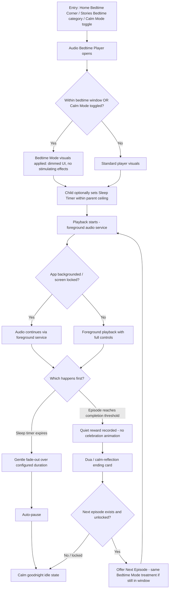
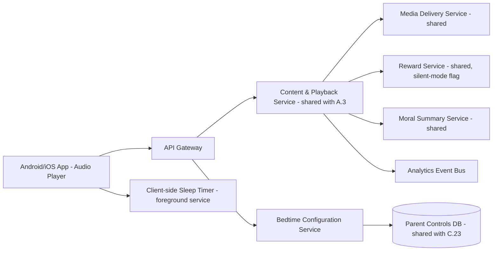

# Feature A.4 — Audio Bedtime Player & Bedtime Mode

**App:** NoorHeroes — Islamic Learning App for Children
**Feature Owner:** Product / Content & Editorial / Media Engineering / Child Wellbeing
**Status:** Implementation-ready
**Version:** 1.0
**Depends on:** A.1 (Auth & Onboarding), A.2 (Home Dashboard — Bedtime Corner widget), A.3 (Stories Module — shared content/reward/moral-summary backend), C.23 (Parental Controls — bedtime window configuration)
**Feeds into:** A.7 Habit Tracker (bedtime ritual habit), A.11 Rewards, A.16 Offline Downloads, C.22 Parent Progress Reports

> **Scope note:** Feature A.3 covers the *video* Story Player and the general Sequential Unlock / Moral Summary / Reward backend shared across all story content. This document covers the **audio-first listening experience** (the Audio Bedtime Player itself — cover, episodes, play/pause/seek/speed/sleep-timer/download/next-previous controls) and **Bedtime Mode as a cross-cutting system state** that can apply to audio, video, and other content surfaces during the parent-configured wind-down window. Backend services, database tables, and reward logic shared with A.3 are referenced, not re-specified, to avoid duplicate/conflicting source-of-truth documentation.

---

## Table of Contents

1. [Product Requirements](#1-product-requirements)
2. [UX/UI Requirements](#2-uxui-requirements)
3. [Backend Requirements](#3-backend-requirements)
4. [Database Design](#4-database-design)
5. [Backend AI Code-Generation Prompt](#5-backend-ai-code-generation-prompt)
6. [Android Requirements](#6-android-requirements)
7. [Android AI Code-Generation Prompt](#7-android-ai-code-generation-prompt)
8. [Admin Requirements](#8-admin-requirements)
9. [Admin AI Code-Generation Prompt](#9-admin-ai-code-generation-prompt)
10. [DevOps Requirements](#10-devops-requirements)
11. [Analytics Requirements](#11-analytics-requirements)
12. [Security Requirements](#12-security-requirements)
13. [QA Requirements](#13-qa-requirements)
14. [Marketing Requirements](#14-marketing-requirements)
15. [Release & Rollback Plan](#15-release--rollback-plan)

---

## 1. Product Requirements

### 1.1 Problem Statement

Many families' highest-value, most emotionally significant daily ritual is the bedtime story — a moment that must be calm, screen-minimal (audio-first, low visual stimulation), reliable (works offline, predictable ending), and never end on a manipulative cliffhanger, a bright dopamine-spiking reward animation, or a sales prompt. NoorHeroes needs a dedicated audio listening experience purpose-built for this ritual, plus a Bedtime Mode system state that any content surface can adopt during the configured wind-down window (source: Feature Reference §21.11 "Audio Bedtime Player," and Consolidated Blueprint §7.5: bedtime mode "dims the UI, disables stimulating reward animations, and ends every session with a dua or calm reflection rather than a bright 'level up' animation").

### 1.2 Business Goals

- Establish the nightly bedtime-story ritual as a core daily-retention habit loop (target: 3x+ weekly bedtime opens per the source KPI strip).
- Differentiate NoorHeroes from generic kids' media apps via a genuinely calming, non-addictive bedtime experience parents can trust without supervision.
- Drive habit-loop integration between Bedtime Listening and the Habit Tracker (bedtime dua/reflection habit).
- Support fully offline bedtime listening for low-connectivity households (a likely-evening-use scenario where home wifi may be shared/congested).

### 1.3 User Goals

- **Child:** Listen to a calming story or dua at bedtime with simple, large, easy-to-use controls, fall asleep without the phone blaring sound after I'm asleep, and end the night feeling calm, not excited.
- **Parent:** Configure when bedtime mode starts, trust that the content and visuals are calming, set a sleep timer so the device doesn't stay on all night, and see that this ritual is genuinely happening (light progress visibility), without needing to supervise every night.

### 1.4 Success Metrics

| Metric | Target |
|---|---|
| Weekly bedtime-player opens per active child | ≥ 3x/week |
| Sleep-timer usage rate among bedtime sessions | ≥ 60% |
| Bedtime session completion rate (reaches dua/reflection ending) | ≥ 70% |
| Audio playback crash-free rate | ≥ 99.7% (audio is the single most failure-sensitive moment — a crash at bedtime is high-trust-cost) |
| Offline bedtime playback success rate | ≥ 99% |
| Parent satisfaction rating for bedtime experience (in-app micro-survey, optional) | ≥ 4.7/5 (source KPI target) |
| Sleep-timer-expiry auto-pause reliability | 100% (must never fail to pause/dim when timer expires) |

### 1.5 Stakeholders

Product Manager, Content/Editorial Lead (audio production, narration, nasheed beds), UX/Motion Designer (calm-mode visual language), Android Architect (audio playback/foreground service), Backend Architect (shared with A.3 Content & Playback Service), Child Psychology/Wellbeing Advisor (sleep-hygiene-conscious design review), Data Analyst, Security Engineer, QA Lead, Customer Support Lead.

### 1.6 User Stories

1. As a child, I want to pick a calming audio story or dua to listen to at bedtime.
2. As a child, I want big, simple play/pause/seek controls I can use in a dim room without much light.
3. As a child, I want to set how long I'll listen before the app stops by itself.
4. As a child, I want to skip to the next or previous episode without leaving the dim bedtime screen.
5. As a child, I want to listen at a slightly slower or faster speed if I prefer.
6. As a child, I want my bedtime story to end gently with a dua, not a bright "you won!" screen.
7. As a child, I want to download bedtime stories so they play even without internet at night.
8. As a parent, I want to set what time bedtime mode starts and ends for my child.
9. As a parent, I want a sleep timer my child can set themselves within limits I control.
10. As a parent, I want assurance that bedtime mode never shows stimulating reward animations or loud sounds.
11. As a parent, I want to see lightly (not invasively) that my child's bedtime listening is happening, without it feeling like surveillance.
12. As a child, when the sleep timer ends, I want the audio to fade gently, not cut off abruptly.

### 1.7 Functional Requirements

**FR-1** Audio Bedtime Player must display: cover art, story/content title, moral lesson teaser, source/scholar-approval status, episode list (for multi-part audio content), and read/listen counts where privacy-safe (aggregate, never exposing other specific children's identities).
**FR-2** Controls required: Play/Pause, Seek (scrub bar), Playback Speed (e.g., 0.8x/1x/1.2x), Sleep Timer, Download, Next Episode, Previous Episode (source §21.11).
**FR-3** Sleep Timer options must be parent-configurable as a bounded range (e.g., parent sets a max of 30/45/60 minutes); within that bound, the child may freely choose a duration up to the parent-set ceiling, or "until episode ends."
**FR-4** Bedtime Mode is a **system-wide state**, not exclusive to this player: any content surface entered during the parent-configured wind-down window (or explicitly via the Home Bedtime Corner widget) must apply the same dimmed visual treatment, disabled stimulating-reward-animation rule, and dua/calm-reflection ending rule (cross-reference A.3 §2.1 "Bedtime Theme Override").
**FR-5** Bedtime Mode must dim the UI (reduced brightness/contrast theme), disable stimulating reward effects (no confetti/badge-burst/level-up animations), and end every session with a dua or calm reflection — this rule has zero exceptions, including for content that would otherwise show a bright completion animation outside the window (source §7.5).
**FR-6** Sleep Timer expiry must trigger a gentle audio fade-out (not an abrupt cut) over a configurable fade duration (default 15 seconds), followed by auto-pause; the screen may also auto-dim further or return to a calm "goodnight" idle state.
**FR-7** Audio playback must continue uninterrupted if the device screen locks or the app backgrounds (foreground media service), since children commonly fall asleep mid-playback with the screen off.
**FR-8** "Next/Previous Episode" navigation must respect the same Sequential Unlock rules defined in A.3 §1.7 FR-4 for any episodic audio series — Previous is always available (no re-locking), Next is gated by the unlock state.
**FR-9** Read/listen counts displayed must be privacy-safe aggregates (e.g., "12,400 children have listened to this story") — never displaying or implying identification of specific other children.
**FR-10** Ending sequence: on reaching the completion threshold, the player transitions directly to a dua/calm-reflection card (not the standard celebratory Completion/Reward screen used outside Bedtime Mode) — reward (XP/Noor Heroes Points) is still recorded quietly in the background but not visually celebrated in this context.
**FR-11** Download must support the same entitlement/parent-policy checks as A.3 §3.4 `POST /v1/downloads/manifest`; Bedtime category content is prioritized for "auto-suggest download" given its predictable, recurring usage pattern (low-connectivity-evening resilience).
**FR-12** Parent must be able to configure: bedtime window start/end time per child, sleep-timer max ceiling, whether bedtime audio auto-suggests/auto-starts when entering the window, and whether a lightweight "bedtime ritual happened" indicator appears in their Parent Dashboard (non-invasive — completion fact only, not full listening transcript/analytics).
**FR-13** Entering Bedtime Mode must never require re-authentication/PIN if the child is already in an active, validly-locked child session — Bedtime Mode is a content-context state, not a security boundary.
**FR-14** If a child opens the Audio Bedtime Player outside the configured bedtime window (e.g., daytime listening), the player still functions normally but does **not** force Bedtime Mode visuals unless the child explicitly opts in via a "Calm Mode" toggle available at any time of day (giving children agency to use the calming experience whenever they want, while keeping the *automatic* window-based trigger separate).

### 1.8 Non-Functional Requirements

- **Performance:** Audio start-to-first-sound p95 < 800ms on cached/downloaded content; < 1.5s on streamed content over typical home wifi.
- **Reliability:** Sleep-timer-expiry auto-pause must be implemented with a robust, foreground-service-backed timer (not a UI-thread-only timer that could be killed by OS battery optimization) — 100% reliability target is non-negotiable given the trust stakes (a child falling asleep with the device blaring at 2am is a severe trust failure).
- **Battery/Resource:** Foreground audio service must be efficient (no continuous wake-lock beyond what's needed for audio playback) to avoid draining the device overnight if accidentally left running past the sleep timer's intended scope.
- **Accessibility:** All controls large-tap-target (≥56dp, larger than standard 44dp baseline, given low-light/half-asleep usage context), high-contrast-against-dim-background text, full screen-reader support.
- **Offline tolerance:** Full offline playback parity with online (FR-11), since bedtime is a predictable recurring need best served by pre-downloaded content.
- **Localization:** All audio dubs/narration and on-screen text localized; RTL layout for Arabic.

### 1.9 Acceptance Criteria

- Given a child sets a 30-minute sleep timer (within the parent's configured ceiling), when 30 minutes elapse during active playback, then audio fades out gently over the configured fade duration and then pauses — the device does not continue playing at full volume past the timer.
- Given a parent has set a sleep-timer ceiling of 30 minutes, when the child attempts to select 60 minutes, then only options up to 30 minutes (or "until episode ends" if explicitly allowed) are selectable.
- Given the child is within the parent-configured bedtime window and opens any story (audio or video), when the player launches, then Bedtime Mode visual/behavioral rules apply automatically without an extra toggle.
- Given an audio episode completes its threshold during Bedtime Mode, when the ending sequence plays, then a dua/calm-reflection card is shown — not the standard bright celebratory completion screen used outside the window.
- Given the app is backgrounded or the screen locks during audio playback, when 10 minutes pass, then audio continues playing uninterrupted (assuming sleep timer hasn't expired).
- Given a child taps "Next Episode" on a locked-next-episode series, when the tap registers, then the same lock-explanation behavior from A.3 applies (specific unlock condition shown, not silently ignored).
- Given a parent views their Dashboard, when they check "Bedtime Ritual" status, then they see a simple completion indicator (e.g., "Bedtime story completed tonight ✓") without exposing a full play-by-play transcript of content/duration unless they explicitly drill into Story Insights (A.3).

### 1.10 Edge Cases

1. Sleep timer is set, but the child finishes the episode naturally before the timer expires → playback simply ends per normal completion flow; the now-moot timer is cancelled cleanly (no leftover background timer attempting to fade/pause audio that has already stopped).
2. Child changes the sleep timer mid-playback (e.g., extends from 15 to 30 minutes) → the new duration applies from the moment of change, not from original playback start, and any pending fade-out scheduled under the old timer is cancelled and rescheduled.
3. Device is rebooted or the app is force-killed by the OS mid-overnight playback (e.g., low memory) → playback does not silently resume in the background after an OS-level kill (expected/acceptable, since a foreground service surviving an explicit force-kill is not guaranteed by the platform), but the app must not auto-resume playback unexpectedly on next foreground open either — resumes only on explicit user action, to avoid surprising late-night/early-morning playback.
4. Parent narrows the bedtime window (e.g., from 8–10pm down to 8:30–9:30pm) while a session is already in Bedtime Mode within the now-excluded time → per the general rule "changes apply at next session, not mid-session" (A.1/Parent Dashboard rule), the current session remains in Bedtime Mode until exited; the new window applies starting the next session.
5. Child has no internet and no pre-downloaded bedtime content, opens the Bedtime Corner at night → friendly offline-state message suggesting previously-downloaded content if any exists, or a calm "no story available right now, here's a dua to read together" fallback rather than a hard error (important given the emotionally sensitive context).
6. Two children share a device; Child A falls asleep mid-playback and the device is handed off / picked up by Child B the next day → no carryover of Child A's playback position or sleep-timer state into Child B's session (full session isolation per the multi-child rule).
7. Playback speed is changed mid-episode → completion-threshold calculation must still be based on actual content consumed (e.g., percentage of total duration), not wall-clock time, so a 1.5x-speed listen still correctly registers full completion.
8. Sleep timer expires exactly at the same moment the episode reaches its natural end → completion/ending-sequence flow takes precedence (child should still get the calm dua ending, not have it pre-empted by a sleep-timer fade that cuts off the dua itself).
9. Parent has disabled "auto-suggest download" but a family is in a known low-connectivity region (detected via repeated streaming failures) → system may still proactively prompt (not auto-execute) "Would you like to download tonight's story for offline listening?" as a helpful one-time suggestion, never silently downloading without consent.
10. Child uses the explicit daytime "Calm Mode" toggle (FR-14) outside the bedtime window, then the actual bedtime window begins while they're still in that session → no jarring transition needed since the visual state was already calm-mode equivalent; session simply continues, and the ending-sequence rule (dua, not celebration) applies as it would for genuine Bedtime Mode.
11. A multi-part audio series' Episode 1 was downloaded, but Episode 2 (just unlocked) was not yet downloaded, and the child is offline at bedtime → "Next Episode" tap on the now-unlocked-but-not-downloaded Episode 2 shows a clear "needs internet to fetch this episode" message rather than a silent failure or attempting a network call that hangs.
12. Volume is at system maximum when the app is opened at night → no special forced-volume-reduction behavior is required (NoorHeroes should not silently override the user/parent's device volume control), but the first-launch-of-bedtime-mode-ever experience may include a one-time gentle tip suggesting a comfortable volume for nighttime listening (a UX nicety, not a technical control).

### 1.11 Error Handling

| Scenario | System Behavior |
|---|---|
| Audio stream fails to load (network) | Friendly retry with explicit control; auto-retry with backoff before surfacing error; suggest downloading for next time |
| Sleep timer fails to fire due to OS process death | Mitigated via foreground service + AlarmManager-backed fallback (Android) — see §6; if both fail (rare OS-level edge case), no audio should be playing anyway since the process itself would have died, so the failure mode is "silence," never "stuck blaring" |
| Media withdrawn mid-playback | Same safe-stop + explanation + alternative pattern as A.3 §1.11, rendered in the calm Bedtime Mode visual style if applicable |
| Download for offline bedtime content fails | Clear retry in Downloads Manager; falls back to streaming if connectivity exists at time of actual playback |
| Parent bedtime-window config fails to load (e.g., Home Aggregation Service degraded) | Player defaults to NOT forcing Bedtime Mode automatically (fails safe toward the less-intrusive standard mode) but the explicit "Calm Mode" toggle remains available regardless, so the calming experience is never entirely unreachable |

### 1.12 Empty States

- No bedtime-eligible content available for the child's age band/locale yet → calm fallback message + suggestion to read a dua together (FR per Edge Case 5), never a blank screen.
- No sleep-timer history/usage yet (first time) → simple, friendly first-use explainer tooltip on the Sleep Timer control.

### 1.13 Loading States

- Audio buffering: gentle pulsing glow on the cover art (no spinning platform-default spinner — calm, ambient loading treatment consistent with Bedtime Mode's tone) with the title/cover already visible (metadata loads instantly from cache even if audio itself buffers).

### 1.14 Offline States

- Full offline parity per FR-11; persistent small "offline" indicator, non-alarming.
- Next-episode-not-downloaded state per Edge Case 11.

### 1.15 Permission States

- No new runtime permissions; relies on existing storage (downloads) and notification (if a "bedtime story ready" reminder notification is enabled) permissions already covered elsewhere.

### 1.16 User Flow (Narrative)

Child enters via Home's Bedtime Corner widget (within window) or directly via Stories Library's "Bedtime Stories" category, or via the explicit "Calm Mode" toggle at any time → Audio Bedtime Player opens (Bedtime Mode visuals auto-applied if within window or Calm-Mode-toggled) → child optionally sets/adjusts Sleep Timer → playback begins, controls available (play/pause/seek/speed/next/prev/download) → child may lock the screen/background the app, audio continues via foreground service → either (a) episode completes naturally → dua/calm-reflection ending → quiet reward recorded → optional Next Episode if unlocked, or (b) sleep timer expires first → gentle fade-out → auto-pause → app shows a calm "goodnight" idle state, no further interaction required from the child.

### 1.17 Detailed Flow Diagram (Mermaid)



### 1.18 Screen Inventory (Complete — Zero Missing)

| # | Screen / Component | Type | Entry Points | Exit Points |
|---|---|---|---|---|
| 1 | Audio Bedtime Player (main screen) | Primary | Home Bedtime Corner, Stories Library "Bedtime Stories" category, Calm Mode toggle, Continue Listening (Home) | Dua ending card, Next Episode, Back to Library |
| 2 | Cover/Info Header (component) | Component | Player top section | N/A |
| 3 | Episode List Sheet (for multi-part audio series) | Modal/Sheet | "Episodes" control in player | Selecting an episode → Player (new content) |
| 4 | Sleep Timer Selector | Modal/Sheet | Sleep Timer icon | Player (timer active) |
| 5 | Playback Speed Selector | Modal/Sheet | Speed icon | Player (speed applied) |
| 6 | Download Control / In-Progress Indicator | Component | Player download icon | Downloads Manager (shared with A.3) |
| 7 | Sleep-Timer-Expiring Gentle Warning (fade-pre-warning state) | Screen variant (in-player) | Final ~10s before fade begins | Fade-out state |
| 8 | Fade-Out / Auto-Pause Visual State | Screen variant (in-player) | Sleep timer expiry | Goodnight Idle State |
| 9 | Goodnight Idle State | Screen variant | Sleep timer auto-pause, or manual pause-and-leave | Resume playback / Exit player |
| 10 | Dua / Calm-Reflection Ending Card | Screen variant | Completion threshold reached during Bedtime Mode | Next Episode offer / Back to Library |
| 11 | Media Unavailable / Safe-Stop (Bedtime-styled variant) | Screen variant | Mid-playback withdrawal | Recommended alternative / dua fallback |
| 12 | Offline — No Bedtime Content Available | Screen variant | Offline + no downloaded bedtime content | Suggested "read a dua together" fallback |
| 13 | Next-Episode-Not-Downloaded (offline) Notice | Component | Tap Next on a not-downloaded-but-unlocked episode while offline | Dismiss, stays on current episode |
| 14 | Calm Mode Toggle (accessible from standard player) | Component | Standard Story Player / Audio Player controls | Re-renders current screen in calm visual treatment |
| 15 | First-Use Sleep Timer Explainer Tooltip | Component (one-time) | First Sleep Timer interaction | Dismiss |
| 16 | Parent "Bedtime Ritual" Status Indicator (Parent Dashboard widget) | Component (Parent Area) | Parent Dashboard | Story Insights (A.3) for full detail, if parent drills in |
| 17 | Parent Bedtime Window/Sleep-Timer-Ceiling Configuration Screen | Screen (Parent Area, cross-ref C.23) | Parent Dashboard → Controls | Saves to Parent Controls |

### 1.19 Events (Complete Analytics Event List)

`bedtime_player_opened` (with `entry_source`), `bedtime_mode_auto_applied`, `calm_mode_manually_toggled`, `bedtime_episode_list_opened`, `bedtime_episode_selected`, `sleep_timer_opened`, `sleep_timer_set` (with `duration_minutes`), `sleep_timer_changed_mid_playback`, `sleep_timer_expired`, `sleep_timer_fade_started`, `sleep_timer_auto_paused`, `playback_speed_changed`, `bedtime_download_started`, `bedtime_download_completed`, `bedtime_next_episode_tapped`, `bedtime_previous_episode_tapped`, `bedtime_next_episode_not_downloaded_shown`, `bedtime_media_unavailable_shown`, `bedtime_completion_threshold_reached`, `bedtime_reward_recorded_silently`, `dua_ending_card_shown`, `bedtime_goodnight_idle_shown`, `bedtime_offline_no_content_shown`, `parent_bedtime_window_configured`, `parent_sleep_timer_ceiling_configured`, `parent_bedtime_ritual_status_viewed`, `app_backgrounded_during_bedtime_playback`, `bedtime_playback_resumed_after_background`.

---

## 2. UX/UI Requirements

> Global Design System tokens defined in **Feature A.1 §2.1**; Bedtime-specific visual treatment first introduced in **Feature A.3 §2.1 ("Bedtime Theme Override")** — this section defines the Audio Player's specific application of that treatment plus controls unique to audio.

### 2.1 Bedtime-Specific Design Extensions

- **Calm Palette Application:** Deep dimmed navy/teal gradient background (consistent with A.3's Bedtime Mode), large soft-glow cover art as the dominant visual element (since there's no video to watch — the cover art "breathes" gently, a slow subtle scale pulse synced loosely to playback, never jarring or fast).
- **Large Low-Light Controls:** All primary controls (play/pause, seek, next/prev) sized ≥56dp with high contrast against the dim background; secondary controls (speed, sleep timer, download) grouped in a less prominent row, still ≥44dp.
- **No Bright Reward Color in This Context:** The standard gold "celebration" accent is muted/desaturated specifically within Bedtime Mode screens (a deliberate token override: `gold-bedtime` is a dimmer, warmer amber rather than the vibrant daytime gold) — reinforcing the "calm, not exciting" tone even in incidental UI accents.
- **Dua Ending Card:** Warm, soft, parchment-on-navy contrast card, gentle fade-in (≥800ms, slower than standard UI transitions elsewhere in the app), no XP/badge counters visible on this specific card even though the reward was recorded — that data lives only in Parent Story Insights, never surfaced to the child in this calm moment.

### 2.2 Screen-Level Design Requirements (Key Screens)

#### Screen: Audio Bedtime Player (Main)

- **Purpose:** Provide a calm, simple, reliable nightly listening experience.
- **Components:** Large cover art (breathing animation), title + episode indicator, moral-lesson teaser line, scholar-approval micro-badge, scrub bar with large thumb, play/pause (largest control, center), next/previous (flanking), secondary row: speed selector, sleep timer, download, episode-list entry.
- **States:** Loading/buffering (ambient glow pulse, no spinner), Playing, Paused, Sleep-Timer-Active (small persistent countdown chip), Sleep-Timer-Expiring-Warning (gentle dimming pre-fade), Fading-Out, Goodnight-Idle, Media-Unavailable, Offline.
- **Accessibility:** All controls labeled; scrub bar operable via screen-reader increment/decrement gestures, not drag-only; speed/timer selectors are simple list-style modals, not complex gesture-based pickers (low-light, possibly half-asleep child usage context demands maximum simplicity).
- **Responsive Rules:** Cover art scales to fill available vertical space above the control cluster; tablet layout centers a max-width column rather than stretching cover art edge-to-edge.

#### Screen: Sleep Timer Selector

- **Purpose:** Let the child choose a listening duration within parent-set bounds.
- **Components:** Simple vertical list of duration options (only those ≤ parent ceiling are shown/selectable — options above the ceiling are not displayed at all, not shown-disabled, to avoid confusing/frustrating a child with an option they can never pick), "Until episode ends" option (if parent allows), Cancel/current-timer-off option.
- **States:** Default (no timer set), Timer-active (shows current selection highlighted), Just-changed (brief confirmation feedback).

#### Screen: Dua / Calm-Reflection Ending Card

- **Purpose:** Close every Bedtime Mode session with a genuinely calming, spiritually grounding moment.
- **Components:** Short dua text (Arabic + transliteration + translation, per the same Dua content pattern as A.5/Dua Learning), soft Noor companion illustration in a "sleepy/calm" pose (distinct visual variant from its energetic daytime pose), single low-key "Done" or "Next Episode" (if applicable) action — no bright button styling.

### 2.3 Tab Structure

Audio Bedtime Player is not a standalone tab; it's reached via Home's Bedtime Corner (Tab 1), Stories Library's Bedtime category (Tab 3), or the Calm Mode toggle exposed within other players. Click mapping:

| Click Target | Destination | API Called | Analytics Event | Permission Check | Error Handling |
|---|---|---|---|---|---|
| Home Bedtime Corner card | Audio Bedtime Player | `GET /v1/content/{id}/manifest` | `bedtime_player_opened` | Entitlement + download-availability if offline | Falls back gracefully per §1.11 |
| Sleep Timer icon | Sleep Timer Selector modal | None (local config + `GET /v1/parent-controls/{child_id}/bedtime` cached) | `sleep_timer_opened` | Reads parent-set ceiling | Defaults to a safe conservative ceiling if config fetch fails |
| Download icon | Inline download start | `POST /v1/downloads/manifest` (shared with A.3) | `bedtime_download_started` | Parent download-policy | Retry on failure |
| Next/Previous Episode | Player reloads with new content | `GET /v1/content/{id}/manifest` | `bedtime_next_episode_tapped` / `_previous_episode_tapped` | Unlock-state check (Next only) | Lock explanation if locked |
| Calm Mode toggle (in standard player) | Re-renders current player in calm visual treatment | None (client-side state) | `calm_mode_manually_toggled` | None | N/A |

### 2.4 Wireframe Description (Composite)

Single full-screen, vertically-centered layout: large cover art occupies the upper ~50% of the screen, title/metadata directly below, scrub bar, then the primary control row, then the secondary control row — a simpler, less information-dense layout than the video Story Player given audio's "ambient companion" usage pattern (often not actively watched, just listened to in a dim room).

### 2.5 Screen Image Generation Prompts

**Screen: Audio Bedtime Player (Main)**
- *Prompt 1 (English):* "Mobile app audio player UI mockup in calm bedtime mode for a children's app. Full-screen deep dimmed navy-teal gradient background resembling a night sky with very soft twinkling star particles. Large centered circular or rounded-square album-style cover art glowing gently, depicting a peaceful crescent moon and lantern illustration (no realistic human faces). Below the cover, a title text line and a thin horizontal scrub/progress bar with a soft glowing thumb. Below that, three large circular control buttons in a row: previous, a larger central play/pause button, and next, all in a muted warm amber tone rather than bright gold. A smaller secondary row below with three small icon buttons: playback speed, sleep timer (showing a small moon-and-clock icon), and download. Extremely calm, soothing, low-stimulation visual tone throughout, generous spacing, soft shadows only, no bright or saturated colors anywhere."
- *Prompt 2 (Arabic RTL):* "نفس واجهة مشغل الصوت بوضع وقت النوم الهادئ لتطبيق أطفال، بتخطيط من اليمين إلى اليسار. خلفية كاملة الشاشة متدرجة كحلية فيروزية داكنة وخافتة تشبه سماء الليل مع جزيئات نجوم متلألئة ناعمة للغاية. غلاف مركزي كبير دائري أو مربع الزوايا مستديرة يتوهج بهدوء، يصور رسمة هلال وفانوس مسالمة (بدون وجوه بشرية واقعية). تحت الغلاف سطر نص العنوان وشريط تقدم رفيع أفقي بمؤشر متوهج ناعم. وتحته ثلاثة أزرار تحكم دائرية كبيرة في صف واحد: السابق، زر تشغيل/إيقاف مؤقت أكبر في المنتصف، والتالي، جميعها بلون كهرماني دافئ خافت بدلاً من الذهبي الزاهي. صف ثانوي أصغر تحته بثلاث أيقونات صغيرة: سرعة التشغيل، مؤقت النوم (يعرض أيقونة هلال وساعة صغيرة)، والتحميل. طابع بصري هادئ ومريح للغاية ومنخفض التحفيز البصري في كل مكان، تباعد كبير، ظلال خفيفة فقط، بدون ألوان زاهية أو مشبعة في أي مكان."

**Screen: Dua / Calm-Reflection Ending Card**
- *Prompt 1 (English):* "Mobile app modal card UI mockup for a gentle bedtime story ending, shown over a dimmed night-sky background. A soft parchment-toned rounded card centered on screen, containing centered short calligraphic-style Arabic text at the top, a transliteration line beneath in italic-style Latin font, and an English translation below that, all in warm cream and soft gold tones. A small sleepy-looking lantern-shaped companion character illustration rests at the bottom of the card with closed peaceful eyes. A single small low-key 'Done' text button below, no bright colors, no badges or XP counters visible anywhere on this card, extremely calm and serene mood, no realistic human faces."
- *Prompt 2 (Arabic RTL):* "نفس بطاقة نهاية قصة وقت النوم الهادئة، تظهر فوق خلفية ليلية خافتة، بتخطيط من اليمين إلى اليسار. بطاقة مستديرة الزوايا بلون شبيه بالرق الدافئ في وسط الشاشة، تحتوي في الأعلى على نص عربي بخط زخرفي قصير في المنتصف، وتحته سطر بالنقل الصوتي بخط لاتيني مائل الطابع، وترجمة إنجليزية أو أخرى أسفل ذلك، جميعها بألوان كريمية وذهبية ناعمة. شخصية فانوس صغيرة تبدو نعسانة بعينين مغمضتين هادئتين في أسفل البطاقة. زر نصي صغير وخافت بعنوان 'تم' أسفل ذلك، بدون ألوان زاهية، بدون أي أوسمة أو عدادات نقاط خبرة ظاهرة على هذه البطاقة، بطابع هادئ وسكينة بالغة، بدون وجوه بشرية واقعية."

*(Remaining screens — Sleep Timer Selector, Episode List Sheet, Goodnight Idle State, Offline No-Content state, Parent Bedtime Configuration screen — follow the same two-prompt EN/AR template using these calm-mode tokens; full set available on request.)*

---

## 3. Backend Requirements

### 3.1 System Design Overview

The Audio Bedtime Player consumes the **same Content & Playback Service, Media Delivery Service, Reward Service, and Moral Summary Service defined in A.3 §3** — no parallel backend stack is built. This feature adds: (a) a **Bedtime Configuration Service** (parent-set window/timer-ceiling, consumed by both this feature and the cross-cutting Bedtime Mode state), and (b) Sleep-Timer state being primarily **client-managed** (it is a local playback-session concept, not something the server needs to track in real time) with only the *configuration ceiling* being server-sourced.

### 3.2 Architecture Diagram (Mermaid)



### 3.3 Service Breakdown

| Service | Responsibility |
|---|---|
| Bedtime Configuration Service | Stores/serves per-child bedtime window, sleep-timer ceiling, auto-suggest-download preference |
| Content & Playback Service (shared) | Audio manifest issuance, heartbeat/completion tracking — identical contract to A.3, `format=audio` |
| Reward Service (shared) | Accepts a `silent: true` flag on completion calls originating from Bedtime Mode so the client knows not to render a celebratory UI (the reward itself is still recorded identically in the ledger) |
| Moral Summary / Dua Service | For Bedtime Mode, may return a `dua_ending` content reference instead of (or in addition to) the standard moral-summary text, configurable per content item |

### 3.4 API List

#### `GET /v1/parent-controls/{child_id}/bedtime`
- **Auth:** Bearer (child-mode session may read its own config; parent session can read/write)
- **Response 200:** `{ "window_start": "20:00", "window_end": "07:00", "sleep_timer_ceiling_minutes": 30, "allow_until_episode_ends_option": true, "auto_suggest_download": true }`
- **Caching:** Client caches aggressively (5–15 min); config changes apply at next session per the standing Parent Dashboard rule.

#### `PUT /v1/parent-controls/{child_id}/bedtime`
- **Auth:** Bearer (parent session only)
- **Request:** Same shape as above.
- **Validation:** `window_end` may be numerically "before" `window_start` (crossing midnight) — this is valid and must be handled correctly downstream, not rejected.
- **Error Codes:** `422 INVALID_TIME_RANGE` only for genuinely malformed input (not for midnight-crossing windows, which are valid).

#### `GET /v1/content/{id}/manifest?format=audio` (shared contract from A.3, audio-specific fields)
- **Response additions for audio:** `{ "listen_count_aggregate": 12400, "dua_ending_ref": "dua_...", "playback_speed_options": [0.8, 1.0, 1.2] }`.

#### `POST /v1/content/{id}/complete` (shared from A.3, with Bedtime-specific flag)
- **Request addition:** `{ "..." , "silent_completion": true }` — when `true`, the Reward Service still writes the ledger entry identically, but the response's `celebratory_ui_hint` field is set to `false`, signaling the client to route to the Dua Ending Card instead of the standard Completion/Reward screen.

### 3.5 Cross-Cutting API Concerns

- **Idempotency, signed URLs, security:** Identical to A.3 §3.4/3.5 — no new patterns introduced, full reuse.
- **Analytics:** Bedtime-specific events (§1.19) are emitted by the client and by the Bedtime Configuration Service's config-change endpoint.

---

## 4. Database Design

### 4.1 ER Diagram (Mermaid)

```mermaid
erDiagram
    CHILD ||--|| BEDTIME_CONFIG : "has one"
    CHILD ||--o{ BEDTIME_SESSION_LOG : "has many (lightweight, parent-status only)"

    BEDTIME_CONFIG {
        uuid child_id PK_FK
        time window_start
        time window_end
        int sleep_timer_ceiling_minutes
        boolean allow_until_episode_ends_option
        boolean auto_suggest_download
        timestamptz updated_at
    }
    BEDTIME_SESSION_LOG {
        uuid log_id PK
        uuid child_id FK
        date session_date
        boolean ritual_completed
        timestamptz created_at
    }
```

> Note: Detailed per-content playback, completion, and reward records reuse A.3's `episode_progress`, `story_completion`, and the shared Reward Ledger tables exactly — no duplicate schema is created here. `BEDTIME_SESSION_LOG` exists specifically to power the lightweight, non-invasive "Bedtime Ritual ✓" Parent Dashboard indicator (FR-12) without the parent needing to query full Story Insights for a simple yes/no.

### 4.2 Tables, Relationships, Constraints

| Table | Key Constraints | Indexes |
|---|---|---|
| `bedtime_config` | PK = FK `child_id` (one row per child); CHECK `sleep_timer_ceiling_minutes BETWEEN 5 AND 120` | — |
| `bedtime_session_log` | FK `child_id`; UNIQUE(`child_id`, `session_date`) — one ritual-status row per child per day | Index `(child_id, session_date DESC)` |

### 4.3 Audit Fields
`bedtime_config.updated_at` tracks last parent change. `bedtime_session_log` is append-once-per-day (upserted, not duplicated).

### 4.4 Soft Delete Rules
N/A — these are lightweight config/status tables with no independent deletion lifecycle beyond the global account-deletion cascade.

### 4.5 Retention Rules
`bedtime_session_log` retained for the same window as general progress history (feeds long-term ritual-consistency trends in Parent Reports); no special shorter retention needed since it stores only a boolean + date, not detailed content.

---

## 5. Backend AI Code-Generation Prompt

```
You are extending the existing Content & Playback Service (built for Feature
A.3) for "NoorHeroes" to support the Audio Bedtime Player and a new Bedtime
Configuration Service. DO NOT duplicate A.3's playback/completion/reward
logic -- reuse it via the format=audio path and the new silent_completion
flag described below.

Stack: FastAPI (Python 3.12), PostgreSQL (SQLAlchemy 2.0), Redis.

Hard requirements:
1. Build GET/PUT /v1/parent-controls/{child_id}/bedtime backed by a new
   bedtime_config table (one row per child, upserted). The PUT endpoint
   must accept window_end times that are numerically earlier than
   window_start (representing a window crossing midnight, e.g.,
   20:00-07:00) as VALID input -- do not add a naive validator that
   rejects end < start. Write a unit test for a midnight-crossing window
   value being accepted and correctly evaluated as "currently active"
   when the current server time is, e.g., 23:30 or 05:00.
2. Add CHECK constraint sleep_timer_ceiling_minutes BETWEEN 5 AND 120 at
   the database migration level, not just app-level validation.
3. Extend the existing POST /v1/content/{id}/complete endpoint (from the
   A.3 codebase) to accept an optional silent_completion: bool field. When
   true, the Reward Service must still write the IDENTICAL ledger entry as
   a normal completion (same idempotency-key behavior, same XP/Noor Heroes Points
   amount) -- the ONLY difference is the response includes
   celebratory_ui_hint: false instead of true. Write a test asserting the
   reward ledger row content is byte-for-byte identical in structure
   between a silent and non-silent completion of the same content, only
   the response hint field differs.
4. Extend the audio manifest response (GET /v1/content/{id}/manifest)
   to include listen_count_aggregate (a privacy-safe rounded/bucketed
   aggregate count, NEVER an exact real-time count that could be used to
   infer individual activity -- round to nearest 100 for counts over 1000,
   nearest 10 below that) and dua_ending_ref (a content reference to a
   dua/reflection card, nullable if not configured for that content item).
5. Build a lightweight bedtime_session_log upsert: whenever a
   silent_completion=true event is processed for a child on a given date,
   upsert a row (child_id, session_date, ritual_completed=true) using
   ON CONFLICT (child_id, session_date) DO UPDATE. Build
   GET /v1/children/{id}/bedtime-ritual-status?date=YYYY-MM-DD for the
   Parent Dashboard widget to consume -- this endpoint returns ONLY a
   boolean and date, never detailed content/duration data (that lives in
   the separate, more detailed A.3 Story Insights endpoint).
6. Write a test confirming that fetching bedtime config for a child with
   no existing row returns sensible safe defaults (e.g., no auto-applied
   bedtime window) rather than a 404 or 500 -- the system must never crash
   for a family that hasn't yet configured this feature.

Deliver: FastAPI router additions, SQLAlchemy models + Alembic migration
for bedtime_config and bedtime_session_log, Pydantic schemas, and a pytest
suite covering the midnight-crossing-window logic, the silent-completion
reward-parity test, and the safe-default-when-unconfigured test.
```

---

## 6. Android Requirements

### 6.1 Technical Requirements
Kotlin, Jetpack Compose, MVVM, Clean Architecture, module `:feature:bedtime-audio`, depends on `:core:media-player` (shared Media3/ExoPlayer foundation from A.3), `:core:design-system`, `:core:offline-cache`.

### 6.2 Screen Mapping
`BedtimeAudioPlayerScreen` Composable; reuses the Media3 player session architecture from A.3's `:core:media-player` module rather than building a parallel audio engine.

### 6.3 Navigation Flow
Full-screen destination, deep link `noorheroes://bedtime/{content_id}`; "Calm Mode" toggle available from the standard Story Player navigates into this same screen/composable with a `forceCalmMode = true` parameter rather than being a wholly separate codepath.

### 6.4 State Management
`BedtimeAudioViewModel` manages `PlayerState` (shared sealed type with A.3's player where applicable) plus a dedicated `SleepTimerState` (Off, Active(remainingSeconds), Warning(secondsLeft), FadingOut, Expired) implemented via a **foreground Service + `AlarmManager`-backed fallback** (not a plain coroutine `delay()` in a ViewModel, which would be killed if the process is reclaimed) — this is the feature's most safety-critical implementation detail given FR-6's "100% reliability" requirement.

### 6.5 API Mapping
`BedtimeRepository.getConfig()` → `GET /v1/parent-controls/{child_id}/bedtime` (cached); `completeEpisode(silent=true)` → `POST /v1/content/{id}/complete` with `silent_completion: true` when in Bedtime Mode.

### 6.6 Analytics Mapping
`BedtimeAnalytics` fires sleep-timer lifecycle events tied to the actual foreground-service timer callbacks (not optimistic UI timing), ensuring `sleep_timer_expired`/`sleep_timer_fade_started`/`sleep_timer_auto_paused` accurately reflect real playback engine state.

### 6.7 Offline Support
Identical download/offline-cache mechanism as A.3 (Media3 `DownloadManager`, per-`child_id` cache namespace); Bedtime category content flagged for proactive "auto-suggest download" UI prompts per FR-11/Edge Case 9 (prompt only, never silent auto-download without explicit child/parent action).

### 6.8 Deep Linking
`noorheroes://bedtime/{content_id}` for "bedtime story ready" notification entry; `noorheroes://bedtime/continue` resumes the most recent in-progress bedtime content.

### 6.9 Push Notifications
Landing target for the "Tonight's bedtime story is ready 🌙" notification (sent ~30 min before the configured bedtime window start, per the platform notification table) — implemented by A.12, this feature only owns the deep-link destination.

### 6.10 Testing Strategy
- Unit: `SleepTimerState` transition logic, including mid-playback timer extension/cancellation (Edge Case 2), and natural-completion-before-timer-expiry cleanup (Edge Case 1).
- Foreground-service reliability test: simulate process trim/low-memory conditions and verify the `AlarmManager` fallback still fires the auto-pause within an acceptable tolerance window even if the primary in-process timer is killed.
- UI tests: Sleep Timer Selector only displays options ≤ parent ceiling; Dua Ending Card never renders XP/badge counters; Calm Mode toggle correctly forces calm visuals outside the bedtime window.
- Integration: full offline download → bedtime playback → sleep-timer-expiry → auto-pause flow with airplane mode enabled throughout.

---

## 7. Android AI Code-Generation Prompt

```
Build the `:feature:bedtime-audio` Android module for NoorHeroes using Kotlin,
Jetpack Compose, MVVM, Clean Architecture, reusing the Media3/ExoPlayer
foundation already built in `:core:media-player` for Feature A.3. Do not
duplicate the playback engine -- extend/configure it for the audio-first,
calm-mode use case.

Hard requirements:
1. Implement SleepTimerState as a sealed class (Off, Active(remainingSeconds),
   Warning(secondsLeft), FadingOut, Expired) and back it with BOTH: (a) a
   foreground Service holding a coroutine-based countdown for normal-case
   accuracy and UI updates, AND (b) an AlarmManager.setExactAndAllowWhileIdle
   scheduled fallback alarm set to fire at the same expiry instant, which
   triggers the same auto-pause/fade logic via a BroadcastReceiver if the
   foreground service's in-process timer was killed by the OS. Write an
   instrumented test that kills the hosting process (e.g., via
   ActivityManager-equivalent test harness or Robolectric process-death
   simulation) mid-countdown and verifies the AlarmManager fallback still
   results in playback being paused at the correct time.
2. The fade-out MUST use a smooth volume ramp (e.g., ExoPlayer's volume
   property animated via a coroutine ticking every 200-500ms) over the
   configured fade duration (default 15s) -- never an abrupt volume-to-zero
   jump or a hard player.pause() without the ramp.
3. Sleep Timer Selector composable must read the parent ceiling from
   BedtimeRepository.getConfig() and render ONLY options <= that ceiling
   (plus "until episode ends" if allowed) -- do not render disabled options
   above the ceiling; they should not appear in the list at all.
4. Implement forceCalmMode as a parameter accepted by the shared player
   composable (the same one used by A.3's standard Story Player) rather
   than building a second parallel screen -- calm-mode visuals (dimmed
   theme tokens, muted amber accent override, breathing cover-art animation)
   are applied via a CompositionLocal or theme-wrapper conditional on this
   flag, set to true automatically when within the bedtime window (read
   from BedtimeRepository) OR when manually toggled by the user.
5. On completion during calm/bedtime mode, call the completion API with
   silent_completion=true and render the Dua Ending Card instead of the
   standard celebratory completion screen -- write a UI test asserting the
   Dua Ending Card composable tree contains NO XP/points/badge counter
   views anywhere, even though the underlying reward was recorded via the
   API (verify via a separate repository-level test, not a UI assertion,
   that the reward call still happened).
6. Audio playback must continue via a foreground MediaSessionService when
   the app is backgrounded or the screen locks -- verify via an
   instrumented test that simulates backgrounding and asserts playback
   position continues to advance.
7. Write a unit test for sleep-timer mid-playback extension (Edge Case 2):
   set a 15-minute timer, advance virtual time 5 minutes, change to a
   30-minute timer, and assert the new expiry is 30 minutes from the
   CHANGE moment, not from the original start, and that no stale fade/pause
   callback from the original timer fires.

Use Hilt, Retrofit+OkHttp, Room (shared cache from A.3), Media3 ExoPlayer +
MediaSessionService + DownloadManager, WorkManager only for non-time-critical
sync (never for the sleep timer itself, which must use the
Service+AlarmManager pattern above for reliability). Follow Global Design
System tokens, adding the new calm-mode token overrides described in this
spec's UX section to `:core:design-system` rather than hardcoding them
locally in this module.
```

---

## 8. Admin Requirements

- **Bedtime Content Tagging Tool:** Within the existing Content/Episode Editor (A.3 §8), add fields: `is_bedtime_eligible` (already exists per A.3), `dua_ending_ref` (link to a Dua content item to use as the calm ending), `recommended_fade_duration_seconds` override per content item if needed. CRUD: Update-only additions to the existing content editor (no new standalone page required).
- **Bedtime Configuration Analytics (Read-only):** Aggregate, privacy-safe view of bedtime-window adoption rates, average sleep-timer-ceiling settings across the user base, and ritual-completion-rate trends (sourced from `bedtime_session_log`, never exposing individual child detail beyond what Parent Story Insights already permits for that family's own admin support context).
- **Listen-Count Aggregate Calibration Tool:** Admin-only control for the rounding/bucketing thresholds used in the privacy-safe `listen_count_aggregate` field (e.g., adjust the "round to nearest 100 above 1000" rule), to allow tuning without a code deploy.

CRUD permissions: Bedtime Content Tagging = Update-only, behind `content_editor` role (part of existing A.3 content editor permissions); Bedtime Configuration Analytics = Read-only; Listen-Count Calibration = Update-only, behind a senior `content_editor` or `product_admin` role given its subtle privacy implications.

---

## 9. Admin AI Code-Generation Prompt

```
Extend the existing NoorHeroes Admin Portal Content/Episode Editor (built for
Feature A.3) to support Bedtime-specific fields, and add one new read-only
analytics page.

1. Content/Episode Editor additions -- add to the existing episode detail
   form: a dua_ending_ref field (a searchable reference picker into the Dua
   content library, nullable), and an optional
   recommended_fade_duration_seconds override (numeric, defaults to the
   global config value of 15 if left blank). These are simple additive
   fields to the existing form/API -- do not build a new page.
2. Bedtime Configuration Analytics (new read-only page) -- a dashboard
   (recharts) showing, sourced from a new read-only aggregated endpoint
   GET /admin/v1/bedtime/analytics: bedtime-window adoption rate (% of
   families with a configured window) over time, distribution of
   sleep-timer-ceiling settings (histogram), and ritual-completion-rate
   trend (sourced from aggregated bedtime_session_log data, NEVER
   exposing any individual child_id-level row on this page -- aggregate
   only, enforced by the backing API only returning pre-aggregated data,
   not raw per-child rows).
3. Listen-Count Aggregate Calibration -- a simple settings form (rounding
   threshold values) restricted to the product_admin role, calling
   PUT /admin/v1/config/listen-count-rounding. Changing this value writes
   an audit_log row with before/after values.

Enforce RBAC via the existing Admin Portal role context. All mutating
actions write an immutable audit_log row.
```

---

## 10. DevOps Requirements

- **Infrastructure:** No new independent services beyond the small Bedtime Configuration Service (can be deployed as a module within the existing Content & Playback Service deployment rather than a separate microservice, given its low complexity/traffic).
- **CI/CD:** Tests for midnight-crossing bedtime windows and silent-completion reward parity (per §5) are mandatory CI gates on any PR touching this module or the shared Reward Service.
- **Monitoring/Logging/Alerting:** Alert on `sleep_timer_auto_paused` event rate dropping unexpectedly relative to `sleep_timer_set` rate (could indicate the AlarmManager fallback or foreground service is silently failing across a fleet of devices — a high-severity trust issue if undetected). Alert on bedtime-config-fetch error rate (drives the "fail safe toward not-forcing-bedtime-mode" client behavior, which itself is safe, but a sustained outage should still be visible to on-call).
- **Disaster Recovery:** N/A beyond what's already covered by the shared Content & Playback Service's DR plan (A.3 §10).
- **Rollback Strategy:** Changes to the silent-completion reward-parity logic require the A.3-shared reward-ledger regression suite to pass before promotion (this feature must never be the cause of a reward-ledger discrepancy in the shared system).
- **Backup Strategy:** `bedtime_config`, `bedtime_session_log` in standard backup tier.
- **Environment Setup:** No special environment needs beyond what A.3 already provisions (shared CDN/media sandbox).

---

## 11. Analytics Requirements

### 11.1 Event Taxonomy
Full list in §1.19, layered on top of A.3's shared playback/completion events (a Bedtime session still fires the underlying `story_playback_started`/`story_completed` events from A.3 in addition to its own Bedtime-specific events — analysts can join across both for full-funnel visibility).

### 11.2 Funnel Analysis
`bedtime_player_opened` → `sleep_timer_set` (optional branch) → (`bedtime_completion_threshold_reached` OR `sleep_timer_expired`) → (`dua_ending_card_shown` OR `bedtime_goodnight_idle_shown`). This funnel measures whether the nightly ritual reaches a calm, intentional close one way or the other (both outcomes count as a "successful" bedtime session — there is no single "correct" ending, completion and timer-expiry are equally valid healthy outcomes).

### 11.3 Dashboard Metrics
Weekly bedtime-opens-per-active-child trend (primary KPI per §1.4), sleep-timer adoption rate, average selected sleep-timer duration vs. parent ceiling (signals whether ceilings are well-calibrated or overly restrictive), ritual-completion-rate (from `bedtime_session_log`).

### 11.4 Cohort & Retention
Cohort by first-bedtime-session-date; correlate sustained weekly bedtime usage with overall app retention — hypothesis: the bedtime ritual is one of the stickiest habit loops in the product (validate via data, consistent with the source material's framing of this as a "Core Retention Product").

### 11.5 Engagement Metrics
Average session duration vs. sleep-timer duration (gap analysis — are children finishing content well before/after their chosen timer, informing content-length/timer-default tuning), Next-Episode continuation rate specifically within Bedtime Mode sessions (heartbeat trend differences from general playback).

---

## 12. Security Requirements

### 12.1 Threat Analysis
- **Sleep-timer reliability failure as a trust/safety issue:** while not a classic "security" threat, an unreliable sleep timer (audio blaring at 2am) is treated with security-incident-level severity in monitoring/alerting given the trust damage — addressed via the dual foreground-service + AlarmManager-fallback architecture (§6).
- **Listen-count aggregate re-identification risk:** mitigated via mandatory rounding/bucketing (§5 item 4) — never expose a raw exact count that could, combined with other signals, narrow down to individual-child inference in a small locale/age-band segment.
- **Bedtime config tampering by a child (not a parent):** mitigated by the `PUT` endpoint being parent-session-only; child-mode sessions can only `GET`, never write, their own bedtime config.

### 12.2 OWASP Checklist (Applied)
Broken Access Control: `PUT /v1/parent-controls/{child_id}/bedtime` strictly requires a parent-session bearer token, server-verified, not a child-mode token regardless of claims.

### 12.3 API Security
Identical patterns to A.3 (signed URLs, idempotency) reused without modification.

### 12.4 Mobile Security
Foreground service for audio/sleep-timer runs with the minimum necessary permissions/wake-lock scope, released promptly on pause/completion to avoid unnecessary overnight battery drain (a security-adjacent trust concern — a child's device dying overnight due to this feature is itself a minor trust failure worth preventing).

### 12.5 Admin Security
Listen-Count Calibration restricted to senior `product_admin` role given its subtle privacy-tuning implications.

### 12.6 Data Encryption & PII Protection
`bedtime_session_log` stores only a boolean + date — minimal data surface by design, deliberately avoiding storing detailed nightly listening transcripts in this lightweight table (detailed data, where it exists, lives in A.3's more thoroughly-governed Story Insights schema).

### 12.7 Child Safety Requirements
This entire feature is, in essence, a child-wellbeing/sleep-hygiene feature — its core "security" property is behavioral reliability (the timer must work) rather than classic data-security, and is treated with equivalent rigor in testing/monitoring.

### 12.8 Compliance Requirements
No additional regulatory surface beyond the platform baseline (A.1); the privacy-safe listen-count aggregation is a voluntary best practice rather than a specific named regulatory requirement, but is held to the same rigor as one.

### 12.9 Security Checklist (Pre-Launch)
- [ ] Sleep-timer reliability verified under simulated process-death conditions (foreground service + AlarmManager fallback test passing)
- [ ] Parent-only write access to bedtime config verified via penetration test (attempt PUT with a child-mode token, confirm rejection)
- [ ] Listen-count aggregate rounding verified to never expose exact small-cohort counts
- [ ] Silent-completion reward-ledger parity test passing (no discrepancy vs. standard completion)

---

## 13. QA Requirements

### 13.1 Test Plan Summary
Coverage spans: sleep-timer reliability (the feature's signature risk), midnight-crossing bedtime windows, silent-completion reward parity, offline bedtime playback, and all 12 edge cases from §1.10.

### 13.2 Test Cases — Happy Path
1. Child sets a 20-minute sleep timer, listens, timer expires mid-episode → gentle fade → auto-pause → goodnight idle state, no abrupt cutoff.
2. Child listens to a bedtime episode to natural completion within the bedtime window → quiet reward recorded, Dua Ending Card shown (no celebratory animation), Next Episode offered if unlocked.
3. Parent configures a 22:00–06:00 (midnight-crossing) bedtime window → child opening the app at 23:30 or 05:00 correctly sees Bedtime Mode auto-applied; opening at 14:00 does not.

### 13.3 Edge Cases
All 12 items from §1.10.

### 13.4 Negative Cases
- Simulate OS process kill of the foreground audio/timer service mid-countdown → AlarmManager fallback still triggers auto-pause within acceptable tolerance (e.g., ±5 seconds).
- Attempt to `PUT` bedtime config using a child-mode session token → rejected.
- Attempt to select a sleep-timer duration above the parent-configured ceiling via a tampered API call (bypassing the UI's option-filtering) → server validates and rejects/clamps server-side as well, not relying solely on client-side option-hiding for enforcement of the underlying playback completion logic (note: the sleep timer itself is client-managed, so server enforcement here specifically refers to ensuring the bedtime_config ceiling value itself cannot be exceeded by a tampered write, not policing every local timer selection in real time).
- Force the Bedtime Configuration Service to be unreachable → app defaults to NOT auto-forcing Bedtime Mode (fails safe per §1.11), Calm Mode toggle remains manually available.

### 13.5 Regression Cases
Full Bedtime Audio suite re-run on every release touching this module, the shared Content & Playback Service, or the Reward Service.

### 13.6 Automation Cases
End-to-end: full offline download → bedtime playback → sleep-timer-expiry → auto-pause flow with airplane mode enabled; midnight-crossing-window automated time-travel test (mock system clock across the boundary); silent-completion reward-ledger-parity automated comparison test.

---

## 14. Marketing Requirements

- **Launch Plan:** Position as a flagship trust-building feature in launch messaging — "a bedtime ritual you can trust, with a sleep timer that actually works."
- **Push Notifications:** "Tonight's bedtime story is ready 🌙" (30 min before window start, per platform notification table) — owned by A.12, deep-links here.
- **Release Notes:** Standard entry for new bedtime content packs (e.g., a new dua collection, Ramadan-night reflection series).
- **App/Play Store Description:** "A real sleep timer and a calm bedtime mode — no bright reward animations at night, just a gentle story and a dua" as a genuine, testable differentiator.
- **ASO Keywords:** "Islamic bedtime stories audio app," "kids sleep timer story app," "dua bedtime app for children."

---

## 15. Release & Rollback Plan

### 15.1 Release Plan
Phased rollout 10% → 50% → 100% over 3–5 days, with the sleep-timer-reliability test suite required to pass on real-device matrix testing (multiple OEM battery-optimization profiles, given Android fragmentation risk for background timers) before any production rollout stage advances.

### 15.2 Rollback Plan
Rollback triggers: any confirmed sleep-timer failure-to-fire incident reported via support (P0 — treated with the same severity as a security incident given trust stakes), reward-ledger discrepancy between silent and standard completions (P0), audio-playback crash-rate regression > 2x baseline. Mechanism: feature flag `bedtime_audio_v1_enabled` allows instant fallback to the prior (or to A.3's standard player without Bedtime-specific timer features) without a full app rollback.

### 15.3 Success Metrics for Go/No-Go
Matches §1.4 targets, with the sleep-timer 100%-reliability target treated as an absolute launch-blocking gate (not a "best effort" target) — go/no-go requires explicit sign-off from both Engineering (device-matrix test results) and the Child Wellbeing Advisor before production rollout.
