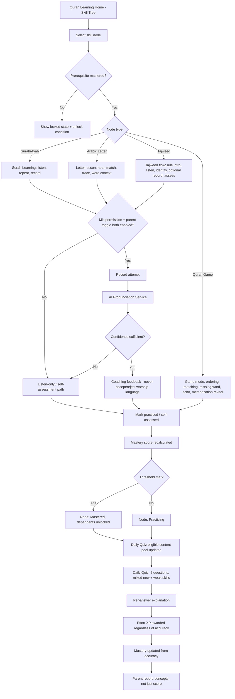
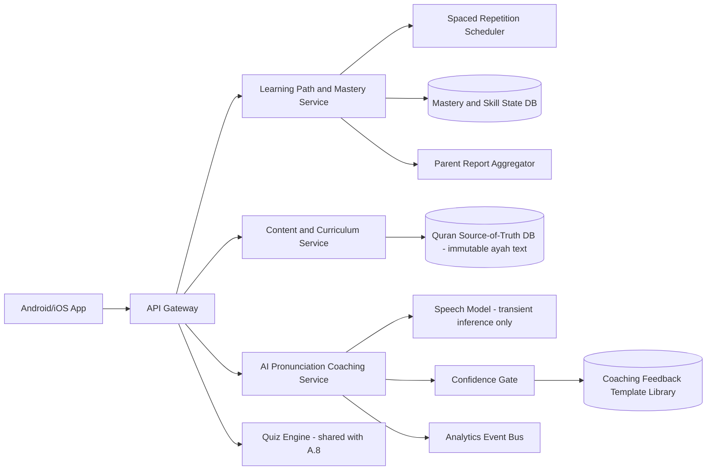
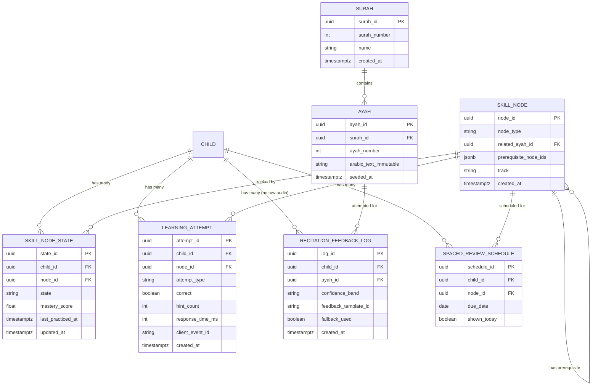

# Feature A.5 — Quran & Arabic Learning (Learn Tab: Quran, Arabic, Tajweed)

**App:** NoorHeroes — Islamic Learning App for Children
**Feature Owner:** Product / Learning Science / Content & Editorial / AI
**Status:** Implementation-ready
**Version:** 1.0
**Depends on:** A.1 (Auth & Onboarding), A.2 (Home Dashboard — surfaces Quran progress/recommendations), Content CMS, Scholar Review Pipeline, C.23 (Parental Controls — AI/microphone permission)
**Feeds into:** A.6 Dua Learning, A.8 Daily Quiz, A.9 Skill Tree/Mastery, A.11 Rewards, A.18 Islamic Facts, C.22 Parent Progress Reports

---

## Table of Contents

1. [Product Requirements](#1-product-requirements)
2. [UX/UI Requirements](#2-uxui-requirements)
3. [Backend Requirements](#3-backend-requirements)
4. [Database Design](#4-database-design)
5. [Backend AI Code-Generation Prompt](#5-backend-ai-code-generation-prompt)
6. [Android Requirements](#6-android-requirements)
7. [Android AI Code-Generation Prompt](#7-android-ai-code-generation-prompt)
8. [Admin Requirements](#8-admin-requirements)
9. [Admin AI Code-Generation Prompt](#9-admin-ai-code-generation-prompt)
10. [DevOps Requirements](#10-devops-requirements)
11. [Analytics Requirements](#11-analytics-requirements)
12. [Security Requirements](#12-security-requirements)
13. [QA Requirements](#13-qa-requirements)
14. [Marketing Requirements](#14-marketing-requirements)
15. [Release & Rollback Plan](#15-release--rollback-plan)

---

## 1. Product Requirements

### 1.1 Problem Statement

Children need an adaptive, mastery-based path to learn Quran recitation, Arabic literacy, and Tajweed that gets "a little harder as I improve and a little easier when I struggle" (source: Consolidated Blueprint §6.3 user story), while parents need confidence that any AI pronunciation feedback is coaching-only — never a religious judgment, never retaining raw child voice by default, and always overridable/disableable by the parent (source §6.3 AI pronunciation rules: "Do not label worship as accepted/rejected... Do not retain raw child voice after processing by default... Parent can disable microphone features per child").

### 1.2 Business Goals

- Establish Quran/Arabic mastery progression as a core differentiator vs. generic kids' Islamic content apps (genuine skill-tree-based learning, not passive consumption).
- Drive habit-loop integration with the Habit Tracker (Quran reading streak) and Daily Quiz (spaced reinforcement).
- Position AI Tajweed Pronunciation Coaching as a premium-tier differentiator (per the source monetization table: "Tajweed Pronunciation AI — Whisper + phoneme groupifier," tier: Pro/Premium, conversion power: Very High) while keeping core Arabic-letter and basic Quran-game content free-tier accessible for equity.
- Maintain zero ambiguity between "pedagogical pronunciation coaching" and any implication of religious/worship validity judgment — a core trust and theological-safety requirement.

### 1.3 User Goals

- **Child:** Learn Arabic letters, practice Quran recitation with helpful (not judgmental) feedback, progress through a clear skill tree that feels achievable, and get rewarded for real learning, not just app-opens.
- **Parent:** See genuine surah-by-surah progress and practice consistency, control whether AI microphone-based coaching is enabled for their child, and trust that nothing in this feature ever implies a verdict on their child's worship.

### 1.4 Success Metrics

| Metric | Target |
|---|---|
| Skill-node mastery rate (Learning → Mastered within 30 days of first attempt) | ≥ 40% |
| Daily Quiz completion rate (5-question set) | ≥ 60% of active children |
| Tajweed practice session completion rate | ≥ 55% |
| AI pronunciation feature opt-in rate (where parent-enabled) | Tracked, no fixed target (parent choice, not a growth KPI to optimize against) |
| Recitation Echo retry-until-mastery rate (engagement signal, not frustration) | Monitored qualitatively alongside completion rate |
| Spaced-review-prompted Arabic letter retention (correct on scheduled review) | ≥ 75% |
| Parent Quran Progress Report view rate (weekly) | ≥ 30% of parents with an active learner |
| Crash-free Learn-tab sessions | ≥ 99.5% |

### 1.5 Stakeholders

Product Manager, Learning Science/Curriculum Designer, Scholar Review Board (Tajweed/Quran accuracy), AI/ML Engineer (pronunciation model, adaptive difficulty), Backend Architect, Android Architect (audio recording/playback), UX Designer, Data Analyst, Security Engineer (voice data handling, child-safety), QA Lead, Customer Support Lead, Accessibility Advisor.

### 1.6 User Stories

1. As a child, I want to learn Arabic letters by hearing them, matching them, and tracing their shapes.
2. As a child, I want to practice reciting a surah verse-by-verse with audio I can replay and slow down.
3. As a child, I want to record myself reciting and get gentle, helpful feedback on my pronunciation — without it feeling like a test of whether my prayer "counts."
4. As a child, I want a short daily quiz that mixes new and previously-learned material so I don't forget things.
5. As a child, I want to learn Tajweed rules one at a time, with an example, before being asked to apply them.
6. As a child, I want to see my progress as a map/tree where some things are locked until I'm ready for them.
7. As a child, I want to play Quran games (ordering ayat, matching, missing-word) that make practice feel like play.
8. As a child without microphone access (parent disabled it, or denied permission), I want to still practice via listen-only mode without feeling excluded.
9. As a parent, I want to see my child's surah progress and practice consistency, not just app-open counts.
10. As a parent, I want full control over whether AI pronunciation/microphone features are enabled for my child, per child.
11. As a parent, I want assurance my child's voice recordings are not stored indefinitely or used to judge religious validity.
12. As a child, I want hints when I'm stuck, without the hints giving away the whole answer immediately.
13. As a child, when a skill needs review, I want gentle reminders, not a sense of having "failed" something I learned before.

### 1.7 Functional Requirements

**FR-1** Learn Tab entry point ("Quran Learning Home") shows a skill-tree map with mastery indicators, organized by Surah/skill-node, plus mode selectors for Quran Game variants and a placement-check option for new learners (source: Blueprint screen catalog, "Quran Learning (Quran Game Hub)").
**FR-2** Skill Tree states are exactly: `Locked → Ready → Learning → Practicing → Mastered → Needs Refresh` (source §6.3/§21.9). A node's `Locked` state must display what prerequisite unlocks it, not just a generic lock.
**FR-3** Mastery score is computed from: accuracy, independent attempts, recency, difficulty, and transfer across question types — the child-facing UI shows progress (e.g., a filling progress ring, a state label) without exposing the raw composite confidence score (source §21.9: "should show progress without revealing a confusing raw model score").
**FR-4** `Needs Refresh` state is triggered by spaced-repetition decay logic (time since last correct demonstration, weighted by original mastery strength) and surfaces as a gentle "let's review this together" prompt, never framed as a regression/failure.
**FR-5** Quran Game modes must include at minimum: ayah ordering, listen-and-select matching ayah, find-the-missing-word, surah-name-to-theme matching (child-safe/approved context only), recitation echo with pronunciation coaching, and progressive-reveal memorization (source §21.9 "Quran Game" game ideas).
**FR-6** Arabic Letters module must include: hear-and-match, tracing, isolated/initial/medial/final form matching, harakah (diacritic) sound pairing, find-the-letter-in-an-approved-word, build-a-word-from-sound-tiles — with spaced review scheduling applied across sessions (source §21.9 "Arabic Letters").
**FR-7** Arabic Letter detailed flow: play phoneme → child selects 1-of-4 letters → child traces the correct shape → letter shown in a familiar word → scheduled for spaced review. Mastery requires correct performance across different question forms and across more than one session (not masterable in a single sitting) — source §21.9.
**FR-8** Surah Learning screen shows ayah-by-ayah list with audio, a translation toggle, Tajweed-rule highlighting inline with the text, and a recitation recorder; actions: listen, repeat, record pronunciation attempt, request a hint, mark ayah as practiced (source: Blueprint screen catalog "Surah Learning").
**FR-9** Microphone-denied or parent-disabled state must fall back to listen-only practice — the child can still progress through listening/repetition-without-recording paths; this is not a dead end (source: Blueprint, "Mic-denied state falls back to listen-only practice").
**FR-10** AI pronunciation scores are advisory and confidence-aware: the system must never label a recitation/worship act as "accepted" or "rejected," must never imply religious/spiritual validity, and must present feedback strictly as pedagogical coaching (e.g., "try emphasizing this letter more" rather than "incorrect") — source §6.3/§21.9, a hard non-negotiable rule.
**FR-11** Raw child voice recordings are not retained after processing by default; only derived, non-reversible feedback signals (e.g., a phoneme-level score) may be retained for progress tracking, never the raw audio itself unless a parent explicitly opts in to a distinct "save recordings" feature (off by default) for their own private playback.
**FR-12** Low-confidence AI pronunciation results must fall back to a "compare against the recorded reference example" self-assessment mode rather than presenting an uncertain automated score as if it were reliable (source §21.9: "Low-confidence results fall back to recorded examples").
**FR-13** Parent must be able to disable microphone/AI pronunciation features per child (not just globally) from Parental Controls (cross-ref C.23); when disabled, all recitation practice defaults to listen-and-self-assess mode app-wide for that child, with no UI path to bypass this setting from within the Learn tab.
**FR-14** Tajweed module flow: introduce one rule with an approved example → listen at normal and slow speed → identify the rule in an example → optional microphone repeat with visual coaching → short assessment (source §21.9 "Tajweed" flow) — each step is sequential and the microphone step is skippable/replaced by listen-only per FR-9/FR-13.
**FR-15** Daily Quiz (Learn-tab-specific instance, shared engine with A.8) assembles exactly 5 questions from recently-learned content plus identified weak skills; question types: multiple choice, sequence, true/false, image match, audio match; immediate explanation shown after each answer; incorrect answers enter a short retry set within the same session (source §21.9).
**FR-16** Quiz completion awards effort XP for participation regardless of accuracy; accuracy affects mastery-score computation, not base participation XP — this separation is intentional (a child should never feel "punished" with zero reward for attempting a hard quiz) (source §21.9: "Completion awards effort XP; accuracy affects mastery, not base participation XP").
**FR-17** Parent-facing Quran/Quiz reports must show concepts/skills, not just a raw numeric score (source §21.9: "Parent report shows concepts, not just a score").
**FR-18** Hint system: hints must be progressive/partial (e.g., eliminate one wrong option, reveal the first letter) rather than immediately revealing the full answer; hint usage is tracked as a data point (`hint_count`) feeding the mastery-confidence calculation, not treated as a penalty visible to the child.
**FR-19** Islamic Facts surfaced within or adjacent to Learn-tab content must carry: locale/age-banded text, topic and related-content linkage, primary/secondary source references, scholar approval and version, an explanation, a linked quiz item, and jurisprudential-scope/exclusion notes where relevant (source §21.9 "Islamic Facts").
**FR-20** Adaptive difficulty: lesson difficulty must adjust based on performance (source: Blueprint use case "Get adaptive lesson") — implemented via the mastery-score/skill-state model, not a separate disconnected difficulty slider.
**FR-21** Quran content data integrity: Ayah text itself is never editable post-seed (verified-source-seeded once); only translations, tafseer notes, and learning metadata are versioned/editable, each requiring scholar sign-off before publish (source: Admin Quran Management module rules, cross-referenced here as a hard content-integrity constraint this feature's read path must respect).

### 1.8 Non-Functional Requirements

- **Performance:** Skill-tree map render p95 < 800ms (cached); audio playback start p95 < 600ms for cached/downloaded ayah audio; AI pronunciation feedback round-trip p95 < 3s (acceptable for a non-real-time coaching interaction, clearly communicated via a "listening... checking..." loading state, never implying instant judgment).
- **Availability:** AI Pronunciation Service degrades gracefully to "compare with reference example" self-assessment mode on outage — never blocks lesson progression.
- **Accuracy/Content Integrity:** 100% of Quran ayah text sourced from a single verified, immutable source-of-truth dataset; zero tolerance for ayah-text divergence across locales/versions (translations may vary, the Arabic text itself never does).
- **Accessibility:** Tracing exercises must have a non-gesture-dependent alternative (e.g., multiple-choice shape matching) for children using assistive input; all audio has a visual-only fallback path (captions/highlighted text) for hearing-impaired use cases.
- **Localization:** Translations/transliterations per locale, scholar-reviewed; RTL layout correctness for Arabic-script display is paramount (this is the single feature most dependent on pixel-perfect Arabic typography/diacritic rendering in the entire app).
- **Data minimization:** Per FR-11, voice data handling is held to the strictest minimization standard in the app.

### 1.9 Acceptance Criteria

- Given a child opens Quran Learning Home for the first time, when the skill tree renders, then a placement-check option is offered before defaulting them into Surah 1 from scratch (respecting prior knowledge where determinable).
- Given a skill node is `Locked`, when the child taps it, then the specific prerequisite/unlock condition is shown, not a generic lock icon.
- Given a parent has disabled microphone/AI features for a child, when that child opens Surah Learning or Tajweed practice, then no microphone-recording UI is rendered anywhere in the flow — listen-only/self-assess paths are the only options presented.
- Given an AI pronunciation feedback confidence score falls below the configured threshold, when feedback is generated, then the system falls back to the "compare with recorded reference" self-assessment mode instead of presenting an uncertain score as authoritative.
- Given a child completes a Daily Quiz with 1 out of 5 correct, when results are shown, then participation/effort XP is still awarded, paired with supportive retry language and a simpler next recommendation — never a zero-reward outcome.
- Given a child's recitation attempt is processed by the AI Pronunciation Service, when feedback is returned, then the language used is strictly coaching-style (e.g., "try again, listen for the heavy sound") and never implies religious acceptance/rejection — verified via an automated content-safety check on the feedback-template library (analogous to A.2's billing-content audit pattern).
- Given a child has not practiced a previously-mastered skill in a configured decay window, when they open Quran Learning Home, then that node shows `Needs Refresh` with a gentle, non-shaming "let's review this together" framing.
- Given a parent opens the Quran Progress Report, when it renders, then it lists mastered/in-progress concepts and consistency trends — not merely a percentage score with no context.

### 1.10 Edge Cases

1. Child completes a skill node's assessment with borderline mastery score (e.g., exactly at the mastery threshold) → system rounds in the child's favor for the *state transition* (Practicing → Mastered) but the underlying continuous mastery score still feeds future spaced-repetition-decay scheduling accurately — borderline cases are not penalized twice.
2. Parent disables microphone mid-session while the child is actively in a recitation-recording flow → the in-progress recording UI must gracefully exit to listen-only mode on the next app-state check (not abruptly crash or leave a dangling "record" button that silently fails); per the standing Parent Dashboard rule, the change can apply at the next session rather than instantly interrupting, but must never leave the child stuck on a broken control if it does interrupt mid-session.
3. Child attempts the same quiz question multiple times across different days (e.g., it recurs in the weak-skills pool) → repeated correct answers should reduce its weak-skill priority over time (the system must not keep re-surfacing an already-remastered concept indefinitely).
4. AI Pronunciation Service returns a high-confidence score that is nonetheless wildly inconsistent with the child's historical performance trend (e.g., sudden perfect score after weeks of struggle, possibly due to background noise/false positive) → flagged internally as an anomaly for model-quality monitoring, but the child still simply sees positive feedback (a false positive in the child's favor is a lower-severity issue than a false negative that discourages a child, so the UX defaults to "do not punish for model uncertainty in either direction" — true uncertainty triggers fallback per FR-12, but a too-good-to-be-true score isn't second-guessed to the child's face).
5. Child's device has no microphone hardware at all (rare, e.g., certain tablets) → recitation-recording UI is hidden entirely (not shown-disabled), identical UX to the parent-disabled case, determined via device capability detection at app start.
6. Spaced-review decay logic computes multiple nodes simultaneously due for refresh on the same day → system caps the number of "Needs Refresh" prompts surfaced at once (e.g., max 2 per day) to avoid overwhelming the child, queuing the remainder for subsequent days rather than dumping all due-reviews simultaneously.
7. Child switches locale mid-curriculum (e.g., from English UI to Arabic UI) → translation/transliteration display updates immediately; the underlying Arabic ayah text and skill-tree progress state remain unchanged (progress is locale-independent, tied to the universal ayah/skill identifiers, not to a locale-specific content version).
8. Hint is requested on a question type that doesn't have a meaningful "partial" hint (e.g., true/false) → falls back to an explanatory micro-hint (e.g., a related fact nudge) rather than a no-op or a broken UI state.
9. Child completes a placement check that places them past Surah-tree nodes that have configured Tajweed-rule prerequisites not yet individually verified as mastered → system either (a) marks prerequisite Tajweed nodes as provisionally "Ready" pending a light confirmation check, or (b) explicitly schedules them for near-term review — never silently skips foundational Tajweed rules entirely based on a placement check alone, since recitation correctness depends on them.
10. Network drops mid-recitation-recording upload → recording is preserved locally and retried (not discarded), but per FR-11's retention rule, once successfully processed server-side and feedback returned, the raw audio is still deleted post-processing even after a retry path (the retry exception does not create a longer-retention loophole).
11. Two siblings practice the same Surah on a shared device on the same day → each child's mastery/progress state, recording, and AI feedback are fully isolated per `child_id`; no cross-contamination of spaced-review scheduling or weak-skill pools.
12. A scholar-issued correction updates a Tajweed rule's approved example or a translation mid-curriculum (content versioning) → children with in-progress mastery of that node retain their progress state (mastery isn't reset by a content text update), but newly-served example content reflects the corrected version going forward.

### 1.11 Error Handling

| Scenario | System Behavior |
|---|---|
| AI Pronunciation Service unavailable/timeout | Falls back to "compare with recorded reference example" self-assessment mode, no error shown to child, logged for ops monitoring |
| Microphone permission denied at OS level | Recitation UI silently switches to listen-only mode; a one-time non-blocking explainer may inform the child/parent why (no repeated nagging) |
| Quiz service unavailable | Daily Quiz widget/screen shows a friendly "quiz will be ready again soon" message, does not block access to other Learn-tab content |
| Skill-tree data fetch failure | Cached last-known skill-tree state rendered with an "may be slightly out of date" indicator rather than a blank/broken map |
| Recording upload failure (network) | Local retry per Edge Case 10; if retries exhaust, child is informed gently ("let's try that again later") and can re-attempt fresh rather than being stuck |
| Ayah audio media fails to load | Retry with backoff; falls back to a lower-bitrate/alternate CDN source if configured before surfacing a hard error |

### 1.12 Empty States
- New child, zero skill-tree progress → guided placement-check offer + a clearly marked "start from the beginning" alternative, never a blank map.
- Zero quiz history yet → Daily Quiz widget shows a friendly first-time framing rather than an empty score history chart.
- Parent Quran Progress Report with zero activity yet → "Once [Child] starts practicing, you'll see their progress here."

### 1.13 Loading States
- Skill-tree map: skeleton node-grid shimmer.
- AI pronunciation feedback: explicit "Listening... checking your recitation" state (sets honest expectation that this takes a few seconds, distinct from instant UI feedback elsewhere in the app).

### 1.14 Offline States
- Downloaded ayah audio and lesson content fully usable offline (listen/repeat/trace flows); AI pronunciation coaching requires connectivity (model inference is server-side) — offline recitation attempts queue locally and are either processed on reconnect or the child is clearly told this feature needs internet, with self-assessment as the immediate offline alternative.
- Quiz: a pre-downloaded subset of likely-quiz-content can be cached for offline quiz attempts, syncing results on reconnect with idempotent submission (per the general pattern established in A.2/A.3).

### 1.15 Permission States
- **Microphone:** OS-level permission + parent-level toggle (C.23) both gate recording features; both must be true for recording UI to appear; either being false routes to listen-only mode, no separate "request permission" nag once denied at the OS level beyond the platform-standard one-time re-prompt affordance.

### 1.16 User Flow (Narrative)

Child opens Learn tab → Quran Learning Home (skill-tree map + mode selector) → taps a Ready/Learning node → routes to Surah Learning (verse-by-verse practice) or a Quran Game mode or Arabic Letters lesson or Tajweed module, depending on node type → practices via listen/repeat/(optionally record) → receives coaching feedback (AI or self-assessment) → marks progress → mastery score updates → if threshold met, node transitions to Mastered and dependent nodes unlock → child may then take the Daily Quiz (mixing this and prior content) → quiz completion awards effort XP, updates mastery, surfaces a parent-report-visible concept summary.

### 1.17 Detailed Flow Diagram (Mermaid)



### 1.18 Screen Inventory (Complete — Zero Missing)

| # | Screen | Type | Entry Points | Exit Points |
|---|---|---|---|---|
| 1 | Learn Tab Landing / Quran Learning Home (Skill Tree Map) | Primary | Bottom nav "Learn" tab, Home "Continue Learning" | Surah Learning, Arabic Letters, Tajweed, Quran Game modes |
| 2 | Placement Check (first-time) | Screen | Quran Learning Home, first visit | Skill Tree (pre-populated states) |
| 3 | Mode Selector Sheet | Modal | Quran Learning Home | Specific game mode screen |
| 4 | Surah Learning | Primary | Skill Tree node tap | Recitation Recorder, Dua Learning (A.6), back to Skill Tree |
| 5 | Recitation Recorder Overlay | Component (in Surah Learning) | "Record" action | Feedback screen / Listen-only fallback |
| 6 | AI Pronunciation Feedback Screen | Screen variant | Recorder submission | Mark-practiced action, Retry |
| 7 | Listen-Only Self-Assessment Screen | Screen variant | Mic disabled/denied path | Mark-practiced action |
| 8 | Arabic Letters — Hear & Match | Screen | Skill Tree (letter node) | Tracing screen |
| 9 | Arabic Letters — Tracing | Screen | Hear & Match | Word-context screen |
| 10 | Arabic Letters — Word Context | Screen | Tracing | Skill Tree (progress update) |
| 11 | Arabic Letters — Word-Building (sound tiles) | Screen (game mode) | Mode Selector | Skill Tree |
| 12 | Tajweed — Rule Introduction | Screen | Skill Tree (Tajweed node) | Listen step |
| 13 | Tajweed — Listen (normal/slow) | Screen | Rule Introduction | Identification step |
| 14 | Tajweed — Rule Identification Exercise | Screen | Listen step | Optional Record / Assessment |
| 15 | Tajweed — Assessment | Screen | Identification (or Record) | Skill Tree (progress update) |
| 16 | Quran Game — Ayah Ordering | Screen | Mode Selector | Skill Tree |
| 17 | Quran Game — Listen & Select Matching Ayah | Screen | Mode Selector | Skill Tree |
| 18 | Quran Game — Missing Word | Screen | Mode Selector | Skill Tree |
| 19 | Quran Game — Surah Theme Matching | Screen | Mode Selector | Skill Tree |
| 20 | Quran Game — Recitation Echo | Screen | Mode Selector | AI Feedback / Listen-only fallback |
| 21 | Quran Game — Progressive Memorization Reveal | Screen | Mode Selector | Skill Tree |
| 22 | Daily Quiz (Learn-tab instance) | Screen (shared engine, A.8) | Skill Tree, Home Daily Quiz widget | Quiz Results |
| 23 | Quiz Per-Answer Explanation Overlay | Component (in Quiz) | Each answer submission | Next question |
| 24 | Quiz Retry Set (mistakes) | Screen | Quiz Results (if mistakes made) | Quiz Results (updated) |
| 25 | Quiz Results / Effort XP Reveal | Screen | Quiz completion | Skill Tree / Home |
| 26 | "Needs Refresh" Gentle Review Prompt | Component | Skill Tree, due-for-review node | Review session (routes to relevant node type) |
| 27 | Hint Overlay (progressive hint) | Component (cross-cutting, in any exercise) | "Hint" control | Resumes exercise |
| 28 | Islamic Fact Detail (Learn-tab linked) | Screen | Linked from quiz/lesson content | Related Quiz item / back |
| 29 | Mastery Badge/Node-Unlock Celebration | Modal | Skill Tree, threshold crossed | Dismiss → Skill Tree |
| 30 | Parent Quran/Arabic Progress Report | Screen (Parent Area) | Parent Dashboard → Child Progress → Learning | Concept Detail Drill-in |
| 31 | Parent Progress Report — Concept Detail | Screen (Parent Area) | Progress Report list | Back |
| 32 | Parent AI/Microphone Permission Toggle (per child) | Screen (Parent Area, cross-ref C.23) | Parent Controls | Saves setting |
| 33 | Microphone Permission Rationale / One-Time Explainer | Modal | First recording attempt | Dismiss → proceeds per permission outcome |

### 1.19 Events (Complete Analytics Event List)

`learn_tab_viewed`, `placement_check_started`, `placement_check_completed`, `skill_node_viewed`, `skill_node_locked_tapped`, `skill_node_started`, `surah_learning_opened`, `ayah_audio_played`, `ayah_audio_slowed`, `recitation_record_started`, `recitation_record_submitted`, `recitation_ai_feedback_shown` (with `confidence_band`), `recitation_fallback_to_reference_shown`, `recitation_listen_only_used`, `ayah_marked_practiced`, `arabic_letter_lesson_started`, `arabic_letter_traced`, `arabic_letter_matched`, `arabic_word_built`, `tajweed_rule_introduced`, `tajweed_identification_attempted`, `tajweed_assessment_completed`, `quran_game_started` (with `game_mode`), `quran_game_completed`, `hint_requested` (with `hint_level`), `mastery_score_updated`, `skill_node_state_changed` (with `from_state`, `to_state`), `needs_refresh_prompt_shown`, `needs_refresh_review_completed`, `daily_quiz_started`, `quiz_question_answered`, `quiz_explanation_viewed`, `quiz_retry_set_started`, `quiz_completed`, `quiz_effort_xp_awarded`, `islamic_fact_linked_viewed`, `mastery_celebration_shown`, `parent_progress_report_viewed`, `parent_concept_detail_viewed`, `parent_ai_mic_permission_toggled`.

---

## 2. UX/UI Requirements

> Global Design System tokens defined in **Feature A.1 §2.1**. This feature introduces Arabic-typography-critical requirements given its content nature.

### 2.1 Learn-Specific Design System Extensions

- **Quranic Arabic Typography:** A distinct, more formal Naskh/Uthmani-style typeface (separate from the general-UI Arabic font used for menus/labels per A.1) is used specifically for ayah text, with correct diacritic (tashkeel) rendering verified across all supported devices/OS versions — this is a content-integrity requirement, not a stylistic preference.
- **Skill Tree Visual Language:** Node states map to distinct, non-color-only visual treatments: Locked (greyed, padlock icon), Ready (outlined, gentle pulse), Learning (partially filled progress ring), Practicing (filled ring, no checkmark yet), Mastered (filled gold ring + checkmark), Needs Refresh (filled ring + small gentle "refresh" icon, warm amber not alarming red).
- **Pronunciation Feedback Visual Language:** Feedback is presented via supportive iconography (e.g., a gentle upward arrow for "getting closer," a star-sparkle for "great job on this part") — explicitly avoiding red X / green check binary-correctness imagery for recitation specifically (distinct from the binary-correct UI used in non-religious quiz contexts elsewhere), to reinforce the "coaching, not judgment" principle visually as well as textually.
- **Hint Button:** Small, secondary-styled, always visibly present but never pulsing/highlighted in a way that pressures use.

### 2.2 Screen-Level Design Requirements (Key Screens)

#### Screen: Quran Learning Home (Skill Tree Map)

- **Purpose:** Orient the child within their overall learning journey and let them choose what to practice.
- **Components:** Scrollable/zoomable tree or path visualization of skill nodes grouped by Surah/topic, mode-selector entry point, mastery summary header (e.g., "12 skills mastered"), placement-check re-offer (for returning low-activity users, subtly, not naggy).
- **States:** Loading (skeleton tree), Default, Error (cached fallback per §1.11), First-time (placement-check prominent).
- **Accessibility:** Tree navigable linearly via screen reader (a logical reading order independent of the visual spatial layout, with each node's state announced).
- **Responsive Rules:** Tree layout reflows for tablet (wider node spacing) without changing the underlying logical structure.

#### Screen: Surah Learning

- **Purpose:** Core verse-by-verse practice experience.
- **Components:** Ayah list (Quranic-typography Arabic + transliteration-optional + translation toggle), Tajweed-rule inline highlight markers, per-ayah audio play/slow-play controls, record button (conditional on permission state), hint control, "mark practiced" action.
- **States:** Default, Recording-active, AI-processing ("Listening... checking"), Feedback-shown, Listen-only-mode, Error (audio load failure).
- **Accessibility:** Translation toggle and transliteration visibility independently controllable, never forced on (per source: "transliteration is optional and controlled by lesson design, not always shown" — here extended to also remain a user-accessible toggle where lesson design permits).

#### Screen: AI Pronunciation Feedback Screen

- **Purpose:** Deliver coaching feedback without implying religious judgment.
- **Components:** Waveform-style visual (decorative, not data-precise) of the attempt, 1-2 specific, constructive coaching phrases (e.g., "Nice! Try holding this letter a bit longer next time"), a "Try Again" and a "Continue" action, never a numeric score displayed to the child (numeric/confidence data exists only in the backend mastery model, never shown raw to a child).
- **States:** High-confidence-positive, High-confidence-needs-practice, Low-confidence-fallback (routes to reference-comparison instead of this screen entirely).

### 2.3 Tab Structure

Learn is Tab 2 of 5 (Home / **Learn** / Stories / Rewards / Profile). Click mapping:

| Click Target | Destination | API Called | Analytics Event | Permission Check | Error Handling |
|---|---|---|---|---|---|
| Skill node (unlocked) | Relevant practice screen | `GET /v1/learning/nodes/{id}` | `skill_node_started` | None beyond entitlement (most Learn content free-tier per source) | Cached fallback |
| Skill node (locked) | Inline unlock-condition display | None | `skill_node_locked_tapped` | None | N/A |
| Record button | Recitation Recorder | `POST /v1/learning/attempts` | `recitation_record_submitted` | Mic OS permission + parent AI toggle | Falls back to listen-only |
| Hint control | Hint Overlay | `GET /v1/learning/hints/{question_id}` (shared with A.5) | `hint_requested` | None | Falls back to generic encouragement text if hint service fails |
| Daily Quiz widget/entry | Daily Quiz screen | `GET /v1/quizzes/daily?context=learn` | `daily_quiz_started` | None | Graceful unavailable message |

### 2.4 Wireframe Description (Composite)

Skill Tree: a vertically-scrolling, organically-curved path (not a rigid grid) connecting nodes in learning-sequence order, with horizontal branching for parallel tracks (e.g., Arabic Letters track running alongside the Quran/Surah track), consistent with a "journey map" metaphor rather than a flat menu list. Practice screens (Surah Learning, Tajweed, Letters) follow a consistent single-column, single-primary-action wireframe pattern similar to A.1's onboarding philosophy, appropriate given the focused, one-task-at-a-time nature of learning exercises.

### 2.5 Screen Image Generation Prompts

**Screen: Quran Learning Home (Skill Tree Map)**
- *Prompt 1 (English):* "Mobile app skill-tree/learning-path map UI mockup for a children's Islamic education app. Warm off-white background. A gently curving illustrated path winding vertically up the screen, connecting circular node icons representing learning skills — some nodes shown filled and glowing gold with a small checkmark (mastered), some partially filled with a teal progress ring (in progress), and some greyed out with a small padlock icon (locked). Small decorative Islamic geometric pattern flourishes along the path. A small mastery summary chip near the top reading a simple stat. Warm, encouraging, game-like but respectful and calm aesthetic, rounded shapes throughout, no realistic human faces, bottom navigation bar visible."
- *Prompt 2 (Arabic RTL):* "نفس واجهة خريطة مسار التعلم/شجرة المهارات لتطبيق تعليم إسلامي للأطفال، بتخطيط من اليمين إلى اليسار. خلفية بيج فاتح دافئ. مسار رسومي منحني بلطف يتصاعد عموديًا على الشاشة، يربط بين أيقونات عقد دائرية تمثل المهارات التعليمية — بعضها معبأ ومتوهج بالذهبي مع علامة صح صغيرة (مكتسبة بالكامل)، وبعضها معبأ جزئيًا بحلقة تقدم فيروزية (قيد التعلم)، وبعضها رمادي اللون مع أيقونة قفل صغيرة (مقفلة). زخارف هندسية إسلامية صغيرة تزين المسار. شريحة ملخص صغيرة قريبة من الأعلى تعرض إحصائية بسيطة. طابع مشجع وشبيه باللعبة لكن محترم وهادئ، أشكال مستديرة في كل مكان، بدون وجوه بشرية واقعية، شريط تنقل سفلي ظاهر."

**Screen: Surah Learning (Ayah Practice)**
- *Prompt 1 (English):* "Mobile app verse-by-verse Quran practice screen UI mockup for children. Clean warm off-white background. A scrollable list of rounded card rows, each showing elegant Arabic Quranic-style calligraphy text at the top of the card, a smaller transliteration line beneath in italic Latin font, and a translation line beneath that in regular font, with a small play-button icon and a slower-speed icon to the side of each card. One card highlighted with a soft teal border indicating the active verse, showing a small record-microphone icon button and a small lightbulb hint icon button beneath it. Respectful, calm, focused educational aesthetic, generous spacing, soft shadows, warm gold accent details, no realistic human faces."
- *Prompt 2 (Arabic RTL):* "نفس شاشة ممارسة القرآن آية بآية للأطفال، بتخطيط من اليمين إلى اليسار بالكامل. خلفية بيج فاتح دافئ ونظيفة. قائمة قابلة للتمرير من صفوف بطاقات مستديرة الزوايا، كل بطاقة تعرض نصًا قرآنيًا بخط عربي أنيق في الأعلى، وسطرًا أصغر للنقل الصوتي بخط لاتيني مائل الطابع أسفله، وسطر ترجمة بخط عادي أسفل ذلك، مع أيقونة زر تشغيل صغيرة وأيقونة سرعة أبطأ بجانب كل بطاقة. بطاقة واحدة مميزة بحد فيروزي ناعم تشير إلى الآية النشطة، تعرض زر أيقونة ميكروفون تسجيل صغير وزر أيقونة لمبة تلميح صغيرة أسفلها. طابع تعليمي محترم وهادئ ومركّز، تباعد كبير، ظلال خفيفة، تفاصيل ذهبية دافئة، بدون وجوه بشرية واقعية."

**Screen: AI Pronunciation Feedback**
- *Prompt 1 (English):* "Mobile app feedback screen UI mockup for a children's pronunciation-practice app, deliberately avoiding any pass/fail or right/wrong iconography. Warm off-white background. A decorative soft wave-pattern illustration in teal representing a sound recording, centered. Below it, a friendly short text message in a rounded speech-bubble shape giving constructive coaching ('Nice try! Let's hold this sound a little longer next time'), with a small upward-trending sparkle icon (not a checkmark or X) suggesting encouraging progress. Two rounded buttons below: 'Try Again' (outlined, secondary style) and 'Continue' (filled, warm gold, primary style). No numeric scores or percentages visible anywhere, calm and encouraging tone, no realistic human faces."
- *Prompt 2 (Arabic RTL):* "نفس شاشة التغذية الراجعة لتطبيق ممارسة النطق للأطفال، بتخطيط من اليمين إلى اليسار، مع تجنب متعمد لأي رموز نجاح/فشل أو صحيح/خاطئ. خلفية بيج فاتح دافئ. رسمة زخرفية لنمط موجي ناعم بلون فيروزي تمثل تسجيلًا صوتيًا، في المنتصف. تحتها رسالة نصية قصيرة وودودة بشكل فقاعة كلام مستديرة تقدم توجيهًا بنّاءً ('محاولة جيدة! لنحافظ على هذا الصوت لفترة أطول في المرة القادمة')، مع أيقونة بريق صاعد صغيرة (ليست علامة صح أو خطأ) تشير إلى تقدم مشجع. زرّان مستديران أسفلها: 'حاول مرة أخرى' (بنمط ثانوي محدد الحواف) و'استمرار' (بنمط أساسي ذهبي دافئ معبأ). بدون أي نقاط أو نسب ظاهرة في أي مكان، طابع هادئ ومشجع، بدون وجوه بشرية واقعية."

*(Remaining screens — Arabic Letters Tracing, Tajweed Rule Introduction, Quran Game modes, Needs Refresh prompt, Hint Overlay, Parent Progress Report — follow the same two-prompt EN/AR template using these tokens; full set available on request.)*

---

## 3. Backend Requirements

### 3.1 System Design Overview

Quran & Arabic Learning is served by a **Learning Path & Mastery Service** (skill-tree state machine, spaced-repetition scheduling), a **Content & Curriculum Service** (Quran/Arabic/Tajweed content, shared Quran data model with Admin's Quran Management module), an **AI Pronunciation Coaching Service** (audio processing, confidence-gated feedback, zero-retention pipeline), and the shared **Quiz Engine** (A.8) for Daily Quiz instances.

### 3.2 Architecture Diagram (Mermaid)



### 3.3 Service Breakdown

| Service | Responsibility |
|---|---|
| Learning Path & Mastery Service | Skill-tree state machine, mastery score computation, prerequisite evaluation |
| Content & Curriculum Service | Serves Quran/Arabic/Tajweed lesson content, reads from the immutable Quran source-of-truth |
| AI Pronunciation Coaching Service | Transient audio inference, confidence gating, coaching-template selection — zero raw-audio retention by design |
| Spaced Repetition Scheduler | Computes `Needs Refresh` due-dates per skill per child, caps daily review prompts |
| Quiz Engine (shared) | 5-question assembly logic, retry-set handling, effort-XP/mastery split |
| Parent Report Aggregator | Rolls up concept-level (not just score-level) progress for Parent Area |

### 3.4 API List

#### `GET /v1/learning/paths?track=quran&child_id=`
- **Auth:** Bearer (child-mode)
- **Response 200:** Skill-tree structure with per-node `state` (`locked|ready|learning|practicing|mastered|needs_refresh`), `unlock_condition` text for locked nodes, mastery summary.
- **Caching:** Short TTL (2 min), invalidated immediately on any mastery-affecting mutation.

#### `POST /v1/learning/placement-check`
- **Request:** `{ "child_id": "...", "responses": [...] }`
- **Response 200:** `{ "recommended_starting_nodes": [...], "provisional_states": {...} }` per Edge Case 9 handling (Tajweed-prerequisite caution).

#### `POST /v1/learning/attempts`
- **Auth:** Bearer (child-mode)
- **Request:** `{ "node_id": "...", "question_id": "...", "attempt_type": "recitation|quiz|tracing|matching", "answer_payload": {...}, "hint_count": 0, "response_time_ms": 4200, "client_event_id": "uuid..." }`
- **Response 200:** `{ "evaluated": true, "correct": true, "mastery_delta": 0.04 }` (for non-recitation types); for recitation, response routes through the Pronunciation Coaching flow below instead.
- **Idempotency:** `client_event_id` unique constraint.

#### `POST /v1/learning/recitation` (Audio submission — distinct, stricter-privacy endpoint)
- **Auth:** Bearer (child-mode), requires both OS-mic-permission-implied client state AND a server-side check that the parent has not disabled AI/mic for this child (defense in depth — server re-validates the parent toggle, never trusting client-side hiding alone)
- **Request:** Multipart audio blob + `{ "ayah_id": "...", "child_id": "..." }`
- **Response 200:** `{ "feedback_template_id": "coach_023", "confidence_band": "high|medium|low", "fallback_to_reference": false }`
- **Processing:** Audio is processed transiently in-memory/ephemeral-storage and deleted immediately post-inference (FR-11) — never written to durable storage in raw form under any code path.
- **Error Codes:** `403 AI_DISABLED_FOR_CHILD` (server-side enforcement of the parent toggle, even if a stale client somehow shows the recording UI).

#### `GET /v1/learning/hints/{question_id}?level=1`
- **Response 200:** `{ "hint_text": "...", "hint_level": 1, "max_level": 3 }` — progressive levels, never full-answer reveal at any level.

#### `GET /v1/quizzes/daily?context=learn`
- **Response 200:** 5-question set assembled from recent + weak-skill pools (shared contract with A.8).

#### `GET /v1/children/{id}/learning-report`
- **Auth:** Bearer (parent session)
- **Response 200:** Concept-level summary (mastered/in-progress/needs-refresh lists with plain-language labels), consistency trend — explicitly structured to avoid a single raw aggregate score as the headline.

### 3.5 Cross-Cutting API Concerns

- **Security:** `/v1/learning/recitation` is the single most privacy-sensitive endpoint in this feature — server-side parent-toggle re-validation, zero raw-audio retention, and confidence-gated fallback are all enforced here, not left to client trust.
- **Caching:** Skill-tree reads cacheable short-TTL; recitation/attempt submissions never cached.
- **Analytics:** All events from §1.19 emitted; recitation-specific events never include raw audio or transcript content, only categorical `confidence_band` and template IDs.

---

## 4. Database Design

### 4.1 ER Diagram (Mermaid)



### 4.2 Tables, Relationships, Constraints

| Table | Key Constraints | Indexes |
|---|---|---|
| `ayah` | FK `surah_id`; `arabic_text_immutable` — application-level write-protection, no UPDATE grant on this column for any service role post-seed | Index `(surah_id, ayah_number)` |
| `skill_node` | CHECK `track IN ('quran','arabic','tajweed')` | Index `(track)` |
| `skill_node_state` | FK `child_id`, `node_id`; UNIQUE(`child_id`, `node_id`); CHECK `mastery_score BETWEEN 0 AND 1` | Index `(child_id, state)` |
| `learning_attempt` | FK `child_id`, `node_id`; UNIQUE(`client_event_id`) | Index `(child_id, node_id, created_at DESC)` |
| `recitation_feedback_log` | FK `child_id`, `ayah_id`; **no audio/blob column exists in this table by design** | Index `(child_id, created_at DESC)` |
| `spaced_review_schedule` | FK `child_id`, `node_id`; UNIQUE(`child_id`, `node_id`, `due_date`) | Index `(child_id, due_date)` |

### 4.3 Audit Fields
`skill_node_state.updated_at`, `ayah.seeded_at` (immutable record of seed time). `learning_attempt`, `recitation_feedback_log` are append-only/immutable historical facts.

### 4.4 Soft Delete Rules
N/A for `ayah`/`surah` (immutable reference data, never deleted). `skill_node` deprecation (e.g., curriculum restructuring) uses an `is_active` flag rather than deletion, to preserve historical `skill_node_state`/`learning_attempt` references.

### 4.5 Retention Rules
**Raw audio is never written to any table or object store in this system — zero-retention by architectural design, not a retention-window policy.** `recitation_feedback_log` (categorical metadata only) retained per standard progress-history rules. `spaced_review_schedule` rows purged 30 days after `due_date` if `shown_today` history is no longer needed for scheduling (a rolling operational table, not a long-term archive).

---

## 5. Backend AI Code-Generation Prompt

```
You are building the Learning Path & Mastery Service and the AI Pronunciation
Coaching Service for "NoorHeroes," a child-safety-first Islamic learning app.
The single most important architectural constraint in this entire service:
RAW CHILD VOICE AUDIO IS NEVER PERSISTED TO ANY DURABLE STORAGE, under any
code path, for any reason, by default.

Stack: FastAPI (Python 3.12), PostgreSQL (SQLAlchemy 2.0), Redis, an async
audio-processing pipeline (the ASR/pronunciation model itself can be treated
as an external inference call -- you are not asked to build the model, only
the safe orchestration around it).

Hard requirements:
1. Implement POST /v1/learning/recitation to: (a) accept a multipart audio
   blob into an IN-MEMORY buffer or an ephemeral, encrypted, short-TTL
   (max 5 minute) temp object that is explicitly deleted (not just
   TTL-expired -- issue an explicit delete call) immediately after the
   inference call returns, success or failure; (b) call the external
   pronunciation-inference service; (c) NEVER write the raw audio bytes to
   PostgreSQL, to a permanent object store, or to application logs (not
   even at debug log level -- audit the entire request path with this in
   mind). Write a test that asserts, after calling this endpoint, no trace
   of the raw audio payload exists in any queryable storage the test can
   access (DB rows, object storage listing, log output capture).
2. The recitation endpoint must SERVER-SIDE re-validate that the parent has
   not disabled AI/microphone features for this child_id (query the shared
   Parental Controls service/table) BEFORE processing any audio -- if
   disabled, return 403 AI_DISABLED_FOR_CHILD immediately without ever
   touching the audio payload. Write a test confirming a request with
   AI disabled for the child never reaches the inference-call code path
   (mock/spy assertion that the inference function was never invoked).
3. Implement confidence gating: define a configurable threshold (e.g.,
   0.7). If the inference service's returned confidence is below this
   threshold, OR if the inference call times out/errors, route the
   response to fallback_to_reference=true and DO NOT select a specific
   coaching feedback template implying a definitive assessment -- select
   instead a generic "let's compare with the example recording" template.
   This fallback path must trigger on BOTH explicit low-confidence AND
   service failure -- they are the same code path, not two different
   error-handling branches that could diverge in behavior.
4. The feedback_template_id selection logic must pull from a
   FEEDBACK_TEMPLATE_LIBRARY that has been content-reviewed to NEVER
   contain language implying religious/worship acceptance or rejection
   (e.g., banned substrings: "accepted", "rejected", "valid prayer",
   "invalid"). Write an automated content-safety test (mirroring the
   pattern from Feature A.2's billing-content audit) that loads the
   entire template library and asserts NONE of the templates match a
   blocklist of religiously-judgmental terms. This test must be a
   mandatory CI gate.
5. Implement the Skill Tree state machine (locked, ready, learning,
   practicing, mastered, needs_refresh) as a pure, well-tested function
   given (current_state, mastery_score, prerequisite_states) ->
   new_state. Write unit tests for every legal transition and confirm
   illegal transitions (e.g., locked -> mastered without passing through
   intermediate states) are impossible to construct via the public API.
6. Implement the Spaced Repetition Scheduler as a nightly batch job that
   computes due_date for mastered nodes based on a decay function
   (time since last_practiced_at, weighted by mastery_score strength),
   writes to spaced_review_schedule, and caps the number of
   "needs_refresh" prompts surfaced per child per day at a configurable
   max (default 2) -- write a test with 5 simultaneously-due nodes for one
   child asserting only 2 are marked shown_today, with the rest queued for
   subsequent days.
7. Implement GET /v1/children/{id}/learning-report to return a
   concept-level structure (lists of mastered/in-progress/needs_refresh
   skill labels with human-readable names, NOT a single raw aggregate
   score as the primary field) -- write a contract test asserting the
   response schema has no top-level numeric "score" field as the headline
   metric.
8. Write Alembic migrations including a write-protection mechanism on
   ayah.arabic_text_immutable (e.g., a database trigger that raises an
   exception on any UPDATE to this column post-initial-insert, or a
   separate immutable-after-seed table design) -- demonstrate this with a
   test that attempts an UPDATE and asserts it is rejected at the database
   layer, not just discouraged by convention.

Deliver: FastAPI routers, SQLAlchemy models, Alembic migrations, Pydantic
schemas, and a pytest suite covering all tests described above, especially
items 1, 2, and 4 which are the feature's defining safety guarantees.
```

---

## 6. Android Requirements

### 6.1 Technical Requirements
Kotlin, Jetpack Compose, MVVM, Clean Architecture, module `:feature:learn`, depends on `:core:audio-recording` (new shared module for mic capture, separate from `:core:media-player` used for playback in A.3/A.4), `:core:design-system`, `:core:network`, `:core:offline-cache`.

### 6.2 Screen Mapping
Each screen in §1.18 maps to a Composable; `:core:audio-recording` provides a `RecitationRecorder` abstraction wrapping `MediaRecorder`/`AudioRecord` with a strict in-memory-buffer-only mode (no file-write path exposed at all from this module's public API, architecturally preventing accidental raw-audio persistence on-device too, not just server-side).

### 6.3 Navigation Flow
Standard Compose Navigation graph under the Learn tab's nested graph; Skill Tree is the graph's start destination.

### 6.4 State Management
`SkillTreeViewModel` mirrors backend node states client-side for instant UI response, but treats the server as authoritative on every fetch (no client-side mastery computation that could drift from server logic — client only renders states, never computes them). `RecitationViewModel` manages a strict state machine: `Idle → Recording → Uploading → AwaitingFeedback → FeedbackShown(...)`, with the recorded audio buffer explicitly cleared from memory (`null`-ed out, buffer reference dropped) immediately upon receiving the server response, mirroring the backend's zero-retention guarantee on the client side too.

### 6.5 API Mapping
`RecitationRepository.submit()` → `POST /v1/learning/recitation`, sending the in-memory audio buffer directly as a multipart stream without ever writing it to a temp file on device storage (to avoid leaving recoverable audio artifacts in app-local storage even transiently).

### 6.6 Analytics Mapping
`LearnAnalytics` fires `recitation_ai_feedback_shown` with only `confidence_band` (categorical) — the analytics layer must structurally be unable to attach raw audio or transcript data to any event payload (enforced by the event's typed Kotlin data class simply not having a field for it).

### 6.7 Offline Support
Lesson content/audio downloadable per the standard offline pattern; recitation/AI feedback explicitly requires connectivity (client shows a clear "needs internet" state rather than queuing raw audio for later upload, since queuing audio would extend its on-device lifetime in tension with the data-minimization principle — recitation attempts made offline are simply not available until reconnected, with self-assessment offered immediately as the offline alternative).

### 6.8 Deep Linking
`noorheroes://learn/node/{node_id}` for Home "Continue Learning" entry points.

### 6.9 Push Notifications
Landing target for "Quran practice reminder" / "your skill is ready for review" notifications (owned by A.12/A.7 habit-linked reminders) — this feature owns the deep-link destinations only.

### 6.10 Testing Strategy
- Unit: Skill Tree client-side state-rendering logic (render-only, never compute), Recitation state-machine transitions, buffer-clearing verification (memory-leak/retention test asserting the audio buffer reference is nulled post-response).
- UI tests: Listen-only fallback rendering when mic permission/parent-toggle is off; AI Feedback screen never displays a numeric score; Hint Overlay never reveals a full answer at any hint level.
- Integration: full recitation submit → feedback flow with mocked server responses for high-confidence, low-confidence-fallback, and service-error scenarios, verifying identical safe UX for the latter two.
- Privacy-specific instrumented test: record a test audio clip, submit it, and assert (via a file-system/memory scan in the test harness) that no audio file was ever written to any on-device path during the entire flow.

---

## 7. Android AI Code-Generation Prompt

```
Build the `:feature:learn` Android module for NoorHeroes using Kotlin, Jetpack
Compose, MVVM, and Clean Architecture. Also build a new shared
`:core:audio-recording` module for microphone capture, used only by this
feature initially.

CRITICAL PRIVACY REQUIREMENT (read first): this feature must NEVER write
raw recorded audio to any file on persistent device storage at any point
in its lifecycle, even temporarily. Audio must be captured directly into
an in-memory buffer (e.g., using AudioRecord with a ByteArray/ByteBuffer
sink, NOT MediaRecorder-to-file), streamed to the server as a multipart
request body directly from memory, and the buffer reference explicitly
nulled out immediately after the server response is received (success or
failure) so it becomes eligible for garbage collection -- do not rely on
scope-exit alone, explicitly null the reference.

Hard requirements:
1. Build RecitationRecorder in :core:audio-recording with a public API
   that ONLY exposes start(), stop(): ByteArray, and a streaming-upload
   helper -- do NOT expose any method that accepts or returns a file path,
   so it is structurally impossible for a caller to accidentally request
   file-based recording from this module.
2. Implement RecitationViewModel with a sealed PlayerState-style state
   machine: Idle, Recording, Uploading, AwaitingFeedback,
   FeedbackShown(confidenceBand, templateText), FallbackToReference,
   Error. On entering FeedbackShown or Error or FallbackToReference,
   explicitly set the held audio ByteArray reference to null in the same
   state-transition code path -- write a unit test using a weak reference
   to the buffer that asserts it becomes garbage-collectable shortly after
   this transition.
3. Gate the Record button's visibility on BOTH: (a) RECORD_AUDIO runtime
   permission granted, AND (b) a server-confirmed parent AI-toggle value
   fetched via ParentalControlsRepository -- if EITHER is false/denied,
   render the Listen-Only Self-Assessment screen variant instead, with NO
   record button anywhere in the composable tree (verify via a UI test
   that asserts zero nodes with a "record" content description exist when
   either condition is false).
4. AI Feedback screen composable must NEVER render a numeric score, percent,
   or confidence value as visible text -- only categorical, pre-written
   coaching copy strings keyed by confidence_band. Write a UI test that
   scans all text nodes on this screen and asserts none match a regex for
   a standalone number followed by '%' or a decimal between 0 and 1.
5. Skill Tree composable renders states purely from server data -- it must
   contain NO client-side mastery-score calculation logic whatsoever; if
   the server is unreachable, render the last-cached server response
   (Room-cached), never a client-computed guess at current state.
6. Hint Overlay: implement hint_level 1/2/3 progressively, each level's
   text supplied entirely by the server response -- the client renders
   whatever level text is returned and never synthesizes additional
   reveal content locally.
7. Write an instrumented test that: starts a recording, stops it
   (obtaining a ByteArray), submits it via a mocked repository, and then
   uses a file-system scanner (walking the app's full sandboxed storage
   directory tree) to assert that ZERO new files were created during the
   entire test run -- this is the feature's signature privacy guarantee
   and must be enforced as an automated, CI-blocking test, not just a
   code-review checklist item.

Use Hilt, Retrofit+OkHttp (streaming multipart from ByteArray, not from
a File), Room for skill-tree/lesson-content caching only (never for
recitation audio). Follow Global Design System tokens from
`:core:design-system`, adding the new node-state and feedback-iconography
tokens described in this spec's UX section.
```

---

## 8. Admin Requirements

- **Skill Tree / Curriculum Builder:** CRUD for `skill_node` definitions, prerequisite graph editing (with cycle-detection validation — a curriculum graph must never contain a circular prerequisite dependency), track assignment (quran/arabic/tajweed). Delete = deactivate only (`is_active = false`), never hard-delete, to preserve historical state references.
- **Quran Management (Surahs/Ayahs/Recitations/Translations/Tafseer):** Per the existing Admin module definition (source: NoorHeroes Blueprint "Quran Management" module) — ayah text itself is seed-once/immutable; translations/tafseer/recitation tracks are versioned and editable, scholar-sign-off gated. This feature's admin surface extends that module with skill-node linkage fields, not a separate Quran data model.
- **Coaching Feedback Template Library Manager:** CRUD for the AI Pronunciation coaching-feedback text templates, with the religious-judgment-language blocklist validation (per §5 item 4) enforced as a hard, non-bypassable validation rule in the editor — a template containing a blocked term cannot be saved as active, full stop, regardless of admin role.
- **Spaced Repetition Configuration:** Admin-tunable parameters (decay function weights, daily-review-prompt cap) without requiring a code deploy.
- **Pronunciation Confidence Threshold Configuration:** Admin-tunable confidence threshold for the fallback-gating logic (§5 item 3), with a clear warning in the UI that lowering this threshold increases the rate of AI-generated (vs. fallback) feedback shown to children — a deliberate friction point to prevent casual threshold-lowering without consideration.

CRUD permissions: Skill Tree Builder = full CRUD (delete = deactivate) behind `curriculum_editor` role; Quran Management = scoped per the existing module's role (ayah text = no UPDATE role exists for anyone, by design); Feedback Template Library = full CRUD behind `content_editor` + mandatory blocklist validation; Spaced Repetition Config & Confidence Threshold = Update-only behind `product_admin` or `ai_ops` role.

---

## 9. Admin AI Code-Generation Prompt

```
Build an internal admin module (React + TypeScript, existing NoorHeroes Admin
Portal shell) for managing the Quran & Arabic Learning curriculum and AI
coaching configuration.

Pages:
1. Skill Tree / Curriculum Builder -- a graph-editing UI (e.g., using a
   library like react-flow) for skill_node entities: create/edit nodes
   with track (quran|arabic|tajweed), related_ayah_id (searchable picker),
   and prerequisite_node_ids (multi-select from existing nodes). On save,
   call a validation endpoint that performs CYCLE DETECTION on the
   resulting prerequisite graph (e.g., via topological sort) -- if a cycle
   would be introduced, block the save with a clear error showing the
   cycle path, rather than silently accepting an invalid graph. Delete
   action only sets is_active=false (relabel the button "Deactivate," not
   "Delete").
2. Coaching Feedback Template Library Manager -- CRUD table/editor for
   feedback templates (id, confidence_band, locale, text). The save
   action MUST run the text through a blocklist validator
   (terms: "accepted", "rejected", "valid prayer", "invalid", and any
   other religiously-judgmental terms from a maintained list fetched from
   GET /admin/v1/config/feedback-blocklist) -- if any match is found,
   block the save entirely with the matched term highlighted, for EVERY
   admin role, with no override/bypass option in the UI.
3. Spaced Repetition Configuration -- a settings form for decay-function
   weights and the daily-review-prompt cap (default 2), restricted to
   product_admin/ai_ops role.
4. Pronunciation Confidence Threshold Configuration -- a settings form
   with a single threshold slider (0.0-1.0) and a prominent, non-dismissible
   warning banner: "Lowering this threshold increases AI-generated feedback
   shown to children instead of the safe reference-comparison fallback.
   Changes require ai_ops sign-off." Restricted to ai_ops role; saving
   requires typing a confirmation phrase (e.g., "I understand") before the
   Save button enables, as extra friction for this sensitive setting.

Enforce RBAC via the existing Admin Portal role context. Every mutating
action writes an immutable audit_log row with admin_id, action,
before/after diff, and timestamp -- the Feedback Template blocklist
validator's rejections should ALSO be logged (as a rejected-attempt audit
entry) for content-safety monitoring purposes.
```

---

## 10. DevOps Requirements

- **Infrastructure:** AI Pronunciation Coaching Service deployed with strict ephemeral-storage policies at the infrastructure level (e.g., tmpfs/in-memory volumes for any transient audio buffer, with infrastructure-level guarantees — not just application-code discipline — that nothing persists to disk-backed storage).
- **CI/CD:** The zero-raw-audio-retention test suite (§5 item 1, §7 instrumented file-scan test) is a **mandatory, non-bypassable** CI gate on any PR touching the Pronunciation Coaching Service or the `:core:audio-recording` Android module. The Feedback Template blocklist content-safety test (§5 item 4) is similarly mandatory.
- **Monitoring/Logging/Alerting:** Alert on any detected write to a forbidden storage path for audio data (a custom infra-level canary/scanner job, defense in depth beyond the CI tests, periodically auditing production storage for anomalous audio-like blobs). Alert on `fallback_to_reference` rate spiking unexpectedly (could indicate the AI inference service is degraded). Alert on Spaced Repetition Scheduler job failures (a silent failure here would mean children stop getting review prompts, a learning-quality regression, not just a technical one).
- **Disaster Recovery:** `ayah`/`surah` immutable reference data backed up with the highest durability tier given its irreplaceable content-integrity role; `skill_node_state`/`learning_attempt` in standard tier.
- **Rollback Strategy:** Any deploy touching the confidence-gating logic or feedback-template selection requires the content-safety blocklist test to pass in staging against the full current template library before promotion.
- **Backup Strategy:** Per above; explicitly, there is nothing to "back up" for raw audio since it never exists in durable storage in the first place — this absence is itself documented as an intentional architectural property, not an oversight, in the DR runbook.
- **Environment Setup:** Staging uses a mocked/sandboxed pronunciation-inference endpoint returning deterministic confidence bands for reliable QA testing without depending on live model behavior.

---

## 11. Analytics Requirements

### 11.1 Event Taxonomy
Full list in §1.19. All recitation-related events are structurally limited to categorical fields only (`confidence_band`, `fallback_used`, template IDs) — there is no event schema field anywhere in this taxonomy capable of carrying raw audio, transcript text, or numeric confidence scores to the analytics warehouse, by design.

### 11.2 Funnel Analysis
`skill_node_started` → (`ayah_audio_played` for Surah nodes) → (`recitation_record_submitted` OR `recitation_listen_only_used`) → `mastery_score_updated` → `skill_node_state_changed` (to mastered). Secondary: `needs_refresh_prompt_shown` → `needs_refresh_review_completed` (measures whether spaced-repetition prompts are actually acted upon, validating the scheduler's value).

### 11.3 Dashboard Metrics
Skill-node mastery-rate by track/age-band, AI-vs-fallback ratio trend (model-quality signal, tracked the same way A.3 tracks AI-vs-human-moral ratio), hint-usage rate by question type (content-difficulty-calibration signal), quiz effort-XP vs. accuracy-mastery correlation (validates the intentional separation in FR-16 is working as intended — i.e., participation isn't dropping even among lower-accuracy children).

### 11.4 Cohort & Retention
Cohort by first-skill-track engaged (Quran vs. Arabic Letters vs. Tajweed first); correlate with long-term retention to inform onboarding/Home recommendation weighting toward whichever entry track proves stickiest.

### 11.5 Learning Metrics
Mastery velocity (nodes mastered per active week), spaced-review adherence rate, AI-coaching opt-in rate trend over time (tracks parent trust evolution as a leading indicator, alongside the explicit satisfaction survey metric in §1.4).

---

## 12. Security Requirements

### 12.1 Threat Analysis
- **Raw voice data exposure (the feature's defining risk):** mitigated architecturally via zero-persistence design on both client and server, enforced by CI-blocking tests at both layers, plus a production canary/scanner job for defense in depth.
- **Parent AI-toggle bypass:** mitigated by server-side re-validation on every recitation submission (never trusting client-side UI-hiding alone).
- **Religious-judgment-language leakage via feedback templates:** mitigated by the hard, non-bypassable blocklist validator at template-save time plus periodic re-audit of the live template library.
- **Curriculum-graph integrity (cycle/orphan nodes):** mitigated by cycle-detection validation at admin-save time.
- **Ayah-text tampering:** mitigated by database-level write-protection (trigger/immutability constraint), not just role-based access control.

### 12.2 OWASP Checklist (Applied)
Cryptographic Failures / Sensitive Data Exposure: this feature's entire security posture centers on *not having* sensitive voice data to expose in the first place — the strongest possible mitigation for this risk class. Security Misconfiguration: the feedback-template blocklist and ayah-immutability constraints are misconfiguration-defense patterns enforced at the data layer, not just app logic.

### 12.3 API Security
`/v1/learning/recitation` requires the strictest request validation in the app (parent-toggle re-check, ephemeral-only storage path, mandatory deletion confirmation).

### 12.4 Mobile Security
`:core:audio-recording` module's restricted public API (no file-path-accepting methods) is itself a security control, not just an engineering convenience — it makes a class of privacy bugs structurally impossible rather than merely discouraged.

### 12.5 Admin Security
Pronunciation Confidence Threshold changes require `ai_ops` role plus a typed confirmation phrase, given the sensitivity of this lever's downstream child-facing impact.

### 12.6 Data Encryption & PII Protection
No durable voice PII exists to encrypt (by design); categorical recitation metadata (`recitation_feedback_log`) is treated as standard progress data, not specially sensitive beyond normal child-data handling.

### 12.7 Child Safety Requirements
The entire feature's pronunciation-coaching design is a child-safety/theological-safety control: never implying religious judgment, never retaining voice data, always providing a no-AI listen-only path. These are P0 launch blockers.

### 12.8 Compliance Requirements
Zero-retention voice data handling meaningfully exceeds typical regulatory minimums (most child-data regulations would permit some retention with consent) — this is a deliberate trust-building choice beyond bare compliance, worth highlighting in any compliance/privacy documentation and marketing.

### 12.9 Security Checklist (Pre-Launch)
- [ ] Zero-raw-audio-retention verified via automated file-system/storage scan tests on both backend and Android (CI-blocking)
- [ ] Server-side parent-AI-toggle re-validation verified via penetration test (attempt recitation submission with toggle off, confirm 403 before any audio processing)
- [ ] Feedback Template blocklist validator verified to reject all known-bad test phrases, with zero bypass path for any admin role
- [ ] Ayah-text immutability verified via direct UPDATE attempt at the database layer
- [ ] Production canary/scanner job for anomalous audio-like storage deployed and verified

---

## 13. QA Requirements

### 13.1 Test Plan Summary
Coverage spans: zero-audio-retention guarantee (signature test), parent-toggle server-side enforcement, confidence-gating/fallback correctness, skill-tree state-machine legality, spaced-repetition capping, and all 12 edge cases from §1.10.

### 13.2 Test Cases — Happy Path
1. Child completes Arabic Letter lesson (hear → trace → word-context) across two sessions, achieving mastery only after the second session's correct performance (single-session-mastery is correctly disallowed per FR-7).
2. Child with mic/AI enabled submits a high-confidence recitation → coaching feedback shown, no numeric score visible, mastery updated.
3. Parent disables AI for a child → child's next Surah Learning session shows listen-only mode with zero record-button presence.

### 13.3 Edge Cases
All 12 items from §1.10.

### 13.4 Negative Cases
- Submit a recitation request with the parent toggle explicitly disabled (server-side state) → `403`, and assert via test instrumentation that the inference call was never invoked.
- Attempt to save a Feedback Template containing a blocklisted term via the Admin API directly (bypassing the UI) → rejected server-side, not just client-side.
- Attempt a direct database `UPDATE` on `ayah.arabic_text_immutable` → rejected by the database-layer protection.
- Construct an admin curriculum-graph save that would introduce a prerequisite cycle → rejected with the cycle path shown.
- Simulate 5 simultaneously-due spaced-review nodes for one child → exactly 2 surfaced today (default cap), remainder scheduled for later dates.

### 13.5 Regression Cases
Full Quran & Arabic Learning suite re-run on every release touching `:feature:learn`, `:core:audio-recording`, the Learning Path & Mastery Service, or the AI Pronunciation Coaching Service.

### 13.6 Automation Cases
End-to-end: full skill-node mastery journey across two sessions, recitation submit → feedback flow across high/low/error confidence scenarios, automated file-system-scan privacy test (CI-blocking on every relevant PR), curriculum-graph cycle-detection automated test suite.

---

## 14. Marketing Requirements

- **Launch Plan:** Position the zero-voice-retention + non-judgmental-coaching design as a primary trust message — genuinely differentiated messaging, not generic "AI-powered" marketing.
- **Push Notifications:** "Your Quran skill is ready for review" (spaced-repetition-triggered), "New Tajweed lesson available."
- **Release Notes:** Standard entries for new Surah/Tajweed content additions.
- **App/Play Store Description:** "AI pronunciation coaching that never judges, never stores your child's voice, and always offers a listen-only alternative" as a strong, testable claim.
- **ASO Keywords:** "Quran learning app for kids," "Arabic letters app children," "Tajweed practice app," "Islamic Arabic learning kids."

---

## 15. Release & Rollback Plan

### 15.1 Release Plan
Phased rollout 10% → 50% → 100% over 3–5 days. Feature flag `ai_pronunciation_coaching_enabled` allows instantly disabling the AI layer fleet-wide (falling back 100% to listen-only mode) without disabling the rest of the Learn tab.

### 15.2 Rollback Plan
Rollback triggers (all P0, zero tolerance): any confirmed raw-audio-retention incident (immediate flag-off + incident review + legal/compliance notification per severity), any confirmed religious-judgment-language reaching a child (immediate template-library audit + flag-off), skill-tree state-machine producing an illegal transition in production. Mechanism: feature-flag-first for the AI layer (instant), full deployment rollback for core skill-tree/curriculum service issues.

### 15.3 Success Metrics for Go/No-Go
Matches §1.4 targets. Go/no-go requires explicit sign-off from Engineering (zero-retention test results), Scholar Review Board (feedback template language review), and Security (privacy architecture review) — this feature has the highest cross-functional sign-off bar of any feature documented so far, given the voice-data and theological-safety stakes combined.
