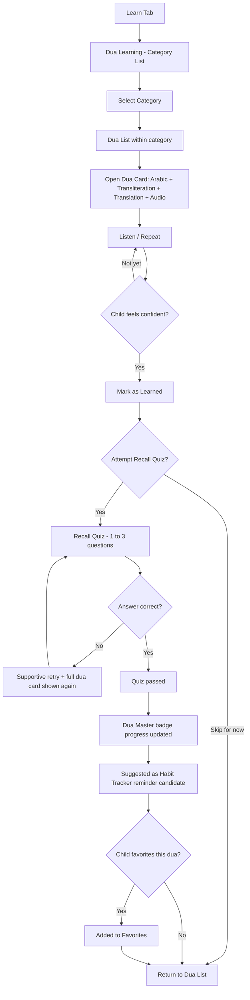
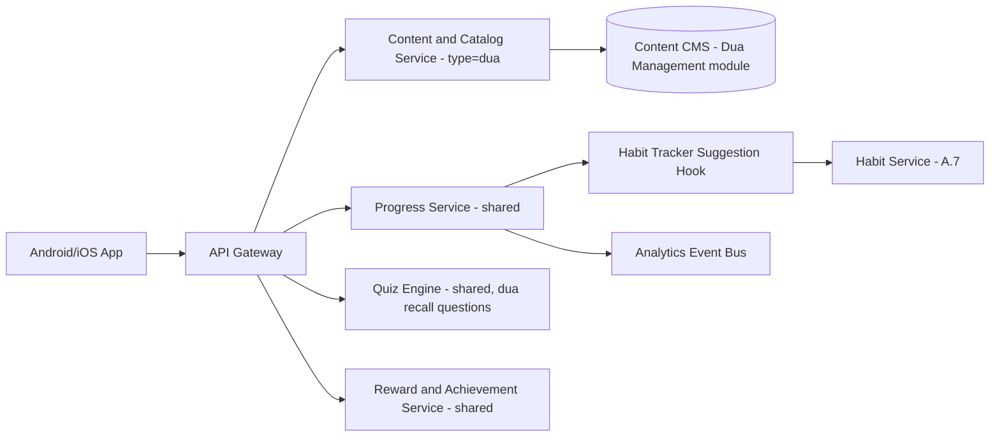
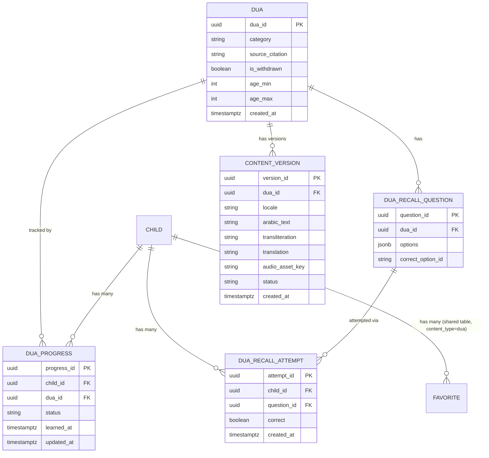

# Feature A.6 — Dua Learning

**App:** NoorHeroes — Islamic Learning App for Children
**Feature Owner:** Product / Content & Editorial / Learning Science
**Status:** Implementation-ready
**Version:** 1.0
**Depends on:** A.1 (Auth & Onboarding), Content CMS, Scholar Review Pipeline
**Feeds into:** A.7 Habit Tracker (dua reminders/check-ins), A.8 Daily Quiz (recall quiz), A.9 Skill Tree/Mastery, A.11 Rewards (Dua Master badge), A.4 Audio Bedtime Player (bedtime-category duas), C.22 Parent Progress Reports

---

## Table of Contents

1. [Product Requirements](#1-product-requirements)
2. [UX/UI Requirements](#2-uxui-requirements)
3. [Backend Requirements](#3-backend-requirements)
4. [Database Design](#4-database-design)
5. [Backend AI Code-Generation Prompt](#5-backend-ai-code-generation-prompt)
6. [Android Requirements](#6-android-requirements)
7. [Android AI Code-Generation Prompt](#7-android-ai-code-generation-prompt)
8. [Admin Requirements](#8-admin-requirements)
9. [Admin AI Code-Generation Prompt](#9-admin-ai-code-generation-prompt)
10. [DevOps Requirements](#10-devops-requirements)
11. [Analytics Requirements](#11-analytics-requirements)
12. [Security Requirements](#12-security-requirements)
13. [QA Requirements](#13-qa-requirements)
14. [Marketing Requirements](#14-marketing-requirements)
15. [Release & Rollback Plan](#15-release--rollback-plan)

---

## 1. Product Requirements

### 1.1 Problem Statement

Children need a simple, joyful, scholar-accurate way to learn the everyday duas that structure a practicing Muslim's day — morning, bedtime, food, travel, gratitude, and protection — presented with Arabic, transliteration, translation, and audio, in a way that is genuinely learnable (not just browsable) and that integrates naturally into daily life via habit reminders, rather than existing as an isolated content library disconnected from real practice (source: NoorHeroes Blueprint screen catalog "Dua Learning" — "UI Sections: Dua category list (morning, bedtime, food, travel, gratitude, protection), dua card with Arabic, transliteration, translation, audio"; "Navigation Flow: Standalone tab under Learn; feeds the Dua Master badge and Habit Builder dua reminders").

### 1.2 Business Goals

- Make Dua Learning the lowest-friction, highest-completion-rate learning module in the app (duas are short, memorable, and universally relevant — an ideal "quick win" content type for sustained engagement).
- Drive Habit Tracker integration: every learned dua should be a candidate for a daily habit reminder, reinforcing real-world practice rather than one-time app consumption.
- Maintain Duas as **always free-tier** content (source: Consolidated Blueprint §5.4 cross-reference, "Duas are always free-tier") — an explicit equity/access commitment, never gated behind a paywall.
- Support the Dua Master badge and related achievement mechanics as a meaningful, well-paced progression goal.

### 1.3 User Goals

- **Child:** Learn duas for everyday moments (waking up, eating, traveling, sleeping) by listening, repeating, and being gently quizzed on recall — and feel proud of remembering them in real life.
- **Parent:** See which duas my child has learned, encourage real-world practice via habit reminders, and trust that every dua's text and audio is scholar-sourced and accurate.

### 1.4 Success Metrics

| Metric | Target |
|---|---|
| Dua "marked as learned" completion rate (per dua opened) | ≥ 60% |
| Recall-quiz attempt rate (among learned duas) | ≥ 50% |
| Recall-quiz pass rate (first attempt) | ≥ 65% |
| Dua → Habit Tracker reminder opt-in rate | ≥ 35% of learned duas |
| Dua Master badge achievement rate (e.g., learn 10 core duas) within 60 days of first dua learned | ≥ 25% |
| Favorite-dua usage rate | ≥ 20% of active learners favorite at least one dua |
| Crash-free Dua Learning sessions | ≥ 99.5% |

### 1.5 Stakeholders

Product Manager, Content/Editorial Lead, Scholar Review Board, UX Designer, Backend Architect (shared Content Service), Android Architect, Data Analyst, QA Lead, Customer Support Lead, Habit Tracker feature owner (cross-feature integration), Growth Marketing.

### 1.6 User Stories

1. As a child, I want to browse duas by category (morning, bedtime, food, travel, gratitude, protection) so I can find the one I need for a specific moment.
2. As a child, I want to see a dua's Arabic text, how to pronounce it (transliteration), and what it means (translation), all together.
3. As a child, I want to listen to a dua recited correctly so I can learn it by ear.
4. As a child, I want to mark a dua as "learned" once I feel confident with it.
5. As a child, I want a short recall quiz to check if I really remember a dua I marked as learned.
6. As a child, I want to favorite duas I use often so I can find them quickly.
7. As a child, I want to earn a Dua Master badge as I learn more duas.
8. As a child, I want my learned morning dua to remind me each morning via the Habit Tracker.
9. As a parent, I want to see which duas my child has learned and is actively reminded about.
10. As a parent, I want assurance every dua's Arabic text, transliteration, and translation is scholar-reviewed and accurate.
11. As a child without internet, I want to still access duas I've already loaded/favorited.
12. As a child, when I get a recall quiz answer wrong, I want a supportive nudge to review the dua again, not a discouraging "fail" message.

### 1.7 Functional Requirements

**FR-1** Dua Learning is a standalone screen reachable from the Learn tab, organized by category: Morning, Bedtime, Food, Travel, Gratitude, Protection (source: screen catalog).
**FR-2** Each Dua Card must display: Arabic text (Quranic-adjacent but dua-appropriate typography — see §2.1), transliteration, translation, and an audio play control — all four elements present simultaneously, not hidden behind extra taps, given duas are short enough to display in full (source: screen catalog "dua card with Arabic, transliteration, translation, audio").
**FR-3** User actions per dua: Listen (play audio), Mark as Learned, Practice Recall Quiz, Favorite (source: screen catalog).
**FR-4** Duas are **always free-tier** — no entitlement/paywall check is ever applied to any dua content, regardless of subscription state (hard rule, zero exceptions, enforced at the API response layer consistent with the pattern established for billing-content exclusion in A.2).
**FR-5** "Mark as Learned" is a child-initiated, self-assessed action (not AI-graded) — the child decides when they feel ready; this status is distinct from and a prerequisite to attempting the Recall Quiz for that dua.
**FR-6** Recall Quiz per dua is short (recommend 1–3 questions given dua length, e.g., "what does this dua ask for," "fill in the missing word," "match the occasion to the dua") and only offered for duas already marked Learned.
**FR-7** Recall Quiz incorrect answers must show supportive, non-shaming retry language and re-surface the dua's full card (Arabic/transliteration/translation/audio) for review before allowing a retry — never a bare "wrong" with no path back to the learning content (consistent with the platform's Ethical Rule against shaming).
**FR-8** Favoriting a dua surfaces it in a dedicated Favorites view (shared mechanic with A.3 Stories favorites) for quick access.
**FR-9** Learning a dua (reaching "Learned" status) must emit an event consumable by the Habit Tracker to offer that dua as a candidate daily-habit reminder (e.g., "Remind me to read this every morning") — this is an explicit cross-feature integration point, not a passive coincidence.
**FR-10** Dua Master badge (and any intermediate milestone badges) criteria are evaluated by the shared Reward/Achievement Service based on cumulative "Learned" dua count, consistent with the append-only reward-ledger pattern used platform-wide.
**FR-11** Every dua requires a source citation before leaving draft status in the CMS, and audio is mandatory before scholar review — text-only duas (no audio) cannot publish to children (source: Admin "Dua Management" module validation rules — this is a read-path guarantee this feature's content consumers rely on, not just an authoring-side rule).
**FR-12** Dua content must be downloadable for offline access (shared Downloads mechanism, A.16) given duas' high real-world recurring-use value (a child should be able to access a learned travel dua without connectivity while actually traveling).
**FR-13** Dua category filtering and search must support locale-aware sorting (e.g., displaying category labels and dua titles in the active locale) with full RTL support for Arabic UI.
**FR-14** A dua's translation/transliteration text is versioned and editable (new version on edit, not in-place mutation) per the same content-integrity pattern as Quran translations (A.5) — children always consume the latest *published* (scholar-approved) version, never a draft.

### 1.8 Non-Functional Requirements

- **Performance:** Dua Library list load p95 < 600ms (cached); audio playback start p95 < 500ms for cached/downloaded dua audio (duas are short, so latency tolerance is lower than for longer-form content).
- **Accuracy:** 100% of published dua content scholar-reviewed; zero tolerance for unreviewed Arabic text or audio reaching a child.
- **Accessibility:** Transliteration/translation text scalable via dynamic type; audio has a visual text-highlight-while-playing option for read-along support.
- **Localization:** Full RTL support for Arabic display; transliteration and translation independently localizable per the child's selected language.
- **Offline tolerance:** Full offline access to downloaded/favorited duas (FR-12).

### 1.9 Acceptance Criteria

- Given a child opens the Dua Learning screen, when the category list renders, then exactly the six defined categories (Morning, Bedtime, Food, Travel, Gratitude, Protection) are shown (plus any additional scholar-approved categories added over time, but never fewer than these six as the baseline taxonomy).
- Given a child opens a specific dua, when the Dua Card renders, then Arabic text, transliteration, translation, and an audio control are all visible without additional taps.
- Given a child has not marked a dua as Learned, when they look for a Recall Quiz entry point for that dua, then none is presented (quiz is gated on Learned status).
- Given a child answers a Recall Quiz question incorrectly, when the result is shown, then supportive retry language appears alongside the full dua card, not a bare incorrect indicator.
- Given a child marks a dua as Learned, when they next open the Habit Tracker, then that dua appears as a suggested candidate for a daily reminder habit.
- Given a child has a free-tier (non-premium) account, when they open any dua, then it is fully accessible with no paywall/upsell shown — this is true for every dua in the catalog without exception.
- Given a dua draft has no audio attached, when an editor attempts to submit it for scholar review, then the submission is blocked with a clear "audio required" validation message.
- Given a child is offline with a previously-downloaded dua, when they open it, then the full card (Arabic/transliteration/translation/audio) renders and plays identically to the online experience.

### 1.10 Edge Cases

1. Child favorites a dua, then the dua is later updated to a new scholar-approved version (e.g., a corrected transliteration) → the favorite reference resolves to the latest published version automatically; the child sees updated content without needing to re-favorite.
2. Child marks a dua as Learned, then later un-marks it (changes their mind / wants to re-practice from scratch) → "Learned" status can be toggled off by the child; doing so does not retroactively revoke an already-awarded Dua Master badge milestone if the cumulative count had already crossed a threshold at time of award (badges are sticky once earned, consistent with the append-only reward-ledger principle — a later un-mark doesn't claw back history).
3. Two different duas in different categories are functionally near-duplicates (e.g., a "before eating" and "before drinking" dua with overlapping wording) → each is tracked as an independently learnable/markable content item; the Recall Quiz must be specific enough to discriminate between them rather than risk a false sense of mastery from confusing one for the other (an editorial/QA concern flagged for content review, not purely a technical edge case, but the system must support per-item independent tracking regardless).
4. Child attempts a Recall Quiz offline for a downloaded-and-learned dua → quiz functions fully offline if the quiz question bank was included in the dua's offline package; result syncs on reconnect with idempotent submission, consistent with the platform's offline-progress pattern.
5. Parent revokes download permissions while a child has several duas already downloaded → already-downloaded dua content remains playable (per the general two-distinct-controls download policy established in A.3/A.4: "allow new downloads" vs. "revoke existing offline content") unless the parent additionally explicitly revokes existing offline content.
6. A dua is archived/retired by Admin (e.g., due to a citation issue requiring removal pending correction) while several children have already marked it Learned → existing "Learned" status and any historical quiz attempts are preserved (not cascade-deleted), but the dua becomes non-discoverable in the active catalog until republished; if a child had it favorited, the favorite shows a "temporarily unavailable" state rather than breaking.
7. Child's locale changes mid-session → transliteration/translation re-render in the new locale immediately; Arabic text is locale-independent (always the same verified Arabic) and never changes.
8. Recall Quiz question pool for a given dua is very small (e.g., only 1 possible question due to the dua's brevity) → the system allows repeated practice of the same single question without it feeling broken, but must avoid presenting it as if there were "multiple new questions" when there's actually just one (e.g., UI doesn't show a misleading "Question 1 of 1" if there's only 1 available).
9. Child rapidly toggles Favorite on/off multiple times in quick succession → idempotent handling ensures the final state is correctly persisted without a race condition leaving a stale/incorrect favorited state.
10. A dua targeted at a specific age range (`age_min`/`age_max` per the Admin schema) is encountered by a child outside that range via direct search/deep-link → the dua still displays respectfully (ages ranges for duas are about appropriateness of complexity/length, not strict content-safety gating like other features), but Home/Recommended surfaces would not have proactively suggested it outside its intended age band.
11. Habit Tracker reminder created from a Learned dua, then the child later un-marks that dua as Learned (Edge Case 2) → the existing habit reminder configuration is not automatically deleted (the parent/child may still want the reminder regardless of the marked-learned status), but the Habit Tracker may show a gentle note that the source dua is no longer marked as fully learned, without forcibly removing the habit.
12. Child taps "Listen" on a dua while another piece of audio (e.g., a Story) is already playing elsewhere in the app (multi-screen/background audio edge case) → standard single-active-audio-session behavior applies (the other audio pauses), consistent with general app-wide audio session management, not a Dua-specific behavior to reinvent.

### 1.11 Error Handling

| Scenario | System Behavior |
|---|---|
| Dua catalog fetch failure | Cached last-known catalog rendered with a subtle "may be outdated" indicator, never a blank screen |
| Audio fails to load/play | Retry with backoff; falls back to a lower-bitrate alternate source if configured before surfacing a hard error |
| Mark-as-Learned submission fails (network) | Optimistic local update, queued for retry, never blocks further interaction |
| Recall Quiz service unavailable | Quiz entry point shows a friendly "quiz coming back soon" message; dua remains fully viewable/learnable regardless |
| Favorite toggle submission fails | Optimistic local update + retry, consistent with platform-wide favoriting pattern (A.3) |
| Dua archived/withdrawn while open | Graceful "this dua is temporarily unavailable" message with a suggested alternative from the same category, never a raw 404 |

### 1.12 Empty States
- Category with zero published duas yet (e.g., a newly-added category) → friendly "more duas for this category are coming soon" message with a link to a populated category.
- Favorites list with zero favorites → "Tap the heart on any dua to save it here" guided empty state.
- Parent Dua Progress view with zero learned duas yet → "Once [Child] learns their first dua, you'll see it here."

### 1.13 Loading States
- Dua Library: skeleton category list + card shimmer.
- Audio: gentle loading pulse on the play button, consistent with other audio-loading treatments across the app.

### 1.14 Offline States
- Downloaded/favorited duas fully functional offline (FR-12); non-downloaded duas show a clear "connect to internet or download" affordance.
- Mark-as-Learned and Favorite actions queue locally and sync on reconnect.

### 1.15 Permission States
- No new runtime permissions; relies on existing storage permission for downloads (shared with A.16).

### 1.16 User Flow (Narrative)

Child opens Learn tab → navigates to Dua Learning → browses by category or searches → opens a Dua Card → listens to the audio, reads Arabic/transliteration/translation → repeats practice across one or more sessions → marks the dua as Learned when confident → optionally attempts the Recall Quiz → on quiz pass, dua contributes toward the Dua Master badge progress and becomes a suggested Habit Tracker reminder candidate → child may favorite frequently-used duas for quick future access.

### 1.17 Detailed Flow Diagram (Mermaid)



### 1.18 Screen Inventory (Complete — Zero Missing)

| # | Screen | Type | Entry Points | Exit Points |
|---|---|---|---|---|
| 1 | Dua Learning Landing (Category List) | Primary | Learn Tab, Search | Category Dua List |
| 2 | Category Dua List | Screen | Dua Learning Landing | Dua Card Detail |
| 3 | Dua Card Detail (Arabic/Transliteration/Translation/Audio) | Screen | Category List, Search, Favorites, Habit Tracker deep link | Recall Quiz, back to list |
| 4 | Audio Playback Controls (in-card component) | Component | Dua Card Detail | N/A |
| 5 | Read-Along Text Highlight (component, during playback) | Component | Dua Card Detail (while playing) | N/A |
| 6 | Mark-as-Learned Confirmation (lightweight, inline) | Component | Dua Card Detail "Mark as Learned" action | Recall Quiz prompt |
| 7 | Recall Quiz Entry Prompt | Component | Post-Mark-as-Learned, or re-entry on an already-Learned dua | Recall Quiz screen |
| 8 | Recall Quiz Question Screen | Screen | Recall Quiz Entry Prompt | Next question / Result |
| 9 | Recall Quiz Incorrect — Supportive Retry + Dua Card Recall | Screen variant | Incorrect answer | Retry question |
| 10 | Recall Quiz Result / Pass Screen | Screen | Final question answered correctly | Dua Master badge progress / back to list |
| 11 | Dua Master Badge Progress Celebration (milestone) | Modal | Crossing a badge threshold | Dismiss → Achievements (A.11) |
| 12 | Habit Tracker Reminder Suggestion Prompt | Modal/inline card | Dua marked Learned | Habit Tracker (A.7) setup, or dismiss |
| 13 | Favorites List (Dua-filtered view, shared component with A.3) | Screen | Dua Learning Landing "Favorites" entry, Profile | Dua Card Detail |
| 14 | Search Results (Dua-scoped) | Screen | Global Search (A.13), scoped to duas | Dua Card Detail |
| 15 | Empty State — No duas in category | Screen variant | Sparse/new category | Alternate category |
| 16 | Empty State — No favorites yet | Screen variant | Favorites List | Dua Learning Landing |
| 17 | Offline — Dua Not Downloaded Notice | Component | Tap on a non-downloaded dua while offline | Dismiss, suggests downloaded alternative |
| 18 | Dua Temporarily Unavailable (archived/withdrawn) | Screen variant | Tap on a withdrawn dua | Suggested alternative from same category |
| 19 | Downloads Manager (Dua scope, shared with A.16) | Screen | Dua Card Detail download icon, Settings | Dua Card Detail (offline) |
| 20 | Parent Dua Progress View | Screen (Parent Area) | Parent Dashboard → Child Progress → Learning → Duas | Concept-level dua list, individual dua status |

### 1.19 Events (Complete Analytics Event List)

`dua_learning_landing_viewed`, `dua_category_selected`, `dua_card_opened`, `dua_audio_played`, `dua_marked_learned`, `dua_unmarked_learned`, `dua_favorited`, `dua_unfavorited`, `dua_recall_quiz_started`, `dua_recall_quiz_question_answered`, `dua_recall_quiz_incorrect_retry_shown`, `dua_recall_quiz_passed`, `dua_master_badge_progress_updated`, `dua_habit_reminder_suggested`, `dua_habit_reminder_accepted`, `dua_habit_reminder_dismissed`, `dua_download_started`, `dua_download_completed`, `dua_unavailable_shown`, `dua_search_performed`, `parent_dua_progress_viewed`.

---

## 2. UX/UI Requirements

> Global Design System tokens defined in **Feature A.1 §2.1**; Arabic/Quranic-adjacent typography conventions established in **Feature A.5 §2.1**.

### 2.1 Dua-Specific Design System Extensions

- **Dua Typography:** Arabic dua text uses the same formal Naskh-style typeface established for Quranic content in A.5 (consistency across all sacred/liturgical text in the app), distinct from general UI Arabic. Transliteration uses an italicized Latin font; translation uses standard body text — the three-line stacked layout (Arabic / transliteration / translation) is a consistent, recognizable pattern repeated across every Dua Card.
- **Category Iconography:** Each of the six categories has a distinct, simple, warm icon (e.g., a sun for Morning, a moon for Bedtime, a small plate for Food, a small path/road for Travel, an open hand for Gratitude, a shield-like soft shape for Protection) — consistent, friendly, non-threatening even for "Protection" (avoid anything resembling a weapon or alarming imagery).
- **Read-Along Highlight:** During audio playback, the Arabic text's current word/phrase is gently highlighted (soft background color sweep) to support read-along literacy — this is a recommended default for dua content given its memorization purpose, distinct from optional captions in Stories.

### 2.2 Screen-Level Design Requirements (Key Screens)

#### Screen: Dua Card Detail

- **Purpose:** Present a complete, learnable dua in one view.
- **Components:** Category tag, large Arabic text block (top, primary visual weight), transliteration line, translation line, audio play/pause control with a progress scrubber, Favorite (heart) icon, Mark-as-Learned toggle/button, Recall Quiz entry button (visible but distinctly secondary until Learned status is set, at which point it becomes primary-styled).
- **States:** Default (not yet learned), Learned (badge/checkmark indicator visible), Playing (read-along highlight active), Offline-available, Offline-unavailable, Error (audio load failure).
- **Accessibility:** Read-along highlight has a screen-reader-friendly alternative (sequential text exposure, not relying on visual highlight alone); translation/transliteration always screen-reader-readable regardless of visual toggle state if one exists.
- **Responsive Rules:** Single-column on mobile; tablet may show category list + dua card side-by-side (master-detail layout) rather than full-screen navigation per tap.

#### Screen: Recall Quiz Question Screen

- **Purpose:** Lightweight, low-pressure check of dua recall.
- **Components:** Question text/audio, 2-4 answer options (consistent with the platform's max-3-or-4-option pattern for child-friendly choice UIs), progress indicator only if more than one question exists for this dua (avoid a misleading "Question 1 of 1" framing — simply omit the counter when there's only one question, per Edge Case 8).
- **States:** Default, Answered-correct (immediate positive feedback), Answered-incorrect (supportive retry + full dua card resurfaced inline or via a clear "review" link).

### 2.3 Tab Structure

Dua Learning is reached via the Learn tab (Tab 2 of 5). Click mapping:

| Click Target | Destination | API Called | Analytics Event | Permission Check | Error Handling |
|---|---|---|---|---|---|
| Category tile | Category Dua List | `GET /v1/catalog?type=dua&category=` | `dua_category_selected` | None (always free-tier) | Cached fallback |
| Dua card (list item) | Dua Card Detail | `GET /v1/catalog/dua/{id}` | `dua_card_opened` | None | Graceful unavailable state |
| Mark as Learned | Inline state update | `POST /v1/progress` | `dua_marked_learned` | None | Optimistic + retry |
| Recall Quiz button | Recall Quiz Question Screen | `GET /v1/quizzes/dua/{dua_id}` | `dua_recall_quiz_started` | Gated on Learned status (client + server) | Friendly unavailable message |
| Favorite icon | Inline toggle | `POST /v1/favorites` | `dua_favorited` | None | Optimistic + retry |
| Download icon | Inline download start | `POST /v1/downloads/manifest` | `dua_download_started` | Parent download-policy (shared A.16) | Retry on failure |

### 2.4 Wireframe Description (Composite)

Category List: a simple grid or list of six (or more) category tiles with icon + label, consistent with other catalog-browsing patterns in the app (similar visual family to Stories' category rails but simpler given the smaller, more enumerable dua taxonomy). Dua Card Detail: a single-column, vertically-stacked layout prioritizing the Arabic text visually, consistent with the "single clear focus" wireframe philosophy used for Surah Learning (A.5).

### 2.5 Screen Image Generation Prompts

**Screen: Dua Learning — Category List**
- *Prompt 1 (English):* "Mobile app category selection screen UI mockup for a children's Islamic learning app's dua section. Warm off-white background. A grid of six rounded square category cards, each with a simple friendly icon and a short label: a sun icon for 'Morning', a crescent moon for 'Bedtime', a small plate-and-utensil icon for 'Food', a winding path icon for 'Travel', an open-hand icon for 'Gratitude', and a soft rounded shield-like shape for 'Protection'. Each card in a slightly different soft pastel-teal-and-gold tint, rounded corners, soft shadows, warm and friendly aesthetic, no realistic human faces, bottom navigation bar visible with 5 icons."
- *Prompt 2 (Arabic RTL):* "نفس شاشة اختيار الفئات لقسم الأدعية في تطبيق تعليم إسلامي للأطفال، بتخطيط من اليمين إلى اليسار. خلفية بيج فاتح دافئ. شبكة من ست بطاقات فئات مربعة مستديرة الزوايا، كل منها بأيقونة بسيطة وودودة وتسمية قصيرة: أيقونة شمس لـ 'الصباح'، هلال لـ 'وقت النوم'، أيقونة صحن وأداة طعام صغيرة لـ 'الطعام'، أيقونة طريق متعرج لـ 'السفر'، أيقونة يد مفتوحة لـ 'الشكر'، وشكل درع ناعم ومستدير لـ 'الحماية'. كل بطاقة بدرجة لون باستيل فيروزي وذهبي مختلفة بلطف، زوايا دائرية، ظلال خفيفة، طابع دافئ وودود، بدون وجوه بشرية واقعية، شريط تنقل سفلي ظاهر بخمس أيقونات."

**Screen: Dua Card Detail**
- *Prompt 1 (English):* "Mobile app dua learning detail screen UI mockup for children. Warm off-white background, rounded card layout. At the top, large elegant Arabic calligraphic text centered, generously spaced. Below it, a smaller italic-style transliteration line, and below that a translation line in regular font, both in soft ink-grey color. Below the text block, a horizontal audio player bar with a play button, soft teal progress line, and a small replay icon. To the side, a heart-shaped favorite icon outline and a rounded checkmark-style 'Mark as Learned' button in warm gold when active. A small secondary 'Practice Quiz' button below, more subdued in styling until the dua is marked learned. Calm, respectful, focused educational aesthetic, soft shadows, generous spacing, no realistic human faces."
- *Prompt 2 (Arabic RTL):* "نفس شاشة تفصيل تعلم الدعاء للأطفال، بتخطيط من اليمين إلى اليسار بالكامل. خلفية بيج فاتح دافئ، تخطيط بطاقة مستديرة الزوايا. في الأعلى نص عربي أنيق بخط زخرفي كبير في المنتصف بتباعد كبير. تحته سطر أصغر للنقل الصوتي بخط مائل الطابع، وتحت ذلك سطر ترجمة بخط عادي، كلاهما بلون رمادي حبري ناعم. أسفل كتلة النص شريط مشغل صوت أفقي بزر تشغيل وخط تقدم فيروزي ناعم وأيقونة إعادة تشغيل صغيرة. بجانبه أيقونة قلب لإضافة المفضلة وزر بشكل علامة صح مستدير بعنوان 'تم التعلم' بلون ذهبي دافئ عند تفعيله. زر ثانوي صغير بعنوان 'تدريب الاختبار' أسفل ذلك، بنمط أكثر هدوءًا حتى يتم تعليم الدعاء كمكتسب. طابع تعليمي هادئ ومحترم ومركّز، ظلال خفيفة، تباعد كبير، بدون وجوه بشرية واقعية."

*(Remaining screens — Recall Quiz, Badge Celebration, Habit Reminder Suggestion, Favorites List, Parent Dua Progress View — follow the same two-prompt EN/AR template using these tokens; full set available on request.)*

---

## 3. Backend Requirements

### 3.1 System Design Overview

Dua Learning is served by the shared **Content & Catalog Service** (`content_type=dua`), the shared **Progress Service**, the shared **Quiz Engine** (A.8, scoped to dua recall questions), and the shared **Reward/Achievement Service** (Dua Master badge). No parallel content/progress stack is built — this feature is primarily a content-type-scoped configuration and a cross-feature integration (Habit Tracker suggestion hook) on top of existing platform services.

### 3.2 Architecture Diagram (Mermaid)



### 3.3 Service Breakdown

| Service | Responsibility |
|---|---|
| Content & Catalog Service | Serves dua catalog by category/locale; enforces always-free-tier (no entitlement check applied to `type=dua`) |
| Progress Service | Tracks Learned/un-Learned status per dua per child |
| Quiz Engine (shared) | Generates/serves recall-quiz questions scoped to a specific dua, gated on Learned status |
| Reward/Achievement Service | Evaluates Dua Master badge criteria from cumulative Learned-dua count |
| Habit Tracker Suggestion Hook | Listens for `dua_marked_learned` events and surfaces a habit-reminder suggestion in A.7 |

### 3.4 API List

#### `GET /v1/catalog?type=dua&category=&locale=`
- **Auth:** Bearer (child-mode)
- **Response 200:** Array of dua summaries (id, category, title, short preview) — paginated, though typical category sizes are small enough that pagination is rarely hit in practice.
- **Validation:** This endpoint path explicitly bypasses any entitlement/subscription-tier filter — a dedicated code comment/test marker should flag this as an intentional always-free exception, not an oversight.
- **Caching:** Long TTL (1 hour) given low content-churn rate; invalidated on publish events.

#### `GET /v1/catalog/dua/{id}`
- **Response 200:** Full Dua Card payload — `{ "id": "...", "category": "morning", "arabic_text": "...", "transliteration": "...", "translation": "...", "audio_url": "...", "source_citation": "...", "age_min": null, "age_max": null }`.
- **Error Codes:** `410 CONTENT_WITHDRAWN` for archived duas (consistent with A.3's pattern, distinct from `404`).

#### `POST /v1/progress`
- **Request:** `{ "content_id": "dua_...", "content_type": "dua", "status": "learned", "client_event_id": "uuid..." }`
- **Response 200:** `{ "updated": true }`
- **Idempotency:** `client_event_id` enforced.
- **Side Effect:** On `status: "learned"` transitioning from a prior non-learned state, emits a `dua_marked_learned` event consumed by the Habit Tracker Suggestion Hook and the Reward/Achievement Service.

#### `GET /v1/quizzes/dua/{dua_id}`
- **Auth:** Bearer (child-mode)
- **Response 200:** `{ "questions": [...] }` — empty/error if the dua is not yet marked Learned for this child (`403 NOT_YET_LEARNED`, server-side re-validation, not just client-side gating).
- **Validation:** If the dua has only one possible question, response includes `total_available: 1` so the client can correctly omit a misleading "Question X of Y" counter (Edge Case 8).

#### `POST /v1/favorites`
- **Request:** `{ "content_id": "dua_...", "content_type": "dua", "favorited": true, "client_event_id": "uuid..." }` — shared contract with A.3's favoriting endpoint, just a different `content_type`.

#### `GET /v1/children/{id}/dua-progress`
- **Auth:** Bearer (parent session)
- **Response 200:** List of duas with `learned_status`, `learned_at`, linked habit-reminder status if applicable — concept-level, consistent with the platform's "show concepts, not just a score" reporting philosophy.

### 3.5 Cross-Cutting API Concerns

- **Entitlement bypass:** `type=dua` catalog/detail endpoints are explicitly excluded from any tier-gating middleware — covered by a dedicated regression test (see §5).
- **Idempotency:** All mutating endpoints (`progress`, `favorites`) use `client_event_id`.
- **Analytics:** All events from §1.19 emitted.

---

## 4. Database Design

### 4.1 ER Diagram (Mermaid)



### 4.2 Tables, Relationships, Constraints

| Table | Key Constraints | Indexes |
|---|---|---|
| `dua` | CHECK `category IN ('morning','bedtime','food','travel','gratitude','protection', ...)` (extensible enum, not hardcoded to exactly 6 at the DB layer to allow scholar-approved category additions without a migration) | Index `(category)` |
| `content_version` (dua-scoped rows) | FK `dua_id`; CHECK `status IN ('draft','pending_review','published','archived')`; audio_asset_key NOT NULL required before `status` can become `pending_review` (enforced via application-level validation backed by a DB-level CHECK where feasible) | Index `(dua_id, status, created_at DESC)` |
| `dua_progress` | FK `child_id`, `dua_id`; UNIQUE(`child_id`, `dua_id`) | Index `(child_id, status)` |
| `dua_recall_question` | FK `dua_id` | Index `(dua_id)` |
| `dua_recall_attempt` | FK `child_id`, `question_id`; idempotency via `client_event_id` at the API layer | Index `(child_id, question_id, created_at DESC)` |

### 4.3 Audit Fields
`dua.created_at`; `content_version.created_at` (append/version-only, no in-place update — editing a dua creates a new `content_version` row, never mutates an existing published one, per FR-14). `dua_progress.updated_at` tracks toggling.

### 4.4 Soft Delete Rules
`dua.is_withdrawn = true` used instead of deletion (consistent with A.3's withdrawn-content pattern) — preserves `dua_progress`/`dua_recall_attempt` history.

### 4.5 Retention Rules
`dua_recall_attempt` retained indefinitely as part of standard learning-history (low volume, high value for Parent Progress views). No special shorter retention needed.

---

## 5. Backend AI Code-Generation Prompt

```
You are extending the existing Content & Catalog Service, Progress Service,
and Quiz Engine (built for Features A.3/A.5/A.8) for "NoorHeroes" to support
Dua Learning. Reuse existing infrastructure -- do not build a parallel
content/progress stack. This feature is primarily a content-type
configuration (type=dua) plus a small set of dua-specific rules.

Stack: FastAPI (Python 3.12), PostgreSQL (SQLAlchemy 2.0), Redis, Kafka.

Hard requirements:
1. Implement an explicit, well-commented EXEMPTION in the entitlement/
   tier-gating middleware for content_type=dua: this content type must
   NEVER be filtered by subscription tier under any code path. Write a
   regression test that creates a fixture family on the free tier and
   asserts GET /v1/catalog?type=dua and GET /v1/catalog/dua/{id} both
   return full content with no paywall/locked fields, and run this test
   in a loop across every existing subscription-tier fixture (free,
   trial-expired, premium) asserting IDENTICAL full-access response shape
   regardless of tier. This is a P0 regression test -- if it ever fails,
   duas have become accidentally paywalled, which violates a hard product
   commitment.
2. Implement POST /v1/progress to support content_type="dua" alongside
   existing content types. On a status transition INTO "learned" (i.e.,
   previous status was NOT "learned", new status IS "learned") for a dua,
   publish a dua_marked_learned event to a `habit-suggestions` Kafka topic
   consumed by the Habit Service (A.7) to surface a reminder-suggestion --
   write a test asserting this event fires exactly once on the
   not-learned -> learned transition and does NOT re-fire on a learned ->
   learned no-op update (e.g., a duplicate client retry).
3. Implement GET /v1/quizzes/dua/{dua_id} to return 403 NOT_YET_LEARNED
   if the requesting child's dua_progress.status != 'learned' for that
   dua_id -- this check must be SERVER-SIDE authoritative, never trusting
   a client claim that the dua was already learned. Include a
   total_available field in the response equal to the actual count of
   dua_recall_question rows for that dua, so the client can correctly
   render "Question 1 of 1" omission logic when there's only one question.
4. Enforce in the Dua Management content-versioning logic (extend the
   existing Content CMS service) that a content_version row cannot
   transition to status='pending_review' if audio_asset_key IS NULL --
   write a test asserting a text-only dua draft submission is rejected
   with a clear validation error, consistent with the "audio is mandatory
   before scholar review" rule.
5. Reward/Achievement Service: implement Dua Master badge criteria
   evaluation as a consumer of dua_marked_learned events, incrementing a
   per-child cumulative learned-dua counter and checking against badge
   thresholds (e.g., 5, 10, 20 duas) using the existing append-only reward
   ledger pattern -- write a test confirming that LATER un-marking a dua
   as learned (status reverting to not-learned) does NOT retroactively
   revoke an already-awarded badge (badges are sticky once earned).
6. Write Alembic migrations for dua, dua_progress, dua_recall_question,
   dua_recall_attempt tables matching the ER diagram, reusing the existing
   shared `favorite` and `content_version` tables for dua-related rows
   rather than creating duplicate parallel tables for those concerns.

Deliver: FastAPI router additions, SQLAlchemy models + Alembic migration,
Pydantic schemas, and a pytest suite covering the always-free-tier
regression test (item 1, treat as the highest-priority test in this
deliverable), the habit-suggestion event-firing test, the
not-yet-learned quiz-gating test, and the audio-required validation test.
```

---

## 6. Android Requirements

### 6.1 Technical Requirements
Kotlin, Jetpack Compose, MVVM, Clean Architecture, module `:feature:dua-learning`, depends on `:core:media-player` (shared, for audio playback — simpler usage than the full Story Player, just play/pause/scrub), `:core:design-system`, `:core:offline-cache`.

### 6.2 Screen Mapping
Each screen in §1.18 maps to a Composable; `DuaCardDetailScreen` reuses `:core:media-player`'s lightweight audio-only playback wrapper (not the full immersive video player UI from A.3).

### 6.3 Navigation Flow
Nested graph under the Learn tab, parallel to A.5's Quran/Arabic graph; `noorheroes://learn/dua/{dua_id}` deep link for Habit Tracker reminder-tap entry and Search results.

### 6.4 State Management
`DuaCardViewModel` holds `DuaCardUiState` (content, learnedStatus, isFavorited, playbackState) — `learnedStatus` toggling is optimistic-update-then-reconcile, consistent with the platform's habit-check-in optimistic pattern (A.2).

### 6.5 API Mapping
`DuaRepository.markLearned()` → `POST /v1/progress` with `content_type: "dua"`; `DuaRepository.getCatalog()` → `GET /v1/catalog?type=dua` (no entitlement-check call needed/made client-side either, consistent with the always-free design).

### 6.6 Analytics Mapping
`DuaLearningAnalytics` fires events per §1.19; `dua_recall_quiz_started` only fires after a successful server `200` (not on tap) to avoid mis-counting attempts blocked by the `403 NOT_YET_LEARNED` server check.

### 6.7 Offline Support
Standard download/offline-cache pattern shared with A.16; Mark-as-Learned and Favorite actions queue in a local outbox synced via WorkManager on reconnect, using `client_event_id` idempotency.

### 6.8 Deep Linking
`noorheroes://learn/dua/{dua_id}`, `noorheroes://learn/dua/category/{category}`.

### 6.9 Push Notifications
Not a notification source itself; Habit Tracker (A.7)-originated dua-reminder notifications deep-link here.

### 6.10 Testing Strategy
- Unit: `DuaCardViewModel` optimistic-update/reconcile logic, Recall Quiz gating logic (client mirrors server's `NOT_YET_LEARNED` check for fast local UX but treats server as authoritative on actual quiz-start).
- UI tests: Recall Quiz question screen correctly omits the "Question X of Y" counter when `total_available == 1`; Dua Card renders all four required elements (Arabic/transliteration/translation/audio control) simultaneously without requiring extra taps.
- Integration: full mark-as-learned → quiz-unlock → quiz-pass → badge-progress-update flow against a mocked backend.
- **Always-free-tier UI regression test:** render the Dua Card/Catalog screens using a mocked "trial-expired" or "free-tier" account fixture and assert NO paywall/upsell UI component is present anywhere in the composable tree (Android-side mirror of the backend's P0 regression test).

---

## 7. Android AI Code-Generation Prompt

```
Build the `:feature:dua-learning` Android module for NoorHeroes using Kotlin,
Jetpack Compose, MVVM, Clean Architecture, reusing `:core:media-player`'s
lightweight audio-playback capability (no video surface needed here).

Hard requirements:
1. DuaCatalogScreen and DuaCardDetailScreen must NEVER render any paywall,
   upgrade, or entitlement-locked UI state under any account-tier fixture
   -- write a parameterized Compose UI test that renders these screens
   against free-tier, trial-expired, AND premium account fixtures and
   asserts the rendered composable tree is IDENTICAL in terms of available
   actions (play, mark-learned, favorite, quiz) across all three fixtures.
   This is the module's signature regression test and must be CI-blocking.
2. DuaCardDetailScreen must render Arabic text, transliteration,
   translation, and an audio play control simultaneously in a single
   composition pass -- do not gate any of these four behind a "show more"
   toggle or separate tab; write a UI test asserting all four element
   types are present in the semantics tree on initial render.
3. The "Practice Quiz" button must be disabled/secondary-styled (not
   hidden) when learnedStatus != Learned, and only becomes the
   primary-styled enabled action once the local state reflects Learned
   status AND a server round-trip has confirmed it (do not enable purely
   optimistically before server confirmation, since this specific gate is
   also server-re-validated and a false-positive enabled button leading to
   a 403 would be a confusing UX regression -- this is one of the few
   actions in the app where we wait for server confirmation before
   enabling the next step's CTA, given the explicit cross-validation rule).
4. Recall Quiz screen: read totalAvailable from the API response and
   render the "Question X of Y" progress label ONLY when totalAvailable > 1
   -- write a UI test confirming the label is absent entirely (not shown
   as "Question 1 of 1") when totalAvailable == 1.
5. On an incorrect Recall Quiz answer, transition to a composable state
   that shows supportive retry copy AND re-renders the full Dua Card
   content (Arabic/transliteration/translation/audio) inline above the
   retry action -- write a UI test asserting the dua's Arabic text node is
   present on this specific error-state screen, not just a bare "incorrect"
   message.
6. Implement the Habit Tracker reminder-suggestion prompt as a dismissible
   inline card shown immediately after a successful mark-as-learned server
   confirmation, with a primary action that deep-links into A.7's habit-
   creation flow pre-filled with this dua's reference -- if dismissed,
   it must not re-appear for the same dua on every subsequent visit (track
   a local "dismissed" flag per dua, but still allow re-suggestion if the
   child explicitly re-visits via the dua's own detail screen and the habit
   was never actually created).
7. Write an integration test for the full offline flow: download a fixture
   dua -> go offline -> mark as learned (queues locally) -> attempt the
   recall quiz if its questions were bundled in the download -> reconnect
   -> verify exactly one sync call fires for the mark-as-learned action
   using its client_event_id.

Use Hilt, Retrofit+OkHttp, Room for offline cache/outbox, the shared
`:core:media-player` audio wrapper. Follow Global Design System tokens
from `:core:design-system`, adding the dua-specific category iconography
and three-line Arabic/transliteration/translation layout pattern described
in this spec's UX section as reusable themed components.
```

---

## 8. Admin Requirements

Per the existing Admin Portal's "Dua Management" module (source: NoorHeroes Blueprint module 6):

- **Dua List/Editor by Category:** Create dua draft (Arabic, transliteration, translation, audio, source citation), Read by category/locale, Edit → new version (never in-place mutation of a published version), Archive dua (soft, never hard-delete).
- **Validation Rules (enforced, not just documented):** Every dua requires a source citation before leaving draft; audio is mandatory before scholar review submission — text-only duas cannot be submitted for review, let alone published.
- **Dua Recall Question Builder:** New admin surface (not explicitly in the source Dua Management module description, but required to operationalize FR-6) — CRUD for `dua_recall_question` rows per dua, with a minimum-1/recommended-max-3 question guideline surfaced as UI guidance (not a hard cap, since some longer duas may warrant more, but the editor should flag unusually large question counts for review given dua brevity).
- **Dua Master Badge Threshold Configuration:** Admin-tunable cumulative-learned-count thresholds for badge tiers, without requiring a code deploy.
- **Habit-Suggestion Eligibility Flag:** Per-dua admin flag (default true) controlling whether a given dua is eligible to trigger the Habit Tracker suggestion hook on learn — some duas (e.g., very situational ones like a travel dua) may reasonably be excluded from "daily habit" framing by editorial judgment.

CRUD permissions: Dua List/Editor = full CRUD (delete = archive) behind `content_editor` role, scholar-approval-gated publish; Recall Question Builder = full CRUD behind `content_editor` role; Badge Threshold Config = Update-only behind `product_admin` role; Habit-Suggestion Eligibility Flag = Update-only behind `content_editor` role.

---

## 9. Admin AI Code-Generation Prompt

```
Build/extend the NoorHeroes Admin Portal's existing Content Management module
(React + TypeScript) to fully support Dua Management.

Pages:
1. Dua List/Editor by Category -- a table grouped by category
   (morning|bedtime|food|travel|gratitude|protection, extensible enum) with
   a detail editor form: Arabic text, transliteration, translation, audio
   upload, source_citation (required field, form blocks submission if
   empty), age_min/age_max (optional). Submitting for review calls
   PATCH /admin/v1/content/dua/{id} { status: 'pending_review' } which the
   backend will reject with a clear inline error if audio_asset_key is
   missing -- surface that backend validation message directly in the UI,
   don't just rely on a generic error toast. Editing a published dua
   creates a NEW content_version row (the UI should make this versioning
   behavior visible, e.g., a "Version History" tab showing prior versions
   with their scholar-approval status), never silently overwrites a live
   published version.
2. Dua Recall Question Builder -- nested under each dua's detail editor, a
   simple list-builder UI for dua_recall_question rows (question text,
   2-4 answer options, mark the correct one). Show a soft warning banner
   (not a hard block) if more than 3 questions are added for a single dua,
   suggesting editorial review given typical dua brevity.
3. Dua Master Badge Threshold Configuration -- a simple ordered-list
   settings form (e.g., tier 1: 5 duas, tier 2: 10 duas, tier 3: 20 duas)
   restricted to product_admin role.
4. Add a "Habit Reminder Eligible" toggle (default ON) to the main Dua
   editor form, calling PATCH /admin/v1/content/dua/{id}
   { habit_suggestion_eligible: bool }.

Enforce RBAC via the existing Admin Portal role context. Every mutating
action writes an immutable audit_log row. Add a dedicated, prominent
read-only banner on this entire module's landing page: "Reminder: Dua
content is ALWAYS free-tier for all users -- there is no subscription
gating mechanism available anywhere in this module, by design." This is
purely an informational UI reminder for content editors, reinforcing the
product rule at the point of content authoring.
```

---

## 10. DevOps Requirements

- **Infrastructure:** No new independent services; Dua Learning rides on the shared Content & Catalog, Progress, Quiz Engine, and Reward Service infrastructure (A.3/A.5/A.8).
- **CI/CD:** The always-free-tier regression test (§5 item 1, §6 item 1 on Android) is a **mandatory, non-bypassable** CI gate on any PR touching the entitlement/tier-gating middleware or the Dua catalog endpoints — equally critical to A.2's billing-content-absence gate, just inverted (ensuring access is never accidentally restricted, rather than ensuring upsell content is never accidentally shown).
- **Monitoring/Logging/Alerting:** Alert if any dua-catalog API response is ever observed (via production sampling, mirroring A.2's pattern) to include a tier-restriction field or paywall indicator — a P0 alert given the hard product commitment at stake.
- **Disaster Recovery:** Covered by the shared Content/Progress service DR plans (A.3/A.5).
- **Rollback Strategy:** Any deploy touching the tier-gating middleware requires the always-free-tier regression suite to pass in staging before promotion, specifically re-run against the Dua content type as part of that suite.
- **Backup Strategy:** Standard tier for `dua_progress`/`dua_recall_attempt`; `content_version` (dua rows) included in the same backup tier as other versioned scholar-approved content.
- **Environment Setup:** No special environment needs beyond shared CMS/media sandbox already provisioned for A.3/A.5.

---

## 11. Analytics Requirements

### 11.1 Event Taxonomy
Full list in §1.19, layered on the shared platform's catalog/progress/quiz events where applicable (a Dua Learning session also fires the underlying shared `content_viewed`/`progress_updated`-style platform events in addition to its own Dua-specific events, enabling cross-feature analyst joins).

### 11.2 Funnel Analysis
`dua_card_opened` → `dua_audio_played` → `dua_marked_learned` → `dua_recall_quiz_started` → `dua_recall_quiz_passed` → `dua_habit_reminder_accepted`. This funnel measures the feature's full intended value chain: from content exposure to genuine recall to real-world habit integration — the last step (`habit_reminder_accepted`) is the feature's true north-star outcome, more meaningful than mere content views.

### 11.3 Dashboard Metrics
Per-category completion rate (which categories are most/least engaging — informs future content investment), recall-quiz pass rate trend, habit-reminder-suggestion acceptance rate (validates FR-9's cross-feature integration value), Dua Master badge achievement-rate distribution.

### 11.4 Cohort & Retention
Cohort by first-dua-category learned; correlate with subsequent engagement in the Habit Tracker specifically (testing the hypothesis that dua-learning is a strong on-ramp into sustained habit-tracking behavior).

### 11.5 Learning Metrics
Average sessions-to-learned per dua (some duas may take longer to feel "confident" with — informs whether certain duas need shorter/simpler scholar-approved phrasing variants for younger age bands), un-mark-as-learned rate (a signal of either accidental taps or genuine reconsideration, worth monitoring for UX clarity issues if unexpectedly high).

---

## 12. Security Requirements

### 12.1 Threat Analysis
- **Accidental paywall regression (the feature's defining risk, inverted from typical security threats):** mitigated via the mandatory always-free-tier regression test suite on both backend and Android, plus production sampling alerts.
- **Content-integrity tampering (unauthorized edit reaching children without scholar approval):** mitigated by the same versioned-content + scholar-approval-gated-publish pattern used platform-wide (A.3/A.5).
- **Cross-child progress leakage:** mitigated by standard `child_id`-scoped query enforcement, consistent with platform-wide isolation patterns.

### 12.2 OWASP Checklist (Applied)
Security Misconfiguration: the always-free-tier exemption is itself a configuration that must be actively protected against misconfiguration drift (hence the dedicated regression test) rather than assumed to remain correct by default. Broken Access Control: Recall Quiz's `NOT_YET_LEARNED` gate is server-enforced, not client-trust.

### 12.3 API Security
Standard idempotency/auth patterns reused from the shared Content/Progress services; no new attack surface introduced beyond what A.3/A.5 already cover.

### 12.4 Mobile Security
No new sensitive data handling; dua-progress data is standard learning-progress data under existing platform child-data handling policies.

### 12.5 Admin Security
Dua editor enforces the audio-required-before-review rule server-side (not just UI validation), preventing a determined bypass via direct API calls.

### 12.6 Data Encryption & PII Protection
No new PII surface; standard child-data handling applies to attempt/response history.

### 12.7 Child Safety Requirements
Supportive, non-shaming Recall Quiz retry language (FR-7) and badge-stickiness-on-un-mark (Edge Case 2) are both deliberate child-wellbeing design choices consistent with the platform's anti-shaming Ethical Rule.

### 12.8 Compliance Requirements
No additional regulatory surface beyond the platform baseline; the always-free-tier commitment is a voluntary equity/access policy choice, not a specific regulatory mandate, but held to equivalent engineering rigor.

### 12.9 Security Checklist (Pre-Launch)
- [ ] Always-free-tier regression suite passing on both backend and Android, confirmed CI-blocking and non-bypassable
- [ ] Recall Quiz server-side `NOT_YET_LEARNED` gate verified via direct API penetration test (attempt quiz-start for a non-learned dua, confirm 403)
- [ ] Audio-required-before-review validation verified via direct admin-API bypass attempt
- [ ] Badge-stickiness-on-un-mark behavior verified via test (mark learned → badge awarded → un-mark → confirm badge still present)

---

## 13. QA Requirements

### 13.1 Test Plan Summary
Coverage spans: always-free-tier guarantee (signature test), mark-as-learned/quiz-gating correctness, habit-suggestion event integration, content-versioning integrity, and all 12 edge cases from §1.10.

### 13.2 Test Cases — Happy Path
1. Child browses Morning category, opens a dua, listens, marks it learned, passes the recall quiz, sees badge progress update, accepts the habit-reminder suggestion.
2. Free-tier (non-premium) child account accesses every dua in the catalog with full functionality and zero paywall prompts anywhere.
3. Parent views Dua Progress and sees a concept-level list of learned duas with linked habit-reminder status.

### 13.3 Edge Cases
All 12 items from §1.10.

### 13.4 Negative Cases
- Attempt `GET /v1/quizzes/dua/{id}` for a dua not yet marked learned → `403 NOT_YET_LEARNED`.
- Attempt to submit a dua draft for scholar review with no audio attached via direct admin API call → rejected.
- Run the always-free-tier regression suite against a deliberately-misconfigured staging build with tier-gating middleware accidentally applied to all content types → confirm the test suite correctly fails (a test-of-the-test sanity check, run periodically).
- Mark a dua learned, confirm badge awarded at threshold, un-mark it, re-check badge state → badge remains present.

### 13.5 Regression Cases
Full Dua Learning suite re-run on every release touching this module, the shared Content/Progress/Quiz services, the entitlement middleware, or the Reward Service.

### 13.6 Automation Cases
End-to-end: full learn → quiz → badge → habit-suggestion flow; always-free-tier UI regression across all account-tier fixtures (CI-blocking); offline mark-as-learned → sync round trip.

---

## 14. Marketing Requirements

- **Launch Plan:** Dua Learning is a strong "quick win" onboarding-adjacent feature — consider highlighting it in early app-tour moments given its low time-investment-to-completion ratio.
- **Push Notifications:** Habit-Tracker-originated dua reminders (owned by A.7) are this feature's primary notification touchpoint; no standalone Dua-specific push needed beyond that integration.
- **Release Notes:** Standard entries for new dua category additions or recall-quiz expansions.
- **App/Play Store Description:** "Every dua, always free — morning, bedtime, food, travel, gratitude, and protection, with audio and a gentle recall quiz" as a genuine, simple, trust-building claim.
- **ASO Keywords:** "Islamic duas for kids app," "kids dua learning free," "morning bedtime dua app children."

---

## 15. Release & Rollback Plan

### 15.1 Release Plan
Phased rollout 25% → 75% → 100% over 2–3 days (lower-risk feature than A.3/A.4/A.5 given its simpler scope and full reuse of already-hardened shared services) — the always-free-tier regression suite must pass at each stage before advancing.

### 15.2 Rollback Plan
Rollback triggers: any confirmed instance of a dua being paywalled/restricted in production (P0, zero tolerance, immediate hotfix), Recall Quiz gating bypass confirmed (allowing quiz access without Learned status), badge-ledger discrepancy. Mechanism: standard deployment rollback (no feature flag layer needed given the feature's tight coupling to already-flagged shared services).

### 15.3 Success Metrics for Go/No-Go
Matches §1.4 targets. Go/no-go reviewed by Product and Content/Editorial Lead; the always-free-tier guarantee requires explicit sign-off confirming the regression suite is green before any production rollout stage advances, consistent with the rigor applied to other hard product/trust commitments in this app (billing-content absence in A.2, voice-data zero-retention in A.5).
