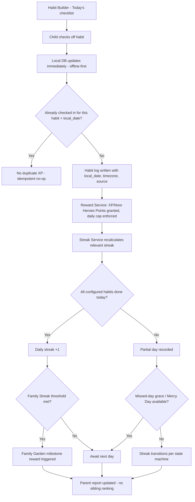
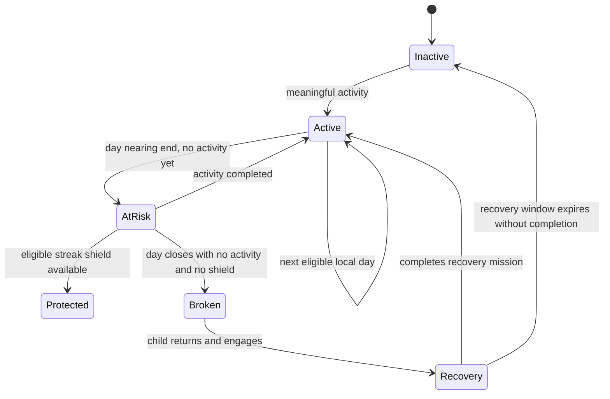
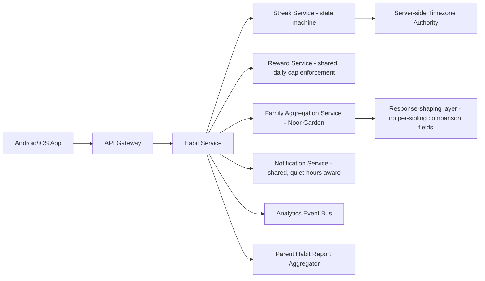

# Feature A.7 — Habit Tracker (Islamic Habit Formation Engine)

**App:** NoorHeroes — Islamic Learning App for Children
**Feature Owner:** Product / Child Wellbeing / Learning Science
**Status:** Implementation-ready
**Version:** 1.0
**Depends on:** A.1 (Auth & Onboarding), A.2 (Home Dashboard — habit check-in widget), A.6 (Dua Learning — dua reminder integration), C.23 (Parental Controls — habit visibility/age scoping)
**Feeds into:** A.11 Rewards (XP/Noor Heroes Points/streak rewards), A.12 Notifications (streak-risk, reminders), A.9 Avatar/Noor Garden, C.22 Parent Progress Reports

---

## Table of Contents

1. [Product Requirements](#1-product-requirements)
2. [UX/UI Requirements](#2-uxui-requirements)
3. [Backend Requirements](#3-backend-requirements)
4. [Database Design](#4-database-design)
5. [Backend AI Code-Generation Prompt](#5-backend-ai-code-generation-prompt)
6. [Android Requirements](#6-android-requirements)
7. [Android AI Code-Generation Prompt](#7-android-ai-code-generation-prompt)
8. [Admin Requirements](#8-admin-requirements)
9. [Admin AI Code-Generation Prompt](#9-admin-ai-code-generation-prompt)
10. [DevOps Requirements](#10-devops-requirements)
11. [Analytics Requirements](#11-analytics-requirements)
12. [Security Requirements](#12-security-requirements)
13. [QA Requirements](#13-qa-requirements)
14. [Marketing Requirements](#14-marketing-requirements)
15. [Release & Rollback Plan](#15-release--rollback-plan)

---

## 1. Product Requirements

### 1.1 Problem Statement

Children need a low-friction, non-surveillance way to build real Islamic practice habits — prayer, Quran reading, dhikr, daily duas, kindness — that rewards consistency without ever shaming a missed day, without turning faith practice into a parent-policing exercise, and without ever comparing siblings against each other (source: Consolidated Blueprint §6.5: "As a child, I want to mark my prayers and good deeds for the day and see my streak grow, so that building good habits feels rewarding rather than like being checked up on"; Ethical Rule: "The habit engine never shames a child for missing worship. It uses mercy language, smaller next steps, parent coaching, and real-world family practice").

### 1.2 Business Goals

- Make the Habit Tracker the single highest-frequency daily-touch feature in the app (multiple habit types checked in daily, ideally several times across the day as prayers occur).
- Drive long-term retention via streak psychology implemented ethically (Mercy Day protection, never-punitive messaging) rather than exploitatively.
- Create a meaningful, non-competitive Family Streak mechanic (Noor Garden) that strengthens household engagement without sibling-ranking risk.
- Feed the Reward Engine with a steady, predictable stream of genuine-effort-based XP/Noor Heroes Points events.

### 1.3 User Goals

- **Child:** Mark off prayers, Quran reading, duas, good deeds, and dhikr as I do them in real life, see my streak and garden grow, and never feel bad if I miss a day.
- **Parent:** Choose which habits are visible to my child (age-appropriate), optionally verify a habit claim without it feeling like religious policing, see consistency patterns and gentle recommendations, and trust that my children are never compared against each other anywhere in the app.

### 1.4 Success Metrics

| Metric | Target |
|---|---|
| Daily active habit check-in rate (≥1 habit/day among active children) | ≥ 55% |
| 7-day streak achievement rate (among children with ≥1 check-in) | ≥ 40% |
| 30-day streak achievement rate | ≥ 15% |
| Mercy Day utilization rate (streaks preserved via grace vs. broken) | Tracked, not optimized against directly (a high rate could mean either healthy forgiveness or overly generous grace — monitored qualitatively) |
| Family Streak (Noor Garden) participation rate among multi-child families | ≥ 30% |
| Streak-risk notification → check-in completion rate | ≥ 25% |
| Habit-check-in submission crash-free rate | ≥ 99.7% (this is a very high-frequency, low-latency-expectation action) |
| Parent habit-visibility configuration completion rate (at least one habit configured per child) | ≥ 80% |

### 1.5 Stakeholders

Product Manager, Child Psychology/Wellbeing Advisor, UX Designer, Backend Architect (Streak/Habit Service), Android Architect, Data Analyst, Security Engineer, QA Lead, Customer Support Lead, Notification/Reward feature owners (cross-feature integration), Scholar Review Board (habit-type framing/language review).

### 1.6 User Stories

1. As a child, I want to see today's habit checklist (prayers, Quran, dua, good deed, dhikr) and check things off as I do them.
2. As a child, I want to see my streak grow and my Noor Garden bloom as I keep up my habits.
3. As a child, I want a smaller, easier target offered to me after I miss a day, instead of feeling like I failed.
4. As a child, I want my family's shared garden to grow when me and my siblings all do our habits, without us being compared to each other.
5. As a child, I want a gentle reminder before I forget a habit, respecting quiet hours and bedtime.
6. As a child, I want to use a simple dhikr counter with audio pronunciation help.
7. As a parent, I want to choose which habits are visible to my child based on their age.
8. As a parent, I want the option to verify a habit claim (e.g., for a younger child), without it ever feeling like I'm "checking up" on their faith.
9. As a parent, I want to see consistency patterns, missed areas, and gentle suggestions — not a shaming scoreboard.
10. As a parent of multiple children, I want to know my children are never ranked or compared against each other in any report.
11. As a child traveling across time zones, I want my streak to be handled fairly, not broken just because of travel.
12. As a child, I want to log a good deed without being forced to write a personal note about it if I don't want to.
13. As a child during Ramadan, I want my habit checklist to switch to Ramadan-relevant habits (fasting, charity, extra Quran, family iftar reflection).

### 1.7 Functional Requirements

**FR-1** Habit Builder's "Today" view shows a checklist of the child's currently-configured habits: Salah (by prayer), Quran reading, daily duas, good deeds, dhikr counter, and optionally a Ramadan fasting tracker — scoped by parent configuration and child age (source §6.5, §21.14, screen catalog "Habit Builder").
**FR-2** Habit check-in is offline-first: local database updates immediately on tap; server sync and reward posting happen asynchronously (source §6.5 Detailed Workflow step 2: "Local database updates immediately (offline-first)").
**FR-3** Exactly one capped reward is granted per `(child_id, habit_id, local_date)` — repeated taps on the same habit on the same day do not farm additional XP/Noor Heroes Points (source §9.3 DB notes: "one capped habit reward per (child_id, habit_id, local_date)"; §6.5 "Rewards have daily caps to prevent farming").
**FR-4** Habit check-in events store: local date, timezone, source, an optional parent-verification flag, and an optional note category — sensitive personal notes are never required (source §6.5/§21.14).
**FR-5** Parent chooses which habits appear, scoped by child age (FR carried from §6.5/§21.14) — the child never sees a habit type the parent has not enabled for them.
**FR-6** Parent verification of a habit claim is **optional** per habit/child and must never be framed in copy or UI treatment as "religious policing" — verification is presented as supportive co-participation (e.g., "Mark this together"), never surveillance (source: hard ethical/copy constraint, §6.5/§screen-catalog).
**FR-7** Streak System implements the exact state machine: `Inactive → Active → AtRisk → Protected/Broken → Recovery → Active/Inactive` per the canonical diagram in §7.4/§21.13 (full transition table specified in §1.17 below) — this is the feature's most safety-critical logic and must be implemented exactly as specified, not approximated.
**FR-8** A "meaningful activity" counting toward a streak is: a completed lesson, a story watched past a minimum-engagement threshold, a quiz, or an approved habit check-in — repeated low-value taps never count (source §7.4/§21.13).
**FR-9** Calendar-day boundaries for streak evaluation use a **server-maintained child timezone**, not raw device-reported time, to resist trivial manipulation while still being fair to genuine travel (source §7.4).
**FR-10** Timezone changes and travel require bounded, abuse-resistant grace logic with server-side reconciliation — a streak must never be silently broken by a timezone shift alone (source §6.5 Error Handling, §21.13).
**FR-11** A "streak shield" (the `Protected` transition from `AtRisk`) is earned through learning/consistency, never purchasable with real money (source §7.4, §21.13 — a hard anti-monetization-of-grace rule).
**FR-12** Family Streak (Noor Garden): multiple children in the same family may contribute to a shared family streak/garden, but **individual sibling habit completion is never compared, ranked, or displayed competitively anywhere**, including in parent reports (source §6.5 Business Rules, §21.12 "Never rank siblings in parent reports" — applies platform-wide but is specifically enforced here at the point of data origin).
**FR-13** Broken-streak and missed-day messaging emphasizes returning, never failure or shame — no UI treatment (color, iconography, copy) may imply punishment (source §6.5/§7.4 Failure Scenario language).
**FR-14** Missed-habit pattern detection triggers a mercy-toned suggestion (smaller target, alternate time, or family reminder) — never a shaming message (source: screen catalog "Habit Builder" Navigation Flow rule; Habit Intelligence Model table "Missed habit pattern → Suggests a smaller target, alternate time, or family reminder. Prevents shame and helps parents coach gently").
**FR-15** Habit reminders respect family hours, bedtime, and parent quiet windows (source §6.5 Engagement Mechanics) — no reminder may fire during a configured quiet/bedtime window.
**FR-16** Dhikr Counter provides a gentle tactile interface, audio pronunciation support, and a daily target, distinct in interaction model from the simple checkbox-style habits (source §6.5 Habit Types).
**FR-17** Fasting Tracker (Ramadan/practice fasts) is optional and parent-controlled, with age-appropriate fasting education content linked (source §6.5 Habit Types, §6.5 "fasting tracker (optional, parent-controlled)").
**FR-18** Seasonal mode integration: when Ramadan mode is active, missions/habits switch to fasting, charity, Quran, dua, and family iftar reflections (source: Habit Intelligence Model table "Ramadan mode active → Switches missions to fasting, charity, Quran, dua, and family iftar reflections").
**FR-19** Noor Garden visual progression: each habit type grows a distinct part of a personal progress world (Quran tree, kindness flowers, Salah lanterns, dua stars, Ramadan moon path); siblings contribute to shared Family Garden milestones (e.g., 100 duas, 30 good deeds, 7 family story nights, a complete Ramadan journey) (source §"Noor Garden Progress World").
**FR-20** Habit check-in is idempotent via `client_request_id`; offline check-ins sync in causal order with server-side deduplication.
**FR-21** Weekly habit reports (parent-facing) use child-friendly highlights framing, not raw failure/success scorecards, and never rank siblings (source §6.5 Engagement Mechanics, cross-ref FR-12/FR-13).
**FR-22** Churn-risk detection (declining habit engagement trend) triggers encouragement-oriented interventions, never pressure-oriented ones (source §6.5 Engagement Mechanics "Churn-risk detection that triggers encouragement, not pressure").

### 1.8 Non-Functional Requirements

- **Performance:** Habit check-in tap-to-local-update latency < 100ms (must feel instantaneous, offline-first by design per FR-2); server sync p95 < 1s once connectivity available.
- **Reliability:** Streak state-machine transitions must be deterministic and reproducible — given identical input history, the computed state must always be identical (critical for trust, auditability, and dispute resolution via Support).
- **Fairness:** Timezone-change grace logic must resist trivial abuse (e.g., repeatedly toggling device timezone to manufacture extra "days") while never penalizing genuine travel — this is an explicit fairness/abuse-resistance balance, not a pure security lockdown.
- **Accessibility:** Dhikr Counter's tactile interface must have a full non-gesture alternative (e.g., a large single tap target) for motor-accessibility needs.
- **Offline tolerance:** Full offline check-in capability per FR-2/FR-20.
- **Localization:** Habit labels, Ramadan-mode copy, and mercy-toned messaging all fully localized and culturally reviewed per locale (mercy/encouragement language must land appropriately across cultures, not just be a literal translation).

### 1.9 Acceptance Criteria

- Given a child checks in the same habit twice in one local day, when the second check-in is submitted, then no additional XP/Noor Heroes Points are awarded, and the system records this gracefully (not as an error).
- Given a child's streak is in `Active` state and they complete a meaningful activity the next eligible local day, when evaluated, then the streak remains `Active` and increments — given they do nothing that day and the day closes, then it transitions to `AtRisk` and then `Broken` per the state machine, never skipping states.
- Given a streak is `Broken`, when the child returns and engages, then it enters `Recovery`; completing a recovery mission returns it to `Active`; the recovery window expiring without completion returns it to `Inactive` — never silently jumping straight back to a high `Active` count.
- Given a child travels and their device timezone changes mid-streak, when the server evaluates the day boundary, then bounded grace logic applies and the streak is not silently broken purely due to the timezone shift, per a server-side reconciliation rule (not an oracle — abuse-resistant bounds apply).
- Given two siblings in the same family both have habit data, when a parent views any report screen, then no UI element compares, ranks, or juxtaposes their individual completion rates competitively — this must be verified across every parent-facing report screen, not just the primary dashboard.
- Given a parent has not enabled the Fasting Tracker for a child, when that child opens Habit Builder, then no fasting-related habit type appears in their checklist.
- Given a missed-habit pattern is detected for a child, when the system responds, then the suggestion shown is a smaller target, alternate time, or family reminder — never a message implying failure or guilt.
- Given Ramadan mode is active, when a child opens Habit Builder, then the checklist reflects Ramadan-relevant habits (fasting, charity, Quran, dua, family iftar reflection) rather than the standard year-round set.

### 1.10 Edge Cases

1. Child checks in a habit at 11:58pm local time, and the check-in's server-processing completes at 12:01am due to a slow network request → the `local_date` recorded must reflect the time of the **client-side check-in action** (captured client-side at tap time and sent in the request payload), not the server's processing timestamp, to avoid an unfair day-boundary mismatch.
2. Child rapidly taps a habit checkbox on/off multiple times before the request completes (accidental double-tap or indecision) → idempotent handling via `client_request_id` per distinct intended state ensures the final persisted state matches the child's last intended action, without duplicate reward issuance and without a flickering UI.
3. Parent disables a previously-visible habit type while the child has an active streak partially built on that habit type → the historical streak/reward data for that habit is preserved (not deleted), but it's removed from today's checklist going forward; if the disabled habit was the sole contributor to an active daily streak chain, the streak's continuation now depends on other still-enabled habits or a different meaningful activity, evaluated fairly (the child isn't penalized retroactively for the parent's configuration change).
4. Two children share a device; Child A checks in a habit, then the device switches to Child B before Child A's offline check-in has synced → the queued offline check-in remains correctly attributed to Child A's `child_id` (captured at action time, not sync time) and syncs correctly regardless of which child's session is currently active when connectivity returns.
5. Family Streak threshold is met by the combined effort of multiple siblings on the same day, but one sibling's individual check-in event hasn't synced yet (still offline) → the Family Streak's authoritative server-side evaluation only counts confirmed, synced check-ins; the family reward/milestone fires once that sibling's event syncs and crosses the threshold (no premature/optimistic family-level reward issuance based on unconfirmed client state).
6. Child sets up a recurring Dhikr Counter target, then changes the target mid-day after having already partially completed today's count → today's progress is preserved proportionally against the new target (not reset to zero), with a sensible recalculation (e.g., if they did 50 of an old 100 target and change to a new 150 target, they're now at 50/150, not back to 0/150).
7. A child's account is flagged for Mercy Day usage many days in a row (e.g., genuinely inconsistent engagement rather than occasional grace) → the system does not editorialize or "punish" this pattern through any UI signal, but the Habit Intelligence Model's missed-pattern detection (FR-14) may still surface a gentle, supportive suggestion — this is fundamentally different from any punitive escalation, and the distinction must be preserved in implementation (suggestion frequency may increase, tone never sharpens).
8. Parent enables "parent verification" for a habit, but is unavailable/offline for an extended period and never verifies a pending claim → the child's own streak/reward progress is **not blocked** waiting on parent verification (verification is supplementary/optional context for the parent, never a gate on the child's actual reward/streak mechanics) — this must be true even though FR-6 allows verification to exist, since verification is "optional" precisely in this sense.
9. Ramadan mode activates mid-cycle while a child has an active non-Ramadan streak → the streak doesn't reset; "meaningful activity" eligibility simply expands to include the newly-relevant Ramadan-specific habit types for that period, then reverts appropriately when Ramadan mode ends (no streak discontinuity purely due to the seasonal mode switch).
10. A child attempts to log an excessive number of "good deeds" in a single day (e.g., 50 taps) in an apparent attempt to inflate engagement metrics or test the system → the daily cap (FR-3) limits actual reward issuance to the configured cap regardless of tap count, and an anomalous-volume pattern may be flagged for fraud/abuse monitoring (not shown to the child as an error — the excess taps simply don't yield additional reward, framed neutrally).
11. Child's server-maintained timezone record becomes stale/incorrect (e.g., they moved permanently to a new timezone months ago but the system never updated) → there must be a mechanism (automatic detection via repeated device-timezone-mismatch signals, or explicit parent/child confirmation) to update the server-maintained timezone of record without requiring a manual support ticket for every case, while still being resistant to abuse (frequent flip-flopping triggers a different, more conservative grace path than a single stable shift).
12. A habit check-in attempt is made for a `local_date` significantly in the past (e.g., backfilling after being offline for several days while traveling with no connectivity at all) → the system must support reconciling a batch of queued historical check-ins on reconnect, each evaluated against its own correct historical `local_date`, with the streak state machine re-computed correctly across the gap (not just blindly applied as if it were "today") — this is a more complex version of the standard offline-sync pattern, specific to a calendar-day-sensitive feature.

### 1.11 Error Handling

| Scenario | System Behavior |
|---|---|
| Habit check-in sync fails (network) | Local state already updated (offline-first); background retry with exponential backoff; never shown as a child-facing error, since the local experience already succeeded |
| Streak state-machine evaluation service unavailable | Last-known cached streak display shown with no alarming "error" framing; recalculated once the service is reachable, never silently reset to zero as a fallback |
| Family Streak aggregation service degraded | Personal/individual habit check-ins and rewards proceed unaffected; Family Garden visual simply doesn't update until the aggregation service recovers, shown as a gentle "growing..." state rather than an error |
| Dhikr Counter audio pronunciation asset fails to load | Counter still fully functional without audio (silent tactile counting), audio retried in background |
| Backfilled historical check-in conflicts with an already-recorded entry for that date | Idempotent merge — existing entry wins, no duplicate reward, no error shown |
| Parent verification request fails to deliver/notify parent | Child's progress is entirely unaffected (per Edge Case 8); parent sees the pending-verification item next time they open the relevant screen, no urgency-framed error |

### 1.12 Empty States
- New child, zero habits configured by parent yet → Habit Builder shows a friendly "ask a grown-up to set up your first habit" prompt with a parent deep-link (consistent with A.2 Edge Case 9).
- Zero streak history yet → Streak display shows a warm "Let's start your first day!" framing rather than a "0" presented starkly.
- Family Garden with zero family-level milestones reached yet → shows the garden's "seedling" starting state with a description of the first milestone to work toward.

### 1.13 Loading States
- Habit checklist: skeleton checklist shimmer (rare given offline-first design — mostly relevant on true first load).
- Streak calendar: skeleton calendar grid.

### 1.14 Offline States
- Full offline check-in functionality per FR-2; persistent (non-alarming) "syncing..." indicator when there's a pending local queue.
- Dhikr Counter and other purely-local-interaction habit types function identically offline.

### 1.15 Permission States
- No new runtime permissions; relies on existing notification permission (shared with A.12) for habit reminders.

### 1.16 User Flow (Narrative)

Child opens Habit Builder (via Home widget or bottom-nav, if surfaced there) → sees Today's checklist scoped to parent-enabled habit types for their age → taps to check in a habit (instant local feedback) → streak/XP updates optimistically, reconciled with server in background → views Streak Calendar/history or Noor Garden visualization → if a day was missed, sees mercy-toned messaging and a smaller-target suggestion rather than a broken-streak penalty screen → if part of a multi-child family, sees Family Garden progress (without sibling comparison) → may request a parent-verification co-marking for a specific habit if that's been enabled.

### 1.17 Detailed Flow Diagram (Mermaid)

**Habit Check-In Flow:**



**Streak State Machine (canonical, source §7.4/§21.13):**



### 1.18 Screen Inventory (Complete — Zero Missing)

| # | Screen / Component | Type | Entry Points | Exit Points |
|---|---|---|---|---|
| 1 | Habit Builder — Today's Checklist | Primary | Home habit widget, bottom-nav/Learn-adjacent entry, deep links | Streak Calendar, Noor Garden, individual habit detail interactions |
| 2 | Habit Check-In Inline Interaction (per habit row) | Component | Today's Checklist | Streak/XP update in place |
| 3 | Dhikr Counter Screen | Screen | Today's Checklist (dhikr habit tap) | Today's Checklist (progress updated) |
| 4 | Fasting Tracker (Ramadan/practice) | Screen | Today's Checklist (if parent-enabled) | Today's Checklist |
| 5 | Good Deed Logging — Category Selector | Modal/Sheet | Today's Checklist (good deed habit tap) | Optional Note entry / direct check-in |
| 6 | Good Deed Optional Note Entry | Screen variant | Category Selector | Check-in confirmation |
| 7 | Streak Calendar / History View | Screen | Today's Checklist "view streak history" | Today's Checklist |
| 8 | Streak State Detail (AtRisk/Broken/Recovery messaging) | Component/Screen variant | Streak Calendar, Today's Checklist banner | Recovery Mission entry, dismiss |
| 9 | Recovery Mission Screen | Screen | Streak State Detail (Broken → Recovery) | Today's Checklist (streak restored to Active) |
| 10 | Mercy-Toned Smaller-Target Suggestion Prompt | Modal | Missed-habit pattern detected | Accept (adjusts target) / Dismiss |
| 11 | Noor Garden — Personal View | Screen | Today's Checklist "Open Noor Garden" | Family Garden (if applicable), Avatar (A.9) |
| 12 | Noor Garden — Family View | Screen | Personal Garden entry point | Personal Garden |
| 13 | Family Streak Milestone Celebration | Modal | Family threshold crossed | Dismiss → Family Garden |
| 14 | Habit Reminder Settings (per-child, Parent Area) | Screen (Parent Area, cross-ref C.23) | Parent Controls | Saves configuration |
| 15 | Habit Visibility/Age-Scoping Configuration (Parent Area) | Screen (Parent Area) | Parent Controls → Children | Saves configuration |
| 16 | Parent Verification Pending Item (Parent Dashboard widget) | Component (Parent Area) | Parent Dashboard | Verification confirm action |
| 17 | Weekly Habit Report (Parent Area) | Screen (Parent Area) | Parent Dashboard → Child Progress → Habits | Habit Detail Drill-in |
| 18 | Weekly Habit Report — Per-Habit Detail | Screen (Parent Area) | Weekly Habit Report | Back |
| 19 | Empty State — No Habits Configured Yet | Screen variant | Today's Checklist, zero habits | Parent setup deep link |
| 20 | Empty State — No Streak History Yet | Screen variant | Streak Calendar, first-time | N/A |
| 21 | Ramadan Mode Checklist Variant | Screen variant | Today's Checklist, Ramadan mode active | Standard checklist (post-Ramadan) |

### 1.19 Events (Complete Analytics Event List)

`habit_builder_viewed`, `habit_checked_in` (with `habit_type`, `local_date`), `habit_checkin_duplicate_ignored`, `habit_unchecked` (if toggle-off is supported), `dhikr_counter_opened`, `dhikr_target_reached`, `dhikr_target_changed_midday`, `fasting_tracker_logged`, `good_deed_category_selected`, `good_deed_note_added`, `streak_state_changed` (with `from_state`, `to_state`, `streak_type`), `streak_shield_applied`, `streak_broken_shown`, `recovery_mission_started`, `recovery_mission_completed`, `recovery_window_expired`, `mercy_suggestion_shown`, `mercy_suggestion_accepted`, `family_streak_milestone_reached`, `noor_garden_viewed` (personal/family), `parent_habit_visibility_configured`, `parent_verification_requested`, `parent_verification_completed`, `weekly_habit_report_viewed`, `ramadan_mode_checklist_activated`, `ramadan_mode_checklist_deactivated`, `timezone_change_grace_applied`, `backfilled_checkin_synced`.

---

## 2. UX/UI Requirements

> Global Design System tokens defined in **Feature A.1 §2.1**.

### 2.1 Habit-Specific Design System Extensions

- **Streak Visual Language:** Consistent with A.5's `Needs Refresh` treatment philosophy — streak risk/broken states use warm amber/gentle iconography (a softly dimming flame or a gentle moon-phase motif), never red/alarming. `Protected` state shows a small shield-glow accent. `Recovery` state uses a distinct "welcome back" warm visual, not a "penalty box" treatment.
- **Noor Garden Illustration System:** A cohesive, evolving illustrated garden scene — Quran tree, kindness flowers, Salah lanterns, dua stars, Ramadan moon path — each growing incrementally with habit consistency, rendered as a single composed scene (not separate disconnected icons), reinforcing the "you're growing something real" metaphor.
- **No-Comparison Enforcement (Design Principle):** Every component used in any parent-facing multi-child report context (Weekly Habit Report, Family Garden) is designed as either (a) an aggregate-only view (combined family totals, no per-child breakdown side-by-side) or (b) a single-child-at-a-time view requiring an explicit child-switcher tap (never a simultaneous side-by-side comparison layout) — this is a structural design constraint, not just a content-writing guideline.
- **Dhikr Counter Interaction:** Large, satisfying single-tap target (oversized relative to standard buttons, ≥72dp) with a gentle haptic pulse per tap (where platform supports it) and a soft incrementing count display — designed to feel meditative, not game-like/frantic.

### 2.2 Screen-Level Design Requirements (Key Screens)

#### Screen: Habit Builder — Today's Checklist

- **Purpose:** Frictionless daily logging of configured habits.
- **Components:** Date header, per-habit checklist rows (icon + label + large tap-target checkbox, or a count-based mini-display for Dhikr), streak summary chip, "View Streak History" and "Open Noor Garden" links.
- **States:** Default, All-complete-today (celebratory but calm acknowledgment, not over-the-top), Partial, Mercy-Day-active (a gentle distinct banner, not hidden, but framed supportively), Offline (small persistent indicator), Empty (zero habits configured).
- **Accessibility:** Each checklist row fully labeled including current state ("Fajr prayer, not yet checked in today"); Dhikr Counter's large tap target has an additional smaller decrement/reset control reachable via standard navigation, not gesture-only.
- **Responsive Rules:** Single column list on mobile; tablet may show checklist alongside a persistent Noor Garden preview panel.

#### Screen: Streak State Detail (Broken/Recovery messaging)

- **Purpose:** Communicate a missed streak and a path forward without shame.
- **Components:** Warm, non-alarming illustration (e.g., a softly glowing garden at dusk rather than a wilted/dead plant — even visual metaphors must avoid implying failure), supportive copy ("Let's pick this back up together!"), a clear single "Start Recovery" or "Try a Smaller Goal" CTA.
- **States:** AtRisk-warning (gentle, time-remaining-today framing), Broken-transition (the moment of transition, softest possible framing), Recovery-active, Recovery-window-closing-soon (gentle nudge, not a countdown-pressure timer).

#### Screen: Noor Garden (Personal & Family)

- **Purpose:** Visualize cumulative habit consistency as a living, growing world.
- **Components:** Layered illustrated scene with distinct zones per habit type, a subtle "last grew on [date]" indicator, Family Garden toggle (if applicable) showing combined-only progress.
- **States:** Seedling (new/low activity), Growing, Flourishing, Family-milestone-celebration overlay.

### 2.3 Tab Structure

Habit Builder is reachable from Home (Tab 1) and is itself part of the bottom-nav structure per some navigation maps as its own entry, or nested under Learn depending on the IA decision already reflected elsewhere in the blueprint — this document assumes Home-widget + a dedicated reachable screen (not necessarily its own bottom-nav tab, consistent with the 5-tab structure: Home/Learn/Stories/Rewards/Profile, where Habit Builder is most naturally reached via Home and via a Rewards-adjacent "Garden" entry point). Click mapping:

| Click Target | Destination | API Called | Analytics Event | Permission Check | Error Handling |
|---|---|---|---|---|---|
| Habit checklist row | Inline check-in | `POST /v1/habits/check-ins` | `habit_checked_in` | None | Optimistic + offline queue |
| Dhikr counter tap | Inline increment | `POST /v1/habits/check-ins` (batched/throttled, not per-tap) | `dhikr_target_reached` (on completion only) | None | Fully offline-capable |
| "View Streak History" | Streak Calendar | `GET /v1/habits/streaks/{child_id}` | N/A (view, implicit) | None | Cached fallback |
| "Open Noor Garden" | Noor Garden screen | `GET /v1/habits/garden/{child_id}` | `noor_garden_viewed` | None | Cached fallback |
| Mercy suggestion "Accept" | Adjusts habit target inline | `PATCH /v1/habits/{habit_id}/target` | `mercy_suggestion_accepted` | None | Optimistic + retry |

### 2.4 Wireframe Description (Composite)

Today's Checklist: a simple vertical list, consistent with the platform's general "checklist card" pattern (similar density to Daily Quiz's results list), with the Dhikr Counter rendered as a visually distinct, larger interactive card rather than a simple checkbox row given its different interaction model. Noor Garden: a full-bleed illustrated scene screen, more visual/immersive than list-based screens elsewhere, intentionally evoking a "place you visit" feeling rather than a "data screen."

### 2.5 Screen Image Generation Prompts

**Screen: Habit Builder — Today's Checklist**
- *Prompt 1 (English):* "Mobile app daily habit checklist screen UI mockup for a children's Islamic app. Warm off-white background. A date header at top, below it a vertical list of rounded checklist rows, each with a small friendly icon (a lantern for prayer, an open book for Quran, a small star for dua, a heart for good deeds) and a label, with a large rounded checkbox on the right side of each row — some checked with a soft gold checkmark, some unchecked outlined in teal. One larger, visually distinct card near the bottom for a dhikr counter showing a big circular tap button with a number count inside it. A small streak-summary chip near the top showing a simple flame-free icon (a small glowing lantern instead) with a number. Warm, calm, encouraging aesthetic, rounded shapes, soft shadows, no realistic human faces, bottom navigation visible."
- *Prompt 2 (Arabic RTL):* "نفس شاشة قائمة العادات اليومية لتطبيق إسلامي للأطفال، بتخطيط من اليمين إلى اليسار بالكامل. خلفية بيج فاتح دافئ. رأس بالتاريخ في الأعلى، وتحته قائمة عمودية من صفوف اختيار مستديرة الزوايا، كل منها بأيقونة صغيرة ودودة (فانوس للصلاة، كتاب مفتوح للقرآن، نجمة صغيرة للدعاء، قلب للأعمال الطيبة) وتسمية، مع مربع اختيار كبير مستدير على الجانب الأيسر من كل صف — بعضها معلّم بصح ذهبي ناعم، وبعضها غير معلّم بحدود فيروزية. بطاقة أكبر ومميزة بصريًا قرب الأسفل لعداد الذكر تعرض زر ضغط دائري كبير برقم العد في داخله. شريحة ملخص صغيرة للمتتالية قرب الأعلى تعرض أيقونة فانوس متوهج بسيطة (بدلاً من اللهب) مع رقم. طابع دافئ وهادئ ومشجع، أشكال مستديرة، ظلال خفيفة، بدون وجوه بشرية واقعية، شريط تنقل سفلي ظاهر."

**Screen: Noor Garden (Personal View)**
- *Prompt 1 (English):* "Mobile app full-screen illustrated progress-world UI mockup for a children's app, depicting a peaceful, lush garden scene viewed from a gentle isometric angle. Distinct zones within the garden: a small flourishing tree with leaves shaped subtly like open book pages (representing Quran progress), soft glowing lantern-shaped flowers along a path (representing prayer), small star-shaped blossoms (representing dua), and gentle kindness-themed flowers in warm pink and gold tones. Warm sunset-toned sky gradient in the background, soft clouds, no realistic human faces or figures, a small treasure-chest-like glowing marker indicating the next milestone to grow toward. Calm, magical, rewarding visual tone, rounded organic shapes, soft lighting, gentle color palette of teals, golds, and soft greens."
- *Prompt 2 (Arabic RTL):* "نفس واجهة عالم التقدم المصور بملء الشاشة لتطبيق أطفال، بتخطيط من اليمين إلى اليسار للعناصر النصية، يصور مشهد حديقة هادئة وخصبة من زاوية متباعدة لطيفة. مناطق مميزة داخل الحديقة: شجرة صغيرة مزهرة بأوراق تشبه بشكل خفي صفحات كتاب مفتوح (تمثل تقدم القرآن)، أزهار على شكل فوانيس متوهجة بلطف على طول المسار (تمثل الصلاة)، أزهار صغيرة على شكل نجوم (تمثل الدعاء)، وأزهار لطيفة بألوان وردية وذهبية دافئة تمثل الأعمال الطيبة. سماء بتدرج لوني يشبه غروب الشمس في الخلفية، غيوم ناعمة، بدون وجوه بشرية أو شخصيات واقعية، علامة متوهجة صغيرة تشبه صندوق كنز تشير إلى الإنجاز التالي المراد الوصول إليه. طابع بصري هادئ وسحري ومُجزٍ، أشكال عضوية مستديرة، إضاءة ناعمة، لوحة ألوان هادئة من الفيروزي والذهبي والأخضر الناعم."

*(Remaining screens — Streak Calendar, Recovery Mission, Mercy Suggestion Prompt, Family Garden, Dhikr Counter detail, Weekly Habit Report — follow the same two-prompt EN/AR template using these tokens; full set available on request.)*

---

## 3. Backend Requirements

### 3.1 System Design Overview

Habit Tracker is served by a **Habit Service** (definitions, check-ins, daily-cap enforcement), a **Streak Service** (the canonical state machine, timezone-aware day-boundary evaluation, grace logic), a **Family Aggregation Service** (Noor Garden/Family Streak, structurally enforcing no-sibling-comparison at the data-shaping layer), and integrates with the shared **Reward Service** and **Notification Service**.

### 3.2 Architecture Diagram (Mermaid)



### 3.3 Service Breakdown

| Service | Responsibility |
|---|---|
| Habit Service | Habit definitions/visibility per child, check-in processing, daily-cap enforcement |
| Streak Service | Canonical state machine evaluation, timezone-aware day boundaries, grace/shield logic |
| Family Aggregation Service | Computes Family Streak/Garden totals; response model structurally excludes per-sibling comparative fields |
| Server-side Timezone Authority | Maintains each child's authoritative timezone-of-record, evaluates change-pattern abuse-resistance |
| Notification Service (shared) | Streak-risk/reminder delivery, quiet-hours/bedtime-window suppression |
| Parent Habit Report Aggregator | Weekly report generation, concept/consistency framing |

### 3.4 API List

#### `GET /v1/habits?child_id=`
- **Auth:** Bearer (child-mode, own child only)
- **Response 200:** `{ "habits": [ { "habit_id": "...", "type": "salah", "label": "Fajr", "target": null, "checked_today": false } ], "ramadan_mode_active": false }`
- **Validation:** Only habits the parent has enabled for this child's age band are returned.

#### `POST /v1/habits/check-ins`
- **Auth:** Bearer (child-mode)
- **Request:** `{ "habit_id": "...", "local_date": "2026-06-22", "timezone": "Asia/Dubai", "source": "self", "note_category": null, "client_request_id": "uuid..." }`
- **Response 200:** `{ "checked": true, "reward": { "xp": 20, "noor_points": 10 }, "daily_cap_reached": false, "streak": { "current": 6, "state": "active" } }`
- **Idempotency:** Unique constraint on `(child_id, habit_id, local_date)` for the reward-granting effect — repeated calls for the same key return the original result (`200`, not an error), consistent with FR-3.
- **Validation:** `local_date` is taken from the client payload (captured at action time per Edge Case 1), validated server-side against a reasonable bound (not arbitrarily far in the future; reasonable backfill window permitted for past dates per Edge Case 12).

#### `GET /v1/habits/streaks/{child_id}`
- **Response 200:** `{ "streak_type": "daily_overall", "current_count": 6, "best_count": 14, "state": "active", "history": [...] }`

#### `GET /v1/habits/garden/{child_id}`
- **Response 200:** `{ "personal": { "zones": {...} }, "family": { "milestones": [...], "next_milestone": {...} } }` — the `family` object structurally contains only aggregate fields, **no per-child breakdown array exists in this response schema at all**, enforced by the Pydantic/response model definition itself (not merely an application convention).

#### `PATCH /v1/habits/{habit_id}/target`
- **Request:** `{ "new_target": 50 }` (e.g., for Dhikr Counter target adjustment)
- **Response 200:** `{ "updated": true, "today_progress_recalculated": 50 }` (per Edge Case 6, proportional preservation).

#### `GET /v1/children/{id}/habit-report?period=weekly`
- **Auth:** Bearer (parent session)
- **Response 200:** Concept/consistency-framed report for a **single specified child only** — there is no multi-child variant of this endpoint that returns more than one child's data in a single response, structurally preventing any accidental side-by-side comparison UI from being built against this API in the first place.

#### `POST /v1/habits/verification`
- **Auth:** Bearer (parent session)
- **Request:** `{ "checkin_id": "...", "verified": true }`
- **Response 200:** `{ "verified": true }`
- **Business Logic:** Purely supplementary metadata write — never gates or modifies the child's already-granted reward/streak state (Edge Case 8).

### 3.5 Cross-Cutting API Concerns

- **Idempotency:** `client_request_id` + the `(child_id, habit_id, local_date)` unique constraint together provide double-layered idempotency protection.
- **Caching:** Habit definitions cacheable short-TTL; streak/garden state never cached beyond a few seconds given its real-time-feeling nature.
- **Security:** No endpoint in this service ever returns sibling-comparative data in a single response — enforced structurally, covered by a dedicated test (see §5).
- **Analytics:** All events from §1.19 emitted.

---

## 4. Database Design

### 4.1 ER Diagram (Mermaid)

```mermaid
erDiagram
    CHILD ||--o{ HABIT_DEFINITION : "has configured"
    HABIT_DEFINITION ||--o{ HABIT_LOG : "has many"
    CHILD ||--o{ HABIT_LOG : "logged by"
    CHILD ||--o{ STREAK : "has many"
    FAMILY ||--o{ FAMILY_STREAK : "has"
    CHILD ||--o{ CHILD_TIMEZONE_RECORD : "has one"

    HABIT_DEFINITION {
        uuid habit_id PK
        uuid child_id FK
        string type
        string label
        jsonb target_config
        boolean active
        boolean fasting_tracker_enabled
        timestamptz created_at
    }
    HABIT_LOG {
        uuid log_id PK
        uuid child_id FK
        uuid habit_id FK
        date local_date
        string timezone
        string source
        boolean verified_by_parent
        string note_category
        string client_request_id
        timestamptz created_at
    }
    STREAK {
        uuid streak_id PK
        uuid child_id FK
        string streak_type
        int current_count
        int best_count
        date last_eligible_date
        string state
        timestamptz updated_at
    }
    FAMILY_STREAK {
        uuid family_streak_id PK
        uuid family_id FK
        string garden_zone
        int aggregate_count
        date last_contribution_date
        timestamptz updated_at
    }
    CHILD_TIMEZONE_RECORD {
        uuid child_id PK_FK
        string current_timezone
        timestamptz last_changed_at
        int change_count_30d
    }
```

### 4.2 Tables, Relationships, Constraints

| Table | Key Constraints | Indexes |
|---|---|---|
| `habit_definition` | FK `child_id`; CHECK `type IN ('salah','quran','dua','good_deed','dhikr','fasting')` | Index `(child_id, active)` |
| `habit_log` | FK `child_id`, `habit_id`; **UNIQUE(`child_id`, `habit_id`, `local_date`)** — the reward-farming-prevention constraint, at the database layer, not just app logic; UNIQUE(`client_request_id`) | Index `(child_id, local_date DESC)` |
| `streak` | FK `child_id`; CHECK `state IN ('inactive','active','at_risk','protected','broken','recovery')` matching the canonical state machine exactly | Index `(child_id, streak_type)` |
| `family_streak` | FK `family_id`; **no `child_id` column on this table at all** — aggregate-only by schema design, structurally preventing per-sibling breakdown queries against this table | Index `(family_id, garden_zone)` |
| `child_timezone_record` | PK = FK `child_id` | — |

### 4.3 Audit Fields
`habit_log` is append-only/immutable (a historical fact). `streak.updated_at` tracks state transitions. `habit_definition.created_at`/parent-edit timestamps tracked via standard `updated_at` if added.

### 4.4 Soft Delete Rules
`habit_definition.active = false` used when a parent disables a habit type, preserving all historical `habit_log` rows referencing it (per Edge Case 3).

### 4.5 Retention Rules
`habit_log` retained indefinitely as core progress/habit history (feeds long-term Parent Reports and Noor Garden growth — this data has lasting value, unlike some other high-volume event types in the platform). `child_timezone_record.change_count_30d` is a rolling window counter, recalculated/decayed by a nightly job.

---

## 5. Backend AI Code-Generation Prompt

```
You are building the Habit Service, Streak Service, and Family Aggregation
Service for "NoorHeroes," a child-safety-first Islamic learning app. The two
defining architectural guarantees of this feature: (1) reward-farming is
impossible at the database constraint layer, and (2) sibling comparison is
structurally impossible because the data model and API response schemas for
any multi-child-touching endpoint simply do not contain per-sibling
breakdown fields.

Stack: FastAPI (Python 3.12), PostgreSQL (SQLAlchemy 2.0), Redis, Kafka.

Hard requirements:
1. Implement POST /v1/habits/check-ins with a database-level
   UNIQUE(child_id, habit_id, local_date) constraint on habit_log. On a
   constraint violation (duplicate check-in for the same day), catch it
   and return the ORIGINAL successful result (200, same reward values as
   the first call) rather than an error -- write a test firing 10
   concurrent check-in requests for the same (child_id, habit_id,
   local_date) and asserting exactly one habit_log row exists and exactly
   one reward was granted, with all 10 requests receiving a 200 response.
2. local_date in the request payload is captured CLIENT-SIDE at action
   time and trusted as the date-of-record (per the spec's Edge Case 1
   rationale), with server-side bounds validation: reject local_date more
   than 1 day in the future (small clock-skew tolerance), and apply a
   more lenient bound for past dates (e.g., up to 14 days back) to support
   the offline-travel-backfill scenario -- write a test for both boundary
   conditions.
3. Implement the Streak state machine EXACTLY per this state set:
   inactive, active, at_risk, protected, broken, recovery -- as a pure
   function taking (current_state, has_meaningful_activity_today,
   day_has_closed, shield_available) -> new_state. Encode the EXACT
   transition table from the spec's stateDiagram (inactive->active on
   activity; active->active on next eligible day; active->at_risk when
   day is nearing end with no activity yet; at_risk->active if activity
   completes; at_risk->protected if a shield is available; at_risk->broken
   if the day closes with no shield; broken->recovery when the child
   returns and engages; recovery->active on completing a recovery mission;
   recovery->inactive if the recovery window expires). Write exhaustive
   unit tests for every legal transition AND assert that no other
   transition is reachable via the public API.
4. Implement timezone-aware day-boundary evaluation using
   child_timezone_record.current_timezone (NOT raw client-reported time
   for the actual streak-eligibility decision, though local_date in the
   check-in payload is still trusted per item 2 -- the streak day-boundary
   logic itself uses the server-maintained timezone of record to determine
   what "today" means for streak continuity purposes). Implement
   abuse-resistant grace logic: if change_count_30d exceeds a threshold
   (e.g., 5 timezone changes in 30 days), apply a more conservative grace
   window than for a single genuine timezone change -- write tests for
   both a single legitimate travel-related timezone change (generous
   grace) and a rapid-flip-flopping pattern (conservative grace).
5. Family Aggregation Service: the family_streak table and its
   corresponding API response model must NOT contain a child_id column or
   any per-child breakdown field WHATSOEVER. Write a STRUCTURAL test
   (e.g., introspecting the Pydantic response model's fields, or the SQL
   table's column list) that asserts no field name containing "child"
   exists anywhere in the family-garden response schema or table
   definition -- this is a stronger guarantee than a behavioral test
   alone, since it prevents the field from ever being added accidentally
   in a future change without that future change consciously overriding
   this explicit test.
6. GET /v1/children/{id}/habit-report must accept exactly ONE child_id
   per call -- do not implement a batch/multi-child variant of this
   endpoint. Write a test asserting the endpoint's OpenAPI schema only
   accepts a single path parameter and has no array-of-child-ids request
   shape anywhere.
7. POST /v1/habits/verification must be a no-op with respect to
   reward/streak state -- write a test that calls this endpoint with
   verified=false for an already-rewarded check-in and asserts the
   child's reward ledger and streak state are completely unchanged
   before and after the call.
8. Write Alembic migrations matching the ER diagram, including the
   UNIQUE constraints described above as actual database constraints,
   not just application-level checks.

Deliver: FastAPI routers, SQLAlchemy models, Alembic migrations, Pydantic
schemas, and a pytest suite covering all 8 items above, with item 1
(reward-farming prevention) and item 5 (no-sibling-comparison structural
guarantee) treated as the highest-priority, most heavily-tested guarantees
in this deliverable.
```

---

## 6. Android Requirements

### 6.1 Technical Requirements
Kotlin, Jetpack Compose, MVVM, Clean Architecture, module `:feature:habits`, depends on `:core:design-system`, `:core:network`, `:core:offline-cache`.

### 6.2 Screen Mapping
Each screen in §1.18 maps to a Composable; `HabitChecklistViewModel` exposes per-row optimistic state independent of overall screen loading state (consistent with A.2's per-section independence pattern).

### 6.3 Navigation Flow
Reachable from Home (deep link) and a dedicated nav-graph entry; Noor Garden and Streak Calendar are sibling destinations off the main Habit Builder screen.

### 6.4 State Management
`HabitChecklistViewModel` captures `local_date` and `timezone` at the exact moment of the check-in tap (using the device's current locale-date and `TimeZone.getDefault()`), embedding both directly into the outgoing request — never recomputed later at sync time, consistent with the backend's client-trusted-`local_date` design (§5 item 2). Offline check-ins are queued in a local Room outbox keyed by `client_request_id`.

### 6.5 API Mapping
`HabitRepository.checkIn()` → `POST /v1/habits/check-ins`; `HabitRepository.getGarden()` → `GET /v1/habits/garden/{child_id}`, with the response DTO's Kotlin data class **structurally having no per-sibling field** (mirroring the backend's schema guarantee on the client side too, so even a hypothetical malicious/buggy server response extension couldn't be rendered by a client that has no field to deserialize it into).

### 6.6 Analytics Mapping
`HabitAnalytics` fires `habit_checked_in` once per genuine new check-in (not on duplicate-ignored taps, which fire a distinct `habit_checkin_duplicate_ignored` event instead, sourced from the server's response indicating whether this was a fresh check-in or an idempotent replay).

### 6.7 Offline Support
Local Room outbox for check-ins, Dhikr Counter progress, and good-deed logs; WorkManager-backed sync on reconnect, processing queued items in chronological `local_date` order to ensure correct streak-state recomputation server-side (Edge Case 12).

### 6.8 Deep Linking
`noorheroes://habits`, `noorheroes://habits/garden`, `noorheroes://habits/streak-risk` (notification entry point).

### 6.9 Push Notifications
Landing targets for streak-risk and habit-reminder notifications (owned by A.12); this feature owns the deep-link destinations and the quiet-hours/bedtime-window suppression logic is enforced server-side by the Notification Service, not duplicated client-side.

### 6.10 Testing Strategy
- Unit: Streak state-machine client-side *display* logic (render-only, mirrors server state, never independently computes transitions); Dhikr target-change proportional-preservation calculation (Edge Case 6).
- UI tests: Mercy-toned messaging screens never contain shaming language (a Compose UI test scanning text nodes against a blocklist of negative-framing terms: "fail", "broke", "lost"); Family Garden screen renders with zero per-child comparative UI elements (structural UI test mirroring the backend's schema guarantee).
- Integration: full offline check-in → backgrounded → reconnect → correct streak recomputation flow, including a multi-day-gap backfill scenario.

---

## 7. Android AI Code-Generation Prompt

```
Build the `:feature:habits` Android module for NoorHeroes using Kotlin,
Jetpack Compose, MVVM, Clean Architecture.

Hard requirements:
1. HabitChecklistViewModel must capture local_date and timezone at the
   EXACT moment of a check-in tap (using LocalDate.now() and
   TimeZone.getDefault() read synchronously in the tap handler, not in
   a later coroutine that could execute after a delay) and embed both
   directly into the outgoing request DTO -- write a unit test using a
   fake clock that advances time between tap and request-send, asserting
   the request payload reflects the tap-time date, not the send-time date.
2. Each habit checklist row's optimistic-update state is independent --
   tapping one habit must not show a loading/disabled state on any other
   row. Implement via a Map<habitId, RowState> in the ViewModel's UI
   state, not a single screen-wide loading flag.
3. Build a Room-backed offline outbox for check-ins keyed by
   client_request_id, with a WorkManager sync worker that processes
   queued items in ASCENDING local_date order (oldest first) when
   syncing a backlog -- write a test queuing 3 check-ins for 3 different
   past dates out of chronological order and asserting the sync worker
   submits them to the repository in chronological order regardless of
   queue-insertion order.
4. The Family Garden response DTO (Kotlin data class deserialized from
   GET /v1/habits/garden/{child_id}) must contain ONLY aggregate fields --
   do not define any field that could hold a per-child breakdown (no
   List<ChildContribution> or similar). Write a test that uses reflection
   to enumerate the DTO class's declared fields and asserts none of them
   are collection types containing a nested "childId" or "child_id" field
   -- this guards against a future well-intentioned but policy-violating
   addition slipping through code review.
5. Implement a Compose UI test utility that scans all Text composables
   rendered on the Streak State Detail and Mercy Suggestion screens and
   asserts none match a blocklist of shame-adjacent words (case-insensitive
   substring match): "fail", "failed", "broke", "broken" (note: "broken"
   IS a valid internal state NAME but must never appear as user-facing
   text -- the UI must always translate the broken state into supportive
   copy, never display the raw state name), "lost", "didn't". Run this
   test against every locale's string resources, not just the default.
6. Dhikr Counter: implement target-change mid-day as a proportional
   recalculation (e.g., 50/100 changing to a 150 target becomes 50/150,
   never reset to 0) -- write a unit test for this exact calculation,
   including a boundary case where the new target is SMALLER than
   current progress (e.g., 80/100 changing to a 50 target -- progress
   caps at the new target, shown as "50/50 - target reached!" rather
   than an invalid 80/50 display).
7. Write an instrumented integration test for the full offline-backfill
   scenario: queue check-ins for "today," "yesterday," and "3 days ago"
   while offline (in that insertion order, out of chronological order),
   go online, and verify via a mocked repository that the sync calls are
   made in chronological order and that the resulting locally-cached
   streak state matches what the (mocked) server would compute given a
   correctly-ordered submission.

Use Hilt, Retrofit+OkHttp, Room, WorkManager. Follow Global Design System
tokens from `:core:design-system`, adding the Noor Garden illustration
system and non-alarming streak-state iconography described in this spec's
UX section as reusable themed components.
```

---

## 8. Admin Requirements

- **Habit Type Configuration:** CRUD for the global catalog of available habit types (`salah`, `quran`, `dua`, `good_deed`, `dhikr`, `fasting`), age-band defaults, and reward-rule linkage (shared with the platform-wide XP/Noor Heroes Points table referenced in §3.4's Reward Service). Delete = deactivate only.
- **Streak Shield/Grace Configuration:** Admin-tunable parameters for the abuse-resistance thresholds (e.g., `change_count_30d` threshold, recovery-window duration) without requiring a code deploy.
- **Mercy-Toned Copy/Localization Review Queue:** A specialized content-review surface ensuring every locale's missed-streak/mercy-suggestion copy has been reviewed for cultural appropriateness (not just literal translation) before publish — given how central tone is to this feature's ethical commitments.
- **Family Garden Milestone Configuration:** CRUD for family-level milestone thresholds (e.g., "100 duas," "30 good deeds," "7 family story nights," "complete Ramadan journey") and their associated reward/celebration content.
- **Habit Report Template Manager:** Configuration of the concept/consistency-framing language used in Weekly Habit Reports, with a built-in linter flagging any template field that would require per-sibling comparative data (structurally discouraging report templates that could violate the no-comparison rule at the content-authoring stage, not just the API-schema stage).

CRUD permissions: Habit Type Configuration = full CRUD (delete = deactivate) behind `content_editor`/`product_admin` role; Streak Shield/Grace Config = Update-only behind `product_admin` role; Mercy-Copy Review Queue = full CRUD + approval workflow behind `content_editor` + `localization_reviewer` roles; Family Garden Milestone Config = full CRUD behind `content_editor` role; Habit Report Template Manager = Update-only behind `product_admin` role with the comparison-linter as a hard validation gate.

---

## 9. Admin AI Code-Generation Prompt

```
Build an internal admin module (React + TypeScript, existing NoorHeroes Admin
Portal shell) for managing the Habit Tracker feature's configuration and
content.

Pages:
1. Habit Type Configuration -- CRUD table for global habit type definitions
   (type enum, default age-band visibility, linked reward-rule reference).
   Delete relabeled "Deactivate" (sets active=false only).
2. Streak Shield/Grace Configuration -- a settings form for
   change_count_30d threshold, conservative-vs-generous grace window
   durations, and recovery-window length, restricted to product_admin role.
3. Mercy-Toned Copy Review Queue -- a localization review workflow: list
   of pending copy strings (missed-streak messages, mercy suggestions,
   recovery-mission framing) per locale, each requiring sign-off from a
   localization_reviewer role confirming cultural-appropriateness (not
   just translation-accuracy) before the string can be set
   status='published'. Include a "flag for re-review" action for any
   already-published string.
4. Family Garden Milestone Configuration -- CRUD for milestone definitions
   (garden_zone, threshold, celebration_content_ref).
5. Habit Report Template Manager -- a template editor for Weekly Habit
   Report content blocks, with a built-in LINTER that scans any template
   field for patterns suggesting per-sibling comparison (e.g., flagging
   template variables like {child_a_score} vs {child_b_score}, or any
   loop construct iterating over "siblings" with a ranking/sort operation)
   -- block saving a template if the linter detects such a pattern, with
   a clear explanation of why, referencing the platform's no-sibling-
   comparison policy.

Enforce RBAC via the existing Admin Portal role context. Every mutating
action writes an immutable audit_log row.
```

---

## 10. DevOps Requirements

- **Infrastructure:** Habit Service and Streak Service are high-frequency, low-latency-sensitive services given the offline-first, instant-feedback design — scaled for steady-state high request volume rather than bursty patterns.
- **CI/CD:** The reward-farming-prevention concurrency test and the no-sibling-comparison structural test (§5 items 1 and 5) are **mandatory, non-bypassable** CI gates on any PR touching the Habit Service, Streak Service, or Family Aggregation Service.
- **Monitoring/Logging/Alerting:** Alert on `habit_log` unique-constraint-violation rate spiking abnormally (could indicate a client bug generating excessive duplicate-check-in attempts, worth investigating even though the system handles it gracefully). Alert on Streak Service state-machine producing an "impossible" transition in production (a canary/invariant check run periodically against live state data). Alert on `change_count_30d` threshold-breach rate trending up unexpectedly (potential abuse pattern worth a closer look, even though the system already applies conservative grace automatically).
- **Disaster Recovery:** `habit_log` (core long-term-value data) backed up at a high durability tier given its irreplaceable nature (a child's real-world practice history).
- **Rollback Strategy:** Any deploy touching the Streak state-machine logic requires a staging replay of historical `habit_log`/`streak` fixture data confirming no child's computed state would unexpectedly regress before production promotion.
- **Backup Strategy:** Standard-to-high tier for `habit_log`/`streak`; `family_streak` in standard tier (aggregate, regenerable from underlying `habit_log` data if ever needed, given it has no unique non-derivable per-child detail).
- **Environment Setup:** Staging supports a "time-travel" testing utility (manipulate the server's evaluation of "current day" for a specific test child) to enable reliable QA of streak transitions without waiting real calendar days.

---

## 11. Analytics Requirements

### 11.1 Event Taxonomy
Full list in §1.19. `family_streak_milestone_reached` and all Family Garden events are aggregate-only by event-schema design, mirroring the API's structural no-sibling-comparison guarantee even at the analytics layer.

### 11.2 Funnel Analysis
`habit_builder_viewed` → `habit_checked_in` (any) → `streak_state_changed` (to active, if applicable) → (`family_streak_milestone_reached` if applicable). Secondary funnel for the recovery path: `streak_broken_shown` → `recovery_mission_started` → `recovery_mission_completed` (measures whether the mercy/recovery design actually re-engages children, the feature's core ethical-design hypothesis worth validating with real data).

### 11.3 Dashboard Metrics
Habit-type-level daily-active-check-in rate, streak-state distribution across the active user base (what % are currently active/at_risk/broken/recovery — a healthy-engagement signal distinct from a single "average streak length" vanity metric), Mercy Day / shield utilization rate trend, Family Garden participation rate among multi-child families.

### 11.4 Cohort & Retention
Cohort by first-habit-type checked in; correlate sustained habit engagement with overall retention (testing whether Habit Tracker, like Stories/Bedtime, is a strong stickiness driver — likely the strongest, given its multiple-times-daily natural touch frequency).

### 11.5 Engagement Metrics
Average habits checked in per active day, recovery-mission completion rate (validates whether the Recovery state design successfully re-engages rather than children simply lapsing to Inactive), Dhikr Counter daily-target-reached rate.

---

## 12. Security Requirements

### 12.1 Threat Analysis
- **Reward farming via rapid/duplicate check-ins:** mitigated by the database-level unique constraint, the feature's single most important integrity guarantee.
- **Streak manipulation via timezone gaming:** mitigated by the abuse-resistant grace-window escalation logic tied to `change_count_30d`.
- **Sibling-comparison data leakage (a child-wellbeing risk, treated with security-equivalent rigor):** mitigated structurally via schema design (no per-child fields in family-aggregate tables/responses at all) plus a dedicated linter on admin-authored report templates.
- **Parent-verification misuse as covert surveillance:** mitigated by the verification flag being purely supplementary metadata, never gating the child's actual progress (Edge Case 8) — a deliberate architectural choice preventing the feature from being repurposed into a monitoring tool against its design intent.

### 12.2 OWASP Checklist (Applied)
Broken Access Control: child-mode sessions can only check in their own habits, server-enforced. Security Misconfiguration: the family-aggregate-only schema design is itself a misconfiguration-defense pattern (the dangerous field literally cannot exist, rather than relying on access-control rules to hide it after the fact).

### 12.3 API Security
Idempotency-key + database-unique-constraint double protection on check-ins; standard auth patterns for all other endpoints.

### 12.4 Mobile Security
No new sensitive data handling; local outbox data (queued check-ins) is low-sensitivity (habit completion booleans, not raw content), standard app-sandboxed storage suffices.

### 12.5 Admin Security
Mercy-copy publish requires `localization_reviewer` sign-off, not just `content_editor`, given the outsized importance of tone in this specific feature.

### 12.6 Data Encryption & PII Protection
Good-deed optional notes (if a child chooses to add one) are treated as standard child-generated content data, not specially sensitive beyond normal handling, but the system never *requires* this data (FR-4), minimizing collection by design.

### 12.7 Child Safety Requirements
Anti-shaming messaging (FR-13), anti-sibling-comparison (FR-12), and optional (never coercive) parent verification (FR-6) are the feature's three core child-wellbeing commitments, each backed by structural (not just policy) enforcement where feasible.

### 12.8 Compliance Requirements
No additional regulatory surface beyond the platform baseline; the no-sibling-comparison commitment is a voluntary child-wellbeing design choice held to engineering-enforced rigor, similar in spirit to A.5's voice-data and A.6's always-free-tier guarantees.

### 12.9 Security Checklist (Pre-Launch)
- [ ] Reward-farming prevention verified via concurrency test (10 concurrent duplicate check-ins → exactly 1 reward)
- [ ] No-sibling-comparison structural test passing on both backend schema and Android DTO reflection test
- [ ] Streak state-machine exhaustive transition test suite passing, including illegal-transition-impossibility verification
- [ ] Parent-verification no-op-on-reward-state behavior verified via test
- [ ] Timezone-abuse-resistance grace logic verified for both legitimate-travel and rapid-flip-flop scenarios

---

## 13. QA Requirements

### 13.1 Test Plan Summary
Coverage spans: reward-farming prevention (signature test), streak state-machine exhaustive correctness, timezone/travel grace logic, no-sibling-comparison structural guarantee, mercy-toned messaging content-safety, and all 12 edge cases from §1.10.

### 13.2 Test Cases — Happy Path
1. Child checks in all configured habits for the day → daily streak increments, Noor Garden grows, no duplicate rewards on accidental re-taps.
2. Child misses a day, returns the next day → streak transitions Broken → Recovery; completing a recovery mission returns it to Active.
3. Two siblings each check in habits on the same day, contributing to a Family Garden milestone → milestone reached, no comparative breakdown shown anywhere to the parent.

### 13.3 Edge Cases
All 12 items from §1.10.

### 13.4 Negative Cases
- Fire 10 concurrent identical check-in requests → exactly one `habit_log` row and one reward grant.
- Attempt to construct an admin Habit Report template containing a per-sibling comparison pattern → blocked by the linter.
- Attempt to read the Family Garden API response and look for any `child_id`-bearing field → none exists.
- Submit a check-in with `local_date` 30 days in the past → rejected per the bounded backfill window; submit one 10 days in the past → accepted.
- Simulate 6 timezone changes within 30 days for one child → conservative grace window applied on the next at-risk evaluation, distinct from the generous single-change path.

### 13.5 Regression Cases
Full Habit Tracker suite re-run on every release touching `:feature:habits`, the Habit/Streak/Family Aggregation Services, or the shared Reward/Notification Services.

### 13.6 Automation Cases
End-to-end: full multi-day streak journey including a deliberate miss-and-recovery cycle (using the staging time-travel utility per §10); offline multi-day backfill sync with correct chronological-order processing; mercy-toned-copy content-safety scan across all published locale strings (CI-blocking, run on every relevant content-string change).

---

## 14. Marketing Requirements

- **Launch Plan:** Position the ethical streak design (Mercy Day, no shaming, no sibling comparison) as a primary trust differentiator in launch messaging, alongside the bedtime (A.4) and voice-privacy (A.5) trust pillars already established.
- **Push Notifications:** Streak-risk reminders ("Don't lose your streak! 5 minutes left" per the platform notification table), gentle daily habit reminders (quiet-hours-respecting).
- **Release Notes:** Standard entries for new habit types or Ramadan-mode seasonal updates.
- **App/Play Store Description:** "A habit tracker that never shames a missed prayer and never compares your children" as a genuine, values-driven claim.
- **ASO Keywords:** "Islamic habit tracker for kids," "kids prayer tracker app," "Salah tracker children," "dhikr counter app kids."

---

## 15. Release & Rollback Plan

### 15.1 Release Plan
Phased rollout 10% → 50% → 100% over 3–5 days, with the reward-farming-prevention and no-sibling-comparison structural test suites required to pass at each stage before advancing.

### 15.2 Rollback Plan
Rollback triggers: any confirmed reward-duplication/farming incident (P0), any confirmed instance of sibling-comparative data appearing in any UI surface (P0, treated with the same severity as a privacy incident given the child-wellbeing stakes), Streak state-machine producing a confirmed illegal/inconsistent transition in production (P0). Mechanism: standard deployment rollback; no feature-flag layer needed for the core check-in flow given its tight coupling to already-hardened shared services, though `ramadan_mode_checklist` toggling itself remains a simple config flag for seasonal activation/deactivation.

### 15.3 Success Metrics for Go/No-Go
Matches §1.4 targets. Go/no-go reviewed by Product, Child Wellbeing Advisor, and Engineering jointly — the no-sibling-comparison and anti-shaming guarantees require explicit sign-off confirming both the structural (schema/DTO) tests and the content-safety (mercy-copy) tests are green, consistent with the rigor applied to this app's other defining trust commitments.
