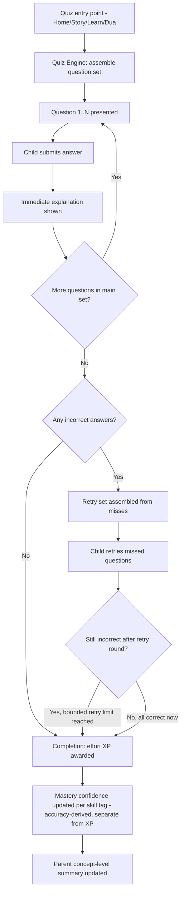
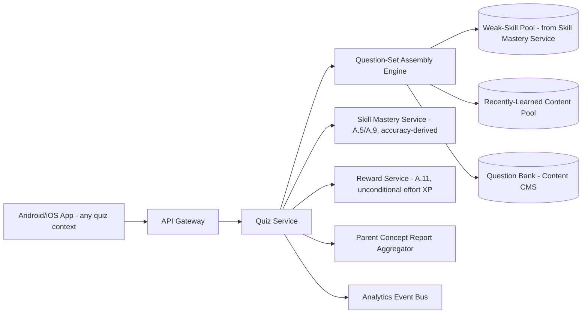
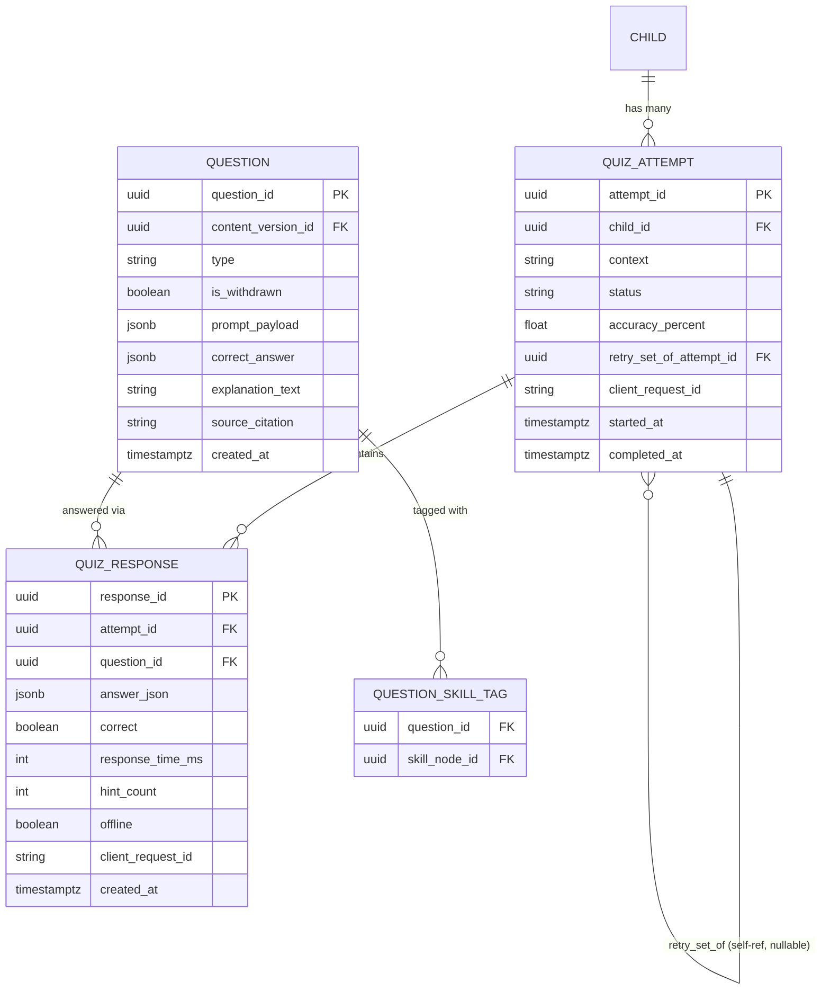

# Feature A.8 — Daily Quiz & Quiz Completion Engine

**App:** NoorHeroes — Islamic Learning App for Children
**Feature Owner:** Product / Learning Science / Content & Editorial
**Status:** Implementation-ready
**Version:** 1.0
**Depends on:** A.1 (Auth & Onboarding), A.2 (Home Dashboard — Daily Quiz widget), A.3 (Stories — post-story quiz instance), A.5 (Quran/Arabic — Learn-tab quiz instance), A.6 (Dua Learning — recall quiz instance), A.9 (Skill Tree/Mastery), Content CMS (Quiz Builder)
**Feeds into:** A.11 Rewards (effort XP), A.9 Skill Mastery (accuracy → mastery confidence), C.22 Parent Progress Reports

> **Scope note:** This document specifies the **shared Quiz Engine** consumed across the platform — by Home's Daily Quiz widget, the Learn tab's skill-practice quizzes (A.5), Stories' post-episode quiz (A.3), and Dua Learning's recall quiz (A.6). Those features reference this engine's contract rather than re-implementing it; this is the single source of truth for quiz assembly, question types, scoring, retry logic, and the parent-facing skill-summary reporting model.

---

## Table of Contents

1. [Product Requirements](#1-product-requirements)
2. [UX/UI Requirements](#2-uxui-requirements)
3. [Backend Requirements](#3-backend-requirements)
4. [Database Design](#4-database-design)
5. [Backend AI Code-Generation Prompt](#5-backend-ai-code-generation-prompt)
6. [Android Requirements](#6-android-requirements)
7. [Android AI Code-Generation Prompt](#7-android-ai-code-generation-prompt)
8. [Admin Requirements](#8-admin-requirements)
9. [Admin AI Code-Generation Prompt](#9-admin-ai-code-generation-prompt)
10. [DevOps Requirements](#10-devops-requirements)
11. [Analytics Requirements](#11-analytics-requirements)
12. [Security Requirements](#12-security-requirements)
13. [QA Requirements](#13-qa-requirements)
14. [Marketing Requirements](#14-marketing-requirements)
15. [Release & Rollback Plan](#15-release--rollback-plan)

---

## 1. Product Requirements

### 1.1 Problem Statement

Children need frequent, low-stakes spaced reinforcement of what they've learned — mixing new content with previously weak skills — that always explains the right answer immediately, never makes accuracy a precondition for being rewarded for trying, and reports to parents in terms of concepts mastered rather than a bare percentage score (source: Consolidated Blueprint §6.3/§21.9: "Daily Quiz: Five questions assembled from recently learned content and weak skills... Immediate explanation after each answer... Completion awards effort XP; accuracy affects mastery, not base participation XP... Parent report shows concepts, not just a score").

### 1.2 Business Goals

- Establish Daily Quiz as the platform's primary spaced-repetition mechanism, reinforcing retention across Quran, Arabic, Tajweed, Stories, and Dua content uniformly.
- Feed the Skill Mastery model (A.5/A.9) with reliable, well-structured accuracy signals distinct from participation-based reward issuance.
- Provide parents with genuinely informative, concept-level progress reporting that justifies continued engagement/subscription value.
- Maintain a single, consistently-governed quiz engine to avoid fragmented, inconsistent quiz UX across features (Stories' post-episode quiz, Learn tab's practice quiz, Dua's recall quiz, Home's Daily Quiz widget all share this contract).

### 1.3 User Goals

- **Child:** Get a short, varied, fair quiz that mixes new and familiar material, learn the right answer right away when I get something wrong, and feel rewarded for trying even if I don't get everything right.
- **Parent:** See what concepts my child is mastering and which need more attention — not just a raw score that doesn't tell me anything useful.

### 1.4 Success Metrics

| Metric | Target |
|---|---|
| Daily Quiz completion rate (started → all questions answered) | ≥ 70% |
| Daily Quiz attempt rate among active children | ≥ 60%/day |
| Retry-set engagement rate (children who retry missed questions when offered) | ≥ 75% |
| Per-answer explanation view-through rate (not skipped) | ≥ 80% |
| Parent skill-summary report view rate (weekly) | ≥ 30% |
| Quiz-driven mastery-confidence accuracy (validated against later independent performance) | Tracked as a model-quality metric, reviewed quarterly |
| Crash-free quiz sessions | ≥ 99.6% |
| Effort-XP-awarded rate (% of started quizzes that result in some reward, regardless of accuracy) | 100% of completed quizzes (by design — this is a hard rule, not a target to optimize) |

### 1.5 Stakeholders

Product Manager, Learning Science/Curriculum Designer, Content/Editorial Lead (Quiz Builder), Backend Architect, Android Architect, Data Analyst, Security Engineer, QA Lead, Customer Support Lead, feature owners of A.2/A.3/A.5/A.6/A.9 (engine consumers).

### 1.6 User Stories

1. As a child, I want a short daily quiz with a mix of question types so it doesn't feel repetitive.
2. As a child, I want the quiz to include some things I just learned and some things I learned a while ago, so I don't forget them.
3. As a child, when I get a question wrong, I want to immediately see why, not just "incorrect."
4. As a child, I want a chance to retry the questions I got wrong, within the same session.
5. As a child, I want to feel good about finishing the quiz even if I didn't get everything right.
6. As a child, I want quiz questions with pictures or sounds, not just text, when that fits the content.
7. As a child, I want hints when I'm stuck on a question, without the hint giving away the whole answer.
8. As a parent, I want to see which concepts my child has mastered and which need more practice — not just a percentage.
9. As a child, I want the quiz embedded right where I'm learning (after a story, in the Learn tab, after a dua) rather than feeling like a separate disconnected test.
10. As a child without internet, I want to still take a quiz I've already downloaded.
11. As a system, I want quiz questions withdrawn for safety reasons to never count toward a child's mastery or reward, even if the attempt was made before withdrawal and is being synced late.

### 1.7 Functional Requirements

**FR-1** Daily Quiz assembles exactly 5 questions per session, sourced from a mix of recently-learned content and identified weak skills (source §6.3/§21.9).
**FR-2** Supported question types: multiple choice, sequence/ordering, true/false, image match, audio match (source §6.3/§21.9/§23.5) — the engine must support all five types as first-class, reusable across every consuming feature.
**FR-3** Immediate explanation is shown after every answer submission, regardless of correctness (source §6.3/§21.9) — this is not optional or skippable-by-default; it is always presented.
**FR-4** Incorrect answers enter a short retry set within the same session (source §6.3/§21.9) — the retry set is assembled from only the missed questions (or close variants, per content design), not the full original set.
**FR-5** Quiz completion always awards effort XP, regardless of accuracy; accuracy independently feeds the Skill Mastery model's confidence calculation but never reduces or withholds the base participation reward (source §6.3/§21.9/§A.5 FR-16 cross-reference — a hard, platform-wide rule restated here as this engine's authoritative implementation point).
**FR-6** Parent-facing reporting from any quiz attempt must surface concepts/skills addressed, not a bare numeric score as the headline (source §6.3/§21.9).
**FR-7** Each question records: `question_id`, `content_version_id`, attempt number, answer, response time, hint count, and an offline flag (source §21.9 "Detailed sample screen" data fields) — this data model is shared across all question types and all consuming features.
**FR-8** Hints are progressive/partial (consistent with A.5 FR-18) and tracked via `hint_count` feeding mastery-confidence calculation, never shown as a visible penalty to the child.
**FR-9** The Quiz Engine must be embeddable/contextualized by the calling feature — a Daily Quiz widget instance (Home), a Learn-tab skill-practice instance (A.5), a post-Story instance (A.3, "3 to 5 questions"), and a Dua recall instance (A.6, "1 to 3 questions") all use the same underlying attempt/response/scoring contract, parameterized by question count and source pool rather than divergent implementations.
**FR-10** Offline quiz attempts are supported when the question bank was included in a content download package; results sync on reconnect with idempotent submission (cross-ref A.3/A.5/A.6 offline patterns).
**FR-11** A quiz attempt that references a question later withdrawn for safety reasons must still sync for historical record purposes, but the withdrawn item is **excluded from mastery and reward calculation** even if the attempt predates the withdrawal and is syncing late (source: Error & Edge-Case Matrix, "Offline quiz uses a withdrawn question → Sync the attempt for history, but exclude the withdrawn item from mastery/reward if it was withdrawn for safety reasons").
**FR-12** Distractor (wrong-answer-option) quality is governed by the Quiz Builder's content-authoring validation, including a "preview for mobile and screen reader" check before publish (source §23.5) — this engine's read path trusts that published questions have passed this authoring-side quality gate.
**FR-13** Question versions are locked after publication (source §23.5 "Version lock after publication") — an in-flight quiz session must never have a question's content change underneath it mid-attempt; edits create a new version for future sessions only.
**FR-14** Quiz attempts are idempotent via `client_request_id` at the attempt level, consistent with the platform's universal idempotency pattern (source §9.3 `quiz_attempts`/`quiz_responses` schema notes).
**FR-15** The engine must support per-question skill-tagging (linking a question to one or more skill/mastery nodes) so that a single quiz session can simultaneously update mastery confidence across multiple distinct skills.

### 1.8 Non-Functional Requirements

- **Performance:** Question-set assembly p95 < 500ms; per-answer explanation render is instantaneous (pre-fetched alongside the question, not a separate round-trip after submission).
- **Reliability:** Question-content version-locking (FR-13) must be verified consistent — no mid-session content drift under any deploy/publish timing.
- **Accessibility:** Every question type must have a "preview for mobile and screen reader" verified path (source §23.5) — image-match and audio-match question types specifically require non-visual/non-auditory alternative interaction paths.
- **Offline tolerance:** Full offline quiz-taking parity for downloaded question banks (FR-10), with correct reconciliation on sync including the withdrawn-question exclusion rule (FR-11).
- **Localization:** All question text/audio/image-alt-text localized; RTL layout for Arabic-script question content.

### 1.9 Acceptance Criteria

- Given a child starts a Daily Quiz, when the question set is assembled, then exactly 5 questions are presented, drawn from a mix of recent-content and weak-skill pools.
- Given a child answers any question (correct or incorrect), when the answer is submitted, then an explanation is shown immediately before proceeding to the next question.
- Given a child answers 2 of 5 questions incorrectly, when the main set is complete, then a retry set containing those 2 (or close variants, per content design) is offered within the same session.
- Given a child completes a quiz with a low accuracy score, when completion is processed, then effort XP is still awarded at the standard participation rate — accuracy never reduces the base reward.
- Given a parent opens a quiz-linked progress report, when it renders, then it lists concepts/skills addressed (e.g., "Practicing: Surah Al-Fatiha recitation") rather than leading with a raw percentage.
- Given a quiz question is withdrawn by Admin for safety reasons after a child took it offline but before their attempt syncs, when the sync occurs, then the attempt record is stored for history but that specific question's response is excluded from mastery/reward calculation.
- Given the same `client_request_id` is submitted twice for a quiz attempt completion (e.g., a network retry), when the server processes both, then only one completion result (and one reward grant) exists.
- Given a question's content is edited and republished mid-day, when a child who started their session before the edit submits a still-in-progress answer, then their session continues to reference the version that was active when their session started (no mid-session content drift).

### 1.10 Edge Cases

1. A child's weak-skill pool is empty (e.g., a brand-new learner with very little history) → the 5-question assembly falls back to a sensible default mix (recent content + a small set of foundational/placement-relevant questions) rather than failing to produce a full 5-question set.
2. A child has so many weak skills that more than 5 qualify for inclusion → the assembly algorithm prioritizes (e.g., by recency-of-weakness, skill importance, or balanced topic coverage) rather than arbitrarily; this prioritization logic should be deterministic and explainable for QA/debugging purposes, not a black box.
3. A retry-set question is also answered incorrectly a second time → the system does not infinitely re-loop the same question within one session; after a bounded number of retry rounds (e.g., 1 retry round), the session concludes with supportive framing and the concept is flagged more strongly for future weak-skill prioritization, rather than trapping the child in an endless retry loop.
4. A child attempts a quiz offline using a downloaded question bank, and one of those questions happens to be a "weak skill" question whose weak-skill status has since changed server-side (the child since improved on it through other practice) → the offline-served question bank reflects whatever was true at download time; on sync, the server's authoritative mastery model is what's actually updated (the stale client-side weak-skill framing doesn't cause incorrect mastery double-counting, since mastery is recalculated server-side from the actual response data, not from the client's assumed reason-for-inclusion).
5. A child rapidly answers all 5 questions in an implausibly short time (e.g., random tapping) → `response_time_ms` is recorded and may feed an anomaly/quality signal for mastery-confidence weighting (a suspiciously fast correct answer contributes less confidence than a thoughtfully-timed one), without blocking the child's reward (effort XP is unconditional per FR-5) or accusing them of cheating in any visible way.
6. Two consuming features (e.g., Stories' post-episode quiz and Home's Daily Quiz widget) could theoretically select overlapping questions for the same child on the same day → this is acceptable and not treated as an error (repetition across distinct contexts has its own spaced-repetition value), but the weak-skill-pool logic should avoid recommending the *exact same* question instance twice within a very short time window (e.g., the same hour) to avoid a jarring "didn't I just answer this" experience.
7. An image-match or audio-match question's media asset fails to load mid-quiz → the question gracefully skips (treated as unanswered, not as an incorrect answer) with a brief explanation ("This question will come back another time") and the assembly logic backfills if possible, or the session simply proceeds with 4 questions rather than blocking entirely.
8. A child uses the maximum hint level on every question → mastery-confidence is appropriately discounted for heavily-hinted correct answers (consistent with A.5 FR-18's "hint usage... feeding the mastery-confidence calculation"), but this is invisible to the child — no UI signal makes them feel penalized for using hints.
9. A quiz attempt spans a midnight boundary (started at 11:58pm, finished at 12:03am) → the attempt is attributed to the day it was *started* for daily-quiz-eligibility purposes (a child shouldn't be blocked from "today's" Daily Quiz just because they happened to finish a late-night one slightly past midnight, nor should they be able to get two Daily Quiz instances by timing it this way — the eligibility window logic must handle this gracefully, consistent in spirit with A.7's local_date handling).
10. A parent-facing skill-summary report is requested for a quiz attempt that included questions from multiple distinct skill domains (e.g., a Daily Quiz mixing a Quran question and a Dua question) → the report correctly attributes each question's contribution to its respective skill domain's mastery tracking, never conflating them into one ambiguous combined score.
11. A child completes the main 5-question set with zero incorrect answers → no retry set is offered (there's nothing to retry); the completion flow proceeds directly to the reward/summary screen without an empty or skipped-feeling intermediate step.
12. A quiz session is abandoned mid-way (child closes the app after 2 of 5 questions) → partial progress is not silently lost; on next entry, the child is offered to resume the same session (if still within a reasonable time window) rather than being forced to restart from question 1, consistent with the platform's general resumability philosophy (A.1 FR-16 spirit).

### 1.11 Error Handling

| Scenario | System Behavior |
|---|---|
| Question-set assembly service unavailable | Falls back to a cached/default deterministic question set rather than blocking quiz access entirely |
| Media asset failure (image/audio question) | Graceful skip per Edge Case 7, never a hard quiz-blocking error |
| Quiz attempt submission fails (network) | Local state preserved (offline-first), retried with idempotency key, never re-prompts the child to re-answer already-answered questions |
| Mastery/reward processing failure post-completion | Completion UI still shows (the child's experience isn't blocked), with reward/mastery reconciliation happening asynchronously and retried server-side |
| Withdrawn question encountered mid-session (rare, real-time withdrawal during an active session) | The specific question is excluded from that session's remaining flow if not yet answered; if already answered, the response is still recorded but flagged for mastery/reward exclusion per FR-11 |

### 1.12 Empty States
- Zero quiz history yet (brand-new learner) → first-time quiz framing rather than a stark "no data" report for parents.
- A consuming feature (e.g., Dua Learning) has no qualifying question pool for a specific item → that quiz entry point is simply not offered (consistent with A.6 FR-6, "Recall Quiz... only offered for duas already marked Learned" — absence is expected, not an error state).

### 1.13 Loading States
- Question-set assembly: brief skeleton/loading state, typically near-instant given p95 < 500ms target.
- Per-answer explanation: pre-fetched alongside the question payload, so there is no additional loading state between answer submission and explanation display.

### 1.14 Offline States
- Full offline quiz-taking for downloaded question banks; results queue and sync per FR-10/FR-11.

### 1.15 Permission States
- No new runtime permissions; audio-match questions reuse existing media-playback capability, no microphone involvement (quizzes are answer-selection based, not recitation-recording based — that's A.5's distinct Tajweed/recitation flow).

### 1.16 User Flow (Narrative)

Child enters a quiz context (Home's Daily Quiz widget, post-Story, Learn-tab practice, or Dua recall) → Quiz Engine assembles the appropriate question set (5 for Daily Quiz, 3–5 for post-Story, 1–3 for Dua recall) → child answers each question, receiving immediate explanation after every answer → incorrect answers are collected into a retry set offered at the end of the main set → child optionally retries → session completes → effort XP awarded unconditionally → accuracy-derived mastery-confidence updates propagate to the Skill Mastery model → parent-facing concept-level summary becomes available in the relevant Progress Report.

### 1.17 Detailed Flow Diagram (Mermaid)



### 1.18 Screen Inventory (Complete — Zero Missing)

| # | Screen / Component | Type | Entry Points | Exit Points |
|---|---|---|---|---|
| 1 | Quiz Entry Card (context-specific: Daily Quiz widget, post-Story prompt, Learn-tab practice, Dua recall) | Component | Home, Story completion flow (A.3), Skill Tree (A.5), Dua Card (A.6) | Quiz Question Screen |
| 2 | Quiz Question Screen — Multiple Choice | Screen | Quiz Entry Card | Per-Answer Explanation |
| 3 | Quiz Question Screen — Sequence/Ordering | Screen | Quiz Entry Card | Per-Answer Explanation |
| 4 | Quiz Question Screen — True/False | Screen | Quiz Entry Card | Per-Answer Explanation |
| 5 | Quiz Question Screen — Image Match | Screen | Quiz Entry Card | Per-Answer Explanation |
| 6 | Quiz Question Screen — Audio Match | Screen | Quiz Entry Card | Per-Answer Explanation |
| 7 | Hint Overlay (cross-cutting, shared with A.5) | Component | Any Question Screen "Hint" control | Resumes question |
| 8 | Per-Answer Explanation Overlay | Component | Every question, after submission | Next question / Retry Set / Completion |
| 9 | Media-Load-Failure Graceful Skip Notice | Component | Image/Audio Match question, asset failure | Next question (question excluded) |
| 10 | Retry Set Entry Screen | Screen | End of main question set, if any incorrect | Retry Question Screens |
| 11 | Retry Question Screen (reuses type-specific screens 2-6) | Screen | Retry Set Entry | Per-Answer Explanation |
| 12 | Quiz Completion / Effort XP Reveal | Screen | End of main set (no misses) or end of retry round | Skill Mastery update (background), Parent report availability |
| 13 | Resume-In-Progress-Session Prompt | Component | Re-entry to a quiz context with an abandoned partial session | Resumes at the correct question index |
| 14 | Offline Quiz Indicator | Component | Any quiz screen, while offline | N/A |
| 15 | Parent Quiz/Concept Summary Report (context-aggregated) | Screen (Parent Area) | Parent Dashboard → Child Progress | Concept Detail Drill-in (shared with A.5 §1.18) |

### 1.19 Events (Complete Analytics Event List)

`quiz_started` (with `context: home_daily|story_post|learn_practice|dua_recall`, `question_count`), `quiz_question_presented` (with `question_type`), `quiz_question_answered` (with `correct`, `response_time_ms`, `hint_count`), `quiz_explanation_viewed`, `quiz_media_skip_due_to_load_failure`, `quiz_retry_set_started`, `quiz_retry_question_answered`, `quiz_retry_limit_reached`, `quiz_completed` (with `accuracy_percent`, `total_questions`), `quiz_effort_xp_awarded`, `quiz_mastery_confidence_updated` (per skill tag), `quiz_abandoned` (with `last_question_index`), `quiz_resumed`, `quiz_offline_attempted`, `quiz_offline_synced`, `quiz_withdrawn_question_excluded_on_sync`, `parent_quiz_summary_viewed`.

---

## 2. UX/UI Requirements

> Global Design System tokens defined in **Feature A.1 §2.1**; hint iconography and progressive-hint pattern established in **Feature A.5 §2.1**.

### 2.1 Quiz-Specific Design System Extensions

- **Question Type Visual Consistency:** All five question types share a consistent screen skeleton (header with progress dots, central question-content area, answer-options area, persistent Hint control) so children recognize "I'm in a quiz" regardless of which feature launched it — critical given this engine is invoked from four different contexts.
- **Non-Punitive Incorrect-Answer Treatment:** Consistent with A.5's pronunciation-feedback philosophy, incorrect quiz answers use supportive iconography (not a harsh red X as the *dominant* visual element) paired with the immediate explanation — the explanation card is the visual focus, not a failure indicator.
- **Retry Set Framing:** Visually distinguished from the main set (e.g., a subtitle "Let's try these again" rather than feeling like a punishment lap), with its own short progress indicator separate from the main set's.
- **Effort XP Reveal:** Always positive/celebratory regardless of accuracy — the completion screen's tone and visual treatment do not vary based on score (a 1/5 and a 5/5 completion both get a warm, celebratory effort-acknowledgment screen; only the parent-facing report, never the child-facing completion screen, reflects accuracy detail).

### 2.2 Screen-Level Design Requirements (Key Screens)

#### Screen: Quiz Question Screen (generic template across types)

- **Purpose:** Present one question clearly with type-appropriate interaction.
- **Components:** Progress indicator (dots or "Question 2 of 5"), question prompt (text/image/audio depending on type), answer-options area (2-4 multiple-choice cards, drag-to-order tiles for sequence, true/false large dual buttons, tap-to-match grid for image/audio match), Hint control (secondary, always visible), Submit/auto-advance-on-select behavior depending on type.
- **States:** Default, Answer-selected-not-yet-submitted (where applicable), Submitting, Explanation-shown, Media-loading, Media-load-failed-skip.
- **Accessibility:** Sequence/ordering questions must support a non-drag alternative (e.g., numbered-tap-to-place) for accessibility; audio-match questions provide a text-transcript fallback option; image-match questions provide descriptive alt-text per option.
- **Responsive Rules:** Answer-option grids reflow for tablet (more columns) without changing interaction model.

#### Screen: Per-Answer Explanation Overlay

- **Purpose:** Immediately teach the correct concept regardless of the child's answer.
- **Components:** Correct-answer restatement, brief explanation text, source/reference tag where applicable (consistent with Islamic Facts' source-citation pattern), "Next" control.
- **States:** Correct-answer-given (light positive accent), Incorrect-answer-given (same explanation content, supportive — not punitive — framing, never hidden or abbreviated compared to the correct-answer case).

### 2.3 Tab Structure

The Quiz Engine has no dedicated tab of its own — it is embedded contextually. Click mapping (representative, per context):

| Click Target | Destination | API Called | Analytics Event | Permission Check | Error Handling |
|---|---|---|---|---|---|
| Home "Daily Quiz" widget | Quiz Question Screen (session start) | `GET /v1/quizzes/daily` | `quiz_started` (context=home_daily) | None | Friendly unavailable message (A.2 pattern) |
| Story post-completion quiz prompt | Quiz Question Screen | `GET /v1/quizzes/content/{episode_id}` | `quiz_started` (context=story_post) | Entitlement (inherited from already-unlocked episode) | Quiz step skippable, reward still finalizes (A.3 §1.11) |
| Skill Tree practice quiz entry | Quiz Question Screen | `GET /v1/quizzes/skill/{node_id}` | `quiz_started` (context=learn_practice) | None | Cached fallback |
| Dua recall quiz entry | Quiz Question Screen | `GET /v1/quizzes/dua/{dua_id}` | `quiz_started` (context=dua_recall) | Learned-status gate (A.6 §3.4) | `403 NOT_YET_LEARNED` |
| Answer option tap | Per-Answer Explanation | `POST /v1/quiz-attempts/{id}/responses` | `quiz_question_answered` | None | Optimistic local advance, retry sync |
| Hint control | Hint Overlay | `GET /v1/learning/hints/{question_id}` (shared with A.5) | `hint_requested` | None | Generic encouragement fallback |

### 2.4 Wireframe Description (Composite)

A single-question-per-screen, full-attention wireframe (no surrounding navigation chrome visible during an active quiz session, similar in spirit to the Story Player's immersive full-screen treatment, though without hiding system status bars) — minimizes distraction during the short, focused quiz experience. The Explanation Overlay appears as a bottom-sheet-style overlay rather than a full screen transition, keeping the question content visible above it for context.

### 2.5 Screen Image Generation Prompts

**Screen: Quiz Question Screen (Multiple Choice)**
- *Prompt 1 (English):* "Mobile app quiz question screen UI mockup for a children's Islamic learning app. Warm off-white background. A small progress indicator at top showing 'Question 2 of 5' with simple dot markers. Center area shows a short question prompt in friendly rounded text, with a small decorative icon. Below, four large rounded rectangular answer-option cards stacked vertically, each with simple text and a small leading icon, one card highlighted with a soft teal border indicating selection. A small lightbulb-shaped hint icon button in a corner. Calm, focused, encouraging aesthetic, soft shadows, generous spacing, no realistic human faces, no harsh red/green colors anywhere yet (pre-submission state)."
- *Prompt 2 (Arabic RTL):* "نفس شاشة سؤال الاختبار لتطبيق تعليم إسلامي للأطفال، بتخطيط من اليمين إلى اليسار بالكامل. خلفية بيج فاتح دافئ. مؤشر تقدم صغير في الأعلى يعرض 'السؤال 2 من 5' بعلامات نقطية بسيطة. منطقة المنتصف تعرض نص سؤال قصير بخط مستدير ودود، مع أيقونة زخرفية صغيرة. أسفل ذلك أربع بطاقات اختيار إجابة كبيرة مستديرة الزوايا مرصوصة عموديًا، كل منها بنص بسيط وأيقونة قائدة صغيرة، بطاقة واحدة مميزة بحد فيروزي ناعم تشير إلى التحديد. زر أيقونة لمبة تلميح صغيرة في الزاوية. طابع هادئ ومركّز ومشجع، ظلال خفيفة، تباعد كبير، بدون وجوه بشرية واقعية، بدون ألوان أحمر/أخضر قاسية في أي مكان حتى الآن (حالة ما قبل الإرسال)."

**Screen: Per-Answer Explanation Overlay**
- *Prompt 1 (English):* "Mobile app bottom-sheet overlay UI mockup for a children's quiz feedback screen, shown over a dimmed/blurred quiz question screen behind it. The sheet has rounded top corners, warm cream background. At the top, a small supportive icon (a soft upward sparkle, not a checkmark or X), below it bold restated correct-answer text, then a short friendly explanation paragraph, then a small source/reference tag chip. A single rounded gold 'Next' button at the bottom. Calm, instructive, non-judgmental visual tone, soft shadows, generous padding, no realistic human faces."
- *Prompt 2 (Arabic RTL):* "نفس واجهة النافذة المنبثقة من الأسفل لشاشة تغذية راجعة اختبار الأطفال، تظهر فوق شاشة سؤال الاختبار المعتمة/الضبابية خلفها، بتخطيط من اليمين إلى اليسار. للورقة زوايا علوية مستديرة وخلفية كريمية دافئة. في الأعلى أيقونة داعمة صغيرة (بريق صاعد ناعم، ليست علامة صح أو خطأ)، تحتها نص الإجابة الصحيحة بخط عريض، ثم فقرة شرح قصيرة وودودة، ثم شريحة صغيرة لمصدر/مرجع. زر ذهبي مستدير واحد بعنوان 'التالي' في الأسفل. طابع بصري هادئ وتعليمي وغير قاسٍ في الحكم، ظلال خفيفة، حشوة كبيرة، بدون وجوه بشرية واقعية."

*(Remaining screens — Sequence/Ordering, True/False, Image Match, Audio Match question types, Retry Set Entry, Completion/Effort XP Reveal, Parent Concept Summary — follow the same two-prompt EN/AR template using these tokens; full set available on request.)*

---

## 3. Backend Requirements

### 3.1 System Design Overview

The Quiz Engine is a shared **Quiz Service** consumed by every feature requiring assessment functionality. It owns question-set assembly (mixing recent + weak-skill pools), attempt/response recording, retry-set logic, and publishes accuracy-derived mastery-confidence updates to the shared **Skill Mastery Service** (A.5/A.9) while independently triggering unconditional effort-XP issuance via the shared **Reward Service** (A.11) — these two downstream effects are deliberately decoupled (FR-5).

### 3.2 Architecture Diagram (Mermaid)



### 3.3 Service Breakdown

| Service | Responsibility |
|---|---|
| Quiz Service | Orchestrates attempt lifecycle, retry-set logic, withdrawn-question exclusion |
| Question-Set Assembly Engine | Mixes recent-content + weak-skill pools into a balanced set, deterministic prioritization |
| Skill Mastery Service (shared, A.5/A.9) | Receives accuracy-derived confidence updates per skill tag |
| Reward Service (shared, A.11) | Issues unconditional effort XP on quiz completion |
| Parent Concept Report Aggregator | Rolls up quiz history into concept-level (not score-level) parent-facing summaries |

### 3.4 API List

#### `GET /v1/quizzes/daily?child_id=`
- **Auth:** Bearer (child-mode)
- **Response 200:** `{ "attempt_id": "...", "questions": [ { "question_id": "...", "type": "multiple_choice", "content_version_id": "...", "prompt": "...", "options": [...], "media_url": null } ], "source_mix": { "recent": 3, "weak_skill": 2 } }`
- **Validation:** Exactly 5 questions per FR-1; falls back to default mix per Edge Case 1 if weak-skill pool is empty.
- **Idempotency:** Re-requesting on the same day before completion returns the **same** in-progress attempt (supports resume per Edge Case 12), not a freshly-reassembled set (which would break version-locking, FR-13).

#### `GET /v1/quizzes/content/{episode_id}` / `GET /v1/quizzes/skill/{node_id}` / `GET /v1/quizzes/dua/{dua_id}`
- **Response 200:** Same shape as above, with `question_count` varying per context (3–5 for story, context-dependent for skill practice, 1–3 for dua per the consuming features' specs) — same underlying contract, different assembly parameters.

#### `POST /v1/quiz-attempts/{attempt_id}/responses`
- **Auth:** Bearer (child-mode)
- **Request:** `{ "question_id": "...", "answer_json": {...}, "response_time_ms": 4200, "hint_count": 1, "offline": false, "client_request_id": "uuid..." }`
- **Response 200:** `{ "correct": true, "explanation": { "text": "...", "source_citation": "..." } }`
- **Idempotency:** `client_request_id` unique per response.
- **Validation:** `question_id` must belong to the referenced `attempt_id`'s assembled set (server-side check, preventing a tampered client from submitting answers to arbitrary unrelated questions).

#### `POST /v1/quiz-attempts/{attempt_id}/complete`
- **Request:** `{ "client_request_id": "uuid..." }`
- **Response 200:** `{ "completed": true, "accuracy_percent": 80, "reward": { "xp": 30, "noor_points": 15 }, "retry_set_question_ids": [...] }`
- **Business Logic:** Reward issuance is unconditional on this call succeeding (FR-5) — even a 0% accuracy attempt triggers the same base effort-XP reward as a 100% one (reward amount may scale by question count/context per the platform reward-rule table, but never by accuracy).
- **Idempotency:** Unique constraint prevents double reward on retried completion calls.

#### `GET /v1/children/{id}/quiz-concept-summary?period=weekly`
- **Auth:** Bearer (parent session)
- **Response 200:** Concept-level structure (e.g., `{ "concepts": [ { "skill": "Surah Al-Fatiha recitation", "status": "practicing", "recent_accuracy_trend": "improving" } ] }`) — explicitly no top-level raw score field as the headline metric, consistent with A.5's reporting philosophy.

### 3.5 Cross-Cutting API Concerns

- **Idempotency:** `client_request_id` enforced on both response-submission and completion endpoints.
- **Security:** Server-side validation that submitted `question_id`s belong to the actual assembled attempt (prevents answer-injection for unrelated/locked content).
- **Withdrawn-content handling:** A `is_withdrawn` flag check at completion-processing time excludes any withdrawn question's response from both mastery and reward-accuracy calculations (the response row is still stored for audit/history per FR-11).
- **Analytics:** All events from §1.19 emitted.

---

## 4. Database Design

### 4.1 ER Diagram (Mermaid)



### 4.2 Tables, Relationships, Constraints

| Table | Key Constraints | Indexes |
|---|---|---|
| `quiz_attempt` | FK `child_id`; UNIQUE(`client_request_id`); CHECK `status IN ('in_progress','completed','abandoned')` | Index `(child_id, context, started_at DESC)` |
| `question` | FK `content_version_id`; question content is version-locked post-publish (no UPDATE to a published question row; editing creates a new question/content_version row instead, mirroring the pattern from A.5/A.6) | Index `(type)` |
| `question_skill_tag` | FK `question_id`, `skill_node_id`; composite PK | Index `(skill_node_id)` |
| `quiz_response` | FK `attempt_id`, `question_id`; UNIQUE(`client_request_id`) | Index `(attempt_id)`, Index `(question_id, created_at DESC)` |

### 4.3 Audit Fields
`quiz_attempt.started_at`/`completed_at`; `quiz_response` is append-only/immutable (a historical fact, never edited).

### 4.4 Soft Delete Rules
`question.is_withdrawn = true` used instead of deletion — preserves all historical `quiz_response` rows referencing it, while excluding it from future assembly and from mastery/reward calculation on any late-syncing response per FR-11.

### 4.5 Retention Rules
`quiz_attempt`/`quiz_response` retained indefinitely as core learning-history data (feeds long-term Parent Concept Reports and mastery-model training/validation).

---

## 5. Backend AI Code-Generation Prompt

```
You are building the shared Quiz Service for "NoorHeroes," consumed by Home's
Daily Quiz widget, Stories' post-episode quiz, the Learn tab's skill-practice
quiz, and Dua Learning's recall quiz. This is a SHARED ENGINE -- design the
API to be parameterized by context/question-count, not forked per consumer.

Stack: FastAPI (Python 3.12), PostgreSQL (SQLAlchemy 2.0), Redis, Kafka.

Hard requirements:
1. Implement question-set assembly as a deterministic, explainable function
   given (child_id, context, target_question_count) -> list[question_id],
   mixing a "recent content" pool and a "weak skill" pool (sourced from the
   Skill Mastery Service). When the weak-skill pool is empty, fall back to
   a default foundational-question mix rather than returning fewer than
   target_question_count questions. When more weak-skill candidates exist
   than slots available, apply a deterministic priority order (e.g.,
   recency-of-weakness descending) -- write a test asserting the same
   input state always produces the same assembled set (no random
   non-reproducible selection that would complicate QA/debugging).
2. GET /v1/quizzes/daily (and the other context-specific GET endpoints)
   must be IDEMPOTENT at the "in-progress attempt" level: if the child
   already has an in_progress quiz_attempt for today/this context, return
   THAT SAME attempt's already-assembled question set (do not reassemble),
   supporting resume-after-abandonment (Edge Case 12) and preventing
   version-drift mid-session (FR-13). Write a test: call the endpoint
   twice for the same child+context without completing, assert the exact
   same attempt_id and question set are returned both times.
3. POST /v1/quiz-attempts/{attempt_id}/responses must validate that the
   submitted question_id is actually a member of that attempt's assembled
   question set -- reject (400) any attempt to submit a response for a
   question_id not in that set, even if that question_id is otherwise
   valid/published elsewhere. Write a test for this exact tampering
   scenario.
4. POST /v1/quiz-attempts/{attempt_id}/complete: implement
   UNCONDITIONAL effort-XP reward issuance via the Reward Service,
   regardless of computed accuracy_percent. The reward amount may vary by
   context/question_count (per the platform's configurable reward-rule
   table) but must NEVER vary by accuracy_percent. Write a test completing
   two attempts for the same context -- one with 0% accuracy, one with
   100% -- and asserting BOTH receive an IDENTICAL XP/Noor Heroes Points reward
   amount. Separately, write a test confirming accuracy_percent DOES
   correctly drive a mastery-confidence update call to the Skill Mastery
   Service (the two effects are decoupled but both must fire correctly).
5. Implement the withdrawn-question exclusion rule: when computing
   accuracy_percent and when triggering mastery-confidence updates at
   completion time, EXCLUDE any quiz_response where its question.
   is_withdrawn = true at processing time, even if the response itself
   was recorded earlier (e.g., an offline attempt syncing late after the
   question was withdrawn in the interim). The response row itself is
   still persisted for historical/audit purposes -- only its contribution
   to accuracy/mastery/reward-eligibility is excluded. Write a test:
   create an attempt with 5 responses, withdraw one of the referenced
   questions, THEN call /complete, and assert accuracy_percent is computed
   over the remaining 4 non-withdrawn responses only, with the 5th
   response row still present in the database.
6. Implement retry-set logic: after the main set completes with N
   incorrect responses, generate a retry_set_of_attempt_id-linked
   quiz_attempt containing only those N missed question_ids (or
   close content-defined variants if configured). Bound retry rounds to
   exactly 1 round by default (configurable) -- after that round, the
   session concludes regardless of remaining incorrect answers, per
   Edge Case 3. Write a test confirming a child who misses the same
   question in both the main set and the single retry round is NOT
   offered a third attempt within the same session.
7. Write Alembic migrations matching the ER diagram, with question content
   version-locking enforced (no UPDATE to a published question row;
   editing creates a new question/content_version row instead, mirroring
   the pattern from A.5/A.6).

Deliver: FastAPI routers, SQLAlchemy models, Alembic migrations, Pydantic
schemas, and a pytest suite covering all 7 items above, with item 4 (the
accuracy-independent reward guarantee) and item 5 (withdrawn-question
exclusion) treated as the highest-priority tests in this deliverable.
```

---

## 6. Android Requirements

### 6.1 Technical Requirements
Kotlin, Jetpack Compose, MVVM, Clean Architecture, module `:core:quiz-engine` (built as a **shared core module**, not a feature module, since it's consumed by `:feature:home`, `:feature:stories`, `:feature:learn`, and `:feature:dua-learning`), depends on `:core:design-system`, `:core:network`, `:core:offline-cache`, `:core:media-player` (for audio-match questions).

### 6.2 Screen Mapping
`QuizSessionScreen` is a single reusable Composable accepting a `QuizContext` parameter (home_daily/story_post/learn_practice/dua_recall) and a `questionCount`; each question type renders via a `QuestionTypeRenderer` sealed-dispatch pattern (one Composable per type, sharing the common screen skeleton).

### 6.3 Navigation Flow
`QuizSessionScreen` is launched as a modal/full-screen destination from any of the four consuming feature modules, returning a `QuizResult` to the caller via a typed navigation result channel (not a shared mutable global state) so each consumer can react appropriately (e.g., Stories proceeds to "Next Learning," Dua Learning updates its badge-progress UI).

### 6.4 State Management
`QuizSessionViewModel` holds the full session state machine: `Assembling → QuestionActive(index) → Submitting → ExplanationShown → (NextQuestion | RetrySet | Completed)`. Resume-after-abandonment is handled by re-calling the same `GET` endpoint, which the backend guarantees returns the same in-progress attempt (§5 item 2) — the client doesn't need its own separate resume-detection logic beyond simply re-fetching.

### 6.5 API Mapping
`QuizRepository.startQuiz(context, childId)` → context-appropriate `GET /v1/quizzes/...` endpoint; `submitResponse()` → `POST /v1/quiz-attempts/{id}/responses`; `completeAttempt()` → `POST /v1/quiz-attempts/{id}/complete`.

### 6.6 Analytics Mapping
`QuizAnalytics` fires `quiz_started` with the correct `context` value sourced from the calling feature's parameter, enabling cross-feature funnel analysis without each feature needing its own duplicate analytics wrapper.

### 6.7 Offline Support
Downloaded content packages (Stories/Learn/Dua, per their respective offline specs) may bundle a pre-assembled question set for offline use; `:core:quiz-engine` accepts either a server-fetched or a locally-bundled question set via the same internal model, so the question-rendering/answering/explanation UI code path is identical regardless of source. Offline responses queue in a shared outbox keyed by `client_request_id`.

### 6.8 Deep Linking
Not directly deep-linked (always entered via a consuming feature's own entry point), but the shared `:core:quiz-engine` module exposes a stable internal API contract so any future feature can adopt it without new engine work.

### 6.9 Push Notifications
N/A directly; consuming features (Home/Habit Tracker) may send quiz-related reminders, deep-linking into their own entry points which then launch the shared quiz engine.

### 6.10 Testing Strategy
- Unit: question-type-agnostic session state machine (Assembling/Active/Submitting/Explanation/Retry/Completed transitions), shared across all four consumers — tested once in `:core:quiz-engine`, not duplicated per feature.
- UI tests: each of the 5 question-type renderers individually (multiple choice, sequence, true/false, image match, audio match), explanation overlay always appears regardless of correctness, completion screen visual treatment is identical regardless of accuracy (a structural UI test comparing rendered tree similarity between a 0%-accuracy and 100%-accuracy completion screen, asserting no accuracy-conditional visual branching exists on this specific screen).
- Integration: full main-set → retry-set → completion flow across all four `QuizContext` values, offline question-bank flow, resume-after-abandonment flow.

---

## 7. Android AI Code-Generation Prompt

```
Build `:core:quiz-engine` as a SHARED Android module for NoorHeroes (Kotlin,
Jetpack Compose, MVVM, Clean Architecture) consumed by `:feature:home`,
`:feature:stories`, `:feature:learn`, and `:feature:dua-learning`. Do not
build per-feature quiz implementations -- this module is the single
reusable engine.

Hard requirements:
1. Define a public QuizContext enum (HomeDaily, StoryPost, LearnPractice,
   DuaRecall) and a single QuizSessionScreen composable accepting
   (context: QuizContext, childId: String, questionCount: Int? = null,
   sourceId: String? = null) as its entry parameters, returning a
   QuizResult (accuracyPercent, rewardGranted, conceptsTouched) via a
   typed navigation result mechanism (e.g., a callback or a
   SavedStateHandle-backed result flow) to the calling feature module --
   no shared mutable singleton state between consumers.
2. Implement QuizSessionViewModel's state machine as a sealed class:
   Assembling, QuestionActive(index, question), Submitting,
   ExplanationShown(correct, explanation), RetrySetIntro,
   Completed(accuracyPercent, reward). On re-entering a quiz context
   that has an in-progress backend attempt, the ViewModel must simply
   re-fetch via the same repository call (which the backend guarantees
   is idempotent and returns the same attempt) -- do NOT implement
   separate client-side "is this a resume?" detection logic; trust the
   backend's idempotent response.
3. Build 5 question-type renderer composables (MultipleChoiceRenderer,
   SequenceOrderingRenderer, TrueFalseRenderer, ImageMatchRenderer,
   AudioMatchRenderer) behind a single QuestionTypeRenderer dispatcher
   that switches on the question's type field. SequenceOrderingRenderer
   MUST provide a non-drag, tap-to-place alternative interaction mode
   (not drag-only) for accessibility -- write a UI test exercising the
   tap-to-place path end-to-end without ever issuing a drag gesture.
4. The Per-Answer Explanation overlay composable must render IDENTICALLY
   in structure (same component tree shape) whether correct=true or
   correct=false -- only the small leading icon and a brief lead-in
   phrase differ; the explanation text/source-citation rendering must be
   byte-for-byte the same code path for both cases. Write a UI test
   asserting the Explanation overlay's semantics tree, with the
   correct-vs-incorrect icon node excluded from comparison, is otherwise
   structurally identical between a correct and incorrect answer
   rendering of the same question.
5. The Completion screen composable must NOT branch its visual treatment
   (colors, animation, layout) based on accuracyPercent -- write a
   Compose UI test rendering the Completion screen with accuracyPercent=0
   and accuracyPercent=100 and asserting the rendered composable tree
   (excluding only the numeric text content itself, which legitimately
   differs) uses identical component types, colors, and layout structure
   in both cases. This directly verifies the accuracy-independent-reward
   UX principle on the client side.
6. Implement an offline question-bank adapter: QuizRepository can be
   constructed with either a server-backed data source or a
   locally-bundled (Room-cached, pre-downloaded) data source implementing
   the same interface -- QuizSessionViewModel must be unaware of which
   source is active, consuming only the shared interface.
7. Write an integration test for the full flow: assemble a 5-question
   set (mocked), answer 2 incorrectly, complete the main set, verify a
   retry set is offered containing exactly those 2 questions, answer one
   correctly and one incorrectly again in the retry round, verify the
   session then concludes (no third round) and reaches Completed state
   with reward granted regardless of the final retry-round accuracy.

Use Hilt, Retrofit+OkHttp, Room, the shared `:core:media-player` for
audio-match question playback. Follow Global Design System tokens from
`:core:design-system` for the consistent quiz-screen skeleton described in
this spec's UX section.
```

---

## 8. Admin Requirements

Per the existing Admin Portal's "Quiz Builder" module (source: NoorHeroes Feature Reference §23.5):

- **Question Bank & Reusable Skills:** CRUD for questions across all 5 supported types, with correct-answer/explanation authoring, difficulty/age/locale/skill tags, and a **distractor quality check** tool (flagging implausible or ambiguous wrong-answer options for editorial review before publish).
- **Preview for Mobile and Screen Reader:** A mandatory pre-publish preview step rendering the question as it will actually appear on both a mobile viewport and via a screen-reader-simulation pass — publish is blocked until this preview has been explicitly acknowledged by the editor.
- **Version Lock After Publication:** Editing a published question creates a new version; the live version remains locked/immutable to any in-flight quiz session referencing it (consistent with FR-13).
- **Withdrawal Tool:** Mark a question `is_withdrawn = true` (never hard-delete) with a required reason field, triggering the exclusion logic specified in §5 item 5.
- **Question-Set Assembly Monitor (Read-only):** Visibility into the deterministic assembly algorithm's actual output distribution (e.g., are certain skills over/under-represented across the user base's daily quizzes) — an editorial/curriculum-quality signal, not a per-child surveillance tool.

CRUD permissions: Question Bank = full CRUD (delete = withdraw) behind `content_editor` role, scholar-approval-gated for any Quran/Tajweed/Dua-tagged question content (cross-referencing A.5/A.6's content-governance rules); Withdrawal Tool = Update-only behind `content_editor` or `trust_safety` role; Assembly Monitor = Read-only.

---

## 9. Admin AI Code-Generation Prompt

```
Build/extend the NoorHeroes Admin Portal's Quiz Builder module (React +
TypeScript) for managing the shared Question Bank consumed by all four
quiz contexts (Home Daily Quiz, Stories post-episode, Learn-tab practice,
Dua recall).

Pages:
1. Question Bank Editor -- CRUD for questions: type selector (multiple
   choice | sequence | true_false | image_match | audio_match), prompt
   content (text/image/audio depending on type), answer options +
   correct-answer designation, explanation text + source_citation,
   difficulty/age_band/locale/skill_tags (multi-select linking to
   skill_node entities from the A.5 Skill Tree Builder). Include a
   "Distractor Quality Check" panel that runs a simple heuristic (e.g.,
   flag if two options are near-duplicate text, or if there's no
   plausible-but-wrong option for multiple choice) and surfaces warnings
   before allowing submission for review -- warnings, not hard blocks,
   since they require human judgment to resolve.
2. Pre-Publish Preview -- a required step before a question can move to
   status='published': render a live preview of the question exactly as
   the mobile app would (using the same component library/styling
   tokens where feasible, or a close visual approximation), PLUS a
   simulated screen-reader-reading-order text dump showing what a
   screen-reader user would hear. The "Publish" button is disabled until
   the editor has clicked "I've reviewed this preview" for both the
   visual and screen-reader views.
3. Version History -- editing a published question creates a NEW
   question/content_version row (never an in-place edit of a live
   version); show a version-history list per question with diffs.
4. Withdrawal Tool -- a "Withdraw" action (not "Delete") requiring a
   reason field, calling PATCH /admin/v1/questions/{id}
   { is_withdrawn: true, reason }. Withdrawn questions remain visible in
   this table with a status pill, never disappear.
5. Question-Set Assembly Monitor -- read-only dashboard (recharts) showing
   aggregate distribution of which skills/topics are actually appearing
   in assembled daily quizzes across the user base over time, sourced
   from a read-only aggregated endpoint, to help curriculum/editorial
   teams spot over/under-represented topics -- this page must NOT expose
   any per-child quiz history, only aggregate topic-distribution data.

Enforce RBAC via the existing Admin Portal role context, with
Quran/Tajweed/Dua-tagged questions additionally requiring scholar
approval before publish (reuse the existing scholar-review workflow
component from the A.5/A.6 admin modules rather than building a new one).
Every mutating action writes an immutable audit_log row.
```

---

## 10. DevOps Requirements

- **Infrastructure:** Quiz Service is a high-traffic shared dependency (invoked by four different feature surfaces) — scaled and monitored as a Tier-1 shared service, with its own SLA distinct from any single consuming feature's SLA.
- **CI/CD:** The accuracy-independent-reward test and the withdrawn-question-exclusion test (§5 items 4 and 5) are **mandatory, non-bypassable** CI gates on any PR touching the Quiz Service, Reward Service integration, or Skill Mastery Service integration.
- **Monitoring/Logging/Alerting:** Alert on question-set assembly p95 latency breach (impacts four different feature surfaces simultaneously, so this is a higher-severity alert than a typical single-feature latency issue). Alert on `quiz_withdrawn_question_excluded_on_sync` rate spiking (could indicate a content-safety issue requiring broader investigation beyond just this exclusion mechanism working correctly). Alert on reward-amount variance correlating with accuracy in production sampling (a canary check specifically for the accuracy-independent-reward guarantee, mirroring the rigor of A.2's billing-content and A.6's always-free-tier production-sampling alerts).
- **Disaster Recovery:** `quiz_attempt`/`quiz_response` covered by standard learning-data DR tier (consistent with A.5/A.7's progress-history tables).
- **Rollback Strategy:** Any deploy touching the question-set assembly algorithm requires a staging replay against historical fixture data confirming deterministic, reproducible output before promotion (per §5 item 1's explainability requirement).
- **Backup Strategy:** Standard tier for attempt/response tables; `question` bank itself backed up at the same tier as other scholar-approved content given its editorial investment value.
- **Environment Setup:** Staging supports injecting a fixed, deterministic weak-skill-pool fixture per test child, enabling reliable QA of assembly-mix behavior without depending on a long organic learning history.

---

## 11. Analytics Requirements

### 11.1 Event Taxonomy
Full list in §1.19. The `context` property on every event is the critical dimension enabling cross-feature funnel and quality analysis of this shared engine — analysts can slice every metric by which consuming feature originated the quiz session.

### 11.2 Funnel Analysis
`quiz_started` → `quiz_question_answered` (×N) → `quiz_explanation_viewed` (×N) → (`quiz_retry_set_started` if applicable) → `quiz_completed` → `quiz_effort_xp_awarded`. Cross-context comparison (e.g., is completion rate higher for `dua_recall`'s shorter 1-3 question sessions vs. `home_daily`'s fixed 5-question sessions) directly informs question-count tuning decisions per context.

### 11.3 Dashboard Metrics
Per-context completion rate, per-question-type engagement/accuracy patterns (are image-match questions harder/more engaging than text-based ones — a content-design signal), retry-set engagement and improvement rate (do children who retry actually answer correctly the second time, validating the immediate-explanation pedagogy), hint-usage rate by question type.

### 11.4 Cohort & Retention
Cohort by quiz-engagement frequency; correlate sustained Daily Quiz usage specifically (the `home_daily` context) with overall retention, distinct from the other embedded contexts which are more naturally tied to their parent feature's own retention drivers.

### 11.5 Learning Metrics
Mastery-confidence-update accuracy over time (does the quiz-derived signal actually predict later independent performance — a model-quality validation loop), accuracy-vs-effort-XP correlation check (a periodic data-integrity audit confirming the two remain decoupled in practice, not just in code, per the platform's hard rule).

---

## 12. Security Requirements

### 12.1 Threat Analysis
- **Answer-injection/tampering (submitting a response for a question not in the assembled set):** mitigated by server-side set-membership validation on every response submission (§5 item 3).
- **Reward-accuracy coupling regression (the feature's defining risk):** mitigated by dedicated tests plus production-sampling alerting confirming the two effects remain decoupled.
- **Withdrawn-content leakage into mastery scoring:** mitigated by the explicit exclusion-at-processing-time logic, independent of when the response was originally recorded.
- **Cross-child attempt/response data leakage:** mitigated by standard `child_id`-scoped query enforcement, consistent with platform-wide isolation patterns.

### 12.2 OWASP Checklist (Applied)
Broken Access Control: response-submission strictly validated against the requesting child's own active attempt and its actual assembled question set. Security Misconfiguration: the version-locking mechanism for published questions is itself a misconfiguration-defense pattern preventing accidental mid-session content drift.

### 12.3 API Security
Idempotency-key enforcement on both response-submission and completion endpoints; standard auth patterns shared with the broader Content/Progress service family.

### 12.4 Mobile Security
No new sensitive data handling; quiz response data (answers, timing, hint usage) is standard learning-progress data under existing platform child-data handling policies.

### 12.5 Admin Security
Quran/Tajweed/Dua-tagged question publishing requires scholar approval, reusing the existing governance workflow rather than introducing a parallel, potentially weaker review path specific to quizzes.

### 12.6 Data Encryption & PII Protection
No new PII surface; standard child-data handling applies to attempt/response history.

### 12.7 Child Safety Requirements
The accuracy-independent-reward guarantee (FR-5) and the immediate-non-punitive-explanation requirement (FR-3) are this feature's core child-wellbeing commitments, consistent with the platform's broader anti-shaming Ethical Rule.

### 12.8 Compliance Requirements
No additional regulatory surface beyond the platform baseline.

### 12.9 Security Checklist (Pre-Launch)
- [ ] Answer-injection/set-membership validation verified via penetration test (attempt to submit a response for a question_id outside the assembled set)
- [ ] Accuracy-independent-reward guarantee verified via automated test (0% vs 100% accuracy receiving identical base reward) and confirmed in production sampling
- [ ] Withdrawn-question exclusion-at-processing-time verified via test (late-syncing offline response referencing a since-withdrawn question)
- [ ] Question version-locking verified (mid-session content edit does not affect an in-flight attempt)
- [ ] Idempotent in-progress-attempt resume behavior verified (repeated GET calls before completion return the identical attempt/question set)

---

## 13. QA Requirements

### 13.1 Test Plan Summary
Coverage spans: deterministic question-set assembly, accuracy-independent reward issuance (signature test), withdrawn-question exclusion, retry-set bounding, resume-after-abandonment, and all 12 edge cases from §1.10.

### 13.2 Test Cases — Happy Path
1. Child completes a 5-question Daily Quiz with 4/5 correct, retries the 1 missed question correctly, receives standard effort XP, and the parent's concept summary reflects the relevant skill as improving.
2. Child completes a Dua recall quiz (1 question) instantly, with the same engine code path as the 5-question Daily Quiz, just parameterized differently.
3. Child abandons a quiz at question 3 of 5, returns the next day, and resumes at question 3 (not restarted).

### 13.3 Edge Cases
All 12 items from §1.10.

### 13.4 Negative Cases
- Submit a response for a `question_id` not in the assembled attempt's set → `400`.
- Complete two attempts with 0% and 100% accuracy respectively → identical base reward amount on both.
- Withdraw a question referenced by an already-recorded-but-not-yet-completed-and-synced response, then complete the attempt → accuracy computed excluding that response; response row still present in DB.
- Call the Daily Quiz `GET` endpoint twice before completing → identical `attempt_id` and question set both times.
- Miss the same question in both the main set and the single retry round → no third round offered.

### 13.5 Regression Cases
Full Quiz Engine suite re-run on every release touching `:core:quiz-engine`, the shared Quiz Service, Reward Service, or Skill Mastery Service — given this engine's shared/cross-cutting nature, regression testing here has outsized blast-radius importance across four consuming features.

### 13.6 Automation Cases
End-to-end: full assembly → answer → explanation → retry → completion flow across all four `QuizContext` values; offline question-bank flow with sync-time withdrawn-question exclusion; resume-after-abandonment automated test; accuracy-independent-reward production-sampling canary check.

---

## 14. Marketing Requirements

- **Launch Plan:** The Quiz Engine itself is infrastructure, not separately marketed — its value is communicated through the features that embed it (Daily Quiz on Home, post-Story quizzes, Dua recall).
- **Push Notifications:** N/A directly (consuming features own their own quiz-related reminder notifications).
- **Release Notes:** New question types or assembly-algorithm improvements get a standard release-note entry, framed in terms of the learning experience improvement, not the underlying engine change.
- **App/Play Store Description:** Indirectly supports claims like "every wrong answer comes with an instant, friendly explanation" and "quizzes that reward trying, not just getting it right."
- **ASO Keywords:** Indirectly supports "Islamic quiz app for kids," "Quran quiz children," contributing to the broader app's discoverability rather than having its own dedicated keyword strategy.

---

## 15. Release & Rollback Plan

### 15.1 Release Plan
Given this is a shared, cross-cutting engine consumed by four features, rollout is gated on the full regression suite passing across **all four consumer contexts**, not just one — phased 10% → 50% → 100% over 3–5 days with explicit per-context monitoring (a regression isolated to, say, the `audio_match` question type used heavily in Dua recall but rarely in Daily Quiz could otherwise be masked by aggregate-only monitoring).

### 15.2 Rollback Plan
Rollback triggers: any confirmed accuracy-reward-coupling incident (P0, zero tolerance, given the explicit hard product rule at stake), any confirmed withdrawn-question mastery/reward leakage (P0), question-set assembly producing non-deterministic/non-reproducible output in production (high severity, breaks QA/debugging trust in the system), answer-injection vulnerability confirmed (P0 security). Mechanism: standard deployment rollback for the shared service; given its cross-cutting nature, a rollback here is coordinated across all four consuming feature teams' on-call awareness, not just the Quiz Engine team's.

### 15.3 Success Metrics for Go/No-Go
Matches §1.4 targets. Go/no-go reviewed by Product, Learning Science Lead, and Engineering jointly across all four consuming feature owners — given the shared/cross-cutting blast radius, sign-off requires confirmation that regression testing covered every consumer context, not just the primary Daily Quiz use case.
