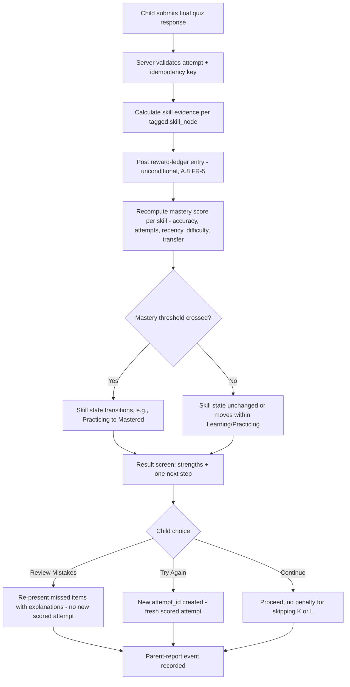
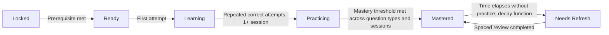
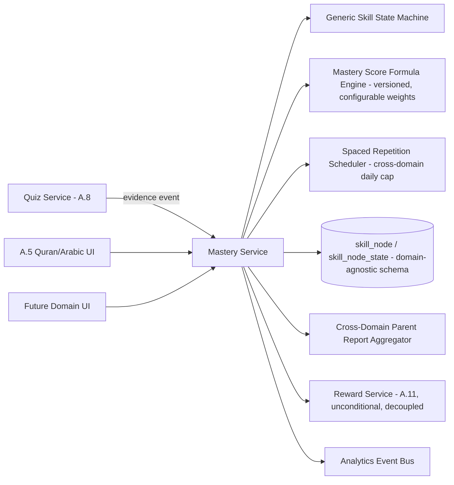
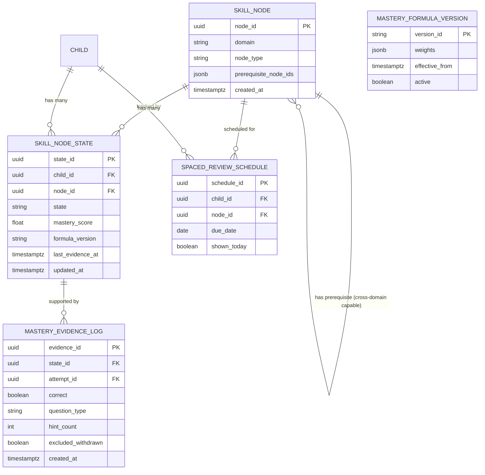

# Feature A.9 — Skill Tree & Mastery Engine

**App:** NoorHeroes — Islamic Learning App for Children
**Feature Owner:** Product / Learning Science / AI
**Status:** Implementation-ready
**Version:** 1.0
**Depends on:** A.1 (Auth & Onboarding), A.8 (Quiz Engine — primary evidence source), Content CMS
**Feeds into:** A.5 (Quran/Arabic/Tajweed skill tree UI), A.2 (Home — mastery-aware recommendations), A.11 Rewards (mastery-linked badges), C.22 Parent Progress Reports

> **Scope note:** Feature A.5 specified the Quran/Arabic/Tajweed skill tree **as experienced by the child** (screens, flows, the domain-specific node catalog). This document specifies the **shared Mastery Engine** underneath it — the generic skill-state machine, the mastery-score formula, spaced-repetition scheduling, and the cross-domain APIs/data model — built once and reused by every current and future learning domain (Quran/Arabic/Tajweed today; potentially Islamic Facts, Stories-linked skills, or other domains tomorrow). Where A.5 already documented a domain-specific screen or flow, this document references it rather than repeating it, and focuses on the parts that are genuinely new: the engine's internals, the **Quiz Completion Result screen** (strengths + one next step + Review Mistakes/Try Again/Continue), and cross-domain extensibility.

---

## Table of Contents

1. [Product Requirements](#1-product-requirements)
2. [UX/UI Requirements](#2-uxui-requirements)
3. [Backend Requirements](#3-backend-requirements)
4. [Database Design](#4-database-design)
5. [Backend AI Code-Generation Prompt](#5-backend-ai-code-generation-prompt)
6. [Android Requirements](#6-android-requirements)
7. [Android AI Code-Generation Prompt](#7-android-ai-code-generation-prompt)
8. [Admin Requirements](#8-admin-requirements)
9. [Admin AI Code-Generation Prompt](#9-admin-ai-code-generation-prompt)
10. [DevOps Requirements](#10-devops-requirements)
11. [Analytics Requirements](#11-analytics-requirements)
12. [Security Requirements](#12-security-requirements)
13. [QA Requirements](#13-qa-requirements)
14. [Marketing Requirements](#14-marketing-requirements)
15. [Release & Rollback Plan](#15-release--rollback-plan)

---

## 1. Product Requirements

### 1.1 Problem Statement

Every learning domain in NoorHeroes (Quran, Arabic, Tajweed, and future domains) needs a consistent, trustworthy way to represent "how well does this child actually know this skill" — combining accuracy, independent attempts, recency, difficulty, and transfer across question formats into a single coherent state — without exposing a confusing raw confidence number to a child, without resetting progress on a single bad attempt, and without letting two different domains implement two different, inconsistent mastery models (source: NoorHeroes Blueprint "Mastery Model — Mastery combines accuracy, independent attempts, recency, and cross-format transfer. A child can retry without losing XP or a streak"; Feature Reference §21.9 "Skill Tree... The UI should show progress without revealing a confusing raw model score").

### 1.2 Business Goals

- Provide one authoritative, reusable Mastery Engine so every learning domain (current and future) behaves consistently and is built once, not reimplemented per domain.
- Ensure mastery-confidence calculations are genuinely evidence-based (not gameable by rapid low-effort repetition) so Parent Progress Reports and Admin curriculum-quality signals are trustworthy.
- Support spaced-repetition scheduling that brings children back to previously-mastered material at the right cadence, driving sustained re-engagement.
- Keep the reward loop (XP/streaks) fully decoupled from mastery accuracy, consistent with the platform's hard anti-punitive rule (source §6.3: "A child can retry without losing XP or a streak").

### 1.3 User Goals

- **Child:** Have lessons that feel like they get "a little harder as I improve and a little easier when I struggle," see clear progress without being shown a confusing score, and never lose my XP/streak just because I got something wrong while practicing.
- **Parent:** Trust that "Mastered" actually means something real (not just one lucky guess), and see meaningful next-step recommendations after a quiz, not just a raw percentage.

### 1.4 Success Metrics

| Metric | Target |
|---|---|
| Skill-node mastery rate (Learning → Mastered within 30 days of first attempt) | ≥ 40% (shared with A.5, this engine is what computes it) |
| Mastery-confidence predictive validity (does "Mastered" status predict later independent-performance success) | ≥ 85%, reviewed quarterly as a model-quality metric |
| Spaced-review adherence rate (`Needs Refresh` prompts actually acted upon) | ≥ 50% |
| Cross-domain engine reuse | 100% of learning domains use this engine — zero parallel/forked mastery implementations |
| Quiz Completion Result → "Try Again"/"Review Mistakes" engagement rate | ≥ 40% when offered |
| Mastery-score computation latency (post-quiz) | p95 < 300ms |

### 1.5 Stakeholders

Product Manager, Learning Science/Psychometrics Lead, AI/ML Engineer, Backend Architect, Android Architect, Data Analyst, QA Lead, feature owners of A.5 (and any future mastery-consuming domain), Scholar Review Board (for domain-specific content, not the engine itself).

### 1.6 User Stories

1. As a child, I want lessons and quizzes that adjust to how well I'm doing, so they don't feel too easy or too hard.
2. As a child, I want to see my progress on a skill as a clear state (still learning, getting good at it, mastered) rather than a confusing number.
3. As a child, after a quiz, I want to see what I did well and one clear thing to work on next — not just a score.
4. As a child, I want the choice to review my mistakes, try the quiz again, or just continue, after I finish.
5. As a child, I want a skill I haven't practiced in a while to gently come back for review, not be forgotten or held against me.
6. As a parent, I want every learning domain in the app (Quran, Arabic, Tajweed, and whatever comes next) to report progress in the same consistent, trustworthy way.
7. As a content/curriculum admin, I want to configure how mastery is calculated for a new learning domain without needing custom engineering work each time.

### 1.7 Functional Requirements

**FR-1** The Mastery Engine exposes exactly six skill states across every domain: `Locked → Ready → Learning → Practicing → Mastered → Needs Refresh` (source §6.3/§21.9 — restated here as the canonical, domain-agnostic definition; A.5 documents the Quran/Arabic-specific UI treatment of these same states).
**FR-2** Mastery score is computed from a weighted combination of: accuracy, independent-attempt count, recency of evidence, item difficulty, and cross-question-format transfer (source §21.9 "Mastery score combines accuracy, independent attempts, recency, difficulty, and transfer across question types") — this formula is implemented once, centrally, and parameterized per domain/skill rather than reimplemented per domain.
**FR-3** The child-facing UI must show progress (a state label, a progress ring, etc.) without ever revealing the raw numeric mastery/confidence score (source §21.9, restated as a hard product rule the engine's API contract enforces by never including a raw score field in any child-facing response).
**FR-4** A child can retry any practice item without losing XP or breaking a streak — mastery-affecting accuracy and reward-affecting participation are fully decoupled systems (source §6.3, shared architectural principle with A.8's quiz engine).
**FR-5** Single-session mastery is disallowed by design: reaching `Mastered` requires repeated correct performance across more than one practice session and, where applicable, across more than one question format (source: A.5 FR-7, generalized here as the engine's domain-agnostic rule — "Mastery requires correct performance across different question forms and across more than one session").
**FR-6** Quiz Completion Result flow (the shared result screen after any quiz/practice attempt): validate the attempt and its idempotency key → calculate skill evidence → post the reward-ledger entry (unconditional, per A.8 FR-5) → show a result screen with **strengths and exactly one concrete next step** → offer `Review Mistakes`, `Try Again`, or `Continue` → record a parent-report event (source §21.10 "Quiz Completion" flow, items 1–7).
**FR-7** "Review Mistakes" re-presents the specific items missed (with their explanations, reusing A.8's Per-Answer Explanation pattern) without re-triggering a scored attempt. "Try Again" launches a fresh attempt (new `attempt_id`) of the same or an equivalent item. "Continue" simply proceeds, with no penalty for declining either of the other two options.
**FR-8** Spaced Repetition Scheduling computes a `next_review_at` timestamp per `(child_id, skill_id)` based on a decay function over time-since-`last_evidence_at`, weighted by mastery strength — generalized from A.5's Quran/Arabic-specific scheduler into the shared engine, with the same daily-prompt cap (default 2) to avoid overwhelming the child (source: A.5 §5 item 6, generalized here).
**FR-9** The engine must support domain-agnostic skill-graph definitions: any domain can define its own `skill_node` catalog, prerequisite graph, and content linkage, while relying on the shared engine for state-machine evaluation, mastery scoring, and spaced-repetition scheduling — no domain may implement a parallel, divergent mastery calculation.
**FR-10** A withdrawn/safety-flagged quiz item's evidence is excluded from mastery-score computation even if the response was recorded before withdrawal (shared rule with A.8 FR-11, enforced once here at the mastery-aggregation layer so every domain inherits it automatically).
**FR-11** The engine exposes a domain-agnostic Parent Report contract: concept-level summaries (skill labels + state + trend), never a single raw aggregate score as the headline metric (source: shared principle with A.5 FR-17/A.6/A.8 §3.4).

### 1.8 Non-Functional Requirements

- **Performance:** Mastery-score recomputation triggered by a quiz-completion event must complete within the p95 < 300ms target so the Quiz Completion Result screen never feels delayed waiting on it.
- **Consistency:** Given identical evidence history, mastery-score computation must be deterministic and reproducible across re-runs (critical for QA, dispute resolution, and model-quality auditing).
- **Extensibility:** Adding a new learning domain must require only data configuration (new `skill_node` rows, domain tag, content linkage) — never new mastery-calculation code.
- **Accuracy/Validity:** The mastery-score formula's predictive validity must be monitored and periodically re-calibrated (a model-quality process, not a one-time implementation).

### 1.9 Acceptance Criteria

- Given a child answers a practice item correctly on their very first attempt in their very first session, when mastery is evaluated, then the skill does **not** transition directly to `Mastered` — it must show evidence across more than one session per FR-5.
- Given a child views any skill's progress, when the UI renders, then no raw numeric mastery/confidence score is ever displayed — only a state label and/or a progress-ring visualization.
- Given a child completes a quiz with some mistakes, when the Result screen renders, then it shows strengths, exactly one concrete next-step recommendation, and the three options `Review Mistakes`/`Try Again`/`Continue` — never just a bare score.
- Given a child selects `Try Again`, when the new attempt is created, then it is a genuinely new `attempt_id` (fresh idempotency scope), not a re-submission of the original attempt.
- Given a child selects `Continue` without reviewing mistakes or retrying, when they proceed, then there is no penalty to their reward or streak for declining those options.
- Given a skill's mastery decays into `Needs Refresh` and the child completes a spaced-review session, when evaluated, then the state returns to `Mastered` (not back to `Learning` or `Practicing` from scratch, since the underlying knowledge wasn't lost, just due for reinforcement).
- Given a new learning domain is added by Admin (e.g., a future Islamic Facts skill tree), when its `skill_node` catalog is configured, then it inherits state-machine evaluation, mastery scoring, and spaced-repetition scheduling automatically, with zero new mastery-calculation code required.

### 1.10 Edge Cases

1. A child answers correctly across two sessions but always via the exact same question format (e.g., always multiple choice, never audio match) for a skill that has multiple available formats → the cross-format-transfer component of the mastery formula appropriately limits confidence growth, keeping the skill in `Practicing` rather than `Mastered` until transfer evidence exists, consistent with FR-2/FR-5.
2. A child has overwhelming evidence of mastery on a skill, then gets one unusual wrong answer (e.g., a misclick) → a single low-quality data point should not catastrophically collapse a strongly-evidenced mastery state; the recency/weighting formula must be resilient to single-attempt noise, not just simplistically averaging.
3. Two different domains (e.g., a Quran skill and a hypothetical future Islamic Facts skill) are tagged on the same quiz question (cross-domain question reuse) → mastery evidence updates correctly and independently for both domains' respective skill nodes from the same single response event, without conflation.
4. A child reaches `Needs Refresh` on multiple skills simultaneously across different domains on the same day → the platform-wide daily-prompt cap (default 2, per FR-8) applies globally across all domains combined, not per-domain (a child should not see 2 Quran refreshes AND 2 Arabic refreshes on the same day if the intent is to cap total daily review load) — this requires the engine to coordinate the cap centrally rather than each domain enforcing its own independent cap.
5. A child selects `Review Mistakes` from the Quiz Completion Result, reviews the explanations, then closes the app without selecting `Continue` explicitly → the underlying quiz attempt is still considered complete (reward already issued per A.8's unconditional rule) regardless of whether the child formally dismisses the result screen — no dangling "incomplete" state should result from simply not tapping a final button.
6. A new domain is configured by Admin with a skill-node catalog that has a prerequisite cycle (e.g., copy-paste error from another domain's graph) → the shared engine's cycle-detection validation (same mechanism specified in A.5 §9 for curriculum graphs) applies uniformly to any domain's graph, not just Quran/Arabic's.
7. A child's mastery-score computation coincides with a quiz-completion event for a withdrawn-question-containing attempt (per FR-10) — the score computed and the score that *would have been* computed without the exclusion are different; this difference itself should be logged for content-quality monitoring (a spike in withdrawal-driven exclusions for a given skill might indicate a content-quality issue in that skill's question pool worth flagging to Admin).
8. A child attempts to "game" the spaced-repetition scheduler by intentionally answering incorrectly on a skill they've already mastered, theoretically to trigger more frequent review sessions (an unusual but conceivable motivation, e.g., wanting more practice) → the system doesn't need to detect or prevent this; if a child genuinely wants more practice, more low-confidence evidence naturally extending their practice opportunities is not a harmful outcome, so no special anti-gaming logic is required here (distinct from genuinely harmful gaming like reward-farming, which IS prevented elsewhere).
9. Mastery-score formula parameters (the relative weights of accuracy/recency/difficulty/transfer) are updated by Admin for model-quality-improvement reasons → already-computed historical mastery states are **not retroactively recalculated** under the old evidence with new weights (which could cause confusing, unexplained state changes for children with no new activity) — the new weights apply only to future evidence-driven recalculations, with a clear changelog/versioning of which formula version produced which historical state.
10. A child's account is merged/migrated (e.g., a rare data-correction scenario) and brings mastery evidence from two previously-separate `child_id` records for the same skill → the engine must have a defined, tested reconciliation behavior (e.g., taking the union of evidence, recalculating from scratch) rather than undefined behavior from a naive merge.
11. A `skill_node`'s prerequisite is itself a node from a different domain (a genuinely cross-domain prerequisite, e.g., a hypothetical future "basic Arabic literacy" prerequisite gating a Quran-domain node) → the engine's prerequisite-evaluation logic must support cross-domain references without special-casing, since `skill_node` and `skill_node_state` are domain-agnostic tables by design.
12. The spaced-repetition decay function computes a `next_review_at` date that has already passed by the time the batch scheduler runs (e.g., due to a scheduler outage/delay) → the review is still correctly queued (not skipped) on the next successful run, with the existing daily-prompt cap preventing a backlog from dumping many overdue reviews on the child at once.

### 1.11 Error Handling

| Scenario | System Behavior |
|---|---|
| Mastery-score computation service unavailable post-quiz | Reward issuance (unconditional, A.8) still completes independently; mastery update queues for retry, Quiz Completion Result screen shows strengths/next-step based on the most recent available state rather than blocking on a synchronous recomputation |
| Spaced Repetition Scheduler batch job failure | No reviews lost — overdue reviews queue correctly on next successful run (Edge Case 12), capped per the standing daily limit |
| Cross-domain prerequisite graph contains a cycle (admin error) | Rejected at admin-save time with the cycle path shown (shared validation mechanism with A.5) |
| Quiz attempt's idempotency key resubmitted (e.g., network retry of the completion call) | Returns the original mastery/reward result, never double-processes evidence |

### 1.12 Empty States
- New child, zero mastery evidence for a domain → all relevant skill nodes show `Locked`/`Ready` states appropriately per prerequisite graph, never an error or blank tree (consistent with A.5's first-time experience).
- Quiz Completion Result with zero mistakes to review → "Review Mistakes" option simply isn't offered (only `Try Again`/`Continue` shown), consistent with A.8 Edge Case 11.

### 1.13 Loading States
- Quiz Completion Result: brief "calculating your progress..." state if mastery computation hasn't completed synchronously within a short budget, though typically near-instant given the p95 < 300ms target.

### 1.14 Offline States
- Mastery-state display uses last-synced cached state when offline; recomputation requiring fresh evidence happens upon reconnect sync, consistent with A.5/A.8's offline patterns.

### 1.15 Permission States
- No new runtime permissions specific to this engine.

### 1.16 User Flow (Narrative)

A child completes a quiz/practice attempt in any domain (Quran, Arabic, Tajweed, or a future domain) via A.8's shared Quiz Engine → the attempt's final response submission triggers this Mastery Engine's evidence-calculation step → mastery score and skill state are recomputed for every skill tagged on the attempt's questions → the Quiz Completion Result screen renders strengths + one next-step recommendation + `Review Mistakes`/`Try Again`/`Continue` → the child picks one → if mastery crosses into `Mastered`, the relevant domain's skill-tree UI (e.g., A.5's map) reflects the unlock in real time → over subsequent days, the Spaced Repetition Scheduler may surface a `Needs Refresh` prompt for that skill once its evidence decays past the configured threshold.

### 1.17 Detailed Flow Diagram (Mermaid)

**Quiz Completion → Mastery Update Flow (source §21.10, generalized):**



**Generic Skill State Machine (canonical, domain-agnostic, source §6.3/§21.9):**



### 1.18 Screen Inventory (Complete — Zero Missing)

| # | Screen / Component | Type | Entry Points | Exit Points |
|---|---|---|---|---|
| 1 | Quiz Completion Result Screen (shared, generic) | Screen | End of any quiz/practice attempt (any domain, any A.8 `QuizContext`) | Review Mistakes / Try Again / Continue |
| 2 | Strengths Summary Component | Component | Quiz Completion Result | N/A |
| 3 | "One Next Step" Recommendation Card | Component | Quiz Completion Result | Relevant practice/content screen if tapped |
| 4 | Review Mistakes Screen | Screen | Quiz Completion Result "Review Mistakes" | Back to Result / Continue |
| 5 | Try Again — Fresh Attempt Launch | Screen transition | Quiz Completion Result "Try Again" | New quiz/practice session |
| 6 | Mastery State Transition Celebration (generic, domain-agnostic wrapper around A.5's mastery celebration) | Modal | Any skill crossing into Mastered, any domain | Dismiss → relevant skill tree |
| 7 | Needs-Refresh Cross-Domain Daily Cap Notice (internal-only state, surfaces via each domain's own prompt UI) | Component | Spaced Repetition Scheduler output | Domain-specific review session |
| 8 | Parent Cross-Domain Mastery Summary (Parent Area) | Screen (Parent Area) | Parent Dashboard → Child Progress → Learning (aggregated across domains) | Domain-specific detail (e.g., A.5's Quran/Arabic report) |

### 1.19 Events (Complete Analytics Event List)

`quiz_result_screen_shown` (with `strengths_count`, `next_step_skill_id`), `quiz_result_review_mistakes_selected`, `quiz_result_try_again_selected`, `quiz_result_continue_selected`, `mastery_score_recomputed` (with `skill_id`, `domain`, internal/aggregate), `skill_state_transitioned` (with `from_state`, `to_state`, `domain`), `mastery_single_session_block_applied` (internal, FR-5 enforcement signal), `spaced_review_due_cross_domain_capped` (internal, FR-8/Edge Case 4 signal), `cross_domain_mastery_summary_viewed`, `mastery_formula_version_applied` (internal/aggregate, model-quality tracking).

---

## 2. UX/UI Requirements

> Global Design System tokens and skill-state visual language defined in **Feature A.1 §2.1** and **Feature A.5 §2.1** ("Skill Tree Visual Language" — Locked/Ready/Learning/Practicing/Mastered/Needs Refresh node treatments). This section covers only the new, domain-agnostic Quiz Completion Result screen.

### 2.1 Quiz Completion Result — Design Requirements

- **Purpose:** Close out any quiz/practice attempt (regardless of originating domain) with genuinely useful, concept-level feedback and a clear, low-pressure set of next-action choices.
- **Components:** A "Strengths" section (1-2 short, specific, positively-framed statements — e.g., "You're getting really confident with Surah Al-Fatiha!"), a single "Next Step" recommendation card (one concrete, specific suggestion, never a vague "keep practicing"), and three equally-weighted, non-hierarchical action buttons: `Review Mistakes` (only shown if mistakes exist), `Try Again`, `Continue`.
- **States:** All-correct (Strengths section is more prominent, no Review Mistakes option), Some-incorrect (Strengths + Next Step + all three options), Mastery-threshold-crossed-this-session (an additional small celebratory accent, layered on top of the standard result screen, not replacing it).
- **Accessibility:** All three action buttons equally reachable/labeled via screen reader; no default-focused button implies a "correct" choice (this is a values-neutral decision point for the child, not a forced-default).
- **Responsive Rules:** Single-column, consistent with the platform's general single-primary-focus screen philosophy (though here there are three valid equally-weighted actions, not one primary CTA — a deliberate deviation reflecting genuine user choice).

### 2.2 Screen Image Generation Prompts

**Screen: Quiz Completion Result**
- *Prompt 1 (English):* "Mobile app quiz results screen UI mockup for a children's learning app. Warm off-white background. At the top, a small celebratory but calm icon (a gentle upward sparkle), below it a 'Strengths' section with two short positive statements in rounded text bubbles. Below that, a distinct highlighted card labeled 'Next Step' with a single concrete suggestion and a small icon. At the bottom, three equally-sized rounded buttons side by side or stacked: 'Review Mistakes' (outlined secondary style), 'Try Again' (outlined secondary style), and 'Continue' (filled warm gold primary style) -- all three clearly tappable and not implying a forced hierarchy beyond Continue's natural visual weight as a primary action. No raw percentage or score number displayed anywhere. Calm, encouraging, educational aesthetic, soft shadows, rounded corners, no realistic human faces."
- *Prompt 2 (Arabic RTL):* "نفس شاشة نتائج الاختبار لتطبيق تعليم للأطفال، بتخطيط من اليمين إلى اليسار بالكامل. خلفية بيج فاتح دافئ. في الأعلى أيقونة احتفالية هادئة صغيرة (بريق صاعد لطيف)، تحتها قسم 'نقاط القوة' بعبارتين إيجابيتين قصيرتين في فقاعات نص مستديرة. أسفل ذلك بطاقة مميزة بعنوان 'الخطوة التالية' مع اقتراح واحد محدد وأيقونة صغيرة. في الأسفل ثلاثة أزرار مستديرة بحجم متساوٍ جنبًا إلى جنب أو مرصوصة: 'مراجعة الأخطاء' (نمط ثانوي محدد الحواف)، 'حاول مرة أخرى' (نمط ثانوي محدد الحواف)، و'استمرار' (نمط أساسي ذهبي دافئ معبأ) — جميعها قابلة للنقر بوضوح وبدون فرض تسلسل هرمي إلزامي بخلاف الثقل البصري الطبيعي لزر الاستمرار كإجراء أساسي. بدون أي نسبة أو رقم خام للنتيجة ظاهر في أي مكان. طابع هادئ ومشجع وتعليمي، ظلال خفيفة، زوايا دائرية، بدون وجوه بشرية واقعية."

---

## 3. Backend Requirements

### 3.1 System Design Overview

The Mastery Engine is a shared **Mastery Service** consumed by every learning domain via a domain-agnostic API. It receives evidence events from A.8's Quiz Service (and any future evidence source), maintains `skill_node`/`skill_node_state` as domain-tagged but structurally uniform tables, runs the centralized state-machine and mastery-score computation, and operates the cross-domain Spaced Repetition Scheduler with its globally-coordinated daily cap.

### 3.2 Architecture Diagram (Mermaid)



### 3.3 Service Breakdown

| Service | Responsibility |
|---|---|
| Mastery Service | Central orchestrator: receives evidence, runs state machine, computes scores, schedules reviews |
| Generic Skill State Machine | Pure, domain-agnostic function: `(current_state, evidence) -> new_state` |
| Mastery Score Formula Engine | Versioned, admin-configurable weighted formula (accuracy/attempts/recency/difficulty/transfer) |
| Spaced Repetition Scheduler | Cross-domain decay-based scheduling with a globally-coordinated daily prompt cap |
| Cross-Domain Parent Report Aggregator | Concept-level summaries spanning every domain a child has engaged with |

### 3.4 API List

#### `POST /v1/mastery/evidence` (internal, called by the Quiz Service on attempt completion)
- **Request:** `{ "child_id": "...", "attempt_id": "...", "responses": [ { "skill_node_id": "...", "correct": true, "question_type": "multiple_choice", "hint_count": 0, "response_time_ms": 4200, "is_withdrawn_excluded": false } ] }`
- **Response 200:** `{ "updated_skills": [ { "skill_node_id": "...", "new_state": "mastered", "transitioned": true } ] }`
- **Business Logic:** Per-skill mastery recomputation runs the versioned formula; `is_withdrawn_excluded` responses are skipped entirely (FR-10).
- **Idempotency:** Keyed on `attempt_id` — reprocessing the same attempt's evidence does not double-count it.

#### `GET /v1/mastery/skills?child_id=&domain=`
- **Response 200:** Array of skill states for a domain — `{ "skill_node_id": "...", "state": "practicing", "domain": "quran" }` — **no raw score field exists in this response schema**, enforced structurally (mirroring A.8/A.5's pattern of hard-excluding sensitive/confusing fields at the model-definition layer, not just by convention).

#### `GET /v1/mastery/result/{attempt_id}`
- **Auth:** Bearer (child-mode)
- **Response 200:** `{ "strengths": ["..."], "next_step": { "skill_node_id": "...", "label": "...", "reason": "..." }, "has_mistakes": true, "mistake_question_ids": [...] }` — backs the Quiz Completion Result screen directly.

#### `POST /v1/mastery/review-due?child_id=`
- **Response 200:** `{ "due_skills": [ { "skill_node_id": "...", "domain": "quran" } ] }` — capped at the global daily limit (default 2) **across all domains combined**, computed centrally rather than per-domain.

#### `GET /v1/children/{id}/mastery-summary?domain=` (parent-facing, optional `domain` filter; omitting it returns a cross-domain rollup)
- **Auth:** Bearer (parent session)
- **Response 200:** Concept-level structure consistent with A.5's reporting philosophy, extended to optionally span multiple domains in one call for a true cross-domain parent view.

### 3.5 Cross-Cutting API Concerns

- **No raw score exposure:** Every child-facing and even parent-facing response schema in this service structurally omits a raw numeric mastery/confidence field as a headline value — covered by a dedicated schema-introspection test (see §5).
- **Determinism:** Given identical evidence input, the formula must produce identical output — covered by reproducibility tests.
- **Versioning:** Formula-weight changes are versioned; historical states retain a reference to which formula version produced them (FR-9/Edge Case 9), never silently retroactively recalculated.

---

## 4. Database Design

### 4.1 ER Diagram (Mermaid)



### 4.2 Tables, Relationships, Constraints

| Table | Key Constraints | Indexes |
|---|---|---|
| `skill_node` | CHECK `domain` is a registered domain value (extensible enum/lookup, not hardcoded to only `quran`/`arabic`/`tajweed`) | Index `(domain)` |
| `skill_node_state` | FK `child_id`, `node_id`; UNIQUE(`child_id`, `node_id`); CHECK `mastery_score BETWEEN 0 AND 1`; CHECK `state IN ('locked','ready','learning','practicing','mastered','needs_refresh')` | Index `(child_id, state)` |
| `mastery_evidence_log` | FK `state_id`, `attempt_id`; append-only | Index `(state_id, created_at DESC)` |
| `mastery_formula_version` | only one row may have `active = true` at a time (enforced via a partial unique index or trigger) | — |
| `spaced_review_schedule` | FK `child_id`, `node_id`; UNIQUE(`child_id`, `node_id`, `due_date`) — **cross-domain**, the daily-cap query spans this single table regardless of `node_id`'s domain | Index `(child_id, due_date)` |

### 4.3 Audit Fields
`mastery_evidence_log` is append-only (a historical fact, never edited — this is the auditable evidence trail behind every mastery-score computation). `skill_node_state.formula_version` records which formula version produced the current score, supporting Edge Case 9's non-retroactive-recalculation rule.

### 4.4 Soft Delete Rules
`skill_node` deprecation uses `is_active = false` (consistent with A.5 §4.4), never hard-delete, preserving historical `skill_node_state`/`mastery_evidence_log` references — applies uniformly across every domain.

### 4.5 Retention Rules
`mastery_evidence_log` retained indefinitely (the auditable evidence trail has lasting model-quality and dispute-resolution value). `spaced_review_schedule` rows purged 30 days after `due_date` once no longer needed for scheduling, consistent with A.5 §4.5.

---

## 5. Backend AI Code-Generation Prompt

```
You are building the shared Mastery Service for "NoorHeroes" -- the single,
domain-agnostic engine underlying skill-tree mastery for Quran, Arabic,
Tajweed, and any future learning domain. This service was partially
scoped in Feature A.5 (which specified the Quran/Arabic-specific skill
tree); THIS deliverable generalizes that into a reusable, multi-domain
engine. Reuse the skill_node/skill_node_state tables and the basic state
machine already built for A.5 -- do not create parallel tables.

Stack: FastAPI (Python 3.12), PostgreSQL (SQLAlchemy 2.0), Redis, Kafka.

Hard requirements:
1. Generalize the skill_node.track column (if it currently hardcodes
   quran|arabic|tajweed per A.5) into a domain column backed by a proper
   lookup/registry table (or a well-documented extensible string enum)
   so a new domain can be added via data configuration alone, with zero
   new application code. Write a test that registers a fictitious new
   domain ("test_domain") via data only, creates skill_node rows for it,
   and confirms the full state-machine/scoring/scheduling pipeline works
   identically to an existing domain.
2. Implement the Mastery Score Formula Engine as a versioned, configurable
   weighted function: score = f(accuracy, independent_attempt_count,
   recency_decay, item_difficulty, cross_format_transfer_bonus), with
   weights stored in mastery_formula_version (only one row active=true at
   a time, enforced via a partial unique index). Write a test confirming
   that given IDENTICAL evidence input, the function ALWAYS produces the
   IDENTICAL score (deterministic, no hidden randomness or
   non-reproducible floating-point-order-dependent computation).
3. Enforce FR-5 (no single-session mastery): the state machine must
   require evidence spanning more than one distinct session
   (distinguishable via attempt timestamps falling on different
   calendar days OR distinct attempt_ids separated by a minimum time
   gap -- choose and document one precise rule) AND, where the skill has
   multiple question_types available, evidence across more than one
   question_type, before allowing a transition into 'mastered'. Write a
   test where a child answers correctly 10 times in a row within a single
   session/attempt and assert the resulting state is NOT 'mastered'
   (it should land in 'practicing' at most).
4. Implement POST /v1/mastery/evidence to process a batch of per-skill
   evidence from a single quiz attempt atomically: for each
   skill_node_id in the payload, look up or create skill_node_state,
   compute new mastery_score using the ACTIVE formula version, run the
   generic state machine, and write a mastery_evidence_log row -- EXCEPT
   for any response where is_withdrawn_excluded=true, which must be
   completely skipped from score computation (but you may still log it
   to mastery_evidence_log with excluded_withdrawn=true for audit
   purposes, just not counted in the score). Write a test mirroring
   A.8's withdrawn-question test, verified at this Mastery Service layer.
5. Implement the Spaced Repetition Scheduler's daily cap as a GLOBAL,
   CROSS-DOMAIN cap: when computing due_skills for a child, query
   spaced_review_schedule across ALL domains combined and cap the total
   returned at the configured daily limit (default 2), not per-domain.
   Write a test where a child has 3 Quran skills and 2 Arabic skills
   simultaneously due, and assert exactly 2 TOTAL are returned as due
   today (not 2 Quran + 2 Arabic = 4), with the remainder correctly
   queued for subsequent days regardless of which domain they belong to.
6. Implement GET /v1/mastery/result/{attempt_id} to synthesize a
   strengths list and a SINGLE next_step recommendation (never more than
   one) -- write a test asserting the response always contains exactly
   one next_step object, never an array of multiple "next steps."
7. Implement formula-version non-retroactivity (Edge Case 9): when
   mastery_formula_version's active row changes, write a test confirming
   that EXISTING skill_node_state rows' mastery_score and formula_version
   fields remain UNCHANGED until their next evidence-driven recomputation
   -- there must be no batch job that retroactively recalculates all
   historical state under new weights.
8. Write a SCHEMA INTROSPECTION test (mirroring A.8/A.5's pattern)
   asserting that NO response model anywhere in this service (child-facing
   OR parent-facing) contains a raw top-level numeric score/confidence
   field as a primary/headline value -- mastery_score may exist
   internally in the database and in evidence-log audit data, but must
   never appear in any API response schema served to clients.

Deliver: FastAPI routers, SQLAlchemy models, Alembic migrations (extending,
not duplicating, A.5's existing skill_node/skill_node_state tables),
Pydantic schemas, and a pytest suite covering all 8 items, with item 5
(cross-domain daily cap) and item 8 (no-raw-score-exposure) treated as
the highest-priority tests given their cross-cutting, multi-domain impact.
```

---

## 6. Android Requirements

### 6.1 Technical Requirements
Kotlin, Jetpack Compose, MVVM, Clean Architecture, module `:core:mastery-engine` (a **shared core module**, mirroring A.8's `:core:quiz-engine` pattern), consumed by `:feature:learn` (A.5) and any future domain feature module. Depends on `:core:design-system`, `:core:network`.

### 6.2 Screen Mapping
`QuizCompletionResultScreen` is a single reusable Composable (analogous to A.8's `QuizSessionScreen`) rendered immediately after any quiz session completes, regardless of originating domain/feature.

### 6.3 Navigation Flow
Launched by `:core:quiz-engine`'s session-completion handoff (A.8 §6.3's `QuizResult` callback triggers navigation into this screen) before returning control to the calling feature — i.e., the flow is: consuming feature → `:core:quiz-engine` session → `:core:mastery-engine` result screen → back to consuming feature.

### 6.4 State Management
`MasteryResultViewModel` fetches `GET /v1/mastery/result/{attempt_id}` once on entry; the three action buttons (`Review Mistakes`/`Try Again`/`Continue`) are modeled as a sealed `ResultAction` the calling feature handles via its own navigation (e.g., A.5's Learn tab routes `TryAgain` back into a fresh A.8 quiz session; A.3's Stories context might route `Continue` into "Next Learning").

### 6.5 API Mapping
`MasteryRepository.getResult()` → `GET /v1/mastery/result/{attempt_id}`; domain skill-tree screens (A.5) call `MasteryRepository.getSkillStates(domain)` → `GET /v1/mastery/skills?domain=`, with the response DTO **structurally containing no raw score field** (a Kotlin data class with no numeric confidence field defined at all, mirroring the backend's schema-level guarantee).

### 6.6 Analytics Mapping
`MasteryAnalytics` fires `quiz_result_screen_shown` and the three selection events; domain feature modules (A.5) consume the same shared analytics interface rather than each defining a parallel one.

### 6.7 Offline Support
Skill-state display uses cached last-synced state when offline (Room-cached `skill_node_state` rows); the Result screen itself requires connectivity (mastery computation is server-side), consistent with other server-computed-feedback patterns in the app (e.g., A.5's AI pronunciation feedback) — offline quiz completions defer their Result screen until reconnect, showing a simpler "saved, will show your results when you're back online" interim state instead.

### 6.8 Deep Linking
Not directly deep-linked; always reached via the quiz-completion handoff from `:core:quiz-engine`.

### 6.9 Push Notifications
Spaced-review reminder notifications (owned by A.12, cross-domain-capped per §5 item 5) deep-link into the relevant domain's own skill-tree entry point (e.g., A.5's `noorheroes://learn/node/{node_id}`), not into this engine's screens directly.

### 6.10 Testing Strategy
- Unit: `MasteryResultViewModel`'s handling of the has_mistakes-conditional `Review Mistakes` button visibility; DTO reflection test confirming no raw score field exists anywhere in `:core:mastery-engine`'s public data classes.
- UI tests: all three result-screen action buttons render with equal visual weight (no implied "correct choice" styling beyond Continue's natural primary-action treatment); Result screen never displays a percentage/score number anywhere in its semantics tree.
- Integration: full quiz-completion → mastery-result → Try-Again-relaunches-fresh-attempt flow, verified across at least two different domains (e.g., a Quran context and a Dua-recall context) using the same shared module code path.

---

## 7. Android AI Code-Generation Prompt

```
Build `:core:mastery-engine` as a SHARED Android module for NoorHeroes (Kotlin,
Jetpack Compose, MVVM, Clean Architecture), consumed by `:feature:learn`
(A.5) and designed for future domain modules to adopt without new engine
work, mirroring the `:core:quiz-engine` pattern from Feature A.8.

Hard requirements:
1. Build QuizCompletionResultScreen as a single reusable composable taking
   (attemptId: String) and returning a sealed ResultAction
   (ReviewMistakes, TryAgain, Continue) via a typed result channel to the
   calling feature module -- no domain-specific logic inside this
   composable; all domain-specific routing (what "Try Again" or
   "Continue" actually navigates to) is the CALLING feature's
   responsibility, not this module's.
2. Define MasterySkillState DTOs with NO numeric score/confidence field
   declared anywhere in the public data class -- write a reflection-based
   unit test enumerating all public data classes in this module and
   asserting none contain a field of a numeric type named anything
   matching /score|confidence/i.
3. Result screen must render the "Review Mistakes" button ONLY when
   has_mistakes=true from the API response -- write a UI test for the
   has_mistakes=false case asserting exactly two buttons (Try Again,
   Continue) are present, not three.
4. The Result screen's three action buttons must be visually equal-weight
   except for Continue's natural primary-button styling (consistent with
   the platform's general primary/secondary button token usage) -- write
   a UI test asserting Review Mistakes and Try Again use IDENTICAL
   secondary-button styling tokens (not one styled differently from the
   other in a way that implies a preferred choice between them).
5. Implement an offline-completion interim state: if a quiz attempt
   completes while offline, do not attempt to render
   QuizCompletionResultScreen at all (since it requires a server round
   trip) -- instead show a simple "Saved! We'll show your results when
   you're back online" interim screen, and queue a deferred navigation
   to the real Result screen once connectivity returns and the attempt
   has synced. Write an integration test for this exact offline-then-
   reconnect-then-show-result sequence.
6. Provide a SkillTreeStateRenderer reusable composable (consumed by
   A.5's skill-tree map UI) that maps the 6 canonical states to the
   visual tokens already defined in `:core:design-system` from A.5's
   work -- do not redefine the state-to-visual mapping separately inside
   `:feature:learn`; centralize it here so any future domain's skill-tree
   UI automatically gets consistent visuals for free.

Use Hilt, Retrofit+OkHttp, Room for cached skill-state display. Follow
Global Design System tokens from `:core:design-system`.
```

---

## 8. Admin Requirements

- **Skill Domain Registry:** Admin CRUD for registering new learning domains (a simple lookup table: domain key, display name, active flag) — the prerequisite for FR-9's zero-new-code domain extensibility.
- **Cross-Domain Skill Graph Validation:** Extends A.5's curriculum-graph cycle-detection (§9) to validate across domains, since `skill_node` prerequisites may now reference cross-domain nodes (Edge Case 11) — the same validation tool, generalized.
- **Mastery Formula Version Manager:** Admin-tunable weights for the accuracy/attempts/recency/difficulty/transfer formula, with strict versioning (only one `active` version at a time) and a clear changelog showing which version produced which historical states — given this is a sensitive, model-quality-affecting lever, changes require a `learning_science` or `ai_ops` role with a documented rationale field (required, not optional, on every version change).
- **Cross-Domain Spaced Repetition Configuration:** The global daily-prompt-cap setting (shared across all domains) lives here, distinct from any domain-specific configuration, since it must be configured once centrally per §5 item 5's architecture.
- **Quiz Result Recommendation Quality Monitor (Read-only):** Visibility into the "one next step" recommendation logic's actual output distribution across the user base — a curriculum-quality signal analogous to A.8's Assembly Monitor.

CRUD permissions: Skill Domain Registry = full CRUD behind `product_admin` role; Cross-Domain Graph Validation = part of the existing `curriculum_editor` role's tooling; Mastery Formula Version Manager = Create-new-version-only (never edit an existing version in place, consistent with the non-retroactivity rule) behind `learning_science`/`ai_ops` role; Spaced Repetition Cross-Domain Config = Update-only behind `product_admin` role; Recommendation Quality Monitor = Read-only.

---

## 9. Admin AI Code-Generation Prompt

```
Build/extend the NoorHeroes Admin Portal (React + TypeScript) to support the
shared Mastery Engine's cross-domain configuration, building on the
Skill Tree / Curriculum Builder already built for Feature A.5.

Pages:
1. Skill Domain Registry -- a simple CRUD table (domain_key, display_name,
   active) for registering learning domains. This is the gating list that
   the Skill Tree / Curriculum Builder's domain selector dropdown (from
   A.5) should read from dynamically, rather than a hardcoded list of
   options -- update that existing dropdown component to fetch from
   GET /admin/v1/mastery/domains instead of a static enum.
2. Cross-Domain Graph Validation -- extend the existing cycle-detection
   validator (built for A.5's Curriculum Builder) to run across ALL
   domains' combined prerequisite graph, not per-domain in isolation,
   since a node in one domain may now reference a prerequisite in
   another. No new page needed -- this is a backend validation-logic
   extension surfaced through the existing Curriculum Builder save flow.
3. Mastery Formula Version Manager -- a form to CREATE a new formula
   version (weights for accuracy, attempts, recency, difficulty,
   transfer_bonus, each as a 0-1 weight, with validation that they
   represent a sensible combination e.g. summing close to 1.0), plus a
   REQUIRED rationale text field explaining why this version is being
   created. Activating a new version sets active=true on it and
   active=false on the prior one -- there is NO "edit existing version"
   action anywhere in this UI, only "create new version," reinforcing the
   non-retroactivity principle at the admin-tooling level. Show a
   version history table with each version's weights, rationale,
   effective_from date, and the admin who created it. Restrict to
   learning_science or ai_ops role.
4. Cross-Domain Spaced Repetition Configuration -- a settings form for the
   GLOBAL daily-review-prompt cap (default 2), explicitly labeled as
   applying across ALL domains combined, not per-domain, with explanatory
   copy clarifying this scope to avoid admin confusion. Restricted to
   product_admin role.
5. Quiz Result Recommendation Quality Monitor -- read-only dashboard
   (recharts) showing, aggregated across the user base, the distribution
   of "next step" recommendations actually being generated (which skills
   get recommended most/least often), sourced from a read-only aggregated
   endpoint, helping curriculum teams spot gaps or over-concentration in
   the recommendation logic's output.

Enforce RBAC via the existing Admin Portal role context. Every mutating
action writes an immutable audit_log row -- formula version creation
specifically logs the full weight set and rationale text for long-term
model-governance auditability.
```

---

## 10. DevOps Requirements

- **Infrastructure:** Mastery Service is a shared, cross-domain dependency (similar criticality tier to A.8's Quiz Service) — monitored with its own SLA distinct from any single domain feature.
- **CI/CD:** The no-single-session-mastery test, the cross-domain daily-cap test, and the no-raw-score-exposure schema test (§5 items 3, 5, 8) are **mandatory, non-bypassable** CI gates on any PR touching the Mastery Service.
- **Monitoring/Logging/Alerting:** Alert on mastery-score computation p95 latency breach (impacts the Quiz Completion Result screen's responsiveness across every domain). Alert on an unusually high rate of `excluded_withdrawn` evidence for a specific skill (a content-quality signal worth surfacing to Admin per Edge Case 7). Alert on the active `mastery_formula_version` constraint being violated (more than one active row — should be structurally impossible given the partial unique index, but monitored as a defense-in-depth canary).
- **Disaster Recovery:** `mastery_evidence_log` backed up at a high durability tier given its audit/model-governance value (similar tier to A.5's `ayah` reference data, given its irreplaceable evidentiary role).
- **Rollback Strategy:** Any deploy changing the Mastery Score Formula Engine's code (not just configuration weights, which are versioned data) requires a staging replay against historical evidence fixtures confirming output parity with the pre-deploy version for unchanged formula-version configurations (a code change should never silently alter scoring for an unrelated, unchanged formula version).
- **Backup Strategy:** `skill_node_state`/`mastery_evidence_log` at the same tier as A.5's progress tables; `mastery_formula_version` (small, low-volume, high-governance-value) backed up at the highest tier alongside other governance-critical configuration data.
- **Environment Setup:** Staging supports injecting a fixture `mastery_formula_version` and fixture evidence histories per test child, enabling deterministic QA of state transitions without depending on a long organic evidence history (mirroring A.5/A.8's staging-fixture philosophy).

---

## 11. Analytics Requirements

### 11.1 Event Taxonomy
Full list in §1.19, all tagged with `domain` where relevant, enabling cross-domain comparison of mastery-engine behavior (e.g., is the `Mastered` transition rate meaningfully different between Quran and Arabic domains, informing whether domain-specific content difficulty calibration is needed even though the underlying formula is shared).

### 11.2 Funnel Analysis
`quiz_result_screen_shown` → (`quiz_result_review_mistakes_selected` OR `quiz_result_try_again_selected` OR `quiz_result_continue_selected`) → (if Try Again) a new quiz-engine session funnel (A.8) → eventual `skill_state_transitioned`. Secondary: `spaced_review_due_cross_domain_capped` → actual review-session-started rate, measuring whether the cross-domain cap is appropriately calibrated (too low a cap might under-utilize valuable review opportunities; too high might overwhelm).

### 11.3 Dashboard Metrics
Per-domain mastery-transition-rate comparison, formula-version model-quality tracking (does a new formula version's predictive validity improve over the prior one, measured via the periodic quarterly review per §1.4), Quiz Result action-selection distribution (Review Mistakes vs. Try Again vs. Continue — informs whether the result screen's framing is actually driving useful re-engagement or mostly being dismissed).

### 11.4 Cohort & Retention
Cohort by first-domain-mastery-achieved; correlate cross-domain mastery breadth (children engaging with multiple domains vs. just one) with overall retention, informing future domain-expansion prioritization.

### 11.5 Learning Metrics
Mastery-score formula predictive-validity tracking (the core model-quality metric from §1.4), cross-format-transfer-evidence rate (are children actually demonstrating skills across multiple question formats, or mostly repeating the same format — a content-design signal for whether enough format variety exists per skill), single-session-mastery-block-applied rate (validates FR-5's rule is meaningfully triggering, not a dead code path).

---

## 12. Security Requirements

### 12.1 Threat Analysis
- **Raw mastery-score exposure (the feature's defining child-UX risk, generalized from A.5's "no confusing raw score" principle):** mitigated via the schema-level structural exclusion enforced on both backend response models and Android DTOs.
- **Formula-governance risk (an under-scrutinized weight change silently degrading learning-quality signals platform-wide):** mitigated via the mandatory-rationale, versioned, role-gated change process.
- **Cross-domain data leakage:** mitigated by standard `child_id`-scoped query enforcement, consistent with platform-wide isolation patterns; domain-tagging is metadata, not a security boundary, but child-isolation remains absolute.

### 12.2 OWASP Checklist (Applied)
Security Misconfiguration: the schema-level no-raw-score-field exclusion and the single-active-formula-version database constraint are both misconfiguration-defense patterns (the dangerous state is structurally prevented, not just discouraged by convention).

### 12.3 API Security
Idempotency on evidence-processing keyed by `attempt_id`; standard auth patterns shared with the broader Content/Progress/Quiz service family.

### 12.4 Mobile Security
No new sensitive data handling beyond what A.5/A.8 already cover; this engine's data is learning-progress metadata, not raw content or voice data.

### 12.5 Admin Security
Mastery Formula Version changes require `learning_science`/`ai_ops` role plus a mandatory rationale field — a governance control, not a technical security control per se, but held to equivalent process rigor given its platform-wide downstream impact.

### 12.6 Data Encryption & PII Protection
No new PII surface; standard child-data handling applies.

### 12.7 Child Safety Requirements
The no-raw-score, no-single-session-mastery, and decoupled-reward-from-accuracy principles are this engine's core child-wellbeing commitments, directly inherited from and consistent with A.5's and A.8's established ethical rules — this engine is where those principles are enforced once, centrally, for every domain.

### 12.8 Compliance Requirements
No additional regulatory surface beyond the platform baseline.

### 12.9 Security Checklist (Pre-Launch)
- [ ] No-raw-score-exposure schema/DTO tests passing on both backend and Android
- [ ] No-single-session-mastery rule verified via test (10 correct answers in one session does not reach Mastered)
- [ ] Cross-domain spaced-repetition daily cap verified (total across domains, not per-domain)
- [ ] Formula-version non-retroactivity verified (changing active version doesn't alter existing skill_node_state rows until next evidence)
- [ ] Cross-domain extensibility verified (a fictitious new domain works end-to-end with zero new code)

---

## 13. QA Requirements

### 13.1 Test Plan Summary
Coverage spans: cross-domain extensibility (signature architectural test), no-single-session-mastery enforcement, no-raw-score-exposure, cross-domain spaced-repetition capping, formula-version governance, and all 12 edge cases from §1.10.

### 13.2 Test Cases — Happy Path
1. Child answers correctly across two separate sessions and at least two question formats for a skill → transitions to `Mastered`; Result screen after the second session shows the mastery celebration layered on the standard result screen.
2. Child completes a quiz with 2 mistakes, selects `Review Mistakes`, reviews explanations, then separately selects `Try Again` → a fresh attempt is created and scored independently.
3. A fictitious new domain is configured via Admin data-only changes and works end-to-end through the shared engine with zero new code deployed.

### 13.3 Edge Cases
All 12 items from §1.10.

### 13.4 Negative Cases
- Answer correctly 10 times in one session → state does not reach `Mastered`.
- Request `GET /v1/mastery/skills` and inspect the response for any numeric score field → none exists.
- Simulate 3 due Quran skills + 2 due Arabic skills on the same day → exactly 2 total returned as due, not 4.
- Change the active formula version, then re-fetch an unrelated child's existing `skill_node_state` with no new evidence → score and `formula_version` unchanged.

### 13.5 Regression Cases
Full Mastery Engine suite re-run on every release touching `:core:mastery-engine`, the shared Mastery Service, or any domain consumer (A.5, and any future domain).

### 13.6 Automation Cases
End-to-end: full multi-session mastery journey across two question formats; cross-domain daily-cap automated test; fictitious-new-domain extensibility automated test (run periodically as an architectural-integrity regression check, not just at initial launch).

---

## 14. Marketing Requirements

- **Launch Plan:** Like A.8, this engine is infrastructure — its value is communicated through A.5 (and future domains) rather than marketed directly.
- **Push Notifications:** Spaced-review reminders are owned by A.12, cross-domain-capped by this engine; no direct marketing surface of its own.
- **Release Notes:** New domains launching on top of this engine get their own release-note entries; the engine's existence enables faster, more consistent future domain launches, an internal velocity benefit worth noting to stakeholders even if not customer-facing.
- **App/Play Store Description:** Indirectly supports "lessons that adapt to how your child is really doing" and "progress reports that show real understanding, not just scores."
- **ASO Keywords:** Indirectly supports adaptive-learning-related discoverability for the broader app.

---

## 15. Release & Rollback Plan

### 15.1 Release Plan
This engine is largely already live in production as part of A.5's initial launch (the Quran/Arabic skill tree already depends on it); this document's "release" is primarily the **generalization work** — extracting the domain-agnostic core, adding the Domain Registry, and generalizing the Spaced Repetition cap to be cross-domain. Rollout: deploy the generalization behind a verification period where Quran/Arabic behavior is confirmed byte-for-byte equivalent to pre-generalization behavior (a refactor-safety gate) before any second domain is onboarded.

### 15.2 Rollback Plan
Rollback triggers: any confirmed regression in existing Quran/Arabic mastery behavior post-generalization (P0, since this refactor must be invisible to existing users), raw-score-exposure regression (P0, consistent severity with other "never expose X" guarantees across the platform), cross-domain daily-cap miscalculation confirmed in production (high severity, affects review-prompt fairness across domains). Mechanism: standard deployment rollback; given the generalization is primarily an internal refactor of already-live functionality, a feature flag is less critical here than ensuring the pre/post behavioral-equivalence test suite is exhaustive before this work ships at all.

### 15.3 Success Metrics for Go/No-Go
Matches §1.4 targets. Go/no-go reviewed by Product, Learning Science Lead, and Engineering — given this is a generalization of already-live functionality, the primary go/no-go gate is the behavioral-equivalence regression suite confirming zero change to existing Quran/Arabic mastery outcomes, plus the new cross-domain extensibility test passing for at least one fictitious test domain before declaring the generalization complete.
