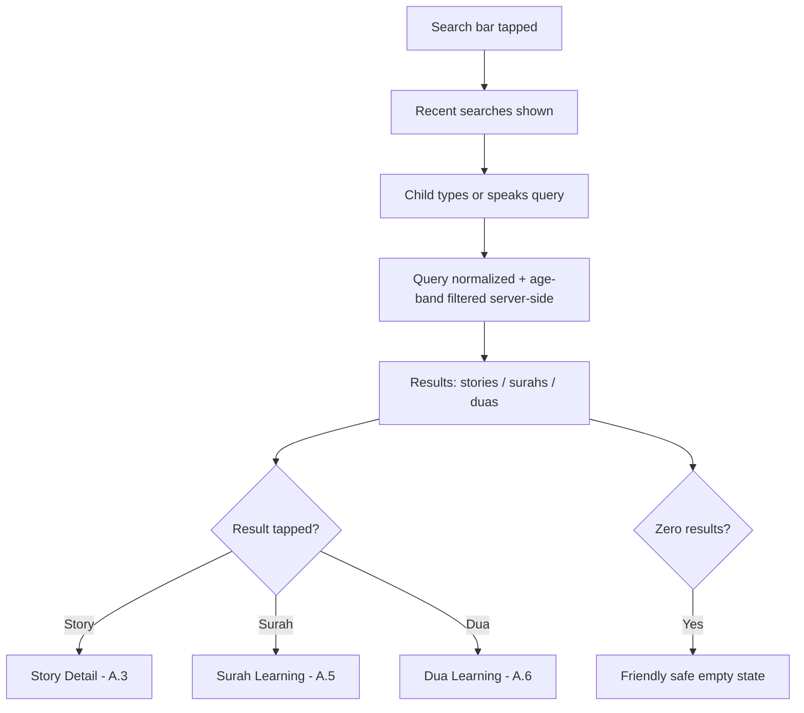
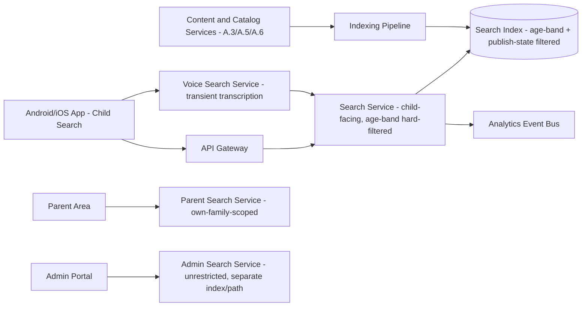

# Feature B.13 — Search & Discovery

**App:** NoorHeroes — Islamic Learning App for Children
**Feature Owner:** Product / Search & Discovery / Child Safety
**Status:** Implementation-ready
**Version:** 1.0
**Depends on:** A.1 (Auth & Onboarding — age band derivation), A.3/A.5/A.6 (Content & Catalog Services — searchable content sources), C.23 (Parental Controls — content-level restrictions)
**Feeds into:** A.3 Story Detail, A.5 Surah Learning, A.6 Dua Learning (search result destinations), E.29 Admin Content Search (operator-only, separate surface)

---

## Table of Contents

1. [Product Requirements](#1-product-requirements)
2. [UX/UI Requirements](#2-uxui-requirements)
3. [Backend Requirements](#3-backend-requirements)
4. [Database Design](#4-database-design)
5. [Backend AI Code-Generation Prompt](#5-backend-ai-code-generation-prompt)
6. [Android Requirements](#6-android-requirements)
7. [Android AI Code-Generation Prompt](#7-android-ai-code-generation-prompt)
8. [Admin Requirements](#8-admin-requirements)
9. [Admin AI Code-Generation Prompt](#9-admin-ai-code-generation-prompt)
10. [DevOps Requirements](#10-devops-requirements)
11. [Analytics Requirements](#11-analytics-requirements)
12. [Security Requirements](#12-security-requirements)
13. [QA Requirements](#13-qa-requirements)
14. [Marketing Requirements](#14-marketing-requirements)
15. [Release & Rollback Plan](#15-release--rollback-plan)

---

## 1. Product Requirements

### 1.1 Problem Statement

Children and parents need a fast, safe way to find content across stories, Quran/Surah learning, and duas — by topic, Prophet name, value, or occasion — in their preferred language and including voice input, with an absolute guarantee that no result, suggestion, or empty-state message ever exposes content below the child's age band or any raw/unmoderated text (source: Consolidated Blueprint navigation table: "Search — Search index excludes anything below the child's age band"; §6.11: "Results are pre-filtered through the child-safe taxonomy; no raw/unmoderated text ever renders"; Feature Reference §"Search System": "Search story | Child | Search by topic, Prophet name, value, or occasion").

### 1.2 Business Goals

- Make content discoverable quickly enough that Search becomes a genuine alternative entry point to browsing, increasing overall content engagement.
- Maintain zero-tolerance content-safety guarantees specific to search (age-band exclusion, no raw/unmoderated text) given search is inherently a more "open-ended input" surface than curated browsing.
- Support voice search as a low-friction input method for younger children who may not yet type fluently, while handling microphone/voice data with the same privacy rigor established elsewhere in the platform (A.5).
- Provide a separate, more powerful Admin search surface for operators, intentionally not age-restricted since it's operator-only.

### 1.3 User Goals

- **Child:** Quickly find a story, surah, or dua by typing or speaking what I'm looking for (a topic, a Prophet's name, a value, or an occasion), see results that make sense for me, and never hit a scary "no results" error.
- **Parent:** Trust that whatever my child searches for, they'll only ever see age-appropriate, already-published, moderated content — search is not a backdoor around the platform's content-safety rules.

### 1.4 Success Metrics

| Metric | Target |
|---|---|
| Search → result-tap conversion rate | ≥ 55% |
| Voice search usage rate (among younger age bands, 4–6 / 6–9) | ≥ 25% |
| Zero-result query rate | ≤ 15% (informs content-gap analysis, not purely a UX metric) |
| Age-band-exclusion guarantee | 100% (hard, zero-tolerance) |
| Search latency (text query) | p95 < 400ms |
| Search latency (voice query, end-to-end including transcription) | p95 < 2s |
| Crash-free search sessions | ≥ 99.6% |

### 1.5 Stakeholders

Product Manager, Search/Discovery Engineer, Backend Architect, Android Architect, Content/Editorial Lead (content-gap analysis from zero-result queries), Data Analyst, Security Engineer (voice-data handling), QA Lead, Child Safety/Trust Advisor.

### 1.6 User Stories

1. As a child, I want to search for a story or lesson by typing what I'm thinking of, like "Prophet Yusuf" or "kindness."
2. As a child, I want to speak my search instead of typing, especially if I'm too young to type well.
3. As a child, I want to filter my results by type (story, surah, dua) so I can narrow down what I'm looking for.
4. As a child, I want to see my recent searches so I can quickly search again for something I looked up before.
5. As a child, when my search doesn't find anything, I want a friendly message, not a scary error or a blank screen.
6. As a parent, I want confidence my child can never search their way into content meant for older kids, or into anything unmoderated.
7. As a parent, I want to be able to search my own child's reports, stories, and habits from the Parent Area.
8. As an admin, I want a powerful, unrestricted search across all content by tag, status, language, and review state for operational purposes.

### 1.7 Functional Requirements

**FR-1** Child Search UI sections: search bar with a voice option, recent searches, filtered results grid (story/lesson/dua), and an empty state (source: screen catalog "Search — UI Sections: Search bar with voice option, recent searches, filtered results grid (story/lesson/dua), empty state").
**FR-2** User actions: type or speak a query, apply a type/age filter, open a result (source: screen catalog "User Actions: Type or speak a query, apply type/age filter, open a result").
**FR-3** Search results are pre-filtered through the child-safe taxonomy; **no raw/unmoderated text ever renders** anywhere in the search UI — not in result titles, not in auto-suggestions, not in the empty state (source §6.11 — a hard, zero-exception rule).
**FR-4** The search index **excludes anything below the child's age band** — age-ineligible content is not merely de-prioritized in ranking, it is structurally absent from the index results returned for that child's session (source: navigation table — restated as a hard rule, not a ranking preference).
**FR-5** Child Search Detailed Workflow (source §6.11, items 1–5): (1) child types or speaks a query, (2) the query is normalized for language and passed through an age-safe query policy, (3) only published, age-eligible content is retrieved, (4) results are ranked by relevance, child level, parent settings, locale, and offline availability, (5) a safe, friendly empty state is shown for no-results queries — **never a raw "no results" error**.
**FR-6** Voice Search validation rules: an explicit microphone affordance is required (no ambient/always-listening search), parent permission is required, short retention or on-device processing is preferred, and **raw audio is not stored for model training by default** (source §6.11 Validation Rules — directly consistent with A.5's voice-data zero-retention principle, applied here to search specifically).
**FR-7** Admin search is a **separate, more powerful, non-age-restricted surface** supporting advanced filtering by tag, status, language, and review state — it is operator-only and must never be confused with or share a code path that could leak its unrestricted results into the child-facing search surface (source §6.11 Business Rules).
**FR-8** Search results route to the correct destination screen by content type: a story result opens Story Detail (A.3), a surah result opens Surah Learning (A.5), a dua result opens Dua Learning (A.6) (source: Search Flow diagram).
**FR-9** Search supports semantic/multilingual understanding — a query in the child's locale should surface relevant results even when the query phrasing doesn't exactly match indexed text (e.g., searching "the whale prophet" should surface Prophet Yunus content) (source: Feature Reference "Search System" features: "Semantic search... Multilingual understanding").
**FR-10** Recent searches are stored per-child (consistent with the platform's per-child, not-shared-across-siblings data-isolation principle established for Favorites/A.3) and are clearable by the child.
**FR-11** A parent-facing search surface exists separately within the Parent Area, allowing parents to search their own child's reports, stories, and habits (source: Feature Reference use case "Search child progress | Parent | Parent searches reports, stories, habits") — this is a distinct surface from child search, scoped to parent-session-authenticated data only.
**FR-12** Age eligibility for search results is recomputed automatically whenever a child's age changes (daily DOB-based recomputation, consistent with the platform's age-based content filtering system) — search never relies on a stale cached age band.

### 1.8 Non-Functional Requirements

- **Performance:** Text-query search p95 < 400ms; voice-query end-to-end (capture + transcribe + search) p95 < 2s.
- **Content Safety:** Age-band exclusion and no-raw-unmoderated-text are treated as P0, zero-tolerance guarantees enforced at the index/query layer, not merely the UI layer.
- **Privacy:** Voice search audio handling follows the same data-minimization rigor as A.5's recitation pipeline — short-retention or on-device processing preferred, never retained for model training by default.
- **Localization:** Multilingual query understanding across all supported locales; RTL search-bar layout and result-grid mirroring for Arabic.
- **Separation of Surfaces:** Child search, Parent search, and Admin search are three distinct, independently-scoped surfaces that must never share an underlying unrestricted query path reachable from a less-privileged context.

### 1.9 Acceptance Criteria

- Given a child searches for any query, when results are returned, then every single result is content the child's current age band is eligible for — no result below their age band ever appears, even transiently or in a "you might also like" adjacent suggestion.
- Given a child's search returns zero results, when the empty state renders, then it is a friendly, safe message — never a raw technical "no results found" error or a blank screen.
- Given a child uses voice search, when they tap the microphone affordance, then recording only begins after this explicit tap (never ambient/always-on), and the resulting raw audio is not retained for model training by default.
- Given a child taps a story result, when the destination loads, then it opens Story Detail (A.3) directly; a surah result opens Surah Learning (A.5); a dua result opens Dua Learning (A.6).
- Given a parent uses the Parent Area's search, when they search, then results are scoped only to their own family's child reports/stories/habits — never another family's data, and never the unrestricted Admin search surface.
- Given an Admin uses the Admin search surface, when they search, then results include all content regardless of age-band/publish-state restrictions that would apply to child search, since this surface is intentionally operator-only and unrestricted.
- Given a child's age band changes (birthday rollover), when they next search, then results reflect the new age band immediately, without requiring an app restart or manual cache clear.

### 1.10 Edge Cases

1. A child's query exactly matches the title of a piece of content that exists but is below their current age band → the content is excluded from results entirely (not shown with a "not available yet" label) — the search index's age-band exclusion is a hard filter at the index/query layer, never a display-time suppression that could be bypassed by leaking the existence of ineligible content.
2. A child speaks a voice query that the transcription service interprets with low confidence → rather than searching for a likely-garbled transcription and returning confusing/irrelevant results, the system either asks the child to try again or falls back to a "did you mean..." simplified clarification, never silently searching a bad transcription and showing a friendly-looking but nonsensical empty state.
3. A child types a query containing language that would be inappropriate if echoed back verbatim → recent-searches storage and any aggregate "popular searches" admin reporting must pass through a content-safety filter before being persisted/displayed anywhere beyond the originating child's own device.
4. Two siblings share a device; recent searches must never carry over between child sessions (consistent with the platform-wide multi-child session-isolation rule) — switching from Child A to Child B must show Child B's own (or empty) recent-search history, never Child A's.
5. A query matches content across multiple types (e.g., "Yusuf" matches both a Prophet Yusuf story and a related dua) → results are grouped/filterable by type (FR-2) so the child isn't presented with an undifferentiated mixed list that's hard to scan.
6. The search backend experiences a partial outage (e.g., the semantic/ML ranking layer is down but basic keyword matching still works) → the system falls back to simpler keyword-based ranking rather than returning zero results or an error, consistent with the platform's general graceful-degradation philosophy (A.2/A.3).
7. A child searches while offline → search functions against the locally-cached/downloaded content index only, clearly indicating results are limited to downloaded content, rather than failing outright or claiming zero results when the issue is actually connectivity, not absence of matching content.
8. An Admin's search query is structured to closely resemble a child-search query format → the two surfaces are served by entirely separate API endpoints/services with separate auth scopes (per FR-7's hard separation requirement), so no input format similarity could cause cross-contamination between the unrestricted Admin index and the age-filtered child index.
9. A parent's Parent Area search query happens to match content terms that could also resolve in the child-facing catalog → the Parent Area search is scoped to the parent's own family's reports/progress/habit data, not the general content catalog.
10. A child's age-band recomputation (FR-12) happens to run mid-search-session → the currently-displayed result set is not abruptly mutated mid-view (avoiding a jarring "items disappearing" experience), but the next search query issued reflects the updated age band correctly.
11. A semantic search match surfaces content that is technically topically relevant but contextually less ideal for the current season (e.g., searching "Eid" outside Eid season) → ranking should sensibly favor currently-relevant seasonal content when an active seasonal mode is in effect, but should not hard-exclude non-currently-seasonal content, since year-round browsing of seasonal content is fine — a ranking-quality consideration, tunable by content/editorial teams, not a hard exclusion rule.
12. A voice search session is interrupted (e.g., a phone call comes in mid-recording) → the partial audio capture is discarded cleanly, no partial/garbled query is submitted, and the child is returned to the search bar in a normal, ready-to-retry state rather than a stuck "processing" state.

### 1.11 Error Handling

| Scenario | System Behavior |
|---|---|
| Zero results for a query | Friendly, safe empty state (FR-5) — never a raw "no results" error |
| Voice transcription low-confidence | Ask child to try again or offer a simplified clarification (Edge Case 2), never search a bad transcription silently |
| Search backend partial outage (ranking layer down) | Graceful fallback to simpler keyword matching (Edge Case 6) |
| Offline search | Scoped to locally-cached content index, clearly indicated as such (Edge Case 7) |
| Voice session interrupted | Partial audio discarded cleanly, search bar returns to ready state (Edge Case 12) |

### 1.12 Empty States
- Zero search results → friendly safe empty state with a suggestion (e.g., "Try searching for a Prophet's name or a feeling like 'kindness'") rather than a stark "no results."
- Zero recent searches yet (new child / cleared history) → recent-searches section simply omitted or shows a lightweight first-time hint, never an awkward empty list placeholder.

### 1.13 Loading States
- Search results: skeleton result-card shimmer while query processes.
- Voice search: a clear "Listening..." state during capture, then "Searching..." during processing — two distinct, honest states rather than one ambiguous spinner.

### 1.14 Offline States
- Search functions against the locally-cached/downloaded content index when offline (Edge Case 7), clearly labeled.

### 1.15 Permission States
- **Microphone (voice search):** explicit per-tap affordance, parent permission required (FR-6) — denied/unavailable microphone access falls back gracefully to text-only search with no nagging re-prompt beyond the platform-standard one-time OS re-prompt affordance.

### 1.16 User Flow (Narrative)

Child taps the search icon (available from Home or any tab) → Search screen opens showing recent searches → child types or taps the microphone and speaks a query → query is normalized and age-band-filtered server-side → results render grouped/filterable by type → child optionally applies a type filter → child taps a result → routes to the correct destination screen (Story Detail, Surah Learning, or Dua Learning) based on content type.

### 1.17 Detailed Flow Diagram (Mermaid)

**Search Flow (canonical, source "Search Flow" diagram):**



### 1.18 Screen Inventory (Complete — Zero Missing)

| # | Screen | Type | Entry Points | Exit Points |
|---|---|---|---|---|
| 1 | Search Screen (landing, with recent searches) | Primary | Home search icon, any tab's search icon | Search Results |
| 2 | Voice Search — Listening State | Screen variant | Search Screen microphone tap | Search Results / Search Screen (retry) |
| 3 | Voice Search — Processing/Transcribing State | Screen variant | After Listening completes | Search Results / Clarification Prompt |
| 4 | Voice Search — Low-Confidence Clarification Prompt | Screen variant | Low-confidence transcription | Retry / Search Screen |
| 5 | Search Results (grid, filterable by type) | Screen | Query submission (text or voice) | Story Detail, Surah Learning, Dua Learning |
| 6 | Type Filter Selector | Component | Search Results | Filtered Search Results |
| 7 | Empty Search State (no results) | Screen variant | Zero-result query | Search Screen (retry) |
| 8 | Recent Searches List (component) | Component | Search Screen | Re-run a past query → Search Results |
| 9 | Clear Recent Searches Action | Component | Recent Searches List | Confirms → empty recent searches |
| 10 | Offline Search Results (cached-content-only) | Screen variant | Search Screen/Results, no connectivity | Story/Surah/Dua Detail (if downloaded) |
| 11 | Parent Area Search (reports/stories/habits) | Screen (Parent Area) | Parent Dashboard search entry | Relevant report/progress detail screen |
| 12 | Admin Search (advanced, operator-only) | Admin screen | Admin Portal nav | Content detail/editor (Admin context) |

### 1.19 Events (Complete Analytics Event List)

`search_opened`, `search_query_submitted` (with `input_method: text|voice`, `query_length`), `search_voice_listening_started`, `search_voice_transcription_low_confidence`, `search_results_shown` (with `result_count`), `search_zero_results_shown`, `search_type_filter_applied`, `search_result_tapped` (with `content_type`), `search_recent_query_reused`, `search_recent_searches_cleared`, `search_offline_mode_shown`, `parent_search_performed`, `admin_search_performed` (internal/operator telemetry).

---

## 2. UX/UI Requirements

> Global Design System tokens defined in **Feature A.1 §2.1**.

### 2.1 Search-Specific Design System Extensions

- **Search Bar:** A consistent, prominent rounded search input reachable identically from Home and every tab (per FR-1's "any tab's search icon"), with a leading magnifier icon and a trailing microphone icon, both always visible (no hidden/overflow menu for voice search, since accessibility/discoverability matters for younger children who may rely on voice more than typing).
- **Result Card Type-Iconography:** Each result card carries a small content-type badge (story/surah/dua icon, consistent with the iconography already established in A.3/A.5/A.6) so children can visually distinguish result types at a glance even before reading the title.
- **Voice Listening State Visual:** A calm, pulsing waveform or glow animation (consistent with A.5's "Listening... checking" tone, never an alarming or overly energetic visual) during capture.
- **Empty State Illustration:** A warm, friendly "searching the garden" or "looking through the library" themed illustration paired with a constructive suggestion, never a sad/negative visual metaphor for "nothing found."

### 2.2 Screen-Level Design Requirements (Key Screens)

#### Screen: Search Screen (Landing)

- **Purpose:** Provide a fast, low-friction entry point to find content by typing or speaking.
- **Components:** Search bar (text + voice), Recent Searches list (tappable to re-run), Clear-recent-searches action.
- **States:** Default (with recent searches), Default (no recent searches yet), Voice-Listening, Voice-Processing.
- **Accessibility:** Microphone button has a clear, distinct accessible label separate from the text-input field; recent search items individually labeled and screen-reader-navigable.
- **Responsive Rules:** Single column; tablet may show a slightly wider search bar with no structural layout change otherwise.

#### Screen: Search Results

- **Purpose:** Present age-safe, relevant results clearly grouped/filterable by content type.
- **Components:** Type-filter chip row (All/Stories/Surahs/Duas), result card grid with type-badge per card, "no results" empty-state variant.
- **States:** Default, Loading (skeleton), Filtered, Empty (friendly), Offline (cached-only, labeled).
- **Accessibility:** Filter chips clearly announce selected/unselected state; result cards individually labeled with title and content type.

### 2.3 Tab Structure

Search is reachable from Home and every tab's search icon, not a standalone bottom-nav tab itself. Click mapping:

| Click Target | Destination | API Called | Analytics Event | Permission Check | Error Handling |
|---|---|---|---|---|---|
| Search icon (any tab) | Search Screen | None until query entered | `search_opened` | None | N/A |
| Microphone icon | Voice Listening State | `POST /v1/search/voice` | `search_voice_listening_started` | Mic permission | Falls back to text search gracefully if denied |
| Submit text query | Search Results | `GET /v1/search` | `search_query_submitted` → `search_results_shown` | None | Friendly empty state on zero results |
| Type filter chip | Filtered Search Results | `GET /v1/search` (with type param) | `search_type_filter_applied` | None | N/A |
| Result card | Story Detail / Surah Learning / Dua Learning | Content-type-specific detail fetch (A.3/A.5/A.6) | `search_result_tapped` | Standard entitlement/unlock checks of the destination feature | Standard destination-feature error handling |

### 2.4 Wireframe Description (Composite)

Search Screen: a simple, single-column layout dominated by the search bar at top with recent searches below — consistent with standard mobile search UX conventions. Search Results: a filterable grid, visually consistent with A.3's Stories Library and A.10's Games Hub grid patterns, reinforcing a consistent "browse grid" visual language across the app regardless of entry point.

### 2.5 Screen Image Generation Prompts

**Screen: Search Screen (Landing)**
- *Prompt 1 (English):* "Mobile app search screen UI mockup for a children's Islamic learning app. Warm off-white background. A large rounded search bar near the top with a small magnifier icon on the left and a small friendly microphone icon on the right, placeholder text reading something like 'Search stories, surahs, duas...'. Below, a 'Recent Searches' label followed by a vertical list of small rounded pill-shaped chips each showing a past query with a small clock icon. Clean, calm, inviting aesthetic, rounded corners, soft shadows, warm teal and gold accents, no realistic human faces, bottom navigation visible."
- *Prompt 2 (Arabic RTL):* "نفس شاشة البحث لتطبيق تعليم إسلامي للأطفال، بتخطيط من اليمين إلى اليسار بالكامل. خلفية بيج فاتح دافئ. شريط بحث كبير مستدير قرب الأعلى بأيقونة عدسة مكبرة صغيرة على اليمين وأيقونة ميكروفون ودودة صغيرة على اليسار، نص توضيحي يقول مثلاً 'بحث عن قصص، سور، أدعية...'. أسفل ذلك تسمية 'البحث الأخير' متبوعة بقائمة عمودية من رقاقات صغيرة بيضاوية الشكل تعرض كل منها عملية بحث سابقة مع أيقونة ساعة صغيرة. طابع نظيف وهادئ ومرحب، زوايا دائرية، ظلال خفيفة، لمسات فيروزية وذهبية دافئة، بدون وجوه بشرية واقعية، شريط تنقل سفلي ظاهر."

**Screen: Voice Search — Listening State**
- *Prompt 1 (English):* "Mobile app voice search active-listening screen UI mockup for a children's app. Warm off-white background. Centered large soft glowing circular microphone icon with a gentle pulsing waveform animation radiating outward in calm teal and gold tones (not energetic or alarming). Below it, simple friendly text reading 'Listening...'. A small 'Cancel' text link beneath. Calm, inviting, reassuring visual tone, soft shadows, rounded shapes, no realistic human faces."
- *Prompt 2 (Arabic RTL):* "نفس شاشة الاستماع النشط للبحث الصوتي لتطبيق أطفال، بتخطيط من اليمين إلى اليسار. خلفية بيج فاتح دافئ. أيقونة ميكروفون دائرية كبيرة متوهجة بهدوء في المنتصف مع تأثير موجي نابض بلطف ينتشر للخارج بدرجات فيروزية وذهبية هادئة (ليست نشطة أو مثيرة للقلق). تحتها نص بسيط وودود يقول 'يستمع الآن...'. رابط نصي صغير بعنوان 'إلغاء' أسفل ذلك. طابع بصري هادئ ومرحب ومطمئن، ظلال خفيفة، أشكال مستديرة، بدون وجوه بشرية واقعية."

---

## 3. Backend Requirements

### 3.1 System Design Overview

Child Search is served by a **Search Service** fronting a search index (e.g., Elasticsearch/OpenSearch-equivalent) that is built and continuously synced from the underlying Content & Catalog Services (A.3/A.5/A.6), with age-band/publish-state filtering applied as a **mandatory index-level or query-level hard filter**, a separate **Voice Search Service** handling transcription with strict data-minimization, and an entirely separate **Admin Search Service** with no shared index/query path with the child-facing service.

### 3.2 Architecture Diagram (Mermaid)



### 3.3 Service Breakdown

| Service | Responsibility |
|---|---|
| Search Service (child-facing) | Query normalization, age-band hard filtering, ranking, result assembly |
| Indexing Pipeline | Keeps the search index in sync with published, age-tagged content from A.3/A.5/A.6 |
| Voice Search Service | Transient audio capture/transcription, strict data minimization (mirrors A.5's recitation pipeline pattern) |
| Parent Search Service | Searches a parent's own family's reports/progress/habit data only |
| Admin Search Service | Unrestricted, advanced-filter search across all content regardless of age/publish state — architecturally separate, no shared code path with child search |

### 3.4 API List

#### `GET /v1/search?q=&type=&child_id=`
- **Auth:** Bearer (child-mode)
- **Response 200:** `{ "results": [ { "content_id": "...", "content_type": "story", "title": "...", "thumbnail_url": "..." } ], "result_count": 12 }`
- **Validation:** The query executes against an index/query layer that has already excluded any content above the requesting child's age band — this is enforced via a mandatory filter clause applied server-side based on the authenticated child's session, never a client-suppliable parameter.
- **Error Codes:** None for zero-results (returns `200` with an empty `results` array and `result_count: 0`, handled gracefully client-side per FR-5 — zero results is not an error condition).
- **Caching:** Short TTL, keyed by `(query_normalized, child_age_band, locale)`.

#### `POST /v1/search/voice`
- **Auth:** Bearer (child-mode), requires confirmed microphone permission state
- **Request:** Multipart audio blob (captured only after explicit tap, per FR-6)
- **Response 200:** `{ "transcription": "...", "confidence": 0.91, "results": [...] }` or, on low confidence, `{ "transcription": null, "confidence": 0.42, "clarification_needed": true }`
- **Processing:** Audio is processed transiently (mirroring A.5 §5 item 1's zero-raw-audio-retention architecture exactly) — never written to durable storage in raw form, deleted immediately post-transcription.
- **Validation:** Below a configurable confidence threshold, returns `clarification_needed: true` rather than searching a low-confidence transcription (Edge Case 2).

#### `GET /v1/parent/search?q=&family_id=`
- **Auth:** Bearer (parent session only)
- **Response 200:** Results scoped strictly to the authenticated parent's own family's reports/progress/habit records — never cross-family, never the general content catalog.

#### `GET /admin/v1/search?q=&tag=&status=&language=&review_state=`
- **Auth:** Admin bearer with appropriate content-access role
- **Response 200:** Unrestricted results across all content regardless of age-band/publish-state, supporting advanced operator filtering — served by an entirely separate service/index from the child-facing endpoint (FR-7).

### 3.5 Cross-Cutting API Concerns

- **Hard age-band filtering:** Enforced at the query/index layer for `/v1/search`, never bypassable via any client-supplied parameter, and re-derived server-side from the authenticated child session on every request (never trusting a cached/stale client-side age band).
- **Surface separation:** `/v1/search`, `/v1/parent/search`, and `/admin/v1/search` are entirely distinct services/code paths with distinct auth scopes — no shared query function that could leak unrestricted results into the child-facing path.
- **Voice data minimization:** Identical zero-retention architecture to A.5's recitation pipeline.
- **Analytics:** All events from §1.19 emitted; recent-search persistence and any aggregate "popular searches" reporting passes through a content-safety filter before storage/display beyond the originating child's own device (Edge Case 3).

---

## 4. Database Design

### 4.1 ER Diagram (Mermaid)

```mermaid
erDiagram
    CHILD ||--o{ RECENT_SEARCH : "has many"
    SEARCH_INDEX_ENTRY {
        uuid content_id PK_FK
        string content_type
        jsonb age_band_eligibility
        boolean is_published
        string locale
        timestamptz indexed_at
    }

    RECENT_SEARCH {
        uuid search_id PK
        uuid child_id FK
        string query_text
        string input_method
        timestamptz created_at
    }
```

> Note: `SEARCH_INDEX_ENTRY` represents the search-index-side projection (e.g., an Elasticsearch document), not a primary relational source of truth — the actual content records live in A.3/A.5/A.6's own schemas; this table/index is a derived, continuously-synced read model.

### 4.2 Tables, Relationships, Constraints

| Table | Key Constraints | Indexes |
|---|---|---|
| `recent_search` | FK `child_id`; capped at N most recent per child (e.g., last 20), older entries pruned automatically | Index `(child_id, created_at DESC)` |
| `search_index_entry` (or equivalent search-engine document) | Must include `age_band_eligibility` and `is_published` as mandatory filterable fields on every document — the indexing pipeline rejects/excludes any content item missing these fields rather than indexing it with an ambiguous default | N/A (search-engine-native indexing, not a relational index) |

### 4.3 Audit Fields
`recent_search.created_at`. Search-index documents carry `indexed_at` for sync-freshness monitoring.

### 4.4 Soft Delete Rules
When underlying content is withdrawn/archived in its source-of-truth service (A.3/A.5/A.6's `is_withdrawn` pattern), the Indexing Pipeline removes or flags the corresponding `search_index_entry` so it no longer surfaces in child search results, consistent with the platform-wide withdrawn-content handling pattern.

### 4.5 Retention Rules
`recent_search` capped per child (rolling window) and clearable by the child at any time (FR-10). No raw voice audio is ever persisted (FR-6) — the Voice Search Service has no corresponding retention table by design.

---

## 5. Backend AI Code-Generation Prompt

```
You are building the Search Service, Voice Search Service, and Parent
Search Service for "NoorHeroes." The child-facing Search Service's single
most important guarantee: AGE-BAND EXCLUSION IS A HARD FILTER, never a
ranking preference, and it is structurally impossible to bypass via any
client-supplied parameter.

Stack: FastAPI (Python 3.12), an OpenSearch/Elasticsearch-compatible
search engine, PostgreSQL (SQLAlchemy 2.0) for recent_search, Kafka
consumer for the Indexing Pipeline.

Hard requirements:
1. Implement GET /v1/search to derive the requesting child's age_band
   SERVER-SIDE from the authenticated child-mode session (never from a
   client-supplied query parameter) and apply it as a MANDATORY filter
   clause in the search-engine query (e.g., a `filter` context term,
   not a `should`/boost clause) -- write a test confirming that even if
   a client supplies an age_band-like override parameter, it has zero
   effect on the actual filter applied; the server's own derived value
   always wins.
2. Implement the Indexing Pipeline as a Kafka consumer subscribing to
   content-publish/update/withdraw events from A.3/A.5/A.6's content
   services. Every indexed document MUST include age_band_eligibility
   and is_published fields -- write a test asserting that a content item
   published WITHOUT a determinable age_band_eligibility value is
   REJECTED from indexing entirely (fails closed -- excluded from search
   rather than indexed with an ambiguous "available to everyone" default).
3. Implement POST /v1/search/voice with the IDENTICAL zero-raw-audio-
   retention architecture as A.5's recitation pipeline: in-memory/
   ephemeral processing only, explicit deletion immediately after
   transcription regardless of success/failure, never written to
   durable storage or logs. Write a test asserting no trace of the raw
   audio payload exists in any queryable storage after the call
   completes (mirroring A.5's exact test pattern).
4. Implement low-confidence handling: if transcription confidence is
   below a configurable threshold (default 0.6), return
   clarification_needed=true and transcription=null -- do NOT execute a
   search against a low-confidence transcription and return potentially
   irrelevant results framed as if they were a confident match. Write a
   test for both above-threshold and below-threshold confidence scores.
5. Implement GET /v1/parent/search as an ENTIRELY SEPARATE endpoint/
   service from GET /v1/search, scoped exclusively to
   reports/progress/habit data belonging to the authenticated parent's
   own family_id -- write a test confirming a parent's search request
   can never return another family's data, and confirming this endpoint
   has no code path that touches the general content catalog search
   index at all.
6. Implement GET /admin/v1/search as a THIRD, separate service with no
   shared query function/module with GET /v1/search -- even though both
   ultimately query similar underlying content data, they must be
   implemented as architecturally distinct code paths (e.g., the admin
   service queries the raw content database directly with full operator
   filters, while the child service exclusively queries the pre-filtered,
   age-tagged search index) so that a bug or refactor in one cannot
   accidentally leak unrestricted capability into the other. Write an
   architectural test (e.g., a module-dependency-graph check) confirming
   no import/dependency relationship exists from the child Search
   Service's module to the Admin Search Service's module or vice versa.
7. Implement recent_search storage with a per-child cap (e.g., 20 most
   recent, oldest pruned automatically) and a content-safety filter
   applied before any aggregate "popular searches" admin-reporting
   feature could ever surface raw query text beyond the originating
   child's own device -- write a test for the cap/pruning behavior and
   a placeholder test asserting no current code path exposes raw
   per-child recent-search text to any admin-facing aggregate view
   without this filter.

Deliver: FastAPI routers, search-engine index mapping definitions, the
Indexing Pipeline Kafka consumer, Pydantic schemas, and a pytest suite
covering all 7 items, with items 1 (hard age-band filter) and 6
(architectural separation of child/parent/admin search) treated as the
two highest-priority guarantees in this entire service.
```

---

## 6. Android Requirements

### 6.1 Technical Requirements
Kotlin, Jetpack Compose, MVVM, Clean Architecture, module `:feature:search`, depends on `:core:design-system`, `:core:network`, `:core:offline-cache`. Voice capture reuses the privacy-conscious recording pattern established in A.5's `:core:audio-recording` module (in-memory buffer only, no file-write path).

### 6.2 Screen Mapping
`SearchScreen` and `SearchResultsScreen` Composables; `SearchViewModel` exposes `StateFlow<SearchUiState>` covering query input, recent searches, and results.

### 6.3 Navigation Flow
Search is reachable via a consistent search icon affordance present on Home and every tab's top bar, opening `SearchScreen` as a distinct destination; results route to the appropriate destination screen by `content_type`.

### 6.4 State Management
`SearchViewModel` debounces text-query submission (avoiding a request per keystroke) and manages the voice-search sub-state machine (`Idle → Listening → Transcribing → Results | ClarificationNeeded`) using the same `:core:audio-recording` in-memory-buffer-only pattern as A.5, with the buffer explicitly nulled after the transcription response is received.

### 6.5 API Mapping
`SearchRepository.search()` → `GET /v1/search`; `SearchRepository.voiceSearch()` → `POST /v1/search/voice` (streaming the in-memory audio buffer directly, never via a temp file, per A.5's established pattern).

### 6.6 Analytics Mapping
`SearchAnalytics` fires events per §1.19; `search_voice_transcription_low_confidence` fires only on the server-confirmed low-confidence response, not on any client-side heuristic guess.

### 6.7 Offline Support
Offline search queries a locally-cached subset of the content index (downloaded/favorited content metadata, consistent with the platform's offline-cache patterns elsewhere) with a clear "offline results" indicator (Edge Case 7).

### 6.8 Deep Linking
`noorheroes://search?q=` (e.g., for a "search for more like this" suggestion elsewhere in the app).

### 6.9 Push Notifications
Not a notification source or destination itself.

### 6.10 Testing Strategy
- Unit: query debouncing logic; voice-search sub-state machine transitions; recent-search cap/pruning client-side cache behavior.
- UI tests: Empty Search State never renders raw technical error text (blocklist scan, consistent with A.3/A.5's pattern); result cards correctly route to the right destination screen by `content_type`.
- Privacy-specific instrumented test (mirroring A.5's exact pattern): record a test voice query, submit it, and assert via file-system scan that no audio file was ever written to any on-device path during the entire flow.

---

## 7. Android AI Code-Generation Prompt

```
Build the `:feature:search` Android module for NoorHeroes using Kotlin,
Jetpack Compose, MVVM, Clean Architecture, reusing the
`:core:audio-recording` module's in-memory-buffer-only recording API
(established in Feature A.5) for voice search -- do not build a second,
parallel audio-capture implementation.

Hard requirements:
1. Implement SearchViewModel's text-query handling with debounced
   submission (e.g., 300-400ms after the last keystroke) rather than
   firing a network request per character typed -- write a unit test
   using a virtual/test clock asserting only one search call fires after
   a rapid sequence of simulated keystrokes followed by a pause.
2. Implement the voice-search sub-state machine: Idle, Listening,
   Transcribing, Results(data), ClarificationNeeded -- using
   :core:audio-recording's recorder abstraction that captures directly
   into an in-memory ByteArray, never to a file. On reaching Results or
   ClarificationNeeded or Error, explicitly null the held audio buffer
   reference in the same transition, mirroring A.5's exact privacy
   pattern. Write a test using a weak reference to confirm the buffer
   becomes garbage-collectable shortly after this transition.
3. On a clarification_needed=true server response, render the
   Clarification Prompt screen (NOT the Results screen) -- write a UI
   test asserting these are visually and structurally distinct screens,
   and that the Results screen never renders when this flag is true.
4. Implement the Empty Search State screen to render ONLY pre-written,
   friendly, server-or-locally-defined copy -- write a UI test scanning
   all text nodes on this screen against a blocklist of raw technical
   error terms ("Exception", "Error code", "404", "null") and asserting
   none are present, mirroring the pattern established in A.3's
   Media-Unavailable screen test.
5. Implement result-card routing: each result card's tap handler
   switches on content_type ("story" -> Story Detail deep link, "surah"
   -> Surah Learning deep link, "dua" -> Dua Learning deep link) -- write
   a parameterized UI test covering all three content types and asserting
   correct navigation target for each.
6. Implement an offline-mode indicator on Search Results when the device
   has no connectivity, sourcing results exclusively from the local
   offline-content-cache index rather than attempting (and failing) a
   network call -- write a test simulating airplane mode and asserting
   results are still shown (from cache) with the offline indicator visible.
7. Write an instrumented privacy test for voice search identical in
   structure to A.5's: record a test query, submit it, then scan the
   app's full sandboxed storage directory tree and assert ZERO new files
   were created during the entire test run.

Use Hilt, Retrofit+OkHttp (streaming multipart from ByteArray, not File),
Room for recent-searches cache and offline-content-index cache. Follow
Global Design System tokens from `:core:design-system`.
```

---

## 8. Admin Requirements

- **Admin Search Surface:** A dedicated, powerful search UI for operators supporting filtering by tag, status, language, and review state, querying the full content database directly (not the age-filtered child search index) — this is the operator-facing surface specified at the architectural level in §3/§5; here it is the actual usable Admin Portal page.
- **Search Index Health Monitor (Read-only):** Visibility into Indexing Pipeline sync lag/failures (is newly-published content actually appearing in child search promptly) and into documents rejected from indexing due to missing `age_band_eligibility` (per §5 item 2's fail-closed behavior) — surfaced here so editorial can quickly fix content missing required metadata.
- **Zero-Result Query Report (Read-only, content-gap analysis):** Aggregate, privacy-safe (no per-child attribution) reporting on the most common zero-result child search queries, helping editorial identify content gaps worth filling.
- **Voice Search Confidence/Quality Monitor (Read-only):** Aggregate tracking of voice-search transcription confidence distribution and clarification-needed rate, an AI/model-quality signal.

CRUD permissions: Admin Search Surface = Read-only (it's a search tool, not a content-editing surface — results link out to the relevant content editor for actual edits) behind any `content_editor`/`support`/`trust_safety` role per the platform's general admin-access tiers; Search Index Health Monitor = Read-only behind `content_editor`/`product_admin`; Zero-Result Query Report = Read-only behind `content_editor`; Voice Search Quality Monitor = Read-only behind `ai_ops`/`product_admin`.

---

## 9. Admin AI Code-Generation Prompt

```
Build an internal admin module (React + TypeScript, existing NoorHeroes
Admin Portal shell) for the operator-facing Search surface and its
supporting monitors.

Pages:
1. Admin Search Surface -- a search bar with advanced filter controls
   (tag multi-select, status dropdown, language dropdown, review_state
   dropdown), calling GET /admin/v1/search. Results link directly to the
   relevant content item's editor (in A.3/A.5/A.6's respective admin
   modules) for any follow-up edit -- this page itself has no inline
   edit capability, it's a discovery/navigation tool only.
2. Search Index Health Monitor -- read-only dashboard (recharts) showing
   indexing-pipeline sync lag over time and a table of content items
   that were REJECTED from indexing due to missing age_band_eligibility
   metadata, each linking to its content editor so the missing field can
   be filled in. Sourced from a read-only aggregated endpoint.
3. Zero-Result Query Report -- read-only, aggregated (never per-child)
   table of the most frequent zero-result child search queries over a
   selectable date range, helping editorial spot content gaps. Sourced
   from an aggregation that has ALREADY applied the content-safety filter
   described in the backend spec before this data ever reaches the admin
   UI -- this page must never display a raw, unfiltered per-child query
   log.
4. Voice Search Confidence/Quality Monitor -- read-only dashboard showing
   transcription confidence-score distribution and clarification-needed
   rate trend over time, restricted to ai_ops/product_admin roles.

Enforce RBAC via the existing Admin Portal role context. All pages here
are READ-ONLY browsing/monitoring tools except where they link out to
existing content editors elsewhere in the Admin Portal -- do not add any
new content-mutation capability directly on these pages.
```

---

## 10. DevOps Requirements

- **Infrastructure:** Search Service backed by a dedicated search-engine cluster (OpenSearch/Elasticsearch-equivalent), scaled for the platform's full DAU query volume; the Indexing Pipeline runs as a standing Kafka consumer keeping the index in sync with content-publish events from A.3/A.5/A.6.
- **CI/CD:** The hard age-band-filter test and the architectural child/parent/admin search separation test (§5 items 1 and 6) are **mandatory, non-bypassable** CI gates on any PR touching any of the three search services.
- **Monitoring/Logging/Alerting:** Alert on Indexing Pipeline consumer lag (newly-published content not appearing in search promptly is a content-discoverability regression). Alert on the rate of content rejected from indexing due to missing `age_band_eligibility` spiking (a content-authoring process issue worth flagging to editorial). Alert on voice-search low-confidence rate spiking (a transcription-model-quality signal). Alert if a production sampling audit (analogous to A.2/A.5/A.6's pattern) ever detects an age-ineligible result reaching a child query — P0 severity given the zero-tolerance guarantee at stake.
- **Disaster Recovery:** The search index itself is fully regenerable from the underlying content services' data via a full reindex job — not treated as irreplaceable primary data, though `recent_search` (lower-value, ephemeral-feeling data) is backed up at a standard tier.
- **Rollback Strategy:** Any deploy touching the age-band filter logic or the Indexing Pipeline's field-validation requires a staging verification reindexing a fixture content set and confirming the resulting index contains zero age-ineligible-for-the-test-child documents before promotion.
- **Backup Strategy:** `recent_search` standard tier; the search index itself prioritizes fast full-reindex capability over point-in-time backup, given its derived/regenerable nature.
- **Environment Setup:** Staging supports a fixture content catalog with deliberately-varied age-band tags to reliably test the hard-filter guarantee across age bands without depending on the full production catalog.

---

## 11. Analytics Requirements

### 11.1 Event Taxonomy
Full list in §1.19. `search_query_submitted` tagged by `input_method` (text vs. voice) enables comparing engagement/conversion between input methods, informing voice-search investment priority.

### 11.2 Funnel Analysis
`search_opened` → `search_query_submitted` → `search_results_shown` → `search_result_tapped` → (destination feature's own engagement funnel, e.g., A.3's story-completion funnel). This measures whether Search is a genuinely effective discovery-to-engagement pathway, not just a query-answering utility.

### 11.3 Dashboard Metrics
Zero-result-query rate and top zero-result queries (content-gap signal, surfaced via the Admin Zero-Result Query Report), voice-vs-text usage split by age band (validates whether younger children are indeed relying more heavily on voice, informing UI prominence decisions), search-to-result-tap conversion rate by content type.

### 11.4 Cohort & Retention
Cohort by first-search-usage; correlate Search engagement with overall content-discovery breadth (does using Search correlate with engaging with a wider variety of content types than children who never search, informing Search's role in the broader discovery/recommendation ecosystem alongside A.2's Home recommendations).

### 11.5 Learning Metrics
Indirect — Search's "learning" contribution is measured via the destination-feature funnels it feeds into (A.3/A.5/A.6's own learning metrics), not directly within this feature.

---

## 12. Security Requirements

### 12.1 Threat Analysis
- **Age-band filter bypass (the feature's defining content-safety risk):** mitigated by the hard, server-side-only, query/index-layer filter that ignores any client-supplied override (§5 item 1).
- **Cross-surface contamination (a child accidentally gaining access to Admin's unrestricted search capability, or a bug leaking unrestricted results into child search):** mitigated by the architectural separation requirement (§5 item 6) with a dedicated module-dependency test.
- **Voice data retention risk:** mitigated by reusing A.5's exact zero-retention architecture.
- **Recent-search/query-text leakage into aggregate admin reporting without filtering:** mitigated by the content-safety filter applied before any aggregate exposure (Edge Case 3/§5 item 7).

### 12.2 OWASP Checklist (Applied)
Broken Access Control: the three search surfaces (child/parent/admin) are strictly, architecturally separated with distinct auth scopes — a fundamental access-control design choice, not just a runtime check. Security Misconfiguration: the fail-closed indexing behavior for content missing `age_band_eligibility` is a misconfiguration-defense pattern (ambiguous metadata defaults to exclusion, never inclusion).

### 12.3 API Security
Server-side-derived age-band filtering on every child search request; standard auth scoping on parent/admin search endpoints.

### 12.4 Mobile Security
Voice search reuses A.5's privacy-hardened, file-write-incapable recording module.

### 12.5 Admin Security
Admin Search Surface is read-only with respect to content mutation (it navigates to existing editors rather than allowing inline edits), reducing its own risk surface as a search tool specifically.

### 12.6 Data Encryption & PII Protection
No new PII surface beyond standard query-text handling (treated with the same care as other child-generated text content, e.g., A.7's optional good-deed notes); no durable voice data exists to protect, by design.

### 12.7 Child Safety Requirements
The hard age-band-exclusion guarantee and the no-raw-unmoderated-text rule are this feature's two defining child-safety commitments, both held to the platform's now-familiar pattern of structural (not merely policy-level) enforcement.

### 12.8 Compliance Requirements
No additional regulatory surface beyond the platform baseline; voice-data handling continues to meaningfully exceed typical regulatory minimums, consistent with A.5's established posture.

### 12.9 Security Checklist (Pre-Launch)
- [ ] Hard age-band filter verified via penetration test (attempt to override age_band via a crafted client parameter, confirm zero effect)
- [ ] Architectural separation of child/parent/admin search verified via module-dependency-graph test
- [ ] Zero-raw-audio-retention verified via the same storage-scan test pattern as A.5
- [ ] Fail-closed indexing behavior verified (content missing age_band_eligibility is excluded, not defaulted to included)
- [ ] Recent-search content-safety filter verified before any aggregate admin exposure

---

## 13. QA Requirements

### 13.1 Test Plan Summary
Coverage spans: hard age-band filtering (signature test), architectural surface separation, voice-search privacy and low-confidence handling, graceful degradation/offline behavior, and all 12 edge cases from §1.10.

### 13.2 Test Cases — Happy Path
1. Child searches "Prophet Yusuf" → relevant story/dua results appear, all age-eligible, correctly routed on tap.
2. Child uses voice search with a clear query → high-confidence transcription, relevant results shown without a clarification step.
3. Parent searches their own child's activity in the Parent Area → results scoped correctly to that family only.

### 13.3 Edge Cases
All 12 items from §1.10.

### 13.4 Negative Cases
- Attempt to override the age-band filter via a crafted client parameter on `/v1/search` → no effect, server-derived value always applies.
- Search for content that exists but is below the child's age band → it never appears in results, including in any "related"/fallback suggestions.
- Submit a low-confidence voice transcription → `clarification_needed: true`, no search executed against the garbled text.
- Index a content item missing `age_band_eligibility` → confirm it is excluded from the index, not defaulted to visible-to-all.

### 13.5 Regression Cases
Full Search suite re-run on every release touching the Search Service, Indexing Pipeline, Voice Search Service, Parent Search Service, or Admin Search Service.

### 13.6 Automation Cases
End-to-end: full text-search → results → destination-routing flow across all three content types; voice-search privacy storage-scan automated test (CI-blocking, mirroring A.5's pattern); architectural module-separation automated test; offline-search-from-cache automated test.

---

## 14. Marketing Requirements

- **Launch Plan:** Search is largely a quality-of-life/discoverability feature rather than a standalone marketing moment, but its age-safety guarantee supports the platform's broader trust narrative.
- **Push Notifications:** Not a notification source.
- **Release Notes:** Not typically called out individually unless a major capability (e.g., semantic search improvements) ships.
- **App/Play Store Description:** Can support "search safely — your child will never find content meant for older kids, even by searching for it directly" as a genuine, testable claim.
- **ASO Keywords:** Indirect support for general discoverability-related keywords; no dedicated standalone ASO strategy.

---

## 15. Release & Rollback Plan

### 15.1 Release Plan
Phased rollout 25% → 75% → 100% over 2–3 days, with the hard age-band-filter test suite required to pass at every stage before advancing, plus a staging-based full-reindex verification against a fixture multi-age-band content catalog.

### 15.2 Rollback Plan
Rollback triggers: any confirmed age-ineligible content surfaced to a child via search (P0, zero tolerance, treated with the same severity as A.2's billing-content or A.5's voice-retention incidents), any confirmed cross-surface contamination between child/parent/admin search (P0), any confirmed raw-audio-retention incident in Voice Search (P0, mirrors A.5's exact incident-response severity). Mechanism: standard deployment rollback; given search reads from a regenerable index, a full reindex from a known-good content snapshot is also an available remediation path distinct from a pure code rollback.

### 15.3 Success Metrics for Go/No-Go
Matches §1.4 targets. Go/no-go requires explicit sign-off from Product, Security, and Trust & Safety confirming the hard age-band-filter and architectural-separation test suites are green, consistent with the rigor applied to this app's other defining zero-tolerance content-safety guarantees.
