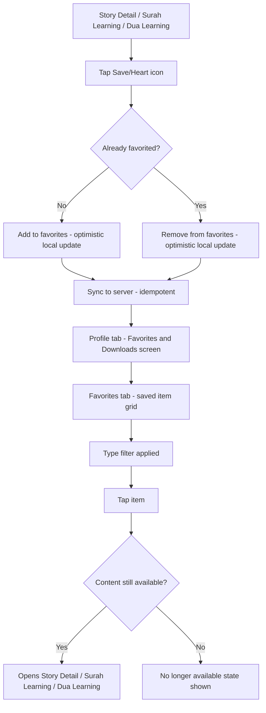
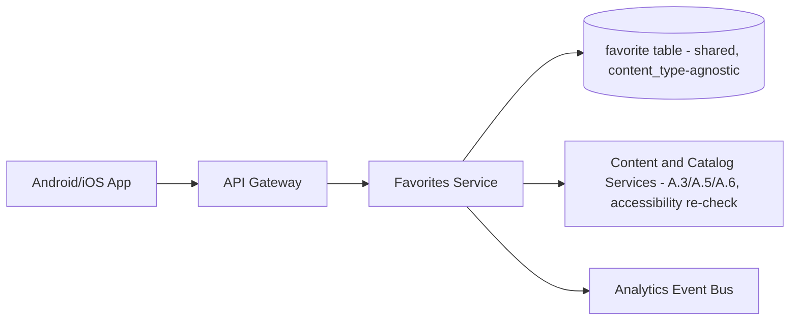
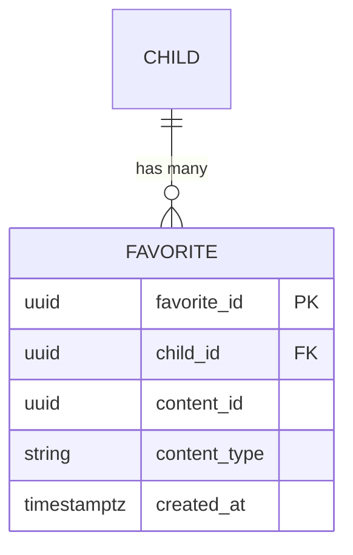

# Feature B.14 — Favorites

**App:** NoorHeroes — Islamic Learning App for Children
**Feature Owner:** Product / Content & Editorial
**Status:** Implementation-ready
**Version:** 1.0
**Depends on:** A.1 (Auth & Onboarding — per-child session isolation), A.3/A.5/A.6 (Content & Catalog Services — favoritable content sources)
**Feeds into:** B.16 Child Profile (Favorites entry point), B.15 Offline Downloads (sibling tab in the shared "Favorites & Downloads" screen), A.2 Home (potential "Recently Favorited" surfacing)

> **Scope note:** The source blueprint presents Favorites and Downloads as two tabs within a single "Favorites & Downloads" screen reachable from the Profile tab. This document specifies the **Favorites tab and its underlying data model/API in full**; Downloads (the offline-manifest tab, storage-used tracking, retry/clear-all actions) is owned by Feature B.15 and referenced here only at the points where the two tabs share a screen shell or a content item's saved/downloaded states visually coexist.

---

## Table of Contents

1. [Product Requirements](#1-product-requirements)
2. [UX/UI Requirements](#2-uxui-requirements)
3. [Backend Requirements](#3-backend-requirements)
4. [Database Design](#4-database-design)
5. [Backend AI Code-Generation Prompt](#5-backend-ai-code-generation-prompt)
6. [Android Requirements](#6-android-requirements)
7. [Android AI Code-Generation Prompt](#7-android-ai-code-generation-prompt)
8. [Admin Requirements](#8-admin-requirements)
9. [Admin AI Code-Generation Prompt](#9-admin-ai-code-generation-prompt)
10. [DevOps Requirements](#10-devops-requirements)
11. [Analytics Requirements](#11-analytics-requirements)
12. [Security Requirements](#12-security-requirements)
13. [QA Requirements](#13-qa-requirements)
14. [Marketing Requirements](#14-marketing-requirements)
15. [Release & Rollback Plan](#15-release--rollback-plan)

---

## 1. Product Requirements

### 1.1 Problem Statement

Children need a simple, low-friction way to bookmark content they love — a story, a surah, a dua — and find it again quickly, with each child's saved list being entirely their own, never visible to or shared with a sibling, and never silently broken when the underlying content changes or is withdrawn (source: Consolidated Blueprint navigation table: "Favorites | Saved content shortcuts | Saved item grid, type filter | Open item, Remove from favorites | Profile, Story/Quran detail 'save' action | Story Detail, Surah/Dua Learning | Favorites are per-child, not shared across siblings").

### 1.2 Business Goals

- Increase return-engagement to previously-enjoyed content, complementing Search (B.13) and Home's Recommended surfacing (A.2) as a third, child-curated discovery pathway.
- Maintain strict per-child data isolation as a non-negotiable platform-wide trust commitment, applied here to a simple but high-touch-frequency feature.
- Keep Favorites lightweight and universally available across every favoritable content type (stories, surahs, duas) via one shared, reusable mechanism rather than per-content-type bespoke implementations.

### 1.3 User Goals

- **Child:** Save stories, surahs, and duas I like with one tap, find them all in one place, and remove them just as easily.
- **Parent:** Trust that each of my children's favorite lists are their own — never mixed up with or visible to a sibling.

### 1.4 Success Metrics

| Metric | Target |
|---|---|
| Favoriting engagement rate (children who favorite at least one item) | ≥ 50% |
| Favorites → re-engagement rate (a favorited item opened again within 14 days) | ≥ 40% |
| Favorites screen view rate (weekly) | ≥ 30% of active children |
| Favorite-toggle action latency | p95 < 200ms (optimistic, near-instant) |
| Crash-free Favorites sessions | ≥ 99.6% |

### 1.5 Stakeholders

Product Manager, UX Designer, Backend Architect, Android Architect, Content/Editorial Lead (favoriting-pattern signal for content curation), Data Analyst, QA Lead.

### 1.6 User Stories

1. As a child, I want to tap a heart/save icon on a story, surah, or dua to save it for later.
2. As a child, I want to see all my saved items in one place, filterable by type.
3. As a child, I want to remove something from my favorites just as easily as I added it.
4. As a child, I want my favorites list to be just mine — not mixed up with my sibling's.
5. As a child, when something I favorited is no longer available, I want a clear, friendly explanation, not a broken link.
6. As a parent, I want assurance favoriting never bypasses age-band content restrictions — a child can only favorite what they could already access.

### 1.7 Functional Requirements

**FR-1** Favorites screen UI sections: a saved-item grid and a type filter (source: screen catalog "Favorites — UI Sections: Saved item grid, type filter").
**FR-2** User actions: open a favorited item, remove it from favorites (source: screen catalog "User Actions: Open item, Remove from favorites").
**FR-3** Favoriting entry points are the "save" action available on Story Detail, Surah Learning, and Dua Learning detail screens (source: screen catalog "Entry Points: Profile, Story/Quran detail 'save' action").
**FR-4** **Favorites are strictly per-child, never shared across siblings** — each child has their own independent favorites list, with no UI surface anywhere (including Parent Area reports) that merges or displays favorites across multiple children as a combined view (source: navigation table — restated as a hard platform-wide data-isolation rule applied here).
**FR-5** A favorite toggle (add/remove) is idempotent and optimistic — toggling the same item rapidly never produces a duplicate favorite record or an inconsistent final state (consistent with the platform's general idempotent-toggle pattern established for habit favorites/check-ins elsewhere).
**FR-6** Favoriting an item is only possible for content the child already has access to — favoriting never bypasses age-band eligibility, entitlement, or unlock-state restrictions; the save action itself is simply unavailable (not erroring, just not offered) on content the child cannot already open.
**FR-7** If favorited content is later withdrawn or archived by Admin, the Favorites grid shows a clear "no longer available" state for that item rather than a broken link or silent disappearance, consistent with the platform-wide withdrawn-content handling pattern (A.3/A.6).
**FR-8** The Favorites grid supports filtering by content type (Stories/Surahs/Duas) consistent with FR-1, using the same type-iconography established in Search (B.13).
**FR-9** Favorites and Downloads (B.15) share a single screen shell with two tabs, reachable from the Profile tab; the two tabs are independently functional and do not share data models, only a UI container.

### 1.8 Non-Functional Requirements

- **Performance:** Favorite-toggle action latency p95 < 200ms (optimistic local update); Favorites grid load p95 < 500ms.
- **Data Isolation:** Per-child favorites isolation is a hard, zero-exception guarantee, consistent with the platform's general multi-child session-isolation principle.
- **Offline tolerance:** Favorites grid and toggle actions function fully offline using cached/queued state, syncing on reconnect.

### 1.9 Acceptance Criteria

- Given a child taps "save" on any favoritable content detail screen, when the action completes, then the item appears in their Favorites grid, and the save icon reflects the favorited state immediately.
- Given a child removes an item from Favorites, when the action completes, then it no longer appears in the grid, and the toggle state reflects this immediately on the originating detail screen if still open.
- Given two siblings each favorite different items, when either child (or their parent) views any Favorites-related screen, then only that specific child's own favorites are ever shown — never the sibling's, never a combined view.
- Given a favorited item is later withdrawn by Admin, when the child opens their Favorites grid, then that item shows a clear "no longer available" state rather than a broken link.
- Given a child does not yet have access to a piece of content (e.g., it's above their age band or a locked episode), when they view that content's detail screen, then no save/favorite action is offered for it.
- Given a child rapidly taps the favorite toggle multiple times in quick succession, when the dust settles, then the final state matches their last actual tap, with no duplicate favorite records created.

### 1.10 Edge Cases

1. A child favorites an episode within a series, and the series is later restructured/renumbered by Admin (a content-lifecycle edge case referenced in A.3 Edge Case 11) → the favorite reference resolves to the new canonical content ID rather than silently breaking, consistent with A.3's established resolution rule.
2. A child favorites an item, then their age band changes (birthday rollover) such that they would no longer be newly-eligible for that specific content type if encountering it fresh today → the existing favorite and its accessibility are **not retroactively revoked** — a child keeps access to and the favorited status of content they already had access to, consistent with the platform's general non-retroactive-restriction philosophy (distinct from a *new* search/browse encounter, which would respect current age-band filtering).
3. Two siblings share a device; switching from Child A to Child B mid-session → the Favorites grid must fully reset to Child B's own list with zero visual or data carryover from Child A's session, consistent with the platform-wide multi-child session-isolation rule (FR-4).
4. A child favorites the maximum reasonable number of items (a very large list, e.g., hundreds) → the Favorites grid paginates/lazy-loads gracefully rather than degrading performance or crashing; there is no hard cap on favorites count by product design (favoriting is free and low-stakes), but the UI must scale gracefully regardless.
5. A child attempts to favorite an item while offline → the action queues locally (optimistic update shown immediately) and syncs on reconnect, using an idempotent toggle request so a queued duplicate doesn't create an inconsistent state once synced.
6. A favorited item's content type changes its fundamental nature (an unusual content-lifecycle edge case, e.g., a piece of content is re-tagged from one content type to another by Admin) → the Favorites grid's type filter correctly reflects the item under its new type going forward, without leaving an orphaned reference under the old type filter.
7. A child taps "remove from favorites" on an item, then immediately re-taps "save" before the first request has confirmed (a rapid undo) → idempotent, last-tap-wins handling ensures the final state matches the child's actual last intended action without a race condition.
8. A parent, while in Parent Preview mode for a specific child (cross-ref A.3's Parent Story Insights pattern), views that child's favorited content as part of understanding their interests → this is a legitimate, single-child-scoped preview, not a violation of FR-4's per-child isolation rule (the isolation rule is about siblings never seeing each other's favorites, not about a parent never being able to see their own child's favorites in an appropriate context).
9. A child favorites an item that requires a specific download/offline package to actually play, and that item is later removed from the Downloads tab (B.15) for storage-management reasons → the favorite itself persists independently of download state; the favorited item simply requires connectivity again to play, consistent with favoriting and downloading being two independent, non-coupled actions on the same content item.

### 1.11 Error Handling

| Scenario | System Behavior |
|---|---|
| Favorite-toggle submission fails (network) | Optimistic local update already shown; retried via background sync, never shown as a child-facing error |
| Favorites grid fetch failure | Cached last-known list rendered with a staleness indicator, never a blank/broken screen |
| Favorited content withdrawn | Clear "no longer available" state per item (FR-7), never a broken link or crash |
| Favorite-toggle attempted on inaccessible content (a tampered/stale client state edge case) | Server rejects the toggle request with a graceful response; client re-syncs accessibility state |

### 1.12 Empty States
- Zero favorites yet → friendly "Tap the heart on any story, surah, or dua to save it here" guided empty state, consistent with the platform's general empty-state philosophy (A.3/A.6).

### 1.13 Loading States
- Favorites grid: skeleton card-grid shimmer while loading.

### 1.14 Offline States
- Favorites grid renders from cache fully offline; toggle actions queue and sync on reconnect (Edge Case 5).

### 1.15 Permission States
- No new runtime permissions specific to this feature.

### 1.16 User Flow (Narrative)

Child opens a Story Detail, Surah Learning, or Dua Learning screen → taps the save/heart icon → the item is added to their Favorites instantly (optimistic) → child later opens their Profile tab → navigates to the "Favorites & Downloads" screen's Favorites tab → browses/filters their saved items by type → taps an item to reopen it, or removes it via the same toggle.

### 1.17 Detailed Flow Diagram (Mermaid)



### 1.18 Screen Inventory (Complete — Zero Missing)

| # | Screen / Component | Type | Entry Points | Exit Points |
|---|---|---|---|---|
| 1 | Favorites & Downloads Screen Shell (tabbed container, shared with B.15) | Primary | Profile tab | Favorites tab content / Downloads tab content |
| 2 | Favorites Tab (saved item grid + type filter) | Screen | Favorites & Downloads Screen Shell | Item Detail (Story/Surah/Dua) |
| 3 | Type Filter Selector (component, shared visual pattern with B.13) | Component | Favorites Tab | Filtered Favorites grid |
| 4 | Favorite Toggle (heart/save icon, component on detail screens) | Component | Story Detail, Surah Learning, Dua Learning | Inline state toggle, no navigation |
| 5 | Empty State — No Favorites Yet | Screen variant | Favorites Tab, zero favorites | Browse content (Stories/Learn tab) |
| 6 | "No Longer Available" Item State (component, within grid) | Component | Favorites Tab, withdrawn item | Dismiss / suggests browsing alternative |
| 7 | Offline Favorites Tab State | Screen variant | Favorites Tab, no connectivity | N/A (fully functional from cache) |

### 1.19 Events (Complete Analytics Event List)

`favorite_added` (with `content_type`, `content_id`), `favorite_removed`, `favorites_tab_viewed`, `favorites_type_filter_applied`, `favorite_item_opened`, `favorite_item_unavailable_shown`, `favorite_toggle_rejected_inaccessible_content` (internal/security signal), `favorites_offline_state_shown`.

---

## 2. UX/UI Requirements

> Global Design System tokens defined in **Feature A.1 §2.1**; type-iconography pattern shared with **Feature B.13 §2.1**; withdrawn-content handling visual pattern established in **Feature A.3 §2.4** / **A.6 §2.4**.

### 2.1 Favorites-Specific Design System Extensions

- **Favorite Toggle Icon:** A single, consistent heart-shaped icon used identically across Story Detail, Surah Learning, and Dua Learning — filled/warm-gold when favorited, outlined when not, with a satisfying brief "pop" micro-animation on toggle (consistent with the platform's general lightweight, non-distracting micro-interaction philosophy).
- **Saved-Item Grid:** Visually consistent with B.13's Search Results grid and A.3's Stories Library grid — reinforcing one consistent "browse grid" visual language reused across every content-listing surface in the app.

### 2.2 Screen-Level Design Requirements (Key Screens)

#### Screen: Favorites Tab

- **Purpose:** Let the child quickly browse and manage everything they've saved.
- **Components:** Type-filter chip row (All/Stories/Surahs/Duas), saved-item grid with type-badge per card, remove-from-favorites action accessible per card (e.g., a long-press or a small inline heart toggle directly on the card, avoiding a required navigation into the item's detail screen just to unfavorite it).
- **States:** Default, Loading (skeleton), Filtered, Empty (friendly guided state), Offline (cached), item-level "no longer available."
- **Accessibility:** Each card's favorited/remove action independently labeled and operable via screen reader without requiring a full navigation round-trip.
- **Responsive Rules:** 2-column grid mobile, 3–4 columns tablet, consistent with other grid surfaces.

### 2.3 Tab Structure

Favorites is reachable via Profile (Tab 5) → Favorites & Downloads screen. Click mapping:

| Click Target | Destination | API Called | Analytics Event | Permission Check | Error Handling |
|---|---|---|---|---|---|
| Save/heart icon (any detail screen) | Inline toggle | `POST /v1/favorites` | `favorite_added` / `favorite_removed` | Accessibility re-check (server-side) | Optimistic + retry |
| Profile → Favorites & Downloads | Favorites Tab | `GET /v1/children/{id}/favorites` | `favorites_tab_viewed` | None | Cached fallback |
| Type filter chip | Filtered grid | `GET /v1/children/{id}/favorites?type=` | `favorites_type_filter_applied` | None | Cached fallback |
| Favorited item card | Story Detail / Surah Learning / Dua Learning | Content-type-specific detail fetch | `favorite_item_opened` | Standard destination-feature checks | Standard destination-feature handling |

### 2.4 Wireframe Description (Composite)

A tabbed screen shell (Favorites | Downloads) with the Favorites tab showing a filter-chip row followed by a standard grid — visually and structurally consistent with every other browse-grid surface in the app (B.13 Search Results, A.3 Stories Library, A.10 Games Hub), reinforcing the platform's consistent grid-browsing visual language.

### 2.5 Screen Image Generation Prompts

**Screen: Favorites Tab**
- *Prompt 1 (English):* "Mobile app favorites/saved-items screen UI mockup for a children's Islamic learning app, shown as one tab within a tabbed screen labeled 'Favorites' and 'Downloads' at the top. Warm off-white background. Below the tabs, a row of small rounded filter chips labeled 'All / Stories / Surahs / Duas'. Below that, a grid of rounded square content cards, each showing a colorful thumbnail illustration, a small content-type icon badge in the corner, a title, and a small filled gold heart icon indicating it's saved. Clean, warm, organized aesthetic, rounded corners, soft shadows, no realistic human faces, bottom navigation visible."
- *Prompt 2 (Arabic RTL):* "نفس شاشة العناصر المفضلة/المحفوظة لتطبيق تعليم إسلامي للأطفال، بتخطيط من اليمين إلى اليسار بالكامل، تظهر كأحد علامتي تبويب في شاشة مقسمة بعنوانين 'المفضلة' و'التحميلات' في الأعلى. خلفية بيج فاتح دافئ. أسفل علامات التبويب صف من رقاقات تصفية صغيرة مستديرة بعنوان 'الكل / قصص / سور / أدعية'. أسفل ذلك شبكة من بطاقات محتوى مربعة مستديرة الزوايا، كل منها تعرض رسمة مصغرة ملونة، وشارة أيقونة صغيرة لنوع المحتوى في الزاوية، وعنوانًا، وأيقونة قلب ذهبي معبأ صغيرة تشير إلى أنه محفوظ. طابع نظيف ودافئ ومنظم، زوايا دائرية، ظلال خفيفة، بدون وجوه بشرية واقعية، شريط تنقل سفلي ظاهر."

---

## 3. Backend Requirements

### 3.1 System Design Overview

Favorites is served by a lightweight, shared **Favorites Service** providing a single, content-type-agnostic toggle/list API consumed identically by Stories (A.3), Quran/Arabic (A.5), and Dua Learning (A.6) — mirroring the reuse pattern already established for the platform's shared `favorite` table referenced in those features' own specs (A.3 §4.1, A.6 §4.1).

### 3.2 Architecture Diagram (Mermaid)



### 3.3 Service Breakdown

| Service | Responsibility |
|---|---|
| Favorites Service | Toggle add/remove, list-by-child, type-filtering, accessibility re-validation |
| (Reused) Content & Catalog Services | Source of truth for whether a child can actually access a given content item (referenced at toggle-time and at list-render-time for "no longer available" resolution) |

### 3.4 API List

#### `POST /v1/favorites`
- **Auth:** Bearer (child-mode)
- **Request:** `{ "content_id": "...", "content_type": "story|surah|dua", "favorited": true, "client_request_id": "uuid..." }`
- **Response 200:** `{ "favorited": true }`
- **Idempotency:** `client_request_id` unique constraint, consistent with the platform-wide pattern; repeated identical toggles return the original result, not an error.
- **Validation:** Server re-validates that the requesting child currently has access to `content_id` (age-band/entitlement/unlock-state, per the respective content type's own rules) before allowing `favorited: true` — rejecting (gracefully, per §1.11) an attempt to favorite genuinely inaccessible content (FR-6/Edge Case re: tampered client state). Removing a favorite (`favorited: false`) has no such accessibility gate (a child can always un-favorite something regardless of current accessibility, e.g., even if their age band changed since).

#### `GET /v1/children/{id}/favorites?type=`
- **Auth:** Bearer (own child only — strictly scoped, never returns another child's data even within the same family)
- **Response 200:** `{ "favorites": [ { "content_id": "...", "content_type": "story", "title": "...", "thumbnail_url": "...", "available": true } ] }`
- **Validation:** `available: false` flags withdrawn/archived content (FR-7) so the client can render the "no longer available" state without a broken navigation attempt.
- **Caching:** Short TTL, invalidated immediately on any toggle for that child.

### 3.5 Cross-Cutting API Concerns

- **Per-child strict scoping:** Every endpoint requires the authenticated child's own session and never accepts or returns data for a different `child_id`, even a sibling within the same family — enforced server-side, not merely by client-side UI omission.
- **Idempotency:** `client_request_id` on the toggle endpoint, consistent with the platform-wide standard.
- **Accessibility re-validation:** Only on the *add* path, never blocking the *remove* path.

---

## 4. Database Design

### 4.1 ER Diagram (Mermaid)

> `favorite` is the same shared, content-type-agnostic table already introduced in A.3 §4.1 and reused in A.6 §4.1 — this is its canonical, complete definition.



### 4.2 Tables, Relationships, Constraints

| Table | Key Constraints | Indexes |
|---|---|---|
| `favorite` | FK `child_id`; UNIQUE(`child_id`, `content_id`, `content_type`) — prevents duplicate favorite rows for the same item; CHECK `content_type IN ('story','surah','dua', ...)` (extensible enum, consistent with the platform's general extensible-domain pattern) | Index `(child_id, content_type, created_at DESC)` |

### 4.3 Audit Fields
`favorite.created_at` records when the item was favorited; removal is a row deletion (favorites have no "soft remove" need, since un-favoriting is a fully reversible, low-stakes user action with no historical-record value comparable to, e.g., reward ledger entries).

### 4.4 Soft Delete Rules
N/A for the `favorite` table itself (rows are simply deleted on unfavorite). The *referenced content* follows its own source-of-truth service's withdrawal pattern (`is_withdrawn`), which this service's `available` field resolution reads at list-time.

### 4.5 Retention Rules
`favorite` rows persist indefinitely until explicitly removed by the child; no automatic expiry.

---

## 5. Backend AI Code-Generation Prompt

```
You are building the shared Favorites Service for "NoorHeroes," consumed
identically by Stories (A.3), Quran/Arabic (A.5), and Dua Learning (A.6).
Reuse the existing `favorite` table already referenced in A.3/A.6's specs
-- do not create a parallel table.

Stack: FastAPI (Python 3.12), PostgreSQL (SQLAlchemy 2.0).

Hard requirements:
1. Implement POST /v1/favorites with UNIQUE(child_id, content_id,
   content_type) at the database layer, and idempotency via
   client_request_id. Write a test firing the same favorite-add request
   twice concurrently and asserting exactly one favorite row exists, with
   both requests receiving a 200 response.
2. On favorited=true, re-validate the requesting child's current access
   to content_id by calling the appropriate Content & Catalog Service
   (A.3/A.5/A.6, dispatched by content_type) BEFORE writing the favorite
   row -- reject gracefully if the child cannot currently access that
   content (e.g., a tampered client attempting to favorite a locked or
   age-ineligible item). On favorited=false (removal), skip this check
   entirely -- a child can always remove a favorite regardless of current
   accessibility. Write a test confirming an attempt to favorite
   genuinely inaccessible content is rejected, and a separate test
   confirming removal of an existing favorite succeeds even for content
   the child can no longer access.
3. Implement GET /v1/children/{id}/favorites to STRICTLY scope results to
   the path parameter's child_id, which must match the authenticated
   child-mode session's own child_id -- write a test confirming a request
   attempting to read a different (even sibling, same-family) child_id's
   favorites is rejected, never silently scoped to the wrong child or
   merged.
4. Resolve each favorite's `available` field at list-time by checking the
   referenced content's current withdrawal/archive status in its
   source-of-truth service -- write a test where a previously-favorited
   item is withdrawn, then confirm the favorites list response shows
   available=false for it (while the favorite row itself is NOT deleted
   -- the child still "remembers" favoriting it, they just can't open it
   right now).
5. Write Alembic migrations matching the favorite table schema (extending
   the existing table from A.3/A.6 if not already fully defined, not
   duplicating it), with the UNIQUE constraint and content_type CHECK
   enforced at the database layer.

Deliver: FastAPI router, SQLAlchemy model, Alembic migration, Pydantic
schemas, and a pytest suite covering all 5 items, with items 1 (no
duplicate favorites) and 3 (strict per-child scoping, no sibling leakage)
treated as the highest-priority guarantees in this service.
```

---

## 6. Android Requirements

### 6.1 Technical Requirements
Kotlin, Jetpack Compose, MVVM, Clean Architecture, module `:feature:favorites`, depends on `:core:design-system`, `:core:network`, `:core:offline-cache`. The favorite-toggle component itself lives in `:core:design-system` (or a small shared `:core:favorites-client` module) since it's embedded identically inside `:feature:stories`, `:feature:learn`, and `:feature:dua-learning's` detail screens.

### 6.2 Screen Mapping
`FavoritesTabScreen` Composable within the shared `FavoritesAndDownloadsScreen` tabbed shell (the shell itself co-owned with B.15); `FavoriteToggleButton` is a small, reusable Composable embedded in each content type's detail screen.

### 6.3 Navigation Flow
Reachable via Profile → Favorites & Downloads → Favorites tab; tapping a favorited item navigates to its content-type-appropriate detail screen via deep link.

### 6.4 State Management
`FavoriteToggleViewModel` (or a shared ViewModel-scoped utility consumed by each detail screen's own ViewModel) handles optimistic toggle state with a `client_request_id` generated once per toggle action and reused on retry, consistent with the platform's universal idempotency pattern.

### 6.5 API Mapping
`FavoritesRepository.toggle()` → `POST /v1/favorites`; `FavoritesRepository.getFavorites(type)` → `GET /v1/children/{id}/favorites?type=`.

### 6.6 Analytics Mapping
`FavoritesAnalytics` fires `favorite_added`/`favorite_removed` from every embedding context (Story Detail, Surah Learning, Dua Learning) via the same shared toggle component, ensuring consistent event shape regardless of origin.

### 6.7 Offline Support
Favorite toggles queue in a local outbox (Room) keyed by `client_request_id`, synced via WorkManager on reconnect; the Favorites grid renders from cached data fully offline.

### 6.8 Deep Linking
`noorheroes://favorites`.

### 6.9 Push Notifications
Not a notification source or destination.

### 6.10 Testing Strategy
- Unit: toggle idempotency/optimistic-update logic, shared across all three embedding contexts.
- UI tests: Favorites Tab correctly renders the "no longer available" state for a withdrawn item without crashing or attempting navigation; type filter correctly scopes the displayed grid.
- Integration: full favorite-add (from any of the three content types) → Favorites Tab reflection → favorite-remove flow; offline toggle → reconnect → sync flow.

---

## 7. Android AI Code-Generation Prompt

```
Build the `:feature:favorites` Android module for NoorHeroes using Kotlin,
Jetpack Compose, MVVM, Clean Architecture, plus a small shared
FavoriteToggleButton composable (placed in `:core:design-system` or a
lightweight shared client module) embedded identically inside
`:feature:stories`, `:feature:learn`, and `:feature:dua-learning's`
detail screens -- do not let each feature module implement its own
separate favorite-toggle logic.

Hard requirements:
1. FavoriteToggleButton's tap handler generates a client_request_id UUID
   once per toggle action (not regenerated on retry) and calls
   FavoritesRepository.toggle(contentId, contentType, favorited,
   clientRequestId) -- write a unit test simulating a network retry and
   asserting the SAME clientRequestId is reused.
2. Implement optimistic toggle state: the heart icon flips immediately on
   tap, before the server confirms -- if the server rejects (e.g., the
   child can no longer access this content, a rare tampered-state edge
   case), roll back to the previous visual state. Write a test for this
   rollback scenario.
3. FavoritesTabScreen must render an item-level "no longer available"
   state (sourced from the available=false field in the API response)
   WITHOUT attempting navigation when such an item is tapped -- write a
   UI test tapping an available=false item and asserting no navigation
   event fires, instead showing an inline explanatory state.
4. GET /v1/children/{id}/favorites calls must always use the
   CURRENTLY ACTIVE child session's own id -- write a test (or a
   structural code-review-enforced convention) confirming
   FavoritesRepository never accepts an arbitrary child_id parameter
   from a calling screen; it should derive the id internally from the
   active session, making it structurally impossible for any screen to
   accidentally request a different child's favorites.
5. Implement a local Room-backed outbox for offline toggle actions keyed
   by clientRequestId, synced via WorkManager on reconnect. Write an
   integration test for the offline-toggle-then-reconnect-then-sync flow.
6. Write a UI test confirming that switching the active child session
   (e.g., via the Profile "Switch Profile" gate) and reopening the
   Favorites tab shows ONLY the newly-active child's favorites, with zero
   visual carryover from the previous session (a cache-invalidation-on-
   switch test).

Use Hilt, Retrofit+OkHttp, Room, WorkManager. Follow Global Design System
tokens from `:core:design-system`, reusing the grid/card visual pattern
already established for Search Results (B.13) and Stories Library (A.3).
```

---

## 8. Admin Requirements

- **Favoriting Pattern Monitor (Read-only):** Aggregate, privacy-safe (never per-child) reporting on which content items are most/least frequently favorited platform-wide — a content-curation signal for editorial, analogous to A.8's Assembly Monitor and A.10's compliance-style monitors but purely informational here.

No CRUD surfaces are needed for this feature specifically — Favorites has no admin-authored content of its own; the only admin-relevant signal is the aggregate favoriting-pattern monitor. CRUD permissions: Favoriting Pattern Monitor = Read-only behind `content_editor` role.

---

## 9. Admin AI Code-Generation Prompt

```
Build a single read-only admin page (React + TypeScript, existing
NoorHeroes Admin Portal shell) for the Favoriting Pattern Monitor.

1. Favoriting Pattern Monitor -- a read-only dashboard (recharts) showing
   the most and least frequently favorited content items platform-wide,
   filterable by content_type and date range, sourced from a read-only
   aggregated endpoint (GET /admin/v1/favorites/pattern-report) that
   NEVER exposes any per-child favorite list or identity -- only
   aggregate counts per content_id. This is purely an editorial/
   curation signal, with no mutation capability on this page at all.

Enforce RBAC via the existing Admin Portal role context (content_editor
role). No audit logging needed for this page since it performs no
mutating actions.
```

---

## 10. DevOps Requirements

- **Infrastructure:** Favorites Service is lightweight, low-traffic relative to other shared services (A.8 Quiz Engine, A.11 Reward Service) — can reasonably share infrastructure tier with A.3's Content & Catalog Service rather than requiring dedicated provisioning.
- **CI/CD:** The strict per-child scoping test and the no-duplicate-favorite-row test (§5 items 1 and 3) are mandatory CI gates on any PR touching this service.
- **Monitoring/Logging/Alerting:** Alert on any detected cross-child favorites-leakage in production sampling (mirroring the rigor applied to other per-child-isolation guarantees across the platform, e.g., A.7/A.11's Family Board no-comparison pattern).
- **Disaster Recovery:** `favorite` table at standard backup tier — low-stakes, easily-recreatable-by-the-user data, not warranting the highest durability tier used for `reward_ledger` or `ayah` reference data.
- **Rollback Strategy:** Standard deployment rollback; no special migration-replay requirement given the table's simplicity.
- **Backup Strategy:** Standard tier.
- **Environment Setup:** No special staging needs beyond the shared Content & Catalog Service fixtures already provisioned for A.3/A.5/A.6.

---

## 11. Analytics Requirements

### 11.1 Event Taxonomy
Full list in §1.19, tagged by `content_type` to compare favoriting behavior across Stories/Surahs/Duas.

### 11.2 Funnel Analysis
`favorite_added` → `favorites_tab_viewed` → `favorite_item_opened` (a return-engagement loop) — measures whether favoriting genuinely drives content re-engagement, the feature's core value hypothesis.

### 11.3 Dashboard Metrics
Most/least-favorited content items (editorial signal, surfaced via the Admin Favoriting Pattern Monitor), favorite-to-reopen conversion rate, average favorites-list size per active child.

### 11.4 Cohort & Retention
Cohort by first-favorite-action; correlate favoriting engagement with overall retention (testing whether favoriting, like several other engagement mechanics already tested across the platform, is a meaningful stickiness driver).

### 11.5 Learning Metrics
Indirect — favoriting itself doesn't directly drive a learning metric, but favorited-content reopening contributes to whichever destination feature's own learning/completion metrics (A.3/A.5/A.6).

---

## 12. Security Requirements

### 12.1 Threat Analysis
- **Cross-child favorites leakage (this feature's defining isolation risk):** mitigated by strict server-side `child_id` scoping on every endpoint, never trusting any client-supplied alternate child reference.
- **Favoriting as an accessibility-bypass vector:** mitigated by the add-path accessibility re-validation (§5 item 2) — a child cannot use favoriting to gain a reference to content they couldn't otherwise open.
- **Duplicate-favorite row inflation:** mitigated by the database-level unique constraint plus idempotency key.

### 12.2 OWASP Checklist (Applied)
Broken Access Control: every favorites endpoint strictly scoped to the authenticated child's own session, server-enforced.

### 12.3 API Security
Idempotency-key + unique-constraint double protection on the toggle endpoint, consistent with the platform-wide pattern.

### 12.4 Mobile Security
No new sensitive data handling; favorites data is standard, low-sensitivity content-preference metadata.

### 12.5 Admin Security
The Favoriting Pattern Monitor is read-only and aggregate-only by design, never exposing per-child favorite lists to any admin role.

### 12.6 Data Encryption & PII Protection
No new PII surface.

### 12.7 Child Safety Requirements
Per-child isolation (FR-4) and the accessibility-bypass-prevention rule (FR-6) are this feature's defining trust commitments, both consistent with patterns already established and heavily tested elsewhere in the platform.

### 12.8 Compliance Requirements
No additional regulatory surface beyond the platform baseline.

### 12.9 Security Checklist (Pre-Launch)
- [ ] Strict per-child scoping verified via direct API attempt to read a sibling's favorites
- [ ] No-duplicate-favorite-row guarantee verified under concurrent toggle requests
- [ ] Accessibility re-validation on the add path verified via a tampered-client-state attempt
- [ ] Withdrawn-content `available: false` resolution verified without favorite-row deletion

---

## 13. QA Requirements

### 13.1 Test Plan Summary
Coverage spans: per-child strict isolation (signature test), idempotent toggle behavior, accessibility re-validation on add, withdrawn-content graceful handling, and all 9 edge cases from §1.10.

### 13.2 Test Cases — Happy Path
1. Child favorites a story, a surah, and a dua from their respective detail screens → all three appear correctly type-tagged in the Favorites grid.
2. Child removes a favorite → it disappears from the grid immediately, with the source detail screen's heart icon (if still open) reflecting the change.
3. Two siblings each favorite different items on a shared device → switching between them shows only each child's own list, with zero crossover.

### 13.3 Edge Cases
All 9 items from §1.10.

### 13.4 Negative Cases
- Attempt to read a sibling's favorites via a direct API call with a different `child_id` → rejected.
- Fire 10 concurrent identical favorite-add requests → exactly one favorite row.
- Attempt to favorite content the child cannot currently access (tampered client state) → rejected gracefully.
- Withdraw a favorited item, then fetch the favorites list → `available: false`, favorite row still present.

### 13.5 Regression Cases
Full suite re-run on every release touching `:feature:favorites`, the Favorites Service, or any of the three content-type detail screens embedding the toggle component.

### 13.6 Automation Cases
End-to-end: full add → list → remove flow across all three content types; offline toggle → reconnect → sync flow; cross-child-isolation automated test (CI-blocking); withdrawn-content graceful-handling automated test.

---

## 14. Marketing Requirements

- **Launch Plan:** A quality-of-life feature, not a standalone marketing moment; supports the broader "every child's experience is their own" trust narrative already established via the platform's multi-child isolation commitments.
- **Push Notifications:** Not a notification source.
- **Release Notes:** Not typically called out individually.
- **App/Play Store Description:** No dedicated claim, though it indirectly supports general "personalized for your child" positioning.
- **ASO Keywords:** None specific to this feature.

---

## 15. Release & Rollback Plan

### 15.1 Release Plan
Phased rollout 25% → 75% → 100% over 1–2 days (low-risk, simple feature reusing already-hardened shared infrastructure patterns) — the strict per-child isolation test must pass at each stage.

### 15.2 Rollback Plan
Rollback triggers: any confirmed cross-child favorites leakage (P0, treated with the same severity as other per-child isolation guarantees across the platform), any confirmed accessibility-bypass via favoriting (high severity), duplicate-favorite-row bug confirmed in production. Mechanism: standard deployment rollback.

### 15.3 Success Metrics for Go/No-Go
Matches §1.4 targets. Go/no-go reviewed by Product and Engineering; the per-child isolation guarantee requires confirmation the relevant test suite is green before any production rollout stage advances, consistent with the platform's standing rigor around this class of guarantee.
