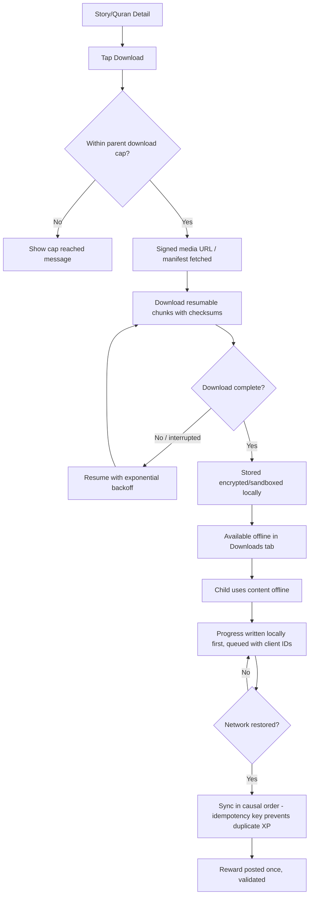
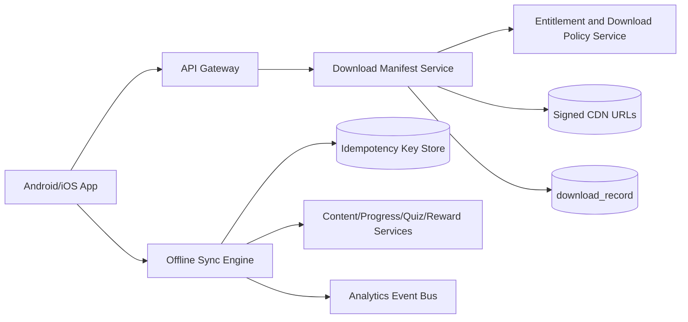
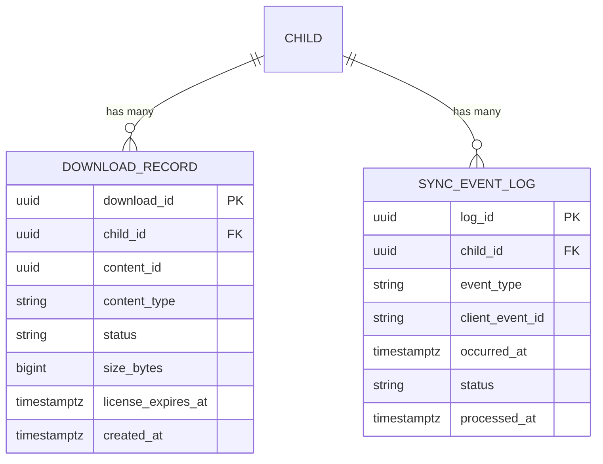

# Feature B.15 — Offline Downloads & Sync

**App:** NoorHeroes — Islamic Learning App for Children
**Feature Owner:** Product / Media Engineering / Platform
**Status:** Implementation-ready
**Version:** 1.0
**Depends on:** A.1 (Auth & Onboarding), A.3/A.5/A.6 (Content & Catalog Services — downloadable media sources), C.23 (Parental Controls — per-child download cap/policy)
**Feeds into:** A.3 Story Player (offline playback), A.4 Audio Bedtime Player (offline playback), A.5 Surah Learning (offline lesson audio), A.8 Quiz Engine (offline question banks), A.9/A.11 (offline-queued evidence/reward sync), B.14 Favorites (shared screen shell)

> **Scope note:** Multiple prior feature documents (A.3, A.4, A.5, A.8, A.9, A.11) already specified their own content's download-manifest contract and offline-sync queuing pattern. This document is the canonical, cross-cutting specification for the underlying Download Manager and Offline Sync Engine those features build on: the parent-configured per-child download cap/policy, the Downloads tab UI (storage used, retry, clear-all), resumable chunked downloads with checksums, local encryption/sandboxing, and the causal-order, idempotent sync-on-reconnect pipeline that every feature's offline progress ultimately flows through.

---

## Table of Contents

1. [Product Requirements](#1-product-requirements)
2. [UX/UI Requirements](#2-uxui-requirements)
3. [Backend Requirements](#3-backend-requirements)
4. [Database Design](#4-database-design)
5. [Backend AI Code-Generation Prompt](#5-backend-ai-code-generation-prompt)
6. [Android Requirements](#6-android-requirements)
7. [Android AI Code-Generation Prompt](#7-android-ai-code-generation-prompt)
8. [Admin Requirements](#8-admin-requirements)
9. [Admin AI Code-Generation Prompt](#9-admin-ai-code-generation-prompt)
10. [DevOps Requirements](#10-devops-requirements)
11. [Analytics Requirements](#11-analytics-requirements)
12. [Security Requirements](#12-security-requirements)
13. [QA Requirements](#13-qa-requirements)
14. [Marketing Requirements](#14-marketing-requirements)
15. [Release & Rollback Plan](#15-release--rollback-plan)

---

## 1. Product Requirements

### 1.1 Problem Statement

Families in low-connectivity environments (travel, limited home internet, data-cost-conscious households) need reliable, parent-controlled offline access to stories, lessons, and audio — with downloads that resume cleanly after interruption, never silently exceed a parent-set storage/count cap, and never let offline progress create duplicate rewards or get lost when connectivity returns (source: Consolidated Blueprint §7.10 "Downloads & Offline Sync Flow" — "Verify entitlement and parent download policy... Request a signed manifest... Download resumable chunks with checksums... Offline progress flow: Write to local database first... Server deduplicates using idempotency keys").

### 1.2 Business Goals

- Make offline access a genuine retention driver for connectivity-constrained households, rather than a degraded, unreliable fallback experience.
- Maintain strict entitlement and parental-policy enforcement on downloads — offline access is never a backdoor around content restrictions or download caps.
- Guarantee that offline-originated progress/rewards reconcile with the exact same integrity guarantees as online activity (idempotency, no duplicate XP, correct furthest-valid-position tracking) — established once here and inherited by every consuming feature.
- Protect downloaded media via encryption/sandboxing where the platform supports it, consistent with the platform's general content-security posture.

### 1.3 User Goals

- **Child:** Download my favorite stories and lessons so I can use them without internet, and have everything just work the same way it does online.
- **Parent:** Set a download limit/policy for my child, see how much storage downloads are using, and trust that offline use never bypasses content restrictions or silently racks up rewards twice.

### 1.4 Success Metrics

| Metric | Target |
|---|---|
| Download completion rate (started → fully downloaded) | ≥ 90% |
| Download resume-after-interruption success rate | ≥ 95% |
| Offline-progress sync success rate (no data loss on reconnect) | 100% (hard guarantee) |
| Duplicate-reward-from-offline-sync rate | 0% (hard guarantee, shared with A.11's idempotency tests) |
| Per-child download cap enforcement accuracy | 100% |
| Crash-free Downloads-tab sessions | ≥ 99.6% |

### 1.5 Stakeholders

Product Manager, Media/Streaming Backend Architect, Android Architect, Backend Architect (sync/idempotency), Security Engineer (media encryption, entitlement enforcement), Data Analyst, QA Lead, Customer Support Lead, feature owners of every offline-capable consuming feature (A.3/A.4/A.5/A.8/A.9/A.11).

### 1.6 User Stories

1. As a child, I want to download a story or lesson so I can watch/listen/practice it without internet.
2. As a child, I want to see all my downloads in one place, with how much space they're using.
3. As a child, when a download fails or is interrupted, I want it to resume or let me retry easily, not restart from zero or just silently fail.
4. As a child, I want to remove a download I don't need anymore, or clear all of them at once.
5. As a parent, I want to set how much can be downloaded per child, so we don't fill up the device or rack up data costs unexpectedly.
6. As a parent, I want assurance that anything my child does offline syncs correctly when we're back online — no lost progress, no duplicate rewards.
7. As a child, when a downloaded item's license/access has expired, I want a clear prompt to re-download, not a silent failure.

### 1.7 Functional Requirements

**FR-1** Downloads tab UI sections: download list, storage used vs. device/parent-set limit, remove action, retry-failed action (source: screen catalog "Favorites & Downloads — UI Sections: Two tabs — Favorites (liked content) and Downloads (offline manifest with storage used / device limit)"; "User Actions: Unlike, remove a download, retry a failed/incomplete download, clear all downloads").
**FR-2** Download Flow (canonical, source §7.10/§21.17, items 1–6): (1) verify entitlement and parent download policy, (2) request a signed manifest, (3) download resumable chunks with checksums, (4) encrypt or sandbox local media where the platform supports it, (5) store version, locale, expiry, and license terms locally, (6) refresh entitlement periodically — offline access is time-bounded, not indefinite.
**FR-3** Downloads are subject to a per-child download cap set by the parent (source: navigation table, "Downloads... Subject to per-child download cap set by parent") — attempting to download beyond the cap shows a clear "cap reached" message.
**FR-4** Offline Progress Flow (canonical, source §7.10/§21.17): write to local database first (offline-first) → queue immutable events with client-generated IDs → sync in causal order once connectivity returns → server deduplicates using idempotency keys → content progress uses the furthest-valid position; quiz attempts remain separately tracked.
**FR-5** Withdrawn content becomes unavailable after the next policy/entitlement refresh, while the child's safe progress history is preserved (source §7.10/§21.17 — the canonical rule this feature's entitlement-refresh mechanism enforces).
**FR-6** Interrupted/failed downloads resume with exponential backoff rather than restarting from zero (source: Offline Content Flow diagram).
**FR-7** License-expired downloads show a clear re-download prompt instead of silently failing (source: screen catalog navigation flow note).
**FR-8** Downloaded media is encrypted or sandboxed locally where the platform supports it (source §7.10/§21.17, item 4) — raw, freely-extractable media files are never left in an unprotected, generally-accessible device location.
**FR-9** Offline progress sync posts rewards exactly once per qualifying completion event via the same idempotency-key mechanism used platform-wide (A.11) — sync never produces duplicate XP/Noor Heroes Points regardless of how many times a client retries the sync call.
**FR-10** A "Clear all downloads" action removes all downloaded media for that child, freeing device storage, without affecting favorites (B.14) or server-side progress history — downloading and favoriting are independent, decoupled actions on the same content item.
**FR-11** Multiple downloads queue and process with resumable chunked transfer (not necessarily strictly serial — the platform may parallelize within reasonable concurrency limits), each tracked independently for retry/failure purposes.
**FR-12** Per-child download isolation: one child's downloaded content is never exposed to or accessible from a sibling's session on a shared device, consistent with the platform-wide multi-child isolation principle.

### 1.8 Non-Functional Requirements

- **Reliability:** Download resume-after-interruption must work across app kills, device reboots, and network changes.
- **Integrity:** Checksums validated on every downloaded chunk; a corrupted/incomplete download must never be presented as successfully complete.
- **Security:** Local media storage encrypted/sandboxed per platform capability (FR-8); signed manifest URLs short-TTL, consistent with A.3's media-security pattern.
- **Storage Efficiency:** Storage-used reporting must be accurate and near-real-time.
- **Sync Integrity:** Causal-order sync and idempotent dedup are the system's highest-priority non-functional requirements — zero tolerance for duplicate rewards or lost progress.

### 1.9 Acceptance Criteria

- Given a child taps Download on eligible content, when the request is processed, then entitlement and the parent's download policy/cap are verified before any download begins.
- Given a download is interrupted, when connectivity/the app resumes, then the download resumes from where it left off rather than restarting from zero.
- Given a child has reached their parent-set download cap, when they attempt to download additional content, then a clear "cap reached" message is shown, and no download begins.
- Given a child completes activity while offline, when connectivity returns, then the resulting progress/reward syncs exactly once.
- Given a downloaded item's entitlement/license has expired, when the child attempts to open it, then a clear re-download prompt is shown — never a silent failure or crash.
- Given a parent changes a download cap, the change is reflected the next time the child attempts a new download.
- Given a child taps "Clear all downloads," then all downloaded media for that child is removed and storage is freed, while favorites and server-side progress history remain unaffected.

### 1.10 Edge Cases

1. A child downloads content, then their age band changes such that the content would no longer be newly-offered today → the existing download remains valid and playable, consistent with the platform's non-retroactive-restriction philosophy.
2. Two downloads are in progress simultaneously when the device loses connectivity → both pause cleanly and independently resume, never cross-contaminating each other's progress.
3. A child attempts to download content already fully downloaded → treated as a no-op (or "already downloaded" confirmation) rather than re-downloading from scratch or creating a duplicate manifest entry.
4. A parent reduces the per-child download cap below the amount already downloaded → existing downloads are not forcibly deleted, but no new downloads are permitted until usage drops back under the new cap.
5. A download's signed manifest URL expires mid-download → the client transparently requests a fresh signed manifest and resumes from the last successfully-downloaded chunk.
6. The same content item is requested for download by two different children on the same shared device → each child's download is stored in a separate, isolated namespace; the access-control layer enforces per-child isolation regardless of any underlying byte-level storage sharing.
7. A child generates many offline progress events over an extended offline period → on reconnect, the sync pipeline processes the full queued batch in correct causal order without overwhelming the server, using batched/paginated submission if needed.
8. A downloaded quiz/question-bank package references a question later withdrawn for safety reasons → per A.8 FR-11, the response is still recorded for history on sync but excluded from mastery/reward calculation; this engine's job is correct delivery/ordering, not the withdrawal-exclusion business logic itself.
9. A child's device runs out of storage mid-download → fails gracefully with a clear "not enough storage" message, distinct from a generic failure/retry message.
10. A child removes a single download while a different download is actively in progress → only the targeted item is affected; the in-progress download continues normally.
11. Parental controls disable downloads entirely for a child while existing downloads exist → existing downloads remain playable unless the parent has also explicitly revoked existing offline content (two distinct controls, consistent with A.3/A.4's pattern); only new download attempts are blocked.
12. A sync batch partially succeeds (e.g., 8 of 10 events sync before a connection drop) → the 2 unsynced events remain correctly queued locally and are retried on next reconnect, with the 8 already-synced events' idempotency keys preventing reprocessing if accidentally resubmitted.

### 1.11 Error Handling

| Scenario | System Behavior |
|---|---|
| Download interrupted | Resumes from last successful chunk with exponential backoff (FR-6) |
| Insufficient device storage | Clear "not enough storage" message, distinct from generic retry messaging |
| Signed manifest URL expires mid-download | Transparently re-requests a fresh manifest, resumes from last chunk |
| Per-child download cap reached | Clear "cap reached" message, no download begins (FR-3) |
| License/entitlement expired | Clear re-download prompt, never a silent failure (FR-7) |
| Offline sync batch partially fails | Unsynced events remain queued, retried on next reconnect (Edge Case 12) |
| Checksum validation failure | Chunk re-downloaded, never accepted as valid; overall download not marked complete until all chunks pass |

### 1.12 Empty States
- Zero downloads yet → friendly "Download a story to watch offline" guided empty state.

### 1.13 Loading States
- Downloads tab: per-item progress bar/percentage during active download; skeleton list shimmer on initial load.

### 1.14 Offline States
- The Downloads tab itself is fully usable offline; storage-used reporting reflects local device state directly.

### 1.15 Permission States
- Standard device storage access (no special runtime permission typically required for app-sandboxed storage on modern Android).

### 1.16 User Flow (Narrative)

Child taps Download on a detail screen → entitlement and parent download policy/cap verified → signed manifest requested → resumable chunked download begins with progress shown → on completion, encrypted/sandboxed locally and appears in Downloads tab → child uses content offline with progress written locally first → on reconnect, queued events sync in causal order, deduplicated via idempotency keys → child may later remove individual downloads or clear all.

### 1.17 Detailed Flow Diagram (Mermaid)



### 1.18 Screen Inventory (Complete — Zero Missing)

| # | Screen / Component | Type | Entry Points | Exit Points |
|---|---|---|---|---|
| 1 | Favorites & Downloads Screen Shell (tabbed, shared with B.14) | Primary | Profile tab | Downloads tab / Favorites tab content |
| 2 | Downloads Tab (download list + storage used) | Screen | Screen Shell | Item playback (offline), Remove/Retry |
| 3 | Storage Used / Device Limit Indicator | Component | Downloads Tab header | N/A |
| 4 | Per-Item Download Progress | Component | Downloads Tab, active download | Completed state |
| 5 | Download Cap Reached Message | Screen variant/Toast | Tap Download beyond cap | Dismiss |
| 6 | Download Failed — Retry Action | Component | Downloads Tab, failed item | Retry → resumes |
| 7 | Insufficient Storage Message | Screen variant/Toast | Download attempt, storage full | Dismiss |
| 8 | License/Entitlement Expired — Re-download Prompt | Screen variant | Open expired item | Re-download flow |
| 9 | Clear All Downloads Confirmation | Modal | "Clear All" action | Confirm/Cancel |
| 10 | Remove Single Download Action | Component | Downloads Tab, per item | Item removed |
| 11 | Empty State — No Downloads Yet | Screen variant | Downloads Tab, zero downloads | Browse content |
| 12 | Download Initiation Control | Component | Story Detail, Surah Learning, etc. | Download begins / Cap message |
| 13 | Parent Download Cap/Policy Configuration | Screen (Parent Area) | Parent Controls | Saves configuration |

### 1.19 Events (Complete Analytics Event List)

`download_initiated`, `download_cap_reached_shown`, `download_progress_updated`, `download_interrupted`, `download_resumed`, `download_completed`, `download_failed_insufficient_storage`, `download_failed_other`, `download_removed`, `downloads_cleared_all`, `download_license_expired_shown`, `download_redownload_initiated`, `downloads_tab_viewed`, `offline_progress_event_queued`, `offline_sync_batch_started`, `offline_sync_batch_completed`, `offline_sync_duplicate_prevented`, `parent_download_cap_configured`.

---

## 2. UX/UI Requirements

> Global Design System tokens defined in **Feature A.1 §2.1**; shared tabbed shell with Favorites established in **Feature B.14 §2.1**.

### 2.1 Downloads-Specific Design System Extensions

- **Download Progress Visual:** A clean circular or linear progress indicator per in-progress item, calm and non-alarming.
- **Storage Used Indicator:** A simple horizontal bar showing used-vs-limit storage, paired with plain-language text.
- **Cap-Reached/Insufficient-Storage Messaging:** Supportive, non-alarming, actionable tone, never a harsh red error block.

### 2.2 Screen-Level Design Requirements

#### Screen: Downloads Tab

- **Purpose:** Let the child manage everything downloaded for offline use, with clear visibility into storage consumption.
- **Components:** Storage-used header bar, download list (thumbnail, title, content-type badge, progress/state, remove action), "Clear All" action.
- **States:** Default, Loading, In-progress-present, Failed-present (retry), Empty, License-expired-present.
- **Accessibility:** Each row's state announced clearly via screen reader, not relying on color/icon alone.
- **Responsive Rules:** Single-column list mobile; denser 2-column on tablet.

### 2.3 Tab Structure

Downloads is reachable via Profile (Tab 5) → Favorites & Downloads screen, sibling to B.14's Favorites tab.

| Click Target | Destination | API Called | Analytics Event | Permission Check | Error Handling |
|---|---|---|---|---|---|
| "Download" control | Inline download start | `POST /v1/downloads/manifest` | `download_initiated` | Entitlement + cap check | Cap-reached / insufficient-storage message |
| Downloads tab item (completed) | Offline playback | N/A | N/A | None | License-expired re-download prompt |
| Remove (per item) | Inline removal | Local + server cleanup | `download_removed` | None | N/A |
| Clear All | Confirmation → all removed | Local + server cleanup | `downloads_cleared_all` | None | N/A |
| Retry (failed item) | Resumes download | `POST /v1/downloads/manifest` | `download_resumed` | Re-validates entitlement/cap | Standard error handling |

### 2.4 Wireframe Description

A simple, single-column list screen consistent with the platform's general list-based management-screen pattern (similar density to A.7's Streak Calendar or A.11's Transaction History) — function-first, not a browse grid.

### 2.5 Screen Image Generation Prompts

**Screen: Downloads Tab**
- *Prompt 1 (English):* "Mobile app downloads management screen UI mockup for a children's Islamic learning app, shown as one tab within a tabbed screen labeled 'Favorites' and 'Downloads' at the top, with 'Downloads' active. Warm off-white background. Below the tabs, a horizontal storage-used bar showing a partially-filled teal progress bar with text reading '1.2 GB of 3 GB used'. Below that, a vertical list of rounded rows, each with a small thumbnail, a title, a content-type icon, and either a circular progress ring, a checkmark, or a small retry icon, plus a small trash/remove icon on the right of each row. A 'Clear All' text link near the bottom. Clean, functional, organized aesthetic, rounded corners, soft shadows, warm teal and gold accents used sparingly, no realistic human faces, bottom navigation visible."
- *Prompt 2 (Arabic RTL):* "نفس شاشة إدارة التحميلات لتطبيق تعليم إسلامي للأطفال، بتخطيط من اليمين إلى اليسار بالكامل، تظهر كأحد علامتي تبويب في شاشة مقسمة بعنوانين 'المفضلة' و'التحميلات' في الأعلى، مع تفعيل 'التحميلات'. خلفية بيج فاتح دافئ. أسفل علامات التبويب شريط أفقي لاستخدام التخزين يعرض شريط تقدم فيروزي معبأ جزئيًا مع نص يقول '1.2 جيجابايت من 3 جيجابايت مستخدمة'. أسفل ذلك قائمة عمودية من صفوف مستديرة، كل منها بصورة مصغرة وعنوان وأيقونة نوع المحتوى، وإما حلقة تقدم دائرية، أو علامة صح، أو أيقونة إعادة محاولة، بالإضافة إلى أيقونة سلة مهملات صغيرة على يسار كل صف. رابط نصي بعنوان 'حذف الكل' قرب الأسفل. طابع نظيف ووظيفي ومنظم، زوايا دائرية، ظلال خفيفة، لمسات فيروزية وذهبية دافئة مستخدمة بقلة، بدون وجوه بشرية واقعية، شريط تنقل سفلي ظاهر."

---

## 3. Backend Requirements

### 3.1 System Design Overview

Offline Downloads & Sync is served by a shared Download Manifest Service (entitlement/cap verification, signed-URL issuance — the same canonical service referenced as `POST /v1/downloads/manifest` across A.3/A.4/A.5/A.8) and a shared Offline Sync Engine (causal-order event ingestion, idempotent dedup, furthest-valid-position resolution) consumed by every offline-capable feature.

### 3.2 Architecture Diagram (Mermaid)



### 3.3 Service Breakdown

| Service | Responsibility |
|---|---|
| Download Manifest Service | Entitlement/cap verification, signed-URL issuance, manifest versioning |
| Entitlement and Download Policy Service | Parent-configured per-child cap, allow/revoke download settings |
| Offline Sync Engine | Causal-order ingestion, idempotent dedup, routing to downstream services |
| (Reused) Content/Progress/Quiz/Reward Services | Actual business-logic processing of each synced event |

### 3.4 API List

#### `POST /v1/downloads/manifest`
- **Auth:** Bearer (child-mode)
- **Request:** `{ "content_id": "...", "content_type": "story", "quality": "standard" }`
- **Response 200:** `{ "manifest_id": "...", "chunks": [ { "chunk_id": "...", "url": "...", "checksum": "sha256:..." } ], "expires_at": "...", "license_expires_at": "..." }`
- **Validation:** Entitlement + cap checked before issuance; `403 DOWNLOAD_CAP_REACHED` with usage/limit in the error body if exceeded.
- **Error Codes:** `403 DOWNLOAD_CAP_REACHED`, `403 DOWNLOADS_DISABLED_BY_PARENT`, `403 ENTITLEMENT_REQUIRED`.
- **Security:** Signed chunk URLs short-TTL; a fresh manifest can be re-requested if chunks expire mid-download.

#### `GET /v1/children/{id}/downloads`
- **Response 200:** `{ "downloads": [ { "content_id": "...", "status": "complete|in_progress|failed|license_expired", "size_bytes": ..., "license_expires_at": "..." } ], "storage_used_bytes": ..., "storage_limit_bytes": ... }`

#### `DELETE /v1/children/{id}/downloads/{content_id}`
- **Response 200:** `{ "removed": true }`

#### `DELETE /v1/children/{id}/downloads` (Clear All)
- **Response 200:** `{ "cleared": true, "count": 12 }`

#### `POST /v1/sync/batch`
- **Auth:** Bearer (child-mode)
- **Request:** `{ "events": [ { "event_type": "habit_checkin|quiz_response|story_progress|...", "client_event_id": "uuid...", "occurred_at": "...", "payload": {...} } ] }`
- **Response 200:** `{ "processed": [ { "client_event_id": "...", "status": "applied|duplicate|rejected" } ] }`
- **Business Logic:** Events processed in ascending `occurred_at` order; each routed to its owning downstream service, which applies its own idempotency-key dedup.
- **Idempotency:** Per-event `client_event_id`; `status: "duplicate"` is a success outcome, not an error.

### 3.5 Cross-Cutting API Concerns

- **Entitlement re-validation:** Every manifest request and periodic refresh re-checks entitlement; downloads are time-bounded, not indefinite.
- **Idempotency:** Universal on the sync batch endpoint, delegated to each domain service's already-hardened mechanism.
- **Causal ordering:** Processed in `occurred_at` order, never assuming arrival order reflects chronological order.

---

## 4. Database Design

### 4.1 ER Diagram (Mermaid)



### 4.2 Tables, Relationships, Constraints

| Table | Key Constraints | Indexes |
|---|---|---|
| `download_record` | FK `child_id`; UNIQUE(`child_id`, `content_id`); CHECK `status IN ('in_progress','complete','failed','license_expired')` | Index `(child_id, status)` |
| `sync_event_log` | FK `child_id`; UNIQUE(`client_event_id`) — the dedup backbone | Index `(child_id, occurred_at)` |

### 4.3 Audit Fields
`sync_event_log` is append-only — every sync attempt is logged, with `status` distinguishing `applied`/`duplicate`/`rejected`.

### 4.4 Soft Delete Rules
`download_record` rows are deleted (not soft-deleted) on explicit removal/clear-all — a current-state inventory, not a history.

### 4.5 Retention Rules
`download_record` reflects current state only. `sync_event_log` retained for a rolling audit window (e.g., 90 days), then pruned — the actual business-impact data lives permanently in each owning domain's own tables.

---

## 5. Backend AI Code-Generation Prompt

```
You are building the shared Download Manifest Service and Offline Sync
Engine for "NoorHeroes" -- canonical, cross-cutting infrastructure consumed
by every offline-capable feature (Stories A.3, Bedtime Audio A.4, Quran/
Arabic A.5, Quiz Engine A.8, Habits A.7, Rewards A.11). Do NOT reimplement
each domain's own business logic here -- this service owns entitlement/
cap verification, signed-URL issuance, and causal-order event routing/
dedup ONLY, delegating actual processing to each domain's already-
hardened service.

Stack: FastAPI (Python 3.12), PostgreSQL (SQLAlchemy 2.0), Redis, a CDN
integration for signed URLs, Kafka for downstream event routing.

Hard requirements:
1. Implement POST /v1/downloads/manifest with UNIQUE(child_id, content_id)
   on download_record -- a second manifest request for already-downloaded
   content should recognize the existing complete record rather than
   creating a duplicate. Write a test for this re-request scenario.
2. Enforce the parent-configured per-child download cap BEFORE issuing a
   manifest: query current storage_used against the parent's configured
   limit; if exceeding it, return 403 DOWNLOAD_CAP_REACHED with usage and
   limit in the error body, and create NO download_record row. Write
   tests for both under-cap and at-cap cases.
3. Implement cap-decrease handling: if a parent lowers the cap below
   current usage, do NOT delete or invalidate existing download_record
   rows -- write a test confirming existing downloads remain
   status='complete' and resolvable after a cap decrease, while a NEW
   manifest request is correctly rejected until usage drops under the
   new limit.
4. Implement POST /v1/sync/batch to process submitted events in ASCENDING
   occurred_at order regardless of array order -- write a test submitting
   out-of-order events and asserting chronological processing order.
5. For each event, look up client_event_id in sync_event_log first; if
   already present with status='applied', return status='duplicate'
   WITHOUT re-invoking the downstream service at all. Write a test
   confirming a replayed batch triggers ZERO downstream calls for
   already-processed events while still processing genuinely new events
   in the same batch.
6. Implement license/entitlement periodic refresh: a scheduled job
   re-validates entitlement for every status='complete' download_record,
   setting status='license_expired' if no longer valid. Write a test
   simulating entitlement revocation and confirming the correct
   transition without deletion (the child still sees it with a
   re-download prompt).
7. Implement withdrawn-content handling consistent with A.3/A.8: a
   download_record referencing now-withdrawn content remains in the
   child's list but flagged appropriately, while already-synced progress/
   reward history from before withdrawal remains fully intact in its
   owning domain service's tables.

Deliver: FastAPI routers, SQLAlchemy models, Alembic migrations, Pydantic
schemas, and a pytest suite covering all 7 items, with items 2 (cap
enforcement) and 5 (true pre-downstream-call dedup) treated as the
highest-priority guarantees.
```

---

## 6. Android Requirements

### 6.1 Technical Requirements
Kotlin, Jetpack Compose, MVVM, Clean Architecture, module `:feature:downloads`, plus shared `:core:download-manager` (resumable chunked transfer with checksum validation, built on Media3 DownloadManager) and `:core:offline-sync` (local outbox + WorkManager causal-order sync) consumed by every offline-capable feature module.

### 6.2 Screen Mapping
`DownloadsTabScreen` within the shared `FavoritesAndDownloadsScreen` shell; `DownloadsViewModel` exposes `StateFlow<DownloadsUiState>`.

### 6.3 Navigation Flow
Reachable via Profile → Favorites & Downloads → Downloads tab; tapping a completed download navigates to offline playback.

### 6.4 State Management
`:core:download-manager's` `DownloadController` is the single shared entry point for initiating/tracking downloads. `:core:offline-sync's` `SyncOutbox` is the single shared local queue every feature module writes to, with one `SyncWorker` responsible for batch-submitting in correct causal order on reconnect.

### 6.5 API Mapping
`DownloadRepository.requestManifest()` → `POST /v1/downloads/manifest`; `DownloadRepository.getDownloads()` → `GET /v1/children/{id}/downloads`; `SyncOutbox.flush()` → `POST /v1/sync/batch`.

### 6.6 Analytics Mapping
`DownloadsAnalytics` fires events per §1.19; progress events throttled to avoid excessive volume.

### 6.7 Offline Support
This module is the offline-support infrastructure for the rest of the platform.

### 6.8 Deep Linking
`noorheroes://downloads`.

### 6.9 Push Notifications
A local "download complete" notification for long-running downloads, owned by this module rather than the server-driven Notification Service.

### 6.10 Testing Strategy
- Unit: cap-check client-side mirror; SyncOutbox causal-ordering logic.
- UI tests: Downloads Tab renders all states correctly; Cap Reached vs Insufficient Storage messages are distinct.
- Integration: download-interruption-and-resume flow; offline-queue → reconnect → batch-sync flow across multiple feature contexts.

---

## 7. Android AI Code-Generation Prompt

```
Build two SHARED Android core modules for NoorHeroes: `:core:download-manager`
and `:core:offline-sync`, consumed by every offline-capable feature module.

Hard requirements for `:core:download-manager`:
1. DownloadController.startDownload(contentId, contentType) is the SOLE
   entry point for starting downloads; downloads chunks with checksum
   validation, persisting resumable progress to Room so app kill/reboot
   resumes from the last validated chunk. Write an instrumented test
   killing the process mid-transfer and verifying correct resume.
2. Implement a fast client-side cap-check mirror for local UX only,
   but ALWAYS still make the actual manifest request so the server's
   authoritative check applies.
3. Render distinct messages for 403 DOWNLOAD_CAP_REACHED vs
   403 DOWNLOADS_DISABLED_BY_PARENT -- write a UI test asserting these
   are visually/textually different, never collapsed into one generic
   message.
4. Implement per-child storage namespacing -- write a test confirming
   Child A's cache entries are not resolvable from Child B's
   DownloadController instance on the same device.

Hard requirements for `:core:offline-sync`:
5. SyncOutbox (Room) stores event_type, client_event_id (generated once
   at action time), occurred_at, and payload. SyncWorker submits ALL
   pending entries to POST /v1/sync/batch SORTED BY occurred_at ascending
   regardless of insertion order. Write a test for this sorting behavior.
6. After a successful batch submission, remove applied AND duplicate
   events from the outbox; only rejected events remain queued. Write a
   test for a mixed response confirming correct outbox clearing.
7. Write an end-to-end test: queue a "story progress" event and a "habit
   check-in" event from two different feature modules into the SAME
   SyncOutbox while offline, trigger SyncWorker on reconnect, and verify
   both submit correctly in one batch and route to their respective
   domain repositories.

Use Hilt, Retrofit+OkHttp, Room, WorkManager, Media3 DownloadManager.
Follow Global Design System tokens from `:core:design-system`.
```

---

## 8. Admin Requirements

- **Download Manifest Health Monitor (Read-only):** Manifest-issuance success/failure rates, cap-rejection rates, signed-URL-expiry retry rates.
- **Offline Sync Integrity Monitor (Read-only):** Sync-batch volume, duplicate-prevention rate (a positive signal), rejected-event rate by domain/event-type.
- **Per-Plan Default Download Cap Configuration:** Admin-tunable default caps per subscription tier.

CRUD permissions: both monitors = Read-only behind `product_admin`/`trust_safety`; Default Cap Configuration = Update-only behind `product_admin`.

---

## 9. Admin AI Code-Generation Prompt

```
Build an internal admin module (React + TypeScript, existing NoorHeroes
Admin Portal shell) for monitoring the Download Manifest Service and
Offline Sync Engine.

1. Download Manifest Health Monitor -- read-only dashboard showing
   issuance success/failure rates, cap-rejection trend, and signed-URL
   expiry-refetch rate over time.
2. Offline Sync Integrity Monitor -- read-only dashboard showing
   sync-batch volume, duplicate-prevention rate (framed positively, e.g.
   "X duplicates correctly caught this week"), and rejected-event
   breakdown by domain/event_type, restricted to product_admin/
   trust_safety.
3. Per-Plan Default Download Cap Configuration -- settings form mapping
   plan codes to default caps, restricted to product_admin. Changes here
   only affect future defaults, never retroactively altering a parent's
   already-configured custom cap.

Enforce RBAC via the existing Admin Portal role context. The cap
configuration form writes an immutable audit_log row; the two monitor
pages are read-only.
```

---

## 10. DevOps Requirements

- **Infrastructure:** Download Manifest Service fronts the same CDN as A.3's Media Delivery Service; Offline Sync Engine scaled for bursty reconnect-driven load.
- **CI/CD:** Cap-enforcement, pre-downstream dedup, and causal-order tests (§5 items 2, 4, 5) are mandatory CI gates.
- **Monitoring/Logging/Alerting:** Alert on download-failure rate spikes, sync-batch latency for large batches, and any production-detected duplicate event that should have been caught by dedup (P0).
- **Disaster Recovery:** `sync_event_log` backed up sufficient for dispute-resolution windows.
- **Rollback Strategy:** Deploys touching causal-ordering/dedup logic require staging replay against historical fixture out-of-order/duplicate-laden batches confirming identical outcomes.
- **Backup Strategy:** `download_record` standard tier (regenerable); `sync_event_log` standard tier, rolling retention.
- **Environment Setup:** Staging supports injecting fixture multi-day offline-backlog sequences mixing event types from different domains.

---

## 11. Analytics Requirements

### 11.1 Event Taxonomy
Full list in §1.19. `offline_sync_duplicate_prevented` is a positive integrity-health signal.

### 11.2 Funnel Analysis
`download_initiated` → `download_completed` → offline usage → `offline_progress_event_queued` → `offline_sync_batch_completed`.

### 11.3 Dashboard Metrics
Download completion/resume-success rate, storage-used distribution, sync-batch size distribution, duplicate-prevention rate trend.

### 11.4 Cohort & Retention
Cohort by first-download-usage; correlate with retention among low-connectivity segments.

### 11.5 Learning Metrics
Indirect — flows through each consuming feature's own metrics.

---

## 12. Security Requirements

### 12.1 Threat Analysis
- **Duplicate reward/progress from offline sync:** mitigated by pre-downstream-call dedup plus each domain service's own idempotency protection.
- **Download-cap bypass:** mitigated by server-side-only enforcement.
- **Unprotected local media extraction:** mitigated by encryption/sandboxing.
- **Cross-child download access on shared devices:** mitigated by per-child storage namespacing.
- **Indefinite offline access bypassing entitlement changes:** mitigated by periodic entitlement-refresh.

### 12.2 OWASP Checklist (Applied)
Broken Access Control: cap/entitlement checks server-side-only. Security Misconfiguration: short-TTL signed URLs and periodic refresh prevent indefinite unchecked access.

### 12.3 API Security
Signed, short-TTL CDN URLs; idempotency-key dedup layered on top of domain services' own guarantees.

### 12.4 Mobile Security
Encrypted/sandboxed media storage; per-child cache namespacing.

### 12.5 Admin Security
Monitor pages read-only; cap-default changes don't retroactively override parent settings.

### 12.6 Data Encryption & PII Protection
No new PII surface.

### 12.7 Child Safety Requirements
Withdrawn-content-becomes-unavailable-on-refresh (FR-5) ensures offline access can't become a permanent loophole around a safety-driven withdrawal.

### 12.8 Compliance Requirements
No additional regulatory surface beyond the platform baseline.

### 12.9 Security Checklist (Pre-Launch)
- [ ] Pre-downstream-call dedup verified
- [ ] Server-side cap enforcement verified via direct API bypass attempt
- [ ] Per-child download storage isolation verified on shared-device fixture
- [ ] Periodic entitlement-refresh correctly transitions revoked content without indefinite access
- [ ] Encrypted/sandboxed local media storage verified

---

## 13. QA Requirements

### 13.1 Test Plan Summary
Coverage spans: download resumability, cap enforcement, pre-downstream dedup, causal-order sync, withdrawn/expired-content handling, and all 12 edge cases from §1.10.

### 13.2 Test Cases — Happy Path
1. Child downloads a story, uses it fully offline, reconnects → progress syncs with exactly one reward.
2. Download interrupted mid-transfer → resumes from last validated chunk.
3. Parent sets a cap; child downloads to the cap; further attempt shows cap-reached cleanly.

### 13.3 Edge Cases
All 12 items from §1.10.

### 13.4 Negative Cases
- Replay an already-synced batch → zero downstream calls for duplicate events.
- Attempt a download beyond cap via direct API call → `403`, no record created.
- Simulate entitlement revocation, run refresh job → transitions to `license_expired`, not deleted.
- Submit an out-of-order sync batch → processed in correct chronological order.

### 13.5 Regression Cases
Full suite re-run on every release touching the Download Manifest Service, Offline Sync Engine, `:core:download-manager`, `:core:offline-sync`, or any consuming feature's offline repositories.

### 13.6 Automation Cases
End-to-end: download-interruption-resume; multi-feature offline-queue-to-sync; cap-enforcement (CI-blocking); periodic entitlement-refresh.

---

## 14. Marketing Requirements

- **Launch Plan:** Position reliable offline access as a value-add for traveling/connectivity-constrained families.
- **Push Notifications:** Local "download complete" notification only.
- **Release Notes:** Standard entries for reliability improvements.
- **App/Play Store Description:** "Download stories and lessons for offline use, with a parent-set limit and reliable resume if your connection drops."
- **ASO Keywords:** "offline Islamic kids app," "download Quran lessons offline," "kids learning app no internet."

---

## 15. Release & Rollback Plan

### 15.1 Release Plan
Phased rollout 10% → 50% → 100% over 4–5 days, gated on the full integrity test suite passing at 100%, given this is shared infrastructure for nearly every offline-capable feature.

### 15.2 Rollback Plan
Rollback triggers (all P0): confirmed duplicate reward/progress from offline sync, confirmed download-cap bypass, confirmed indefinite-offline-access past entitlement revocation, confirmed cross-child download access. Mechanism: standard rollback with cross-team incident response given the shared blast radius.

### 15.3 Success Metrics for Go/No-Go
Matches §1.4 targets. Go/no-go requires sign-off from Product, Engineering, and Security jointly, given this feature's foundational role protecting offline-derived data integrity across nearly the entire platform.
