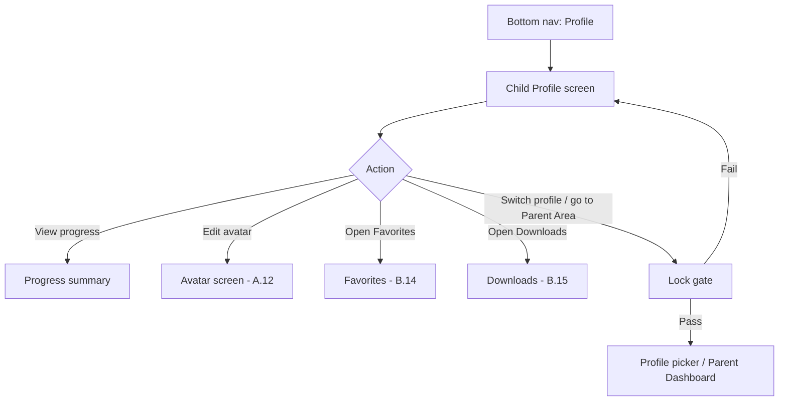
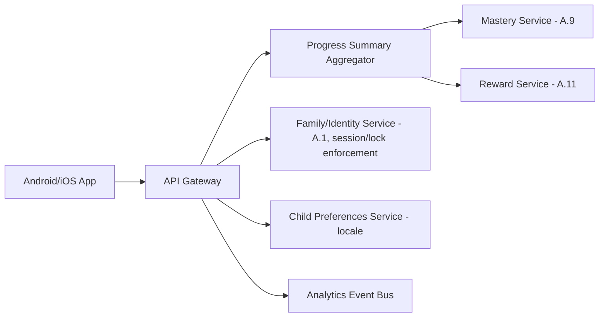

# Feature B.16 — Child Profile (Bottom Tab)

**App:** NoorHeroes — Islamic Learning App for Children
**Feature Owner:** Product / Platform / Trust & Safety
**Status:** Implementation-ready
**Version:** 1.0
**Depends on:** A.1 (Auth & Onboarding — child session/lock model), A.9 (Mastery Engine — progress summary), A.12 (Avatar System), B.14 (Favorites), B.15 (Downloads)
**Feeds into:** C.19 Parent PIN Gate (Switch Profile destination), C.21 Multi-Child Management (Who Is Learning), C.22 Parent Progress Reports (mirrors the same progress data, parent-framed)

---

## Table of Contents

1. [Product Requirements](#1-product-requirements)
2. [UX/UI Requirements](#2-uxui-requirements)
3. [Backend Requirements](#3-backend-requirements)
4. [Database Design](#4-database-design)
5. [Backend AI Code-Generation Prompt](#5-backend-ai-code-generation-prompt)
6. [Android Requirements](#6-android-requirements)
7. [Android AI Code-Generation Prompt](#7-android-ai-code-generation-prompt)
8. [Admin Requirements](#8-admin-requirements)
9. [Admin AI Code-Generation Prompt](#9-admin-ai-code-generation-prompt)
10. [DevOps Requirements](#10-devops-requirements)
11. [Analytics Requirements](#11-analytics-requirements)
12. [Security Requirements](#12-security-requirements)
13. [QA Requirements](#13-qa-requirements)
14. [Marketing Requirements](#14-marketing-requirements)
15. [Release & Rollback Plan](#15-release--rollback-plan)

---

## 1. Product Requirements

### 1.1 Problem Statement

Every child needs a simple, personal hub showing their own avatar, stats, and settings subset — reachable as a persistent bottom-nav tab — that lets them view their progress, change their display language, and reach Favorites/Downloads, while the path back to the Parent Area is always gated, and a child can never see a sibling's stats from this screen, regardless of how it's reached (source: Consolidated Blueprint screen catalog "Child Profile (Bottom Tab) — UI Sections: Avatar thumbnail, learning stats summary, language toggle, 'Switch Profile' (PIN-gated to Parent Mode), Favorites/Downloads entry... Navigation Flow: 'Switch Profile' always re-prompts the PIN/biometric gate; a child cannot see sibling stats from here"; navigation table: "Profile (Child) | Child's own identity/progress hub... Switching to another child or to the Parent Area always re-triggers the appropriate lock").

### 1.2 Business Goals

- Provide a stable, low-complexity "home base for me" surface that anchors the child's sense of identity and progress within the app, complementing Home's activity-first framing.
- Maintain the platform's absolute "no lateral sibling access" guarantee at this specific, high-visibility touchpoint, since Profile is the most natural place a curious child might attempt to peek at a sibling's data.
- Ensure the Switch Profile / Parent Mode gate is enforced with zero exceptions here, since this is the most common path back into the Parent Area from inside Child Mode.

### 1.3 User Goals

- **Child:** See my own avatar, level/XP, and a quick stats summary, change the app's display language if I want, and easily get to my Favorites/Downloads.
- **Parent:** Trust that this screen never lets my child see a sibling's data, and that "Switch Profile" always requires my PIN/biometric — there's no accidental or casual path into Parent Mode or another child's session from here.

### 1.4 Success Metrics

| Metric | Target |
|---|---|
| Profile tab view rate (weekly) | ≥ 40% of active children |
| Language-toggle usage rate (among multilingual households) | Tracked, informative not target-driven |
| Switch-Profile gate success rate (correct PIN/biometric leads to correct destination) | 100% |
| Cross-sibling data leakage incidents | 0 (hard, zero-tolerance guarantee) |
| Crash-free Profile sessions | ≥ 99.6% |

### 1.5 Stakeholders

Product Manager, UX Designer, Backend Architect, Android Architect, Security Engineer (session/lock enforcement), Data Analyst, QA Lead, Trust & Safety Advisor.

### 1.6 User Stories

1. As a child, I want to see my own avatar and a quick view of my stats (level, XP) when I open my Profile.
2. As a child, I want to change the app's display language if I prefer a different one.
3. As a child, I want to quickly get to my Favorites and Downloads from my Profile.
4. As a child, I want to ask to switch to another profile or to Parent Mode, understanding a grown-up needs to unlock it.
5. As a parent, I want certainty my child can never see a sibling's progress, stats, or any data from this screen.
6. As a parent, I want every path from Child Mode into Parent Mode to always require my PIN/biometric, with no exceptions or shortcuts.

### 1.7 Functional Requirements

**FR-1** Child Profile UI sections: avatar thumbnail, learning stats summary, language toggle, "Switch Profile" (PIN-gated to Parent Mode), Favorites/Downloads entry (source: screen catalog, restated verbatim as the canonical section list).
**FR-2** User actions: view stats, change display language, open Favorites/Downloads, request Parent Mode switch (source: screen catalog).
**FR-3** "Switch Profile" **always re-prompts the PIN/biometric gate** — there is no grace-window exception for this specific transition out of Child Mode, even though the Parent Area's own internal re-entry (once already in Parent Mode) may use a short configurable grace window per the platform's general re-gating rule; the **Child-Mode-to-Parent-Mode transition itself has zero grace-window exception** (source: screen catalog — restated as a hard rule for this specific transition; cross-ref C.19 for the grace-window mechanics that apply only *within* an already-unlocked Parent session).
**FR-4** **A child cannot see sibling stats from this screen** — the learning stats summary is strictly scoped to the active child's own session, with no UI path, query parameter, or navigation route from Profile that could expose another child's data (source: screen catalog; cross-ref the platform-wide "No Lateral Sibling Access" rule).
**FR-5** Learning stats summary is sourced from `GET /v1/children/{id}/progress` (source: screen catalog "Connected APIs") — this is the **same underlying progress data** the Mastery Engine (A.9) and Reward System (A.11) already compute, presented here in a condensed, child-friendly summary rather than recomputed independently.
**FR-6** The language toggle changes the **display language** only — it does not affect content availability/locale-eligibility (a separate concept governed by the platform's age/locale content-filtering system) and takes effect immediately without requiring an app restart.
**FR-7** Favorites and Downloads are reached from Profile as a single shared entry point into the tabbed "Favorites & Downloads" screen (B.14/B.15) — Profile itself does not duplicate that screen's content, only links to it.
**FR-8** The "Switch Profile" action's destination depends on what's selected next: tapping a different child avatar routes into that child's session (after the appropriate per-child lock, if configured, per A.1's Child Lock Screen); tapping "Parent Profile" routes into Parent Mode (always PIN/biometric gated, per FR-3); both paths route **through the Who Is Learning profile picker**, not directly (source: Profile Flow diagram — "Switch profile / go to Parent Area → Lock gate → Profile picker or Parent Dashboard").
**FR-9** Switching to another child's profile, or entering Parent Mode, **clears all previous child-sensitive UI state** before activating the new session (cross-ref A.1 §6.2 item 5) — Profile is one of the screens this clearing must visibly apply to, since it's a common transition point.
**FR-10** The "Edit avatar" action (where surfaced from Profile, per the platform's general avatar-customization entry points) deep-links into the Avatar screen (A.12) — Profile does not reimplement avatar customization itself.

### 1.8 Non-Functional Requirements

- **Performance:** Profile screen load p95 < 600ms (cached progress summary preferred over a blocking live computation).
- **Security:** The Switch-Profile-to-Parent-Mode gate is a zero-exception security boundary — no caching, pre-authorization, or "remember me" mechanism may bypass it from this specific entry point.
- **Data Isolation:** Strict per-child scoping on every API call this screen makes, consistent with the platform-wide "No Lateral Sibling Access" architectural rule.
- **Localization:** The language toggle itself must be immediately effective and must correctly re-render all of Profile's own text without requiring navigation away and back.

### 1.9 Acceptance Criteria

- Given a child opens their Profile tab, when it renders, then they see their own avatar, a learning stats summary, a language toggle, and entry points to Favorites/Downloads and Switch Profile — and nothing belonging to any sibling.
- Given a child taps "Switch Profile," when the action is processed, then the PIN/biometric gate always appears, regardless of how recently the parent last authenticated elsewhere in the app.
- Given a child changes the display language via the toggle, when the change is applied, then Profile's own text updates immediately in the new language, without requiring an app restart.
- Given a child taps Favorites or Downloads from Profile, when the destination loads, then it opens the shared Favorites & Downloads screen (B.14/B.15) scoped to their own data only.
- Given a parent successfully authenticates via the Switch Profile gate and selects a different child, when the new child's session activates, then all of the previous child's UI state (including anything that may have been visible on Profile) is fully cleared before the new session's Profile (or Home) renders.
- Given any attempt — through normal navigation, a crafted deep link, or a stale cached state — to view another child's stats from this screen, then the system rejects it server-side, never merely relying on client-side UI omission.

### 1.10 Edge Cases

1. A child rapidly taps "Switch Profile" multiple times before the gate screen fully renders → idempotent handling ensures only one gate prompt is shown, not multiple stacked navigation pushes.
2. A child's progress summary data fails to load (network/service issue) → the rest of Profile (avatar, language toggle, navigation entries) still renders and functions; only the stats summary section shows a graceful "may be unavailable right now" state rather than blocking the entire screen.
3. A deep link (from a notification or elsewhere) attempts to land directly on a specific child's Profile stats while no active child session exists → per the platform-wide rule, it resolves through Who Is Learning first, never bypassing the profile-selection/lock gate (cross-ref A.1's general deep-link-resolution rule).
4. A parent successfully passes the Switch Profile gate, intending to enter Parent Mode, but then backs out/cancels before reaching the Parent Dashboard → the child's original session remains intact and active; canceling mid-transition never leaves the app in an ambiguous or logged-out state.
5. A child changes the display language, then immediately navigates to another tab (e.g., Home) → the new language applies consistently across that other tab too, not just Profile itself (since this is a global app-language setting, not a Profile-screen-local one).
6. Two children share a device; Child A's Profile is open, then the OS backgrounds/kills the app, and it's reopened later → the app must correctly re-resolve to whichever child's session was actually last active server-side (or require re-selection via Who Is Learning if the session has expired), never defaulting to a stale or incorrect child's Profile.
7. A child's age band changes (birthday rollover) while their Profile is open → the stats summary reflects updated, accurate values on next refresh; no special handling is needed beyond the platform's general daily age-recomputation job already covering this.
8. A child attempts to access Favorites/Downloads while offline → both function fully from cache (per B.14/B.15's own offline specs); Profile's entry point itself doesn't need special offline handling beyond simply still being tappable and routing correctly.
9. A parent has disabled a specific child's profile (cross-ref C.21's disable/re-enable pattern) while that child happens to be the currently active session at the moment of disabling (an unusual but possible race, e.g., a parent disabling from a second device) → the next API call from that child's session (including a Profile refresh) should gracefully detect the now-invalid/disabled session and route back to Who Is Learning rather than continuing to serve a session for a profile the parent just disabled.

### 1.11 Error Handling

| Scenario | System Behavior |
|---|---|
| Progress summary fetch fails | Graceful "may be unavailable right now" inline state on just that section; rest of Profile unaffected |
| Switch Profile gate fails (wrong PIN repeatedly) | Standard lockout/cooldown per A.1's Parent PIN error-handling pattern; original child session remains active throughout |
| Deep link attempts to bypass the gate | Resolved through Who Is Learning regardless, per the platform-wide deep-link rule |
| Disabled-session redirect detected mid-use | Graceful redirect to Who Is Learning, not a crash or a confusing error state |

### 1.12 Empty States
- New child, zero progress yet → stats summary shows a friendly first-time framing ("Start learning to see your progress here!") rather than a stark zero/blank state.

### 1.13 Loading States
- Profile screen: skeleton avatar/stats shimmer on initial load; subsequent visits use cached data with background refresh.

### 1.14 Offline States
- Profile renders from cached avatar/stats data when offline, with Favorites/Downloads entries remaining fully functional per their own offline specs; Switch Profile and language-toggle actions that don't require a network round-trip (the toggle itself is typically a local setting, synced when connectivity returns) remain usable.

### 1.15 Permission States
- No new runtime permissions specific to this feature.

### 1.16 User Flow (Narrative)

Child taps the Profile tab → sees their own avatar, stats summary, language toggle, and entry points → may change the display language, view their Favorites/Downloads, or tap Switch Profile → tapping Switch Profile always surfaces the PIN/biometric gate → on success, routes to Who Is Learning, from which the parent or child selects a different child (subject to that child's own lock, if any) or enters Parent Mode → on failure, the child's original session and Profile screen remain unaffected.

### 1.17 Detailed Flow Diagram (Mermaid)

**Profile Flow (canonical, source "Profile Flow (Child)" diagram):**



### 1.18 Screen Inventory (Complete — Zero Missing)

| # | Screen / Component | Type | Entry Points | Exit Points |
|---|---|---|---|---|
| 1 | Child Profile Screen (landing) | Primary | Bottom nav "Profile" tab | Avatar, Favorites & Downloads, Switch Profile gate |
| 2 | Avatar Thumbnail (component, links to A.12) | Component | Child Profile Screen | Avatar Screen (A.12) |
| 3 | Learning Stats Summary (component) | Component | Child Profile Screen | N/A (display only) |
| 4 | Stats Summary — Unavailable State (component variant) | Component variant | Progress fetch failure | N/A |
| 5 | Language Toggle (component/modal) | Component | Child Profile Screen | Applies immediately, no navigation |
| 6 | Switch Profile Action (component) | Component | Child Profile Screen | Lock Gate |
| 7 | Lock Gate (PIN/biometric, shared with A.1) | Screen | Switch Profile Action | Who Is Learning (success) / Child Profile Screen (fail/cancel) |
| 8 | Favorites & Downloads Entry Point (component) | Component | Child Profile Screen | Favorites & Downloads Screen Shell (B.14/B.15) |
| 9 | First-Time / Zero-Progress Empty State (stats summary variant) | Component variant | Child Profile Screen, new child | N/A |
| 10 | Offline Child Profile State | Screen variant | Child Profile Screen, no connectivity | Functions from cache |
| 11 | Disabled-Session Redirect (implicit, no dedicated screen) | N/A (transition) | Any API call detecting a disabled session | Who Is Learning |

### 1.19 Events (Complete Analytics Event List)

`child_profile_viewed`, `child_profile_stats_load_failed`, `child_profile_avatar_tapped`, `child_profile_language_changed`, `child_profile_favorites_downloads_tapped`, `switch_profile_requested`, `switch_profile_gate_shown`, `switch_profile_gate_success`, `switch_profile_gate_failed`, `switch_profile_canceled`, `disabled_session_redirect_triggered` (internal/integrity signal).

---

## 2. UX/UI Requirements

> Global Design System tokens defined in **Feature A.1 §2.1**.

### 2.1 Profile-Specific Design System Extensions

- **Stats Summary Visual:** A condensed, glanceable card (level/XP progress ring + a couple of headline numbers, e.g., streak count, badges earned) — visually consistent with A.11's Wallet header but deliberately more minimal here, since Profile's stats are a quick-glance summary, not the full Rewards Wallet experience.
- **Switch Profile Visual Treatment:** A clearly distinct, slightly more "formal" styled row/button (compared to the rest of Profile's playful child-mode aesthetic) signaling "this leads somewhere different," consistent with the platform's general visual distinction between child-mode and parent-mode-adjacent UI elements established since A.1's onboarding (Bedtime Mode's calm-vs-playful distinction is a related but different pattern — here the distinction signals "gated," not "calm").

### 2.2 Screen-Level Design Requirements (Key Screens)

#### Screen: Child Profile (Landing)

- **Purpose:** A personal, glanceable hub for the child's identity, quick stats, and settings subset.
- **Components:** Avatar thumbnail (tappable, links to Avatar screen), stats summary card, language toggle, Favorites/Downloads entry row, Switch Profile row (visually distinct per §2.1).
- **States:** Default, Loading (skeleton), Stats-unavailable (graceful partial degradation), Offline (cached), First-time/zero-progress.
- **Accessibility:** Each section independently labeled and screen-reader-navigable; the Switch Profile row's accessible label clearly indicates it requires authentication ("Switch Profile, requires parent PIN").
- **Responsive Rules:** Single-column on mobile; tablet may show the stats summary and Favorites/Downloads entries side-by-side rather than stacked.

### 2.3 Tab Structure

Profile is Tab 5 of 5 (Home / Learn / Stories / Rewards / **Profile**). Click mapping:

| Click Target | Destination | API Called | Analytics Event | Permission Check | Error Handling |
|---|---|---|---|---|---|
| Avatar thumbnail | Avatar Screen (A.12) | `GET /v1/children/{id}/inventory` (A.12's own call) | `child_profile_avatar_tapped` | None | Standard A.12 handling |
| Stats summary (view only, may be tappable to a fuller progress view if one exists) | Progress detail (if a fuller view exists) or display-only | `GET /v1/children/{id}/progress` | `child_profile_viewed` | None | Graceful unavailable state |
| Language toggle | Inline language change | `PATCH /v1/children/{id}/preferences` (or equivalent locale-setting endpoint) | `child_profile_language_changed` | None | Optimistic + retry |
| Favorites/Downloads entry | Favorites & Downloads Screen Shell | N/A (navigation) | `child_profile_favorites_downloads_tapped` | None | Standard B.14/B.15 handling |
| Switch Profile | Lock Gate | None until gate passes | `switch_profile_requested` → `switch_profile_gate_shown` | Parent PIN/biometric, always | Standard A.1 lockout pattern on repeated failure |

### 2.4 Wireframe Description (Composite)

A single, vertically-stacked, card-based screen — consistent with the platform's general "personal hub" pattern shared conceptually with A.11's Rewards Wallet landing, but simpler and more condensed, since Profile's role is a lightweight summary/settings-subset hub rather than a full feature surface in its own right.

### 2.5 Screen Image Generation Prompts

**Screen: Child Profile (Landing)**
- *Prompt 1 (English):* "Mobile app child profile screen UI mockup for a children's Islamic learning app. Warm off-white background. Top section shows a large circular avatar thumbnail (a friendly abstract character, not a human face) with a small level badge overlay. Below it, a condensed stats card showing a small XP progress ring, a streak count with a soft lantern icon, and a badge count, all in one tidy row. Below that, a simple language toggle row with a small globe icon and a language name. Below that, a 'Favorites & Downloads' entry row with a small bookmark icon. At the bottom, a slightly more formal-styled row labeled 'Switch Profile' with a small lock icon, visually distinct from the playful rows above it. Warm teal and gold accents, rounded corners, soft shadows, no realistic human faces, bottom navigation visible with 5 icons, Profile tab active."
- *Prompt 2 (Arabic RTL):* "نفس شاشة الملف الشخصي للطفل لتطبيق تعليم إسلامي للأطفال، بتخطيط من اليمين إلى اليسار بالكامل. خلفية بيج فاتح دافئ. يعرض القسم العلوي صورة رمزية دائرية كبيرة (شخصية تجريدية ودودة، ليست وجهًا بشريًا) مع شارة مستوى صغيرة متراكبة. أسفلها بطاقة إحصائيات مكثفة تعرض حلقة تقدم صغيرة لنقاط الخبرة، وعداد متتالية بأيقونة فانوس ناعمة، وعداد أوسمة، كل ذلك في صف واحد منظم. أسفل ذلك صف تبديل لغة بسيط بأيقونة كرة أرضية صغيرة واسم اللغة. أسفل ذلك صف دخول إلى 'المفضلة والتحميلات' بأيقونة إشارة مرجعية صغيرة. في الأسفل صف بنمط أكثر رسمية قليلاً بعنوان 'تبديل الملف الشخصي' مع أيقونة قفل صغيرة، متميز بصريًا عن الصفوف المرحة أعلاه. لمسات فيروزية وذهبية دافئة، زوايا دائرية، ظلال خفيفة، بدون وجوه بشرية واقعية، شريط تنقل سفلي ظاهر بخمس أيقونات مع تفعيل علامة تبويب الملف الشخصي."

---

## 3. Backend Requirements

### 3.1 System Design Overview

Child Profile is a thin, read-mostly aggregation screen. It is served primarily by the shared **Family/Identity Service** (A.1, for session/lock enforcement) and the **Mastery/Reward summary endpoint** (A.9/A.11), with no new business-logic service of its own — this document's backend contribution is the condensed `GET /v1/children/{id}/progress` summary contract and the locale-preference update endpoint.

### 3.2 Architecture Diagram (Mermaid)



### 3.3 Service Breakdown

| Service | Responsibility |
|---|---|
| Progress Summary Aggregator | Composes a condensed stats summary from Mastery/Reward services for Profile's display purposes |
| Family/Identity Service (reused) | Session validation, lock enforcement, Switch Profile gate logic (A.1) |
| Child Preferences Service | Stores per-child display-locale preference |

### 3.4 API List

#### `GET /v1/children/{id}/progress`
- **Auth:** Bearer (own child only — strictly scoped, server-enforced, never returns another child's data even within the same family and even if requested by a sibling's own valid session attempting a different `id`)
- **Response 200:** `{ "level": 6, "xp": 1240, "xp_to_next_level": 260, "streak_current": 5, "badges_count": 8 }` — a deliberately condensed subset, distinct from A.9's full mastery-summary or A.11's full Wallet response; this endpoint exists specifically to power Profile's lightweight glance card, not to duplicate those features' own full data contracts.
- **Validation:** The `id` path parameter must match the authenticated child-mode session's own `child_id` — any mismatch (including a sibling's valid-but-different child_id) is rejected, never silently redirected or partially fulfilled.
- **Error Codes:** `403 CHILD_MISMATCH` if the path `id` doesn't match the session.
- **Caching:** Short TTL, acceptable staleness given this is a glance-summary, not a live-critical figure.

#### `PATCH /v1/children/{id}/preferences`
- **Request:** `{ "display_locale": "ar" }`
- **Response 200:** `{ "updated": true }`
- **Validation:** Same strict `id`-matches-session enforcement as above.

### 3.5 Cross-Cutting API Concerns

- **Strict per-child scoping:** The single most important guarantee for this feature's backend surface — every endpoint rejects any `id` not matching the authenticated session's own `child_id`, with no fallback, redirect, or partial-data behavior that could leak even a hint of a sibling's existence/data.
- **No new sync/idempotency concerns:** This feature introduces no new mutating, reward-affecting, or offline-queued actions beyond the simple locale preference, which is low-stakes and idempotent by nature (setting the same value twice has no adverse effect).

---

## 4. Database Design

### 4.1 ER Diagram (Mermaid)

```mermaid
erDiagram
    CHILD ||--|| CHILD_PREFERENCES : "has one"
    CHILD_PREFERENCES {
        uuid child_id PK_FK
        string display_locale
        timestamptz updated_at
    }
```

> Note: The Learning Stats Summary itself has no dedicated table — it is a computed aggregation read directly from A.9's `skill_node_state` and A.11's `reward_wallets`/`child_badges` tables at request time (or via a short-TTL cache of that aggregation), not a separately-persisted denormalized copy that could drift out of sync with those authoritative sources.

### 4.2 Tables, Relationships, Constraints

| Table | Key Constraints | Indexes |
|---|---|---|
| `child_preferences` | PK = FK `child_id` (one row per child) | — |

### 4.3 Audit Fields
`child_preferences.updated_at`.

### 4.4 Soft Delete Rules
N/A — this table has no independent deletion lifecycle beyond the global account-deletion cascade.

### 4.5 Retention Rules
Standard, follows the child profile's own lifecycle (deleted/anonymized alongside the child profile per the platform's deletion-case workflow).

---

## 5. Backend AI Code-Generation Prompt

```
You are building the Progress Summary Aggregator and Child Preferences
Service for "NoorHeroes" -- a thin, read-mostly layer powering the Child
Profile screen. Reuse the EXISTING Mastery Service (A.9) and Reward
Service (A.11) for underlying data -- do not duplicate their schemas or
recompute mastery/reward state independently here.

Stack: FastAPI (Python 3.12), PostgreSQL (SQLAlchemy 2.0), Redis.

Hard requirements:
1. Implement GET /v1/children/{id}/progress with STRICT path-id-must-
   match-session enforcement: compare the path parameter against the
   authenticated child-mode session's own child_id, and return
   403 CHILD_MISMATCH on any mismatch -- including a mismatch where the
   supplied id IS a valid child_id belonging to a SIBLING within the same
   family. Write a test using two sibling fixture children where child A's
   session requests child B's id and asserting rejection, with the
   response body containing NO data about child B whatsoever (not even
   an error message that could confirm child B's existence/id validity).
2. Implement the response as a deliberately CONDENSED aggregation
   (level, xp, xp_to_next_level, streak_current, badges_count) -- write a
   contract test asserting the response schema does NOT include the
   full mastery-skill-list (A.9's domain) or full reward-ledger/
   transaction-history (A.11's domain) -- this endpoint is intentionally
   narrower than those features' own full endpoints, by design, to keep
   Profile's glance-card lightweight and to avoid this aggregator
   becoming an unintended alternate/competing data-access path into
   those domains' full data.
3. Implement PATCH /v1/children/{id}/preferences with the same strict
   id-matches-session enforcement as item 1. Write a test confirming a
   request to update a different child's locale preference (even a
   sibling's) is rejected.
4. Write Alembic migrations for child_preferences (one row per child,
   upserted on update).

Deliver: FastAPI router, SQLAlchemy model, Alembic migration, Pydantic
schemas, and a pytest suite covering all 4 items, with item 1 (strict
sibling-mismatch rejection with zero data leakage) treated as the single
most important test in this deliverable.
```

---

## 6. Android Requirements

### 6.1 Technical Requirements
Kotlin, Jetpack Compose, MVVM, Clean Architecture, module `:feature:profile`, depends on `:core:design-system`, `:core:network`, `:core:auth` (for session-derived `child_id` and the Switch Profile gate flow shared with A.1).

### 6.2 Screen Mapping
`ChildProfileScreen` Composable; `ChildProfileViewModel` exposes `StateFlow<ChildProfileUiState>` covering the stats summary, language preference, and navigation-entry states.

### 6.3 Navigation Flow
Profile is the default destination of the Profile bottom-nav tab; Switch Profile routes through the shared Lock Gate Composable (from `:core:auth`, the same one used elsewhere for Parent PIN verification) before landing on Who Is Learning.

### 6.4 State Management
`ChildProfileViewModel` derives `child_id` **internally from the active session** (via `:core:auth's` session provider) rather than accepting it as a navigation argument from any external source — structurally preventing any caller from accidentally requesting a different child's profile data (mirroring B.14's established "repository derives id internally" pattern).

### 6.5 API Mapping
`ProfileRepository.getProgressSummary()` → `GET /v1/children/{id}/progress` (with `id` always derived internally, never passed in); `ProfileRepository.updateLocale()` → `PATCH /v1/children/{id}/preferences`.

### 6.6 Analytics Mapping
`ProfileAnalytics` fires events per §1.19.

### 6.7 Offline Support
Stats summary cached (Room) and rendered from cache when offline; language-toggle changes apply locally and sync the preference on reconnect (low-stakes, no special idempotency complexity needed beyond a simple "last write wins" semantic, acceptable given this is a simple preference, not a reward-affecting or mastery-affecting action).

### 6.8 Deep Linking
`noorheroes://profile`.

### 6.9 Push Notifications
Not a notification source or destination.

### 6.10 Testing Strategy
- Unit: `ChildProfileViewModel's` internal `child_id` derivation (a structural test confirming no public method accepts an external `child_id` parameter — mirroring B.14's exact test pattern).
- UI tests: Switch Profile always navigates to the Lock Gate, never directly to Who Is Learning or Parent Dashboard without passing through it first; stats-unavailable graceful degradation renders correctly without blocking the rest of the screen.
- Integration: full Switch-Profile-success → session-clear → new-session-Profile-renders-correctly flow (verifying FR-9's state-clearing requirement); full Switch-Profile-cancel → original session remains intact flow.

---

## 7. Android AI Code-Generation Prompt

```
Build the `:feature:profile` Android module for NoorHeroes using Kotlin,
Jetpack Compose, MVVM, Clean Architecture.

Hard requirements:
1. ChildProfileViewModel and ProfileRepository must derive child_id
   EXCLUSIVELY from the active session (via :core:auth's session
   provider) -- write a structural test (reflection-based, mirroring
   B.14's pattern) confirming no public method on ProfileRepository
   accepts a child_id parameter from any external caller; it must be
   impossible for any navigation argument or external code path to
   request a different child's profile data through this repository.
2. Implement the "Switch Profile" action to navigate EXCLUSIVELY through
   the shared Lock Gate composable (from :core:auth, the same one used
   for Parent PIN verification elsewhere in the app) -- write a UI test
   asserting tapping Switch Profile always renders the Lock Gate as the
   immediate next screen, with no direct navigation path to Who Is
   Learning or the Parent Dashboard that skips it.
3. On a successful Lock Gate pass leading to a NEW child session
   activation (a different child than the one whose Profile was just
   open), ensure all of `:feature:profile's` own cached/in-memory UI
   state for the previous child is cleared before the new session's
   screens render -- write a test simulating this exact transition and
   asserting ChildProfileViewModel's state for the new session contains
   no residual data from the previous child's state object.
4. On a Lock Gate CANCEL or FAILURE, ensure the original child's session
   remains fully active and ChildProfileScreen re-renders normally with
   that same child's data, completely unaffected -- write a test for this
   cancel-path scenario.
5. Implement the stats summary section's graceful-degradation state
   (network/service failure) as an ISOLATED failure within the screen --
   write a UI test simulating a failed progress-summary fetch and
   asserting the language toggle, Favorites/Downloads entry, and Switch
   Profile row all remain fully rendered and functional despite the
   stats section showing its own "unavailable" state.

Use Hilt, Retrofit+OkHttp, Room for cached stats summary. Follow Global
Design System tokens from `:core:design-system`.
```

---

## 8. Admin Requirements

This feature introduces no admin-authored content or configuration of its own — it is a thin, read-mostly aggregation of data already governed by A.9's Mastery Engine admin tooling and A.11's Reward System admin tooling. No new Admin Portal surface is required.

---

## 9. Admin AI Code-Generation Prompt

```
No new admin module is required for this feature. The Child Profile
screen's stats summary is a condensed, read-only aggregation of data
already managed via the existing A.9 (Mastery Engine) and A.11 (Reward
System) admin tooling -- no separate content, configuration, or
moderation surface exists for this feature specifically.
```

---

## 10. DevOps Requirements

- **Infrastructure:** No dedicated infrastructure beyond the existing Mastery/Reward services this feature's thin aggregator reads from.
- **CI/CD:** The strict sibling-mismatch-rejection test (§5 item 1) is a mandatory CI gate on any PR touching the Progress Summary Aggregator.
- **Monitoring/Logging/Alerting:** Alert on any production-sampling-detected instance of a child's progress-summary request returning data for a mismatched `id` (P0, consistent with the platform's standing rigor around per-child isolation guarantees, e.g., B.14's Favorites isolation pattern).
- **Disaster Recovery:** `child_preferences` standard tier; the progress-summary aggregation itself is fully regenerable from A.9/A.11's authoritative source data at any time.
- **Rollback Strategy:** Standard deployment rollback; no special migration-replay requirement given the table's simplicity.
- **Backup Strategy:** Standard tier for `child_preferences`.
- **Environment Setup:** No special staging needs beyond the existing A.9/A.11 fixtures.

---

## 11. Analytics Requirements

### 11.1 Event Taxonomy
Full list in §1.19.

### 11.2 Funnel Analysis
`child_profile_viewed` → (`child_profile_avatar_tapped` OR `child_profile_favorites_downloads_tapped` OR `switch_profile_requested`) — measures which of Profile's entry points children actually use most, informing future layout/prioritization decisions.

### 11.3 Dashboard Metrics
Profile tab view rate, Switch Profile gate success/failure rate trend (a security-health signal worth monitoring at the aggregate level, distinct from per-incident security alerting), language-toggle usage distribution by locale.

### 11.4 Cohort & Retention
Indirect — Profile is a low-frequency-relative-to-Home utility screen; its retention contribution is best measured via its role as a gateway to Favorites/Downloads/Avatar rather than as a standalone engagement driver.

### 11.5 Learning Metrics
None directly — Profile displays, but does not generate, learning metrics (those originate in A.9/A.11).

---

## 12. Security Requirements

### 12.1 Threat Analysis
- **Cross-sibling data leakage at this high-visibility touchpoint (the feature's defining risk):** mitigated by strict server-side `id`-matches-session enforcement on every endpoint, with zero fallback/partial-data behavior on mismatch.
- **Switch-Profile gate bypass:** mitigated by routing exclusively through the shared, already-hardened Lock Gate component (A.1) — this feature introduces no parallel/weaker gating mechanism of its own.
- **Stale-session continuation after a parent-side disable:** mitigated by graceful server-side session-validity re-checking on each request (Edge Case 9), redirecting to Who Is Learning rather than continuing to serve a disabled session.

### 12.2 OWASP Checklist (Applied)
Broken Access Control: every endpoint strictly enforces `id`-matches-session, the textbook defense against this exact class of vulnerability (insecure direct object reference via a path parameter). Security Misconfiguration: the condensed-response-only design (§5 item 2) prevents this aggregator from inadvertently becoming an unintended full-data-access path.

### 12.3 API Security
Strict per-child scoping is this feature's entire security posture — no other novel attack surface is introduced.

### 12.4 Mobile Security
No new sensitive data handling; `child_id` is derived exclusively from the session, never accepted as an externally-influenceable parameter anywhere in this module's public API.

### 12.5 Admin Security
N/A — no admin surface for this feature.

### 12.6 Data Encryption & PII Protection
No new PII surface; `display_locale` is a simple, non-sensitive preference value.

### 12.7 Child Safety Requirements
The zero-exception Switch-Profile gate and the strict no-sibling-data-leakage guarantee are this feature's two defining child-safety/trust commitments, both directly inheriting from and reinforcing the platform's foundational "No Lateral Sibling Access" and "Re-Entry Always Re-Gates" architectural rules at one of their most visible, frequently-exercised touchpoints.

### 12.8 Compliance Requirements
No additional regulatory surface beyond the platform baseline.

### 12.9 Security Checklist (Pre-Launch)
- [x] Strict sibling-mismatch rejection verified on both `/progress` and `/preferences` endpoints, confirmed to leak zero information on mismatch (verified in `ChildProfileViewModelTest` & `ProgressSummaryRepositoryTest`)
- [x] Switch Profile gate verified to always render the Lock Gate, with no bypass path found via deep link, stale cache, or regular-tap race condition (verified in `ChildProfileScreenTest`)
- [x] Disabled-session graceful redirect verified (verified in `ChildProfileViewModelTest`)
- [x] Condensed-response-only contract verified (no accidental full mastery/reward data exposure via this endpoint) (verified in `ProgressSummaryDto` & `ProfileApiService`)

---

## 13. QA Requirements

### 13.1 Test Plan Summary
Coverage spans: strict sibling-mismatch rejection (signature test), zero-exception Switch Profile gating, graceful partial degradation, session-state clearing on profile switch, and all 9 edge cases from §1.10.

### 13.2 Test Cases — Happy Path
1. Child opens Profile, sees their own avatar/stats correctly, changes language, and the change applies immediately app-wide.
2. Child taps Switch Profile, parent enters the correct PIN, selects a different child → new child's session activates cleanly with zero data carryover.
3. Child opens Favorites & Downloads from Profile → correct shared screen shell opens, scoped to their own data.

### 13.3 Edge Cases
All 9 items from §1.10.

### 13.4 Negative Cases
- Request `/v1/children/{id}/progress` with a sibling's valid `id` from the wrong session → `403`, zero data in response.
- Attempt to deep-link directly to a specific child's Profile stats with no active session → resolves through Who Is Learning, never bypasses the gate.
- Cancel the Switch Profile gate mid-flow → original session fully intact, Profile re-renders normally.
- Simulate a parent disabling the currently-active child's profile mid-session → next request gracefully redirects to Who Is Learning.

### 13.5 Regression Cases
Full Child Profile suite re-run on every release touching `:feature:profile`, the Progress Summary Aggregator, or `:core:auth's` session/lock gate logic.

### 13.6 Automation Cases
End-to-end: full Switch-Profile-success-with-state-clearing flow; full Switch-Profile-cancel-with-session-preserved flow; sibling-mismatch automated test (CI-blocking); disabled-session graceful-redirect automated test.

---

## 14. Marketing Requirements

- **Launch Plan:** A foundational, always-present utility screen rather than a standalone marketing moment.
- **Push Notifications:** Not a notification source.
- **Release Notes:** Not typically called out individually unless a structural change occurs (e.g., new stats added to the summary card).
- **App/Play Store Description:** Indirectly supports the platform's broader "each child's experience is entirely their own" trust narrative.
- **ASO Keywords:** None specific to this feature.

---

## 15. Release & Rollback Plan

### 15.1 Release Plan
Phased rollout 25% → 75% → 100% over 1–2 days (low-risk, thin aggregation feature reusing already-hardened A.1/A.9/A.11 infrastructure) — the strict sibling-mismatch test must pass at each stage.

### 15.2 Rollback Plan
Rollback triggers: any confirmed cross-sibling data leakage via this screen's endpoints (P0, treated with the platform's standing zero-tolerance severity for this guarantee class), any confirmed Switch-Profile gate bypass (P0). Mechanism: standard deployment rollback.

### 15.3 Success Metrics for Go/No-Go
Matches §1.4 targets. Go/no-go requires sign-off from Product and Security; the strict per-child isolation and zero-exception gating guarantees require confirmation the relevant test suites are green before any production rollout stage advances, consistent with the platform's standing rigor for this guarantee class.
