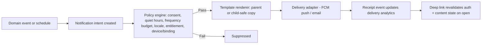
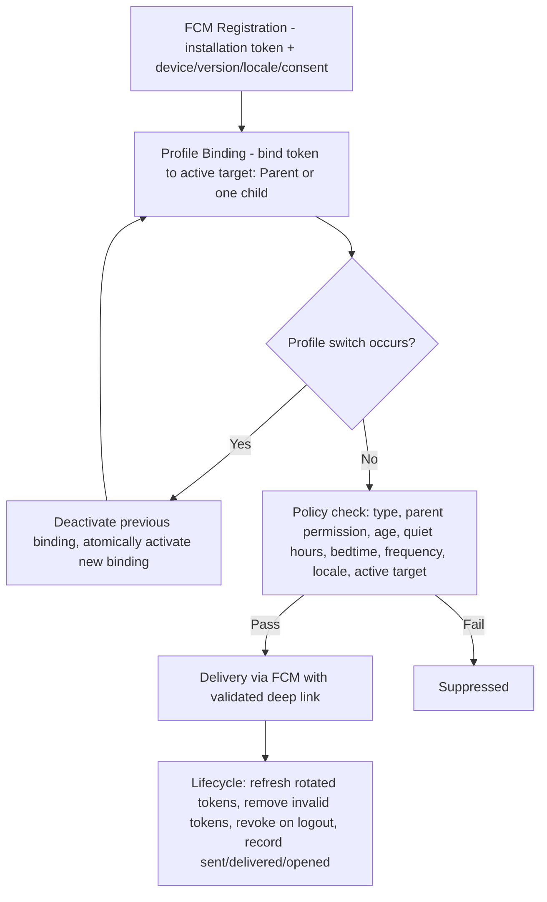
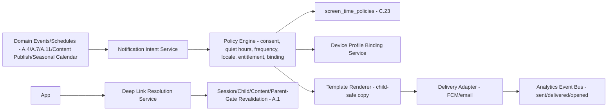

# Feature B.17 — Notifications (Child-Facing)

**App:** NoorHeroes — Islamic Learning App for Children
**Feature Owner:** Product / Platform / Child Wellbeing
**Status:** Implementation-ready
**Version:** 1.0
**Depends on:** A.1 (Auth & Onboarding — device/profile binding), A.7 (Habit Tracker — streak-risk/reminder triggers), A.4 (Bedtime Player — bedtime story trigger), A.11 (Rewards — milestone triggers), C.23 (Parental Controls — per-child reminder/quiet-hours configuration)
**Feeds into:** A.2 Home, A.4 Bedtime Corner, A.7 Habit Builder, A.11 Rewards Wallet, A.12 Avatar (deep-link destinations)

> **Scope note:** This document specifies the **child-facing notification surface** — the trigger catalog for child-bound push notifications (daily reminder, streak-risk, bedtime story, new content, reward/milestone child-side copy), the shared Firebase profile-binding/routing architecture, server-side quiet-hours/fatigue-budget policy enforcement, and deep-link revalidation on open. Parent-only notification categories (weekly report, billing, safety alerts, device login) are owned by the Parent Area's Notifications feature (cross-ref C-track); this document covers only what a child ever sees or that targets the active child-mode device binding, plus the shared delivery architecture both surfaces sit on top of.

---

## Table of Contents

1. [Product Requirements](#1-product-requirements)
2. [UX/UI Requirements](#2-uxui-requirements)
3. [Backend Requirements](#3-backend-requirements)
4. [Database Design](#4-database-design)
5. [Backend AI Code-Generation Prompt](#5-backend-ai-code-generation-prompt)
6. [Android Requirements](#6-android-requirements)
7. [Android AI Code-Generation Prompt](#7-android-ai-code-generation-prompt)
8. [Admin Requirements](#8-admin-requirements)
9. [Admin AI Code-Generation Prompt](#9-admin-ai-code-generation-prompt)
10. [DevOps Requirements](#10-devops-requirements)
11. [Analytics Requirements](#11-analytics-requirements)
12. [Security Requirements](#12-security-requirements)
13. [QA Requirements](#13-qa-requirements)
14. [Marketing Requirements](#14-marketing-requirements)
15. [Release & Rollback Plan](#15-release--rollback-plan)

---

## 1. Product Requirements

### 1.1 Problem Statement

Children need gentle, well-timed, content-appropriate notifications (a daily reminder, a streak-risk nudge, a bedtime story alert, new content, reward/milestone moments) that respect parent-configured quiet hours and bedtime, never carry billing or sensitive analytics content, never arrive for the wrong child on a shared device, and never let a deep link bypass the platform's session/lock gates (source: Feature Reference §21.16: "Child-facing through the device: approved learning reminder, bedtime story, streak-at-risk, seasonal event... Parent controls per-child reminders and quiet hours... Maximum frequency and fatigue budgets are server-enforced... Deep links validate session, child, content availability, and parent gate... Child notification copy contains no billing or sensitive analytics").

### 1.2 Business Goals

- Drive re-engagement (daily reminders, streak-risk nudges) without crossing into manipulative/fatiguing notification patterns, consistent with the platform's broader anti-exploitative-engagement ethic.
- Maintain exact, exclusive device-to-active-profile binding so a child never receives a parent-only alert (or vice versa) — a foundational trust mechanic given Firebase issues one token per installation, not per child.
- Support the Bedtime Story trigger as a meaningful complement to A.4's Bedtime Player feature, reinforcing the nightly ritual habit loop.
- Ensure every campaign (even automated, trigger-based ones) is governed by the same server-side policy engine — no notification path may bypass quiet-hours/fatigue-budget enforcement.

### 1.3 User Goals

- **Child:** Get a gentle nudge if I haven't done my lesson yet, a heads-up when my streak needs attention, a reminder when my bedtime story is ready, and to know about cool new content — all without it feeling naggy, and never seeing anything about money or reports.
- **Parent:** Control which reminders my child gets and during which hours, trust that a notification meant for me never reaches my child's device (and vice versa), and trust that tapping a notification always goes through the same safe checks as normal navigation.

### 1.4 Success Metrics

| Metric | Target |
|---|---|
| Daily reminder → session-start conversion rate | ≥ 25% |
| Streak-risk notification → check-in completion rate | ≥ 25% (shared target with A.7 §1.4) |
| Bedtime story notification → Bedtime Player open rate | ≥ 30% |
| Cross-profile misdelivery incidents (child receiving a parent notification or vice versa) | 0 (hard, zero-tolerance guarantee) |
| Quiet-hours/bedtime-window violation rate | 0% (hard, server-enforced guarantee) |
| Notification opt-out/fatigue rate (repeated non-opens leading to backoff) | Tracked, informs auto-backoff tuning |
| Deep-link-open → correct-destination-or-graceful-gate rate | 100% |

### 1.5 Stakeholders

Product Manager, Child Wellbeing Advisor, Backend Architect (Notification Service), Android Architect, Content/Editorial Lead (notification copy review), Data Analyst, Security Engineer (device-binding integrity), QA Lead, feature owners of every trigger source (A.4/A.7/A.11).

### 1.6 User Stories

1. As a child, I want a gentle reminder if I haven't done my daily lesson yet.
2. As a child, I want to know if my streak is about to end so I have a chance to keep it.
3. As a child, I want a notification when my bedtime story is ready, timed before my actual bedtime.
4. As a child, I want to hear about new stories or lessons that just became available for me.
5. As a child, I want to be told when I earn a badge or level up, with no mention of money or grown-up stuff.
6. As a parent, I want to control which reminder types my child gets and set quiet hours/bedtime windows that are always respected.
7. As a parent, I want certainty my device's notification binding always matches whichever profile is actually active, with zero mix-ups.
8. As a child, when I tap a notification, I want it to take me to the right place safely, even if something about my session has changed since the notification was sent.

### 1.7 Functional Requirements

**FR-1** Child-facing notification classes: approved learning reminder (daily reminder), bedtime story, streak-at-risk, new content, seasonal event, and the child-side copy of reward/milestone notifications (source §21.16, NoorHeroes Blueprint notification-use-case table — restated as the canonical child-facing class list).
**FR-2** Notification Flow (canonical, source §7.9 "Notification Flow" diagram): (1) a domain event or schedule creates a notification intent, (2) the policy engine checks consent, quiet hours, frequency budget, locale, entitlement, and device, (3) on pass, a template renderer produces parent-or-child-safe copy; on fail, the notification is suppressed, (4) a delivery adapter sends via FCM push or email, (5) a receipt event updates delivery analytics, (6) on open, the deep link **revalidates auth and content state**.
**FR-3** **Parent controls per-child reminders and quiet hours** — every reminder type is individually toggleable per child, and quiet-hours/bedtime windows are configured per child (source §21.16; cross-ref C.23).
**FR-4** **Maximum frequency and fatigue budgets are server-enforced** — never solely a client-side mute or a campaign-level setting that could be bypassed by an automated trigger path (source §21.16 — restated as a hard rule applying uniformly to every trigger source, scheduled or event-driven).
**FR-5** **Deep links validate session, child, content availability, and parent gate** — tapping any notification re-runs the exact same checks normal in-app navigation would, never granting a shortcut past any of them (source §21.16).
**FR-6** **Child notification copy contains no billing or sensitive analytics** — this is a template-authoring-time constraint enforced by content governance, not merely a convention (source §21.16, restated as a hard rule with zero exceptions, including for milestone/reward notifications that might otherwise be tempted to reference subscription tier or similar).
**FR-7** **Every campaign supports preview, test audience, schedule, cancel, and kill switch** (source §21.16) — applies to admin-authored campaigns layered on top of the automated trigger catalog (e.g., a seasonal-event push), not the purely automated triggers themselves, which are config-driven rather than campaign-authored.
**FR-8** **Firebase issues one token per app installation, not per child** — NoorHeroes implements per-child notification targeting through an **exclusive active-profile binding**: the installation token is bound to either the Parent Profile or exactly one selected child at any given time, with the binding atomically deactivated and reactivated on every profile switch (source: NoorHeroes Blueprint "Firebase Push Notification System" / "Firebase Notification Routing" — restated as the canonical architecture this feature's delivery layer depends on).
**FR-9** Two devices belonging to the same family may have **independent bindings** — e.g., one device actively bound to Child A while another device (or the same device at a different time) is bound to Child B or the Parent Profile; logout revokes all bindings for that session/device (source §7.9/NoorHeroes Blueprint, restated).
**FR-10** Every child-targeted notification passes a **server-side policy check against that child's `screen_time_policies`** (quiet hours/bedtime) before send — **client-side mute alone is never trusted** (source: NoorHeroes Blueprint "Quiet Hours & Bedtime" card — a hard rule).
**FR-11** Per-category daily/weekly frequency caps prevent notification fatigue; **engagement nudges back off automatically after repeated non-opens** (source: NoorHeroes Blueprint "Frequency Capping" card) — this auto-backoff is itself a server-side policy behavior, not a one-time static cap.
**FR-12** Specific trigger conditions (representative, source-confirmed): Daily reminder fires when the daily goal is not met by a configurable threshold hour; Streak risk fires on late-day inactivity with an active streak (e.g., "7PM with no activity and active streak"); Bedtime story fires 30 minutes before the configured bedtime; New content fires when new story/lesson content is published within the child's age/locale eligibility; Reward notifications fire when the Reward Service posts a ledger entry crossing a notify-worthy threshold (badge/level/weekly-challenge-completion); Seasonal notifications fire via an Islamic-calendar-date scheduling job (Ramadan mode activation, Eid content unlock) targeting the family (parent + active children).
**FR-13** In-app (non-push) notifications also exist for some triggers (e.g., "Tomorrow's episode is ready" on sequential-unlock-threshold-met) — these surface within the app's own UI (e.g., a Home banner) rather than as a device push, but still pass through the same policy engine for consent/eligibility purposes.

### 1.8 Non-Functional Requirements

- **Delivery Integrity:** The exclusive active-profile binding (FR-8/FR-9) is the system's highest-priority non-functional requirement — zero tolerance for cross-profile misdelivery.
- **Policy Enforcement:** Quiet-hours/bedtime and frequency-budget checks must be server-side and applied uniformly across every trigger path (scheduled jobs, real-time event triggers, admin campaigns) — no trigger source may have a "fast path" that skips the policy engine.
- **Content Safety:** Child-copy billing/analytics exclusion is enforced at template-authoring time via content governance, not just a runtime filter.
- **Performance:** Notification intent-to-delivery latency p95 < 30s for real-time triggers (e.g., streak-risk); scheduled triggers (daily reminder, bedtime story) fire within their configured time window with minute-level accuracy.

### 1.9 Acceptance Criteria

- Given a child has not met their daily goal by the configured threshold hour, when the policy engine evaluates, then a daily-reminder notification intent is created, subject to consent/quiet-hours/frequency checks before any send.
- Given a notification intent would fire during a child's configured quiet hours or bedtime window, when the policy engine evaluates it, then the notification is suppressed — this check is server-side and cannot be bypassed by any trigger path, scheduled or event-driven.
- Given a device's active profile binding switches from Child A to Child B, when the switch completes, then Child A's binding is deactivated and Child B's is activated atomically — no notification intended for Child A can be delivered to that device while Child B's binding is active, and vice versa.
- Given a child taps any notification, when the deep link resolves, then it revalidates session, child, content availability, and any applicable parent gate exactly as normal in-app navigation would — never skipping any of these checks.
- Given a notification template is authored for a child-facing class, when it is reviewed for publish, then it is verified to contain no billing terms or sensitive analytics language — enforced as a hard content-governance gate.
- Given a child repeatedly does not open a given engagement-nudge category, when the system evaluates subsequent eligibility, then it automatically backs off the frequency for that category rather than continuing at the same cadence indefinitely.
- Given a parent disables a specific reminder type for their child, when that trigger condition would otherwise fire, then no notification intent is created for that child for that type.

### 1.10 Edge Cases

1. A child's device switches profiles (Child A → Parent Profile) at nearly the same instant a streak-risk notification intent for Child A is being processed → the delivery adapter must check the binding's active status at actual send time, not just at intent-creation time, so a notification doesn't deliver to a binding that has since been deactivated; if the binding changed before send, the notification for Child A is held/redirected appropriately (e.g., delivered once Child A's binding is active again, or discarded if no longer relevant) rather than incorrectly delivered to whatever profile is now active on that device.
2. Two siblings share one device, and both have an active streak at risk on the same evening, but only one can be the "active profile" at any moment → each child's streak-risk evaluation and notification intent is independent and correctly scoped to whichever profile is active *at delivery time* for that specific device; if Child B's profile is active when Child A's streak-risk notification would otherwise fire on this shared device, the system does not deliver Child A's notification to this device at all in that moment (it may still be eligible for delivery via a different family device bound to Child A, if one exists, per FR-9's independent-bindings rule).
3. A child's bedtime window spans midnight (cross-ref A.4's bedtime-window edge case) → the bedtime-story trigger's "30 minutes before bedtime" calculation must correctly handle a bedtime window crossing midnight, consistent with A.4's established midnight-crossing-window logic.
4. A new content item is published, but by the time the New Content notification's delivery actually processes, the content has been very quickly withdrawn (a rare but possible race) → the policy engine's "content availability" check (part of FR-5's deep-link validation, but also relevant at send-time for this specific trigger) should prevent sending a notification promoting content that's no longer available; if the notification was already sent before withdrawal, the deep link's own revalidation-on-open will gracefully handle the now-unavailable content rather than crashing.
5. A child taps a notification while their device has no connectivity → the deep link's revalidation requires connectivity for the actual session/content checks; the app should show a clear "reconnect to open this" state rather than a confusing partial navigation or crash.
6. A parent changes a child's quiet-hours configuration while a notification intent for that child is already queued (created before the change, not yet sent) → the policy engine should re-evaluate against the **current** quiet-hours configuration at actual send time, not the configuration that was active when the intent was created, ensuring a parent's just-made change takes effect immediately rather than after a stale intent already in the queue.
7. A child's streak transitions out of an "at risk" state (e.g., they complete the qualifying activity) after a streak-risk notification intent was created but before it was sent → the notification should be canceled/suppressed rather than sent with now-inaccurate "your streak is at risk" messaging, since the underlying condition is no longer true.
8. A device is shared and currently has no active profile binding at all (e.g., immediately after a logout, before any profile is re-selected) → no child- or parent-targeted notification is deliverable to this device until a new binding is established; this is the expected, safe default state, not an error condition.
9. An admin-authored seasonal campaign (e.g., Ramadan mode activation) targets "family-wide (parent + active children)" → this must correctly resolve to delivering an appropriately-worded version to the parent's binding AND to each currently-active child's binding across however many devices the family has, respecting each binding's own policy checks independently (a child's own quiet-hours still apply to their copy of a family-wide campaign).
10. A push token becomes invalid (e.g., app uninstalled, token rotated by the OS) → the Lifecycle stage of the routing pipeline (FR-8's architecture) must detect and remove invalid tokens, refresh rotated ones, and avoid repeatedly attempting delivery to a dead token, consistent with standard FCM lifecycle management.
11. A child's age-band/eligibility changes (birthday rollover) between when a "New Content" notification intent was created (content was eligible) and when it's actually sent → the eligibility should be re-checked at send time using the child's current age band, not the age band at intent-creation time, consistent with the platform's general "always use current, not stale, eligibility" principle.

### 1.11 Error Handling

| Scenario | System Behavior |
|---|---|
| Active profile binding changes between intent creation and send | Binding status re-checked at send time; notification held/redirected/discarded as appropriate, never misdelivered (Edge Case 1) |
| Notification deep link tapped offline | Clear "reconnect to open this" state, never a crash or confusing partial navigation |
| Quiet-hours/eligibility configuration changes after intent creation, before send | Re-evaluated against current configuration at send time, not stale intent-creation-time configuration (Edge Case 6) |
| Underlying trigger condition resolves before send (e.g., streak no longer at risk) | Notification intent canceled/suppressed (Edge Case 7) |
| Push token invalid/expired | Detected and removed by the Lifecycle stage; no repeated delivery attempts to a dead token |
| Content withdrawn after a promoting notification already sent | Deep-link revalidation on open gracefully handles unavailable content, consistent with the platform's withdrawn-content UX pattern |

### 1.12 Empty States
- No notification history yet (new child) → N/A for push notifications themselves; any in-app notification-history list (if surfaced to the child at all, which is more typically a parent-area concept) would show a simple "nothing yet" state.

### 1.13 Loading States
- Deep-link revalidation on open: a brief loading state while session/child/content checks complete, before landing on the resolved destination.

### 1.14 Offline States
- Deep links tapped offline show a clear reconnect prompt (Edge Case 5); the underlying notification itself was still delivered via FCM's own offline-queuing behavior at the OS level, which is outside this feature's direct control but compatible with it.

### 1.15 Permission States
- **Notification permission (OS-level):** if denied, the child simply doesn't receive push notifications; in-app banner-style notifications (FR-13) remain unaffected since they don't require this permission. No special in-app re-prompt nagging beyond the platform-standard one-time OS re-prompt affordance.

### 1.16 User Flow (Narrative)

A domain event occurs (e.g., a child's daily goal remains unmet past the threshold hour, or A.11's Reward Service posts a notify-worthy ledger entry) or a schedule fires (bedtime-story timing, seasonal calendar trigger) → a notification intent is created → the policy engine checks consent, quiet hours, frequency budget, locale, entitlement, and the device's currently-active binding → on pass, a child-safe template renders the copy → the delivery adapter sends via FCM → a receipt event records delivery/open analytics → if the child taps the notification, the deep link revalidates session/child/content/parent-gate state before landing on the correct destination screen.

### 1.17 Detailed Flow Diagram (Mermaid)

**Notification Flow (canonical, source §7.9):**



**Firebase Notification Routing (canonical, source NoorHeroes Blueprint "Firebase Notification Routing"):**



### 1.18 Screen Inventory (Complete — Zero Missing)

| # | Screen / Component | Type | Entry Points | Exit Points |
|---|---|---|---|---|
| 1 | OS Push Notification (system-rendered, not an app screen) | System | FCM delivery | Tap → Deep Link Resolution |
| 2 | Deep Link Resolution — Loading State | Screen variant | Notification tap | Resolved destination screen |
| 3 | Deep Link Resolution — Offline/Reconnect Prompt | Screen variant | Notification tap, no connectivity | Retry → resumes resolution |
| 4 | Deep Link Resolution — Session/Lock Gate (if required) | Screen (shared with A.1) | Deep link requiring re-auth | Resolved destination screen / Who Is Learning |
| 5 | Deep Link Resolution — Content Unavailable Fallback | Screen variant | Deep link to withdrawn/unavailable content | Suggested alternative / Home |
| 6 | In-App Notification Banner (e.g., "Tomorrow's episode is ready") | Component | Home or relevant feature screen | Relevant content destination |
| 7 | Bedtime Story Notification Destination (A.4 Bedtime Player) | Screen (A.4) | Bedtime Story notification tap | N/A (A.4's own flow) |
| 8 | Streak-Risk Notification Destination (A.7 Habit Builder) | Screen (A.7) | Streak Risk notification tap | N/A (A.7's own flow) |
| 9 | New Content Notification Destination (relevant content detail) | Screen (A.3/A.5/A.6) | New Content notification tap | N/A (destination feature's own flow) |
| 10 | Reward/Milestone Notification Destination (A.11 Rewards Wallet/Achievements) | Screen (A.11) | Reward notification tap | N/A (A.11's own flow) |
| 11 | Parent Per-Child Reminder/Quiet-Hours Configuration (Parent Area, cross-ref C.23) | Screen (Parent Area) | Parent Controls | Saves configuration |

### 1.19 Events (Complete Analytics Event List)

`notification_intent_created` (with `type`, `target_binding`), `notification_suppressed` (with `suppression_reason: quiet_hours|frequency_cap|consent|stale_condition|binding_inactive`), `notification_sent`, `notification_delivered`, `notification_opened`, `notification_deep_link_resolved`, `notification_deep_link_offline_shown`, `notification_deep_link_content_unavailable_shown`, `notification_binding_activated` (with `target: parent|child_id`), `notification_binding_deactivated`, `notification_fatigue_backoff_applied`, `push_token_invalidated`, `push_token_refreshed`, `in_app_notification_banner_shown`, `in_app_notification_banner_tapped`.

---

## 2. UX/UI Requirements

> Global Design System tokens defined in **Feature A.1 §2.1**. This feature's primary UI surface is the OS-level push notification itself (governed by platform notification styling conventions, not this app's own design system) plus the deep-link resolution states and in-app banner component.

### 2.1 Notification-Specific Design System Extensions

- **Notification Copy Tone:** Consistent with the platform's general warm, non-shaming, non-pressuring tone established across Habit Tracker (A.7) and Rewards (A.11) — e.g., the streak-risk example copy "Don't lose your 7-day streak! 5 minutes left" is urgency-aware but not alarming; bedtime story copy ("Tonight's bedtime story is ready. 🌙") is calm and inviting, consistent with A.4's Bedtime Mode tone.
- **In-App Banner Visual:** A lightweight, dismissible card-style banner (consistent with Home's general card-based widget language, A.2 §2.1) rather than a disruptive modal interrupt — in-app notifications should feel like a natural part of the Home/feature surface, not an intrusive popup.
- **Deep-Link Loading State:** A brief, branded loading indicator (consistent with the platform's general loading-state visual language) rather than a jarring blank screen during the revalidation checks.

### 2.2 Screen-Level Design Requirements (Key Screens)

#### Screen: Deep Link Resolution States

- **Purpose:** Safely and transparently resolve a notification tap into the correct, validated destination.
- **Components:** Loading spinner/branded indicator; for the offline case, a friendly "Connect to the internet to open this" message with a retry action; for the content-unavailable case, a graceful "this isn't available right now" message with a suggested alternative, consistent with the platform's established withdrawn-content UX pattern (A.3/A.6).
- **States:** Resolving (loading), Offline, Content-unavailable, Requires-lock-gate (routes into the shared Lock Gate from A.1/B.16), Success (lands on destination).

#### Component: In-App Notification Banner

- **Purpose:** Surface a lightweight, non-disruptive heads-up within the app itself (e.g., "Tomorrow's episode is ready").
- **States:** Shown, Dismissed, Tapped (navigates to relevant destination).

### 2.3 Tab Structure

This feature has no dedicated tab; it surfaces via OS push notifications and in-app banners on Home or relevant feature screens. Click mapping:

| Click Target | Destination | API Called | Analytics Event | Permission Check | Error Handling |
|---|---|---|---|---|---|
| OS push notification (any type) | Deep Link Resolution → relevant destination | `GET /v1/notifications/resolve?token=` (or equivalent deep-link validation call) | `notification_opened` → `notification_deep_link_resolved` | Session, child, content availability, parent gate (FR-5) | Offline/content-unavailable/lock-gate fallbacks per §1.10/§1.11 |
| In-app banner | Relevant feature destination | N/A (in-app navigation) | `in_app_notification_banner_tapped` | Standard destination-feature checks | Standard destination-feature handling |

### 2.4 Wireframe Description (Composite)

No dedicated full-screen wireframe of its own beyond the brief deep-link-resolution loading/error states, which follow the platform's general lightweight transitional-screen pattern (similar to A.3's loading states). The in-app banner follows Home's card component pattern.

### 2.5 Screen Image Generation Prompts

**Component: In-App Notification Banner (e.g., on Home)**
- *Prompt 1 (English):* "Mobile app home screen UI mockup showing a lightweight dismissible notification banner card near the top of the content area, below the header. The banner has a small rounded icon (a glowing star), short friendly text reading 'Tomorrow's episode is ready!', and a small 'x' dismiss icon in the corner. Warm off-white background behind it, soft shadow under the banner card, rounded corners, warm teal and gold accents, calm and non-intrusive visual weight relative to the rest of the home screen content below it, no realistic human faces."
- *Prompt 2 (Arabic RTL):* "نفس واجهة الشاشة الرئيسية لتطبيق الجوال تعرض بطاقة إشعار خفيفة وقابلة للإغلاق قرب الأعلى أسفل الرأس، بتخطيط من اليمين إلى اليسار. تحتوي البطاقة على أيقونة صغيرة مستديرة (نجمة متوهجة)، ونص ودود قصير يقول 'الحلقة القادمة جاهزة غدًا!'، وأيقونة إغلاق صغيرة 'x' في الزاوية. خلفية بيج فاتح دافئ خلفها، ظل خفيف تحت بطاقة الإشعار، زوايا دائرية، لمسات فيروزية وذهبية دافئة، ثقل بصري هادئ وغير مقحم نسبة إلى بقية محتوى الشاشة الرئيسية أسفلها، بدون وجوه بشرية واقعية."

---

## 3. Backend Requirements

### 3.1 System Design Overview

Child-facing Notifications are served by a shared **Notification Service** (intent creation, policy engine, template rendering, delivery adapter) and a **Device Profile Binding Service** implementing the exclusive active-profile-binding architecture (FR-8/FR-9) — both shared with the Parent Area's notification surface, with this document's contribution being the child-facing trigger catalog, the policy engine's child-specific checks (quiet hours, age/locale eligibility), and the deep-link revalidation contract.

### 3.2 Architecture Diagram (Mermaid)



### 3.3 Service Breakdown

| Service | Responsibility |
|---|---|
| Notification Intent Service | Creates intents from domain events/schedules |
| Policy Engine | Evaluates consent, quiet hours, frequency budget, locale, entitlement, and current active binding before allowing send |
| Device Profile Binding Service | Maintains the exclusive parent/child active-binding-per-installation model, atomic switch-on-profile-change |
| Template Renderer | Produces child-safe (or parent) copy from governed templates |
| Delivery Adapter | FCM/email delivery, token lifecycle management |
| Deep Link Resolution Service | Re-validates session/child/content/parent-gate on every notification open |

### 3.4 API List

#### `POST /v1/devices` (cross-ref NoorHeroes Blueprint API table)
- **Auth:** Bearer
- **Request:** `{ "fcm_token": "...", "app_version": "...", "locale": "...", "timezone": "..." }`
- **Response 200:** `{ "installation_id": "..." }` — registers/refreshes the installation-level FCM token.

#### `PATCH /v1/devices/{id}/active-profile`
- **Auth:** Bearer
- **Request:** `{ "target": "parent" }` or `{ "target_child_id": "..." }`
- **Response 200:** `{ "bound": true, "target": "..." }`
- **Business Logic:** Atomically deactivates the previous `device_profile_bindings` row for this installation and activates the new one — implemented as a single transaction, never a window where two bindings are simultaneously active or zero bindings exist mid-switch beyond the transaction boundary itself.

#### Internal: Notification Intent → Policy → Delivery pipeline (not directly client-callable; triggered by domain events/schedules)
- Each domain event (A.4/A.7/A.11/content-publish/seasonal-calendar) publishes to a `notification-triggers` topic consumed by the Notification Intent Service.
- The Policy Engine re-evaluates **at actual send time**, not intent-creation time, against: current `screen_time_policies` (quiet hours/bedtime), current frequency-budget state, current per-category opt-in, current age/locale eligibility (for content-promoting types), and the device's **currently active binding** (Edge Case 1/6/7/11 — all resolved by this single "always re-check at send time" architectural principle).

#### `GET /v1/notifications/resolve?deep_link_token=`
- **Auth:** Bearer (whichever session is currently active on the device)
- **Response 200:** `{ "destination": "habit_builder", "valid": true }` or `{ "valid": false, "reason": "content_unavailable|session_expired|requires_lock_gate", "fallback_destination": "..." }`
- **Validation:** Re-runs session validity, the child-binding match (the notification's intended child must match the currently active session, or the client routes through Who Is Learning if not), content-availability, and any applicable parent-gate requirement — exactly mirroring FR-5.

### 3.5 Cross-Cutting API Concerns

- **Send-time re-evaluation:** The single most important architectural principle in this service — every policy/eligibility/binding check happens at actual send time, never relying on a potentially-stale intent-creation-time snapshot.
- **Exclusive binding integrity:** `device_profile_bindings` enforces exactly one active binding per installation at any moment, atomically switched, never momentarily ambiguous in a way that could cause misdelivery.
- **Content safety:** Template rendering for child-facing classes is restricted to governed templates with a hard billing/analytics-term blocklist (mirroring the platform's established pattern from A.5/A.7's feedback-template and mercy-copy review gates).

---

## 4. Database Design

### 4.1 ER Diagram (Mermaid)

> Tables sourced directly from the Consolidated Blueprint §9.5/§9.6 schema reference, reproduced here as the canonical definition for this feature's backend.

```mermaid
erDiagram
    PARENT ||--o{ PUSH_INSTALLATION : "has"
    PUSH_INSTALLATION ||--o{ PUSH_TOKEN : "has"
    PUSH_INSTALLATION ||--|| DEVICE_PROFILE_BINDING : "has exactly one active"
    CHILD ||--o{ NOTIFICATION_PREFERENCE : "has"
    NOTIFICATION_INTENT ||--o{ NOTIFICATION_DELIVERY : "results in"

    PUSH_INSTALLATION {
        uuid installation_id PK
        uuid parent_id FK
        string app_version
        string locale
        string timezone
    }
    PUSH_TOKEN {
        uuid token_id PK
        uuid installation_id FK
        string fcm_token
        string state
        timestamptz expiry
    }
    DEVICE_PROFILE_BINDING {
        uuid installation_id PK_FK
        string target
        uuid target_child_id
        boolean active
        timestamptz updated_at
    }
    NOTIFICATION_PREFERENCE {
        uuid parent_id FK
        uuid child_id FK
        string channel
        string type
        boolean enabled
        jsonb quiet_hours
    }
    NOTIFICATION_INTENT {
        uuid intent_id PK
        string event_or_schedule_ref
        string target_binding
        string status
        timestamptz created_at
    }
    NOTIFICATION_DELIVERY {
        uuid delivery_id PK
        uuid template_id FK
        string recipient_ref
        string status
        timestamptz sent_at
        timestamptz opened_at
    }
```

### 4.2 Tables, Relationships, Constraints

| Table | Key Constraints | Indexes |
|---|---|---|
| `device_profile_bindings` | PK = FK `installation_id`; **exactly one active binding per installation, enforced via this table's single-row-per-installation design (not a multi-row table needing a partial-unique-index — the schema itself only permits one current binding state per installation)** | — |
| `notification_preferences` | FK `parent_id`, `child_id` (nullable for parent-only types); UNIQUE(`parent_id`, `child_id`, `channel`, `type`) | Index `(child_id, type)` |
| `notification_intents` | — | Index `(status, created_at)` |
| `notification_deliveries` | FK `template_id` | Index `(recipient_ref, sent_at DESC)` |
| `push_tokens` | FK `installation_id`; CHECK `state IN ('active','rotated','invalid')` | Index `(installation_id, state)` |

### 4.3 Audit Fields
`notification_deliveries.sent_at`/`opened_at` track the full lifecycle. `device_profile_bindings.updated_at` tracks the most recent switch.

### 4.4 Soft Delete Rules
N/A — these are operational/current-state tables; historical delivery records (`notification_deliveries`) are themselves the audit trail and are never deleted, only the live `device_profile_bindings`/`push_tokens` state is mutated in place as bindings/tokens change over time.

### 4.5 Retention Rules
`notification_deliveries` retained for a standard analytics-retention window; `notification_intents` for suppressed/processed intents pruned after a shorter operational window once no longer needed for debugging.

---

## 5. Backend AI Code-Generation Prompt

```
You are building the Notification Intent Service, Policy Engine, Device
Profile Binding Service, and Deep Link Resolution Service for "NoorHeroes."
The single most important architectural principle across all of these:
EVERY POLICY/ELIGIBILITY/BINDING CHECK HAPPENS AT ACTUAL SEND TIME (or
actual deep-link-open time), never relying on a stale snapshot from
intent-creation time.

Stack: FastAPI (Python 3.12), PostgreSQL (SQLAlchemy 2.0), Redis, Kafka,
FCM integration for delivery.

Hard requirements:
1. Implement PATCH /v1/devices/{id}/active-profile as an ATOMIC database
   transaction: deactivate the installation's current
   device_profile_bindings row (if any) and create/activate the new one
   in the SAME transaction -- write a test confirming that at no
   queryable point does an installation have zero OR more than one
   active binding simultaneously (query the table mid-transaction-
   equivalent via a serializable-isolation test or an explicit
   single-row-design verification).
2. Implement the Policy Engine to re-evaluate quiet_hours, frequency
   budget, per-category opt-in, age/locale eligibility, and the
   CURRENTLY ACTIVE binding at the moment of actual delivery attempt,
   NOT at intent-creation time. Write a test: create a notification
   intent for Child A, then BEFORE the delivery worker processes it,
   change Child A's quiet_hours configuration to now suppress it, then
   process the delivery and assert it is suppressed (reflecting the
   updated configuration, not the configuration at intent-creation time).
3. Implement the same send-time re-check for the active binding itself:
   create an intent targeting Child A's binding, then switch the
   installation's active binding to Child B BEFORE the delivery worker
   processes it, and assert the notification is NOT delivered to this
   installation in that state (it should be held/discarded per the
   policy, never delivered to whichever profile happens to be active
   now if that's not the intended target).
4. Implement automatic fatigue backoff: track per-category,
   per-child open/non-open history; if a category's recent non-open
   rate exceeds a configurable threshold, automatically reduce that
   category's send frequency for that child until engagement resumes.
   Write a test simulating N consecutive non-opens and asserting the
   next eligible send for that category is correctly delayed beyond
   the normal cadence.
5. Implement GET /v1/notifications/resolve to re-run FULL validation
   (session validity, the notification's intended child matches the
   CURRENTLY active session -- if not, signal that the client should
   route through Who Is Learning instead of the original destination,
   content availability, and parent-gate requirement) -- write a test
   for a notification originally intended for Child A being opened
   while Child B's session is now active on that device, asserting the
   response correctly signals a re-route through Who Is Learning rather
   than incorrectly resolving into Child A's content under Child B's
   active session.
6. Implement child-facing template content-safety validation: maintain
   a blocklist of billing/analytics terms ("subscribe", "price",
   "billing", "renew", "trial", analytics-sounding terms like "engagement
   score") and reject any child-facing template submission containing
   them -- write a test asserting a template containing a blocked term
   cannot be saved as active for any child-facing notification type.
7. Implement push token lifecycle management: detect FCM delivery
   failures indicating an invalid/unregistered token, mark the
   corresponding push_tokens row state='invalid', and exclude it from
   future delivery attempts -- write a test simulating a token-invalid
   FCM response and confirming no further delivery attempts target
   that token.

Deliver: FastAPI routers/workers, SQLAlchemy models, Alembic migrations,
Pydantic schemas, and a pytest suite covering all 7 items, with items 1
(atomic exclusive binding) and 3 (send-time binding re-check preventing
misdelivery) treated as the two highest-priority guarantees in this
entire service.
```

---

## 6. Android Requirements

### 6.1 Technical Requirements
Kotlin, Jetpack Compose, MVVM, Clean Architecture, module `:core:notifications` (a shared core module, since both child-facing and parent-facing notification handling share the same FCM/binding/deep-link infrastructure), depends on `:core:design-system`, `:core:network`, `:core:auth`.

### 6.2 Screen Mapping
No dedicated full feature screen; `DeepLinkResolutionHandler` is a navigation-layer component intercepting notification-tap intents before standard navigation; `InAppNotificationBanner` is a reusable Composable embedded on Home and other relevant screens.

### 6.3 Navigation Flow
A notification tap launches the app (or brings it to foreground) with a deep-link payload → `DeepLinkResolutionHandler` calls `GET /v1/notifications/resolve` → routes to the resolved destination, the offline/unavailable fallback, or Who Is Learning (if a re-route is signaled per §5 item 5), never directly trusting the raw notification payload's destination claim without this server round-trip.

### 6.4 State Management
`DeviceBindingManager` (in `:core:auth` or `:core:notifications`) calls `PATCH /v1/devices/{id}/active-profile` on every profile switch (Child A → Child B, Child → Parent, Parent → Child) as part of the same transition flow already established for session/state-clearing in A.1/B.16 — this binding update is bundled into that existing transition, not a separate, easily-forgotten extra step.

### 6.5 API Mapping
`DeviceRepository.registerToken()` → `POST /v1/devices`; `DeviceRepository.updateActiveProfile()` → `PATCH /v1/devices/{id}/active-profile`; `NotificationRepository.resolveDeepLink()` → `GET /v1/notifications/resolve`.

### 6.6 Analytics Mapping
`NotificationAnalytics` fires `notification_opened`/`notification_deep_link_resolved` etc. per §1.19.

### 6.7 Offline Support
Deep-link resolution requires connectivity (server-side validation is mandatory, per the architecture's core principle) — the offline state shown is a clear, honest "reconnect to open this" prompt rather than attempting any local-only resolution that could bypass the server's authoritative checks.

### 6.8 Deep Linking
This entire feature *is* the deep-linking infrastructure for notification-originated navigation; it doesn't itself define new deep-link schemes beyond routing into each destination feature's already-established scheme (`noorheroes://habits`, `noorheroes://rewards`, etc., per those features' own specs).

### 6.9 Push Notifications
This feature owns push notification handling itself.

### 6.10 Testing Strategy
- Unit: `DeviceBindingManager's` atomic-update-bundled-into-profile-switch logic (a test confirming the binding API call always fires as part of the same transition as the session switch, never decoupled/forgettable).
- UI tests: `InAppNotificationBanner` dismissal persistence (a dismissed banner doesn't reappear for the same trigger instance); Deep-link offline/content-unavailable states render correctly.
- Integration: full notification-tap → deep-link-resolve → correct-destination flow; a simulated "notification intended for Child A, but Child B's session is now active" scenario, asserting correct re-route through Who Is Learning rather than incorrect destination access.

---

## 7. Android AI Code-Generation Prompt

```
Build the `:core:notifications` shared Android module for NoorHeroes using
Kotlin, Jetpack Compose, MVVM, Clean Architecture, consumed by both the
child-facing notification handling (this document) and the Parent Area's
own notification surface.

Hard requirements:
1. Implement DeviceBindingManager.switchActiveProfile(target) as a
   function that is ALWAYS called as part of the SAME transition flow
   that handles session switching in :core:auth (e.g., invoked from
   within the same suspend function/transaction-equivalent that clears
   previous-child UI state and activates the new session) -- write a
   test asserting that every code path which switches the active child/
   parent session also triggers exactly one call to
   PATCH /v1/devices/{id}/active-profile, with no session-switch code
   path existing that skips this call.
2. Implement DeepLinkResolutionHandler to intercept ALL notification-tap
   intents and ALWAYS call GET /v1/notifications/resolve before any
   navigation occurs -- write a test asserting the raw notification
   payload's claimed destination is NEVER directly used for navigation
   without first passing through this server-validated resolution call.
3. Handle the resolve response's possible outcomes: valid destination
   (navigate there), requires_lock_gate (route through the shared Lock
   Gate from :core:auth first), content_unavailable (show the graceful
   fallback with a suggested alternative), session_expired or a
   target-child-mismatch signal (route to Who Is Learning) -- write a
   parameterized test covering all these response variants and asserting
   correct handling for each.
4. Implement InAppNotificationBanner as a dismissible Compose component
   with per-trigger-instance dismissal persistence (a dismissed banner
   for a specific trigger instance does not reappear even after
   navigating away and back) -- write a UI test for this dismissal
   persistence behavior.
5. Implement the offline deep-link state: if GET /v1/notifications/resolve
   fails due to no connectivity, show a clear "Connect to the internet to
   open this" message with a retry action -- write a UI test simulating
   airplane mode on a notification tap and asserting this exact state
   renders, never a crash or a silently-stuck loading spinner.

Use Hilt, Retrofit+OkHttp, Firebase Cloud Messaging SDK for token
registration/receipt. Follow Global Design System tokens from
`:core:design-system` for the InAppNotificationBanner and deep-link
loading/error states.
```

---

## 8. Admin Requirements

Per the existing Admin Portal's "Notification Management" module (already referenced in A.12's admin context for a different purpose; this is its primary home):

- **Notification Template Library:** CRUD for push/in-app templates (per child-facing and parent-facing class), with the **hard billing/analytics-term blocklist validation** (§5 item 6) enforced at save time for any child-facing template — no override exists for any admin role.
- **Campaign Scheduler:** Create/schedule admin-authored campaigns (e.g., seasonal-event pushes) with **preview, test audience, schedule, cancel, and kill switch** support (FR-7) — every campaign, even a one-off admin-authored one, routes through the same Policy Engine as automated triggers, never a separate, weaker delivery path.
- **Segment Builder:** Build audiences by age band, locale, plan, engagement state (cross-ref the platform's general segment-data source from Analytics) — never directly exposing raw child identities to the campaign-authoring admin.
- **Delivery/Engagement Report (Read-only):** Sent/delivered/opened rates per category, fatigue-backoff trigger frequency, and binding-related delivery-block rates (a health signal for the exclusive-binding architecture's correct operation).
- **Device Binding Health Monitor (Read-only):** Visibility into binding-switch latency, any detected (and automatically prevented) misdelivery-risk events from the send-time re-check (§5 item 3) — a positive integrity signal, similar in spirit to B.15's duplicate-prevention monitor.

CRUD permissions: Template Library = full CRUD behind `content_editor` role, hard blocklist gate non-bypassable for any role; Campaign Scheduler = full CRUD (Create campaign/Read performance/Update pre-send only/Cancel a scheduled send) behind `notification_manager`/`content_editor` role; Segment Builder = part of Campaign Scheduler's tooling, same role; Delivery/Engagement Report = Read-only behind `product_admin`/`content_editor`; Device Binding Health Monitor = Read-only behind `product_admin`/`trust_safety`.

---

## 9. Admin AI Code-Generation Prompt

```
Build/extend the NoorHeroes Admin Portal's Notification Management module
(React + TypeScript) for managing child-facing and parent-facing
notification templates and campaigns.

Pages:
1. Notification Template Library -- CRUD editor for templates, tagged by
   target class (child-facing vs parent-facing) and type (reminder,
   streak-risk, bedtime, new-content, reward, seasonal, etc.). On save,
   for any template tagged child-facing, run it through a BLOCKLIST
   VALIDATOR (terms: "subscribe", "price", "billing", "renew", "trial",
   and analytics-sounding terms like "engagement score", "retention") --
   block the save with the matched term highlighted, for EVERY admin
   role, with NO override option anywhere in this UI, mirroring the
   pattern from A.5's coaching-feedback-template blocklist.
2. Campaign Scheduler -- create/schedule admin-authored campaigns with a
   live PREVIEW (rendering the template with sample data), a TEST
   AUDIENCE send option (limited to a small, explicitly-marked-as-test
   segment), scheduling controls, and a CANCEL action for any
   not-yet-sent scheduled campaign, plus a global KILL SWITCH that
   immediately halts all in-flight sends for a given campaign. Every
   campaign created here is submitted to the SAME backend Policy Engine
   pipeline as automated triggers -- this admin tool has no separate,
   bypassing delivery path.
3. Segment Builder -- a filter-builder UI for age band, locale, plan
   tier, and engagement-state criteria, sourced from existing Analytics
   segment data -- this tool never displays or exports raw individual
   child identities, only aggregate segment size estimates.
4. Delivery/Engagement Report -- read-only dashboard (recharts) showing
   sent/delivered/opened rates per category over time, fatigue-backoff
   trigger frequency, restricted to product_admin/content_editor roles.
5. Device Binding Health Monitor -- read-only dashboard showing binding-
   switch latency and a count of "misdelivery-risk events correctly
   prevented" (framed positively, mirroring B.15's duplicate-prevention
   monitor pattern), restricted to product_admin/trust_safety roles.

Enforce RBAC via the existing Admin Portal role context. Every mutating
action (template edits, campaign create/schedule/cancel) writes an
immutable audit_log row.
```

---

## 10. DevOps Requirements

- **Infrastructure:** Notification Intent Service and Policy Engine scaled for the platform's full notification volume (scheduled triggers like daily reminders create large simultaneous batches at common threshold hours); Device Profile Binding Service is a low-latency, high-consistency-requirement service given its exclusive-binding guarantee.
- **CI/CD:** The atomic-exclusive-binding test and the send-time policy/binding re-check test (§5 items 1 and 3) are **mandatory, non-bypassable** CI gates on any PR touching the Device Profile Binding Service or the Policy Engine.
- **Monitoring/Logging/Alerting:** Alert (P0) on any production-sampling-detected cross-profile misdelivery incident. Alert on quiet-hours/bedtime-window violation detected in production sampling (P0, zero-tolerance per FR-10). Alert on FCM delivery failure rate spikes (infrastructure health). Alert on fatigue-backoff trigger rate trending unusually high or low (a calibration signal for the backoff thresholds).
- **Disaster Recovery:** `device_profile_bindings` and `push_tokens` at a tier ensuring quick recovery, given their direct role in preventing misdelivery; `notification_deliveries` standard analytics-retention tier.
- **Rollback Strategy:** Any deploy touching the Policy Engine's send-time-re-evaluation logic or the binding-switch transaction requires a staging replay confirming no regression in the exclusive-binding guarantee or the quiet-hours enforcement guarantee before promotion.
- **Backup Strategy:** Standard tier for delivery/intent tables; binding/token tables prioritize fast-recovery/consistency over deep historical backup given their current-state nature.
- **Environment Setup:** Staging supports simulating rapid profile-switch sequences and concurrent notification-intent processing to reliably test the send-time re-check guarantees without depending on rare real-world timing races.

---

## 11. Analytics Requirements

### 11.1 Event Taxonomy
Full list in §1.19. `notification_suppressed` tagged by `suppression_reason` gives clear visibility into why notifications aren't reaching children — distinguishing healthy suppression (quiet hours, stale condition) from potential calibration issues (frequency cap too aggressive).

### 11.2 Funnel Analysis
`notification_intent_created` → `notification_sent` (after suppression checks) → `notification_delivered` → `notification_opened` → `notification_deep_link_resolved` → (destination feature's own engagement). This is the complete trigger-to-engagement funnel, comparable across notification classes (daily reminder vs. streak-risk vs. bedtime story vs. new content vs. reward) to inform calibration.

### 11.3 Dashboard Metrics
Per-category open rate and conversion-to-action rate (e.g., streak-risk → check-in completion, matching A.7's own funnel), suppression-reason breakdown, fatigue-backoff trigger frequency, binding-switch volume/latency.

### 11.4 Cohort & Retention
Cohort by notification-opt-in configuration; correlate reminder/streak-risk engagement with overall retention (testing whether well-calibrated reminders are a genuine retention lever vs. simply a vanity engagement metric).

### 11.5 Learning Metrics
Indirect — notifications drive engagement with each destination feature's own learning metrics (A.4/A.5/A.7's completion/mastery rates), with this feature's contribution measured via the funnel above.

---

## 12. Security Requirements

### 12.1 Threat Analysis
- **Cross-profile misdelivery (the feature's single highest-stakes risk):** mitigated by the atomic exclusive-binding architecture plus send-time binding re-validation, tested exhaustively.
- **Quiet-hours/bedtime bypass:** mitigated by server-side-only policy enforcement, never trusting any client-side mute setting as authoritative.
- **Deep-link-based gate bypass:** mitigated by full server-side revalidation on every notification open, never trusting the raw notification payload's destination claim.
- **Billing/sensitive-content leakage into child-facing copy:** mitigated by the hard, non-bypassable template blocklist validator.
- **Stale notification intents acting on outdated conditions:** mitigated by send-time (not intent-creation-time) re-evaluation across every relevant check.

### 12.2 OWASP Checklist (Applied)
Broken Access Control: deep-link resolution re-validates session/child/content/gate on every open, the correct defense against trusting an unauthenticated client-supplied destination claim. Security Misconfiguration: the exclusive single-active-binding schema design and the hard content-safety blocklist are both misconfiguration-defense patterns enforced at the data/logic layer.

### 12.3 API Security
Standard auth patterns; the binding-switch transaction is this service's most security-critical operation given its exclusivity guarantee.

### 12.4 Mobile Security
Notification logic reuses NoorHeroes' privacy-hardened architecture.

### 12.5 Admin Security
Campaign creation routes through the same Policy Engine as automated triggers — no admin-exclusive bypass path exists, limiting the admin surface's own risk profile.

### 12.6 Data Encryption & PII Protection
No new PII surface beyond device/token metadata already governed by standard handling; notification copy itself is content, not personal data, though child-facing copy is held to the platform's content-safety governance regardless.

### 12.7 Child Safety Requirements
The exclusive-binding misdelivery prevention, the server-enforced quiet-hours/bedtime guarantee, and the no-billing/no-sensitive-analytics child-copy rule are this feature's three core child-wellbeing/trust commitments.

### 12.8 Compliance Requirements
No additional regulatory surface beyond the platform baseline; notification-data handling continues to meaningfully exceed typical regulatory minimums.

### 12.9 Security Checklist (Pre-Launch)
- [ ] Atomic exclusive-binding guarantee verified (no installation ever has zero or multiple simultaneously active bindings)
- [ ] Send-time policy/binding re-evaluation verified (a stale intent never delivers against an outdated condition or to the wrong currently-active profile)
- [ ] Server-side quiet-hours/bedtime enforcement verified independent of any client-side mute setting
- [ ] Deep-link full revalidation-on-open verified (raw payload destination never directly trusted)
- [ ] Child-facing template blocklist verified to reject all known-bad test phrases for every admin role

---

## 13. QA Requirements

### 13.1 Test Plan Summary
Coverage spans: exclusive-binding integrity (signature test), send-time policy re-evaluation (signature integrity test), deep-link full revalidation, content-safety template governance, and all 11 edge cases from §1.10.

### 13.2 Test Cases — Happy Path
1. Child doesn't meet their daily goal by the threshold hour → daily-reminder notification fires, respecting quiet hours, and tapping it lands correctly on the relevant learning screen.
2. Child's streak is at risk in the evening → streak-risk notification fires, tapping it lands on Habit Builder, and a timely check-in resolves the risk.
3. Parent switches the active device profile from Child A to Child B → Child A's binding deactivates and Child B's activates atomically, with subsequent notifications correctly targeted.

### 13.3 Edge Cases
All 11 items from §1.10.

### 13.4 Negative Cases
- Switch the active binding away from Child A between intent creation and send → notification is not misdelivered to whichever profile is now active.
- Change a child's quiet-hours configuration after an intent is created but before send → the updated configuration is respected, not the stale one.
- Attempt to save a child-facing template containing a blocked billing term → rejected for every role.
- Tap a notification deep link while offline → clear reconnect prompt, no crash.
- Open a notification originally intended for Child A while Child B's session is active → correctly re-routes through Who Is Learning, never resolves into Child A's content under Child B's session.

### 13.5 Regression Cases
Full Notifications suite re-run on every release touching the Notification Intent Service, Policy Engine, Device Profile Binding Service, Template Renderer, or Deep Link Resolution Service.

### 13.6 Automation Cases
End-to-end: full trigger-to-delivery-to-open-to-correct-destination flow per notification class; atomic-binding-switch automated test (CI-blocking); send-time-re-evaluation automated test for both stale-condition and stale-binding scenarios; child-facing-template content-safety automated scan.

---

## 14. Marketing Requirements

- **Launch Plan:** Position the exclusive device-binding guarantee and server-enforced quiet hours as part of the platform's broader trust narrative (no notification mix-ups, no late-night pings).
- **Push Notifications:** This feature *is* the push notification system for child-facing triggers.
- **Release Notes:** New notification trigger types or seasonal-campaign capabilities get standard release-note entries.
- **App/Play Store Description:** "Notifications that always go to the right profile, respect bedtime, and never mention billing to your child" as a genuine, testable claim.
- **ASO Keywords:** Indirect support for general trust/safety-related discoverability.

---

## 15. Release & Rollback Plan

### 15.1 Release Plan
Phased rollout 10% → 50% → 100% over 3–5 days, with the exclusive-binding and send-time-re-evaluation test suites required to pass at each stage, given the cross-cutting nature of the binding architecture (shared with the Parent Area's own notification surface).

### 15.2 Rollback Plan
Rollback triggers (all P0, zero tolerance): any confirmed cross-profile misdelivery incident, any confirmed quiet-hours/bedtime-window violation, any confirmed billing/sensitive-analytics content reaching a child via notification copy, any confirmed deep-link gate bypass. Mechanism: standard deployment rollback; given the shared binding infrastructure, an incident here is coordinated with the Parent Area's notification team as well.

### 15.3 Success Metrics for Go/No-Go
Matches §1.4 targets. Go/no-go requires sign-off from Product, Security, and Child Wellbeing jointly confirming the exclusive-binding, send-time-re-evaluation, server-side quiet-hours, and content-safety test suites are all green — consistent with the rigor applied to this app's other defining zero-tolerance trust commitments.
