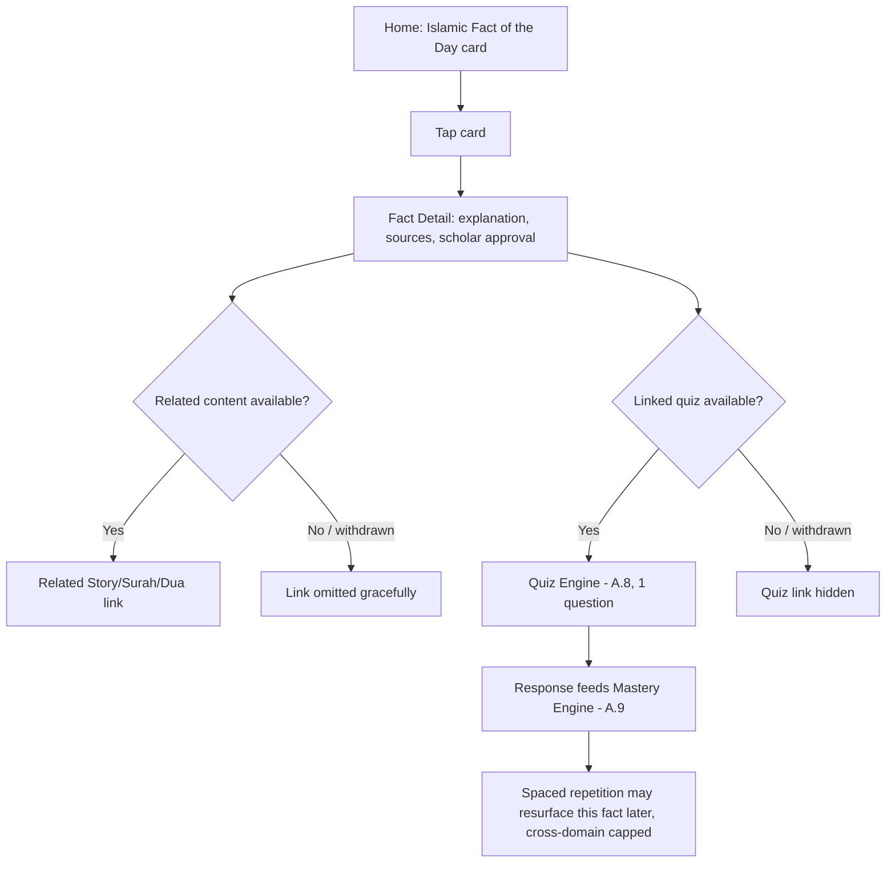
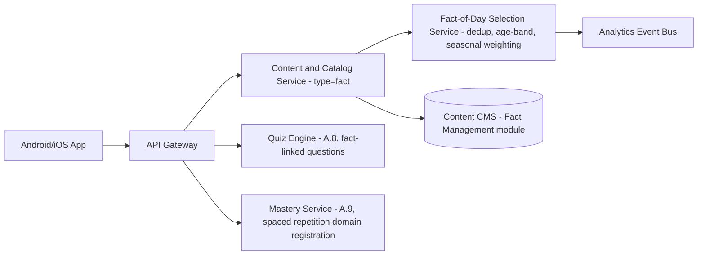
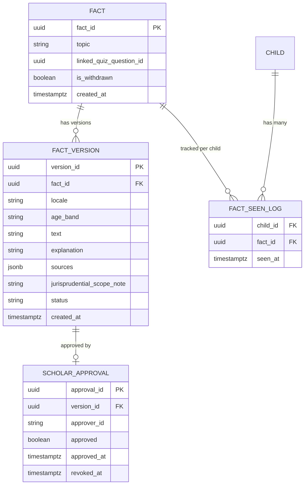

# Feature B.18 — Islamic Facts Module

**App:** NoorHeroes — Islamic Learning App for Children
**Feature Owner:** Product / Content & Editorial / Scholar Review
**Status:** Implementation-ready
**Version:** 1.0
**Depends on:** A.1 (Auth & Onboarding), A.2 (Home — Islamic Fact of the Day card), A.8 (Quiz Engine — linked quiz item), A.9 (Mastery Engine — spaced repetition)
**Feeds into:** A.2 Home, A.3 Stories (related-content linkage), A.5 Learn Tab, A.8 Quiz Engine, C.22 Parent Progress Reports

---

## Table of Contents

1. [Product Requirements](#1-product-requirements)
2. [UX/UI Requirements](#2-uxui-requirements)
3. [Backend Requirements](#3-backend-requirements)
4. [Database Design](#4-database-design)
5. [Backend AI Code-Generation Prompt](#5-backend-ai-code-generation-prompt)
6. [Android Requirements](#6-android-requirements)
7. [Android AI Code-Generation Prompt](#7-android-ai-code-generation-prompt)
8. [Admin Requirements](#8-admin-requirements)
9. [Admin AI Code-Generation Prompt](#9-admin-ai-code-generation-prompt)
10. [DevOps Requirements](#10-devops-requirements)
11. [Analytics Requirements](#11-analytics-requirements)
12. [Security Requirements](#12-security-requirements)
13. [QA Requirements](#13-qa-requirements)
14. [Marketing Requirements](#14-marketing-requirements)
15. [Release & Rollback Plan](#15-release--rollback-plan)

---

## 1. Product Requirements

### 1.1 Problem Statement

Children benefit from short, scholarly-sourced Islamic knowledge nuggets that are genuinely sourced, age-appropriate, and tied to a real concept — never generated freely by an AI, never touching disputed jurisprudential territory, and always traceable to a specific scholar-approved version — while parents need confidence that what their child reads as "a fact about Islam" is accurate and properly scoped (source: Feature Reference §21.9 "Islamic Facts — Each fact stores: Fact text by locale and age band. Topic and related content. Primary and secondary source references. Scholar approval and version. Explanation and quiz item. Jurisprudential scope or exclusion notes where needed"; NoorHeroes Blueprint: "Spaced repetition resurfaces forgotten facts; disputed topics stay out of child-facing auto-generation").

### 1.2 Business Goals

- Provide a low-effort, high-trust "light learning" surface that reinforces the platform's scholar-review credibility at a very high-frequency touchpoint (Home's daily fact card).
- Feed the shared Mastery Engine (A.9) with spaced-repetition-eligible evidence, extending its value beyond Quran/Arabic/Tajweed into general Islamic-knowledge retention.
- Maintain absolute editorial discipline around disputed/jurisprudentially-sensitive topics — facts module content is **never** AI-auto-generated for anything touching contested fiqh matters.

### 1.3 User Goals

- **Child:** Learn a short, interesting Islamic fact each day, understand why it's true (the explanation), and optionally test myself with a quick related question.
- **Parent:** Trust that every fact my child sees is scholar-approved, properly sourced, and appropriately scoped — never presenting a disputed or sect-specific ruling as a flat, unqualified "fact."

### 1.4 Success Metrics

| Metric | Target |
|---|---|
| Daily Fact card view rate (Home) | ≥ 50% of active children |
| Fact → linked-quiz engagement rate | ≥ 35% |
| Fact-detail view rate (tap-through from the card) | ≥ 25% |
| Spaced-repetition resurfacing engagement rate (forgotten facts revisited) | ≥ 40% when surfaced |
| Scholar-approval coverage (published facts with a valid, non-expired approval record) | 100% |
| Crash-free Islamic Facts sessions | ≥ 99.6% |

### 1.5 Stakeholders

Product Manager, Content/Editorial Lead, Scholar Review Board, UX Designer, Backend Architect, Android Architect, Data Analyst, QA Lead, feature owners of A.2 (Home) and A.8/A.9 (Quiz/Mastery integration).

### 1.6 User Stories

1. As a child, I want a new, interesting Islamic fact to discover each day.
2. As a child, I want to understand why a fact is true, not just be told it's true.
3. As a child, I want to test what I learned with a quick related quiz question.
4. As a child, I want to see facts I might have forgotten come back around so I remember them better.
5. As a child, I want to see a related story or lesson linked to a fact I found interesting.
6. As a parent, I want confidence every fact is scholar-approved and properly sourced — never a disputed ruling presented as settled.
7. As a content admin, I want a clear way to mark a topic as too jurisprudentially sensitive for child-facing auto-generation, keeping it out of this module entirely.

### 1.7 Functional Requirements

**FR-1** Each fact stores: fact text by locale and age band, topic and related-content linkage, primary and secondary source references, scholar approval and version, an explanation, a linked quiz item, and jurisprudential-scope/exclusion notes where relevant (source §21.9 — restated verbatim as the canonical, complete data-field list for this content type).
**FR-2** Fact cards display: age band, topic, source, scholar approval, explanation, related story, and quiz (source: NoorHeroes Blueprint "Islamic Facts" card — restated as the canonical display contract).
**FR-3** **Disputed/jurisprudentially-sensitive topics stay out of child-facing auto-generation** — no fact touching contested fiqh matters may be produced via AI generation for child-facing display; such topics, if covered at all, require full human scholar authorship with explicit jurisprudential-scope notes, never an AI-drafted starting point (source: NoorHeroes Blueprint — restated as a hard, zero-exception rule).
**FR-4** **Spaced repetition resurfaces forgotten facts** — Islamic Facts is a participating domain in the shared Mastery Engine's (A.9) cross-domain spaced-repetition scheduler, subject to the same global daily-prompt cap as Quran/Arabic/Tajweed (source: NoorHeroes Blueprint; cross-ref A.9 FR-8/§5 item 5).
**FR-5** The Home "Islamic Fact of the Day" card (A.2's existing widget) is this module's primary surface; this document owns the fact-content data model and detail/quiz flow that the Home card links into, not a duplicate of Home's own card-rendering logic.
**FR-6** Each fact's `explanation` field must be distinct from its `fact text` — the card states the fact, and a deeper explanation (available via tap-through to Fact Detail) provides the "why," consistent with the platform's general "teach the reasoning, not just the answer" pedagogy already established in A.8's Per-Answer Explanation pattern.
**FR-7** A fact's linked quiz item routes through the shared Quiz Engine (A.8) using the same five-question-type contract, parameterized for this context (typically 1 question per fact, consistent with the brevity of a single fact) — this module does not implement a parallel quiz mechanism.
**FR-8** Facts are deduped against a child's own recently-seen history (consistent with A.5 §1.7 FR-13's "no repeat within a rolling 30-day window where catalog size allows" rule, restated here as this module's own deduplication policy) before being selected as "today's fact."
**FR-9** A fact's `related_content` linkage (to a Story, Surah, or Dua) must reference real, currently-eligible content for the requesting child — a stale/withdrawn related-content reference is excluded from display rather than producing a broken link, consistent with the platform-wide withdrawn-content handling pattern.
**FR-10** Facts surfaced during an active seasonal mode (Ramadan/Eid) are weighted toward seasonally-relevant topics where available, consistent with the platform's general calendar-aware recommendation principle (cross-ref A.2's Islamic-calendar-event reason codes), without hard-excluding non-seasonal facts from selection eligibility.
**FR-11** Scholar approval records are versioned (consistent with the platform's content-versioning pattern established in A.3/A.5/A.6) — editing a fact's text/explanation/sources creates a new version requiring fresh scholar sign-off before it can replace the currently-published version; children always see the latest *published* (approved) version, never a draft.

### 1.8 Non-Functional Requirements

- **Content Integrity:** 100% of published facts must have a valid, current scholar-approval record at all times — a fact whose approval has been revoked/superseded is automatically excluded from selection until a re-approved version replaces it.
- **Performance:** Fact-of-the-Day selection p95 < 300ms (cacheable, low-churn data); Fact Detail load p95 < 400ms.
- **Localization:** Fact text, explanation, and source citations fully localized per locale; RTL layout correctness for Arabic.
- **Editorial Discipline:** The disputed-topic exclusion-from-auto-generation rule is enforced as a content-authoring-workflow gate, not merely a style guideline.

### 1.9 Acceptance Criteria

- Given a child views Home, when the Islamic Fact of the Day card renders, then it shows a fact appropriate to their age band and locale, not previously seen within the recent dedup window.
- Given a child taps the fact card, when Fact Detail opens, then it shows the explanation, source references, scholar-approval indicator, and any related content/quiz link.
- Given a fact's topic is jurisprudentially sensitive, when content is authored for it, then no AI-auto-generation path was used to produce the child-facing text — it is fully human/scholar-authored, with jurisprudential-scope notes present.
- Given a fact's scholar approval is later revoked or superseded by Admin, when the selection logic next runs, then that fact version is excluded from "today's fact" eligibility until a re-approved version exists.
- Given a child has not seen a specific fact in a configured time window and the cross-domain spaced-repetition scheduler determines it's due for resurfacing, when the global daily cap allows it, then that fact may be resurfaced as a gentle review prompt, subject to the same cap shared with Quran/Arabic/Tajweed.
- Given a fact's related-content reference has since been withdrawn, when Fact Detail renders, then that specific link is omitted gracefully rather than producing a broken navigation attempt.

### 1.10 Edge Cases

1. A child's age band changes (birthday rollover) and the previously-shown "today's fact" text version was age-band-specific → on next fact selection, the system correctly resolves to the age-band-appropriate text variant for the child's new band, without needing any special migration (since fact text is already locale/age-band-keyed per FR-1).
2. The fact catalog for a child's specific age band/locale combination is very small (e.g., a newly-added locale with few facts so far) → the dedup window (FR-8) gracefully relaxes (e.g., allowing repeats sooner) rather than failing to produce a "fact of the day" at all, consistent with the general "fall back to a sensible default rather than show nothing" principle established elsewhere (A.5 Edge Case 1).
3. A fact's linked quiz item references a question that is later withdrawn for safety reasons → consistent with A.8 FR-11/A.9 FR-10, any already-recorded response is preserved for history but excluded from mastery/reward calculation; this module's own responsibility is simply to stop offering that quiz link until a replacement exists.
4. Two facts on closely related topics could each independently qualify as "today's fact" on the same day across different surfaces (e.g., Home's daily card and a spaced-repetition resurfacing prompt elsewhere) → this is acceptable, consistent with A.9's general "repetition across distinct contexts has its own spaced-repetition value" principle (A.9 §1.10 Edge Case 6), though the selection logic should avoid showing the *exact same* fact instance twice within the same day across surfaces for a single child.
5. A scholar revokes approval on a fact version that a child has already seen and engaged with (quiz answered, etc.) → consistent with the platform's general non-retroactive-revocation principle, the child's historical engagement/mastery-evidence record from that interaction is preserved; only future selection eligibility is affected.
6. A fact's `related_content` was valid at content-authoring time but the underlying Story/Surah/Dua content item is later restructured (e.g., a series renumbering, per A.3 Edge Case 11) → the related-content reference resolves to the new canonical content ID rather than breaking, consistent with the platform's established content-restructuring resolution rule.
7. A child encounters the Fact of the Day during an active Ramadan seasonal mode, but the day's seasonally-weighted selection pool happens to be exhausted (all seasonal facts already shown this season) → falls back gracefully to the general (non-seasonal-weighted) selection pool rather than failing to produce a fact.
8. An admin attempts to mark a fact as approved without an actual scholar-review record attached (a process/tooling-bypass attempt) → rejected by the admin tooling's validation, consistent with the platform's established content-governance pattern (A.3/A.5/A.6's scholar-approval gates).
9. A child offline encounters a "Fact of the Day" that was cached before going offline, then later (still offline) tries to access the linked quiz which requires the Quiz Engine's online question-set assembly → if the question bank wasn't pre-downloaded, the quiz link shows a clear "needs internet" state rather than a silent failure, consistent with the platform's general offline-content-availability messaging pattern.

### 1.11 Error Handling

| Scenario | System Behavior |
|---|---|
| Fact-of-the-Day selection service fails | Falls back to a cached/default evergreen fact rather than showing no fact at all, consistent with A.2's general per-section graceful-degradation pattern |
| Fact Detail fetch fails | Cached last-known data shown with a staleness indicator, or a friendly retry state if no cache exists |
| Linked related-content reference is withdrawn/stale | That specific link omitted gracefully (FR-9), rest of Fact Detail unaffected |
| Linked quiz question withdrawn | Quiz link removed/hidden until a replacement exists (Edge Case 3) |
| Scholar approval revoked on the currently-displayed fact mid-session | The child's already-open view is not abruptly altered mid-view; only future selections are affected, consistent with the platform's general non-disruptive-mid-session-change principle |

### 1.12 Empty States
- A locale/age-band combination with zero published facts yet → Home's Fact of the Day card simply omits itself for that session (consistent with A.2's per-section graceful-omission pattern) rather than showing an empty/broken card.

### 1.13 Loading States
- Fact Detail: skeleton card shimmer while loading.

### 1.14 Offline States
- A previously-cached Fact of the Day remains viewable offline; the linked quiz requires connectivity unless its question data was separately pre-downloaded (Edge Case 9).

### 1.15 Permission States
- No new runtime permissions specific to this feature.

### 1.16 User Flow (Narrative)

Child sees the Islamic Fact of the Day card on Home → taps it → Fact Detail opens showing the explanation, source references, scholar-approval indicator, and any related story/quiz links → child optionally taps through to the related content or answers the linked quiz question → the quiz response feeds the shared Quiz Engine/Mastery Engine exactly as any other quiz attempt would → over time, the spaced-repetition scheduler may resurface a previously-seen fact for gentle review, subject to the platform-wide cross-domain daily cap.

### 1.17 Detailed Flow Diagram (Mermaid)



### 1.18 Screen Inventory (Complete — Zero Missing)

| # | Screen / Component | Type | Entry Points | Exit Points |
|---|---|---|---|---|
| 1 | Islamic Fact of the Day Card (Home widget, owned by A.2, content sourced here) | Component | Home | Fact Detail |
| 2 | Fact Detail Screen | Screen | Fact of the Day Card, spaced-repetition resurfacing prompt, related-content linkage from elsewhere | Related Content (Story/Surah/Dua), Linked Quiz |
| 3 | Linked Quiz (shared A.8 instance, 1 question) | Screen (A.8) | Fact Detail | Quiz Completion Result (A.9) |
| 4 | Related Content Link (component, within Fact Detail) | Component | Fact Detail | Story Detail / Surah Learning / Dua Card Detail |
| 5 | Spaced-Repetition Resurfacing Prompt (shared component pattern, cross-domain with A.5/A.9) | Component | Skill Tree / Home, cross-domain capped | Fact Detail |
| 6 | Scholar-Approval Indicator (component, within Fact Detail) | Component | Fact Detail | N/A (display only) |
| 7 | Empty/Omitted State (Home card, zero eligible facts) | N/A (absence of component) | N/A | N/A |
| 8 | Offline Fact Detail (cached) | Screen variant | Fact Detail, no connectivity | Quiz link shows "needs internet" if not pre-downloaded |

### 1.19 Events (Complete Analytics Event List)

`fact_of_day_shown` (Home, with `fact_id`), `fact_card_tapped`, `fact_detail_viewed`, `fact_explanation_viewed`, `fact_source_viewed`, `fact_related_content_tapped`, `fact_quiz_started`, `fact_quiz_completed`, `fact_spaced_repetition_resurfaced`, `fact_selection_fallback_used` (internal, Edge Case 2/7 signal), `fact_scholar_approval_revoked_excluded` (internal/content-integrity signal).

---

## 2. UX/UI Requirements

> Global Design System tokens defined in **Feature A.1 §2.1**; per-answer-explanation pedagogy pattern established in **Feature A.8 §2.1**; scholar-approval badge iconography established in **Feature A.3 §2.1**/**A.5 §2.1**.

### 2.1 Facts-Specific Design System Extensions

- **Fact Card (Home widget):** Consistent with A.2's general card visual language — a compact card with a short fact statement, a small decorative icon (topic-relevant), and a subtle scholar-approval micro-badge, inviting a tap without overwhelming Home's already-dense layout.
- **Fact Detail Layout:** A calm, reading-focused single-column layout — fact restated prominently at top, explanation below in clear body text, source citations in a smaller, clearly-distinguished reference style (consistent with academic-citation conventions adapted for a child-friendly tone), scholar-approval badge with a tap-to-expand "what does this mean" micro-explainer for curious parents/older children.
- **Jurisprudential-Scope Note Treatment:** Where present, rendered as a clearly-separated, calm informational note (not an alarming warning style) — e.g., "This practice may vary between different schools of thought" — consistent with the platform's general non-alarming informational-note visual language.

### 2.2 Screen-Level Design Requirements (Key Screens)

#### Screen: Fact Detail

- **Purpose:** Deliver the full context behind a single Islamic fact with appropriate sourcing transparency.
- **Components:** Fact restatement header, explanation body text, primary/secondary source citation block, scholar-approval badge (with version/date), jurisprudential-scope note (if present), Related Content card, Linked Quiz entry card.
- **States:** Default, Loading (skeleton), Offline (cached), Related-content-unavailable (that section simply omitted), Quiz-unavailable (that section simply omitted or shows "needs internet" if offline-specific).
- **Accessibility:** Source citations and the scholar-approval badge are fully screen-reader-readable, not icon-only.
- **Responsive Rules:** Single-column on mobile; tablet may show the fact/explanation in a wider reading column with related-content/quiz cards alongside rather than stacked below.

### 2.3 Tab Structure

Islamic Facts has no dedicated tab; it's reached via Home's Fact of the Day card or spaced-repetition resurfacing prompts. Click mapping:

| Click Target | Destination | API Called | Analytics Event | Permission Check | Error Handling |
|---|---|---|---|---|---|
| Fact of the Day card (Home) | Fact Detail | `GET /v1/facts/{id}` | `fact_card_tapped` → `fact_detail_viewed` | None | Cached fallback |
| Related Content link | Story Detail / Surah Learning / Dua Card Detail | Destination-feature's own fetch | `fact_related_content_tapped` | Standard destination-feature checks | Link omitted if reference is stale (FR-9) |
| Linked Quiz entry | Quiz Engine session (A.8) | `GET /v1/quizzes/fact/{fact_id}` | `fact_quiz_started` | None | Hidden if withdrawn |

### 2.4 Wireframe Description (Composite)

Fact Detail follows a calm, single-focus reading-screen wireframe consistent with the platform's general "single clear focus" philosophy (A.1 onboarding, A.5 practice screens) — appropriate given this is a short-form, reflective content type rather than a browse/discover surface.

### 2.5 Screen Image Generation Prompts

**Screen: Fact Detail**
- *Prompt 1 (English):* "Mobile app fact-detail screen UI mockup for a children's Islamic learning app. Warm off-white background, single-column reading layout. At the top, a short fact statement in large, friendly bold text with a small decorative topic icon beside it. Below, a paragraph of explanatory body text in clear regular font. Below that, a small reference-style citation block in smaller muted text. Below that, a small badge-style element reading 'Scholar Approved' with a checkmark icon and a small date label. Further down, two rounded cards: one labeled 'Related Story' with a small thumbnail, and one labeled 'Quick Quiz' with a small question-mark icon. Calm, trustworthy, educational aesthetic, generous spacing, soft shadows, rounded corners, warm teal and gold accents used sparingly, no realistic human faces."
- *Prompt 2 (Arabic RTL):* "نفس شاشة تفاصيل المعلومة لتطبيق تعليم إسلامي للأطفال، بتخطيط من اليمين إلى اليسار بالكامل، بتخطيط قراءة بعمود واحد. في الأعلى عبارة معلومة قصيرة بخط كبير وودود وعريض مع أيقونة موضوع زخرفية صغيرة بجانبها. أسفل ذلك فقرة من النص التوضيحي بخط عادي وواضح. أسفل ذلك كتلة استشهاد صغيرة بأسلوب مرجعي بخط أصغر وهادئ اللون. أسفل ذلك عنصر شارة صغير يقول 'موثّق من علماء' مع أيقونة علامة صح وتسمية تاريخ صغيرة. أسفل ذلك بطاقتان مستديرتان: واحدة بعنوان 'قصة ذات صلة' مع صورة مصغرة صغيرة، وأخرى بعنوان 'اختبار سريع' مع أيقونة علامة استفهام صغيرة. طابع هادئ وموثوق وتعليمي، تباعد كبير، ظلال خفيفة، زوايا دائرية، لمسات فيروزية وذهبية دافئة مستخدمة بقلة، بدون وجوه بشرية واقعية."

---

## 3. Backend Requirements

### 3.1 System Design Overview

Islamic Facts is served by the shared **Content & Catalog Service** (`content_type=fact`), participates in the shared **Mastery Engine's** spaced-repetition scheduler (A.9) as a registered domain, and routes its linked quiz item through the shared **Quiz Engine** (A.8) — no parallel content/quiz/scheduling infrastructure is built.

### 3.2 Architecture Diagram (Mermaid)



### 3.3 Service Breakdown

| Service | Responsibility |
|---|---|
| Content & Catalog Service | Serves fact content by locale/age-band; enforces scholar-approval-gated publish |
| Fact-of-Day Selection Service | Dedup logic, age-band/locale resolution, seasonal weighting, fallback handling |
| Quiz Engine (shared, A.8) | Serves the 1-question fact-linked quiz instance |
| Mastery Service (shared, A.9) | Registers Islamic Facts as a domain in the cross-domain skill graph for spaced-repetition purposes |

### 3.4 API List

#### `GET /v1/facts/daily?child_id=`
- **Auth:** Bearer (child-mode)
- **Response 200:** `{ "fact_id": "...", "text": "...", "topic": "...", "scholar_approved": true, "approval_version": "v3" }`
- **Validation:** Resolves age-band/locale-appropriate text variant; applies dedup against recent-seen history (FR-8), relaxing gracefully if the eligible pool is small (Edge Case 2); excludes any fact whose current approval has been revoked (Acceptance Criteria).
- **Caching:** Cacheable per `(child_age_band, locale, local_date)` for most of a day, since "today's fact" is stable per child per day.

#### `GET /v1/facts/{id}`
- **Response 200:** Full Fact Detail payload — `{ "fact_id": "...", "text": "...", "explanation": "...", "topic": "...", "sources": [...], "scholar_approval": {...}, "jurisprudential_scope_note": "...", "related_content": { "content_id": "...", "content_type": "story", "available": true }, "linked_quiz_id": "..." }`.
- **Validation:** `related_content.available: false` if the reference is stale/withdrawn (FR-9), consistent with the platform's general `available` flag pattern (mirroring B.14's Favorites resolution approach).
- **Error Codes:** `410 FACT_WITHDRAWN` for an archived fact.

#### `GET /v1/quizzes/fact/{fact_id}` (delegates to A.8's shared contract)
- **Response 200:** Same shape as A.8's general quiz-question-set contract, parameterized to 1 question for this context.

### 3.5 Cross-Cutting API Concerns

- **Scholar-approval enforcement:** A fact lacking a current valid approval record is never eligible for selection or direct fetch by a child session — enforced at the query layer, not just the admin-authoring workflow.
- **Withdrawn-content handling:** Consistent with the platform-wide `is_withdrawn`/`available` pattern.
- **Domain registration:** Islamic Facts registers as a `domain` value in A.9's extensible domain registry (cross-ref A.9 §5 item 1) — no new mastery/scheduling code is written here; this module only configures data.

---

## 4. Database Design

### 4.1 ER Diagram (Mermaid)



### 4.2 Tables, Relationships, Constraints

| Table | Key Constraints | Indexes |
|---|---|---|
| `fact` | CHECK `topic` is a registered topic value | Index `(topic)` |
| `fact_version` | FK `fact_id`; CHECK `status IN ('draft','pending_review','published','archived')`; ayah-style immutability does not apply here (fact text IS editable, but only via new versions, never in-place mutation of a published version) | Index `(fact_id, locale, age_band, status)` |
| `scholar_approval` | FK `version_id`; a version cannot be `status='published'` without a corresponding `scholar_approval` row with `approved=true` and `revoked_at IS NULL` | Index `(version_id)` |
| `fact_seen_log` | FK `child_id`, `fact_id`; append-only | Index `(child_id, seen_at DESC)` |

### 4.3 Audit Fields
`fact_version.created_at`; `scholar_approval.approved_at`/`revoked_at` track the full approval lifecycle. `fact_seen_log` is append-only (a historical fact, supporting both dedup and spaced-repetition evidence).

### 4.4 Soft Delete Rules
`fact.is_withdrawn = true` used instead of deletion, consistent with the platform-wide withdrawn-content pattern — preserves `fact_seen_log` history.

### 4.5 Retention Rules
`fact_seen_log` retained consistent with other progress-history data (feeds spaced-repetition scheduling and dedup logic, both of which have ongoing value).

---

## 5. Backend AI Code-Generation Prompt

```
You are extending the existing Content & Catalog Service (A.3/A.5/A.6) and
registering a new domain ("islamic_facts") in the shared Mastery Service's
domain registry (A.9) for the Islamic Facts module. Reuse existing
infrastructure -- do not build parallel content, quiz, or spaced-repetition
systems.

Stack: FastAPI (Python 3.12), PostgreSQL (SQLAlchemy 2.0), Redis, Kafka.

Hard requirements:
1. Implement the scholar-approval gate at the DATABASE/QUERY layer: a
   fact_version cannot be queried as the "published" version for a child
   unless a corresponding scholar_approval row exists with approved=true
   AND revoked_at IS NULL. Write a test: approve a version, publish it,
   confirm it's selectable; then revoke the approval and confirm it
   becomes immediately unselectable for any NEW fact-of-day request
   (existing fact_seen_log history for children who already saw it
   remains untouched).
2. Implement GET /v1/facts/daily with dedup logic against fact_seen_log
   within a configurable rolling window (default 30 days, mirroring
   A.5's dua-recall pattern), gracefully relaxing the window when the
   eligible pool for a given (age_band, locale) is small enough that
   strict dedup would return zero candidates -- write a test for both
   the normal-pool-size case (dedup strictly enforced) and the
   small-pool-size case (graceful relaxation rather than an empty
   result).
3. Implement seasonal weighting: when a seasonal mode (Ramadan/Eid) is
   active, bias selection toward facts tagged with the matching seasonal
   topic, but fall back to the general pool if the seasonal-tagged pool
   is exhausted for that child this season -- write a test for the
   exhausted-seasonal-pool fallback.
4. Implement withdrawn-related-content resolution: GET /v1/facts/{id}
   must check the current availability of any related_content reference
   (querying the appropriate Content & Catalog Service by content_type)
   and set available=false rather than returning a stale/broken
   reference -- write a test for a fact whose related story has since
   been withdrawn.
5. Register "islamic_facts" as a new domain in A.9's skill_node domain
   registry (a DATA migration, not new application code, per A.9's
   FR-9/extensibility design) -- write a test confirming a fixture
   Islamic Facts skill node works end-to-end through A.9's existing
   state-machine/scoring/scheduling pipeline with zero new mastery-
   calculation code required, mirroring A.9's own "fictitious new domain"
   extensibility test pattern.
6. Write Alembic migrations for fact, fact_version, scholar_approval,
   fact_seen_log, matching the ER diagram, with the approval-gate
   constraint enforced as described in item 1.

Deliver: FastAPI router additions, SQLAlchemy models, Alembic migration,
Pydantic schemas, and a pytest suite covering all 6 items, with item 1
(scholar-approval gate enforcement) and item 5 (genuine A.9 domain
registration, not a parallel implementation) treated as the highest-
priority guarantees.
```

---

## 6. Android Requirements

### 6.1 Technical Requirements
Kotlin, Jetpack Compose, MVVM, Clean Architecture, module `:feature:facts` (a lightweight feature module), depends on `:core:quiz-engine` (A.8), `:core:mastery-engine` (A.9), `:core:design-system`, `:core:network`, `:core:offline-cache`.

### 6.2 Screen Mapping
`FactDetailScreen` Composable; the Home Fact of the Day card itself lives in `:feature:home` (A.2) and simply deep-links into this module's `FactDetailScreen`.

### 6.3 Navigation Flow
`noorheroes://facts/{fact_id}` reachable from Home's card and from spaced-repetition resurfacing prompts (A.9's generic review-prompt UI, parameterized for this domain).

### 6.4 State Management
`FactDetailViewModel` fetches `GET /v1/facts/{id}`; related-content and quiz sections render conditionally based on the `available`/presence flags in the response, never attempting navigation for an unavailable reference.

### 6.5 API Mapping
`FactsRepository.getDailyFact()` → `GET /v1/facts/daily`; `FactsRepository.getFactDetail()` → `GET /v1/facts/{id}`; quiz launch delegates to `:core:quiz-engine's` shared `QuizSessionScreen` with `QuizContext` parameterized appropriately.

### 6.6 Analytics Mapping
`FactsAnalytics` fires events per §1.19.

### 6.7 Offline Support
Daily fact and Fact Detail cached for offline viewing; linked quiz requires connectivity unless its single question was bundled into a broader offline content package (Edge Case 9), consistent with the platform's general offline-quiz pattern (A.8 §6.7).

### 6.8 Deep Linking
`noorheroes://facts/{fact_id}`, `noorheroes://facts/daily`.

### 6.9 Push Notifications
Not a notification source itself; could theoretically be referenced by a future "new fact available" notification type, but no such type exists in the current notification catalog (B.17) for this module specifically.

### 6.10 Testing Strategy
- Unit: conditional rendering logic for related-content/quiz sections based on availability flags.
- UI tests: Fact Detail never attempts navigation for an `available: false` related-content reference; scholar-approval badge renders correctly with version/date info.
- Integration: full Home-card-tap → Fact Detail → linked-quiz → Mastery Engine evidence flow, verified to use the exact same shared `:core:quiz-engine`/`:core:mastery-engine` code paths as other domains (a reuse-verification test, consistent with A.9/A.10's established pattern).

---

## 7. Android AI Code-Generation Prompt

```
Build the `:feature:facts` Android module for NoorHeroes using Kotlin,
Jetpack Compose, MVVM, Clean Architecture. This module is intentionally
THIN -- it reuses `:core:quiz-engine` (A.8) for the linked quiz and
`:core:mastery-engine` (A.9) for spaced-repetition display, with no
parallel implementations of either.

Hard requirements:
1. Build FactDetailScreen rendering the fact text, explanation, source
   citations, scholar-approval badge (with version/date), an optional
   jurisprudential-scope note, and conditionally-rendered Related
   Content and Linked Quiz cards based on the API response's
   availability/presence flags -- write a UI test confirming tapping a
   related-content card with available=false is impossible (the card
   itself is not rendered at all in that case, not rendered-but-disabled).
2. Quiz launch from Fact Detail must invoke `:core:quiz-engine's` EXISTING
   QuizSessionScreen composable with QuizContext parameterized for this
   domain (mirroring how A.6's Dua Recall and A.3's Story Post-completion
   contexts already do this) -- write an integration test confirming this
   reuses the exact same shared composable/repository code path as those
   other domains, not a new parallel quiz UI built specifically for facts.
3. Implement offline caching of the daily fact and fact-detail payload
   (Room), with the quiz section showing a "needs internet" state if its
   question data wasn't part of an offline-downloaded package -- write a
   test for this offline-quiz-unavailable state.
4. Write a UI test for the scholar-approval badge rendering correctly with
   its version/date metadata, screen-reader-readable (not icon-only).

Use Hilt, Retrofit+OkHttp, Room. Follow Global Design System tokens from
`:core:design-system`, reusing A.3/A.5's scholar-approval badge component
and A.8's explanation-card visual pattern rather than redefining them
locally in this module.
```

---

## 8. Admin Requirements

- **Fact Editor:** CRUD for facts and their versions — text/explanation/sources/jurisprudential-scope-notes per locale/age-band, topic tagging, linked-quiz-question assignment. Editing a published fact creates a new version (never in-place mutation), gated on fresh scholar approval before it can supersede the live version.
- **Disputed-Topic Flag:** A hard, admin-settable flag on a topic (not a per-fact toggle) marking it as jurisprudentially sensitive — when set, the Fact Editor's "Generate with AI" assist tool (if one exists in the broader CMS) is **disabled entirely** for facts tagged under that topic, forcing full human/scholar authorship (FR-3's enforcement point).
- **Scholar Approval Workflow:** The same scholar-review queue pattern established across A.3/A.5/A.6 — approve/reject a fact version, with revocation supported for already-published versions (immediately removing them from future selection eligibility per §5 item 1).
- **Seasonal Topic Tagging:** Tag facts as seasonally-relevant (Ramadan/Eid/etc.) for the selection service's weighting logic.
- **Fact Engagement Monitor (Read-only):** Aggregate view of fact-view/quiz-engagement rates per fact/topic — an editorial content-quality signal.

CRUD permissions: Fact Editor = full CRUD (delete = withdraw) behind `content_editor` role, scholar-approval-gated publish; Disputed-Topic Flag = Update-only behind `trust_safety`/`scholar_lead` role (deliberately a higher bar than standard content editing, given its role gating an entire authoring pathway); Scholar Approval Workflow = approve/reject/revoke behind `scholar_reviewer` role; Seasonal Topic Tagging = part of the Fact Editor's form, `content_editor` role; Fact Engagement Monitor = Read-only behind `content_editor`.

---

## 9. Admin AI Code-Generation Prompt

```
Build/extend the NoorHeroes Admin Portal's Content Management module (React
+ TypeScript) to support Islamic Facts.

Pages:
1. Fact Editor -- CRUD form per fact: topic (dropdown, sourced from a
   topic registry), per-locale/age-band text variants, explanation,
   sources (structured citation list), jurisprudential_scope_note
   (optional rich-text field), linked_quiz_question_id (searchable
   picker into the shared Question Bank from A.8). Editing a published
   fact creates a NEW VERSION (show version history with diffs), gated
   on a fresh scholar_approval row before it can be set status=published.
2. Disputed-Topic Flag -- on the Topic Registry's own management page
   (or as a flag within it), a "Jurisprudentially Sensitive" toggle per
   topic, restricted to trust_safety/scholar_lead role. When toggled on
   for a topic, the Fact Editor's AI-assist drafting tool (if the broader
   CMS has one) must be HARD-DISABLED for any fact tagged under that
   topic -- enforce this check server-side at the AI-assist endpoint
   itself, not just by hiding a UI button (a determined editor must not
   be able to call the AI-assist API directly for a disputed-topic fact
   even by bypassing the UI).
3. Scholar Approval Workflow -- reuse the existing scholar-review queue
   component from A.3/A.5/A.6's admin modules, extended to cover
   fact_version rows. Include a "Revoke" action for already-published
   versions, with a required reason field, restricted to scholar_reviewer
   role.
4. Seasonal Topic Tagging -- a multi-select field on the Fact Editor form
   for tagging seasonal relevance (Ramadan, Eid al-Fitr, Eid al-Adha,
   etc.), feeding the backend's seasonal-weighting selection logic.
5. Fact Engagement Monitor -- read-only dashboard (recharts) showing
   view/quiz-engagement rates per fact and per topic, sourced from a
   read-only aggregated endpoint.

Enforce RBAC via the existing Admin Portal role context. Every mutating
action writes an immutable audit_log row, with Disputed-Topic Flag
changes and Approval Revocations specifically flagged as high-sensitivity
audit entries given their content-governance significance.
```

---

## 10. DevOps Requirements

- **Infrastructure:** No new dedicated infrastructure; rides on the shared Content & Catalog Service, Quiz Engine, and Mastery Service infrastructure already provisioned for A.3/A.5/A.6/A.8/A.9.
- **CI/CD:** The scholar-approval-gate enforcement test and the genuine-A.9-domain-registration test (§5 items 1 and 5) are mandatory CI gates on any PR touching this module's backend additions.
- **Monitoring/Logging/Alerting:** Alert if any published fact is ever detected (via a periodic integrity audit) without a corresponding valid, non-revoked `scholar_approval` row — a P0 content-governance violation given the platform's zero-tolerance stance on unreviewed content reaching children. Alert if the Disputed-Topic AI-assist hard-disable is ever bypassed in production sampling (a content-governance canary).
- **Disaster Recovery:** `fact`/`fact_version`/`scholar_approval` backed up at the same tier as other scholar-approved content (A.3/A.5/A.6's reference-content tier).
- **Rollback Strategy:** Any deploy touching the selection/dedup/seasonal-weighting logic requires a staging verification against fixture multi-age-band/locale catalogs confirming no regression in the graceful-fallback behaviors (Edge Cases 2/7).
- **Backup Strategy:** Standard-to-high tier for fact content tables; `fact_seen_log` standard tier.
- **Environment Setup:** Staging supports fixture facts with deliberately small/exhausted pools per age-band/locale to reliably test the graceful-relaxation and seasonal-fallback behaviors.

---

## 11. Analytics Requirements

### 11.1 Event Taxonomy
Full list in §1.19.

### 11.2 Funnel Analysis
`fact_of_day_shown` → `fact_card_tapped` → `fact_detail_viewed` → (`fact_related_content_tapped` OR `fact_quiz_started` → `fact_quiz_completed`). Measures whether the daily fact genuinely drives deeper engagement (related content, quiz) or remains a passive glance-only touchpoint.

### 11.3 Dashboard Metrics
Per-topic engagement rate (editorial content-quality signal), AI-fallback-used rate (Edge Cases 2/7, informs catalog-completeness priorities for sparse locale/age-band/seasonal pools), scholar-approval-revocation frequency (a content-governance health metric, ideally low and trending toward zero).

### 11.4 Cohort & Retention
Cohort by first-fact-engagement; correlate sustained Fact-of-the-Day engagement with broader Home/Learn engagement (testing whether this light-touch content type meaningfully complements the platform's deeper learning surfaces or functions independently).

### 11.5 Learning Metrics
Spaced-repetition resurfacing engagement/retention rate for facts specifically (comparable to A.5's Quran/Arabic retention metrics, extending the same measurement approach to this lighter-weight domain).

---

## 12. Security Requirements

### 12.1 Threat Analysis
- **Unreviewed/unapproved content reaching a child (the feature's defining content-governance risk):** mitigated by the database/query-layer scholar-approval gate (never just an authoring-workflow convention).
- **AI-generated content on disputed jurisprudential topics:** mitigated by the hard, server-side-enforced Disputed-Topic AI-assist disable, not just a UI-level hint.
- **Withdrawn related-content/quiz leakage:** mitigated by the platform-wide `available`/withdrawal-exclusion pattern, consistently applied here.

### 12.2 OWASP Checklist (Applied)
Security Misconfiguration: the scholar-approval gate enforced at the query layer (not just the authoring UI) is a misconfiguration-defense pattern — even a buggy or bypassed admin form cannot result in unapproved content becoming selectable.

### 12.3 API Security
Standard patterns inherited from the shared Content & Catalog Service; no novel attack surface introduced.

### 12.4 Mobile Security
No new sensitive data handling.

### 12.5 Admin Security
The Disputed-Topic AI-assist disable is enforced server-side at the AI-assist endpoint itself, not merely a hideable UI button — preventing a determined editor from bypassing it via direct API access.

### 12.6 Data Encryption & PII Protection
No new PII surface; `fact_seen_log` is standard low-sensitivity progress-adjacent metadata.

### 12.7 Child Safety Requirements
The scholar-approval gate and the disputed-topic AI-generation exclusion are this feature's two defining content-safety/theological-accuracy commitments, both held to the platform's standard of structural (database/query-layer) enforcement rather than mere policy.

### 12.8 Compliance Requirements
No additional regulatory surface beyond the platform baseline; the scholar-review discipline applied here is a voluntary content-governance commitment held to engineering-enforced rigor, consistent with the platform's broader pattern (A.3/A.5/A.6).

### 12.9 Security Checklist (Pre-Launch)
- [ ] Scholar-approval gate verified at the query layer (a fact with a revoked approval is immediately unselectable)
- [ ] Disputed-Topic AI-assist hard-disable verified via direct API bypass attempt
- [ ] Withdrawn related-content/quiz exclusion verified
- [ ] Genuine A.9 domain-registration (not a parallel implementation) verified via the fictitious-domain-style extensibility test

---

## 13. QA Requirements

### 13.1 Test Plan Summary
Coverage spans: scholar-approval gate enforcement (signature test), disputed-topic AI-generation exclusion, graceful dedup/seasonal-fallback behavior, withdrawn-reference handling, and all 9 edge cases from §1.10.

### 13.2 Test Cases — Happy Path
1. Child sees today's fact on Home, taps through to Fact Detail, reads the explanation/sources, answers the linked quiz question, and the response correctly feeds the Mastery Engine.
2. A fact is later resurfaced via spaced repetition within the platform-wide cross-domain daily cap.
3. Admin authors a new fact, it passes scholar review, and becomes selectable for eligible children.

### 13.3 Edge Cases
All 9 items from §1.10.

### 13.4 Negative Cases
- Revoke a fact's scholar approval, then request `/v1/facts/daily` for an otherwise-eligible child → that fact is never selected.
- Attempt to call the AI-assist drafting endpoint directly for a fact tagged under a disputed topic, bypassing the UI → rejected server-side.
- Request Fact Detail for a fact whose related content has been withdrawn → `available: false`, no broken link.
- Simulate an exhausted seasonal-tagged pool during Ramadan mode → falls back to the general pool rather than failing.

### 13.5 Regression Cases
Full Islamic Facts suite re-run on every release touching this module, the shared Content & Catalog Service, Quiz Engine, or Mastery Service.

### 13.6 Automation Cases
End-to-end: full daily-fact → detail → related-content/quiz flow; scholar-approval-revocation-immediate-exclusion automated test (CI-blocking); disputed-topic AI-assist-disable automated test; A.9 genuine-domain-registration extensibility test.

---

## 14. Marketing Requirements

- **Launch Plan:** A light-touch but trust-reinforcing feature — supports the platform's broader "every piece of content is scholar-reviewed" narrative at a very high-frequency touchpoint (Home, daily).
- **Push Notifications:** No dedicated notification type currently; could be considered as a future "new fact" addition to B.17's catalog if warranted by engagement data.
- **Release Notes:** New seasonal fact packs (Ramadan/Eid) get standard release-note entries as needed.
- **App/Play Store Description:** Indirectly supports "every fact, every story, every lesson — scholar-reviewed" as a platform-wide claim this feature helps substantiate.
- **ASO Keywords:** "Islamic facts for kids app," "daily Islamic knowledge children."

---

## 15. Release & Rollback Plan

### 15.1 Release Plan
Phased rollout 25% → 75% → 100% over 2–3 days (low-risk, thin feature reusing already-hardened A.3/A.5/A.6/A.8/A.9 infrastructure) — the scholar-approval-gate test must pass at each stage.

### 15.2 Rollback Plan
Rollback triggers: any confirmed instance of an unapproved/revoked fact reaching a child (P0, consistent with the platform's zero-tolerance stance on unreviewed content), any confirmed AI-generated content on a disputed topic reaching a child-facing surface (P0). Mechanism: standard deployment rollback.

### 15.3 Success Metrics for Go/No-Go
Matches §1.4 targets. Go/no-go requires sign-off from Product, Content/Editorial Lead, and Scholar Review Board jointly — the scholar-approval-gate and disputed-topic-exclusion guarantees require explicit sign-off confirming their respective test suites are green, consistent with the rigor applied to this app's other content-integrity-critical features.
