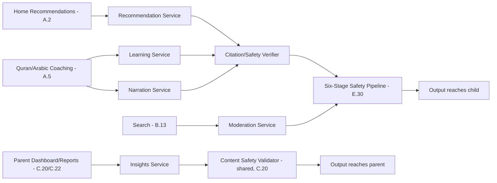
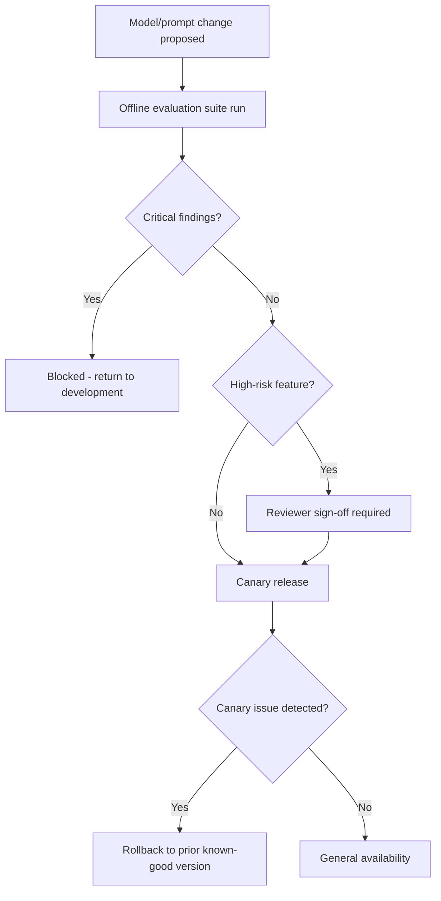
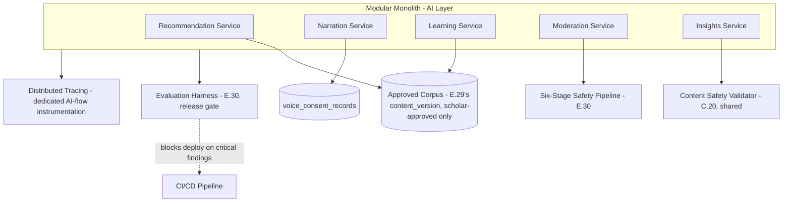
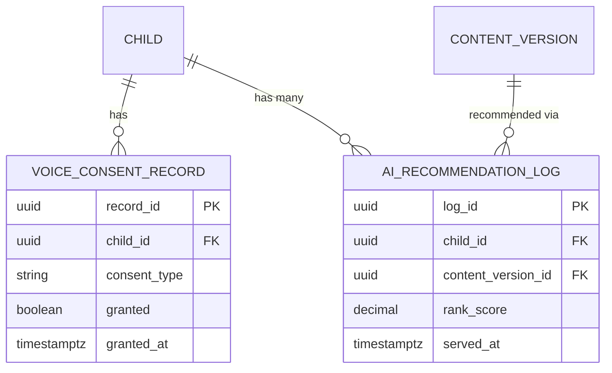

# Feature F.35 — AI Layer & Microservices Architecture (Cross-Cutting)

**App:** NoorHeroes — Islamic Learning App for Children
**Feature Owner:** AI/ML Engineering / Platform Architecture / Trust & Safety
**Status:** Implementation-ready
**Version:** 1.0
**Depends on:** E.29 (Content CMS — approved corpus), E.30 (AI Moderation Console — the safety pipeline this architecture document specifies the surrounding services for), E.28 (Admin Auth/RBAC — evaluation-gate sign-off)
**Feeds into:** A.5 (Quran/Arabic AI pronunciation coaching), B.13 (Search semantic/voice), A.2 (Home recommendations), C.22/C.26 (AI Insight Report, AI Interaction History)

> **Scope note:** This is a **cross-cutting architecture document**, not a single feature with its own screens. E.30 already specified the AI Moderation Console's queue/console UI and the six-stage safety pipeline's moderation-facing surface. This document specifies the **five backend AI microservices themselves** (Recommendation, Narration, Learning, Moderation, Insights), their shared infrastructure pattern (modular-monolith-at-launch with defined extraction points), the AI governance rules every one of them must follow (scholar-reviewed religious answers, child-safe moderation tone, no voice cloning without consent, no diagnosis/sibling-comparison in Insights), and the evaluation/release-gating discipline (E.30's Evaluation Harness) that gates every model or prompt change before general availability. Every child-facing feature that *consumes* AI (A.5, B.13, A.2) treats this document as the architectural source of truth for what's actually running behind those consumer-facing surfaces.

---

## Table of Contents

1. [Product Requirements](#1-product-requirements)
2. [UX/UI Requirements](#2-uxui-requirements)
3. [Backend Requirements](#3-backend-requirements)
4. [Database Design](#4-database-design)
5. [Backend AI Code-Generation Prompt](#5-backend-ai-code-generation-prompt)
6. [Android Requirements](#6-android-requirements)
7. [Android AI Code-Generation Prompt](#7-android-ai-code-generation-prompt)
8. [Admin Requirements](#8-admin-requirements)
9. [Admin AI Code-Generation Prompt](#9-admin-ai-code-generation-prompt)
10. [DevOps Requirements](#10-devops-requirements)
11. [Analytics Requirements](#11-analytics-requirements)
12. [Security Requirements](#12-security-requirements)
13. [QA Requirements](#13-qa-requirements)
14. [Marketing Requirements](#14-marketing-requirements)
15. [Release & Rollback Plan](#15-release--rollback-plan)

---

## 1. Product Requirements

### 1.1 Problem Statement

NoorHeroes needs an AI layer that increases trust rather than risk — five purpose-bounded microservices (Recommendation, Narration, Learning, Moderation, Insights), each with its own explicit controls, sitting behind a mandatory safety pipeline and evaluation gate, deliberately scoped as a small, curated corpus rather than a general LLM tutor, since the user base doesn't yet justify the cost/risk of a broader approach (source: NoorHeroes Blueprint "AI Microservices Architecture" table; "AI Rule: AI should increase trust, not risk"; Consolidated Blueprint §18.4 Risks: "Building the AI layer before there's a user base to justify its cost — mitigate by keeping the recommendation corpus small and curated rather than a general LLM tutor at this stage").

### 1.2 Business Goals

- Ship AI capability (recommendations, narration, adaptive difficulty, moderation, parent insights) that is genuinely safety-bounded by design, not safety-retrofitted after a generic LLM integration.
- Maintain a deliberately small, curated, cost-proportionate AI footprint matched to the platform's actual current user base and risk tolerance.
- Gate every model/prompt change through offline evaluation, reviewer sign-off, canary release, and a defined rollback path before general availability — directly operationalizing the Phase 3 exit criterion.
- Keep the AI layer's architecture consistent with the platform's broader "modular monolith at launch, extract services only when justified" philosophy, avoiding premature distributed-systems complexity.

### 1.3 User Goals

- **Child:** Get genuinely helpful, age-appropriate recommendations and coaching that never feel risky, never pretend to be a human/scholar/friend, and never encourage secrecy or emotional dependency.
- **Parent:** Trust that every AI capability is bounded, reviewable, and disableable, with religious answers specifically routed through scholar-approved content rather than improvised.
- **AI/ML Engineer:** Work within a clear, evaluation-gated release process and an architecture that scales the right components first, without inheriting unnecessary microservice complexity on day one.

### 1.4 Success Metrics

| Metric | Target |
|---|---|
| AI safety evaluation gate pass rate before any release | 100% zero unresolved critical findings (hard, Phase 3 exit criterion, shared with E.30) |
| Recommendation completion-rate uplift (Phase 4 continuation target) | > 10% above baseline |
| Religious-rulings-category improvisation incidents | 0 (hard, zero-tolerance — these always route to approved answers or scholar handoff) |
| Voice cloning without explicit consent incidents | 0 (hard, zero-tolerance) |
| AI Insight Report diagnosis/sibling-comparison/false-certainty incidents | 0 (hard, zero-tolerance, shared with C.20/C.22) |
| Canary-release rollback execution time (if triggered) | ≤ 30 minutes |

### 1.5 Stakeholders

AI/ML Engineering Lead, Platform Architecture Lead, Trust & Safety, Scholar Review Board, Backend Architect, Data Analyst, QA Lead, feature owners of A.2/A.5/B.13/C.20/C.22/E.30.

### 1.6 User Stories

1. As an AI/ML engineer, I want a clear microservice boundary for each AI capability, each with its own explicit, documented controls.
2. As an AI/ML engineer, I want every model/prompt change gated by offline evaluation, sign-off, canary release, and rollback before reaching children.
3. As a scholar, I want religious-rulings questions to always route to approved content or a scholar handoff, never an improvised model answer.
4. As a parent, I want assurance no AI feature ever clones my child's voice without my explicit, separate consent.
5. As Trust & Safety, I want the AI layer's architecture itself (not just its console) to enforce citation/safety verification before any output reaches a child.
6. As Platform Architecture, I want the AI layer's extraction-into-separate-services decision to be load-justified, not premature.

### 1.7 Functional Requirements

**FR-1** AI Microservices Architecture (canonical, source NoorHeroes Blueprint, five services with explicit controls):
- **Recommendation Service** — ranks stories, lessons, habits, missions, and next-best actions. Controls: uses age, language, progress, parent preferences, and safety tags.
- **Narration Service** — generates or selects tone-aware narration variants and subtitle translations. Controls: approved voices, bedtime limits, **no child voice cloning without explicit consent**.
- **Learning Service** — adapts Quran, Arabic, dua, and quiz difficulty to mastery level. Controls: **separates educational hints from religious rulings**.
- **Moderation Service** — filters prompts, outputs, search, admin content, and child-generated text. Controls: audit logs, remote kill switch, parent review, admin queue (cross-ref E.30's full specification of this service's console/queue surface).
- **Insights Service** — creates parent reports, habit analytics, growth insights, and recommendations. Controls: privacy-preserving aggregation; child PII minimized.
**FR-2** **AI Rule: AI should increase trust, not risk** (source — the governing design principle every service above must satisfy; restated as the ceiling principle already operationalized in C.23 FR-7 for parent-controllable settings, here extended to the underlying services' own default behavior).
**FR-3** **Scholar-Reviewed AI Responses: religious answers must map to approved knowledge cards. Anything about rulings, aqeedah, halal/haram, prayer, or fiqh receives stricter confidence thresholds and review paths** (source — restated, shared verbatim with E.30 FR-2, since this is the Learning/Recommendation Services' actual behavioral contract, not merely a moderation-console concern).
**FR-4** **Child-Safe Moderation: the AI layer blocks unsafe topics, refuses sensitive conversations, strips personal data, and offers warm redirects suitable for children** (source — restated, shared with E.30 FR-3).
**FR-5** **Religious rulings with legitimate scholarly difference of opinion are never improvised by the model — these route to an approved-answer set or a scholar handoff. Every response cites its approved source content in the parent/admin-visible history. The AI must never claim to be human, a scholar, or "a friend who keeps secrets," and must never encourage emotional dependency** (source §12.2 — four distinct, hard behavioral rules governing every AI service's output).
**FR-6** **Model output is never published as permanent curriculum content without passing through the standard human review pipeline** (source §12.2 — restated as the requirement that AI-generated content (e.g., a Recommendation Service's suggested next story, if ever authored rather than merely ranked from existing approved content) cannot bypass E.29's content CMS review chain).
**FR-7** **Voice Q&A and Pronunciation Coaching: push-to-talk only — never an always-listening microphone. Recording state is always visibly displayed to the child. Process the minimum necessary audio for the task. Raw audio is deleted after response/scoring by default; derived scores are stored only when useful and consented to. Parents can disable voice features globally or on a per-child basis** (source §12.3 — restated as the Narration/Learning Services' canonical voice-handling contract, the architectural origin point of A.5's own voice-recording guarantees).
**FR-8** **AI may summarize (Insights Service): consistency, skill strengths and refresh needs, story themes enjoyed, healthy usage, suggested next activity. AI must not: diagnose developmental, behavioral, or religious conditions; compare siblings; infer sensitive traits; present uncertain conclusions as settled facts** (source §12.4 — restated, shared verbatim with C.20/C.22's Content Safety Validator scope).
**FR-9** **Evaluation & Safety Gating: maintain ongoing test suites for age appropriateness, Islamic factuality against the approved corpus, refusal correctness, citation correctness, PII leakage, toxicity/unsafe-advice detection, multilingual consistency, pronunciation-scoring bias across accents, and recommendation diversity. Release gate: every model or prompt change requires offline evaluation, reviewer sign-off for high-risk features, a canary release, and a defined rollback path before reaching general availability** (source §12.5 — the complete, canonical evaluation-suite taxonomy and release-gate process, of which E.30's Evaluation Harness is the operational implementation).
**FR-10** **Architecture style: modular monolith at launch**, extracted into separate services only when load or operational ownership justifies it — candidate extraction points (deferred until justified): media transcoding/delivery, notification dispatch, analytics ingestion, **recommendation inference**, **AI tutor and voice processing**, subscription webhook handling (source §3.1 — restated as the architectural philosophy governing how/when these five logical AI "services" actually become physically separate deployable services).
**FR-11** **Keep the recommendation corpus small and curated rather than a general LLM tutor at this stage** (source §18.4 Risks — a deliberate scope-discipline principle, the architectural restraint underlying FR-1's Recommendation/Learning Service designs).
**FR-12** Distributed tracing is specifically required for AI flows (alongside media and subscription flows), given they involve the most cross-service hops and the highest cost of a silent failure (source §20.2).

### 1.8 Non-Functional Requirements

- **Citation/Safety Verification Before Display:** All AI output passes a citation/safety verifier before reaching a child — an architectural gate at the Recommendation & AI Safety Service layer, not merely a downstream moderation-console check (cross-ref E.30's pipeline).
- **Canary-Release Discipline:** No model/prompt change reaches general availability without offline evaluation, sign-off, a canary stage, and a defined, tested rollback path.
- **Cost-Proportionate Scope:** The AI layer's corpus size and service complexity remain matched to actual current usage, deliberately avoiding premature broad-LLM-tutor scope.
- **Voice Data Minimization:** Raw audio deleted by default post-processing, consistent with the zero-retention architecture already established in A.5.

### 1.9 Acceptance Criteria

- Given any AI-touching child-facing interaction, when it occurs, then it passes through the citation/safety verifier before any output reaches the child.
- Given a religious-rulings question with legitimate scholarly difference of opinion, when asked, then the model never improvises an answer — it routes to an approved-answer set or a scholar handoff, with the response citing its approved source content in parent/admin-visible history.
- Given any AI output, when reviewed, then it never claims to be human, a scholar, or "a friend who keeps secrets," and never encourages emotional dependency.
- Given a voice-interaction feature is used, when recording occurs, then it is push-to-talk only with visibly displayed recording state, and raw audio is deleted after response/scoring by default.
- Given the Narration Service is used, when any voice variant is generated, then no child voice cloning occurs without explicit, separate consent.
- Given an AI Insight Report is generated, when reviewed, then it contains no developmental/behavioral/religious diagnosis, no sibling comparison, and no presentation of uncertain conclusions as settled fact.
- Given a model or prompt change is proposed, when evaluated, then it must pass offline evaluation, receive reviewer sign-off for high-risk features, go through a canary release, and have a defined rollback path before general availability.
- Given the platform's current traffic/team size, when the architecture is reviewed, then AI services remain within the modular monolith except where load/ownership has genuinely justified extraction.

### 1.10 Edge Cases

1. The Recommendation Service's candidate ranking surfaces a piece of content that technically exists in the approved corpus but has since been withdrawn (cross-ref E.29's content lifecycle) → the citation/safety verifier must check current content availability at serve-time, not merely at corpus-indexing time, excluding withdrawn content from any recommendation regardless of how recently it was indexed.
2. A canary release of a new model version shows acceptable aggregate evaluation metrics but a specific religious-rulings-category test case in the evaluation suite fails → per FR-9's release gate, this is a release-blocking critical finding regardless of how strong the aggregate metrics look, since religious-rulings accuracy is held to its own elevated bar (cross-ref E.30 FR-2's stricter confidence threshold, the consumer-facing manifestation of this same gating principle).
3. The Narration Service is asked to generate a narration variant using a child's own recorded voice as a style reference, with the parent having consented to voice-feature use generally but not specifically to voice-cloning → consistent with FR-1's "no child voice cloning without explicit consent" being its own distinct consent category, general voice-feature consent does NOT imply voice-cloning consent — the two are never bundled into a single broader permission.
4. The Insights Service, in summarizing a child's habit consistency, would naturally need to reference a specific date range during which the child's behavior notably changed (e.g., right around a documented life event the parent mentioned in a support ticket, which the Insights Service has no access to and shouldn't) → the service has no access to such external context by design (its inputs are strictly the platform's own learning/habit data), so it correctly limits itself to describing the observable pattern ("consistency dipped during this period") without ever speculating about external causes, consistent with FR-8's "must not infer sensitive traits" principle extended to causal speculation generally.
5. A load spike on the Recommendation Service (e.g., a viral content moment driving unusually high traffic) reaches a level where the candidate-extraction threshold genuinely seems justified → this triggers the documented extraction evaluation process (FR-10), but extraction itself is a deliberate, reviewed architectural decision with its own rollout plan — never an emergency ad-hoc split performed reactively under load pressure without the standard service-extraction review.
6. An evaluation suite test for "pronunciation-scoring bias across accents" reveals a systematic scoring disadvantage for a specific regional Arabic dialect → this is treated as a critical finding for any model update touching pronunciation scoring specifically, blocking release until addressed, consistent with the principle that bias findings are not treated as lower-priority than safety findings when the bias itself constitutes an unfair child-facing outcome.
7. A model/prompt change is approved and canary-released, but a previously-unseen failure mode emerges during the canary window itself (not caught by the offline evaluation suite) → the defined rollback path (FR-9) must be actually executable within the canary window, reverting to the prior known-good model/prompt version without requiring a full redeploy cycle, consistent with the platform's general feature-flag-based kill-switch philosophy (cross-ref E.30's kill switch, E.34's rollback-strategy pattern).

### 1.11 Error Handling

| Scenario | System Behavior |
|---|---|
| Recommendation references withdrawn content | Excluded at serve-time via the citation/safety verifier, regardless of indexing freshness |
| Religious-rulings test case fails in an otherwise-passing evaluation run | Treated as a release-blocking critical finding, never offset by strong aggregate metrics |
| General voice-feature consent present, voice-cloning consent absent | Voice cloning never proceeds — the two consents are never conflated |
| Canary release reveals a new failure mode mid-window | Rollback path executed within the canary window, no full redeploy required |
| Accent-specific pronunciation-scoring bias detected | Treated as a critical finding for any release touching pronunciation scoring |

### 1.12 Empty States
- A locale/age-band with too little approved corpus content for meaningful recommendation ranking → the Recommendation Service falls back to a sensible, clearly-non-personalized default set rather than an empty result, consistent with A.2's own established graceful-degradation pattern for this exact scenario.

### 1.13 Loading States
- N/A at this architectural-document level; individual consuming features (A.2/A.5/B.13) own their own loading-state UX.

### 1.14 Offline States
- N/A at this architectural-document level; AI services are inherently server-side and require connectivity, with each consuming feature owning its own offline-fallback UX (e.g., A.5's listen-only offline fallback).

### 1.15 Permission States
- Voice-cloning consent and general voice-feature consent are tracked as two distinct, separately-grantable permissions (Edge Case 3), consistent with C.26's general per-consent-type granularity.

### 1.16 User Flow (Narrative)

A child-facing feature (Home recommendations, Quran pronunciation coaching, Search) calls into the relevant AI microservice (Recommendation, Learning/Narration, or Moderation respectively) → the request passes through the citation/safety verifier and the broader six-stage safety pipeline (E.30) → output reaches the child only if it clears every gate → separately, the Insights Service periodically generates parent-facing summaries, themselves passing through the same Content Safety Validator (C.20/C.22) → any proposed change to a model or prompt anywhere in this layer must clear the full evaluation suite, receive sign-off, canary-release successfully, and have a tested rollback path before reaching general availability.

### 1.17 Detailed Flow Diagram (Mermaid)

**AI Microservices Architecture (canonical, source NoorHeroes Blueprint table):**



**Release Gate (canonical, source §12.5):**



### 1.18 Screen Inventory (Complete — Zero Missing)

> As a cross-cutting architecture document, this feature has no dedicated UI screens of its own — its operator-facing surfaces are E.30's AI Moderation Console (already fully specified) and E.30's Evaluation Harness Dashboard/Release Gate Decision screens (already specified). This document's "screens" are the conceptual architecture diagrams above, which inform every consuming feature's own UI.

| # | Surface | Owning Document | Relationship to This Document |
|---|---|---|---|
| 1 | AI Moderation Queue/Detail | E.30 | Operates downstream of the Moderation Service specified here |
| 2 | Evaluation Harness Dashboard | E.30 | Operationalizes this document's §1.7 FR-9 release-gate requirement |
| 3 | Kill Switch Confirmation | E.30 | Operates on the AI features/services architected here |
| 4 | AI Insight Report (consumer) | C.20/C.22 | Consumes the Insights Service specified here |
| 5 | Pronunciation Coaching UI (consumer) | A.5 | Consumes the Learning/Narration Services specified here |
| 6 | Search Voice Query (consumer) | B.13 | Consumes the Moderation Service specified here |

### 1.19 Events (Complete Analytics Event List)

`ai_recommendation_served` (with `service: recommendation`, `corpus_size`), `ai_narration_variant_generated`, `ai_voice_cloning_attempt_blocked_no_consent` (internal/security signal), `ai_learning_difficulty_adapted`, `ai_religious_question_routed_to_approved_answer`, `ai_religious_question_routed_to_scholar_handoff`, `ai_output_citation_attached`, `ai_insight_generated`, `ai_evaluation_suite_run_completed` (shared event type with E.30), `ai_release_gate_passed`/`ai_release_gate_blocked` (shared with E.30), `ai_canary_release_started`, `ai_canary_rollback_executed`, `ai_service_extraction_threshold_reached` (internal/architecture signal).

---

## 2. UX/UI Requirements

> This is a cross-cutting backend-architecture document; it defines no UI of its own. Every visual/interaction requirement for AI-touching surfaces is owned by the consuming feature (A.2 §2/A.5 §2/B.13 §2) or the operator-facing console (E.30 §2). This section documents the **shared design principle** every consuming surface must reflect, given it originates architecturally here.

### 2.1 AI-Output Presentation Principle (Cross-Cutting)

- **Never anthropomorphize beyond the platform's established Noor-companion character design** — AI-generated or AI-ranked content must never be presented in a way that implies the AI itself is a human, a scholar, or a confiding "friend" (FR-5), regardless of which consuming feature's UI is doing the presenting.
- **Citations are always available, never hidden** — wherever a consuming feature surfaces an AI-derived answer or recommendation with a religious dimension, a path to the approved source citation must be reachable (even if not always shown inline by default), consistent with FR-5's "every response cites its approved source content in the parent/admin-visible history."
- **Voice-recording state is always visible** — every consuming feature's own voice-interaction UI (A.5's recitation flow, B.13's voice search) must visibly display recording state, inheriting this requirement from FR-7 rather than each feature inventing its own variant.

---

## 3. Backend Requirements

### 3.1 System Design Overview

The AI Layer is implemented as **five logical services within the modular monolith** at launch (Recommendation, Narration, Learning, Moderation, Insights), each with clearly-bounded responsibilities and controls, sitting behind a shared **Citation/Safety Verifier** and the broader six-stage pipeline already specified in E.30. Extraction into physically separate deployable services is a load/ownership-justified decision, not a day-one default (FR-10).

### 3.2 Architecture Diagram (Mermaid)



### 3.3 Service Breakdown

| Service | Responsibility | Controls (canonical) |
|---|---|---|
| Recommendation Service | Ranks stories, lessons, habits, missions, next-best actions | Age, language, progress, parent preferences, safety tags |
| Narration Service | Tone-aware narration variants, subtitle translations | Approved voices, bedtime limits, no cloning without consent |
| Learning Service | Adapts Quran/Arabic/dua/quiz difficulty to mastery | Separates educational hints from religious rulings |
| Moderation Service (specified fully in E.30) | Filters prompts/outputs/search/admin-content/child-generated text | Audit logs, remote kill switch, parent review, admin queue |
| Insights Service | Parent reports, habit analytics, growth insights | Privacy-preserving aggregation, child PII minimized |

### 3.4 API List

#### `POST /v1/ai/recommendations` (internal, called by A.2's Home feed assembly)
- **Request:** `{ "child_id": "...", "context": "home_feed" }`
- **Response 200:** `{ "items": [ { "content_id": "...", "rank_score": ..., "reason_tags": [...] } ] }`
- **Validation:** Every returned `content_id` is re-checked for current availability (not withdrawn) at serve-time, never trusting index freshness alone (Edge Case 1).

#### `POST /v1/ai/narration/generate` (internal, called by A.3/A.5)
- **Request:** `{ "content_id": "...", "voice_profile_id": "...", "is_cloned_voice": false }`
- **Validation:** **Rejects (`403 VOICE_CLONING_CONSENT_REQUIRED`) if `is_cloned_voice: true` is requested without a distinct, separate `voice_cloning_consent` record** — general voice-feature consent alone is insufficient (Edge Case 3).

#### `POST /v1/ai/learning/adapt-difficulty` (internal, called by A.5/A.8)
- **Request:** `{ "child_id": "...", "skill_id": "...", "mastery_state": "..." }`
- **Response 200:** `{ "recommended_difficulty": "...", "is_religious_ruling_category": false }`
- **Validation:** For `is_religious_ruling_category: true` skill domains, this endpoint **never returns an improvised answer/hint** — it returns only a reference to an approved-answer-set entry or a scholar-handoff flag (FR-5).

#### `POST /v1/ai/insights/generate` (internal, called by C.20's Report Generation Service)
- Routes through the existing Content Safety Validator (C.20 §5) before any output is persisted as a deliverable report — no new validation logic introduced here, reusing the established gate.

#### `POST /v1/ai/evaluation-runs` / `GET /v1/ai/evaluation-runs/{id}` (reused/extended from E.30)
- The evaluation suite specifically covers, per FR-9: age appropriateness, Islamic factuality, refusal correctness, citation correctness, PII leakage, toxicity/unsafe-advice detection, multilingual consistency, pronunciation-scoring bias across accents, and recommendation diversity — each as its own named test category within the harness, not a single undifferentiated "AI quality" score.

### 3.5 Cross-Cutting API Concerns

- **Serve-time content-availability re-verification:** Every Recommendation/Learning Service response re-checks current content status, never trusting stale index state.
- **Distinct voice-cloning consent enforcement:** A separate, structurally-required consent category from general voice-feature consent.
- **Religious-rulings non-improvisation:** Enforced at the Learning/Recommendation Service response-shape level — there is no field/path through which an improvised free-text religious answer could be returned for this category.
- **Evaluation-suite category completeness:** All nine named categories from FR-9 must each independently report pass/fail, never collapsed into one aggregate score that could mask a single critical-category failure.

---

## 4. Database Design

### 4.1 ER Diagram (Mermaid)



> Note: This document's tables are deliberately minimal — most underlying data (the approved corpus, evaluation cases, ai_interactions) is already specified by E.29/E.30/C.26. The two new tables here are specific to this architecture document's own consent-distinctness and recommendation-logging requirements.

### 4.2 Tables, Relationships, Constraints

| Table | Key Constraints | Indexes |
|---|---|---|
| `voice_consent_record` | FK `child_id`; CHECK `consent_type IN ('voice_feature_general','voice_cloning')` — **two structurally distinct consent types, never a single combined flag** | Index `(child_id, consent_type)` |
| `ai_recommendation_log` | FK `child_id`, `content_version_id`; retained for recommendation-diversity evaluation-suite analysis | Index `(child_id, served_at DESC)` |

### 4.3 Audit Fields
`ai_recommendation_log.served_at`; `voice_consent_record.granted_at`.

### 4.4 Soft Delete Rules
N/A — these are append-only operational/consent tables.

### 4.5 Retention Rules
`voice_consent_record` retained per the platform's standard consent-retention rigor (cross-ref C.26's `consent_record` standard); `ai_recommendation_log` retained for a rolling analysis window sufficient for the evaluation suite's recommendation-diversity testing.

---

## 5. Backend AI Code-Generation Prompt

```
You are implementing the AI Layer's five logical services (Recommendation,
Narration, Learning, Moderation, Insights) as MODULAR-MONOLITH components
for "NoorHeroes" -- NOT as separately-deployed microservices, consistent with
the platform's "modular monolith at launch, extract only when load-
justified" architecture philosophy. Reuse E.29's approved-corpus content
tables, E.30's six-stage safety pipeline and Evaluation Harness, and
C.20's Content Safety Validator -- do not duplicate any of their logic.

Stack: FastAPI (Python 3.12), PostgreSQL (SQLAlchemy 2.0), Redis, distinct
internal Python modules per logical service within the same deployable
application (not separate containers/services at this stage).

Hard requirements:
1. Implement POST /v1/ai/recommendations to re-verify each candidate
   content_id's current availability (not withdrawn, per E.29's content
   lifecycle) at SERVE TIME, never trusting a potentially-stale
   recommendation index alone -- write a test confirming a withdrawn
   content item is excluded from results even if it remains in the
   underlying ranking index.
2. Implement POST /v1/ai/narration/generate to REQUIRE a distinct,
   separate voice_cloning consent record (consent_type='voice_cloning')
   whenever is_cloned_voice=true is requested -- write a test confirming
   a child with ONLY general voice_feature_general consent (no cloning
   consent) is rejected with 403 VOICE_CLONING_CONSENT_REQUIRED.
3. Implement POST /v1/ai/learning/adapt-difficulty to NEVER return a
   free-text improvised answer for any skill flagged
   is_religious_ruling_category=true -- the response schema for this
   category must structurally only support a reference to an
   approved_answer_id or a scholar_handoff flag, with NO free-text answer
   field reachable for this category at all -- write a schema-
   introspection test confirming this structural constraint.
4. Implement the Evaluation Harness's test-category taxonomy (extending
   E.30's existing harness) to report PASS/FAIL independently for each of
   the 9 named categories (age appropriateness, Islamic factuality,
   refusal correctness, citation correctness, PII leakage, toxicity/
   unsafe-advice, multilingual consistency, pronunciation-scoring bias
   across accents, recommendation diversity) -- write a test confirming
   a single category's failure (e.g., pronunciation-scoring bias) is
   correctly surfaced as a release-blocking critical finding even when
   all 8 other categories pass, never averaged/aggregated into a single
   score that could mask this.
5. Implement distributed tracing instrumentation specifically tagged for
   AI-flow request paths (Recommendation/Narration/Learning/Moderation/
   Insights calls), consistent with §20.2's requirement that AI flows
   receive dedicated tracing given their cross-service-hop cost -- write
   a test confirming a fixture AI-flow request produces a correlated
   trace spanning each internal service-module hop it passes through.

Deliver: FastAPI routers/internal service modules organized as clearly-
bounded logical components within the existing monolith, SQLAlchemy
models for the two new tables (voice_consent_record, ai_recommendation_log),
Alembic migrations, Pydantic schemas, and a pytest suite covering all 5
items, with items 2 (distinct voice-cloning consent) and 3 (structural
non-improvisation for religious rulings) treated as the two highest-
priority guarantees in this entire deliverable.
```

---

## 6. Android Requirements

### 6.1 Technical Requirements
No new Android module is introduced by this document — every AI-consuming Android surface (A.2's Home recommendations rendering, A.5's `:core:audio-recording`/coaching UI, B.13's voice search) already owns its own client implementation per its respective document. This section exists only to confirm that no consuming module independently re-implements any of this document's server-side guarantees on-device.

### 6.2 Screen Mapping
N/A — no new screens.

### 6.3 Navigation Flow
N/A.

### 6.4 State Management
Each consuming feature's own ViewModel/repository calls into this layer's internal APIs exactly as it would call any other backend service — no client-side AI logic (e.g., on-device ranking, on-device religious-answer generation) exists anywhere in the Android app, consistent with the platform's server-authoritative AI architecture.

### 6.5 API Mapping
Already specified per-feature (A.2/A.5/A.8/B.13's own `§6.5` sections); this document introduces no new client-facing contract beyond what those features already call.

### 6.6 Analytics Mapping
AI-layer-originated events (§1.19) are emitted server-side and consumed by the shared Analytics Event Bus, not duplicated by client-side instrumentation.

### 6.7 Offline Support
N/A — inherited from each consuming feature's own offline-fallback design (e.g., A.5's listen-only offline fallback).

### 6.8 Deep Linking
N/A.

### 6.9 Push Notifications
N/A.

### 6.10 Testing Strategy
- Architectural test (cross-cutting): confirm no Android module contains a string-matching/free-text religious-answer-generation code path of its own — every religious-content interaction must route through this layer's server-side approved-answer/scholar-handoff contract, never a client-local fallback.

---

## 7. Android AI Code-Generation Prompt

```
No new Android module is required for this document. Write ONE
cross-cutting architectural test (can live in any convenient shared
test module) that scans the Android codebase for any function or class
name suggestive of on-device religious-answer generation, on-device
content ranking, or on-device voice-cloning logic (e.g., search for
patterns like "generateAnswer", "localRank", "cloneVoice" outside of the
expected thin API-client wrapper functions) and asserts NONE exist --
confirming the server-authoritative AI architecture has no on-device
escape hatch anywhere in the consuming app.
```

---

## 8. Admin Requirements

This document's operator-facing surfaces are already fully specified elsewhere: the AI Moderation Console and Evaluation Harness Dashboard (E.30), and the AI Insight Report Content-Safety Audit Log (C.20 §8). No additional admin surface is introduced here.

---

## 9. Admin AI Code-Generation Prompt

```
No new admin module is required for this document. E.30's own §9
(Admin AI Code-Generation Prompt) already covers the AI Moderation
Console and Evaluation Harness tooling this architecture document's
services are gated by.
```

---

## 10. DevOps Requirements

- **Infrastructure:** The five logical AI services run within the existing modular-monolith deployment at launch; the documented extraction candidates (recommendation inference, AI tutor/voice processing) are evaluated for physical service extraction only once load/ownership genuinely justifies it (FR-10), with that evaluation itself being a reviewed architectural decision, not a reactive emergency response (Edge Case 5).
- **CI/CD:** The Evaluation Harness's full 9-category release gate (shared with E.30) is a mandatory, non-bypassable CI/CD gate for any deploy touching any of the five AI services' models or prompts.
- **Monitoring/Logging/Alerting:** Distributed tracing specifically instrumented for AI-flow request paths, given their cross-service-hop cost (§20.2). Alert on any evaluation-suite category failure being silently averaged out rather than independently surfaced (a defense-in-depth canary for §5 item 4's guarantee). Alert on canary-release rollback execution time exceeding the 30-minute target.
- **Disaster Recovery:** `voice_consent_record` at the platform's standard consent-retention tier; `ai_recommendation_log` at standard tier (a rolling-analysis dataset, not a permanent record).
- **Rollback Strategy:** Every model/prompt change ships with a pre-tested, executable rollback path validated during the canary stage itself — not merely documented in theory, but actually exercised in a staging dry-run before the canary window opens in production.
- **Backup Strategy:** Standard tier for this document's two new tables; inherited tiers for the approved corpus (E.29) and evaluation/audit data (E.30).
- **Environment Setup:** Staging supports fixture evaluation scenarios covering all 9 named test categories, including deliberately-injected accent-bias and religious-rulings-improvisation-attempt fixtures, for reliable QA of the release gate's independent category-failure detection.

---

## 11. Analytics Requirements

### 11.1 Event Taxonomy
Full list in §1.19.

### 11.2 Funnel Analysis
`ai_recommendation_served` → (destination-feature engagement, e.g., A.2's own funnel) — measures whether AI-driven recommendations genuinely improve content-discovery-to-engagement conversion, the basis for the Phase 4 "completion uplift above 10%" exit criterion.

### 11.3 Dashboard Metrics
Per-service request volume and latency (Recommendation/Narration/Learning/Moderation/Insights), religious-rulings routing distribution (approved-answer vs. scholar-handoff rate — informs corpus-completeness priorities), voice-cloning-consent grant rate, evaluation-suite per-category pass/fail trend over successive model versions, canary-rollback frequency.

### 11.4 Cohort & Retention
Cohort by AI-recommendation-exposure; correlate recommendation engagement with retention (the Phase 4 continuation's core hypothesis).

### 11.5 Learning Metrics
Recommendation completion-rate uplift (the explicit Phase 4 exit-criterion metric); adaptive-difficulty appropriateness (informed by A.9's own mastery-tracking metrics, consumed here rather than duplicated).

---

## 12. Security Requirements

### 12.1 Threat Analysis
- **Religious-rulings improvisation (this architecture's single most theologically-sensitive risk):** mitigated by the structural absence of any free-text answer path for this category, at the response-schema level.
- **Voice cloning without explicit, distinct consent:** mitigated by a separate, structurally-required consent type, never bundled with general voice-feature consent.
- **Stale-corpus recommendation of withdrawn content:** mitigated by serve-time availability re-verification.
- **Evaluation-category-failure masking via aggregate scoring:** mitigated by independently-reported pass/fail per named category.
- **Premature/reactive service extraction under load pressure:** mitigated by treating extraction as a deliberate, reviewed architectural decision, never an emergency response.

### 12.2 OWASP Checklist (Applied)
Security Misconfiguration: the structural absence of a free-text religious-answer path and the distinct voice-cloning consent requirement are both misconfiguration-defense patterns — the dangerous capability simply isn't representable in the relevant response schema or consent model.

### 12.3 API Security
Serve-time content-availability re-verification and the structural religious-rulings non-improvisation guarantee are this layer's two most theologically/safety-critical properties.

### 12.4 Mobile Security
No on-device AI logic exists (per §7's architectural test), eliminating any on-device-AI-specific attack surface entirely.

### 12.5 Admin Security
Inherited from E.30's already-specified AI Moderation Console and Evaluation Harness security properties.

### 12.6 Data Encryption & PII Protection
The Insights Service's PII-minimization requirement (FR-1) and the Moderation Service's audit/redaction architecture (shared with E.30/C.26) together govern this layer's PII posture.

### 12.7 Child Safety Requirements
This entire document is one of the platform's most foundational child-safety architecture specifications — the five services' explicit controls, the religious-rulings non-improvisation guarantee, the voice-consent distinctness, and the evaluation-gate discipline together constitute the architectural reality behind every AI-touching feature's safety claims throughout this entire documentation suite.

### 12.8 Compliance Requirements
The evaluation suite's documented, auditable 9-category taxonomy directly supports any future AI-safety regulatory inquiry into the platform's release-gating rigor.

### 12.9 Security Checklist (Pre-Launch)
- [ ] Serve-time content-availability re-verification verified for the Recommendation Service
- [ ] Distinct voice-cloning consent requirement verified, never satisfied by general voice-feature consent alone
- [ ] Structural non-improvisation for religious-rulings-category responses verified via schema introspection
- [ ] Independent per-category evaluation-suite pass/fail reporting verified (no aggregate-score masking)
- [ ] No on-device AI logic exists anywhere in the Android codebase (architectural scan test)
- [ ] Canary-release rollback path verified executable within the target time window via an actual staging dry-run

---

## 13. QA Requirements

### 13.1 Test Plan Summary
Coverage spans: structural religious-rulings non-improvisation (signature test), distinct voice-cloning consent (signature test), serve-time content re-verification, independent evaluation-category reporting, and all 7 edge cases from §1.10.

### 13.2 Test Cases — Happy Path
1. The Recommendation Service serves age/progress-appropriate content, correctly excluding any since-withdrawn item.
2. A child with general voice-feature consent but not voice-cloning consent uses pronunciation coaching normally (non-cloned narration), with cloning correctly unavailable.
3. A religious-rulings-category question correctly routes to an approved-answer-set entry, with the citation visible in parent-facing history.

### 13.3 Edge Cases
All 7 items from §1.10.

### 13.4 Negative Cases
- Request a recommendation set and confirm a fixture withdrawn item never appears.
- Request cloned-voice narration without cloning-specific consent → rejected.
- Attempt to retrieve a free-text answer field for a religious-rulings-category response → no such field exists in the schema.
- Run an evaluation suite with one deliberately-failing category among nine passing ones → correctly surfaced as a release-blocking finding, not averaged away.

### 13.5 Regression Cases
Full suite re-run on every release touching any of the five AI services, the Citation/Safety Verifier, or the Evaluation Harness.

### 13.6 Automation Cases
End-to-end AI-flow distributed-tracing verification; structural religious-rulings non-improvisation automated test (CI-blocking); distinct voice-cloning-consent automated test (CI-blocking); independent evaluation-category-reporting automated test (CI-blocking); on-device-AI-logic-absence architectural scan (CI-blocking).

---

## 14. Marketing Requirements

N/A — this is a cross-cutting backend architecture document with no direct end-user-facing marketing surface. Its correct operation is the foundation behind every AI-touching consumer feature's own "AI should increase trust, not risk" marketing claims (A.5, B.13, A.2, C.20/C.22).

---

## 15. Release & Rollback Plan

### 15.1 Release Plan
Phased rollout consistent with Phase 3's Sprint 10 "AI Layer (Gated)" plan: Recommendation engine, AI safety gateway + moderation, parent-facing AI permission controls, kill switch, and the evaluation harness must all be in place and passing **before any child-facing release** of any of these five services — this is not a feature releasing to a traffic percentage in the usual sense; it is a gated capability that either has cleared every evaluation/sign-off/canary requirement or has not shipped at all.

### 15.2 Rollback Plan
Rollback triggers (all P0): any confirmed religious-rulings improvisation reaching a child, any confirmed voice cloning without distinct consent, any confirmed evaluation-category-failure masked by aggregate scoring, any confirmed stale-corpus recommendation of withdrawn content. Mechanism: the pre-tested canary-stage rollback path, executed immediately; given the foundational nature of this architecture, an incident here triggers the platform's highest-severity cross-team response, equivalent to E.28's and E.30's own foundational-module severity class.

### 15.3 Success Metrics for Go/No-Go
Matches §1.4 targets, explicitly including the Phase 3 exit criterion (AI safety evaluation gates pass with zero unresolved critical findings, shared with E.30) and the Phase 4 continuation criterion (completion uplift above 10%, safety evaluation gates continue to pass). Go/no-go requires sign-off from AI/ML Engineering, Trust & Safety, Scholar Review Board, Platform Architecture, and Security jointly — this document's correctness is a precondition for every AI-touching feature across the entire platform to honor its own safety and trust claims in practice.
