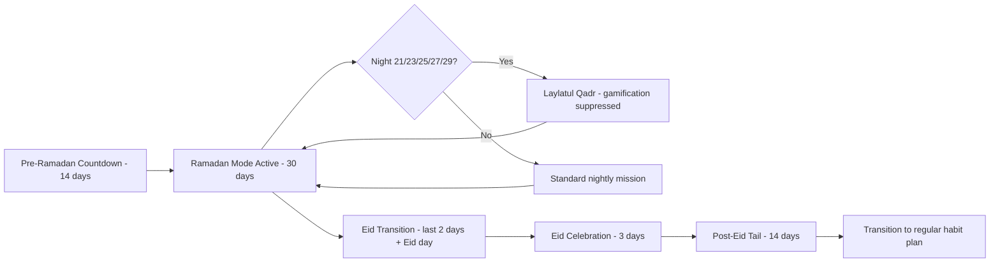
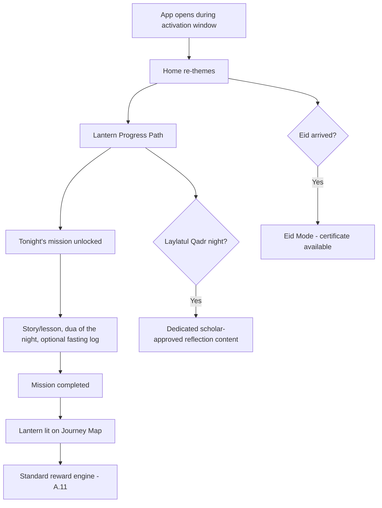
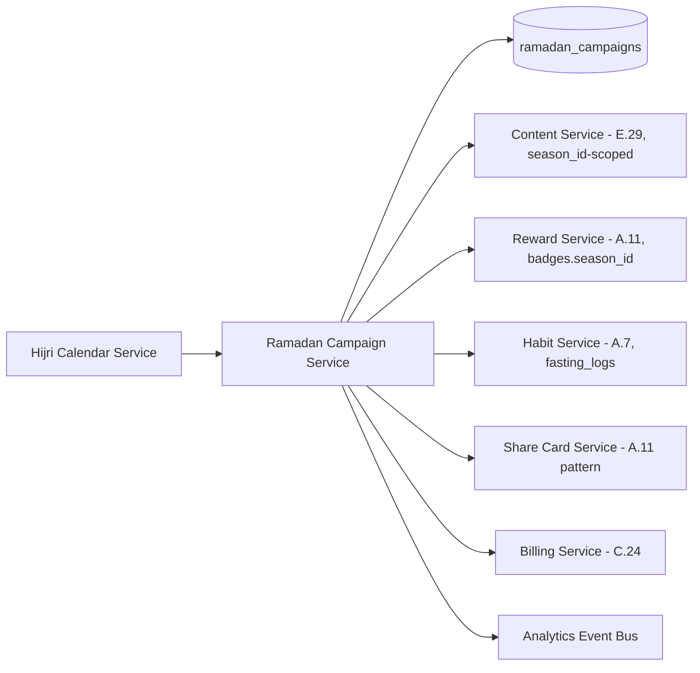
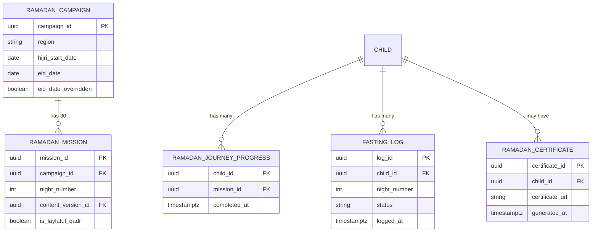

# Feature F.36 — Ramadan Mode (Cross-Cutting Seasonal Module)

**App:** NoorHeroes — Islamic Learning App for Children
**Feature Owner:** Content & Editorial / Growth & Engagement / Scholar Review Board
**Status:** Implementation-ready
**Version:** 1.0
**Depends on:** A.1 (Region setting on Parent Profile — activation-window source of truth), A.7 (Habit Tracker — fasting log uses the same engine), A.11 (Reward System — `season_id`-scoped badges/missions), E.29 (Content CMS — 30-night content authored/reviewed through the standard pipeline), C.20/C.21 (Parent Dashboard/Family Aggregate), E.31 (Engagement Tools — Seasonal Calendar coordination)
**Feeds into:** A.2 Home (theme re-skin), A.3 Stories (Ramadan story set), A.6 Dua Learning (dua-of-the-night), C.24 Subscription & Billing (Day 28-30 conversion moment)

> **Scope note:** Ramadan content and mechanics are referenced throughout A.2/A.3/A.6/A.7/A.11's own documents as "seasonal" hooks. This document consolidates all of it into **one buildable, coherent module** — the activation-window lifecycle (Region-keyed, Hijri-calendar-driven), the child-facing Lantern Progress Path and its screens, the parent-facing Ramadan Dashboard tab and Family Aggregate, the Laylatul Qadr gamification-suppression rule, the Eid transition/celebration, the Day 28-30 soft-conversion moment, and the admin-side Ramadan Campaign Manager / 30-Night Content Scheduler. Every mechanic here reuses an already-hardened engine (A.7's habit logging, A.11's reward/badge system, E.29's content pipeline, C.24's billing) — this document introduces no parallel reward, content-review, or billing logic of its own.

---

## Table of Contents

1. [Product Requirements](#1-product-requirements)
2. [UX/UI Requirements](#2-uxui-requirements)
3. [Backend Requirements](#3-backend-requirements)
4. [Database Design](#4-database-design)
5. [Backend AI Code-Generation Prompt](#5-backend-ai-code-generation-prompt)
6. [Android Requirements](#6-android-requirements)
7. [Android AI Code-Generation Prompt](#7-android-ai-code-generation-prompt)
8. [Admin Requirements](#8-admin-requirements)
9. [Admin AI Code-Generation Prompt](#9-admin-ai-code-generation-prompt)
10. [DevOps Requirements](#10-devops-requirements)
11. [Analytics Requirements](#11-analytics-requirements)
12. [Security Requirements](#12-security-requirements)
13. [QA Requirements](#13-qa-requirements)
14. [Marketing Requirements](#14-marketing-requirements)
15. [Release & Rollback Plan](#15-release--rollback-plan)

---

## 1. Product Requirements

### 1.1 Problem Statement

Ramadan is NoorHeroes' single highest-engagement seasonal moment, and families need a coherent 30-night structured journey — fasting education appropriate to each child's age and parental preference, nightly Islamic content, dua sets, and a Quran challenge — paired with a family-level rollup for parents, while the platform needs this entire module fully scholar-reviewed and content-complete at a hard internal deadline well ahead of the actual date, with gamification deliberately suppressed during the most spiritually significant nights (source: NoorHeroes Blueprint §8: "Ramadan content is referenced throughout the storytelling, habit, seasonal-events, and gamification modules. This section consolidates all of it into a single buildable feature"; §8.9: "All 30 nights of content must be scholar-approved and content-complete at least 3 weeks before the actual Ramadan date — this is a hard internal deadline, not a soft target").

### 1.2 Business Goals

- Convert Ramadan's natural engagement spike into the platform's strongest annual growth and trial-to-paid conversion moment, via a soft, never-blocking Day 28-30 conversion card.
- Maintain absolute scholar-review and content-completeness discipline against a hard, non-negotiable internal deadline (3 weeks pre-Ramadan) — explicitly called out as a top risk if skipped.
- Reuse every existing platform mechanic (habit logging, reward/badge engine, content CMS, billing) rather than building parallel Ramadan-specific infrastructure.
- Respect the spiritual character of Laylatul Qadr by deliberately suppressing competitive/gamified framing during those nights.

### 1.3 User Goals

- **Child:** Experience a 30-night journey with a story, dua, and mission each night, see lit lanterns mark progress, feel the season's special calm during Laylatul Qadr and the joy of Eid.
- **Parent:** Set each child's fasting approach appropriately, see a family-wide rollup of everyone's Ramadan progress, generate a shareable end-of-Ramadan certificate, and trust the season never pressures a child to fast beyond what's medically/age-appropriate.

### 1.4 Success Metrics

| Metric | Target |
|---|---|
| Content-complete and scholar-approved deadline compliance | 100% at least 3 weeks before Ramadan (hard, zero-tolerance) |
| 30-night journey completion rate (≥1 mission completed) | ≥ 70% of active families |
| Family Ramadan Report generation/share rate | ≥ 40% of multi-child families |
| Day 28-30 conversion-card-driven trial-to-paid conversion | 15-25% of trial users converting to annual |
| Post-Eid habit-continuation rate (active 14 days post-Eid) | ≥ 50% |

### 1.5 Stakeholders

Content/Editorial Lead, Scholar Review Board, Growth/Engagement Lead, Backend Architect, Android Architect, Data Analyst, QA Lead, Customer Support Lead.

### 1.6 User Stories

1. As a child, I want a special Ramadan-themed Home with a 30-night journey map showing my progress.
2. As a child, I want each night to unlock a themed story, dua, and mission.
3. As a child, I want the last ten odd nights (Laylatul Qadr) to feel calmer and more reflective, not competitive.
4. As a child, I want a special Eid celebration with a reward reveal and a shareable card.
5. As a parent, I want to set my child's fasting approach and see their nightly log only within what I've allowed.
6. As a parent, I want a family-wide Ramadan rollup and an end-of-Ramadan report I can print or share.
7. As a parent, I want a soft reminder near the end of Ramadan about continuing my subscription, never a blocking paywall.
8. As an admin, I want to schedule all 30 nights of content well ahead of time, with the system enforcing the content-completeness deadline.

### 1.7 Functional Requirements

**FR-1** Activation Window & Lifecycle (canonical): Pre-Ramadan Countdown (14 days before); Ramadan Mode Active (30 days, Hijri, regionalized); Laylatul Qadr Window (nights 21, 23, 25, 27, 29 — gamification deliberately suppressed); Eid Transition (last 2 days + Eid day); Eid Celebration (3 days); Post-Eid Tail (14 days after Eid).
**FR-2** **The activation window is keyed to the Region setting on the Parent Profile, not device locale.**
**FR-3** **A moon-sighting-disputed Eid date triggers an Admin override that updates the `ramadan_campaigns` record and pushes a one-time notification; in-progress UI re-syncs on next app open.**
**FR-4** **Hijri start date: server-side Hijri calendar service with a regional moon-sighting override table.**
**FR-5** Child UX Flow: Home re-themes; Lantern Progress Path (30-night journey map); each night unlocks a themed mission set (story, dua, optional fasting log); completion feeds the standard reward engine (A.11); Laylatul Qadr surfaces dedicated scholar-approved content; Eid transitions to Eid Mode with a certificate available.
**FR-6** Parent UX Flow: Ramadan section on Parent Dashboard with family-level aggregate rollup; per-child Fasting Tracker toggle (hidden for young children by default); certificate generation/share via the standard Parent Gate.
**FR-7** Each of the 30 nights follows the same `content_items`/`content_versions` schema as all other content, scoped with a `season_id` — no parallel content schema.
**FR-8** Ramadan-specific achievements plug into the existing achievement/badge system; `badges.season_id` scopes seasonal badges — no parallel reward mechanism.
**FR-9** **Fasting-tracking content for young children must avoid any framing that could pressure a child medically unready to fast; the parent toggle exists specifically to let a parent exclude a child from this feature entirely.**
**FR-10** Fasting Tracker supports three parent-configurable approaches per child: full fast / practice / education-only, with the child only able to log within the allowed range.
**FR-11** Database additions: `ramadan_campaigns`, `ramadan_missions`, `ramadan_journey_progress`, `fasting_logs`, `ramadan_certificates` — all additive, none replacing an existing table.
**FR-12** **Laylatul Qadr nights deliberately suppress gamification** — no leaderboard-style framing, no competitive badge call-outs during these nights, a calmer reflection-oriented register.
**FR-13** The Day 28-30 conversion moment shows a **soft, never-blocking** card with standard purchase-flow terms shown first — never an interrupting paywall.
**FR-14** Family member invites support a read-only Family Ramadan Report link for extended family.

### 1.8 Non-Functional Requirements

- **Content-Completeness Deadline:** All 30 nights' content must be scholar-approved at least 3 weeks before the actual region-adjusted Ramadan start date — system-trackable, not aspirational.
- **Region-Correctness:** Activation timing reflects the Parent Profile's Region, never device locale.
- **Reuse, Not Duplication:** Every reward/content-review/habit-logging/billing mechanic reuses its existing engine.
- **Laylatul Qadr Tonal Integrity:** Gamification suppression must be automatically, reliably applied for the five specific nights, never dependent on manual editorial memory.

### 1.9 Acceptance Criteria

- Given a family's Region, when activation window is determined, then it correctly reflects that region's Hijri start date, never device locale.
- Given a moon-sighting dispute updates the Eid date, when a child's app is next opened, then the UI re-syncs to the corrected date.
- Given a child completes a night's mission, then it marks complete on the Journey Map and the standard A.11 reward engine processes it.
- Given Laylatul Qadr is active, then gamification elements are automatically suppressed.
- Given a parent sets "education-only," then no actual fasting-log option beyond educational content is presented.
- Given the Day 28-30 window arrives, then a soft, non-blocking conversion card appears, never an interrupting paywall.
- Given all 30 nights are checked 3 weeks before Ramadan, then 100% scholar approval is required.

### 1.10 Edge Cases

1. A family's Region changes mid-Ramadan → window recalculates going forward; already-completed nights are preserved.
2. A child's age band changes mid-Ramadan → completed nights remain credited; remaining nights reflect the new age band going forward.
3. A parent changes a child's fasting approach partway through → existing log entries preserved; no new entries beyond the new scope offered going forward.
4. Two children on different fasting approaches → Family Aggregate Bar reflects each child's own scope without implying comparison.
5. A child misses several nights → missed nights remain completable retroactively, never locked out, consistent with the platform's anti-shaming philosophy.
6. The content-completeness deadline arrives with a gap discovered → release-blocking incident with explicit escalation.
7. A family's trial lapses before day 28 → the Ramadan-day-count-specific conversion card simply doesn't apply; C.24's standard messaging takes over instead.
8. A Family Ramadan Report invite link is shared with someone without the app installed → gracefully prompts installation/account context, never a broken page.

### 1.11 Error Handling

| Scenario | System Behavior |
|---|---|
| Moon-sighting dispute changes Eid date | Admin override updates `ramadan_campaigns`; one-time notification; UI re-syncs on next open |
| Content-completeness gap discovered near deadline | Release-blocking incident, explicit escalation |
| Family Region changes mid-Ramadan | Window recalculates going forward; prior progress preserved |
| Missed nights | Remain completable retroactively |
| Day 28-30 card conflicts with trial lifecycle | Card simply doesn't apply if irrelevant; standard messaging takes over |

### 1.12 Empty States
- A new family joining mid-Ramadan → prior nights marked "not applicable" rather than missed.

### 1.13 Loading States
- Brief themed loading transition entering the activation window.

### 1.14 Offline States
- Journey Map and current night's content function offline if pre-downloaded; sync follows B.15's standard pattern.

### 1.15 Permission States
- Fasting Tracker visibility is parent-permissioned per child; hidden, not shown-disabled, if not enabled.

### 1.16 User Flow (Narrative)

14 days before the region-adjusted start, families see a countdown and parents complete a prep checklist → on the start date, Home re-themes and the Lantern Progress Path appears → each night the child completes a mission → during Laylatul Qadr the presentation shifts calmer → near day 28-30, a soft conversion card appears for trial families → on Eid, the app transitions to Eid Mode with a reward reveal and shareable card → for 14 days post-Eid, gentle nudges encourage continuing into a regular habit plan → throughout, parents have a Ramadan Dashboard tab with family aggregate and an end-of-Ramadan certificate/report.

### 1.17 Detailed Flow Diagram (Mermaid)





### 1.18 Screen Inventory (Complete — Zero Missing)

| # | Screen | Type | Entry Points | Exit Points |
|---|---|---|---|---|
| 1 | Ramadan Prep / Countdown | Screen | Home, 14 days before activation | Parent Prep Checklist |
| 2 | Ramadan Home (themed) | Primary | App open during activation window | Journey Map, themed Stories/Rewards |
| 3 | Ramadan Journey Map (Lantern Progress Path) | Primary | Ramadan Home | Mission Detail, Night Recap |
| 4 | Night Recap | Screen | Journey Map, completed night | Back to Journey Map |
| 5 | Mission Detail (Ramadan) | Screen | Journey Map, current night | Story Player, Dua of the Night, Fasting Tracker entry |
| 6 | Ramadan Story Player | Screen | Mission Detail | Mission Detail (completed) |
| 7 | Fasting Tracker Toggle & Log | Component/Screen | Mission Detail, Parent Settings | Mission Detail |
| 8 | Laylatul Qadr Reflection (calmer variant) | Screen variant | Journey Map, nights 21/23/25/27/29 | Night Recap (calmer variant) |
| 9 | Eid Countdown | Screen | Ramadan Home, last 2 days | Eid Home |
| 10 | Eid Home (themed) | Screen | Eid Countdown, Eid day onward | Eid Reward Reveal, Eid Card Generator |
| 11 | Eid Reward Reveal | Screen | Eid Home | Eid Card Generator |
| 12 | Eid Card Generator | Screen | Eid Home | Parent Gate → Share |
| 13 | Ramadan Complete Certificate | Screen | Eid Home, Journey Map | Parent Gate → Share/Print |
| 14 | Post-Eid "Keep the Habit" | Screen | Home, 14 days post-Eid | A.7's Habit Builder |
| 15 | Ramadan Settings Card (Parent) | Screen (Parent Area) | Family Overview | Fasting approach per child, reminders, invites |
| 16 | Ramadan Dashboard Tab (Parent) | Screen (Parent Area) | Parent Dashboard, active window only | Per-child detail, Family Aggregate |
| 17 | Family Ramadan Aggregate | Screen (Parent Area) | Ramadan Dashboard Tab | Per-child detail |
| 18 | Family Ramadan Report (printable) | Screen (Parent Area) | Ramadan Dashboard Tab, Post-Eid | Certificate generation, Family member invite |
| 19 | Conversion Moment Card (Day 28-30) | Component/Modal | Home, Ramadan Dashboard | C.24's standard purchase flow |
| 20 | Family Member Invite (read-only report link) | Screen (Parent Area) | Ramadan Settings Card, Family Report | External share |

### 1.19 Events (Complete Analytics Event List)

`ramadan_countdown_viewed`, `ramadan_prep_checklist_completed`, `ramadan_home_themed_viewed`, `ramadan_journey_map_viewed`, `ramadan_night_mission_completed`, `ramadan_lantern_lit`, `ramadan_laylatul_qadr_reflection_viewed`, `ramadan_fasting_log_entry_added`, `ramadan_fasting_approach_changed`, `ramadan_eid_countdown_viewed`, `ramadan_eid_mode_entered`, `ramadan_eid_reward_revealed`, `ramadan_eid_card_generated`, `ramadan_certificate_generated`, `ramadan_certificate_shared`, `ramadan_post_eid_habit_transition_shown`, `ramadan_conversion_card_shown`, `ramadan_conversion_card_converted`, `ramadan_family_report_viewed`, `ramadan_family_member_invited`, `ramadan_region_window_recalculated`, `ramadan_eid_date_admin_override_applied`.

---

## 2. UX/UI Requirements

> Reuses the platform's general child-mode warm/playful visual register with a dedicated seasonal theme overlay, and the Parent-Mode formal register for parent-facing Ramadan screens.

### 2.1 Ramadan-Specific Design System Extensions

- **Ramadan Theme Skin:** A color/illustration overlay applied to Home, Stories, and Rewards — lanterns, crescent-moon motifs, warm deep-teal-and-gold-at-night palette — distinct variants for Standard Ramadan / Laylatul Qadr / Eid.
- **Lantern Progress Path Visual Language:** A 30-node journey map with lit/unlit lantern states, special visual treatment for the five Laylatul Qadr nights.
- **Laylatul Qadr Calm-Mode Visual Language:** A deliberately quieter, less saturated treatment — no competitive badge call-outs, no leaderboard framing.
- **Eid Celebration Visual Language:** A joyful, bright, celebratory shift distinct from both other registers — child-safe, non-startling celebratory flourishes.

### 2.2 Screen-Level Design Requirements (Key Screens)

#### Screen: Ramadan Journey Map (Lantern Progress Path)
- **Purpose:** Give the child a clear, motivating sense of 30-night progress.
- **Components:** 30 lantern nodes, special markers on Laylatul Qadr nights, "tonight's mission" call-to-action.
- **States:** Default, Tonight's-mission-available, Night-completed, Laylatul-Qadr-active, Missed-night-still-completable.
- **Accessibility:** Each lantern node's state announced clearly via screen reader.

#### Screen: Family Ramadan Aggregate
- **Purpose:** Give parents a warm family-wide view without ranking siblings.
- **Components:** Aggregate-only progress visualization, per-child detail accessible individually.
- **States:** Default, Empty.

### 2.3 Tab Structure

Child-facing screens reached via re-themed Home; parent-facing via a dedicated "Ramadan" tab on the Parent Dashboard, visible only during the active window.

| Click Target | Destination | API Called | Analytics Event | Permission Check | Error Handling |
|---|---|---|---|---|---|
| Journey Map "Tonight's Mission" | Mission Detail | `GET /v1/ramadan/missions/{night}` | `ramadan_night_mission_completed` | None | Standard handling |
| Fasting Tracker entry | Fasting Log | `POST /v1/ramadan/fasting-logs` | `ramadan_fasting_log_entry_added` | Parent-permissioned | Hidden if not enabled |
| Parent Ramadan Dashboard tab | Ramadan Dashboard | `GET /v1/ramadan/family-aggregate` | N/A | Parent session | Standard handling |
| "Generate Certificate" | Certificate/Card Generator | `POST /v1/ramadan/certificates` | `ramadan_certificate_generated` | Parent Gate | Standard handling |
| Conversion Card "Continue with [plan]" | C.24's purchase flow | Reuses C.24's endpoints | `ramadan_conversion_card_converted` | None | Standard C.24 handling |

### 2.4 Wireframe Description (Composite)

Ramadan Home follows A.2's card-based dashboard layout with the seasonal overlay; the Journey Map follows a path/node pattern conceptually related to A.9's Skill Tree; the Parent Ramadan Dashboard tab follows C.20's card pattern, scoped to Ramadan content.

### 2.5 Screen Image Generation Prompts

**Screen: Ramadan Journey Map (Lantern Progress Path)**
- *Prompt 1 (English):* "Mobile app full-screen illustrated journey map UI mockup for a children's Islamic app, Ramadan theme. Deep warm teal night-sky background with soft stars. A winding path of 30 small lantern icons, some glowing warm gold (completed), one larger and pulsing softly (tonight's mission), several dim/unlit ahead (locked but not punitive-looking), and five lanterns marked with a small crescent-moon badge (Laylatul Qadr nights). A small countdown label near the top reading 'Night 12 of 30'. Warm, magical, calm aesthetic, soft glowing particles, rounded shapes, no realistic human faces, bottom navigation visible."
- *Prompt 2 (Arabic RTL):* "نفس شاشة خريطة الرحلة المصورة بملء الشاشة لتطبيق إسلامي للأطفال، بطابع رمضاني، بتخطيط من اليمين إلى اليسار بالكامل. خلفية سماء ليلية فيروزية دافئة وعميقة مع نجوم ناعمة. مسار متعرج من 30 أيقونة فانوس صغيرة، بعضها متوهج بذهبي دافئ (مكتمل)، واحد أكبر ونابض بهدوء (مهمة الليلة)، عدة فوانيس خافتة أماماً (مقفلة لكن غير عقابية المظهر)، وخمسة فوانيس مميزة بشارة هلال صغيرة (ليالي القدر). تسمية عد تنازلي صغيرة قرب الأعلى تقول 'الليلة 12 من 30'. طابع دافئ وسحري وهادئ، جزيئات متوهجة ناعمة, أشكال مستديرة، بدون وجوه بشرية واقعية، شريط تنقل سفلي ظاهر."

**Screen: Eid Home (themed)**
- *Prompt 1 (English):* "Mobile app home screen UI mockup for a children's Islamic app, Eid celebration theme. Bright, joyful warm gold and soft pastel background with gentle confetti-like sparkles (non-startling, child-safe celebratory style). A central card showing a glowing gift/reward-reveal icon labeled 'Eid Mubarak!' with a small 'Open Your Reward' button. Below, cards for 'Generate Eid Card' and 'Ramadan Certificate'. Warm, bright, celebratory but calm mood, rounded shapes, soft shadows, no realistic human faces, bottom navigation visible."
- *Prompt 2 (Arabic RTL):* "نفس شاشة الصفحة الرئيسية لتطبيق إسلامي للأطفال، بطابع احتفال العيد، بتخطيط من اليمين إلى اليسار بالكامل. خلفية ذهبية دافئة ومشرقة وفرحة مع لمسات باستيل ناعمة وومضات خفيفة (غير مفاجئة، آمنة للأطفال). بطاقة مركزية تعرض أيقونة هدية متوهجة بعنوان 'عيد مبارك!' مع زر صغير 'افتح جائزتك'. أسفل ذلك بطاقات لـ 'إنشاء بطاقة عيد' و'شهادة رمضان'. طابع دافئ ومشرق واحتفالي لكن هادئ، أشكال مستديرة، ظلال خفيفة، بدون وجوه بشرية واقعية، شريط تنقل سفلي ظاهر."

---

## 3. Backend Requirements

### 3.1 System Design Overview

Ramadan Mode is served by a **Ramadan Campaign Service** (the lifecycle/activation-window state machine, Hijri-calendar integration), which orchestrates content through E.29's existing Content Service (with `season_id` scoping), rewards through A.11's existing Reward Service (with `badges.season_id`), habit/fasting logging through A.7's existing Habit Service, and certificate sharing through A.11's existing Share Card Service pattern.

### 3.2 Architecture Diagram (Mermaid)



### 3.3 Service Breakdown

| Service | Responsibility |
|---|---|
| Ramadan Campaign Service | Activation-window lifecycle, region-keyed Hijri-date resolution, moon-sighting override handling |
| Hijri Calendar Service | Server-side Hijri date computation with regional override table |
| Content Service (reused, E.29) | Serves 30 night content units, Laylatul Qadr set, Eid package, all season_id-scoped |
| Reward Service (reused, A.11) | Processes nightly mission completions as standard reward-eligible events |
| Habit Service (reused, A.7) | Fasting log entries, parent-configured approach enforcement |
| Share Card Service (reused, A.11 pattern) | Eid card and certificate generation/sharing |

### 3.4 API List

#### `GET /v1/ramadan/campaign-status?region=`
- **Response 200:** `{ "phase": "...", "current_night": 12, "hijri_start_date": "...", "eid_date": "..." }`
- **Validation:** Resolves `region` from the Parent Profile server-side — never accepts a client-supplied region override for actual phase computation.

#### `GET /v1/ramadan/missions/{night}`
- **Response 200:** Night's content unit, sourced from E.29's `content_versions` with `season_id` set.
- **Validation:** For nights 21/23/25/27/29, includes a server-computed `gamification_suppressed: true` flag.

#### `POST /v1/ramadan/fasting-logs`
- **Request:** `{ "child_id": "...", "night": 12, "status": "fasted_full|fasted_practice|education_only" }`
- **Validation:** Rejects if `status` exceeds the parent's configured `fasting_approach` for that child.

#### `POST /v1/ramadan/certificates` / `POST /v1/ramadan/eid-cards`
- **Auth:** Parent Gate verification
- **Validation:** Generated artifact excludes child ID/DOB/location.

#### `GET /v1/ramadan/family-aggregate`
- **Response 200:** Aggregate-only family rollup — no per-child array field.

#### `POST /v1/admin/ramadan/eid-date-override`
- **Business Logic:** Updates `ramadan_campaigns.eid_date`; triggers a one-time push; client UI re-syncs on next open.

### 3.5 Cross-Cutting API Concerns

- **Region resolution always server-side, never client-supplied.**
- **Server-computed gamification-suppression flag, never client-side date calculation.**
- **Zero parallel schema** — every Ramadan mechanic reuses its owning service's existing table structure.

---

## 4. Database Design

### 4.1 ER Diagram (Mermaid)



### 4.2 Tables, Relationships, Constraints

| Table | Key Constraints | Indexes |
|---|---|---|
| `ramadan_campaigns` | UNIQUE(`region`, year-derived from `hijri_start_date`) | Index `(region)` |
| `ramadan_missions` | FK `campaign_id`, `content_version_id`; CHECK `night_number BETWEEN 1 AND 30` | Index `(campaign_id, night_number)` |
| `ramadan_journey_progress` | FK `child_id`, `mission_id`; UNIQUE(`child_id`, `mission_id`) | Index `(child_id)` |
| `fasting_logs` | FK `child_id`; status validated against parent-configured approach at application layer | Index `(child_id, night_number)` |
| `ramadan_certificates` | FK `child_id`; PII-excluded artifact | Index `(child_id, generated_at DESC)` |

### 4.3 Audit Fields
`ramadan_journey_progress.completed_at`, `fasting_logs.logged_at`, `ramadan_certificates.generated_at`.

### 4.4 Soft Delete Rules
N/A — append-only progress/log records.

### 4.5 Retention Rules
All Ramadan tables retained indefinitely as part of each child's permanent progress history.

---

## 5. Backend AI Code-Generation Prompt

```
You are building the Ramadan Campaign Service and Hijri Calendar Service
for "NoorHeroes," orchestrating EXISTING engines (E.29's Content Service,
A.11's Reward Service, A.7's Habit Service, A.11's Share Card Service
pattern) -- do NOT build parallel content, reward, or habit-logging
infrastructure.

Stack: FastAPI (Python 3.12), PostgreSQL (SQLAlchemy 2.0), Redis, a Hijri
calendar calculation library plus a regional moon-sighting override table.

Hard requirements:
1. Implement GET /v1/ramadan/campaign-status to resolve region
   EXCLUSIVELY from the authenticated parent's own Profile record
   server-side -- write a test confirming a client-supplied region
   parameter has ZERO effect on actual phase computation.
2. Implement the gamification_suppressed flag on
   GET /v1/ramadan/missions/{night} as SERVER-COMPUTED for nights
   21/23/25/27/29 -- write a test confirming correct true/false values.
3. Implement POST /v1/ramadan/fasting-logs to validate status against
   the child's parent-configured fasting_approach -- write a test
   confirming education_only cannot submit fasted_full/fasted_practice.
4. Implement ramadan_journey_progress completion as IDEMPOTENT
   (UNIQUE(child_id, mission_id)) and routed through A.11's EXISTING
   reward-issuance endpoint -- write a test confirming no duplicate
   reward on replay, and confirming the actual grant flows through the
   shared reward_ledger table.
5. Implement GET /v1/ramadan/family-aggregate with NO per-child-array
   field -- write a structural test mirroring A.7/A.11's pattern.
6. Implement POST /v1/admin/ramadan/eid-date-override to update
   ramadan_campaigns.eid_date and trigger a one-time notification via
   B.17's existing infrastructure -- write a test confirming subsequent
   campaign-status calls reflect the corrected date.

Deliver: FastAPI routers, SQLAlchemy models, Alembic migrations, Pydantic
schemas, and a pytest suite covering all 6 items, with items 1 and 4
treated as the two highest-priority guarantees.
```

---

## 6. Android Requirements

### 6.1 Technical Requirements
Kotlin, Jetpack Compose, MVVM, Clean Architecture, module `:feature:ramadan`, depends on `:core:reward-client` (A.11), `:core:design-system`, `:core:network`, `:core:offline-cache`/`:core:offline-sync` (B.15).

### 6.2 Screen Mapping
Each of the 20 screens in §1.18 maps to a Composable; the Ramadan theme overlay is a design-token swap, not a duplicated UI tree.

### 6.3 Navigation Flow
Ramadan screens reachable from re-themed Home during the active window; the Parent Ramadan Dashboard tab is conditionally rendered within C.20's existing shell.

### 6.4 State Management
`RamadanCampaignViewModel` derives phase/night/suppression state entirely from server responses — never independently computing Hijri dates client-side.

### 6.5 API Mapping
`RamadanRepository.getCampaignStatus()/getMission()/logFasting()/getFamilyAggregate()`, `RamadanCertificateRepository.generate()` map to their endpoints; mission completion delegates to `:core:reward-client's` existing `RewardRepository.reportCompletion()`.

### 6.6 Analytics Mapping
`RamadanAnalytics` fires events per §1.19.

### 6.7 Offline Support
Pre-downloaded mission content functions offline; completions/logs queue via B.15's existing outbox.

### 6.8 Deep Linking
`noorheroes://ramadan`, `noorheroes://ramadan/night/{n}`, `noorheroes://ramadan/eid`.

### 6.9 Push Notifications
Eid-date-override notification and reminders route through B.17's existing shared architecture.

### 6.10 Testing Strategy
- Unit: purely-server-driven phase/night/suppression rendering.
- UI tests: Family Ramadan Aggregate never renders per-child comparison; Laylatul Qadr variant renders correctly when flagged.
- Integration: full mission-completion → reward-engine → lantern-lit flow; fasting-log flow respecting parent-configured restriction.

---

## 7. Android AI Code-Generation Prompt

```
Build the `:feature:ramadan` Android module for NoorHeroes using Kotlin,
Jetpack Compose, MVVM, Clean Architecture, reusing `:core:reward-client`
(A.11) and `:core:offline-sync` (B.15) -- no parallel reward or sync
infrastructure.

Hard requirements:
1. RamadanCampaignViewModel derives all state EXCLUSIVELY from server
   responses -- write a test/structural check confirming no Hijri-
   calculation library or hardcoded Laylatul-Qadr night list exists in
   this module's source.
2. Mission completion calls RewardRepository.reportCompletion() (A.11's
   shared entry point) -- write a test confirming this exact call path.
3. Laylatul Qadr visual variant renders based on the server's
   gamification_suppressed flag -- write a UI test for both states.
4. Family Ramadan Aggregate renders from a DTO with NO per-child-array
   field -- write a reflection test.
5. Fasting-log entry respects the parent-configured restriction
   client-side as a fast local UX check -- write a test confirming no
   "fasted_full" option is offered for an education_only child.

Use Hilt, Retrofit+OkHttp, Room. Follow Global Design System tokens,
applying the Ramadan/Laylatul-Qadr/Eid theme tokens as a conditional
overlay.
```

---

## 8. Admin Requirements

- **Ramadan Campaign Manager:** Configure `ramadan_campaigns` per region, trigger Eid-date-override on dispute.
- **30-Night Content Scheduler:** Schedule each night's content assignment, reusing E.29's CMS for authoring/review.
- **Laylatul Qadr Content Set Manager:** Curate and tag the five special-night content units.
- **Eid Content Package Manager:** Manage Eid-transition/celebration content.
- **Ramadan Analytics Dashboard (Read-only):** Completion rates, fasting-approach distribution, conversion performance.
- **Content-Completeness Deadline Tracker (Read-only):** Surfaces which content units haven't completed scholar approval ahead of the hard 3-week deadline.

CRUD permissions: Campaign Manager = full CRUD behind `content_editor`/`super_admin` (Eid-date-override restricted to `super_admin`); Content Scheduler/Laylatul Qadr/Eid Package Manager = full CRUD behind `content_editor`; Analytics/Deadline Tracker = Read-only behind `content_editor`/`product_admin`.

---

## 9. Admin AI Code-Generation Prompt

```
Build/extend the NoorHeroes Admin Portal's Engagement and Content modules
for Ramadan Mode, reusing E.29's existing Content CMS/scholar-review
components -- do NOT build a parallel content editor.

Pages:
1. Ramadan Campaign Manager -- CRUD for ramadan_campaigns per region,
   with an "Override Eid Date" action restricted to super_admin.
2. 30-Night Content Scheduler -- assigns existing E.29-authored content
   to each of 30 night slots; links out to E.29's editor for authoring,
   never reimplementing it.
3. Laylatul Qadr Content Set Manager -- filtered scheduler view for
   nights 21/23/25/27/29 with required is_laylatul_qadr tagging.
4. Eid Content Package Manager -- manages Eid content assignments,
   reusing E.29's Media Library.
5. Ramadan Analytics Dashboard -- read-only metrics dashboard.
6. Content-Completeness Deadline Tracker -- a read-only checklist
   sourced from E.29's review-queue status, with a countdown to the
   hard 3-week deadline and red/amber/green readiness indicators.

Enforce RBAC via the existing Admin Portal role context. Every mutating
action writes an immutable audit_log row.
```

---

## 10. DevOps Requirements

- **Infrastructure:** The Ramadan Campaign Service is a low-traffic orchestration layer; actual content/reward/habit traffic rides on already-provisioned infrastructure, with capacity planning ahead of the activation window's expected traffic spike.
- **CI/CD:** Server-side-only region-resolution and idempotent-reward-engine-reuse tests are mandatory CI gates.
- **Monitoring/Logging/Alerting:** **Alert (P0) starting at the 3-week-before-Ramadan deadline if any content unit hasn't completed scholar approval**, escalating daily until resolved. Alert on campaign-status latency/error spikes during the activation window. Alert on any client-supplied region override affecting phase computation.
- **Disaster Recovery:** Standard-to-high tier across additive tables; `ramadan_campaigns` at a tier sufficient given its role gating the entire seasonal experience.
- **Rollback Strategy:** Staging verification against fixture multi-region/moon-sighting scenarios before promotion, given the inability to "retry next week" mid-season.
- **Backup Strategy:** Standard-to-high tier.
- **Environment Setup:** Staging supports a time-travel testing utility for simulating each lifecycle phase without waiting for the calendar date.

---

## 11. Analytics Requirements

### 11.1 Event Taxonomy
Full list in §1.19.

### 11.2 Funnel Analysis
`ramadan_home_themed_viewed` → `ramadan_journey_map_viewed` → `ramadan_night_mission_completed` (repeated) → `ramadan_certificate_generated`; separately, `ramadan_conversion_card_shown` → `ramadan_conversion_card_converted`.

### 11.3 Dashboard Metrics
Nightly completion-rate trend, fasting-approach distribution, certificate/Eid-card share rates, Day 28-30 conversion rate against the 15-25% target.

### 11.4 Cohort & Retention
Cohort by Ramadan-participation; correlate full-30-night completion with post-Eid and longer-term retention.

### 11.5 Learning Metrics
Quran/dua engagement specifically during Ramadan, measured at the seasonal-cohort level.

---

## 12. Security Requirements

### 12.1 Threat Analysis
- **Region/date manipulation:** mitigated by server-side-only region resolution.
- **Duplicate reward issuance:** mitigated by idempotent completion routed through A.11's hardened path.
- **Sibling comparison via Family Aggregate:** mitigated by structural no-per-child-array schema.
- **Fasting-approach bypass:** mitigated by server-side validation.

### 12.2 OWASP Checklist (Applied)
Broken Access Control: fasting-log status validated server-side. Security Misconfiguration: server-computed suppression flag and server-side region resolution are misconfiguration-defense patterns.

### 12.3 API Security
Server-side region resolution and idempotent reward-engine reuse are this module's two most important properties.

### 12.4 Mobile Security
No new sensitive data handling beyond A.7/A.11's established patterns.

### 12.5 Admin Security
Eid-date-override restricted to `super_admin` given its broad regional impact.

### 12.6 Data Encryption & PII Protection
Certificate/Eid-card generation reuses A.11's exact PII-exclusion guarantee.

### 12.7 Child Safety Requirements
The fasting-approach parent-permission restriction and the Laylatul Qadr gamification-suppression rule are this module's two defining child-wellbeing commitments.

### 12.8 Compliance Requirements
The hard, system-tracked content-completeness deadline operationalizes zero-tolerance for skipping scholar review under deadline pressure.

### 12.9 Security Checklist (Pre-Launch)
- [ ] Server-side-only region resolution verified
- [ ] Idempotent mission completion verified, routed through A.11's existing engine
- [ ] Server-computed gamification-suppression flag verified for exactly five nights
- [ ] Fasting-log parent-approach-restriction enforcement verified server-side
- [ ] Family Aggregate structural no-sibling-comparison schema verified
- [ ] Content-completeness deadline alerting verified

---

## 13. QA Requirements

### 13.1 Test Plan Summary
Coverage spans server-side region resolution, idempotent reward reuse, gamification-suppression correctness, fasting-approach enforcement, deadline alerting, and all 8 edge cases.

### 13.2 Test Cases — Happy Path
1. Correct phase/night shown per region; mission completion feeds A.11's reward engine.
2. Laylatul Qadr night renders the calmer presentation.
3. Parent generates/shares a certificate with no PII.

### 13.3 Edge Cases
All 8 items from §1.10.

### 13.4 Negative Cases
- Client-supplied region override → no effect.
- Replayed mission completion → no duplicate reward.
- `fasted_full` for an `education_only` child → rejected.
- Family Ramadan Aggregate response → no per-child array field.
- Deadline simulation with incomplete content → alert fires.

### 13.5 Regression Cases
Full suite re-run on every release touching the Ramadan Campaign Service or any reused engine.

### 13.6 Automation Cases
End-to-end full-lifecycle simulation via the time-travel utility; idempotent-reward-reuse test (CI-blocking); server-side-region-resolution test (CI-blocking); deadline-alerting test.

---

## 14. Marketing Requirements

- **Launch Plan:** Position as the platform's flagship annual growth moment (the "Ramadan Growth Flywheel").
- **Push Notifications:** Countdown, nightly reminders, Eid countdown/celebration, post-eid nudges — via B.17's shared architecture.
- **Release Notes:** Annual content refresh gets standard entries.
- **App/Play Store Description:** "A complete 30-night Ramadan journey for your family — scholar-reviewed content every night, with Laylatul Qadr treated with the calm it deserves."
- **ASO Keywords:** "Ramadan app for kids," "Islamic Ramadan calendar app children," "Ramadan habit tracker family."

---

## 15. Release & Rollback Plan

### 15.1 Release Plan
Given the absolute content-completeness deadline (3 weeks pre-Ramadan), this module's release plan is calendar-gated: feature-complete and content-complete status must be confirmed at least 3 weeks before the earliest-activating region's Hijri start date, with engineering rollout completing well ahead of that content deadline.

### 15.2 Rollback Plan
Rollback triggers (all P0): any confirmed region-resolution manipulation, any confirmed duplicate reward issuance, any confirmed gamification during Laylatul Qadr, any confirmed fasting-restriction bypass, any confirmed sibling-comparison data, and — uniquely — any confirmed scholar-review gap discovered after the deadline, which triggers immediate escalation to Content/Editorial leadership and the Scholar Review Board rather than a code rollback.

### 15.3 Success Metrics for Go/No-Go
Matches §1.4 targets. Go/no-go requires sign-off from Content/Editorial Lead, Scholar Review Board, Growth/Engagement Lead, and Engineering jointly, on its own dedicated, earlier timeline relative to the actual activation date given the non-repeatable nature of this seasonal window.
