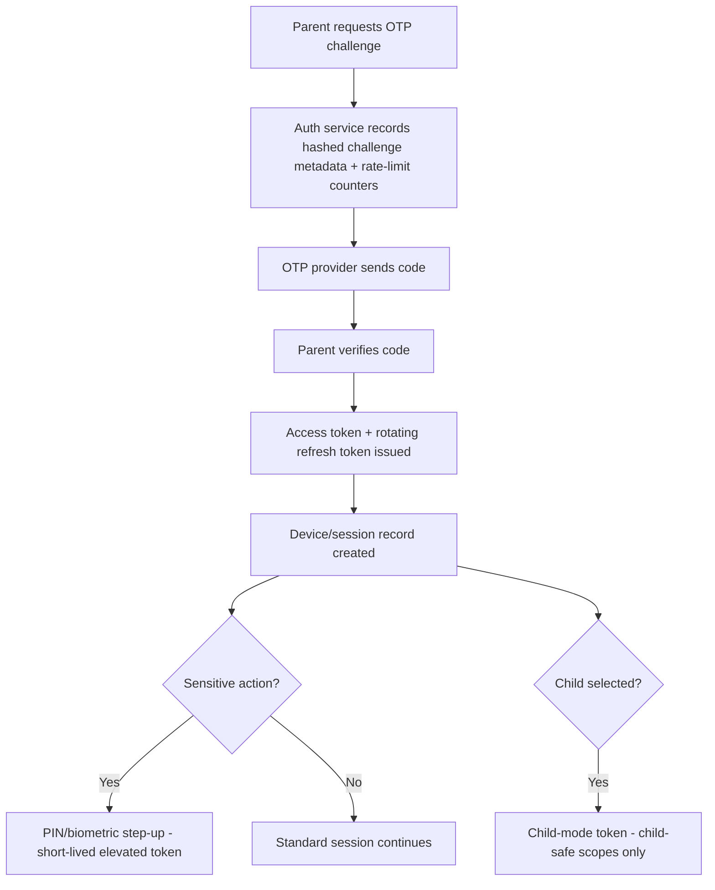
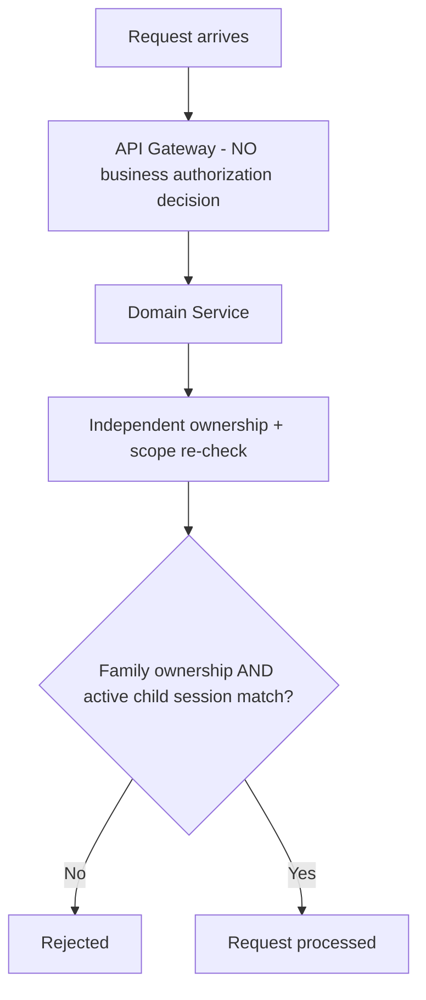
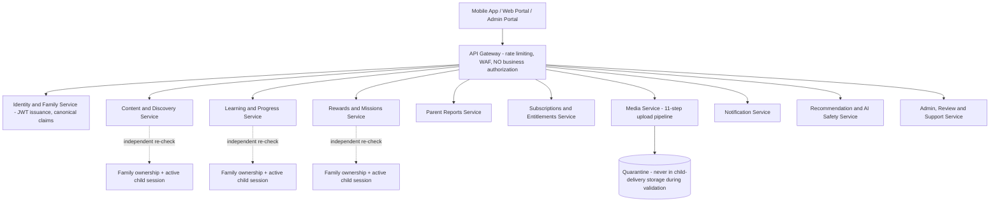
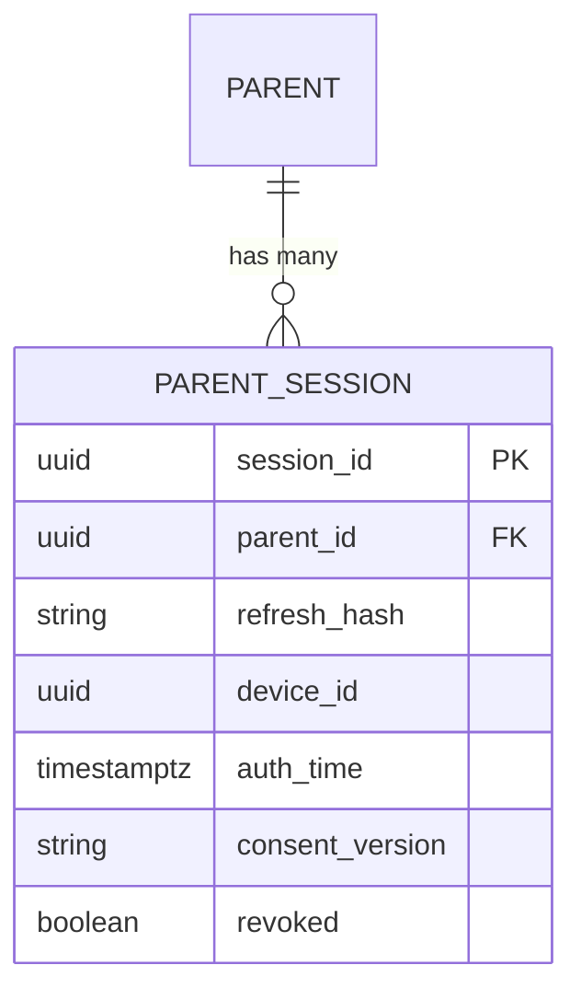

# Feature F.37 — Security Architecture (Cross-Cutting)

**App:** NoorHeroes — Islamic Learning App for Children
**Feature Owner:** Security Engineering / Platform Architecture / Trust & Safety
**Status:** Implementation-ready
**Version:** 1.0
**Depends on:** Nothing within the feature suite — this document is itself the architectural foundation every other feature's own security guarantees are built upon
**Feeds into:** Every feature in this entire documentation suite; specifically the trust-root mechanics already detailed in A.1 (onboarding), C.19 (Parent PIN Gate), E.28 (Admin Auth/RBAC), E.30 (AI Moderation), E.32 (PII Masking), F.35 (AI Layer)

> **Scope note:** This is the final cross-cutting architecture document, consolidating authentication, authorization, data encryption, API security, the content-upload validation pipeline, child safety controls, and vulnerability-prevention/incident-response practice into **one place** — pulling together security decisions already made and individually detailed across A.1, C.19, C.21, E.28, E.29, E.30, E.32, and F.35 rather than introducing new mechanisms. Every "hard rule" stated here has already been operationally specified in its owning feature document; this document's job is to state the **unifying architectural principles** those individual implementations all satisfy, and to specify the handful of genuinely cross-cutting concerns (the JWT token-claims schema itself, the gateway's no-business-authorization rule, the 11-step upload pipeline, and the incident-response procedure) that don't belong to any single feature.

---

## Table of Contents

1. [Product Requirements](#1-product-requirements)
2. [UX/UI Requirements](#2-uxui-requirements)
3. [Backend Requirements](#3-backend-requirements)
4. [Database Design](#4-database-design)
5. [Backend AI Code-Generation Prompt](#5-backend-ai-code-generation-prompt)
6. [Android Requirements](#6-android-requirements)
7. [Android AI Code-Generation Prompt](#7-android-ai-code-generation-prompt)
8. [Admin Requirements](#8-admin-requirements)
9. [Admin AI Code-Generation Prompt](#9-admin-ai-code-generation-prompt)
10. [DevOps Requirements](#10-devops-requirements)
11. [Analytics Requirements](#11-analytics-requirements)
12. [Security Requirements](#12-security-requirements)
13. [QA Requirements](#13-qa-requirements)
14. [Marketing Requirements](#14-marketing-requirements)
15. [Release & Rollback Plan](#15-release--rollback-plan)

---

## 1. Product Requirements

### 1.1 Problem Statement

NoorHeroes needs one consolidated, coherent security architecture — authentication (JWT access/refresh with rotation and a Redis denylist), authorization (RBAC computed from role + resource scope + region + locale + action, with the gateway performing zero business-authorization decisions), data encryption (TLS in transit, encryption at rest, slow-salted-hash credential storage, zero biometric-template storage), API security (WAF/rate-limiting/bot-detection, recurring penetration testing, MFA on every admin/scholar account), a single 11-step content-upload validation pipeline shared by every upload source, and a documented, parent-notification-inclusive incident-response procedure — so that every individual feature's own security guarantee is built on the same hardened foundation rather than each reinventing its own (source: Consolidated Blueprint §13 "Security, Privacy & Child Safety Architecture": "A consolidated reference for authentication, authorization, child-access control, data privacy, and audit logging — pulling together security decisions already made across Parent Trust, Product Architecture, and Tech Stack into one place").

### 1.2 Business Goals

- Provide one architectural source of truth for security decisions, eliminating the risk of inconsistent or weaker security implementations emerging per-feature.
- Hold admin/scholar account security to a deliberately higher bar (MFA/passkeys, recurring pen-testing) than the parent-facing OTP+PIN model, given the elevated blast radius of an admin compromise.
- Ensure the API Gateway never becomes a single point of authorization-bypass failure — every domain service independently rechecks ownership and scope.
- Maintain a tested, documented incident-response procedure for the worst-case scenario (a data breach), including parent-notification steps, rather than improvising one only after an incident occurs.

### 1.3 User Goals

- **Parent:** Trust that authentication is robust (OTP + JWT + PIN/biometric step-up), that a single compromised component (e.g., a misconfigured gateway) can never expose their or their children's data, and that if something ever does go wrong, there's a real, tested plan for notifying and protecting them.
- **Admin/Scholar:** Operate under appropriately elevated security requirements (MFA/passkeys) given the sensitivity of what they can access, distinct from the parent-facing trust model.
- **Security Engineering:** Have one consolidated reference covering every security decision already made, rather than security knowledge scattered and potentially inconsistent across dozens of feature documents.

### 1.4 Success Metrics

| Metric | Target |
|---|---|
| MFA/passkey enrollment for admin/scholar accounts | 100% (hard, zero-tolerance, shared with E.28's 2FA-mandatory rule) |
| Authorization-bypass incidents via gateway misconfiguration | 0 (hard, zero-tolerance — the gateway never makes business-authorization decisions, so it structurally cannot be the sole point of bypass) |
| Backup-restore verification success rate | 100% (a backup that has never been restored is not considered verified) |
| Content reaching child-delivery storage without completing all 11 upload-pipeline steps | 0 (hard, zero-tolerance) |
| Penetration-test finding remediation within defined SLA | 100% |
| Incident-response procedure tabletop-exercise frequency | At least annually, with documented findings actioned |

### 1.5 Stakeholders

Security Engineering Lead, Platform Architecture Lead, Trust & Safety, Legal/Compliance, Backend Architects across every domain service, DevOps/Infrastructure Lead, QA Lead.

### 1.6 User Stories

1. As a parent, I want my authentication to be robust and my session properly revocable if a device is lost.
2. As a parent, I want assurance that no single compromised component can expose my or my children's data.
3. As an admin or scholar, I want my account held to a higher security bar given what I can access.
4. As Security Engineering, I want one consolidated architectural reference rather than security decisions scattered inconsistently across many documents.
5. As Security Engineering, I want a tested, documented incident-response procedure, including parent-notification steps, ready before it's ever needed.
6. As any engineer building a new feature, I want to inherit this architecture's guarantees by following its established patterns, not reinvent security primitives myself.

### 1.7 Functional Requirements

**FR-1** JWT Authentication Flow (canonical, source §13.1, the architectural origin point this document specifies once for every feature to reuse): (1) parent requests an OTP challenge; (2) auth service records hashed challenge metadata and rate-limit counters; (3) OTP provider sends the code; (4) parent verifies the code; (5) auth service issues a short-lived access token and a rotating refresh token; (6) a device/session record is created; (7) parent PIN or biometric step-up creates a short-lived elevated token for sensitive actions; (8) selecting a child creates a child-mode token containing only child-safe scopes.
**FR-2** **Token claims (canonical, source §13.1): `sub`, `family_id`, `mode`, optional `child_id`, `scopes`, `device_id`, `auth_time`, `consent_version`, `session_id`** — this exact claim set is the single schema every token-issuing and token-validating code path across the entire platform must use, never a feature-specific variant.
**FR-3** **Authorization is computed from role + resource scope + region + locale + action** (source §13.2/§11.6 — restated as the canonical, platform-wide authorization model, already operationalized per-role in E.28's RBAC matrix).
**FR-4** **The API Gateway performs no business authorization decisions on its own — every domain service rechecks ownership and scope independently. This prevents a single gateway misconfiguration from becoming a system-wide authorization bypass** (source §13.2/§3.3 — a hard, zero-exception architectural rule already reflected in every prior feature's "service-layer enforcement, not gateway-layer" pattern, e.g., E.28's structural child-mode-token rejection, E.32's PII Masking Service).
**FR-5** **Child-mode tokens carry only child-safe scopes; Parent dashboard APIs explicitly reject child-mode tokens rather than silently returning empty data, so a scope mismatch is observable rather than silently masked** (source §13.2 — restated as the rationale behind C.20's structural Parent-Session-Only Gate pattern, with the explicit-rejection-not-silent-empty-response design choice called out here as the general principle).
**FR-6** **Every child-scoped query is double-checked against family ownership AND active child session — a parent's JWT alone is never sufficient to read a specific child's data outside their own family** (source §13.2 — the architectural origin of C.19's strict session-to-child_id binding and B.14's per-child isolation guarantees).
**FR-7** **Parent identity: phone/email OTP or Google login (no Apple login). JWT access + refresh token pair; refresh rotation on use; Redis-backed denylist for revoked tokens. Child profiles are not independently authenticated accounts — they are PIN/biometric/pattern-locked profiles under one parent session** (source "Security Architecture" card — restated as the canonical parent/child identity model).
**FR-8** **Platform Security & Role Taxonomy (Dual-Axis Authorization Model):** The system strictly enforces a dual-axis authorization architecture: (1) **Customer Account Tiers (Client Scope):** `guest`, `registered` (free), and `premium` (active subscription, evaluated via `parent_entitlements` and `JwtClaims.is_premium`); (2) **Internal Administrative RBAC (Staff Scope):** The 9 canonical roles defined in E.28 (`super_admin`, `product_admin`, `content_editor`, `scholar`, `moderator`, `support`, `billing_ops`, `analytics_viewer`, `trust_safety`) enforced via `admin_users.role` and `require_admin_scope()`. Consumer tokens cannot access admin routes, and customer PII is masked by default.
**FR-9** **Parent Mode re-gates on every entry (PIN/biometric, short grace window)** (source — restated, the architectural origin of C.19's zero-exception Switch-Profile gating with its client-side-UX-only grace-window design).
**FR-10** Data Encryption (canonical, source §13.3): TLS in transit; encryption at rest for the database and object storage; managed secret storage with rotation; **PIN and lock-pattern hashes use a slow, salted hashing algorithm (e.g., bcrypt or argon2) — never a fast general-purpose hash**; **biometric verification relies entirely on OS-level assertions; NoorHeroes never stores biometric templates itself.**
**FR-11** API Security (canonical, source §13.4): WAF, rate limiting, and bot/credential-stuffing detection at the gateway layer; SAST, dependency scanning, container scanning, and regular penetration testing as part of CI/CD and a recurring security calendar; **MFA/passkeys required for admin and scholar accounts** — a higher bar than the parent-facing OTP+PIN model.
**FR-12** Content Upload Validation Pipeline (canonical, complete 11-step sequence, source §13.5): (1) extension and MIME allowlist validation; (2) file-signature verification (magic bytes, not just trusting the extension); (3) size/duration/dimension limits; (4) antivirus and malware scanning; (5) image/video adult-content AI classifier; (6) audio transcription plus text-safety scan; (7) text adult/sexual/violent/extremist safety scan; (8) metadata stripping (EXIF, GPS, author info); (9) perceptual hash check against a known-content blocklist; (10) **quarantine before transcoding — assets are never in child-delivery storage during this stage**; (11) human child-safety review.
**FR-13** Child Safety Controls (canonical, source §13.8): no open direct messages or public comments anywhere in the product; no unsafe external links reachable without a parent gate; parent gate required around all external sharing actions; content age and region eligibility enforced at the API layer, not just hidden in the UI; scholar and child-safety approval required before any content reaches a child, with no seasonal-content exception; an AI emergency kill switch exists and is regularly tested; a report/feedback path is available on all media; support and moderation escalation paths carry defined severity SLAs.
**FR-14** Vulnerability Prevention (canonical, source §13.9): immutable or tamper-evident audit logs (append-only at the database-role level, not just the application level); tested backup restores — a backup that has never been restored is not a verified backup; a documented incident-response procedure with parent-notification steps for any data-breach scenario.
**FR-15** **Rate limiting applies at device, IP, phone, and account levels** (source — restated as the complete, multi-dimensional rate-limiting requirement, beyond a single IP-based check alone).

### 1.8 Non-Functional Requirements

- **Service-Layer-Only Authorization:** No business-authorization decision is ever made at the gateway layer — every domain service independently re-verifies ownership/scope, a structural defense-in-depth principle applied uniformly.
- **Slow-Hash Credential Storage:** Every credential (parent PIN, child lock pattern/PIN) uses a slow, salted algorithm — never a fast general-purpose hash, eliminating brute-force feasibility even if a hash were ever exfiltrated.
- **Zero Biometric Storage:** No biometric template is ever stored by NoorHeroes under any circumstance — verification is delegated entirely to the OS.
- **Upload-Pipeline Completeness:** All 11 steps apply to every upload source (admin CMS, scholar-submitted media, any future user-generated surface) — never a partial or source-specific subset.
- **Tested, Not Theoretical, Backup Restores:** A backup is only considered verified once an actual restore has been successfully performed against it.

### 1.9 Acceptance Criteria

- Given a parent authenticates, when the flow completes, then the token issued contains exactly the canonical claim set (`sub`, `family_id`, `mode`, optional `child_id`, `scopes`, `device_id`, `auth_time`, `consent_version`, `session_id`) — no feature-specific variant token schema exists anywhere in the platform.
- Given a request reaches the API Gateway, when it's routed to a domain service, then the gateway has made no business-authorization decision of its own — the domain service performs its own independent ownership/scope check.
- Given a child-mode token is used against a Parent Dashboard endpoint, when this occurs, then the request is explicitly rejected with a clear error, never silently returning an empty/masked dataset.
- Given any child-scoped query is executed, when checked, then it verifies both family ownership AND the active child session — a valid parent JWT alone is never sufficient.
- Given any PIN or lock-pattern value is stored, when inspected, then it uses a slow, salted hash — never a fast general-purpose hash function.
- Given biometric verification is used anywhere in the app, when reviewed, then no biometric template has ever been transmitted to or stored by any NoorHeroes server.
- Given content is uploaded from any source, when it reaches child-delivery storage, then it has passed all 11 steps of the upload validation pipeline, with quarantine strictly preceding transcoding.
- Given a documented incident-response procedure is reviewed, when audited, then it includes specific parent-notification intelligence for a data-breach scenario, and the most recent backup-restore test was successfully completed and verified.

### 1.10 Edge Cases

1. A domain service's own independent authorization check fails to catch a request the gateway would have otherwise blocked (e.g., a temporary gateway WAF rule lapses) → consistent with FR-4's defense-in-depth design, this is precisely the scenario the "gateway makes no business-authorization decisions" architecture is meant to render survivable — the domain service's own check remains the actual authoritative gate regardless of gateway-layer state, so a gateway-layer gap alone should never result in an actual authorization bypass.
2. A refresh token is used after having already been rotated (e.g., a replayed/stolen old refresh token) → the Redis-backed denylist must correctly reject this reuse attempt, treating it as a signal of potential compromise (consistent with standard refresh-token-rotation security practice) rather than silently accepting it.
3. An admin/scholar account's MFA device is lost → a documented, audited recovery path exists (consistent with E.28's general account-recovery patterns), never a silent MFA bypass for this elevated-privilege account class specifically.
4. Content uploaded by a trusted internal source (e.g., a Content Editor uploading directly via the CMS) is tempting to fast-track past some of the 11 pipeline steps given the apparent lower risk → this temptation must be explicitly resisted architecturally — the pipeline applies identically regardless of upload source's perceived trust level, since the actual risk (a compromised editor account, a supply-chain-compromised asset, human error) is not eliminated by source trust alone.
5. A penetration test discovers a finding that, while technically valid, would require disproportionate effort relative to its actual risk to remediate immediately → findings are triaged by severity with defined remediation SLAs (FR-?, cross-ref the platform's general severity-SLA pattern), but every finding still requires a documented disposition (fixed, risk-accepted-with-sign-off, or compensating-control-applied) — never a finding that simply goes unaddressed without an explicit decision.
6. A data-breach incident occurs that, on initial assessment, appears to affect only non-sensitive data (e.g., aggregate analytics) → the incident-response procedure must still be fully invoked to confirm this assessment is correct before concluding parent notification isn't warranted, since an initial scoping assessment made under time pressure is exactly the kind of judgment a structured procedure exists to verify rather than shortcut.
7. A backup-restore test reveals the backup is not actually restorable as expected (a genuine "backup that turns out not to be a backup" scenario) → this is itself a critical incident requiring immediate remediation (rebuilding the actual restorable backup process) and a root-cause investigation into how an unverified, non-functional backup process went undetected, never simply noted and left for a future cycle.

### 1.11 Error Handling

| Scenario | System Behavior |
|---|---|
| Child-mode token used against a Parent Dashboard endpoint | Explicit rejection with a clear error, never silently returning empty/masked data (FR-5) |
| Replayed/stolen rotated refresh token | Rejected via the Redis-backed denylist, treated as a potential compromise signal |
| Gateway-layer authorization gap (e.g., a lapsed WAF rule) | Domain service's own independent authorization check remains authoritative, preventing actual bypass |
| Penetration-test finding with disproportionate remediation cost | Requires an explicit documented disposition, never left unaddressed silently |
| Backup found non-restorable during a verification test | Treated as a critical incident, immediate remediation, root-cause investigation |

### 1.12 Empty States
- N/A at this architectural-document level.

### 1.13 Loading States
- N/A at this architectural-document level.

### 1.14 Offline States
- N/A at this architectural-document level; each feature's own offline-fallback design (e.g., A.5/B.13/B.15's listen-only/cached-policy patterns) already incorporates this architecture's authentication/authorization guarantees into their respective offline-handling designs.

### 1.15 Permission States
- N/A at this architectural-document level beyond what's already specified by FR-3/FR-8's role taxonomy, operationalized per-feature throughout this documentation suite.

### 1.16 User Flow (Narrative)

A parent authenticates via OTP, receiving a JWT access/refresh token pair scoped to their own `family_id`; selecting a child creates a distinct child-mode token with only child-safe scopes; any sensitive parent action requires a fresh PIN/biometric step-up creating a short-lived elevated token; every request, regardless of which domain service ultimately handles it, passes through a gateway that performs no authorization decisions of its own, with the receiving domain service independently re-verifying ownership and scope; any uploaded content passes through the complete 11-step validation pipeline before ever reaching child-delivery storage; and in the rare event of a security incident, a documented, tested, parent-notification-inclusive procedure governs the response.

### 1.17 Detailed Flow Diagram (Mermaid)

**JWT Authentication Flow (canonical, source §13.1):**



**Authorization Defense-in-Depth (canonical, source §13.2):**



### 1.18 Screen Inventory (Complete — Zero Missing)

> As with F.35, this is a cross-cutting architecture document with no dedicated UI screens of its own. Every security mechanism specified here is operationalized through screens already fully documented in their owning features.

| # | Surface | Owning Document | Relationship to This Document |
|---|---|---|---|
| 1 | Parent PIN/Biometric Gate, Who Is Learning | C.19 | Implements FR-1/FR-7/FR-9's authentication/re-gating flow |
| 2 | Admin Login / 2FA | E.28 | Implements FR-11's MFA-on-admin-accounts requirement |
| 3 | Child Lock Verification | C.19/C.23 | Implements FR-10's slow-hash credential storage |
| 4 | AI Moderation Console Kill Switch | E.30 | Implements FR-13's AI emergency kill switch |
| 5 | Media Library / Quarantine Detail | E.29 | Implements FR-12's upload-pipeline quarantine step |
| 6 | PII Masking / Unmask Workflow | E.32 | Implements FR-6's double-checked child-scoped query principle |
| 7 | Audit Log Viewer | E.28 | Implements FR-14's immutable, tamper-evident audit logging |

### 1.19 Events (Complete Analytics Event List)

`auth_otp_requested`, `auth_token_issued`, `auth_refresh_token_rotated`, `auth_refresh_token_reuse_detected` (internal/security signal), `auth_step_up_token_issued`, `auth_child_mode_token_issued`, `authorization_gateway_passthrough` (internal, confirms no gateway-layer business-authorization decision was made), `authorization_domain_service_check_performed` (internal), `authorization_child_mode_token_rejected_on_parent_endpoint` (internal/security signal), `upload_pipeline_step_completed` (internal, per-step), `upload_quarantined`, `penetration_test_finding_logged`, `penetration_test_finding_disposition_recorded`, `backup_restore_test_completed` (with `success: bool`), `incident_response_procedure_invoked`, `incident_parent_notification_sent`.

---

## 2. UX/UI Requirements

> This is a cross-cutting backend-architecture document; it defines no UI of its own beyond what's already specified by the owning features listed in §1.18. The one cross-cutting UX principle this document establishes:

### 2.1 Security-Surface Consistency Principle (Cross-Cutting)

- **Every security-sensitive UI surface across the platform (PIN entry, MFA enrollment, lock screens) shares the same calm-but-serious visual register** already established in C.19 §2.1 (the Parent-Mode formal register) — this document doesn't redefine that register, but confirms it as the platform-wide standard for any future security-adjacent screen not yet built, rather than each new feature inventing its own visual treatment for "this is a security boundary."

---

## 3. Backend Requirements

### 3.1 System Design Overview

This architecture is implemented across the **API Gateway** (rate limiting, WAF, no business authorization), the **Identity & Family Service** (already specified in A.1/C.19, the JWT-issuing authority for the canonical claim schema), every **domain service** (independently re-verifying ownership/scope per request), the **Media Service** (the 11-step upload pipeline), and a documented, periodically-exercised **Incident Response Procedure**.

### 3.2 Architecture Diagram (Mermaid)



### 3.3 Service Breakdown

| Service | Responsibility (security-architecture-relevant slice) |
|---|---|
| API Gateway | TLS termination, rate limiting (device/IP/phone/account), WAF, bot/credential-stuffing detection, request/correlation IDs — **zero business authorization** |
| Identity & Family Service | OTP challenge/verification, JWT issuance with the canonical claim schema, refresh-token rotation, Redis denylist for revoked tokens |
| Every domain service | Independent family-ownership + active-child-session re-verification per request, never trusting the gateway's pass-through alone |
| Media Service | The complete 11-step upload validation pipeline, quarantine-before-transcode enforcement |
| Admin, Review & Support Service | Segregation-of-duties enforcement (E.29), audit logging (E.28), AI moderation/kill-switch (E.30) |

### 3.4 API List

#### `POST /api/v1/auth/register` / `POST /api/v1/auth/login` / `POST /api/v1/auth/refresh` / `POST /api/v1/auth/logout` / `POST /api/v1/auth/verify-email`
- **Rate Limits (canonical, source endpoint table):** register 5/hour/IP; login 10/hour/IP; refresh 30/hour/user; verify-email 10/hour/IP.
- **Validation:** `refresh` rotates the refresh token on every use (never reusable), denylisting the prior token in Redis; `logout` revokes the refresh token (added to the Redis denylist) immediately.

#### `GET /api/v1/children` / `POST /api/v1/children` / `PATCH /api/v1/children/{id}` / `DELETE /api/v1/children/{id}` / `GET /api/v1/children/{id}/progress`
- **Auth:** `PATCH`/`DELETE` require Bearer JWT **+ parent PIN** (step-up), `registered+`, **owner only** — every one of these endpoints independently verifies family ownership server-side, never trusting the JWT's `family_id` claim alone without a corresponding ownership check against the actual database record.
- **Validation:** `DELETE` is a soft-delete cascading visibility, never data (consistent with C.21's disable-vs-delete distinction).

#### Internal contract: every domain service's own request-handling code
- **Validation:** Independently queries for `(family_id matches JWT claim) AND (child_id matches the active child-mode session, if applicable)` before returning any child-scoped data — this check is duplicated deliberately across every service, never centralized solely at the gateway (FR-4/FR-6).

### 3.5 Cross-Cutting API Concerns

- **No gateway-layer business authorization:** The single most important architectural principle in this entire document — the gateway's role is purely network/transport-layer protection (rate limiting, WAF, TLS), never a decision about whether a specific request is allowed to access specific data.
- **Canonical, single JWT claim schema:** Every token-issuing code path uses the exact same claim set, never a feature-specific variant that could create inconsistent authorization semantics.
- **Rate limiting at four dimensions:** device, IP, phone, and account — never a single-dimension check alone, which would be trivially bypassable by rotating just one dimension.

---

## 4. Database Design

### 4.1 ER Diagram (Mermaid)

> This document introduces no new tables of its own — every relevant table (`parent_sessions`, `audit_logs`, `child_lock`, `parent_pin`) is already specified by its owning feature (A.1/C.19/E.28). This section documents the **shared schema principle** governing all of them.



### 4.2 Tables, Relationships, Constraints

| Table | Key Constraints | Indexes |
|---|---|---|
| `parent_sessions` | `refresh_hash` stores a **hash** of the refresh token, never the raw token value (source: "Refresh strategy: Rotating refresh tokens, stored hashed... Per source document's `parent_sessions.refresh_hash` field") | Index `(parent_id, revoked)` |

### 4.3 Audit Fields
`audit_logs` (E.28's shared table) is **append-only at the database-role level, not just the application level** (FR-14) — the strongest possible enforcement of immutability, since even a compromised application-layer code path cannot violate this guarantee.

### 4.4 Soft Delete Rules
Inherited from each owning feature (e.g., C.21's child/parent disable-not-delete pattern).

### 4.5 Retention Rules
Inherited from each owning feature's own retention standard (e.g., A.11's reward ledger, E.28's audit log).

---

## 5. Backend AI Code-Generation Prompt

```
You are implementing the cross-cutting Security Architecture for
"NoorHeroes" -- specifically the JWT token-claim schema, the API Gateway's
no-business-authorization rule, the rate-limiting configuration, the
slow-hash credential-storage standard, and the 11-step upload validation
pipeline. Every individual feature's OWN authorization logic (e.g.,
C.19's session-to-child_id binding, E.28's self-elevation prevention,
E.32's PII masking) is already specified in its own document -- this
deliverable's job is the SHARED PRIMITIVES those features all build on.

Stack: FastAPI (Python 3.12), PostgreSQL (SQLAlchemy 2.0), Redis,
Argon2id/bcrypt for credential hashing, a WAF/rate-limiting gateway layer
(e.g., Nginx/Envoy with a Redis-backed token-bucket implementation).

Hard requirements:
1. Implement the canonical JWT claim schema (sub, family_id, mode,
   optional child_id, scopes, device_id, auth_time, consent_version,
   session_id) as a SINGLE SHARED Pydantic model/schema used by every
   token-issuing code path in the entire backend -- write a test
   confirming no other module defines its own divergent token-claim
   schema; every issued token, regardless of which service issues it
   (parent login, child-mode selection, step-up elevation), validates
   against this exact shared schema.
2. Implement refresh-token rotation with a Redis-backed denylist: on
   every successful refresh, the OLD refresh token is immediately added
   to the denylist and a NEW one is issued -- write a test confirming a
   replay attempt using the just-rotated-away OLD token is rejected,
   treated as a potential-compromise signal (e.g., logged as a security
   event), not silently accepted.
3. Implement the API Gateway layer (or the relevant middleware if using
   an in-process gateway pattern) to perform ONLY network/transport-layer
   checks (rate limiting at device/IP/phone/account dimensions, WAF rules,
   TLS termination) -- write an ARCHITECTURAL test (a code-search/
   dependency-graph check) confirming the gateway layer's code contains
   NO business-logic authorization decision (e.g., no "does this user
   own this child_id" check anywhere in gateway-layer code), since that
   check must live exclusively in each domain service.
4. Implement credential hashing (parent PIN, child lock pattern/PIN)
   using Argon2id (or an equivalent slow, salted algorithm) exclusively
   -- write a test confirming no fast general-purpose hash function
   (e.g., plain SHA-256 without a slow KDF wrapper) is used anywhere in
   the credential-storage code path, via a dependency/import-scan test.
5. Implement the 11-step upload validation pipeline (extension/MIME
   allowlist, file-signature/magic-byte verification, size/duration/
   dimension limits, AV/malware scan, image/video adult-content
   classifier, audio transcription + text-safety scan, text safety scan,
   metadata stripping, perceptual-hash blocklist check, quarantine-
   before-transcode, human child-safety review) as ONE SHARED pipeline
   function/module invoked identically regardless of upload source
   (admin CMS, scholar-submitted media, any future user-generated
   surface) -- write a test confirming an asset cannot reach the
   "transcode" stage without having passed through every one of the
   prior 10 steps, in order, with no shortcut path for any particular
   source.
6. Implement every domain service's child-scoped query helper to
   ALWAYS verify family ownership AND active child-session match
   server-side, regardless of what the gateway already let through --
   write a test confirming a request with a valid JWT for Family A but
   a path/query parameter referencing a child in Family B is rejected
   by the DOMAIN SERVICE itself, even under a simulated scenario where
   the gateway layer's own check (if any existed) was bypassed entirely.

Deliver: the shared JWT schema module, the refresh-rotation/denylist
implementation, the gateway-layer rate-limiting configuration, the
credential-hashing utility module, the shared 11-step upload pipeline
module, and a pytest suite covering all 6 items, with items 3 (gateway
has zero business authorization) and 6 (domain-service-level re-
verification is the actual authoritative gate) treated as the two
highest-priority guarantees in this entire deliverable, since together
they constitute the platform's core defense-in-depth principle.
```

---

## 6. Android Requirements

### 6.1 Technical Requirements
No new Android module is introduced by this document. The shared `:core:auth` module (already specified in C.19) is the client-side implementation of this architecture's authentication flow; this document's contribution is confirming that module's design (JWT storage, refresh-token handling, step-up token lifecycle) against the canonical server-side claim schema and rotation behavior specified here.

### 6.2 Screen Mapping
N/A — already specified in C.19/E.28.

### 6.3 Navigation Flow
N/A.

### 6.4 State Management
`:core:auth's` token storage must never persist a refresh token in a way that survives a server-side rotation incorrectly — on every successful refresh, the client must discard the old token and store only the newly-issued one, consistent with the server's denylist-based rotation enforcement (a client holding onto a stale token after rotation would simply find it rejected on next use, but correct client behavior avoids ever attempting this).

### 6.5 API Mapping
Already specified per-feature (C.19's `ParentGateLauncher`, session repositories); this document introduces no new client-facing contract.

### 6.6 Analytics Mapping
Security-architecture-level events (§1.19) are emitted server-side; the client doesn't independently instrument authentication-internals events beyond what each consuming feature (C.19) already specifies for its own UX-level analytics.

### 6.7 Offline Support
N/A at this document's level — each feature's own offline design (e.g., C.19's offline lock verification against a securely-cached salted hash) already incorporates this architecture's credential-handling standards.

### 6.8 Deep Linking
N/A.

### 6.9 Push Notifications
N/A.

### 6.10 Testing Strategy
- Architectural test (cross-cutting): confirm `:core:auth's` token-storage implementation uses Android Keystore-backed encrypted storage for any locally-cached credential material (already required by C.19 §6's offline lock-verification spec), never plaintext SharedPreferences, reinforcing this document's slow-hash/secure-storage principle at the client layer.

---

## 7. Android AI Code-Generation Prompt

```
No new Android module is required for this document. Write ONE
cross-cutting architectural test confirming `:core:auth's` local
credential-caching implementation (used for C.19's offline lock
verification) exclusively uses Android Keystore-backed encrypted storage
-- scan for any direct SharedPreferences.putString() call involving a
variable named/typed in a way suggestive of a PIN, pattern, or hash value,
and assert none exist outside the Keystore-backed storage abstraction.
This confirms the client-side half of this document's FR-10 slow-hash/
secure-storage principle is correctly implemented at the one place the
client legitimately caches credential-derived material.
```

---

## 8. Admin Requirements

This document's operator-facing surfaces are already fully specified elsewhere: Admin Login/2FA and the Audit Log Viewer (E.28), the AI Moderation Console's kill switch (E.30), the Media Library's quarantine handling (E.29), and the PII Masking/Unmask workflow (E.32). The one addition this document specifies that doesn't yet exist elsewhere:

- **Security Posture Dashboard (Read-only):** A consolidated view of MFA-enrollment compliance across all admin/scholar accounts, recent penetration-test finding status/disposition, backup-restore-test history and results, and incident-response-procedure tabletop-exercise history — giving Security Engineering and leadership one place to confirm this entire architecture's health, rather than checking each underlying system individually.

CRUD permissions: Security Posture Dashboard = Read-only behind `super_admin`/`security` role.

---

## 9. Admin AI Code-Generation Prompt

```
Build a single read-only admin page (React + TypeScript, existing
NoorHeroes Admin Portal shell) for the Security Posture Dashboard.

1. Security Posture Dashboard -- a read-only view aggregating: (a)
   MFA/passkey enrollment status across every admin/scholar account
   (sourced from E.28's admin_user table), flagging any non-compliant
   account; (b) recent penetration-test findings with their disposition
   status (fixed/risk-accepted/compensating-control), sourced from a
   penetration_test_findings reference table; (c) backup-restore-test
   history with pass/fail results and dates; (d) incident-response
   tabletop-exercise history. This page performs NO mutating actions --
   it is purely a consolidated health-check view for Security
   Engineering and leadership. Restricted to super_admin/security roles.

Enforce RBAC via the existing Admin Portal role context. No audit
logging needed for this page since it performs no mutating actions.
```

---

## 10. DevOps Requirements

- **Infrastructure:** The API Gateway layer (rate limiting, WAF) sits in front of every domain service; Redis serves both the rate-limit counters and the refresh-token denylist; managed secret storage (a cloud KMS or equivalent) handles credential rotation.
- **CI/CD:** SAST, dependency scanning, and container scanning run on every CI/CD pipeline execution (FR-11); the gateway-has-zero-business-authorization architectural test and the domain-service-independent-reverification test (§5 items 3 and 6) are mandatory, non-bypassable CI gates.
- **Monitoring/Logging/Alerting:** Alert (P0) on any detected refresh-token-reuse-after-rotation event (a strong compromise signal). Alert on any MFA-non-compliant admin/scholar account discovered in production. Alert on a backup-restore test failing. Recurring (at minimum quarterly) penetration testing per the documented security calendar, with findings tracked to disposition.
- **Disaster Recovery:** This document's own subject matter — tested backup restores (FR-14) are the disaster-recovery verification mechanism for every other feature's own data; a documented incident-response procedure governs the worst-case scenario.
- **Rollback Strategy:** Any deploy touching the JWT-issuance schema, the refresh-rotation logic, or the gateway's rate-limiting configuration requires a staging penetration-test-style verification before promotion, given this architecture's foundational role across the entire platform.
- **Backup Strategy:** Per §14.7/§19.4 (cross-ref): PostgreSQL automated backups with **tested restore drills** (not just automated backup creation alone); Cloudflare R2's provider-level durability for media, backed by the content-versioning system as a logical safety net.
- **Environment Setup:** Staging supports realistic penetration-testing exercises and periodic incident-response tabletop simulations without risk to production data.

---

## 11. Analytics Requirements

### 11.1 Event Taxonomy
Full list in §1.19.

### 11.2 Funnel Analysis
N/A in the traditional engagement sense — this document's events are security/compliance signals, not a user-facing conversion funnel.

### 11.3 Dashboard Metrics
MFA-enrollment compliance rate (admin/scholar accounts), refresh-token-reuse-detection frequency, upload-pipeline quarantine rate by step (informs which specific check is catching the most issues), penetration-test finding volume/severity/disposition trend, backup-restore-test pass rate over time.

### 11.4 Cohort & Retention
N/A — internal security/compliance metrics, not user cohorts.

### 11.5 Learning Metrics
None — this is a foundational security document with no direct learning-metric relationship.

---

## 12. Security Requirements

> Given this entire document **is** the Security Requirements specification for the platform, this section summarizes the document's own meta-level self-assessment rather than restating every FR above.

### 12.1 Threat Analysis
- **Single-point-of-failure authorization (a compromised or misconfigured gateway granting broad access):** mitigated by the zero-gateway-business-authorization architecture — every domain service is its own independent authorization boundary.
- **Credential exfiltration leading to rapid brute-force compromise:** mitigated by slow, salted hashing for every credential type, making brute-force infeasible even with exfiltrated hashes.
- **Refresh-token replay after rotation:** mitigated by the Redis-backed denylist, treating any reuse attempt as a compromise signal.
- **Unsafe content reaching children via any upload source:** mitigated by the uniform, source-agnostic 11-step pipeline with quarantine strictly preceding transcode.
- **An untested incident-response plan failing when actually needed:** mitigated by the requirement for periodic tabletop exercises and tested (not merely created) backup restores.

### 12.2 OWASP Checklist (Applied)
This document's architecture directly addresses, at the platform level: Broken Access Control (the defense-in-depth gateway/domain-service split); Cryptographic Failures (slow-hash credentials, TLS, encryption at rest); Security Misconfiguration (the structural, not conventional, enforcement of every rule above); Identification and Authentication Failures (the canonical JWT schema, refresh rotation, MFA on elevated accounts); Vulnerable and Outdated Components (SAST/dependency/container scanning in CI/CD).

### 12.3 API Security
Already the subject of §3/§11 above in full.

### 12.4 Mobile Security
Already the subject of §6 above; reinforced by the platform-wide Keystore-backed local credential-caching standard.

### 12.5 Admin Security
MFA/passkeys mandatory for every admin/scholar account, a deliberately higher bar than the parent-facing model, given the elevated blast radius of this account class.

### 12.6 Data Encryption & PII Protection
TLS in transit, encryption at rest, slow-hash credentials, zero biometric storage — the complete encryption posture this document establishes as the platform-wide standard.

### 12.7 Child Safety Requirements
The complete Child Safety Controls list (FR-13) — no open messaging, no unsafe external links without a parent gate, API-layer (not UI-only) age/region eligibility enforcement, zero seasonal-content review exception, a regularly-tested AI kill switch, a universal report/feedback path, and defined-SLA escalation — together constitute this document's direct child-safety contribution, distinct from but complementary to the content-specific guarantees already detailed in E.29/E.30/F.35.

### 12.8 Compliance Requirements
Immutable, tamper-evident audit logging (database-role-level enforcement) and the documented, parent-notification-inclusive incident-response procedure are this document's most direct compliance-relevant contributions, supporting any future regulatory inquiry into the platform's security posture.

### 12.9 Security Checklist (Pre-Launch)
- [ ] Canonical JWT claim schema verified as the sole schema across every token-issuing code path
- [ ] Refresh-token rotation and replay-detection verified via the Redis denylist
- [ ] Gateway-zero-business-authorization architecture verified via code-search/dependency-graph test
- [ ] Domain-service-level independent re-verification verified even under a simulated gateway-bypass scenario
- [ ] Slow-hash-only credential storage verified, no fast general-purpose hash anywhere
- [ ] Zero biometric-template storage verified
- [ ] 11-step upload pipeline verified as a single shared, source-agnostic module with quarantine strictly preceding transcode
- [ ] MFA/passkey enrollment verified at 100% for admin/scholar accounts
- [ ] Backup-restore test verified successful within the current cycle
- [ ] Incident-response procedure verified current, with at least one tabletop exercise completed in the past year

---

## 13. QA Requirements

### 13.1 Test Plan Summary
Coverage spans: canonical JWT schema uniformity (signature test), gateway-zero-authorization architecture (signature test), domain-service independent re-verification (signature test), slow-hash credential storage, the 11-step upload pipeline's completeness/ordering, and all 7 edge cases from §1.10.

### 13.2 Test Cases — Happy Path
1. A parent authenticates, receives a correctly-shaped JWT, selects a child receiving a correctly-scoped child-mode token, and performs a step-up action receiving a correctly-scoped elevated token.
2. An uploaded asset passes all 11 pipeline steps in order and becomes available for child delivery only after quarantine and human review.
3. A penetration test runs, findings are logged with clear dispositions, and a subsequent backup-restore test completes successfully.

### 13.3 Edge Cases
All 7 items from §1.10.

### 13.4 Negative Cases
- Attempt to reuse a rotated-away refresh token → rejected, logged as a potential compromise signal.
- Search the gateway-layer codebase for any business-authorization logic → none found.
- Simulate a gateway-layer bypass and confirm a domain service's own check still correctly rejects an unauthorized cross-family request.
- Search the credential-storage code path for any fast general-purpose hash function → none found.
- Attempt to skip a step in the upload pipeline for a "trusted" internal upload source → no such shortcut exists.

### 13.5 Regression Cases
Full suite re-run on every release touching the Identity & Family Service, the API Gateway configuration, the Media Service's upload pipeline, or any domain service's authorization-check code.

### 13.6 Automation Cases
End-to-end full authentication-to-step-up-token-lifecycle flow; gateway-zero-authorization architectural scan (CI-blocking); domain-service-independent-reverification automated test under simulated gateway bypass (CI-blocking); 11-step upload-pipeline ordering/completeness automated test (CI-blocking); recurring (scheduled) penetration-test and backup-restore-test automation.

---

## 14. Marketing Requirements

N/A — this is a cross-cutting internal architecture document with no direct end-user-facing marketing surface. Its correct operation is the foundational guarantee behind every other feature's own trust and safety claims throughout this entire documentation suite — from C.19's "every grown-up action always requires verification" to E.29's "every piece of content is scholar-reviewed" to F.35's "AI should increase trust, not risk."

---

## 15. Release & Rollback Plan

### 15.1 Release Plan
This architecture is foundational and largely already in production via its individual feature implementations (A.1, C.19, E.28, E.29, E.30, E.32, F.35); this document's own "release" is primarily a consolidation/verification exercise — confirming every individual implementation actually conforms to the canonical schema/principles stated here, with any discovered divergence treated as a defect to remediate, phased rollout 10% → 50% → 100% applying specifically to any net-new shared-primitive code (e.g., a newly-consolidated JWT-schema validation module) rather than to already-shipped feature-level mechanics.

### 15.2 Rollback Plan
Rollback triggers (all P0, the platform's highest-severity class): any confirmed gateway-layer authorization bypass, any confirmed refresh-token-replay compromise, any confirmed fast-hash credential storage anywhere, any confirmed content reaching child-delivery storage without completing all 11 upload-pipeline steps, any confirmed non-restorable backup discovered outside of a scheduled test (i.e., discovered during an actual emergency). Mechanism: immediate rollback of the implicated component; given this architecture's foundational, cross-cutting nature, any confirmed incident here triggers the platform's highest-severity, all-hands cross-team incident response, equivalent in severity class to C.19's and E.28's own foundational-module incidents — and in the case of a confirmed data breach, formally invokes the documented incident-response procedure including parent notification.

### 15.3 Success Metrics for Go/No-Go
Matches §1.4 targets. Go/no-go for any change to this architecture requires explicit sign-off from Security Engineering, Platform Architecture, Trust & Safety, and Legal/Compliance jointly — this document's correctness is the precondition for every other feature across the entire platform's own security, privacy, and child-safety guarantees to actually hold in practice, making its review bar the highest in the entire documentation suite.
