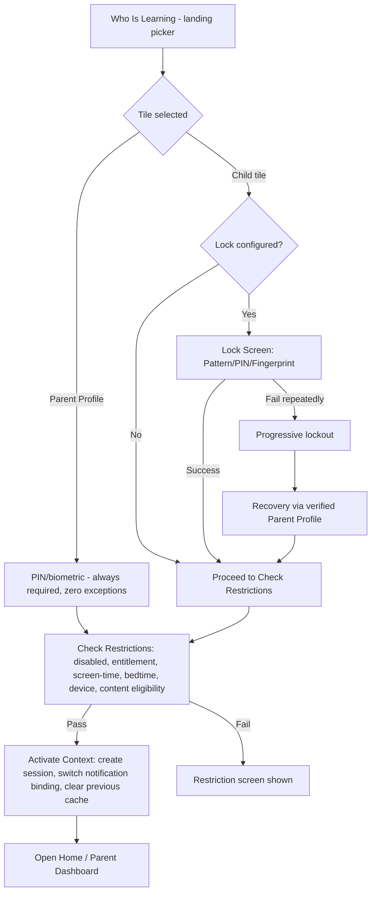
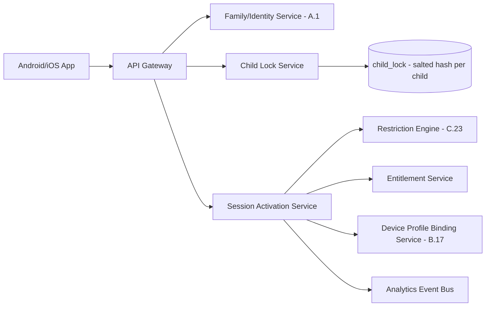

# Feature C.19 — Parent PIN/Biometric Gate & Profile Access Control

**App:** NoorHeroes — Islamic Learning App for Children
**Feature Owner:** Product / Security / Platform
**Status:** Implementation-ready
**Version:** 1.0
**Depends on:** A.1 (Auth & Onboarding — initial PIN setup, child lock configuration), B.16 (Child Profile — Switch Profile entry point), B.17 (Notifications — profile-binding switch)
**Feeds into:** C.20 Parent Dashboard, C.21 Multi-Child Management, C.23 Parental Controls (screen-time/bedtime override), every Parent Area screen (re-gating)

> **Scope note:** A.1 specified the **one-time** Parent PIN Setup screen during onboarding and the per-child lock *configuration*. This document specifies the **recurring access-control gate itself** — the Who Is Learning profile picker, the per-child Lock Verification screen, the Parent Profile PIN/biometric gate and its grace-window mechanics, lock recovery via verified Parent Profile, the four-stage Select→Verify→Check Restrictions→Activate pipeline, and the parent-PIN-gated override path used by screen-time/bedtime (C.23) and irreversible actions (C.21's child deletion). This is the single, canonical specification for "how does anyone get into any profile, ever," referenced by every other Parent Area and Child Mode feature rather than re-specified per-feature.

---

## Table of Contents

1. [Product Requirements](#1-product-requirements)
2. [UX/UI Requirements](#2-uxui-requirements)
3. [Backend Requirements](#3-backend-requirements)
4. [Database Design](#4-database-design)
5. [Backend AI Code-Generation Prompt](#5-backend-ai-code-generation-prompt)
6. [Android Requirements](#6-android-requirements)
7. [Android AI Code-Generation Prompt](#7-android-ai-code-generation-prompt)
8. [Admin Requirements](#8-admin-requirements)
9. [Admin AI Code-Generation Prompt](#9-admin-ai-code-generation-prompt)
10. [DevOps Requirements](#10-devops-requirements)
11. [Analytics Requirements](#11-analytics-requirements)
12. [Security Requirements](#12-security-requirements)
13. [QA Requirements](#13-qa-requirements)
14. [Marketing Requirements](#14-marketing-requirements)
15. [Release & Rollback Plan](#15-release--rollback-plan)

---

## 1. Product Requirements

### 1.1 Problem Statement

Families sharing one device across multiple children, and parents wanting confident control over both their own settings and each child's session, need a profile-selection and access-control system where every child can have an independently-configured lock (or none), every entry into Parent Mode is gated with zero exceptions, lock recovery always routes through verified parent authentication rather than a generic "forgot lock" bypass, and the same gate mechanism governs both routine profile switching and high-stakes override actions like screen-time extensions or child deletion (source: Consolidated Blueprint §6.2: "As a parent with three children sharing one tablet, I want each child to have their own lock and their own isolated session, so that siblings cannot see each other's progress or accidentally access parent controls"; NoorHeroes Blueprint "Lock Rules": "Every child can have a different lock type... Child lock recovery requires verified Parent Profile authentication").

### 1.2 Business Goals

- Provide one canonical, deeply-trusted access-control mechanism reused by every feature requiring a gate (routine profile switch, screen-time override, child deletion, AI/microphone permission changes, PIN reset) rather than fragmented, inconsistent per-feature gating logic.
- Maintain zero-exception re-gating on Parent Mode entry, with a deliberately short, configurable grace window that balances security against repeated-PIN-entry friction for legitimate parent sessions.
- Support flexible per-child lock configuration (none/pattern/PIN/fingerprint) so families can match security friction to each child's age/trust level.
- Ensure lock recovery never becomes a security hole — there is no generic, parent-bypassing "forgot lock" path anywhere in the system.

### 1.3 User Goals

- **Parent:** Set up a PIN (and optionally biometric) once, configure each child's own lock independently, and trust that re-entering Parent Mode always requires verification, while not being constantly re-prompted during a single active parenting session.
- **Child:** Use my own lock (or none, if my parent set it that way) to get into my profile, and know that if I forget it, a grown-up can help me back in safely.

### 1.4 Success Metrics

| Metric | Target |
|---|---|
| Parent gate verification success rate (correct PIN/biometric) | ≥ 95% |
| Cross-profile data leakage incidents | 0 (hard, zero-tolerance) |
| Lock-recovery-via-Parent-Profile completion rate | ≥ 90% |
| Grace-window-related support complaints | Tracked, informs calibration |
| Gate verification latency (local, no network dependency) | p95 < 200ms |
| Crash-free gate/picker sessions | ≥ 99.7% |

### 1.5 Stakeholders

Product Manager, Security Engineer, UX Designer, Backend Architect (Identity/Session Service), Android Architect, Data Analyst, QA Lead, Customer Support Lead, every feature owner requiring a gate (C.20/C.21/C.23).

### 1.6 User Stories

1. As a parent, I want to set a PIN once that gates my Parent Mode, purchases, settings, and any irreversible action.
2. As a parent, I want each of my children to have their own independent lock — or no lock at all, if I trust that child.
3. As a child, I want to enter my pattern/PIN or use my fingerprint to get into my own profile.
4. As a child who forgot my lock, I want a clear way to ask a grown-up to help me back in, without it being a generic bypass.
5. As a parent, I want re-entering Parent Mode to always require my PIN/biometric, except during a brief grace window if I just verified moments ago.
6. As a parent, I want the same PIN gate to apply when I'm extending screen time, deleting a child profile, or changing AI/microphone settings — not a separate, weaker check.
7. As a parent, I want confidence that switching between my children's profiles never lets one child see another's data, even momentarily.

### 1.7 Functional Requirements

**FR-1** The landing profile picker ("Who Is Learning") shows: active child profile tiles, the Parent Profile tile, and an "Add Child" tile (gated behind Parent Profile verification); **disabled child profiles appear only inside the Parent Profile, never on the landing picker** (source §6.2 item 1).
**FR-2** Selecting the **Parent Profile tile always requires PIN or biometric verification, with no exceptions, regardless of how recently the parent last authenticated for a child selection** (source §6.2 item 2/Business Rules).
**FR-3** Selecting a **Child tile**: if no lock is configured, proceed directly to policy checks (FR-7); if a lock is configured (Pattern/PIN/Fingerprint), show the matching lock screen (source §6.2 item 3).
**FR-4** **Every child can have a different lock type** (none, pattern, PIN, fingerprint) — lock configuration is fully independent per child (source NoorHeroes Blueprint "Lock Rules").
**FR-5** Lock verification mechanics: **Pattern** compares against a salted, slow hash (raw gesture points never logged); **PIN** compares against a salted, slow hash with retry-count-enforced progressive lockout; **Fingerprint** uses **OS biometric assertion only** — biometric data itself is never stored by NoorHeroes (source §6.2 item 3 sub-bullets — canonical, zero-exception storage rule).
**FR-6** **Lock failed or biometric unavailable** falls back to that child's own PIN/pattern, or recovers via **verified Parent Profile** — lock recovery **never** routes through a generic "forgot lock" flow that bypasses parent verification (source §6.2 item 3/Validation Rules — hard, zero-exception rule).
**FR-7** The four-stage access pipeline (canonical, source NoorHeroes Blueprint stage grid): (1) **Select Profile** — landing picker lists active children + Parent Profile; (2) **Verify If Locked** — pattern/PIN/biometric with retry limit, recovery through parent authentication; (3) **Check Restrictions** — validate disabled status, entitlement, screen-time budget, bedtime, device, content eligibility; (4) **Activate Context** — create child-mode session, switch notification binding, clear previous profile cache, open Home.
**FR-8** On successful selection, the app creates a **short-lived child-mode session** bound to `family_id`, `child_id`, device ID, and an entitlement snapshot — **sibling progress must never be returned to child-mode API calls** (source §6.2 item 4 — the platform-wide "No Lateral Sibling Access" rule's enforcement origin point).
**FR-9** **Switching to a different child clears all previous child-sensitive UI state before activating the new scoped session** (source §6.2 item 5).
**FR-10** **Parent Mode re-gates on every entry (PIN/biometric), with a short, configurable grace window** — re-entry to Parent Mode from already-active Parent Mode (e.g., from background) may skip the prompt within this window; the Child-Mode-to-Parent-Mode transition via "Switch Profile" always re-prompts with zero exception regardless of grace-window timing (source NoorHeroes Blueprint "Parent / Child Access Control" card; cross-ref B.16 FR-3).
**FR-11** **Two devices may select different children simultaneously** — each installation maintains its own independent active-profile binding, with no cross-device interference (source §6.2 Failure Scenarios; cross-ref B.17 FR-9).
**FR-12** Failed PIN/lock attempts trigger **progressively longer lockout**; recovery for a child's lock is **always** via verified Parent Profile (FR-6); recovery for the **Parent PIN itself** routes through the parent's own account-recovery flow (phone/email OTP re-verification, cross-ref A.1 FR-22), never a shortcut.
**FR-13** The same Parent PIN/biometric gate mechanism is reused, not re-implemented, by every feature requiring parent-level authorization: screen-time/bedtime override (C.23), child profile deletion (C.21), AI/microphone permission changes, PIN reset itself, and Achievement-card sharing (A.11 FR-12).
**FR-14** At the screen-time limit, the system **finishes the current short activity, saves progress, then shows a calm locked state**; **bedtime blocks new sessions during the configured window**; **parent override of either requires Parent Profile verification** through this same gate (source NoorHeroes Blueprint "Restriction Engine"/"Bedtime Configuration" cards — the actual policy is owned by C.23).
**FR-15** **Offline lock verification**: a locked child selected while offline verifies against the **locally cached salted hash**, then enforces the **last signed restriction/entitlement policy** — no network round-trip is required for the lock check itself (source §6.2 Error Handling).

### 1.8 Non-Functional Requirements

- **Security:** Salted, slow (Argon2id-class) hashing for PIN/pattern storage; biometric verification delegates entirely to the OS, with zero biometric data ever transmitted to or stored by NoorHeroes servers. This is the platform's single most security-critical feature.
- **Performance:** Local lock verification must not require a network round-trip — p95 < 200ms, fully on-device.
- **Reliability:** The four-stage pipeline must behave identically whether online or offline (offline falls back to cached hash + last-signed policy per FR-15), never silently skipping a stage.
- **Session Isolation:** Sibling-data leakage prevention (FR-8/FR-9) enforced at both client (UI-state-clearing) and server (query-scoping) layers — defense in depth.

### 1.9 Acceptance Criteria

- Given the Who Is Learning picker is shown, then it lists exactly the active (non-disabled) child profiles plus the Parent Profile tile plus an Add Child tile.
- Given a parent taps the Parent Profile tile, then PIN/biometric verification is always required.
- Given a child with no lock configured taps their tile, then they proceed directly to restriction checks with no lock screen.
- Given a child with a PIN lock exceeds the retry limit, then progressively longer lockout applies, and recovery is only available via verified Parent Profile.
- Given a child profile is activated, then no subsequent child-mode API call ever returns sibling data.
- Given a parent is in an active Parent session and returns to it via normal in-Parent-Mode navigation within the grace window, then they are not re-prompted — but given they tap "Switch Profile" from inside Child Mode, the gate always appears regardless of the grace window.
- Given offline connectivity during lock verification, then the check succeeds/fails against the locally cached salted hash with the last-signed restriction policy applied.
- Given a parent extends screen time, deletes a child profile, or resets their PIN, then they pass through this same gate mechanism.

### 1.10 Edge Cases

1. A child correctly enters their lock, but the device loses connectivity exactly at the "Check Restrictions" stage → this stage also falls back to the last-signed policy snapshot offline, rather than blocking activation entirely.
2. Two children share a device; Child A is PIN-locked, Child B has no lock → switching always returns to the picker and re-runs the full pipeline, including UI-state-clearing, for every switch.
3. A parent's enrolled biometric changes at the OS level → the app gracefully falls back to PIN entry rather than permanently locking the parent out; PIN remains the durable fallback at all times.
4. A child's lock-recovery flow is initiated and parent-verified, but the parent backs out before resetting the new lock → the child's original lock configuration remains unchanged and functional.
5. A device sits idle on the Who Is Learning picker for an extended period → no special device-level timeout is required by this feature, but each individual profile selection always re-runs the full verification pipeline.
6. A parent's grace window expires while they are mid-action inside an already-open Parent Mode screen → this only affects the next re-entry check, not the already-active session.
7. A child enters a correct pattern while an active lockout countdown is still running → the lockout is still honored; correct credentials don't bypass an active cooldown.
8. Two guardians share the same family account on different devices → each device's grace window is tracked independently, with no shared/synced clock across devices.
9. A screen-time override is requested from within Child Mode (a child asks a nearby parent) → still requires the full Parent Profile gate, never a lighter in-context-only check.
10. A child's lock type is changed by the parent while that child might have an active session elsewhere (rare multi-device case) → the change takes effect for future verification attempts; an already-active session isn't retroactively affected mid-session.

### 1.11 Error Handling

| Scenario | System Behavior |
|---|---|
| Wrong PIN/pattern entered | Inline error, retry count increments, progressive lockout once threshold exceeded |
| Biometric assertion fails/unavailable | Falls back to PIN/pattern entry, never a dead end |
| Lockout active, correct credential entered | Lockout countdown still honored, not accepted until countdown expires |
| Offline lock verification | Local cached salted-hash comparison; offline restriction check uses last-signed policy |
| Interrupted lock-recovery flow | Original lock configuration preserved unchanged |
| Biometric enrollment change at OS level | Graceful fallback to PIN, never permanent lockout |

### 1.12 Empty States
- A family with zero children yet → the picker shows only the Parent Profile tile and the Add Child tile.

### 1.13 Loading States
- Profile activation (stage 4): a brief loading state while session/binding/cache-clearing complete, before Home renders.

### 1.14 Offline States
- Full offline functionality for lock verification and restriction-checking per FR-15.

### 1.15 Permission States
- **Biometric (OS-level):** if not enrolled or denied, the biometric option simply isn't offered, consistent with the "hide, don't show-disabled" pattern.

### 1.16 User Flow (Narrative)

App launches with a valid session → Who Is Learning picker shows active children + Parent Profile + Add Child → user taps a tile → Parent Profile always requires PIN/biometric; a child tile applies its configured lock (or none) → restriction checks run → on pass, the appropriate session activates, notification binding switches, previous profile cache clears, and Home/Dashboard renders → any later re-entry to Parent Mode, restriction override, or irreversible action re-runs this same gate.

### 1.17 Detailed Flow Diagram (Mermaid)



### 1.18 Screen Inventory (Complete — Zero Missing)

| # | Screen | Type | Entry Points | Exit Points |
|---|---|---|---|---|
| 1 | Who Is Learning (Profile Picker) | Primary | Splash (valid session), logout-from-child-mode, "Switch Profile" (B.16) | Lock Screen, Parent Gate, Child Home, Parent Dashboard |
| 2 | Profile Lock Verification (Pattern/PIN/Fingerprint) | Screen | Who Is Learning, child tile with lock configured | Child Home (success), Recovery, lockout state |
| 3 | Lockout Countdown State | Screen variant | Repeated failed lock attempts | Recovery link, or retry after countdown |
| 4 | "Ask a Grown-Up" Recovery Link/Prompt | Component | Profile Lock Verification | Parent Profile Gate (recovery context) |
| 5 | Parent Profile PIN/Biometric Gate | Screen | Who Is Learning "Parent Profile" tile, "Switch Profile" from Child Mode, any override-requiring action | Parent Dashboard / the specific override action |
| 6 | Parent PIN Lockout Countdown State | Screen variant | Repeated failed Parent PIN attempts | Account-recovery flow (A.1) |
| 7 | Biometric Fallback-to-PIN State | Screen variant | Biometric assertion failure/unavailability | Standard PIN entry |
| 8 | Restriction Screen | Screen | Check Restrictions stage failure | Parent override gate, or blocked with explanation |
| 9 | Calm Locked State (screen-time limit reached) | Screen | Screen-time budget exhausted mid-session | Parent override gate |
| 10 | Bedtime Block Screen | Screen | Attempted session start during bedtime window | Parent override gate |
| 11 | Add Child Tile (gated) | Component | Who Is Learning | Parent Gate → Add Child flow (A.1) |
| 12 | Disabled Child Profile (visible only inside Parent Profile) | Screen variant (cross-ref C.21) | Parent Profile / Child Management | Re-enable action (C.21) |
| 13 | PIN Reset (re-triggered from Settings → Security) | Screen (shared with A.1) | Settings → Security | Confirms new PIN |

### 1.19 Events (Complete Analytics Event List)

`who_is_learning_viewed`, `profile_tile_selected`, `lock_screen_shown`, `lock_verification_succeeded`, `lock_verification_failed`, `lock_lockout_triggered`, `lock_recovery_initiated`, `parent_gate_shown`, `parent_gate_succeeded`, `parent_gate_failed`, `parent_gate_grace_window_skip`, `biometric_fallback_to_pin`, `restriction_check_failed`, `restriction_override_requested`, `restriction_override_granted`, `session_activated`, `previous_profile_cache_cleared`, `offline_lock_verification_used`.

---

## 2. UX/UI Requirements

> Global Design System tokens defined in **Feature A.1 §2.1**.

### 2.1 Gate-Specific Design System Extensions

- **Who Is Learning Tile Grid:** Large, friendly tappable child avatar tiles, a visually distinct Parent Profile tile (lock icon overlay, consistent with B.16's "Switch Profile" treatment), and a dashed-outline "Add Child" tile.
- **Lock Screen Visual Language:** Calm, non-alarming even during lockout — countdown timers use a non-punitive numeric style consistent with A.7's non-shaming framing.
- **Parent Gate Visual Distinction:** A more formal, less playful visual treatment than any child-mode screen.

### 2.2 Screen-Level Design Requirements

#### Screen: Who Is Learning (Profile Picker)
- **Purpose:** The single landing surface for selecting which mode/child to enter.
- **Components:** Child avatar tiles (active/non-disabled only), Parent Profile tile (lock icon), Add Child tile.
- **States:** Default, Loading, Offline (cached list).
- **Accessibility:** Each tile labeled including lock status.
- **Responsive Rules:** Grid reflows for tablet without shrinking tap targets below 44dp.

#### Screen: Profile Lock Verification
- **Purpose:** Verify the selected child's identity via their configured lock type.
- **Components:** Child avatar header, pattern/PIN/biometric input, retry counter (shown only as attempts accumulate), "Ask a grown-up" recovery link.
- **States:** Default, Entering, Incorrect, Lockout-countdown, Biometric-fallback-offered.
- **Accessibility:** Non-gesture alternative for pattern entry.

### 2.3 Tab Structure

This feature precedes all tab navigation. Click mapping:

| Click Target | Destination | API Called | Analytics Event | Permission Check | Error Handling |
|---|---|---|---|---|---|
| Child tile (no lock) | Check Restrictions → Child Home | `GET /v1/children/{id}/restrictions` then session activation | `profile_tile_selected` → `session_activated` | Restriction checks | Restriction screen on failure |
| Child tile (locked) | Lock Screen | `POST /v1/children/{id}/lock/verify` | `lock_screen_shown` → success/failed | Lock match | Lockout / recovery on repeated failure |
| Parent Profile tile | Parent Gate | `POST /v1/auth/pin/verify` | `parent_gate_shown` → success/failed | Always required | Lockout → account recovery |
| "Ask a grown-up" recovery link | Parent Gate (recovery context) | Same as Parent Gate | `lock_recovery_initiated` | Always required | Standard handling |

### 2.4 Wireframe Description (Composite)

Who Is Learning: a centered tile grid (similar spirit to A.10's Games Hub grid, but functioning as profile navigation). Lock screens: a simple, centered, single-focus input pad consistent with the platform's "one clear focus per screen" philosophy.

### 2.5 Screen Image Generation Prompts

**Screen: Who Is Learning (Profile Picker)**
- *Prompt 1 (English):* "Mobile app profile picker screen UI mockup for a family learning app. Warm off-white background with a soft night-sky gradient header. A grid of 2-3 large rounded square tiles, each showing a colorful cartoon child avatar and first name beneath, one tile with a small lock icon overlay in the corner indicating it requires a code. A distinctly-styled tile with a parent silhouette icon and a small padlock badge labeled 'Parent'. A final dashed-outline tile with a plus icon labeled 'Add Child'. Soft shadows under each tile, generous spacing, playful but clean rounded typography for child names, more formal styling on the Parent tile specifically, modern family-app aesthetic, no realistic human faces on child avatars."
- *Prompt 2 (Arabic RTL):* "نفس واجهة شاشة اختيار الملف الشخصي لتطبيق تعليم عائلي، بتخطيط من اليمين إلى اليسار بالكامل. خلفية بيج فاتح دافئ مع رأس بتدرج لوني هادئ يشبه سماء الليل. شبكة من بطاقتين أو ثلاث بطاقات مربعة كبيرة مستديرة الزوايا، تعرض كل منها صورة رمزية كرتونية ملونة لطفل واسمه الأول أسفلها، مع بطاقة واحدة تحمل أيقونة قفل صغيرة متراكبة في الزاوية تشير إلى أنها تتطلب رمزًا. بطاقة مميزة بأيقونة ظل للوالد وشارة قفل صغيرة بعنوان 'الوالد'. بطاقة أخيرة بخط متقطع وأيقونة زائد بعنوان 'إضافة طفل'. ظلال خفيفة تحت كل بطاقة، تباعد كبير، خط مرح لكن نظيف ومستدير لأسماء الأطفال، تنسيق أكثر رسمية على بطاقة الوالد تحديدًا، طابع تطبيق عائلي حديث، بدون وجوه بشرية واقعية على الصور الرمزية للأطفال."

**Screen: Profile Lock Verification (PIN)**
- *Prompt 1 (English):* "Mobile app child profile lock screen UI mockup, showing a numeric PIN pad. Warm off-white background. At top, a small circular child avatar with their name. Below, a row of 4 circular PIN-progress dots above a 3x4 numeric keypad with large rounded buttons. Below the keypad, a small, calm text link reading 'Ask a grown-up for help'. No retry-count warning visible yet, soft shadows, rounded corners, warm teal and gold accents, friendly but secure-feeling aesthetic, no realistic human faces."
- *Prompt 2 (Arabic RTL):* "نفس شاشة قفل الملف الشخصي للطفل، تعرض لوحة أرقام لرمز PIN، بتخطيط من اليمين إلى اليسار. خلفية بيج فاتح دافئ. في الأعلى صورة رمزية دائرية صغيرة للطفل مع اسمه. أسفل ذلك صف من 4 نقاط دائرية لتقدم الرمز فوق لوحة أرقام 3×4 بأزرار كبيرة مستديرة. أسفل لوحة الأرقام رابط نصي صغير وهادئ يقول 'اطلب المساعدة من أحد الوالدين'. بدون أي تحذير لعدد المحاولات ظاهر حتى الآن، ظلال خفيفة، زوايا دائرية، لمسات فيروزية وذهبية دافئة، طابع ودود لكن يبعث على الشعور بالأمان، بدون وجوه بشرية واقعية."

---

## 3. Backend Requirements

### 3.1 System Design Overview

This feature is served by the **Family/Identity Service** (introduced in A.1) extended with a **Child Lock Service** (per-child lock configuration/verification), a **Session Activation Service** (the four-stage pipeline's stages 3–4), and reuses A.1's PIN-hashing and OTP-recovery infrastructure for the Parent Gate itself.

### 3.2 Architecture Diagram (Mermaid)



### 3.3 Service Breakdown

| Service | Responsibility |
|---|---|
| Family/Identity Service (reused, A.1) | Parent PIN storage/verification, account recovery |
| Child Lock Service | Per-child lock type/hash storage, verification, progressive lockout |
| Session Activation Service | Orchestrates stages 3-4: restriction checks, session creation, binding switch, cache-clear signal |
| Restriction Engine (reused, C.23) | Screen-time/bedtime/entitlement/content-eligibility evaluation |
| Device Profile Binding Service (reused, B.17) | Notification-binding switch on profile activation |

### 3.4 API List

#### `GET /v1/family/children` (reused from A.1)
- **Response 200:** Active (non-disabled) children + lock-type metadata (not the hash) for picker rendering.

#### `POST /v1/children/{id}/lock/verify`
- **Auth:** Bearer (parent-session-scoped device, pre-child-session-activation context)
- **Request:** `{ "lock_type": "pin", "value_hash_or_assertion": "..." }`
- **Response 200:** `{ "verified": true }` or `{ "verified": false, "attempts_remaining": 2, "lockout_until": null }`
- **Validation:** Salted slow-hash comparison server-side; progressive lockout via an attempt counter with exponential cooldown.
- **Error Codes:** `423 LOCKED_RETRY_COOLDOWN`.

#### `POST /v1/children/{id}/lock/recover`
- **Auth:** Bearer (requires an **already-verified** Parent Profile session — unreachable without first passing the Parent Gate)
- **Response 200:** `{ "recovery_token": "..." }`

#### `POST /v1/auth/pin/verify` (Parent Gate)
- **Auth:** Bearer
- **Request:** `{ "pin": "...", "trigger_context": "switch_profile|override|settings" }`
- **Response 200:** `{ "verified": true, "grace_window_started_at": "..." }`
- **Error Codes:** `423 LOCKED_RETRY_COOLDOWN`.

#### `POST /v1/sessions/child-mode`
- **Auth:** Bearer
- **Request:** `{ "child_id": "..." }`
- **Response 200:** `{ "session_token": "...", "restrictions": {...}, "expires_at": "..." }`
- **Business Logic:** Runs the full "Check Restrictions" stage before issuing the session token; on failure, returns a specific reason rather than a generic error.
- **Validation:** Every child-scoped query downstream must verify family ownership AND the active child session; this session can never be used to query a different `child_id`.

### 3.5 Cross-Cutting API Concerns

- **Defense-in-depth sibling isolation:** Every downstream child-scoped API call re-validates the active session's `child_id` match.
- **Zero-exception Parent Gate:** No caching/pre-authorization may substitute for an actual verify call when `trigger_context` is `switch_profile` or any override action.
- **Biometric data handling:** Server never receives or stores raw biometric data.

---

## 4. Database Design

### 4.1 ER Diagram (Mermaid)

```mermaid
erDiagram
    CHILD ||--o| CHILD_LOCK : "may have one"
    CHILD_LOCK {
        uuid child_id PK_FK
        string lock_type
        string value_hash
        int failed_attempts
        timestamptz locked_until
        timestamptz updated_at
    }
    PARENT ||--|| PARENT_PIN : "has one"
    PARENT_PIN {
        uuid parent_id PK_FK
        string pin_hash
        int failed_attempts
        timestamptz locked_until
        timestamptz updated_at
    }
    DEVICE ||--o| GRACE_WINDOW_STATE : "may have one active"
    GRACE_WINDOW_STATE {
        uuid device_id PK_FK
        uuid parent_id FK
        timestamptz grace_expires_at
    }
```

> `child_lock` and `parent_pin` are the same canonical tables introduced in A.1 — this document reuses them, adding `failed_attempts`/`locked_until` if not already present, and introduces `grace_window_state` for this feature's re-entry mechanic.

### 4.2 Tables, Relationships, Constraints

| Table | Key Constraints | Indexes |
|---|---|---|
| `child_lock` | PK = FK `child_id`; CHECK `lock_type IN ('none','pattern','pin','fingerprint')` | — |
| `parent_pin` | PK = FK `parent_id` | — |
| `grace_window_state` | PK = FK `device_id`; FK `parent_id`; ephemeral | — |

### 4.3 Audit Fields
`child_lock.updated_at`/`parent_pin.updated_at` track configuration changes.

### 4.4 Soft Delete Rules
N/A — `child_lock` rows updated in place when configuration changes.

### 4.5 Retention Rules
Standard; tables follow the profile's own lifecycle.

---

## 5. Backend AI Code-Generation Prompt

```
You are building the Child Lock Service and Session Activation Service for
"NoorHeroes" -- the canonical, single source of truth for profile-access
control, reused by every feature requiring parent-level or child-level
gating. Reuse A.1's existing parent_pin table and hashing infrastructure --
do not reimplement PIN hashing logic separately here.

Stack: FastAPI (Python 3.12), PostgreSQL (SQLAlchemy 2.0), Redis, Argon2id.

Hard requirements:
1. Implement POST /v1/children/{id}/lock/verify with progressive lockout
   (escalating cooldown stored as locked_until). Write a test confirming
   a CORRECT credential entered while locked_until is still in the future
   is still rejected.
2. Implement POST /v1/children/{id}/lock/recover reachable ONLY with a
   bearer token representing an ALREADY-VERIFIED Parent Profile session.
   Write a test confirming a parent token that has NOT passed
   POST /v1/auth/pin/verify in this session cannot call this endpoint.
3. Implement POST /v1/auth/pin/verify to ALWAYS require fresh verification
   regardless of trigger_context -- the grace window is a client-side
   decision only. Write a test confirming this endpoint always performs
   a real check on every call, with no server-side fast-path.
4. Implement POST /v1/sessions/child-mode to run the FULL restriction
   stage before issuing a token, returning a SPECIFIC failure reason on
   any failure. Write a test for each distinct failure reason.
5. Implement strict child-mode-session-to-child_id binding: write a test
   confirming every subsequent API call using a session token for
   child_id=X is rejected with 403 if it attempts to reference a
   DIFFERENT child_id, using fixture sibling children in the same family
   to confirm family-ownership alone is NOT sufficient authorization.
6. Implement offline-compatible lock verification: document the dual-path
   design (client-side cached-hash fallback for offline, server-side
   authoritative when online) and write a test confirming the server-side
   path is always authoritative when connectivity is available.

Deliver: FastAPI routers, SQLAlchemy models/migrations, Pydantic schemas,
and a pytest suite covering all 6 items, with items 2 and 5 treated as
the two highest-priority guarantees in this entire service.
```

---

## 6. Android Requirements

### 6.1 Technical Requirements
Kotlin, Jetpack Compose, MVVM, Clean Architecture, module `:core:auth`, depends on `:core:design-system`, `:core:network`, Android's `BiometricPrompt` API.

### 6.2 Screen Mapping
`WhoIsLearningScreen`, `LockVerificationScreen`, `ParentGateScreen` Composables, within `:core:auth's` public API surface.

### 6.3 Navigation Flow
`WhoIsLearningScreen` is the landing destination after Splash; any feature requiring the Parent Gate calls a shared `ParentGateLauncher.requireParentAuth(triggerContext)` function rather than implementing its own PIN-prompt UI.

### 6.4 State Management
`GraceWindowManager` tracks the client-side-only decision of whether to skip showing the Parent Gate UI; calling the actual verify endpoint is always safe per the backend design. `GraceWindowManager` always returns "must prompt" for `triggerContext == SwitchProfile`.

### 6.5 API Mapping
`LockRepository.verifyChildLock()` → `POST /v1/children/{id}/lock/verify`; `ParentGateRepository.verify()` → `POST /v1/auth/pin/verify`; `SessionRepository.activateChildSession()` → `POST /v1/sessions/child-mode`.

### 6.6 Analytics Mapping
`AuthGateAnalytics` fires events per §1.19.

### 6.7 Offline Support
`LockRepository` falls back to a locally-cached salted hash for offline verification; restriction checks fall back to the last-signed policy snapshot.

### 6.8 Deep Linking
N/A — this is the gate all other deep links pass through.

### 6.9 Push Notifications
N/A directly; session activation triggers the device-binding switch consumed by B.17.

### 6.10 Testing Strategy
- Unit: `GraceWindowManager's` zero-exception rule for `SwitchProfile`; lockout-countdown-honored logic.
- UI tests: Who Is Learning never renders a disabled child's tile; Parent Gate always renders for `switch_profile` regardless of recent verification.
- Integration: full profile-switch → session-activation → previous-cache-cleared flow; offline-lock-verification flow.

---

## 7. Android AI Code-Generation Prompt

```
Build the `:core:auth` shared Android module for NoorHeroes (Kotlin, Jetpack
Compose, MVVM, Clean Architecture) -- the canonical profile-access-control
module consumed by every other feature requiring a gate.

Hard requirements:
1. Implement ParentGateLauncher.requireParentAuth(triggerContext): Boolean
   as the SOLE way any feature module requests parent verification.
   TriggerContext is a sealed class (SwitchProfile, ScreenTimeOverride,
   ChildDeletion, PinReset, AchievementShare, Settings). Write a
   structural test confirming no other module contains a PIN-pad pattern
   outside `:core:auth`.
2. Implement GraceWindowManager.shouldPromptForReentry(triggerContext):
   Boolean -- must return TRUE unconditionally for SwitchProfile,
   regardless of cached grace-window state. Write a unit test confirming
   this even when the grace window started 1 second ago.
3. Implement WhoIsLearningScreen rendering its tile list EXCLUSIVELY from
   the server's response -- write a test asserting no disabled-status
   filtering logic exists client-side.
4. Implement LockVerificationScreen with Pattern/PIN/Biometric variants.
   On 423 LOCKED_RETRY_COOLDOWN, disable input entirely until the
   countdown expires -- write a UI test confirming the input pad is
   non-interactive during an active lockout even with a programmatically
   "correct" submission.
5. Implement SessionActivationRepository to clear ALL other feature
   modules' cached state for the PREVIOUS profile before navigating to
   the new profile's Home, centralizing the mechanism B.16 delegates to.
6. Implement offline lock verification using Android Keystore-backed
   encrypted storage for the cached hash, never plaintext -- write a test
   confirming this.

Use Hilt, Retrofit+OkHttp, Android Keystore, BiometricPrompt. Follow
Global Design System tokens from `:core:design-system`.
```

---

## 8. Admin Requirements

- **Lockout/Recovery Support Tool:** A support-facing tool allowing a verified support agent to assist a locked-out parent by re-triggering the standard OTP recovery flow, never a direct bypass.
- **Gate/Lockout Health Monitor (Read-only):** Aggregate visibility into lock-verification failure rates, lockout-trigger frequency, and Parent Gate success rates.

CRUD permissions: Support Tool = action-taking (initiate recovery only) behind `support` role, fully audited; Health Monitor = Read-only behind `product_admin`/`trust_safety`.

---

## 9. Admin AI Code-Generation Prompt

```
Build a small addition to the NoorHeroes Admin Portal's existing Support
module (React + TypeScript) plus one read-only monitor page.

1. Lockout/Recovery Support Tool -- within an existing Support Case view,
   add an action "Initiate Account Recovery for This Parent" that
   triggers the SAME phone/email OTP recovery flow the parent would use
   themselves -- this does NOT directly reset or bypass the PIN. Every
   use writes a high-sensitivity audit_log entry.
2. Gate/Lockout Health Monitor -- read-only dashboard showing
   lock-verification failure rate trend, lockout-trigger frequency by
   lock type, and Parent Gate success/failure rate, restricted to
   product_admin/trust_safety roles. Never displays raw PINs, patterns,
   or biometric data.

Enforce RBAC via the existing Admin Portal role context.
```

---

## 10. DevOps Requirements

- **Infrastructure:** Tier-0 SLA alongside A.1's Identity Service and A.11's Reward Service, given this feature gates every other surface.
- **CI/CD:** The strict session-to-child_id binding test and the recovery-requires-true-Parent-Gate test are mandatory, non-bypassable CI gates.
- **Monitoring/Logging/Alerting:** Alert (P0) on any cross-child session access detected. Alert on lockout-trigger-rate spikes. Alert on Parent Gate failure-rate spikes.
- **Disaster Recovery:** `parent_pin`/`child_lock` at the highest durability tier; `grace_window_state` is ephemeral, low-durability.
- **Rollback Strategy:** Any deploy touching session-issuance or lockout logic requires staging penetration-test-style verification before promotion.
- **Backup Strategy:** Highest tier for `parent_pin`/`child_lock`; standard for ephemeral state.
- **Environment Setup:** Staging supports fixture multi-child families with varied lock configurations and deliberately-triggered lockout states.

---

## 11. Analytics Requirements

### 11.1 Event Taxonomy
Full list in §1.19.

### 11.2 Funnel Analysis
`who_is_learning_viewed` → `profile_tile_selected` → (lock or parent gate flow) → `session_activated`.

### 11.3 Dashboard Metrics
Lock-type distribution, lockout-trigger frequency, grace-window utilization rate, restriction-check-failure-reason breakdown.

### 11.4 Cohort & Retention
Indirect — this feature's quality is best measured by friction reduction rather than a standalone retention metric.

### 11.5 Learning Metrics
None directly.

---

## 12. Security Requirements

### 12.1 Threat Analysis
- **Cross-sibling data access:** mitigated by strict session-to-`child_id` binding, defense in depth.
- **Parent Gate bypass:** mitigated by zero-exception, always-fresh server-side verification.
- **Lock-recovery-as-a-backdoor:** mitigated by requiring an already-verified Parent Profile session.
- **Brute-force guessing:** mitigated by progressive lockout honored regardless of credential correctness.
- **Biometric data exposure:** structurally impossible.

### 12.2 OWASP Checklist (Applied)
Broken Access Control: this feature exists specifically to prevent this vulnerability class platform-wide. Cryptographic Failures: salted, slow hashing, zero biometric storage.

### 12.3 API Security
Strict session-to-`child_id` binding and always-fresh Parent Gate verification are non-negotiable, CI-enforced guarantees.

### 12.4 Mobile Security
Locally-cached lock hashes stored via Android Keystore-backed encrypted storage, never plaintext.

### 12.5 Admin Security
The Support Tool never directly resets a PIN — only re-triggers standard OTP recovery.

### 12.6 Data Encryption & PII Protection
PIN/pattern values never stored or logged in plaintext; biometric data never transmitted to or stored by NoorHeroes.

### 12.7 Child Safety Requirements
The zero-exception Parent Gate and strict sibling-isolation guarantee are the platform's two most foundational trust commitments.

### 12.8 Compliance Requirements
No additional regulatory surface beyond the platform baseline.

### 12.9 Security Checklist (Pre-Launch)
- [x] Strict session-to-child_id binding verified via penetration test
- [x] Recovery-requires-true-Parent-Gate verified
- [x] Lockout-honored-during-active-cooldown verified
- [x] Zero-exception Switch-Profile gating verified
- [x] Biometric data confirmed never transmitted/stored
- [x] Offline lock-hash caching verified to use secure storage

---

## 13. QA Requirements

### 13.1 Test Plan Summary
Coverage spans: strict sibling isolation, zero-exception Parent Gate, true-recovery-gate enforcement, lockout integrity, offline verification, and all 10 edge cases from §1.10.

### 13.2 Test Cases — Happy Path
1. Parent configures different lock types for 3 children; each successfully enters their own profile.
2. Parent switches profiles via Switch Profile, always re-prompted.
3. A child forgets their lock, parent verifies via "Ask a grown-up," successfully resets it.

### 13.3 Edge Cases
All 10 items from §1.10.

### 13.4 Negative Cases
- Query a sibling's data using a session activated for a different child → `403`.
- Call lock-recovery with a parent token that hasn't freshly verified → rejected.
- Enter a correct PIN during active lockout → still rejected.
- Attempt Switch Profile within seconds of a fresh Parent Gate success elsewhere → still prompts.

### 13.5 Regression Cases
Full suite re-run on every release touching `:core:auth`, Child Lock Service, or Session Activation Service.

### 13.6 Automation Cases
End-to-end multi-child profile-switching flow; sibling-isolation penetration test (CI-blocking); offline lock-verification test; lockout-cooldown-integrity test.

---

## 14. Marketing Requirements

- **Launch Plan:** Position "every child has their own lock, every grown-up action always needs a PIN" as a foundational trust claim.
- **Push Notifications:** Not a notification source.
- **Release Notes:** Not typically called out individually.
- **App/Play Store Description:** "Every child gets their own lock, and every parent action always requires verification — no exceptions."
- **ASO Keywords:** "kids app parental lock," "multi child profile app safe," "Islamic app parent PIN."

---

## 15. Release & Rollback Plan

### 15.1 Release Plan
Phased rollout 10% → 50% → 100% over 5–7 days, given this is the platform's foundational trust-root feature with the broadest possible blast radius.

### 15.2 Rollback Plan
Rollback triggers (all P0): confirmed cross-sibling data access, confirmed Parent Gate bypass, confirmed lock-recovery-as-bypass, confirmed lockout bypass, confirmed biometric data transmission/storage. Mechanism: immediate rollback with the highest-severity cross-team incident response.

### 15.3 Success Metrics for Go/No-Go
Matches §1.4 targets. Go/no-go requires sign-off from Product, Security, and Engineering leadership jointly — this feature's launch bar is the highest in the documentation suite, since its correctness is a precondition for every other feature's security guarantees.
