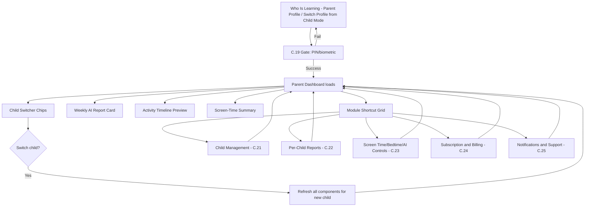
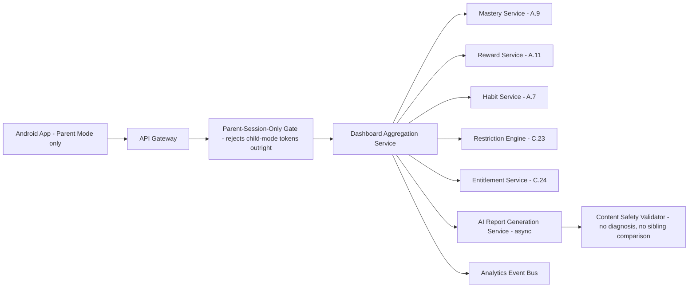
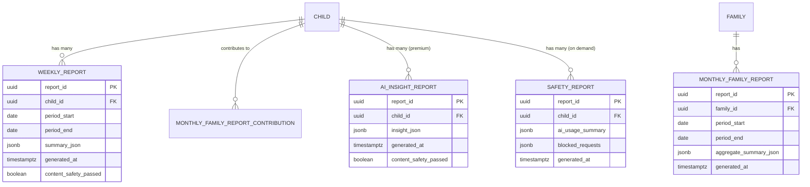

# Feature C.20 — Parent Dashboard

**App:** NoorHeroes — Islamic Learning App for Children
**Feature Owner:** Product / Parent Trust / Platform
**Status:** Implementation-ready
**Version:** 1.0
**Depends on:** C.19 (Parent PIN/Biometric Gate — entry gating), A.9/A.11 (Mastery/Reward data sources), A.7 (Habit data source), B.15 (Downloads — entitlement cross-reference)
**Feeds into:** C.21 Multi-Child Management, C.22 Parent Progress Reports (Per-Child Reports), C.23 Parental Controls, C.24 Subscription & Billing, C.25 Parent Notifications & Support

> **Scope note:** This document specifies the **Parent Dashboard landing screen** — the home base for Parent Mode reached only via C.19's gate. The deep Per-Child Report, Child Management list, Screen-Time/Bedtime settings, AI Controls/History, Subscription management, and Notifications/Support are each owned by their own dedicated documents (C.21–C.25) and are referenced here only as the Dashboard's module-shortcut destinations. This document owns: the Dashboard's own data aggregation (child selector, weekly AI report card, activity timeline preview, screen-time summary), the strict mobile-app-only visibility rule, and the cross-child "compare family trends without ranking siblings" principle as it applies at this specific landing surface.

---

## Table of Contents

1. [Product Requirements](#1-product-requirements)
2. [UX/UI Requirements](#2-uxui-requirements)
3. [Backend Requirements](#3-backend-requirements)
4. [Database Design](#4-database-design)
5. [Backend AI Code-Generation Prompt](#5-backend-ai-code-generation-prompt)
6. [Android Requirements](#6-android-requirements)
7. [Android AI Code-Generation Prompt](#7-android-ai-code-generation-prompt)
8. [Admin Requirements](#8-admin-requirements)
9. [Admin AI Code-Generation Prompt](#9-admin-ai-code-generation-prompt)
10. [DevOps Requirements](#10-devops-requirements)
11. [Analytics Requirements](#11-analytics-requirements)
12. [Security Requirements](#12-security-requirements)
13. [QA Requirements](#13-qa-requirements)
14. [Marketing Requirements](#14-marketing-requirements)
15. [Release & Rollback Plan](#15-release--rollback-plan)

---

## 1. Product Requirements

### 1.1 Problem Statement

Parents need one calm, jargon-free home base showing how each of their children is progressing and a quick path to every settings module, without wading through technical language or alarming framing, and with an absolute guarantee that this view exists only behind verified Parent Mode in the mobile app — never reachable from a child session, and never available on the web portal at all (source: Consolidated Blueprint §6.7: "As a parent, I want one place to see how each of my children is progressing and to adjust their settings, without wading through technical jargon or alarming language"; "Visibility Rule: The Parent Progress Dashboard exists only in the Mobile App and is hidden in every child profile session... Parent dashboard APIs reject any child-mode token outright").

### 1.2 Business Goals

- Make the Dashboard the trust-reinforcing centerpiece of the platform's "Trust-Led Monetization" strategy — parents subscribe when they feel the app is safer, more authentic, and more useful than generic entertainment.
- Drive weekly parent engagement via the AI Weekly Report card, a high-conversion module parents pay for "clarity and reassurance."
- Provide one consistent, calm entry point to every other Parent Area module, reducing navigation confusion across Child Management, Reports, Subscription, Settings, Notifications, and Support.
- Maintain the platform's no-sibling-ranking guarantee at this specific, highest-visibility parent touchpoint.

### 1.3 User Goals

- **Parent:** See a calm summary of how each child is doing this week, switch between children easily, glance at healthy-usage/screen-time status, and reach any settings module quickly — all without alarming language or technical jargon.

### 1.4 Success Metrics

| Metric | Target |
|---|---|
| Weekly Dashboard view rate (among parents with ≥1 active child) | ≥ 60% |
| Weekly AI Report card view-through rate | ≥ 50% |
| Module-shortcut click-through rate (any module) | ≥ 40% per session |
| Child-switcher usage rate (multi-child families) | ≥ 70% |
| Dashboard load time (cached) | p95 < 600ms |
| Cross-sibling ranking incidents on this screen | 0 (hard, zero-tolerance) |
| Crash-free Dashboard sessions | ≥ 99.6% |

### 1.5 Stakeholders

Product Manager, Parent Trust/UX Lead, Backend Architect (Aggregation Service), Android Architect, Data Analyst, Security Engineer, QA Lead, Customer Support Lead, feature owners of C.21/C.22/C.23/C.24/C.25 (module-shortcut destinations).

### 1.6 User Stories

1. As a parent, I want to see, at a glance, how each of my children did this week.
2. As a parent, I want to quickly switch between my children's summaries without navigating away and back.
3. As a parent, I want a preview of recent activity (stories, habits, lessons, rewards) without opening a full report.
4. As a parent, I want to see healthy-usage/screen-time status without digging into a separate settings page.
5. As a parent, I want one place that links to every other parent module — reports, settings, subscription, support.
6. As a parent, I want to compare overall family trends without ever seeing my children ranked against each other.
7. As a parent, I want confidence this dashboard is only ever reachable after I've verified who I am, and never visible from my child's own session.

### 1.7 Functional Requirements

**FR-1** Dashboard components: child switcher chips, weekly AI report card, activity timeline preview, screen-time summary, module shortcut grid (source: NoorHeroes Blueprint screen catalog "Parent Dashboard — Components").
**FR-2** Dashboard actions: switch child context, open any module (Reports, Settings, Subscription, Support), compare family trends (source: screen catalog "Actions").
**FR-3** Entry points: Who Is Learning (Parent Profile selection), bottom-tab "Profile → Parent Mode" from inside Child Mode — both routing through C.19's gate (source: screen catalog "Entry Points").
**FR-4** Exit points: Child Management, Reports, Subscription, Settings, Notifications, Support (source: screen catalog "Exit Points").
**FR-5** **Never ranks siblings against each other; re-entry always requires the PIN/biometric gate unless within the short grace window** (source: screen catalog "Navigation Rules" — restated as this screen's two defining trust rules, the latter being C.19's grace-window mechanic applied here).
**FR-6** **The Parent Progress Dashboard exists only in the Mobile App and is hidden in every child profile session. It becomes visible only when the Parent Profile is selected and verified; Parent dashboard APIs reject any child-mode token outright** (source §6.7 Visibility Rule — a hard, zero-exception architectural rule enforced at the API layer, not merely client-side route-hiding).
**FR-7** Dashboard contents (canonical, source §6.7 "Dashboard Contents"): child selector; milestones completed; course/lesson/Quran/story/quiz/habit/streak progress; badges and achievements; weekly/monthly report summaries; healthy-usage and screen-time status; AI recommendation reasons and safe (redacted) AI interaction history; notification and bedtime settings; child enable/disable controls; subscription and plan capacity.
**FR-8** Weekly Report types and cadence (canonical, source §6.7 "Detailed Workflow"): Weekly child report (stories completed, Quran progress, duas learned, habit streaks, quiz scores, recommended next step) — weekly; Monthly family report (cross-child progress summary, family streaks, content favorites, learning consistency) — monthly; AI insight report (strengths, weak areas, suggested next stories/duas/Quran practice, healthy-usage notes) — premium, weekly; Safety report (AI usage history, blocked requests, content flags, profile-setting changes) — on demand.
**FR-9** **Dashboard content always labels data freshness; uses trend language and recommendations, never judgmental grades** (source §6.7 Validation Rules).
**FR-10** **Subscription/plan-limit messaging appears only on parent surfaces — never inside child mode** (source §6.7 Validation Rules — restated as this screen's explicit permission to show such messaging, in deliberate contrast to A.2 Home's hard prohibition on it).
**FR-11** **Report generation delayed → dashboard shows the last successfully generated report with an explicit "as of" timestamp rather than a blank or broken state** (source §6.7 Error Handling).
**FR-12** **The web portal explicitly excludes the Parent Progress Dashboard** — attempting to access it from the web portal is blocked by design, not merely unimplemented (source §6.7 Failure Scenario; cross-ref the platform's Parent Web Account Portal scope, which is account/security/billing/consent only).
**FR-13** **AI-generated parent insights must never diagnose developmental, behavioral, or religious conditions; must never compare siblings; must never present uncertain conclusions as settled facts** (source §6.7 Business Rules — a hard rule governing every AI-derived content surfaced anywhere on this Dashboard or its linked reports).
**FR-14** The module shortcut grid routes to: Child Management (C.21), Per-Child Reports (C.22), Screen Time & Bedtime / AI Controls (C.23), Subscription & Billing (C.24), Notifications (Parent) & Support (C.25) — this Dashboard does not duplicate any of those modules' own content, only links to them with a brief preview where specified (FR-1's preview components).
**FR-15** "Compare family trends" (FR-2) is satisfied via **aggregate-only or single-child-at-a-time views** — consistent with the structural no-sibling-comparison pattern already established platform-wide (A.7/A.11) — never a simultaneous side-by-side per-child comparison table or chart on this screen.

### 1.8 Non-Functional Requirements

- **Visibility Enforcement:** FR-6's mobile-app-only, Parent-Profile-only visibility rule is enforced at the API layer (rejecting any child-mode token), not merely via client-side route guarding — a P0 architectural requirement.
- **Performance:** Dashboard load p95 < 600ms from cache; weekly report data may be eventually-consistent (generated asynchronously) but must always show a clearly-labeled last-known-good state rather than blocking the whole screen.
- **Tone:** All copy across every Dashboard component uses calm, trend-oriented, non-judgmental language — enforced as a content-governance standard, not just a style guideline.
- **Re-gating:** Every Dashboard session re-entry honors C.19's grace-window rules exactly, introducing no parallel/weaker gating logic of its own.

### 1.9 Acceptance Criteria

- Given a parent successfully passes the C.19 gate, when the Dashboard loads, then it shows the child switcher, weekly AI report card, activity timeline preview, screen-time summary, and module shortcut grid for the currently-selected child.
- Given a parent switches the child-switcher chip to a different child, when the switch completes, then all Dashboard components update to reflect that child's own data only.
- Given a request is made to any Dashboard API using a child-mode session token, when the server processes it, then the request is rejected outright, regardless of which child or family it belongs to.
- Given a parent has multiple children, when they view any "family trend" comparison on this Dashboard, then it is presented as an aggregate or single-child view, never a side-by-side sibling ranking.
- Given the weekly report generation is delayed, when the parent opens the Dashboard, then the last successfully generated report is shown with an explicit "as of [date]" timestamp, never a blank or broken card.
- Given a parent attempts to reach this Dashboard via the web portal, when they try, then access is blocked by design — the web portal has no route to this surface at all.
- Given any AI-generated insight appears on this Dashboard, when reviewed, then it contains no developmental/behavioral/religious diagnosis, no sibling comparison, and no presentation of uncertain conclusions as settled fact.

### 1.10 Edge Cases

1. A parent has zero children with any activity yet (e.g., immediately post-onboarding) → the Dashboard renders with an explicit "no activity yet" empty state for the relevant components (timeline, weekly report) rather than blank/broken cards, consistent with the platform-wide explicit-empty-state philosophy.
2. A parent's only child profile is disabled (cross-ref C.21) → the Dashboard's child switcher still allows selecting that disabled child for **read-only** viewing purposes (consistent with C.21's "disabled profiles retain data and remain visible" rule), but no live/active-session actions are offered for it from here.
3. A parent has a free-tier plan with only 1 active child slot, but the family previously had more children before a downgrade (cross-ref C.24's "excess profiles become read-only archives, never silently deleted" rule) → the child switcher includes these archived profiles in a clearly-distinguished, read-only-labeled state, not mixed in indistinguishably with active children.
4. Analytics/report data for a specific child is delayed beyond the normal generation window (e.g., a backend processing delay) → the affected card shows the explicit delayed-state messaging (FR-11) rather than other Dashboard components being blocked waiting on it — each component degrades independently.
5. A parent's premium subscription (which gates the AI Insight Report specifically, per FR-8) expires or downgrades while they're viewing the Dashboard → the AI Insight Report component reflects the new entitlement state on next load (showing an upsell/locked state appropriately, since this is a parent surface where such messaging is explicitly permitted per FR-10), without crashing or showing stale premium content past expiry.
6. Two parents (co-guardians) on different devices view the Dashboard for the same family simultaneously → each sees their own independently-rendered Dashboard (per their own device's session/grace-window state per C.19), with no shared "currently viewing" lock or conflict — this is a read-mostly screen, not a collaborative-editing surface requiring such coordination.
7. A parent taps a module shortcut (e.g., Child Management) and then uses the back button to return to the Dashboard → the Dashboard re-renders from cache instantly rather than re-fetching everything from scratch, with a background refresh if the cache is stale, consistent with the platform's general cache-then-refresh pattern.
8. A request reaches a Dashboard API with a parent-session token that has technically expired or been revoked (e.g., the parent logged out on another device) → rejected with a standard re-authentication flow, not confused with the child-mode-token-rejection rule (FR-6), which is a distinct, additional check beyond ordinary session validity.
9. A family's weekly report contains AI-generated content that, due to a model error, drifts toward language resembling a developmental/behavioral observation about a specific child → this must be caught by the content-safety validation pipeline (mirroring the platform's established pattern for AI-generated content elsewhere) before ever reaching the Dashboard, never relying on the parent to simply not notice or not mind.

### 1.11 Error Handling

| Scenario | System Behavior |
|---|---|
| Weekly/monthly report generation delayed | Last successfully generated report shown with explicit "as of [date]" timestamp (FR-11) |
| Child-mode token used on any Dashboard API | Outright rejection, regardless of family/child ownership (FR-6) |
| Web portal access attempt | Blocked by design — no route exists (FR-12) |
| Individual component data fetch failure (e.g., activity timeline) | That specific component shows a graceful "may be unavailable right now" state; other components unaffected |
| AI-generated content failing content-safety validation | Suppressed/excluded from display rather than shown unfiltered (Edge Case 9) |

### 1.12 Empty States
- Zero activity yet for the selected child → explicit "Once [Child] starts learning, you'll see their progress here" framing across the relevant components, never a blank/broken-looking chart.

### 1.13 Loading States
- Dashboard: skeleton shimmer for each component independently (child switcher chips load fast/first; weekly report and timeline may resolve slightly later without blocking the rest of the screen).

### 1.14 Offline States
- Dashboard renders from last-cached data when offline, with a clear "may be outdated" indicator; module shortcuts requiring connectivity show this clearly on tap rather than navigating into a broken destination screen.

### 1.15 Permission States
- No new runtime permissions; this screen is purely a data-aggregation/navigation surface.

### 1.16 User Flow (Narrative)

Parent selects Parent Profile from Who Is Learning (or taps "Profile → Parent Mode" from inside Child Mode) → passes C.19's gate → Dashboard loads with the currently-default (or last-viewed) child selected → parent reviews the weekly AI report card, activity timeline preview, and screen-time summary → optionally switches to a different child via the switcher chips, refreshing all components for that child → taps a module shortcut to drill into Child Management, Reports, Settings, Subscription, or Support → returns to the Dashboard via back navigation, which re-renders instantly from cache.

### 1.17 Detailed Flow Diagram (Mermaid)



### 1.18 Screen Inventory (Complete — Zero Missing)

| # | Screen / Component | Type | Entry Points | Exit Points |
|---|---|---|---|---|
| 1 | Parent Dashboard (landing) | Primary | C.19 gate success (Parent Profile or Switch Profile) | Child Management, Per-Child Reports, Screen Time/AI Controls, Subscription, Notifications/Support |
| 2 | Child Switcher Chips | Component | Parent Dashboard | Refreshes Dashboard for selected child |
| 3 | Weekly AI Report Card (preview) | Component | Parent Dashboard | Full Per-Child Report (C.22) |
| 4 | Activity Timeline Preview | Component | Parent Dashboard | Full Activity Timeline (within C.22) |
| 5 | Screen-Time Summary (preview) | Component | Parent Dashboard | Full Screen Time & Bedtime Settings (C.23) |
| 6 | Module Shortcut Grid | Component | Parent Dashboard | Each respective module (C.21-C.25) |
| 7 | Report-Delayed State (component variant) | Component variant | Weekly/Monthly report generation delay | N/A (shows last-known report) |
| 8 | Archived/Disabled Child Read-Only Selector State | Component variant | Child Switcher, archived/disabled child selected | Read-only view of that child's historical data |
| 9 | Empty State — Zero Activity Yet | Screen variant | New family/child, no activity | N/A |
| 10 | Offline Dashboard State | Screen variant | No connectivity | Cached data shown, module shortcuts requiring connectivity indicate this on tap |
| 11 | AI Insight Report Locked/Upsell State (premium-gated component) | Component variant | Non-premium plan viewing the AI Insight Report card | Subscription & Billing (C.24) |

### 1.19 Events (Complete Analytics Event List)

`parent_dashboard_viewed`, `dashboard_child_switched`, `weekly_report_card_viewed`, `weekly_report_card_tapped`, `activity_timeline_preview_viewed`, `activity_timeline_item_tapped`, `screen_time_summary_viewed`, `module_shortcut_tapped` (with `module: child_management|reports|settings|subscription|support`), `dashboard_report_delayed_state_shown`, `dashboard_offline_state_shown`, `ai_insight_locked_state_shown`, `dashboard_child_mode_token_rejected` (internal/security signal).

---

## 2. UX/UI Requirements

> Global Design System tokens defined in **Feature A.1 §2.1**; Parent-Mode formal visual register established in **Feature C.19 §2.1**; no-sibling-comparison structural design principle established in **Features A.7/A.11 §2.1**.

### 2.1 Dashboard-Specific Design System Extensions

- **Calm, Trend-Oriented Visual Language:** Charts and summaries use gentle upward/downward trend-line styling rather than stark pass/fail or letter-grade visuals — consistent with FR-9's "trend language and recommendations, never judgmental grades" requirement, expressed visually as well as textually.
- **Module Shortcut Grid:** A clean icon-plus-label grid (consistent with the platform's general grid pattern, e.g., A.10's Games Hub) but in the more formal Parent Mode visual register established in C.19.
- **Data-Freshness Labeling:** Every data-driven component carries a small, consistently-placed "as of [date/time]" label, never silently presenting stale data as current.

### 2.2 Screen-Level Design Requirements (Key Screens)

#### Screen: Parent Dashboard (Landing)

- **Purpose:** A calm, scannable home base for everything Parent Mode.
- **Components:** Child switcher chip row (avatar + name per child, including archived/disabled in a visually distinguished style), Weekly AI Report card (headline insight + "View full report" link), Activity Timeline preview (last 3-5 items, chronological), Screen-Time Summary (healthy-usage score/status), Module Shortcut Grid (5 icons: Child Management, Reports, Settings, Subscription, Support).
- **States:** Default, Loading (per-component skeleton), Report-delayed (per component), Empty (zero activity), Offline (cached), AI-Insight-locked (premium upsell, parent-surface-appropriate).
- **Accessibility:** Each component independently labeled and screen-reader-navigable; trend charts have a text-equivalent summary, not relying on visual-only interpretation.
- **Responsive Rules:** Single-column stacked on mobile; tablet may show a 2-column layout (e.g., Weekly Report + Timeline side-by-side, Screen-Time + Module Grid below).

### 2.3 Tab Structure

The Parent Dashboard is the landing destination of Parent Mode, not itself a tab within a further sub-navigation (Parent Mode's own internal navigation to C.21-C.25 is via the module shortcut grid plus standard back navigation). Click mapping:

| Click Target | Destination | API Called | Analytics Event | Permission Check | Error Handling |
|---|---|---|---|---|---|
| Child switcher chip | Refreshes Dashboard for that child | `GET /v1/parent/dashboard?child_id=` | `dashboard_child_switched` | Family-ownership check | Cached fallback |
| Weekly Report card | Full Per-Child Report (C.22) | N/A (navigation) | `weekly_report_card_tapped` | Standard C.22 checks | Standard C.22 handling |
| Activity Timeline item | Relevant detail (within C.22) | N/A (navigation) | `activity_timeline_item_tapped` | Standard checks | Standard handling |
| Screen-Time Summary | Full Screen Time & Bedtime Settings (C.23) | N/A (navigation) | `module_shortcut_tapped` (screen_time) | Standard C.23 checks | Standard handling |
| Module Shortcut Grid icon | Respective module | N/A (navigation) | `module_shortcut_tapped` | Standard per-module checks | Standard per-module handling |

### 2.4 Wireframe Description (Composite)

A single, vertically-scrolling, card-based dashboard — consistent with the platform's general "card dashboard" pattern already established in A.2 (Home) and A.11 (Rewards Wallet), but rendered in the more formal Parent Mode visual register, with the child switcher pinned near the top as the primary context-setting control for everything below it.

### 2.5 Screen Image Generation Prompts

**Screen: Parent Dashboard**
- *Prompt 1 (English):* "Mobile app parent dashboard screen UI mockup for a family learning app, in a slightly more formal/professional visual register than a typical playful kids app screen. Warm off-white background. Near the top, a horizontal row of small rounded child-avatar chips with names, one highlighted as selected. Below, a card labeled 'Weekly Report' with a small trend-line graphic and a short calm summary sentence, plus a 'View full report' link. Below that, a card labeled 'This Week' showing 3-4 small chronological activity rows with simple icons (story watched, habit checked, badge earned). Below that, a card labeled 'Screen Time' with a simple horizontal usage bar and a calm status label like 'Healthy balance this week'. At the bottom, a grid of 5 rounded icon buttons labeled 'Children', 'Reports', 'Settings', 'Subscription', 'Support'. Clean, trustworthy, calm aesthetic, soft shadows, rounded corners, warm teal and gold accents used sparingly, no realistic human faces."
- *Prompt 2 (Arabic RTL):* "نفس شاشة لوحة تحكم الوالدين لتطبيق تعليم عائلي، بطابع بصري أكثر رسمية ومهنية قليلاً من شاشة تطبيق أطفال نموذجية، بتخطيط من اليمين إلى اليسار بالكامل. خلفية بيج فاتح دافئ. قرب الأعلى صف أفقي من رقاقات صور رمزية صغيرة مستديرة للأطفال مع أسمائهم، واحدة مميزة كمحددة. أسفل ذلك بطاقة بعنوان 'التقرير الأسبوعي' مع رسمة خط اتجاه صغيرة وجملة ملخص هادئة قصيرة، بالإضافة إلى رابط 'عرض التقرير الكامل'. أسفل ذلك بطاقة بعنوان 'هذا الأسبوع' تعرض 3-4 صفوف نشاط زمنية صغيرة بأيقونات بسيطة (قصة تمت مشاهدتها، عادة تم تسجيلها، وسام تم اكتسابه). أسفل ذلك بطاقة بعنوان 'وقت الشاشة' بشريط استخدام أفقي بسيط وتسمية حالة هادئة مثل 'توازن صحي هذا الأسبوع'. في الأسفل شبكة من 5 أزرار أيقونات مستديرة بعناوين 'الأطفال'، 'التقارير'، 'الإعدادات'، 'الاشتراك'، 'الدعم'. طابع نظيف وموثوق وهادئ، ظلال خفيفة، زوايا دائرية، لمسات فيروزية وذهبية دافئة مستخدمة بقلة، بدون وجوه بشرية واقعية."

---

## 3. Backend Requirements

### 3.1 System Design Overview

The Parent Dashboard is served by a **Dashboard Aggregation Service** that composes data from the Mastery Service (A.9), Reward Service (A.11), Habit Service (A.7), Restriction Engine (C.23), Entitlement Service (C.24), and an **AI Report Generation Service** (asynchronous weekly/monthly report production) — with a hard, API-layer enforcement that **no child-mode session token may ever successfully call any Dashboard endpoint**.

### 3.2 Architecture Diagram (Mermaid)



### 3.3 Service Breakdown

| Service | Responsibility |
|---|---|
| Parent-Session-Only Gate | Hard middleware rejecting any child-mode token on Dashboard endpoints |
| Dashboard Aggregation Service | Composes the Dashboard's read model from underlying domain services |
| AI Report Generation Service | Asynchronously produces weekly/monthly/AI-insight/safety reports |
| Content Safety Validator | Validates AI-generated report content against the no-diagnosis/no-sibling-comparison/no-false-certainty rules before it can ever be stored as a deliverable report |

### 3.4 API List

#### `GET /v1/parent/dashboard?child_id=`
- **Auth:** Bearer (**Parent session only** — middleware rejects any child-mode token before this handler even executes)
- **Response 200:** `{ "child_id": "...", "weekly_report_preview": {...}, "activity_timeline_preview": [...], "screen_time_summary": {...}, "report_as_of": "..." }`
- **Validation:** `child_id` must belong to the authenticated parent's own family — standard family-ownership check, layered on top of the parent-session-only gate.
- **Error Codes:** `403 CHILD_MODE_TOKEN_REJECTED` (a distinct, explicit error code from generic `401`/`403`, making this specific rejection reason traceable in logs/monitoring).
- **Caching:** Short-to-medium TTL; weekly-report-derived fields cached longer (since they only regenerate weekly) than activity-timeline fields.

#### `GET /v1/parent/dashboard/reports/{type}?child_id=` (type: weekly|monthly|ai_insight|safety)
- **Response 200:** Full report payload, or `{ "delayed": true, "last_known_report": {...}, "last_known_as_of": "..." }` if the current period's generation hasn't completed yet (FR-11).
- **Validation:** `ai_insight` type requires premium entitlement; returns a locked/upsell-shaped response (not an error) for non-premium accounts, since this is a parent-surface monetization touchpoint.

### 3.5 Cross-Cutting API Concerns

- **Hard child-mode-token rejection:** This is the single most important, platform-foundational guarantee at this API surface — implemented as middleware applied to every route in this service, not a per-handler check that could be forgotten on a new endpoint.
- **No sibling-comparison fields:** Consistent with A.7/A.11's structural pattern, any "family trend" aggregation field is schema-designed to be aggregate-only, never a per-child array field intended for side-by-side comparison rendering.
- **AI content governance:** Every report payload passes through the Content Safety Validator before being persisted as a deliverable report — this is a write-time gate on the Report Generation Service, not a read-time filter that could be bypassed.

---

## 4. Database Design

### 4.1 ER Diagram (Mermaid)



### 4.2 Tables, Relationships, Constraints

| Table | Key Constraints | Indexes |
|---|---|---|
| `weekly_report` | FK `child_id`; **`content_safety_passed` must be `true` before this row is eligible to be returned by `GET /v1/parent/dashboard/reports/weekly`** — enforced as an application-layer query filter, defense-in-depth alongside the write-time validator | Index `(child_id, period_end DESC)` |
| `monthly_family_report` | FK `family_id`; **`aggregate_summary_json` schema has no per-child-array field by design**, consistent with A.7/A.11's structural no-comparison pattern | Index `(family_id, period_end DESC)` |
| `ai_insight_report` | FK `child_id`; same `content_safety_passed` gating as `weekly_report` | Index `(child_id, generated_at DESC)` |
| `safety_report` | FK `child_id` | Index `(child_id, generated_at DESC)` |

### 4.3 Audit Fields
All report tables carry `generated_at`. `content_safety_passed` is itself an auditable gate-result field, supporting later investigation of any report that failed validation (and was therefore never surfaced).

### 4.4 Soft Delete Rules
N/A — reports are historical artifacts retained per the platform's standard analytics-retention policy, not subject to a delete lifecycle of their own (they age out naturally per retention rules below).

### 4.5 Retention Rules
Weekly/monthly reports retained for a rolling window sufficient for trend display (e.g., 12 months); safety reports retained per the platform's compliance-relevant retention policy given their AI-safety-audit value.

---

## 5. Backend AI Code-Generation Prompt

```
You are building the Dashboard Aggregation Service and the
Parent-Session-Only Gate for "NoorHeroes." The single most important
guarantee in this entire service: NO CHILD-MODE SESSION TOKEN MAY EVER
SUCCESSFULLY CALL ANY ENDPOINT IN THIS SERVICE, under any circumstance.

Stack: FastAPI (Python 3.12), PostgreSQL (SQLAlchemy 2.0), Redis, Kafka
consumer for async report generation.

Hard requirements:
1. Implement a middleware (applied at the router-mount level, not
   per-endpoint) that inspects the authenticated session's token type
   and immediately returns 403 CHILD_MODE_TOKEN_REJECTED for ANY request
   to this service's routes if the token represents a child-mode session
   -- this must be structurally impossible to bypass by a new endpoint
   forgetting to add its own check. Write a test that adds a NEW dummy
   route to this router WITHOUT any endpoint-specific auth code and
   confirms the middleware still rejects a child-mode token against it,
   proving the protection is structural, not per-handler.
2. Implement GET /v1/parent/dashboard with standard family-ownership
   validation on the child_id query parameter (in addition to the
   parent-session-only gate) -- write a test confirming a parent
   requesting a child_id NOT belonging to their own family is rejected,
   distinct from and in addition to the child-mode-token rejection test.
3. Implement report-delay graceful degradation: GET /v1/parent/dashboard/
   reports/{type} must return the last successfully generated report
   (with its original generated_at as the "as of" timestamp) if the
   CURRENT period's report generation has not yet completed -- never an
   error or blank response. Write a test simulating a delayed current-
   period generation and confirming the previous period's report is
   returned with the correct "as of" framing.
4. Implement the Content Safety Validator as a MANDATORY write-time gate
   on the AI Report Generation Service: before any weekly_report or
   ai_insight_report row can be inserted with content_safety_passed=true,
   run its generated content through a validator checking for (a) any
   language resembling a developmental/behavioral/religious diagnosis,
   (b) any sibling-comparison language, (c) any uncertain-conclusion-
   presented-as-fact pattern. If validation fails, store the row with
   content_safety_passed=false (for audit purposes) but NEVER serve it
   via the read API -- write a test confirming a report failing
   validation is never returned by GET /v1/parent/dashboard/reports/weekly,
   while the dashboard read API correctly falls back to the previous
   passing report instead (mirroring item 3's delay-fallback logic, since
   a failed-validation report is functionally equivalent to a not-yet-
   generated one from the parent's perspective).
5. Implement monthly_family_report with NO per-child-array field in its
   aggregate_summary_json schema -- write a structural test (mirroring
   A.7/A.11's pattern) asserting the JSON schema has no field capable of
   holding a per-child breakdown intended for comparison rendering.
6. Implement ai_insight_report access-gating: requesting this report type
   for a non-premium child returns a LOCKED-STATE response shape (not an
   error), since this is a parent-surface monetization touchpoint where
   showing upsell framing is explicitly permitted (unlike child-facing
   surfaces) -- write a test confirming the exact locked-state response
   shape for a non-premium fixture family.

Deliver: FastAPI routers, the webhook receiver, the Celery reconciliation
task, SQLAlchemy models, Alembic migrations, Pydantic schemas, and a
pytest suite covering all 6 items, with item 1 (structural child-mode-
token rejection) and item 4 (mandatory write-time content-safety gate)
treated as the two highest-priority guarantees in this entire service.
```

---

## 6. Android Requirements

### 6.1 Technical Requirements
Kotlin, Jetpack Compose, MVVM, Clean Architecture, module `:feature:parent-dashboard`, depends on `:core:auth` (C.19's gate), `:core:design-system`, `:core:network`, `:core:offline-cache`.

### 6.2 Screen Mapping
`ParentDashboardScreen` Composable; `ParentDashboardViewModel` exposes `StateFlow<DashboardUiState>` with each component (child switcher, weekly report, timeline, screen-time summary) modeled as an independently-loading/failing slice, consistent with the platform's general per-section independence pattern (A.2 §6.4).

### 6.3 Navigation Flow
Reachable only via `:core:auth's` Parent Gate success path (cross-ref C.19 §6.3); module shortcuts navigate into `:feature:child-management` (C.21), `:feature:reports` (C.22), `:feature:parental-controls` (C.23), `:feature:subscription` (C.24), `:feature:support` (C.25).

### 6.4 State Management
`ParentDashboardViewModel` derives the active `family_id`/parent session entirely from `:core:auth's` session provider (never accepting it as an external parameter, mirroring B.16's established "derive internally" pattern); switching the child-switcher chip re-fetches all components scoped to the newly-selected `child_id`.

### 6.5 API Mapping
`DashboardRepository.getDashboard(childId)` → `GET /v1/parent/dashboard?child_id=`; `DashboardRepository.getReport(type, childId)` → `GET /v1/parent/dashboard/reports/{type}?child_id=`.

### 6.6 Analytics Mapping
`ParentDashboardAnalytics` fires events per §1.19.

### 6.7 Offline Support
Dashboard renders from last-cached data (Room) when offline, with a clear staleness indicator; module shortcuts that require connectivity show this clearly on tap rather than navigating into a broken destination screen.

### 6.8 Deep Linking
`noorheroes://parent/dashboard` — reachable only through the standard Parent Gate flow even if accessed via a deep link (consistent with B.17's universal deep-link-revalidation principle: a deep link to this screen still passes through C.19's gate, never bypassing it).

### 6.9 Push Notifications
Not a notification source itself; may be the landing target for parent-facing notification types (owned by the Parent Area's own Notifications feature, C.25), always passing through the Parent Gate on open per B.17's universal deep-link revalidation rule.

### 6.10 Testing Strategy
- Unit: per-component independent loading/failure state handling; child-switcher re-fetch logic.
- UI tests: AI Insight Report locked state renders correctly for non-premium fixture accounts; report-delayed state shows the correct "as of" framing rather than a blank card.
- Integration: full Parent Gate success → Dashboard load → child-switch → module-shortcut-navigate → back-to-Dashboard-from-cache flow; confirm this screen's ViewModel/repository never accepts a `child_id` that bypasses the active parent session's own family scope (a structural test mirroring B.16's reflection-based pattern).

---

## 7. Android AI Code-Generation Prompt

```
Build the `:feature:parent-dashboard` Android module for NoorHeroes using
Kotlin, Jetpack Compose, MVVM, Clean Architecture. This screen is
reachable ONLY through `:core:auth's` Parent Gate success path.

Hard requirements:
1. ParentDashboardViewModel must model each Dashboard component (child
   switcher, weekly report, activity timeline, screen-time summary) as
   an INDEPENDENT loading/content/error state slice -- write a test
   confirming a simulated failure of the weekly-report fetch does not
   block or blank out the activity-timeline or screen-time-summary
   components, which continue to render normally from their own
   successful fetches.
2. DashboardRepository must derive the active parent/family context
   EXCLUSIVELY from `:core:auth's` session provider -- write a structural
   test (reflection-based, mirroring B.16's and C.19's established
   pattern) confirming no public method on this repository accepts an
   externally-supplied family_id parameter that could bypass the active
   session's own scope.
3. Render the AI Insight Report card's locked/upsell state distinctly
   from its loaded-content state when the active child's entitlement is
   non-premium -- write a UI test confirming the locked-state composable
   tree contains an upsell CTA linking to `:feature:subscription`, and
   that this is the ONLY context in this entire app where such an upsell
   element is permitted to render (cross-reference: this module is
   explicitly exempt from the platform-wide no-billing-content-shown-to-
   child rule, since it renders only in verified Parent Mode -- but write
   a test confirming this module is NEVER reachable via any code path
   that originates from an active child-mode session, reinforcing rather
   than contradicting that platform-wide rule).
4. Implement the report-delayed state rendering the previous period's
   report with a clearly-labeled "as of [date]" framing, never a blank
   card -- write a UI test for this exact state.
5. Implement offline caching (Room) for all Dashboard components, with a
   persistent "may be outdated" indicator when serving from cache -- write
   a test simulating airplane mode and confirming the Dashboard still
   renders fully from cache rather than blocking or erroring.

Use Hilt, Retrofit+OkHttp, Room. Follow Global Design System tokens from
`:core:design-system`, using the Parent-Mode formal visual register
established for `:core:auth's` screens in Feature C.19.
```

---

## 8. Admin Requirements

This feature introduces no admin-authored content of its own — the Dashboard is a read-mostly aggregation of data already governed by A.7/A.9/A.11's own admin tooling, plus the AI Report Generation Service's content-safety validation (which is a backend governance mechanism, not an admin-authored-content surface). The one admin-relevant addition:

- **AI Report Content-Safety Audit Log (Read-only):** Visibility into reports that failed the Content Safety Validator (`content_safety_passed = false`), supporting model-quality monitoring and editorial awareness of any systematic AI-generation issues — read-only, restricted to `trust_safety`/`ai_ops` roles.

CRUD permissions: AI Report Content-Safety Audit Log = Read-only behind `trust_safety`/`ai_ops`.

---

## 9. Admin AI Code-Generation Prompt

```
Build a single read-only admin page (React + TypeScript, existing NoorHeroes
Admin Portal shell) for the AI Report Content-Safety Audit Log.

1. AI Report Content-Safety Audit Log -- a read-only, paginated table of
   weekly_report and ai_insight_report rows where content_safety_passed
   = false, showing (masked child identifier, report type, generated_at,
   and -- if feasible without re-exposing the unsafe content itself in a
   way that defeats the purpose of having blocked it -- a brief
   validator-failure-reason tag such as "possible diagnosis language" or
   "possible sibling comparison"). This page is for MODEL-QUALITY
   MONITORING ONLY -- it has no edit, approve-anyway, or override
   capability anywhere; a report that failed validation simply stays
   blocked, permanently, with this page existing only to help
   ai_ops/trust_safety notice and investigate patterns. Restricted to
   trust_safety/ai_ops roles.

Enforce RBAC via the existing Admin Portal role context. No mutating
actions exist on this page, so no audit_log writes are needed for it.
```

---

## 10. DevOps Requirements

- **Infrastructure:** Dashboard Aggregation Service is read-heavy, moderate-traffic; the AI Report Generation Service runs as an async batch/scheduled job (weekly/monthly cadences) plus on-demand for Safety Reports.
- **CI/CD:** The structural child-mode-token-rejection test and the mandatory content-safety write-time gate test (§5 items 1 and 4) are **mandatory, non-bypassable** CI gates on any PR touching this service.
- **Monitoring/Logging/Alerting:** Alert (P0) on any production-sampling-detected instance of a child-mode token successfully reaching a Dashboard endpoint. Alert on Content Safety Validator failure-rate spikes (a model-quality signal worth investigating, even though the failure itself is safely contained). Alert on report-generation-delay rate trending up (a processing-pipeline health signal).
- **Disaster Recovery:** Report tables at standard analytics-retention tier; `safety_report` at a tier consistent with its compliance-relevant audit value.
- **Rollback Strategy:** Any deploy touching the Parent-Session-Only Gate middleware requires a staging verification (attempt a child-mode-token request against every route in this service) before promotion, given the structural-protection guarantee at stake.
- **Backup Strategy:** Standard tier for report tables.
- **Environment Setup:** Staging supports fixture multi-child families with deliberately-delayed report-generation states and deliberately-failing content-safety-validation fixtures for reliable QA of both graceful-degradation paths.

---

## 11. Analytics Requirements

### 11.1 Event Taxonomy
Full list in §1.19.

### 11.2 Funnel Analysis
`parent_dashboard_viewed` → `weekly_report_card_viewed` → `weekly_report_card_tapped` → (full report engagement, measured within C.22). Also: `parent_dashboard_viewed` → `module_shortcut_tapped` (by module) — measures which modules parents reach most often from this landing surface, informing future Dashboard layout/prioritization.

### 11.3 Dashboard Metrics
Weekly Dashboard view rate (the platform's primary parent-engagement health metric), module-shortcut click distribution, AI Insight Report locked-state-to-upgrade conversion rate (a monetization signal), report-delay frequency (a backend health signal worth keeping low).

### 11.4 Cohort & Retention
Cohort by first-Dashboard-view; correlate sustained weekly Dashboard engagement with subscription retention (testing the platform's "Trust-Led Monetization" hypothesis directly — does Dashboard engagement predict renewal).

### 11.5 Learning Metrics
None directly generated here — this screen displays, but doesn't generate, learning metrics (sourced from A.7/A.9/A.11).

---

## 12. Security Requirements

### 12.1 Threat Analysis
- **Child-mode session reaching parent-only data (this feature's single defining risk):** mitigated by the structural, router-level middleware rejection, not a per-endpoint convention.
- **Cross-family data access:** mitigated by standard family-ownership validation layered on top of the parent-session-only gate.
- **AI-generated content violating the no-diagnosis/no-sibling-comparison/no-false-certainty rules:** mitigated by the mandatory write-time Content Safety Validator gate, with failed content permanently blocked from ever being served, not merely flagged.
- **Web portal access attempt:** mitigated by the route simply not existing on that surface, per FR-12's by-design exclusion.

### 12.2 OWASP Checklist (Applied)
Broken Access Control: the structural middleware approach is the textbook defense against this exact risk class, applied at the router-mount level so it cannot be forgotten per-endpoint. Security Misconfiguration: the write-time (not read-time) content-safety gate is itself a misconfiguration-defense pattern — a failed report can never accidentally become servable later due to a caching or query-logic change, since it was never marked eligible in the first place.

### 12.3 API Security
The Parent-Session-Only Gate and family-ownership checks are this service's two most important access-control properties.

### 12.4 Mobile Security
No new sensitive data handling beyond what's already governed by the underlying domain services (A.7/A.9/A.11) this Dashboard aggregates.

### 12.5 Admin Security
The Content-Safety Audit Log is read-only with zero override capability, by design — a blocked report stays blocked permanently, with no admin path to "approve anyway."

### 12.6 Data Encryption & PII Protection
No new PII surface beyond what's already governed by the underlying domain services.

### 12.7 Child Safety Requirements
The no-diagnosis/no-sibling-comparison/no-false-certainty AI content rules (FR-13) are this feature's defining child-and-family-wellbeing commitment, given how much trust parents place in AI-generated insight about their own children.

### 12.8 Compliance Requirements
No additional regulatory surface beyond the platform baseline; the Safety Report's retention is held to compliance-relevant audit standards given its AI-safety-history role.

### 12.9 Security Checklist (Pre-Launch)
- [ ] Structural child-mode-token rejection verified across every route in this service, including a deliberately-added test-only dummy route
- [ ] Family-ownership validation verified independent of the token-type check
- [ ] Mandatory write-time content-safety gate verified (a failed report is never servable, ever)
- [ ] No-sibling-comparison structural schema test passing for `monthly_family_report`
- [ ] Web portal confirmed to have no route to this Dashboard

---

## 13. QA Requirements

### 13.1 Test Plan Summary
Coverage spans: structural child-mode-token rejection (signature test), mandatory content-safety write-time gate (signature test), graceful per-component degradation, report-delay framing, and all 9 edge cases from §1.10.

### 13.2 Test Cases — Happy Path
1. Parent passes the gate, views the Dashboard for Child A, sees all components populated correctly, switches to Child B, and all components refresh for Child B.
2. A delayed weekly report shows the previous week's report with a clear "as of" timestamp.
3. A non-premium parent sees the AI Insight Report card in its locked/upsell state, taps it, and reaches Subscription & Billing.

### 13.3 Edge Cases
All 9 items from §1.10.

### 13.4 Negative Cases
- Attempt any Dashboard API call with a child-mode session token → rejected with `403 CHILD_MODE_TOKEN_REJECTED`, including against a newly-added test-only route.
- Request a `child_id` not belonging to the authenticated parent's family → rejected.
- Simulate a report failing content-safety validation → it is never returned by the read API, with the previous passing report served instead.
- Attempt to access this Dashboard via a simulated web-portal request path → no route exists.

### 13.5 Regression Cases
Full Parent Dashboard suite re-run on every release touching the Dashboard Aggregation Service, the Parent-Session-Only Gate middleware, or the AI Report Generation Service.

### 13.6 Automation Cases
End-to-end: full gate-success → Dashboard-load → child-switch → module-navigation flow; structural child-mode-token-rejection automated test (CI-blocking, run against every route including newly-added ones); content-safety write-time-gate automated test; report-delay-graceful-degradation automated test.

---

## 14. Marketing Requirements

- **Launch Plan:** Position the Dashboard as the centerpiece of the platform's "Trust-Led Monetization" narrative — parents subscribe for clarity and reassurance, and this is where that promise is delivered weekly.
- **Push Notifications:** Indirectly relevant — a "Your weekly report is ready" notification type (owned by C.25) would deep-link here, always passing through the Parent Gate on open.
- **Release Notes:** New Dashboard modules or report types get standard release-note entries.
- **App/Play Store Description:** "A calm weekly summary of how your child is really doing — never judgmental, never comparing siblings" as a genuine, testable differentiator.
- **ASO Keywords:** "Islamic kids app parent dashboard," "kids learning progress report app," "family Islamic app parent insights."

---

## 15. Release & Rollback Plan

### 15.1 Release Plan
Phased rollout 10% → 50% → 100% over 3–5 days, with the structural child-mode-token-rejection test and the content-safety write-time gate test required to pass at each stage, given this screen's role as the highest-trust, highest-visibility parent-facing surface in the platform.

### 15.2 Rollback Plan
Rollback triggers (all P0): any confirmed instance of a child-mode session reaching this Dashboard's data, any confirmed AI-generated diagnosis/sibling-comparison/false-certainty content reaching a parent, any confirmed cross-family data access. Mechanism: standard deployment rollback; given the structural nature of the middleware protection, a regression would likely indicate a deeper routing/auth-layer issue warranting broader investigation beyond just this feature.

### 15.3 Success Metrics for Go/No-Go
Matches §1.4 targets. Go/no-go requires sign-off from Product, Parent Trust/UX Lead, Security, and Trust & Safety jointly — the AI content-safety guarantee specifically requires confirmation that the Content Safety Validator's test suite is green and that a sample of generated reports has been manually reviewed before this feature's AI-driven components go live in production.
