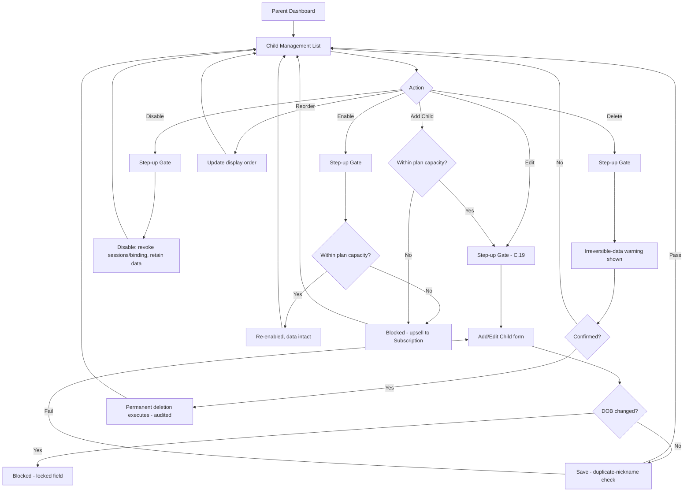
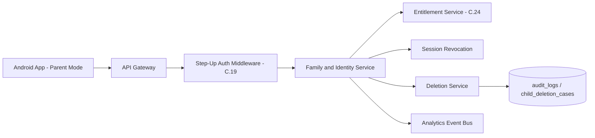
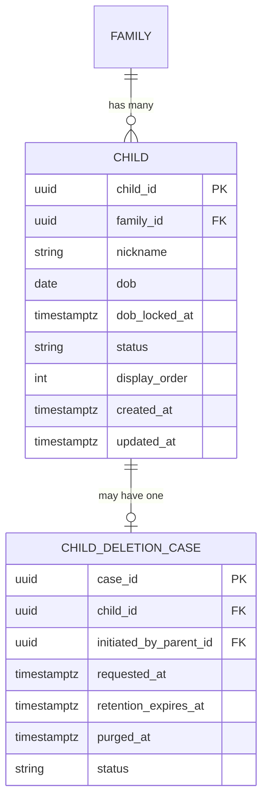

# Feature C.21 — Multi-Child Management

**App:** NoorHeroes — Islamic Learning App for Children
**Feature Owner:** Product / Parent Trust / Platform
**Status:** Implementation-ready
**Version:** 1.0
**Depends on:** C.19 (Parent PIN/Biometric Gate — step-up on every mutating action), C.20 (Parent Dashboard — entry point), A.1 (Add Child — original creation flow, reused for Add/Edit here), C.24 (Subscription & Billing — plan-capacity enforcement)
**Feeds into:** C.22 Per-Child Reports, C.23 Parental Controls (Child Locks & Sessions), C.19 (lock recovery destination)

> **Scope note:** A.1 specified the **first-time, onboarding-flow** Add Child screen. This document specifies the **ongoing family-management surface** reachable from the Parent Dashboard: the Child Management list, the reusable Add/Edit Child form as invoked from here, and the full disable/re-enable/permanent-deletion lifecycle with its step-up-authentication and legal-retention requirements. Child Locks & Sessions configuration (per-child lock type, active-device list, device revocation) is referenced here as an exit point but owned by C.23.

---

## Table of Contents

1. [Product Requirements](#1-product-requirements)
2. [UX/UI Requirements](#2-uxui-requirements)
3. [Backend Requirements](#3-backend-requirements)
4. [Database Design](#4-database-design)
5. [Backend AI Code-Generation Prompt](#5-backend-ai-code-generation-prompt)
6. [Android Requirements](#6-android-requirements)
7. [Android AI Code-Generation Prompt](#7-android-ai-code-generation-prompt)
8. [Admin Requirements](#8-admin-requirements)
9. [Admin AI Code-Generation Prompt](#9-admin-ai-code-generation-prompt)
10. [DevOps Requirements](#10-devops-requirements)
11. [Analytics Requirements](#11-analytics-requirements)
12. [Security Requirements](#12-security-requirements)
13. [QA Requirements](#13-qa-requirements)
14. [Marketing Requirements](#14-marketing-requirements)
15. [Release & Rollback Plan](#15-release--rollback-plan)

---

## 1. Product Requirements

### 1.1 Problem Statement

Parents managing multiple children on one family account need a clear, safe way to view, edit, disable, re-enable, reorder, and — when truly necessary — permanently delete each child's profile, with disabling always reversible and data-preserving, deletion always a genuinely irreversible, self-service, step-up-authenticated action with an explicit warning, and plan-capacity limits enforced fairly without ever silently destroying a downgraded family's data (source: NoorHeroes Blueprint screen catalog "Child Management — Actions: Edit profile, disable/enable, delete (PIN + irreversible-data warning), reorder... Navigation Rules: Delete is a two-step confirm; disabled profiles retain data and remain visible here as read-only"; Consolidated Blueprint §6.14: "Self-service permanent delete button in Family settings... Warning shown: 'Deleted data cannot be recovered'... No Support ticket required").

### 1.2 Business Goals

- Give parents full, trustworthy self-service control over their family's child profiles without requiring Support intervention for routine lifecycle actions, reducing support load while increasing parent confidence.
- Enforce plan-capacity limits fairly — never silently deleting data on a downgrade, always converting excess profiles to read-only archives.
- Maintain absolute clarity between **disable** (reversible, data-retained) and **delete** (irreversible, step-up-authenticated, legally-retained-then-purged) as two genuinely distinct actions.
- Ensure every mutating action on this screen passes through C.19's step-up Parent Gate, with zero shortcuts.

### 1.3 User Goals

- **Parent:** See all my children in one list, edit any child's profile details, temporarily disable a child's access without losing their progress, re-enable them later, reorder the list, and — if I really need to — permanently delete a child's profile with a clear warning and my PIN.

### 1.4 Success Metrics

| Metric | Target |
|---|---|
| Child Management view rate (multi-child families, monthly) | ≥ 50% |
| Disable→re-enable completion rate | ≥ 80% within 90 days |
| Permanent deletion completion rate | Tracked, not optimized |
| Accidental-deletion support contacts | Trending toward zero |
| Plan-capacity-downgrade data-loss incidents | 0 (hard, zero-tolerance) |
| Crash-free Child Management sessions | ≥ 99.6% |

### 1.5 Stakeholders

Product Manager, Parent Trust/UX Lead, Backend Architect (Family/Identity Service), Android Architect, Security Engineer, Legal/Compliance, Data Analyst, QA Lead, Customer Support Lead.

### 1.6 User Stories

1. As a parent, I want to see a list of all my children with their avatar, age, and current status.
2. As a parent, I want to edit any child's profile details.
3. As a parent, I want to temporarily disable a child's access without losing their progress, and re-enable them later.
4. As a parent, I want to reorder my children's list.
5. As a parent, I want to permanently delete a child's profile when truly necessary, with a clear warning and my PIN required.
6. As a parent, I want to add a new child, subject to my current plan's capacity.
7. As a parent who downgraded my plan, I want my children's data preserved as read-only archives, never silently deleted.
8. As a parent, I want every one of these actions to require my PIN.

### 1.7 Functional Requirements

**FR-1** Child Management UI sections: child list cards (avatar, age, status), a per-child action menu, and a "+ Add Child" entry point.
**FR-2** Actions: edit profile, disable/enable, delete (PIN + irreversible-data warning), reorder.
**FR-3** **Delete is a two-step confirm; disabled profiles retain data and remain visible here as read-only.**
**FR-4** **Disable (reversible):** the child cannot enter child mode while disabled; active sessions and notification bindings are revoked immediately; all progress/history/rewards are retained; the parent can re-enable at any time, subject to current plan capacity.
**FR-5** **Permanent Deletion (irreversible, self-service):** (1) parent navigates to Child Settings → Delete Child; (2) parent confirms identity via step-up authentication; (3) the app displays the warning *"Deleted data cannot be recovered. This action is permanent."*; (4) on confirmation, deletion executes immediately, subject to legal-retention rules — no Support ticket required; (5) an audited deletion record is created automatically (`child_deletion_cases` → `audit_logs`).
**FR-6** Add/Edit Child reuses the same form fields established in A.1 (nickname, DOB picker, avatar grid, language/level selectors, interest chips, daily-goal slider, AI permission toggle).
**FR-7** **DOB is immutable after first save except via Support** — a hard rule distinguishing DOB from every other editable field, given its role driving age-band content eligibility platform-wide.
**FR-8** **Visible child count is gated by subscription tier** — adding a child beyond plan capacity is blocked inline with a clear upsell path to Subscription & Billing (C.24).
**FR-9** **Duplicate nicknames within a family are rejected inline** at save time, with differentiation guidance offered as the resolution path.
**FR-10** **Trial-cancellation downgrade:** the parent selects the one child who remains active; all others are disabled (not deleted), retaining data, until plan capacity returns.
**FR-11** Every mutating action requires **step-up authentication** via C.19's Parent Gate — mutating endpoints are never reachable with only a standard parent session token.
**FR-12** Re-enabling a disabled child is itself **subject to current plan capacity** — blocked with a clear upsell path if at the limit, never a silent failure.
**FR-13** Revoking a device (C.23) force-logs-out that session immediately.

### 1.8 Non-Functional Requirements

- **Irreversibility Integrity:** Permanent deletion must be genuinely irreversible after its legal-retention window.
- **Data Preservation on Disable/Downgrade:** Never delete or corrupt underlying data — a hard, zero-tolerance guarantee.
- **Step-Up Auth Coverage:** Every mutating endpoint requires step-up authentication, server-enforced.
- **Performance:** List load p95 < 500ms; Add/Edit Child save p95 < 800ms.

### 1.9 Acceptance Criteria

- Given a parent opens Child Management, then it lists every child (active and disabled), with disabled children clearly marked and read-only.
- Given a parent disables a child, then active sessions/notification bindings are revoked immediately while data remains fully intact.
- Given a parent re-enables a child within plan capacity, then the child becomes immediately able to enter child mode with all prior data intact; at capacity, re-enable is blocked with a clear upsell path.
- Given a parent initiates permanent deletion, then they must pass step-up authentication and see the explicit warning before deletion can proceed.
- Given a parent successfully deletes a child, then no Support ticket was required, an audited deletion record was automatically created, and the deletion is irreversible subject only to the legal-retention window.
- Given a parent attempts to add a child beyond plan capacity, then the action is blocked inline with a path to Subscription & Billing.
- Given a duplicate nickname is attempted, then the save is rejected inline with differentiation guidance.
- Given a plan downgrade occurs, then the parent selects which one child remains active, and all others are disabled (never deleted).

### 1.10 Edge Cases

1. A parent attempts to edit a child's DOB after the first save → the field is read-only/locked, with an explanation that changes require Support.
2. A parent disables their only active child while another device still has that child's session active → that device's session is invalidated on its very next API call.
3. A parent initiates permanent deletion, passes step-up, sees the warning, but backs out before final confirmation → no deletion occurs; the profile is entirely unaffected.
4. A parent reorders children while one is mid-deletion-confirmation for a different child → these are independent actions, neither blocks the other.
5. A family's plan capacity decreases while more children are active than the new limit allows, before the parent completes the forced-selection step → a defined safe default applies (most-recently-active child remains enabled) rather than an undefined/inconsistent state.
6. A parent deletes a child profile with an unusual per-child entitlement tied to it → deletion proceeds per the standard flow; entitlement cascade is handled by C.24's own logic.
7. Step-up authentication expires mid-form → re-attempting to save triggers a fresh step-up prompt rather than silently failing or silently saving.
8. Two co-guardians edit the same child's profile from different devices nearly simultaneously → last-write-wins at the database layer; each UI reflects a fresh fetch before allowing a save.
9. A parent deletes the only remaining active child → allowed, with a gentle informational note (not a hard block) that the family will have zero active children.
10. A re-enabled child's notification binding is re-established the next time their profile is selected via Who Is Learning (C.19/B.17), not separately orchestrated here.

### 1.11 Error Handling

| Scenario | System Behavior |
|---|---|
| Attempt to edit DOB | Field locked/read-only with a brief explanation |
| Add Child beyond plan capacity | Inline block with upsell path |
| Duplicate nickname on save | Inline rejection with differentiation guidance |
| Re-enable beyond plan capacity | Inline block with upsell path |
| Step-up auth expires mid-form | Fresh step-up prompt on save attempt |
| Deletion flow abandoned before final confirm | No action taken; profile unaffected |

### 1.12 Empty States
- Zero children (after deleting all) → list shows only "+ Add Child" with a friendly prompt.

### 1.13 Loading States
- List: skeleton card-list shimmer. Save: button spinner, rest of form remains visible.

### 1.14 Offline States
- List renders read-only from cache; all mutating actions require connectivity, shown clearly.

### 1.15 Permission States
- No new runtime permissions; step-up handled entirely by C.19.

### 1.16 User Flow (Narrative)

Parent reaches Child Management from the Parent Dashboard → sees the full child list (active + disabled, read-only for the latter) → taps a per-child action (edit/disable/enable/delete, each step-up gated) → or taps "+ Add Child" (subject to plan capacity) → may reorder the list → exits to a Per-Child Report (C.22) or back to the Dashboard.

### 1.17 Detailed Flow Diagram (Mermaid)



### 1.18 Screen Inventory (Complete — Zero Missing)

| # | Screen / Component | Type | Entry Points | Exit Points |
|---|---|---|---|---|
| 1 | Child Management (List) | Primary | Parent Dashboard module shortcut | Add/Edit Child, Per-Child Report, Child Locks & Sessions (C.23) |
| 2 | Child List Card | Component | Child Management List | Per-child action menu |
| 3 | Per-Child Action Menu | Component/Modal | Child List Card | Edit, Disable/Enable, Delete, view Report |
| 4 | Add/Edit Child Form | Screen (shared with A.1) | "+ Add Child", per-child "Edit" | Child Management List |
| 5 | DOB Locked-Field Explanation | Component | Add/Edit Child, DOB field tap (post-first-save) | Dismiss |
| 6 | Plan-Capacity-Blocked State (Add Child) | Screen variant | Add Child attempt beyond capacity | Subscription & Billing (C.24) |
| 7 | Duplicate-Nickname Inline Rejection | Component | Add/Edit Child save attempt | Resolves via differentiation guidance |
| 8 | Disable Confirmation (step-up gated) | Screen/Modal | "Disable" action | Child Management List (now disabled) |
| 9 | Re-Enable Confirmation (step-up gated) | Screen/Modal | "Enable" action | Child Management List, or capacity-blocked state |
| 10 | Permanent Deletion — Step 1: Step-Up Gate | Screen (shared with C.19) | "Delete" action | Step 2 |
| 11 | Permanent Deletion — Step 2: Irreversible-Data Warning | Screen | Step-Up Gate success | Confirm / Cancel |
| 12 | Deletion Success Confirmation | Screen variant | Confirmed deletion | Child Management List (child removed) |
| 13 | Reorder Mode | Component/Screen variant | "Reorder" action | Saves new order |
| 14 | Disabled Child Read-Only Card State | Component variant | Child Management List | Re-Enable, view historical Report only |
| 15 | Zero-Children Empty State | Screen variant | No children | Add Child |
| 16 | Offline Child Management State | Screen variant | No connectivity | Read-only browsing |
| 17 | Trial-Cancellation Forced-Selection Screen | Screen | Plan downgrade event | Child Management List (others now disabled) |

### 1.19 Events (Complete Analytics Event List)

`child_management_viewed`, `child_edit_started`, `child_dob_edit_attempted_blocked`, `child_edit_saved`, `child_duplicate_nickname_rejected`, `child_disable_initiated`, `child_disable_completed`, `child_enable_initiated`, `child_enable_completed`, `child_enable_blocked_plan_capacity`, `child_delete_initiated`, `child_delete_warning_shown`, `child_delete_confirmed`, `child_delete_canceled`, `child_delete_completed`, `child_add_initiated`, `child_add_blocked_plan_capacity`, `child_add_completed`, `child_reorder_completed`, `trial_cancellation_forced_selection_shown`, `trial_cancellation_forced_selection_completed`.

---

## 2. UX/UI Requirements

> Global Design System tokens defined in **Feature A.1 §2.1**; Parent-Mode formal visual register established in **Feature C.19 §2.1**.

### 2.1 Child-Management-Specific Design System Extensions

- **Disabled-Profile Visual Treatment:** A clearly desaturated/greyed card style with a "Disabled" status pill — never implying the data is gone.
- **Deletion Warning Visual Treatment:** The single most serious-toned screen in the Parent Area — sober, non-decorative, using the platform's `Error` token for the irreversibility statement, while avoiding any manipulative dark-pattern friction (Cancel equally easy to find/tap as Confirm).
- **Reorder Mode:** Simple drag-handles or up/down arrow controls per row.

### 2.2 Screen-Level Design Requirements

#### Screen: Child Management (List)
- **Purpose:** A clear, trustworthy overview and control surface for every child profile.
- **Components:** Child list cards (avatar, name, age, status pill), per-card action affordance, "+ Add Child", "Reorder" entry.
- **States:** Default, Loading, Empty, Offline, Plan-capacity-at-limit.
- **Accessibility:** Status announced clearly, not relying on color alone.
- **Responsive Rules:** Single-column mobile; denser 2-column on tablet.

#### Screen: Permanent Deletion — Irreversible-Data Warning
- **Purpose:** Ensure deliberate, informed confirmation of an irreversible action.
- **Components:** Child's name/avatar restated, exact warning text, two equally-sized buttons (Cancel / Permanently Delete).
- **States:** Default, Confirming, Success.
- **Accessibility:** Warning text is the focal, screen-reader-announced content; no artificial delay/countdown before Confirm is tappable.

### 2.3 Tab Structure

| Click Target | Destination | API Called | Analytics Event | Permission Check | Error Handling |
|---|---|---|---|---|---|
| "Edit" | Step-up Gate → Add/Edit form | `PATCH /v1/family/children/{id}` | `child_edit_started` → `_saved` | Step-up auth | Inline validation |
| "Disable" | Step-up Gate → confirmation | `POST /v1/children/{id}/disable` | `child_disable_initiated` → `_completed` | Step-up auth | Standard handling |
| "Enable" | Step-up Gate → confirmation | `POST /v1/children/{id}/enable` | `child_enable_initiated` → `_completed`/`_blocked` | Step-up + capacity check | Upsell on block |
| "Delete" | Step-up Gate → Warning | `POST /v1/children/{id}/delete` | full delete funnel | Step-up auth | Two-step confirm |
| "+ Add Child" | Step-up Gate → Add form | `POST /v1/family/children` | `child_add_initiated` → `_completed`/`_blocked` | Step-up + capacity check | Upsell on block |
| "Reorder" | Reorder Mode | `PATCH` order batch | `child_reorder_completed` | Step-up auth | Standard handling |

### 2.4 Wireframe Description

Child Management List: a simple vertical card list. The Deletion Warning screen deliberately breaks from the rest of the app's playful register into a sober, single-focus confirmation screen.

### 2.5 Screen Image Generation Prompts

**Screen: Child Management (List)**
- *Prompt 1 (English):* "Mobile app child management list screen UI mockup for a family learning app, formal parent-mode visual register. Warm off-white background. A vertical list of rounded rectangular cards, each showing a small circular child avatar, name, age, and a status pill reading 'Active' (soft teal) or 'Disabled' (muted grey). Each card has a small three-dot overflow menu. At the bottom, a dashed-outline 'Add Child' card with a plus icon, and a 'Reorder' text link near the top. Clean, trustworthy, calm aesthetic, soft shadows, rounded corners, no realistic human faces on avatars."
- *Prompt 2 (Arabic RTL):* "نفس شاشة قائمة إدارة الأطفال لتطبيق تعليم عائلي، بطابع رسمي لوضع الوالدين، بتخطيط من اليمين إلى اليسار. خلفية بيج فاتح دافئ. قائمة عمودية من بطاقات مستطيلة مستديرة الزوايا، تعرض كل منها صورة رمزية دائرية صغيرة، الاسم، العمر، وشريحة حالة تقول 'نشط' (فيروزي ناعم) أو 'معطل' (رمادي خافت). كل بطاقة بها أيقونة قائمة من ثلاث نقاط. في الأسفل بطاقة بخط متقطع بعنوان 'إضافة طفل'، ورابط 'إعادة الترتيب' قرب الأعلى. طابع نظيف وموثوق وهادئ، ظلال خفيفة، زوايا دائرية، بدون وجوه بشرية واقعية."

**Screen: Permanent Deletion — Irreversible-Data Warning**
- *Prompt 1 (English):* "Mobile app serious warning confirmation screen UI mockup, deliberately sober and minimal compared to a typical playful kids-app screen. Plain white/light grey background, no decorative illustration. Centered child name and small avatar at top. Below, in bold dark-red text: 'Deleted data cannot be recovered. This action is permanent.' Below that, two equally-sized rounded buttons: neutral grey-outlined 'Cancel' and solid dark-red 'Permanently Delete', equally easy to read and tap. Minimal, serious, high-clarity layout, generous white space."
- *Prompt 2 (Arabic RTL):* "نفس شاشة تأكيد التحذير الجاد، بتخطيط من اليمين إلى اليسار، بسيطة ورسمية بشكل متعمد. خلفية بيضاء/رمادية فاتحة جدًا، بدون رسوم زخرفية. اسم الطفل وصورة رمزية صغيرة في الأعلى. أسفل ذلك، بخط عريض أحمر داكن: 'لا يمكن استرجاع البيانات المحذوفة. هذا الإجراء نهائي.' أسفل ذلك، زرّان متساويان: 'إلغاء' محدد الحواف رمادي، و'حذف نهائي' معبأ أحمر داكن، كلاهما سهل القراءة والنقر بالتساوي. تخطيط بسيط وجاد وواضح، مساحة بيضاء كبيرة."

---

## 3. Backend Requirements

### 3.1 System Design Overview

Multi-Child Management is served by the Family/Identity Service (A.1, extended), enforcing step-up authentication (C.19) on every mutating call, plan-capacity checks (C.24), and the two-phase deletion workflow.

### 3.2 Architecture Diagram (Mermaid)



### 3.3 Service Breakdown

| Service | Responsibility |
|---|---|
| Family/Identity Service (extended) | Child CRUD (excl. DOB post-lock), disable/enable, list/reorder |
| Step-Up Auth Middleware (reused, C.19) | Enforces fresh parent verification |
| Entitlement Service (reused, C.24) | Plan-capacity checks |
| Session Revocation | Invalidates active sessions/bindings on disable |
| Deletion Service | Legal retention, automatic audit case creation |

### 3.4 API List

#### `GET /v1/family/children` (extended)
- **Response 200:** All children (active + disabled), ordered per `display_order`.

#### `POST /v1/family/children` (Add Child)
- **Auth:** Bearer + step-up
- **Validation:** Plan-capacity check (`403 PLAN_CAPACITY_EXCEEDED`); duplicate-nickname check (`409 DUPLICATE_NICKNAME`); idempotent via client key.

#### `PATCH /v1/family/children/{id}` (Edit Child)
- **Auth:** Bearer + step-up
- **Validation:** Rejects DOB modification once `dob_locked_at` is set (`422 DOB_IMMUTABLE`).

#### `POST /v1/children/{id}/disable`
- **Auth:** Bearer + step-up
- **Business Logic:** Sets status='disabled'; immediately revokes active session tokens (denylist) and deactivates the device-profile binding (B.17).

#### `POST /v1/children/{id}/enable`
- **Auth:** Bearer + step-up
- **Validation:** Re-checks plan capacity.

#### `POST /v1/children/{id}/delete`
- **Auth:** Bearer + step-up + explicit `acknowledged_warning: true`
- **Business Logic:** Executes deletion subject to legal-retention rules; creates `child_deletion_cases` + `audit_logs` rows automatically.

#### `PATCH /v1/family/children/order`
- **Auth:** Bearer + step-up
- **Request:** `{ "ordered_child_ids": [...] }`

### 3.5 Cross-Cutting API Concerns

- **Step-up enforcement:** Every mutating endpoint, middleware-enforced.
- **Plan-capacity checks:** Applied consistently to both Add Child and Enable.
- **DOB immutability:** Enforced at the database/application layer, not just client-side.
- **Deletion audit trail:** Fully automatic.

---

## 4. Database Design

### 4.1 ER Diagram (Mermaid)



### 4.2 Tables, Relationships, Constraints

| Table | Key Constraints | Indexes |
|---|---|---|
| `child` | FK `family_id`; UNIQUE(`family_id`, `nickname`); CHECK `status IN ('active','disabled','deletion_pending','deleted')`; no UPDATE grant on `dob` once `dob_locked_at IS NOT NULL` | Index `(family_id, display_order)` |
| `child_deletion_case` | FK `child_id`, `initiated_by_parent_id`; append-only | Index `(child_id)` |

### 4.3 Audit Fields
`child.updated_at`; `child_deletion_case` itself is the audit record.

### 4.4 Soft Delete Rules
Disable = `status='disabled'` (reversible). Permanent deletion is a genuine hard-delete/anonymization at the end of the retention window; until then, `deletion_pending`.

### 4.5 Retention Rules
`child_deletion_case` retained indefinitely. Underlying data purged/anonymized at `retention_expires_at` per Legal/Compliance's configured duration.

---

## 5. Backend AI Code-Generation Prompt

```
You are extending the existing Family/Identity Service (A.1) for "NoorHeroes"
to support ongoing Multi-Child Management: edit, disable, enable, delete,
reorder, and plan-capacity-gated add. Every mutating endpoint requires
STEP-UP authentication (reuse C.19's middleware -- do not reimplement).

Stack: FastAPI (Python 3.12), PostgreSQL (SQLAlchemy 2.0), Redis (JWT
denylist).

Hard requirements:
1. Implement DOB immutability at the DATABASE layer (trigger or
   equivalent guard) rejecting any UPDATE to dob where dob_locked_at IS
   NOT NULL. Write a test attempting this and asserting 422 DOB_IMMUTABLE.
2. Implement POST /v1/children/{id}/disable to set status='disabled',
   add every active session token for this child to the Redis denylist,
   and deactivate the device_profile_bindings row. Write a test creating
   an active session, disabling the child, then asserting the next API
   call using that token is rejected.
3. Implement POST /v1/children/{id}/enable and POST /v1/family/children
   to BOTH check plan capacity before succeeding. Write tests for
   403 PLAN_CAPACITY_EXCEEDED with {current, limit} detail.
4. Implement POST /v1/children/{id}/delete requiring BOTH step-up AND
   acknowledged_warning: true. Write a test confirming rejection when
   this field is missing/false even with valid step-up. On success,
   create child_deletion_case + audit_logs rows IN THE SAME TRANSACTION.
5. Implement UNIQUE(family_id, nickname) at the database layer. Write a
   test for rejection at the constraint level under a race condition.
6. Implement PATCH /v1/family/children/order updating display_order for
   an ordered list in a single transaction, all-or-nothing on any
   invalid/partial list.

Deliver: FastAPI router extensions, SQLAlchemy models, Alembic migrations,
Pydantic schemas, and a pytest suite covering all 6 items, with items 1
and 2 treated as the highest-priority guarantees.
```

---

## 6. Android Requirements

### 6.1 Technical Requirements
Kotlin, Jetpack Compose, MVVM, Clean Architecture, module `:feature:child-management`, depends on `:core:auth`, `:core:design-system`, `:core:network`.

### 6.2 Screen Mapping
`ChildManagementListScreen`, `AddEditChildScreen` (shared with A.1, parameterized by entry context), `DeletionWarningScreen`.

### 6.3 Navigation Flow
Reached from `:feature:parent-dashboard`; every mutating action calls `ParentGateLauncher.requireParentAuth(...)` first.

### 6.4 State Management
`ChildManagementViewModel` derives family context internally from `:core:auth`. The DOB field renders read-only whenever the server response includes a non-null `dobLockedAt`.

### 6.5 API Mapping
Repository methods map directly to their respective endpoints; every call passes the step-up token from `ParentGateLauncher`.

### 6.6 Analytics Mapping
`ChildManagementAnalytics` fires events per §1.19.

### 6.7 Offline Support
List renders read-only from cache offline; mutating actions show "connect to make changes."

### 6.8 Deep Linking
`noorheroes://parent/children`, `noorheroes://parent/children/{id}/edit`.

### 6.9 Push Notifications
Not a notification source.

### 6.10 Testing Strategy
- Unit: DOB-locked-field rendering; reorder local-state management.
- UI tests: Deletion Warning's Cancel/Confirm buttons equal size; disabled cards show correct read-only state.
- Integration: full disable→re-enable; full deletion and cancellation; plan-capacity-blocked flows routing to Subscription.

---

## 7. Android AI Code-Generation Prompt

```
Build the `:feature:child-management` Android module for NoorHeroes (Kotlin,
Jetpack Compose, MVVM, Clean Architecture).

Hard requirements:
1. Every mutating action must call ParentGateLauncher.requireParentAuth
   BEFORE invoking its repository method -- write a test confirming no
   mutating method is callable without a preceding step-up auth call.
2. Render the DOB field read-only whenever ChildDetail.dobLockedAt is
   non-null -- write a UI test for both existing-child (locked) and
   new-child (editable) cases.
3. Build DeletionWarningScreen with the EXACT warning text and two
   equally-sized buttons (Cancel, Permanently Delete) differing only in
   semantic color -- write a UI test asserting equal measured bounds.
4. Send acknowledged_warning: true ONLY after the user taps "Permanently
   Delete" on this screen -- write a test confirming no other code path
   sends this field as true.
5. Render disabled child cards with ONLY "Enable" and "View Report"
   actions -- write a UI test confirming "Edit" is absent; document and
   implement the decision that deletion of a disabled child IS permitted
   without requiring re-enable first.
6. Implement plan-capacity-blocked states for Add Child and Enable with
   a CTA to `:feature:subscription` -- write UI tests for each.

Use Hilt, Retrofit+OkHttp, Room. Follow Global Design System tokens,
using the sober warning treatment specifically for DeletionWarningScreen.
```

---

## 8. Admin Requirements

- **Deletion Case Audit Viewer (Read-only):** Search by masked identifier, view the full `child_deletion_case` lifecycle. No override/restore capability.
- **DOB Change Support Tool:** The one legitimate path for post-lock DOB correction — requires documented reason and identity verification, fully audited.
- **Plan-Capacity Configuration:** Owned by C.24, referenced here only as the data source.

CRUD permissions: Deletion Case Audit Viewer = Read-only behind `support`/`trust_safety`; DOB Change Support Tool = narrow, audited Update-only behind `support`.

---

## 9. Admin AI Code-Generation Prompt

```
Build two additions to the NoorHeroes Admin Portal's existing Support module
(React + TypeScript).

1. Deletion Case Audit Viewer -- read-only, search-by-masked-identifier
   table of child_deletion_case rows. NO restore/override action exists
   anywhere. Restricted to support/trust_safety roles.
2. DOB Change Support Tool -- within a Support Case view, an action
   "Correct Child Date of Birth" requiring a mandatory reason field and
   identity-verification confirmation before calling a dedicated backend
   endpoint that performs the one-time correction and resets
   dob_locked_at. Every use writes a high-sensitivity audit_log entry
   (reason, agent id, old/new DOB, timestamp). Restricted to support role.

Enforce RBAC via the existing Admin Portal role context.
```

---

## 10. DevOps Requirements

- **Infrastructure:** No new dedicated infrastructure; extends the Family/Identity Service.
- **CI/CD:** DOB-immutability and immediate-session-revocation tests are mandatory, non-bypassable CI gates.
- **Monitoring/Logging/Alerting:** Alert on any DOB update post-lock via a non-Support-tool path (P0). Alert on deletion-case purge-job failures. Alert on plan-capacity-check bypass attempts.
- **Disaster Recovery:** `child_deletion_case` at a high compliance-audit tier; `child` at standard-to-high tier.
- **Rollback Strategy:** Any deploy touching deletion-execution or DOB-immutability logic require staging verification before promotion.
- **Backup Strategy:** Standard-to-high tier for `child`/`child_deletion_case`.
- **Environment Setup:** Staging supports fixture families at exact plan-capacity limits and fixture children with various `dob_locked_at` states.

---

## 11. Analytics Requirements

### 11.1 Event Taxonomy
Full list in §1.19.

### 11.2 Funnel Analysis
`child_delete_initiated` → `_warning_shown` → (`_confirmed` → `_completed`) OR `_canceled` — measures whether the warning gives parents a genuine pause point.

### 11.3 Dashboard Metrics
Disable→re-enable rate and median time-to-re-enable, deletion-cancellation rate at the warning step, plan-capacity-block frequency.

### 11.4 Cohort & Retention
Cohort by disable-event occurrence; correlate with subsequent re-engagement vs. churn.

### 11.5 Learning Metrics
None directly generated here.

---

## 12. Security Requirements

### 12.1 Threat Analysis
- **Unauthorized child-profile mutation:** mitigated by step-up auth on every mutating endpoint.
- **DOB tampering:** mitigated by database-layer write-protection, with the only bypass being the fully-audited Support tool.
- **Stale session continuation after disable:** mitigated by immediate JWT-denylist revocation.
- **Plan-capacity bypass:** mitigated by server-side-only checks.
- **Accidental/coerced deletion:** mitigated by genuine two-step confirm with no dark-pattern friction.

### 12.2 OWASP Checklist (Applied)
Broken Access Control: every mutating endpoint requires step-up auth. Security Misconfiguration: DOB-immutability trigger and UNIQUE(family_id, nickname) enforced beneath the application layer.

### 12.3 API Security
Step-up + plan-capacity + DOB-immutability + duplicate-nickname checks form this service's complete posture.

### 12.4 Mobile Security
No new sensitive data handling beyond standard child-profile data.

### 12.5 Admin Security
The DOB Change Support Tool is the only legitimate immutability bypass, heavily audited.

### 12.6 Data Encryption & PII Protection
Standard child-data handling; deletion-case records treated with compliance-audit-level care.

### 12.7 Child Safety Requirements
Data preservation on disable/downgrade and genuine non-coerced deletion confirm are this feature's defining trust commitments.

### 12.8 Compliance Requirements
The retention-then-purge workflow defers the precise duration to Legal/Compliance while specifying the enforcing mechanism.

### 12.9 Security Checklist (Pre-Launch)
- [ ] DOB immutability verified at the database layer
- [ ] Immediate session revocation on disable verified
- [ ] Plan-capacity enforcement verified on both Add Child and Enable
- [ ] Deletion requires both step-up AND explicit warning acknowledgment
- [ ] Duplicate-nickname constraint verified under concurrency

---

## 13. QA Requirements

### 13.1 Test Plan Summary
Coverage spans: DOB immutability, immediate session revocation on disable, plan-capacity enforcement, genuine two-step deletion confirm, and all 10 edge cases from §1.10.

### 13.2 Test Cases — Happy Path
1. Parent edits a child's profile; DOB field correctly locked.
2. Parent disables a child mid-session elsewhere; that session is rejected; parent later re-enables with all data intact.
3. Parent completes deletion with audit case automatically created, no Support ticket.

### 13.3 Edge Cases
All 10 items from §1.10.

### 13.4 Negative Cases
- PATCH a child's DOB post-lock → `422 DOB_IMMUTABLE`.
- Add/enable beyond plan capacity → `403 PLAN_CAPACITY_EXCEEDED`.
- Delete without `acknowledged_warning: true` → rejected even with valid step-up.
- Concurrent duplicate-nickname creation → exactly one succeeds.

### 13.5 Regression Cases
Full suite re-run on every release touching the Family/Identity Service's management endpoints, C.19's middleware, or C.24's entitlement checks.

### 13.6 Automation Cases
End-to-end disable→re-enable; deletion and cancellation flows; DOB-immutability test (CI-blocking); plan-capacity-block-and-upsell-routing test.

---

## 14. Marketing Requirements

- **Launch Plan:** Reinforces "self-service, no Support ticket needed" trust narrative.
- **Push Notifications:** Not a notification source.
- **Release Notes:** Not typically called out individually.
- **App/Play Store Description:** Indirectly supports "full control over your family's profiles, including genuine self-service deletion."
- **ASO Keywords:** None specific.

---

## 15. Release & Rollback Plan

### 15.1 Release Plan
Phased rollout 10% → 50% → 100% over 3–5 days, with DOB-immutability and immediate-session-revocation suites required to pass at every stage.

### 15.2 Rollback Plan
Rollback triggers (all P0): confirmed DOB tampering bypass, confirmed stale-session continuation after disable, confirmed plan-capacity bypass, confirmed deletion without full two-step confirm. Mechanism: standard deployment rollback.

### 15.3 Success Metrics for Go/No-Go
Matches §1.4 targets. Go/no-go reviewed by Product, Security, and Legal/Compliance jointly — the deletion mechanism's compliance correctness requires explicit Legal sign-off before going live.
